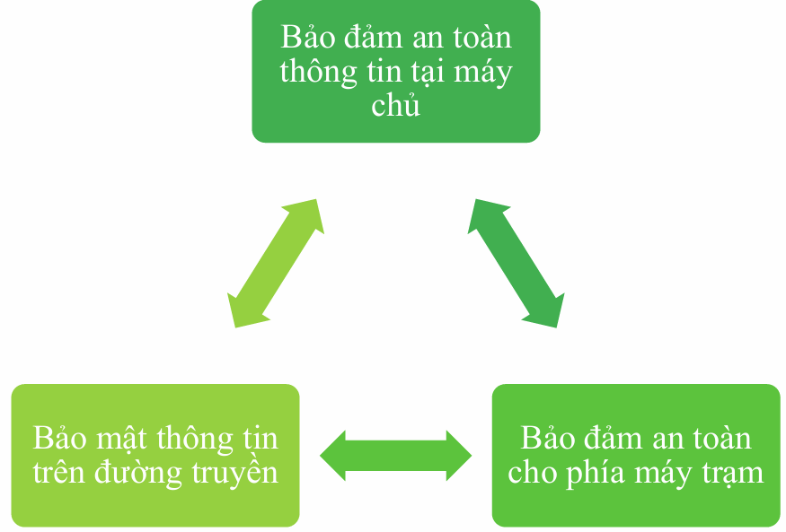
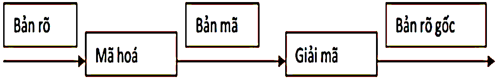
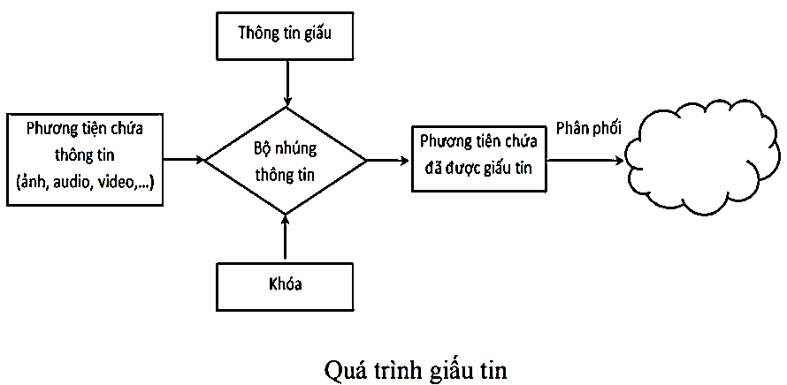
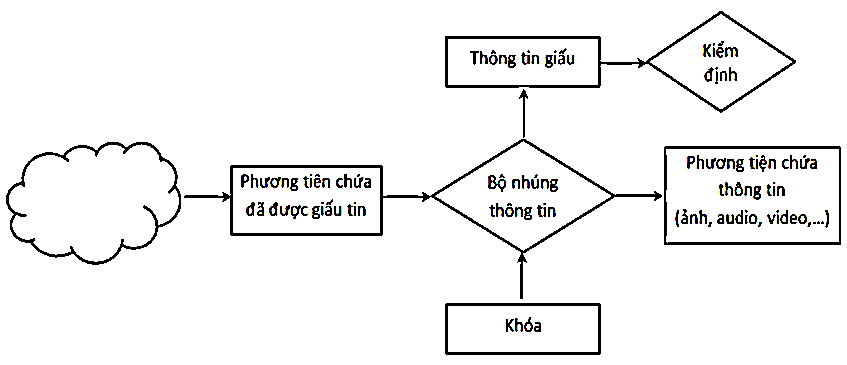

## 1.1. Các phương pháp bảo vệ thông tin

- **Bảo vệ vật lý:** áp dụng các **biện pháp của tổ chức và một tập hợp các phương tiện** can thiệp vào sự xâm nhập hoặc truy cập trái phép vào đối tượng được bảo vệ.

- **Bảo vệ thông qua tổ chức và luật pháp:** bằng các phương pháp pháp lý, giám sát và kiểm soát việc thực hiện chúng.

- **Bảo vệ bằng các thiết bị công nghệ.**

- **Phương pháp mật mã và kỹ thuật dấu tin:** mã hóa thông tin và che giấu thông tin truyền

## 1.2. Lịch sử ngắn gọn về mật mã

Được chia thành 4 giai đoạn.

- **Naive cryptography - Mật mã cổ đại:** dùng bảng chữ cái abc, số… cùng các phép toán sơ cấp (dịch chuyển hàng/cột, modulo, mã hóa vòng…) ***(mật mã Caesar và Polybius)***

<!-- -->

- **Formal cryptography - Mật mã hiện đại:** chuyển đổi về dạng nhị phân, sử dụng các phép toán logic…

- **Scientific cryptography - Mật mã khoa học:** hệ thống mật mã với sự biện minh toán học chặt chẽ về độ bền mật mã *(hệ thống mật mã đối xứng, bất đối xứng, hash function).*

- **Computer cryptography - Mật mã máy tính:** hệ thống mật mã cung cấp mã hóa tốc độ cao.

## 1.3. Hiểm họa trong an toàn thông tin

Các hiểm họa đối với hệ thống có thể được phân loại thành:

- **Hiểm họa vô tình:** Chẳng hạn quyên đăng xuất chế độ đặc quyền, về lại chế độ cho người dùng thông thường, vô tình để kẻ xấu lợi dụng, tùy ý chỉnh sửa hệ thống.

- **Hiểm họa cố ý:** như cố tình truy cập vào hệ thống một cách trái phép.

- **Hiểm họa bị động:** là hiểm họa nhưng **chưa hoặc không tác động trực tiếp lên hệ thống**, như nghe trộm các gói tin trên đường truyền.

- **Hiểm họa chủ động:** là việc **sửa đổi thông tin, thay đổi tình trạng hoặc hoạt động** của hệ thống.

**Xuất phát từ những nguyên nhân sau:**

- **Từ phía người sử dụng:** xâm nhập bất hợp pháp.

- **Trong kiến trúc hệ thống thông tin:** tổ chức hệ thống kỹ thuật không có cấu trúc hoặc không đủ mạnh để bảo vệ thông tin.

- **Ngay trong chính sách bảo mật an toàn thông tin:** không chấp hành các chuẩn an toàn, không xác định rõ các quyền trong vận hành hệ thống.

- Thông tin trong hệ thống máy tính cũng sẽ dễ bị xâm nhập nếu **không có công cụ quản lý, kiểm tra và điều khiển hệ thống.**

- Nguy cơ hay **lỗ hổng nằm ngay trong cấu trúc phần cứng**, phần mềm hệ thống và ứng dụng do hãng sản xuất cài sẵn các loại 'rệp' điện tử theo ý đồ định trước, gọi là **'bom điện tử'.**

- Nguy hiểm nhất đối với mạng máy tính là **tin tặc**.

## 1.4. Nhiệm vụ bảo đảm an toàn thông tin

<table>
<colgroup>
<col style="width: 50%" />
<col style="width: 49%" />
</colgroup>
<thead>
<tr>
<th style="text-align: center;">
Ảnh minh họa image1.png

Hình 1. Nhiệm vụ bảo đảm ATTT
</th>
<th><ul>
<li>
<strong>Trước kia,</strong> hầu như chỉ có nhu cầu bảo mật thông tin.

🡪 các phương pháp truyền thống được cung cấp bởi các cơ chế hành chính và phương tiện vật lý.
</li>
<li>
<strong>Ngày nay,</strong> máy tính đòi hỏi các phương pháp tự động hỗ trợ bảo đảm an toàn thông tin, nhiều yêu cầu mới như an ninh tại máy chủ và trên mạng

🡪 đòi hỏi phải có các phương tiện bảo vệ dữ liệu khi truyền. Trong đó có cả các phương tiện phần mềm và phần cứng.
</li>
</ul></th>
</tr>
</thead>
<tbody>
</tbody>
</table>

## 1.5. Giải pháp bảo đảm an toàn thông tin

- Bảo mật, xác thực, chống từ chối và toàn vẹn.

- Trong khi phát triển cơ chế bảo mật và thuật toán, cần phải xem xét các tấn công có thể

- Dùng các cơ chế Toán học để xây dựng các thuật toán đồng thời kết hợp với các giao thức để viết nên các chương trình xử lý.

- Cơ chế an ninh thông thường bao gồm nhiều thuật toán và giao thức, nhiều bên tham gia,

- Khi đã có các cơ chế an ninh rồi, cần phải quyết định dùng chúng ở đâu, trên giao thức nào, ở thiết bị nào và thông qua các dịch vụ gì.

## 1.6. Các yêu cầu đảm bảo an toàn thông tin

**Bảo vệ thông tin - cung cấp ba nhiệm vụ chính: (và mọi hệ thống đều tuân theo 3 yêu cầu này)**

- **Tính bí mật (Confidentiality):** chỉ người dùng có thẩm quyền mới được truy nhập thông tin.

  - Các thông tin bí mật có thể gồm: *Dữ liệu riêng của cá nhân; Các thông tin thuộc quyền sở hữu trí tuệ của các doanh nghiệp hay các cơ quan/tổ chức; Các thông tin có liên quan đến an ninh quốc gia.*

  - Tính bí mật có thể được đảm bảo bằng kênh mã hóa VPN

- **Tính toàn vẹn (Integrity):** thông tin chỉ có thể được sửa đổi bởi những người dùng có thẩm quyền. Tính toàn vẹn liên quan đến tính **hợp lệ (validity) và chính xác (accuracy)** của dữ liệu.

  - **Dữ liệu là toàn vẹn nếu:** Dữ liệu không bị thay đổi; Dữ liệu hợp lệ; Dữ liệu chính xác.

- **Tính sẵn sàng (Availability):** thông tin có thể truy nhập bởi người dùng hợp pháp bất cứ khi nào họ có yêu cầu. Tính sẵn có có thể được đo bằng các yếu tố:

  - *Thời gian cung cấp dịch vụ (Uptime);*

  - *Thời gian ngừng cung cấp dịch vụ (Downtime)*

  - *Tỷ lệ phục vụ: **A = (Uptime)/(Uptime + Downtime)***

  - *Thời gian trung bình giữa các sự cố*

  - *Thời gian trung bình ngừng để sửa chữa*

  - *Thời gian khôi phục sau sự cố*

- **Tính bí mật & Tính sẵn sàng có sự mâu thuẫn với nhau, vì thế cần cân bằng 2 tính chất này/ tập trung vào 1 tính chất, phụ thuộc vào đặc điểm của hệ thống.**

## 1.7. Các thành phần của an toàn thông tin

- **An toàn máy tính và dữ liệu:**

  - Đảm bảo an toàn hệ điều hành, ứng dụng, dịch vụ;

  - Vấn đề điều khiển truy nhập;

  - Vấn đề mã hóa và bảo mật dữ liệu;

  - Vấn đề phòng chống phần mềm độc hại;

  - Việc sao lưu tạo dự phòng dữ liệu, đảm bảo dữ liệu lưu trong máy tính không bị mất mát khi xảy ra sự cố.

- **An ninh mạng:**

  - Các tường lửa, proxy cho lọc gói tin và điều khiển truy nhập

  - Mạng riêng ảo và các kỹ thuật bảo mật thông tin truyền như SSL/TLS, PGP

  - Các kỹ thuật và hệ thống phát hiện, ngăn chặn tấn công, xâm nhập

  - Vấn đề giám sát mạng.

- **Quản lý an toàn thông tin:**

  - Quản lý rủi ro

  - Nhận dạng

  - Đánh giá

  - Thực thi quản lý an toàn thông tin

  - Lập kế hoạch (Plan)

  - Thực thi kế hoạch (Do/Implement)

  - Giám sát kết quả thực hiện (Monitor)

  - Thực hiện các kiểm soát (Control).

- **Chính sách an toàn thông tin:**

  - Chính sách an toàn ở **mức vật lý** (Physical security policy)

  - Chính sách an toàn ở **mức tổ chức** (Organizational security policy)

  - Chính sách an toàn ở **mức logic** (Logical security policy).

## 1.8. Các mối đe dọa & nguy cơ trong các vùng hạ tầng cntt

Các vùng trong hạ tầng CNTT và các mối đe dọa:

- **Vùng người dùng (User domain)**

  - Thiếu ý thức về vấn đề an ninh an toàn

  - Coi nhẹ các chính sách an ninh an toàn

  - Vi phạm chính sách an ninh an toàn

  - Đưa CD/DVD/USB với các files cá nhân vào hệ thống

  - Tải ảnh, âm nhạc, video

  - Phá hoại dữ liệu, ứng dụng và hệ thống

  - Tấn công phá hoại từ các nhân viên bất mãn

  - Nhân viên có thể tống tiền hoặc chiếm đoạt thông tin quan trọng.

- **Vùng máy trạm (Workstation domain)**

  - Truy nhập trái phép vào máy trạm

  - Truy nhập trái phép vào hệ thống, ứng dụng và dữ liệu

  - Các lỗ hổng an ninh trong hệ điều hành máy trạm

  - Các lỗ hổng an ninh trong các phần mềm ứng dụng máy trạm

  - Các hiểm họa từ virus, mã độc và các phần mềm độc hại

  - Người dùng đưa CD/DVD/USB với các files cá nhân vào hệ thống

  - Người dùng tải ảnh, âm nhạc, video.

- **Vùng mạng LAN (LAN domain)**

  - Truy nhập trái phép vào mạng LAN vật lý

  - Truy nhập trái phép vào hệ thống, ứng dụng và dữ liệu

  - Các lỗ hổng an ninh trong hệ điều hành máy chủ

  - Các lỗ hổng an ninh trong các phần mềm ứng dụng máy chủ

  - Nguy cơ từ người dùng giả mạo trong mạng WLAN

  - Tính bí mật dữ liệu trong mạng WLAN có thể bị đe dọa

  - Các hướng dẫn và chuẩn cấu hình cho máy chủ LAN chưa được tuân thủ.

- **Vùng LAN-to-WAN (LAN-to-WAN domain)**

  - Thăm dò và rà quét trái phép các cổng dịch vụ

  - Truy nhập trái phép

  - Lỗ hổng an ninh trong các bộ định tuyến, tường lửa và các thiết bị mạng khác

  - Người dụng cục bộ (trong LAN) có thể tải các file không xác định, nội dung từ các nguồn không xác định

- **Vùng WAN (WAN domain)**

  - Rủi ro từ việc dữ liệu có thể được truy nhập trong môi trường công cộng và mở

  - Hầu hết dữ liệu được truyền dưới dạng rõ (cleartext/plaintext)

  - Dễ bị nghe trộm

  - Dễ bị tấn công phá hoại

  - Dễ bị tấn công từ chối dịch vụ (DoS) và từ chối dịch vụ phân tán (DDoS)

  - Kẻ tấn công có thể tự do, dễ dàng gửi email có đính kèm virus, sâu và phần mềm độc hại.

- **Vùng truy nhập từ xa (Remote Access domain)**

  - Tấn công kiểu vét cạn (brute force) vào tên người dùng và mật khẩu

  - Tấn công vào hệ thống đăng nhập và điều khiển truy cập

  - Truy nhập trái phép vào hệ thống CNTT, ứng dụng và dữ liệu

  - Thông tin bí mật có thể bị đánh cắp từ xa

  - Rò rỉ dữ liệu do vi phạm các tiêu chuẩn phân loại dữ liệu.

- **Vùng hệ thống/ứng dụng (Systems/Applications domain)**

  - Truy nhập trái phép đến trung tâm dữ liệu, phòng máy hoặc tủ cáp

  - Khó khăn trong quản lý các máy chủ yêu cầu tính sẵn dùng cao

  - Lỗ hổng trong quản lý các phần mềm ứng dụng của hệ điều hành máy chủ

  - Các vấn đề an ninh trong các môi trường ảo của điện toán đám mây

  - Vấn đề hỏng hóc hoặc mất dữ liệu.

## 1.9. Bộ tiêu chuẩn an toàn thông tin

- ISO = International Organization for Standardization – Tổ chức tiêu chuẩn hoá quốc tế

- ISO 27001 là một tiêu chuẩn được công nhận trên toàn thế giới đối với hệ thống quản lý an toàn thông tin (ISMS).

- ISO 27001 đảm bảo rằng một công ty hoặc tổ chức phi lợi nhuận hiểu được điểm mạnh và điểm yếu của mình nằm ở đâu

- **Cấu trúc của ISO 27001:2013**

  - *Bối cảnh tổ chức*

  - *Phạm vi của tổ chức*

  - *Khả năng lãnh đạo*

  - *Lập kế hoạch*

  - *Hỗ trợ*

  - *Vận hành*

  - *Đánh giá hiệu suất*

  - *Cải tiến hệ thống*

## 1.10. Một số kỹ thuật an toàn và bảo mật thông tin

- **Mã hóa thông tin:**

  - sử dụng các kỹ thuật để **biến đổi một bản thông điệp có ý nghĩa thành một dãy mã ngẫu nhiên** để liên lạc giữa người gửi và người nhận.

  - người ngoài cuộc có thể có được sự hiện hữu của dãy mã ngẫu nhiên đó nhưng **khó có thể chuyển thành bản thông điệp ban đầu nếu không có “khóa” để giải mã** của thông điệp.

- **Mã hóa và giải mã gồm:**

  - **Bản rõ (plaintext or cleartext):** Chứa các xâu ký tự gốc, thông tin trong bản rõ là thông tin cần mã hoá để giữ bí mật.

  - **Bản mã (ciphertext):** Chứa các ký tự sau khi đã được mã hoá, mà nội dung của nó được giữ bí mật.

  - **Sự mã hoá (Encryption):** Quá trình che giấu thông tin bằng phương pháp nào đó để làm ẩn nội dung bên trong.

  - **Sự giải mã (Decryption):** Quá trình biến đổi trả lại bản mã bản thành bản rõ.

<figcaption>
Hình 2. Quy trình mã hóa &amp; giải mã
</figcaption>

- **Mật mã học (Crytography)** Là nghệ thuật và khoa học để giữ thông tin được an toàn.

<!-- -->

- **Giấu tin**

  - Là kỹ thuật nhúng một lượng thông tin số (ảnh, audio, video) vào trong một đối tượng dữ liệu số **khác**.

  - Một trong những yêu cầu cơ bản của giấu tin là ***đảm bảo tính chất ẩn của thông tin được giấu,*** đồng thời ***không làm ảnh hưởng đến chất lượng của dữ liệu gốc.***

  - Mục đích của giấu tin là làm cho thông tin đã giấu không thể nghe thấy hoặc nhìn thấy được, người ngoài cuộc ***không thể nhận thấy được sự tồn tại của thông tin đã giấu.***

  - Kỹ thuật giấu tin gồm 2 phần là **thuật toán giấu tin và thuật toán tách thông tin đã giấu** ra khỏi phương tiện mang tin đã giấu.

  - **Giấu tin khác với mật mã ở chỗ:**

    - **kỹ thuật giấu tin mật** là **tìm cách ẩn giấu thông điệp** vào một phương tiện số như hình ảnh, audio, video mà người ngoài cuộc khó có thể phát hiện được sự hiện hữu của thông điệp trong phương tiện số đó *mặc dù người ngoài cuộc có thể có nó trong tay.*

    - **trong khoa học mật mã** người ta tìm cách để biến đổi bản thông điệp có ý nghĩa thành một dãy mã ngẫu nhiên để liên lạc với nhau trên mạng công cộng mà người ngoài cuộc có thể có được sự hiện hữu của dãy mã ngẫu nhiên đó nhưng khó có thể chuyển thành bản thông điệp ban đầu nếu không có “khóa” để giải mã của thông điệp.

<figcaption>
Hình 3. Quá trình giấu tin
</figcaption>

<figcaption>
Hình 4. Quá trình tách thông tin đã giấu
</figcaption>

- **Chữ ký số**

  - **đảm bảo sự an toàn trong việc giao dịch số.**

  - **Chữ ký điện số** là **thông tin đi kèm theo dữ liệu** (văn bản, âm thanh, hình ảnh, video...) nhằm mục đích **xác định người chủ của dữ liệu đó.**

    - Chữ ký điện số là chuỗi thông tin cho phép xác định nguồn gốc, xuất xứ, thực thể đã tạo ra 1 thông điệp.

  - **Chữ ký số khóa công khai** là mô hình *sử dụng các kỹ thuật mật mã để **gắn với mỗi người sử dụng một cặp khóa công khai- bí mật***, qua đó có thể **ký các văn bản điện tử** cũng như trao đổi các thông tin mật.

  - Khóa công khai thường được phân phối thông qua **chứng thực khóa công khai**.

  - Quá trình sử dụng chữ ký số bao gồm 2 phần: **tạo chữ ký và kiểm tra chữ ký.**

  - Mỗi người cần 1 cặp khóa gồm khóa công khai và khóa bí mật. Khóa bí mật dùng để tạo chữ ký số (CKS) và khóa công khai dùng để thẩm định chữ ký số (xác thực)

    - **Thẩm định chữ ký số:** là quá trình *xác thực được người gửi, chống chối bỏ, xác thực sự toàn vẹn của thông tin.*
