## 10.1. Lược đồ chữ ký số Elgamal

- Lược đồ chữ ký số Elgamal được thiết kế dựa trên các tính chất đại số của phép lũy thừa modulo, cùng với bài toán logarit rời rạc.

- Thuật toán sử dụng một cặp **khóa chung và khóa riêng**. Khóa riêng được sử dụng để tạo chữ ký số cho tin nhắn và chữ ký đó có thể được xác minh bằng cách sử dụng khóa chung tương ứng của người ký.

- Bổ sung tính chất của phần tử sinh/căn nguyên thủy: Nếu *α* là căn nguyên thuỷ của *p* (xét trong nhóm $\mathbb{Z}_{p}^{*}$) thì:

  - Với mọi số nguyên m, $\alpha^{m} \equiv 1\left( {mod}p \right)$nếu và chỉ nếu $m \equiv 0\left( {mod}p - 1 \right)$.

  - Với mọi số nguyên $i,j$: $\alpha^{i} \equiv \alpha^{j}\left( {mod}p \right)$ nếu và chỉ nếu $i \equiv j\left( {mod}p - 1 \right)$

- **Sinh khóa:** Với 2 số nguyên tố *p* và *α*, *α* là căn nguyên thủy của *p* trong trường $G_{p}^{*}$. Alice tạo ra một cặp khóa riêng - khoá chung như sau:

  - Tạo một số nguyên ngẫu nhiên $X_{A}^{}$, sao cho 1 \< $X_{A}^{}$ \< *p* – 1.

  - Tính: $Y_{A}^{}$ = $\alpha^{X_{A}^{}}$ mod *p*.

  - **Khoá riêng** của Alice là $X_{A}^{}$.

  - **Khóa công khai** của Alice là {p, *α*, $Y_{A}^{}$}.

- **Tạo chữ ký số:**

  - Để ký tin nhắn *M*, đầu tiên tính toán hàm băm *m* = *H*(*M*), sao cho *m* ∈$\mathbb{Z}$, 0 ≤ *m* ≤ *p* - 1.

    - Thuật toán băm có thể sử dụng ***SHA-1, SHA-2, SHA-3.***

  - Chọn một số nguyên ngẫu nhiên *K* sao cho 1 \< *K* \< *p* - 1 và gcd(*K*, *p* - 1) = 1.

  - Tính:

    $$
    \begin{aligned}
    S_{1} &\equiv \alpha^{K} \pmod{p}, \\
    K K^{-1} &\equiv 1 \pmod{p-1}, \\
    S_{2} &\equiv K^{-1}\left(m-X_{A}S_{1}\right) \pmod{p-1}.
    \end{aligned}
    $$

  - Chữ ký bao gồm cặp ($S_{1}$,$S_{2}$).

- Bob có thể **xác minh chữ ký** đó có phải là chữ ký của Alice không bằng cách:

  - Tính:

    $$
    \begin{aligned}
    V_{1} &\equiv \alpha^{m} \pmod{p}, \\
    V_{2} &\equiv Y_{A}^{S_{1}}S_{1}^{S_{2}} \pmod{p}.
    \end{aligned}
    $$

  - Chữ ký hợp lệ nếu $V_{1}$=$V_{2}$. Ta chứng minh điều này như sau:

    - Giả sử $V_{1}$=$V_{2}$, tức là: $\alpha^{m}{mod}p$= $(Y_{A}^{})^{S_{1}}(S_{1})^{S_{2}}{mod}p$

    - Thay công thức tính $Y_{A}^{}$và $S_{1}$: $\alpha^{m}{mod}p$= $\alpha^{X_{A}^{}.S_{1}}.\alpha^{K.S_{2}}{mod}p$

    - Chia 2 vế cho $\alpha^{X_{A}^{}.S_{1}}$, ta được: $\alpha^{m - X_{A}^{}.S_{1}}{mod}p = \alpha^{K.S_{2}}{mod}p$

    - Vì *α* là căn nguyên thủy của *p*: $m - X_{A}^{}.S_{1} \equiv K.S_{2}\left( {mod}p - 1 \right)$

    - Thay công thức tính $S_{2}$, ta được: $m - X_{A}^{}.S_{1} \equiv K.K^{- 1}\left( m - X_{A}^{}.S_{1} \right)\left( {mod}p - 1 \right)$.

      Ta có điều phải chứng minh.

<!-- -->

- **Ví dụ:** Cho trường hữu hạn $G_{19}^{*}$ nghĩa là p = 19, và có các căn nguyên thủy {2, 3, 10, 13, 14, 15}. Ta chọn $\alpha$ = 10 ∈ tập căn nguyên thủy.

  - **Alice “Sinh khóa”:** **Alice tạo ra một cặp khóa như sau:**

    - Alice chọn $X_{A}^{}$= 16.

    - Tính $Y_{A}^{}$ = $\alpha^{X_{A}^{}}$ mod *p* = 1016 mod 19 = 4.

    - Private key của Alice là 16.

    - Public key của Alice là {*p*, *α*,$Y_{A}^{}$} = {19, 10, 4}.

  - **Alice “Mã hóa”:** Giả sử Alice muốn ký một tin nhắn có giá trị băm *m* = 14.

    - Alice chọn *K* = 5, ta có gcd(5, 18) = 1.

    - $S_{1}$ = *α k* mod *p* = 105 mod 19 = 3.

    - $K^{- 1}$mod (*p* - 1) = 5-1 mod 18 = 11.

    - $S_{2}$= $K^{- 1}$ (*m* - $X_{A}^{}$.$S_{1}$) mod (*p* - 1) = 11.(14 – 16.3) mod 18 = -374 mod 18 = 4.

  - **Bob có thể xác minh chữ ký như sau.**

    - $V_{1}$= $\alpha^{m}$ mod p = 1014 mod 19 = 16.

    - $V_{2}$ = $(Y_{A}^{})^{S_{1}}(S_{1})^{S_{2}}{mod}{}p$ = 43. 34 mod 19 = 5184 mod 19 = 16.

    - Do đó, chữ ký là hợp lệ bởi vì $V_{1}$= $V_{2}$*=* 16.

- Lược đồ chữ ký số **DSA (Digital Signature Algorithm)** và **DSS (Digital Signature Standard)** không hoàn toàn giống nhau, nhưng có mối liên hệ chặt chẽ.

  - **DSS (Digital Signature Standard)**: Là tiêu chuẩn do NIST (Viện Tiêu chuẩn và Công nghệ Quốc gia Mỹ) ban hành, quy định các phương pháp tạo và xác minh chữ ký số. DSS được thiết kế để đảm bảo tính bảo mật và xác thực trong giao tiếp số. Ban đầu, DSS chỉ sử dụng DSA làm thuật toán chính, nhưng sau này có thể bao gồm các thuật toán khác như ECDSA (Elliptic Curve Digital Signature Algorithm).

  - **DSA (Digital Signature Algorithm)**: Là một thuật toán cụ thể được quy định trong DSS, dựa trên bài toán lôgarit rời rạc. DSA sử dụng cặp khóa (khóa bí mật và khóa công khai) để tạo và xác minh chữ ký số, thường kết hợp với hàm băm như SHA.

## 10.2. Lược đồ chữ ký số Schnorr

- Dựa trên bài toán lôgarit rời rạc, được tối ưu hơn so với lược đồ ElGamal. Schnorr giảm thiểu số lượng tính toán và tạo chữ ký ngắn hơn, đồng thời vẫn đảm bảo tính bảo mật cao.

- Lược đồ dựa trên việc sử dụng module số nguyên tố *p*. Với *p* – 1 ta có thừa số nguyên tố *q* có kích thước thích hợp, sao cho *p* - 1 ≡ 0 (mod *q*). Thông thường, sử dụng *p* ≈ 21024 và *q* ≈ 2160. Do đó, *p* là số 1024-bit và *q* là số 160-bit, cũng là độ dài của giá trị băm **SHA-1**.

- **Sinh khóa:** Tạo ra một cặp khóa riêng tư / công khai, bao gồm các bước sau.

  - Chọn số nguyên tố *p* và *q*, sao cho *q* là thừa số nguyên tố của *p* – 1 (*q* là ước của *p* − 1).

  - Chọn một số nguyên *α*, sao cho ***α q* ≡ 1 (mod *p*).** Giá trị của *α*, *p*, và *q* là **khóa công khai toàn cục** (global public key), được tất cả người dùng chia sẻ trong hệ thống.

  - Chọn một số nguyên ngẫu nhiên *s* sao cho 0 \< *s* \< *q*, là **khóa riêng** của người gửi **(private key).**

  - Tính *v* = *α* -*s* mod *p*, là **khóa công khai** của người gửi **(public key)**.

- **Tạo khóa:** Người gửi có khóa riêng *s* và khóa công khai *v* tạo chữ ký cho thông điệp *M* như sau:

  - Chọn một số nguyên ngẫu nhiên *r*, sao cho 0 \< *r* \< *q*. Tính *x* = *α r* mod p.

  - Đính kèm thông điệp *M* với *x* và băm kết quả được đính kèm để tính: *e* = H(*M* ‖ *x*).

    - H là hàm băm SHA-1.

    - Kết quả *e* là giá trị băm 160-bit (phù hợp với kích thước của *q*).

  - Tính *y* = (*r* + *s.e*) mod *q*.

  - **Chữ ký bao gồm cặp (*e*, *y*).**

- **Xác minh chữ ký:** Bất kỳ người nhận nào khác cũng có thể xác minh chữ ký như sau.

  - Tính $x' = \alpha^{y}v^{e}{mod}p$.

    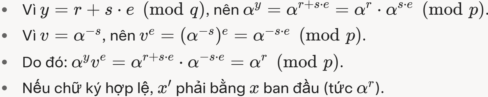

  - Tính *e'* = H(*M* \|\| *x*′).

  - So sánh *e*′ với *e* trong chữ ký.

  - Nếu *e*' = *e*, thì chữ ký hợp lệ.

- Nếu chữ ký (*e*, *y*) được tạo đúng bởi người gửi (có khóa bí mật *s*), thì quá trình xác minh sẽ thành công.

- Nếu kẻ tấn công giả mạo chữ ký mà không biết *s*, họ không thể tạo ra *y* sao cho$\alpha^{y}v^{e} = \alpha^{r}$, vì bài toán lôgarit rời rạc là khó.

- **Tại sao lược đồ chữ ký số Schnorr có thể xử lý đa chữ ký (multi-signature)**

  - Trong đa chữ ký, giả sử *n* người cùng ký vào một thông điệp M, nhưng thay vì tạo *n* chữ ký riêng lẻ, họ tạo ra một chữ ký duy nhất đại diện cho tất cả.

  - **Yêu cầu:**

    - Chữ ký tổng hợp **phải nhỏ gọn**.

    - Quá trình **xác minh chỉ cần thực hiện một lần**, nhưng vẫn đảm bảo tất cả các bên đã tham gia ký.

  - Đa chữ ký thường được dùng trong blockchain (như Bitcoin) để giảm kích thước giao dịch và tăng hiệu quả.

  - Lược đồ Schnorr có thể xử lý đa chữ ký nhờ tính **tuyến tính** trong cách tính *y*, cùng với việc sử dụng giá trị băm *e* chung: *y* = (*r* + *s.e*) mod *q*.

    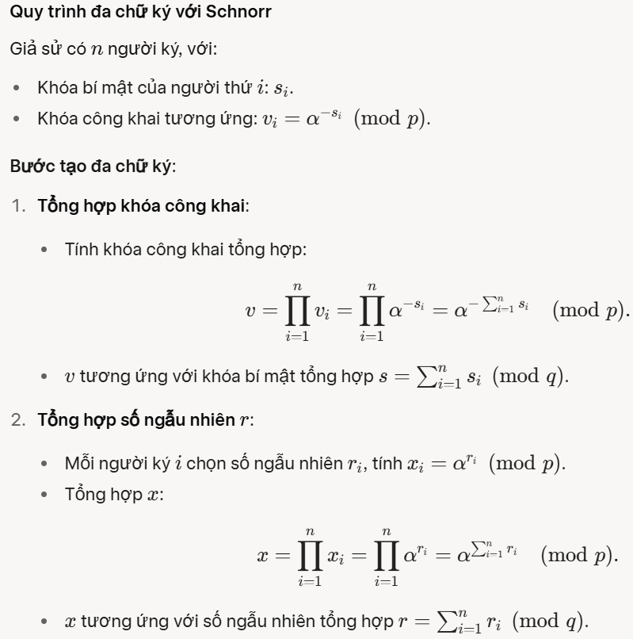

    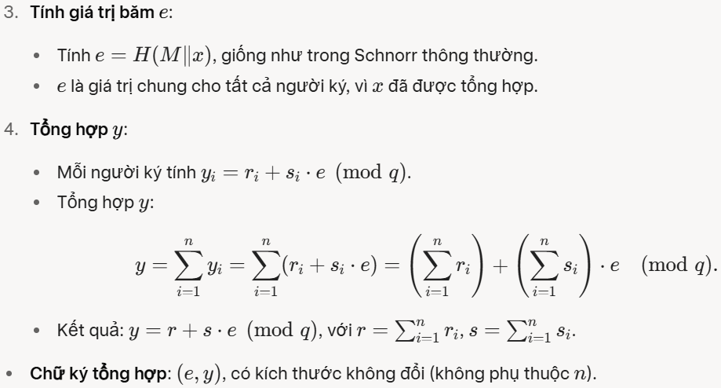

    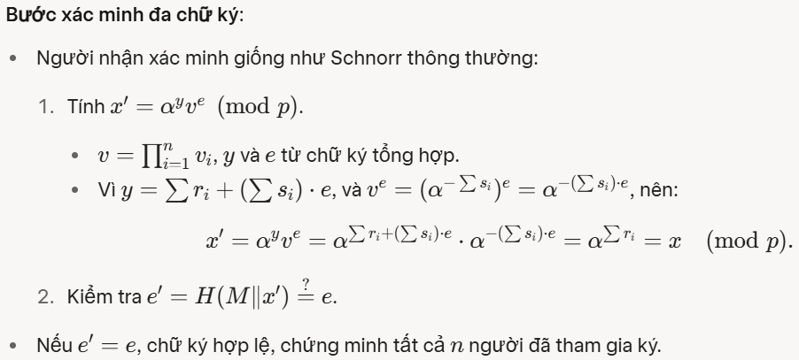

## 10.3. Lược đồ chữ ký số DSA

Mặc dù thường bị nhầm lẫn với chữ ký điện tử, chữ ký số thực chất là một loại chữ ký điện tử nâng cao, sử dụng kỹ thuật mã hóa để đảm bảo tính xác thực, tính toàn vẹn, và tính không thể chối bỏ của tài liệu.

Chữ ký số được cấp bởi các tổ chức chứng thực (CA – Certificate Authority) đáng tin cậy và đi kèm với cặp khóa mã hóa: *khóa công khai và khóa riêng*.

Vào 8/1991, Viện Tiêu chuẩn và Công nghệ Quốc gia (NIST) đã xuất bản Tiêu chuẩn Xử lý Thông tin Liên bang FIPS 186, được gọi là Thuật toán Chữ ký Số (DSA), sử dụng Thuật toán băm an toàn (SHA).

DSA cung cấp chức năng chữ ký số, không thể được sử dụng để mã hóa hoặc trao đổi khóa như RSA. Chữ ký số được tạo ra bằng cách sử dụng mã hóa bất đối xứng. DSA phù hợp cho việc ký và giải mã.

**Cách tiếp cận của RSA:**

- Thông điệp cần ký được đưa vào một hàm băm tạo ra mã băm an toàn có độ dài cố định.

- Mã băm này sau đó được mã hóa bằng khóa riêng của người gửi (*PRa*) để **tạo thành chữ ký E(PRa, H(M)).**

- **Cả tin nhắn và chữ ký** đều được truyền đi.

- Người nhận nhận tin nhắn và tạo mã băm bằng hàm băm H (cùng hàm băm mà người gửi đã dùng) để tính mã băm H(*M*).

- Người nhận cũng giải mã chữ ký bằng khóa chung (*PUa*)​ của người gửi, Kết quả là giá trị H'(*M*).

- Nếu mã băm được tính khớp với chữ ký được giải mã, tức là H′(*M*)=H(*M*), chữ ký được chấp nhận là hợp lệ.

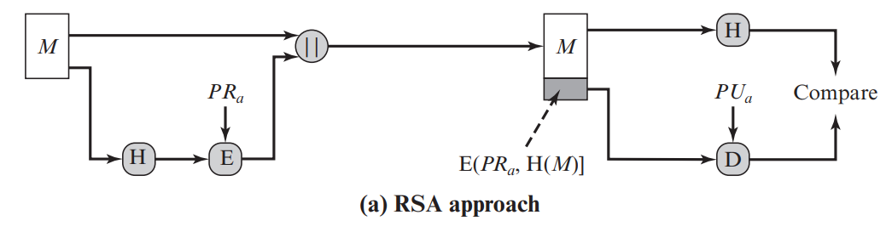
<figcaption>
Hình 76. Hướng tiếp cận RSA
</figcaption>

**Cách tiếp cận của DSA:**

- Tin nhắn được băm để tạo mã băm.

- Mã băm và số ngẫu nhiên *k* được đưa vào hàm chữ ký, kết hợp với khóa riêng của người gửi (*PRa*) và tập hợp tham số công khai toàn cầu (*PUG*).

- Kết quả là chữ ký gồm hai thành phần *r* và *s*.

- Bên nhận tạo mã băm của tin nhắn, chữ ký được nhập vào hàm xác minh, & hàm xác minh cũng phụ thuộc *PUG* và *PRa*.

- Nếu đầu ra hàm xác minh khớp với *r*, chữ ký được coi là hợp lệ.

  **\* Chỉ người biết khóa riêng (*PRa*) có thể tạo chữ ký hợp lệ.**

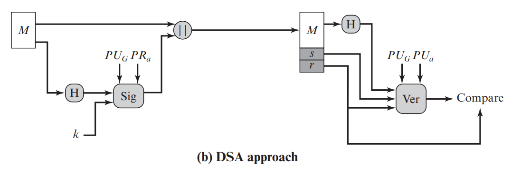
<figcaption>
Hình 77. Hướng tiếp cận DSA
</figcaption>

Thuật toán này trải qua 03 quá trình: *Sinh khóa, Tạo chữ ký, Xác thực chữ ký.*

**\* Sinh khóa:** Tạo thành phần khóa công khai toàn cầu:

- Chọn số nguyên tố *p* sao cho $2^{L - 1} < p < 2^{L}$, với $512 \leq L \leq 1024$ và *L* là bội của 64.

- Một số nguyên tố *q* được chọn, sao cho *q* là ước của $(p - 1)$, nghĩa là $(p - 1){mod}q = 0$, và $2^{N - 1} < q < 2^{N}$, thường $N = 160$ bit đối với SHA-1 (hay $N = 256$bit đối với SHA-2).

> \- Chọn số nguyên *h* bất kỳ để tính $g = h^{\frac{p - 1}{q}}{mod}p$sao cho $1 < h < p - 1$và\
> *g* \> 1.
>
> \- Khóa bí mật: Chọn số nguyên ngẫu nhiên hoặc giả ngẫu nhiên *x* sao cho $0 < x < q$.

\- Tính khóa công khai: $y = g^{x}{mod}p$.

Vậy, ta thu được: Tham số công khai *p, q, g;* Khóa riêng *x*; Khóa công khai *y*.

**\* Tạo chữ ký**

**Input**: Tin nhắn *M*, khóa bí mật *x*, các tham số công khai *p*, *q*, *g.*

Tạo một số bí mật cho mỗi tin nhắn *M*: Chọn *k* là số nguyên ngẫu nhiên hay giả ngẫu nhiên sao cho $0 < k < q$. Giá trị *k* là duy nhất cho mỗi tin nhắn & không được tái sử dụng. Nếu *k* bị lộ hoặc tái sử dụng, kẻ tấn công có thể suy ra *x*.

Tính

$$
\begin{aligned}
r &\equiv (g^{k} \bmod p) \bmod q, \\
s &\equiv k^{-1}\left(H(M)+xr\right) \pmod{q}.
\end{aligned}
$$

> với *H(M)* là giá trị băm của tin nhắn *M* sử dụng SHA-1.

Nếu $r = 0$hoặc $s = 0$ thì phải chọn lại *k* để tạo chữ ký.

**Output:** Signature = (*r, s*).

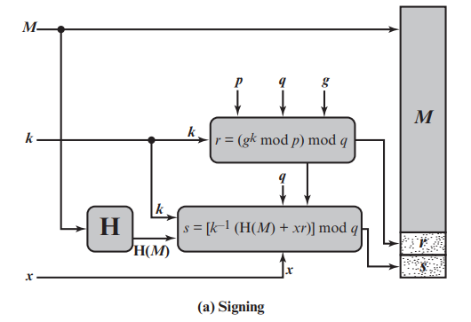
<figcaption>
Hình 78. Tạo chữ ký'
</figcaption>

**\* Xác thực chữ ký**

Gọi $M',r',s'$lần lượt là các phiên bản người nhận nhận được khi người gửi gửi $M,r,s$.

**Input**: Tin nhắn *M*', chữ ký (*r*', *s*'), khóa công khai *y*, các tham số công khai *p*, *q*, *g*.

Tính các giá trị:

$$
\begin{aligned}
w &\equiv (s')^{-1} \pmod{q}, \\
u_{1} &\equiv H(M')w \pmod{q}, \\
u_{2} &\equiv r'w \pmod{q}, \\
v &\equiv (g^{u_{1}}y^{u_{2}} \bmod p) \bmod q.
\end{aligned}
$$

Nếu $v = r'$thì chữ ký là hợp lệ. Ngược lại, chữ ký không hợp lệ.

**Output**: *True* (1) hoặc *False* (0).

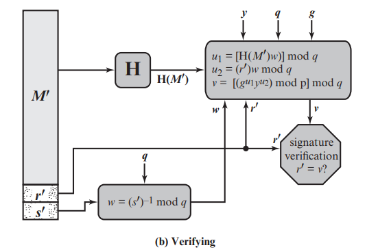
<figcaption>
Hình 79. Xác thực chữ ký
</figcaption>

***\**** ***Sự đúng đắn của giải thuật***

Ta có $v = \left\lbrack \left( g^{u_{1}}y^{u_{2}} \right){mod}p \right\rbrack{mod}q = \left\lbrack \left( g^{H(M').w}y^{(r').w} \right){mod}p \right\rbrack{mod}q$

$= \left\lbrack \left( g^{H(M').(s')^{- 1}}g^{x.(r').(s')^{- 1}} \right){mod}p \right\rbrack{mod}q$

$= \left\lbrack \left( g^{H(M').(s')^{- 1} + x.(r').(s')^{- 1}} \right){mod}p \right\rbrack{mod}q$

$= \left\lbrack \left( g^{(s')^{- 1}.\left\lbrack H(M') + x.(r') \right\rbrack} \right){mod}p \right\rbrack{mod}q$

Mà $s = \left\{ k^{- 1}\left\lbrack H(M) + x.r \right\rbrack \right\}{mod}q \Rightarrow k^{- 1} = \frac{s}{H(M) + x.r}$

$\Rightarrow k = \frac{H(M) + x.r}{s} = s^{- 1}\left\lbrack H(M) + x.r \right\rbrack = (s')^{- 1}.\left\lbrack H(M') + x.(r') \right\rbrack$

Vậy $v = \left( g^{k}{mod}p \right){mod}q = r$.

## 10.4. Thuật toán chữ ký số trên đường cong Elliptic (Elliptic Curve Digital Signature Algorithm - ECDSA)

- Là một kỹ thuật chữ ký số dựa trên mật mã đường cong elliptic, được giới thiệu trong phiên bản 2009 của FIPS 186.

- ECDSA ngày càng phổ biến nhờ hiệu quả vượt trội: cung cấp mức độ bảo mật tương đương các lược đồ khác (như RSA, DSA) nhưng với **<u>độ dài khóa nhỏ hơn</u>**, giúp giảm tài nguyên tính toán và lưu trữ.

- ***Bốn yếu tố có liên quan trong chữ ký số dựa trên đường cong Elliptic:***

  - **Tham số miền chung (global domain parameters):** Tất cả người dùng trong hệ thống sử dụng cùng một tập hợp tham số miền, bao gồm **đường cong elliptic và điểm cơ sở** **(x, y)** trên đường cong.

  - **Sinh cặp khóa công khai/riêng tư:**

    - Người ký **chọn một số** ngẫu nhiên/ giả ngẫu nhiên làm **khóa bí mật.**

    - Dùng **số này và điểm cơ sở** để **tính một điểm khác** trên đường cong, làm **khóa công khai**.

  - **Tạo chữ ký:**

    - Tính **giá trị băm của thông điệp** sẽ được ký.

    - Dùng *khóa bí mật, tham số miền, và giá trị băm* để **tạo chữ ký,** gồm hai số nguyên *r* và *s*.

  - **Xác minh chữ ký:**

    - Người nhận dùng *khóa công khai, tham số miền, và số s* để tính giá trị *v*.

    - So sánh *v* với *r*: **Nếu *v* = *r*, chữ ký hợp lệ.**

- **Global Domain Parameters – Tham số miền:** Có thể được chia sẻ cho một nhóm người hoặc dành riêng cho một người dùng. Bao gồm

  - *q*: Kích thước của trường hữu hạn *GF(q)*, với *q* là số nguyên tố lẻ (ví dụ: *q* = *p*) hoặc\
    q = 2m (trường nhị phân).

  - *seedE:* Chuỗi bit dài ít nhất 256-bit, dùng nếu đường cong được tạo ngẫu nhiên **\[tùy chọn\]**.

  - *a, b*: Các số nguyên xác định phương trình đường cong elliptic:

    - Với *q* \> 3: *y*2 = *x*3 + *ax* + *b*.

    - Với *q* = 2*m*: *y*2 + *xy* = *x*3 + *ax* + *b*.

  - *G* = (*xg​, yg*​): Điểm cơ sở trên đường cong.

  - *n*: Bậc của điểm *G*, là số nguyên dương nhỏ nhất sao cho *nG* = *O* (điểm vô cực).

    - *n* cũng là số điểm trên đường cong.

    - Yêu cầu: *n* \> 2256 và *n* \>$4\sqrt{q}$ ​, để đảm bảo bảo mật.

- **Sinh khóa:** Mỗi người ký phải tạo một cặp khóa: *khóa riêng tư và khóa công khai*. Người ký - Bob, tạo hai khóa bằng các bước sau:

  - **Bước 1:** Chọn một số nguyên ngẫu nhiên hoặc giả ngẫu nhiên *d*, *d* ∈ \[1, *n* - 1\].

  - **Bước 2:** Tính *Q* = *dG*. Đây là một điểm trong *Eq *(*a, b*).

  - **Bước 3: Khóa công khai của Bob là *Q* và khóa riêng tư là *d*.**

- **Tạo khóa:** Với các **tham số miền, khóa công khai (*Q*) và khóa riêng tư (*d*)** trong tay, Bob tạo chữ ký số 320 byte cho tin nhắn *m* bằng các bước sau:

  - **Bước 1:** Chọn một số nguyên ngẫu nhiên hoặc giả ngẫu nhiên *k*, *k* ∈ \[1, *n* - 1\].

  - **Bước 2:** Tìm điểm *P* = (*x*, *y*) = *kG* và *r* = $\overline{x}$ mod *n*. Nếu ***r* = 0** thì quay lại **bước 1**.

    - Việc chuyển đổi *x* thành số nguyên $\overline{x}$ bắt nguồn từ chuẩn ANSI X9.62, chỉ định phương pháp chuyển đổi các phần tử trường thành số nguyên.

    - Chỉ áp dụng khi *x* là một phần tử của trường nhị phân (biểu diễn dưới dạng đa thức hoặc vector bit), không phải số nguyên trực tiếp, khi đường cong được định nghĩa trên trường *GF(2m).*

    - Nếu đường cong elliptic được định nghĩa trên trường *GF(p)* (với *p* là số nguyên tố), thì *x* đã là một số nguyên trong khoảng \[0, *p* − 1\], nên việc chuyển đổi thường không cần thiết. Trong trường hợp này, *x*' = *x*, và ***r* = *x* mod *n*.**

  - **Bước 3:** Tính *t* = *k* -1 mod *n*.

  - **Bước 4:** Tính *e* = H(*m*), trong đó H có thể là hàm băm SHA-2 hoặc SHA-3, sau khi băm sẽ chuyển đổi chuỗi bit này thành số nguyên *e*.

  - **Bước 5:** Tính *s* = *k* -1 (*e* + *dr*) mod *n*. Nếu ***s* = 0** thì quay lại **bước 1.**

    **🡪 Chữ ký của tin nhắn *m* là cặp (*r*, *s*).**

- **Xác minh chữ ký:** Alice biết các ***thông số miền và khóa công khai*** của Bob. Alice nhận tin nhắn và chữ ký số của Bob, sau đó thực hiện xác minh chữ ký bằng các bước sau:

  - **Bước 1:** Xác minh rằng *r* và *s* là các số nguyên trong phạm vi \[1, *n* – 1\]

  - **Bước 2:** Dùng SHA, thực hiện H(*m*) và chuyển chuỗi bit vừa băm sang số nguyên *e*.

  - **Bước 3:** Tính *w* = *s* -1 mod *n*.

  - **Bước 4:** Tính toán $u_{1} = e.w$ và $u_{2} = r.w$ **<u>trong modulo *n*.</u>**

  - **Bước 5:** Tính điểm *X*(*x*1, *y*1) = *u*1.*G* + *u*2.*Q*.

  - **Bước 6:** Nếu *X* = 0, từ chối chữ ký, ngược lại nếu *X* ≠ 0 tính *v* = *x*1 mod *n*.

  - **Bước 7:** Chấp nhận chữ ký của Bob khi và chỉ khi *v = r.*

- **Tại sao *v* = *r* chứng minh chữ ký hợp lệ?**

  - Nếu thư Alice nhận được trên thực tế có chữ ký của Bob, thì: 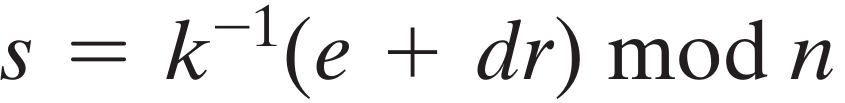

  - Sau đó:

    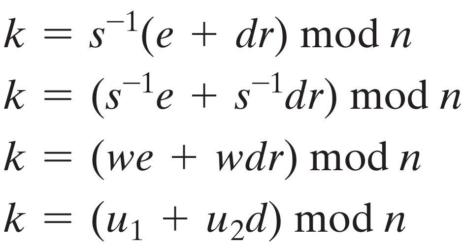

  - Xem xét rằng: 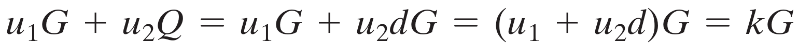

  - Do đó, *X* = (*u*1 ​+ *u*2.​*d*)*G* = *kG* = *P*.

  - Vì *X* = *P*, tọa độ x1 của *X* bằng *x* của *P*, nên *v* = *x*1 mod *n* = *x* mod n = *r* (với $\overline{x}$ = *x*).

  - Vậy, nếu chữ ký hợp lệ thì *v = r.*
