## 11.1. Băm

Băm (hashing) là quá trình **chuyển đổi dữ liệu đầu vào có kích thước bất kỳ thành một chuỗi đầu ra có độ dài cố định, được gọi là giá trị băm.** Quá trình này đóng vai trò quan trọng trong việc lưu trữ, truy xuất và bảo mật dữ liệu.

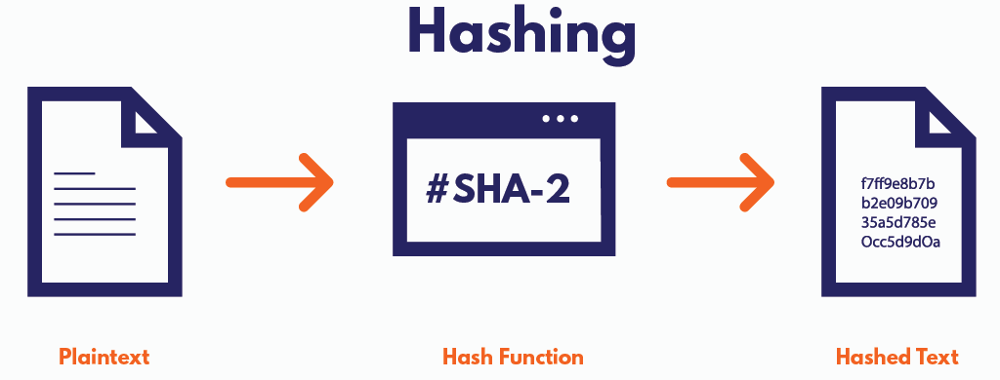
<figcaption>
Hình 80. Sơ bộ quy trình băm
</figcaption>

Băm bao gồm *ba thành phần chính:*

- ***Khóa (key)*** có thể là chuỗi ký tự, số nguyên hoặc bất kỳ dạng dữ liệu nào, được sử dụng để tạo ra giá trị băm. Khóa giúp xác định vị trí lưu trữ hoặc chỉ số của dữ liệu trong một cấu trúc dữ liệu.

- ***Hàm băm (Hash function)*** là một thuật toán nhận khóa đầu vào và sinh ra một chỉ số băm (hash index), xác định vị trí của dữ liệu trong bảng băm. Hàm này được thiết kế để biểu diễn dữ liệu một cách ngắn gọn và đồng nhất.

- ***Bảng băm (Hash table)*** là một cấu trúc dữ liệu lưu trữ các cặp khóa-giá trị, trong đó hàm băm ánh xạ các khóa đến các vị trí cụ thể trong bảng. Mỗi giá trị trong bảng băm được liên kết với một chỉ số duy nhất, giúp truy xuất dữ liệu nhanh chóng.

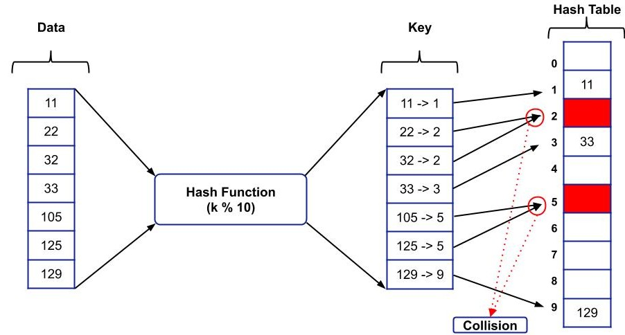
<figcaption>
Hình 81. Các thành phần của quá trình băm
</figcaption>

***\***

***Vì sao cần cấu trúc dữ liệu Hash?***

- Dữ liệu trên internet tăng nhanh mỗi ngày, khiến việc lưu trữ và xử lý hiệu quả trở thành thách thức. Một cấu trúc dữ liệu rất phổ biến được sử dụng cho mục đích như vậy là cấu trúc dữ liệu Mảng.

- Trong lập trình, dù dữ liệu không lớn, vẫn cần lưu trữ và truy cập nhanh. Mảng là cấu trúc phổ biến, cho phép lưu trữ trong thời gian *T*(1), nhưng tìm kiếm mất ít nhất *T*(log *n*), không hiệu quả với dữ liệu lớn.

- Vì vậy, cần một cấu trúc lưu trữ và tìm kiếm trong thời gian không đổi *T*(1). Cấu trúc dữ liệu Hash ra đời để đáp ứng nhu cầu này, cho phép lưu trữ và truy xuất dữ liệu nhanh chóng trong *T*(1).

***Băm hoạt động như thế nào?***

- Giả sử ta có một tập hợp các chuỗi {“ab”, “cd”, “efg”} và ta muốn lưu trữ nó trong một bảng.

- Mục tiêu chính là tìm kiếm hoặc cập nhật các giá trị được lưu trữ trong bảng một cách nhanh chóng trong thời gian ***T*(1)** và ta không quan tâm đến thứ tự của các chuỗi trong bảng.

- Vậy tập hợp các chuỗi trên có thể **vừa là khóa và vừa là giá trị.** Nhưng làm cách nào để lưu trữ giá trị tương ứng với khóa?

- **Bước 1:** Các hàm băm (là một số công thức toán học) được sử dụng để tính giá trị băm đóng vai trò là index của cấu trúc dữ liệu, nơi giá trị sẽ được lưu trữ.

- **Bước 2:** Gán số cho từng ký tự: “a” = 1, “b” = 2, ...

- **Bước 3:** Giá trị số bằng tổng của tất cả các ký tự của chuỗi **\[sum(string)\]**: “ab”=1+2=3, “cd”=3+4=7, “efg”= 5+6+7=18.

- **Bước 4:** Giả sử rằng ta có một bảng kích thước 7 phần để lưu trữ các chuỗi này. Hàm băm được sử dụng ở đây là **tổng của các ký tự trong key mod (Table size).** Từ đó, ta có thể tính toán vị trí **(index)** của từng chuỗi trong mảng bằng cách lấy **sum(string) mod (table size).**

- **Bước 5:** Vì vậy, ta sẽ lưu trữ “ab”: 3 mod 7 = 3 (index = 3), “cd”: 7 mod 7 = 0\
  (index = 0), “efg”: 18 mod 7 = 4 (index = 4). Minh họa như hình dưới:

<figcaption>
Hình 82. Ví dụ băm
</figcaption>

**Lưu ý**

- **Đụng độ (collision)**: Ví dụ trên không có đụng độ (các chỉ số 0, 3, 4 khác nhau). Nếu hai chuỗi có cùng chỉ số, cần phương pháp giải quyết đụng độ (như danh sách liên kết hoặc dò tuyến tính).

- Thực tế, cần hàm băm phức tạp hơn ví dụ trên để phân bố đều dữ liệu, giảm đụng độ.

**<u>\
</u>**

## 11.2. Hàm băm (Hash function)

Hàm băm chuyển đổi dữ liệu có kích thước bất kỳ thành chuỗi ngắn gọn với độ dài cố định, đảm bảo tính toàn vẹn của dữ liệu mà không yêu cầu khóa. Chúng thường được xây dựng thông qua các thuật toán lặp đặc biệt, tạo ra giá trị băm độc đáo và hiệu quả. Ba đặc điểm chính của hàm băm:

- *Tính kháng tiền ảnh thứ nhất:* Khi một hàm băm *h* tạo ra giá trị băm *a*, việc tìm ra bất kỳ giá trị đầu vào *x* nào có giá trị băm *a* là rất khó khăn. Điều này đảm bảo tính chất mã hóa một chiều của hàm băm.

- *Tính kháng tiền ảnh thứ hai:* Khi một hàm băm *h* cho đầu vào *x* tạo ra giá trị băm *h*(*x*), việc tìm thấy bất kỳ giá trị đầu vào *y* nào khác để *h*(*y*) = *h*(*x*) là rất khó khăn.

- *Tính kháng va chạm:* Đối với một hàm băm *h*, rất khó để tìm thấy bất kỳ hai giá trị đầu vào *x*, *y* khác nhau sao cho *h*(*x*) = *h*(*y*).

***Tính bảo mật trong hàm băm:***

- **Không thể đảo ngược**: Chưa chứng minh được sự tồn tại của hàm băm hoàn toàn không thể đảo ngược (tức là không thể tìm nguyên mẫu từ giá trị băm). Tuy nhiên, hàm băm mạnh phải khiến việc này cực kỳ khó về mặt tính toán.

- **Kháng xung đột (collision resistance)**:

  - Tấn công "birthday" cho thấy: Với hàm băm có giá trị dài *n* bit, kẻ tấn công có thể tìm xung đột (hai đầu vào khác nhau cho cùng giá trị băm) trong khoảng $2^{\frac{n}{2}}$ phép tính.

  - ***Ví dụ:*** Với SHA-256 (*n* = 256), độ phức tạp tìm xung đột là 2128, vẫn rất lớn.

  - Một hàm băm được coi là mạnh nếu độ phức tạp tìm xung đột gần với $2^{\frac{n}{2}}$.

- **Hiệu ứng tuyết lở (avalanche effect)**:

  - Một thay đổi nhỏ trong đầu vào (dù chỉ 1 bit) phải dẫn đến thay đổi lớn trong giá trị băm (khoảng 50% bit thay đổi).

  - Điều này đảm bảo giá trị băm không tiết lộ thông tin về đầu vào, ngay cả các bit riêng lẻ, tăng tính bảo mật.

- **Ứng dụng trong băm mật khẩu**: Thuộc tính trên giúp hàm băm tạo khóa an toàn từ mật khẩu người dùng, vì giá trị băm không để lộ thông tin về mật khẩu gốc.

***Ứng dụng của hàm băm:***

- **Xác minh chữ ký số**: Dùng trong chữ ký số (như ECDSA, RSA) để xác minh tính xác thực của dữ liệu. Ví dụ: SHA-256 băm thông điệp trước khi ký, đảm bảo tính toàn vẹn và xác thực.

- **Băm mật mã**: Tăng tính riêng tư và giảm tải cho cơ sở dữ liệu trung tâm bằng cách lưu trữ dữ liệu dưới dạng giá trị băm.

- **SSL handshake**: Trong "bắt tay" SSL/TLS, các hàm băm (như SHA) giúp trình duyệt và máy chủ đồng ý về khóa mã hóa và xác thực dữ liệu, chuẩn bị kết nối an toàn.

- **Kiểm tra tính toàn vẹn**: Dùng SHA-256 để kiểm tra tính toàn vẹn dữ liệu, đảm bảo dữ liệu không bị thay đổi trong quá trình truyền tải.

***\* Phương pháp để tính hàm băm:***

- **Phương pháp phân chia:** Đây là phương pháp đơn giản nhất và dễ dàng nhất để tạo giá trị băm.

  - *Thực hiện chia giá trị khóa k cho kích thước bảng băm M, lấy phần dư làm giá trị băm.*

  - **Công thức**: $H(k) = k{mod}M$

    - *k:* Giá trị khóa.

    - *M:* Kích thước bảng băm (nên là *số nguyên tố* để phân bố đều).

  - **Ưu điểm**:

    - Đơn giản, nhanh (chỉ cần 1 phép chia).

    - Hoạt động tốt với nhiều giá trị *M*.

  - **Nhược điểm**:

    - Các khóa liên tiếp ánh xạ đến giá trị băm liên tiếp, dễ gây cụm (clustering).

    - Cần chọn *M* cẩn thận để tránh va chạm.

- **Phương pháp giữa bình phương (Mid Square Method)**

  - *Thực hiện bình phương giá trị khóa: k2, sau đó lấy các chữ số ở giữa của k2 làm giá trị băm.*

  - **Công thức**: H(*k*) = các chữ số giữa của (*k*⋅*k*).

  - **Ví dụ:** Bảng có 100 vị trí (cần 2 chữ số), k = 50. Tính k2 = 50⋅50 = 2500. Sau đó, lấy 2 chữ số giữa: 50 ⇒ H(*k*) = 50.

  - **Ưu điểm**:

    - Hiệu suất tốt, vì tất cả chữ số của khóa đều góp phần vào kết quả.

    - Không phụ thuộc vào phân phối của chữ số đầu/cuối của khóa.

  - **Nhược điểm**:

    - Khóa lớn làm bình phương tăng gấp đôi số chữ số, khó xử lý.

    - Vẫn có thể xảy ra va chạm.

- **Phương pháp gấp (Folding Method):**

  - ***Bước 1:** Chia khóa k thành các phần có cùng số lượng chữ số (trừ phần cuối có thể ít số chữ số hơn).*

  - ***Bước 2:** Cộng các phần lại. Nếu tổng s có số chữ số vượt quá số chữ số mong muốn (dựa trên kích thước bảng băm), thì **bỏ đi chữ số cao nhất** (chữ số "mang" – carry), chỉ giữ lại các chữ số thấp hơn làm giá trị băm.*

  - **Công thức:**

    $$
    \left\{ \begin{aligned}
    & k = k_{1},k_{2},...,k_{n} \\
    & s = k_{1} + k_{2} + ... + k_{n} \\
    & H(k) = s
    \end{aligned} \right.
    $$

  - Ví dụ: *k* = 1234567, bảng kích thước 100 (mỗi phần 2 chữ số).

    - Chia: 12, 34, 56, 7

    - Cộng: 12 + 34 + 56 + 7 = 109.

    - Nhưng bảng chỉ cần 2 chữ số (vì kích thước bảng là 100), nên chữ số cao nhất: 1 là "lần mang cuối cùng". Bỏ chữ số 1, giữ lại 2 chữ số thấp hơn: 09.

    - Vậy giá trị băm H(*k*) = 09.

- **Phương pháp nhân (Multiplication Method)**

  - ***Bước 1:** Chọn hằng số a (0 \< a \< 1).*

  - ***Bước 2:** Nhân khóa k với a: k ⋅ a.*

  - ***Bước 3:** Lấy phần thập phân của k⋅a.*

  - ***Bước 4:** Nhân kết quả với kích thước bảng M.*

  - ***Bước 5:** Lấy phần nguyên (FLOOR) làm giá trị băm.*

  - **Công thức:** $H(k) = FLOOR\left\lbrack M.\left( k.a{mod}{}1 \right) \right\rbrack$

  - **Lưu ý:** Số lượng chữ số mỗi phần thay đổi tùy thuộc vào kích thước của bảng băm. Ví dụ: kích thước của bảng băm là 100 thì mỗi phần phải có 2 chữ số, trừ phần cuối cùng có thể có số chữ số ít hơn.

  - **Ví dụ:**

    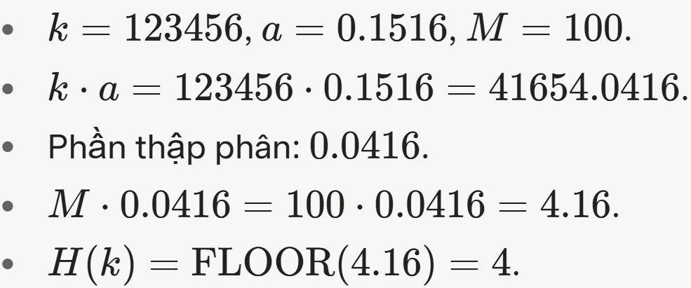

  - **Ưu điểm**:

    - Hoạt động với nhiều giá trị *a* từ 0 đến 1, mặc dù có 1 số giá trị có xu hướng cho kết quả tốt hơn các giá trị còn lại.

    - Nhanh nếu *M* là lũy thừa của 2.

  - **Nhược điểm**:

    - Phù hợp nhất khi *M* là lũy thừa của 2, nếu không sẽ chậm hơn.

    - Cần chọn *a* cẩn thận để giảm va chạm.

## 11.3. Cấu trúc Merkle-Damgard

Hàm băm Merkle-Damgard là một phương pháp xây dựng các hàm băm mật mã chống va chạm từ các hàm nén một chiều chống va chạm. Cấu trúc này được sử dụng trong thiết kế của nhiều thuật toán băm phổ biến như *MD5, SHA-1, SHA-2.*

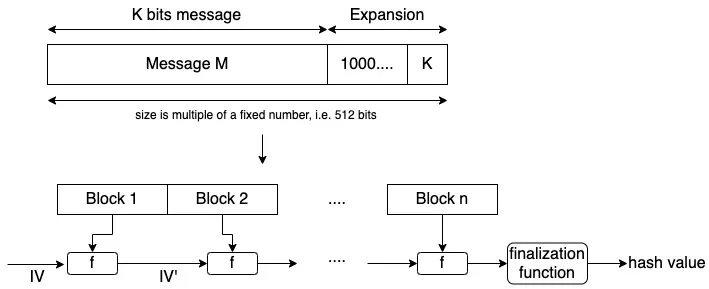
<figcaption>
Hình 83. Cấu trúc Merkle-Damgard
</figcaption>

Đầu tiên, ta tiến hành mở rộng thông điệp (*M*) đến độ dài là bội số của một số bit cụ thể, vì hàm nén chỉ xử lý đầu vào có kích thước xác định. Quá trình mở rộng bao gồm hai phần:

*Khối đệm:* Bắt đầu bằng bit ‘1’ và theo sau là các bit ‘0’. Bit ‘1’ đầu tiên đảm bảo tránh va chạm, ngăn trường hợp thông điệp M thêm một khối đệm ‘0’, và *M’* là *M* thêm ‘0’ ở cuối, tạo ra cùng giá trị băm, gây khó xác định số 0 sau *M* là khối đệm được thêm hay đó là phần cuối của *M’*.

*Kích thước của khối thông điệp gốc:* 64 bit cuối cùng (khối *K*) lưu trữ độ dài của thông điệp gốc, giúp ngăn chặn các cuộc tấn công mở rộng độ dài. Tổng độ dài của thông điệp gốc và khối đệm phải là bội số của kích thước khối trừ đi 64 bit dành cho khối kích thước.

Tiếp theo, ta tiến hành xử lý thông điệp đã mở rộng. Thông điệp đã mở rộng được chia thành các khối nhỏ và xử lý tuần tự. Mỗi khối được kết hợp với một vector khởi tạo (*IV*) thông qua hàm nén một chiều *f*, sử dụng các phép toán logic như *AND, OR, XOR*, v.v. Giá trị *IV* được cập nhật sau mỗi lần nén, và giá trị cuối cùng chính là giá trị băm. Kích thước của *IV* quyết định độ dài của giá trị băm đầu ra.

Cấu trúc Merkle-Damgard đảm bảo tính kháng va chạm nhờ hàm nén một chiều và quy trình mở rộng thông điệp chặt chẽ. Việc sử dụng khối đệm và khối kích thước giúp tăng cường bảo mật, ngăn chặn các cuộc tấn công như tấn công mở rộng độ dài, đồng thời duy trì tính toàn vẹn của dữ liệu.

## 11.4. Thuật toán băm

- **Tổng quan:** Họ thuật toán SHA bao gồm các hàm băm: SHA-1, SHA-224, SHA-256, SHA-384, SHA-512.

  - **SHA-1**: Do NSA phát triển (1995), dài 160-bit, hiện không còn an toàn.

  - **SHA-2**: Gồm SHA-224, SHA-256, SHA-384, SHA-512, cũng do NSA phát triển, công bố bởi NIST (FIPS PUB 180-2, 2002). An toàn hơn SHA-1 nhờ độ dài bit lớn, bắt buộc dùng trong chữ ký số, chứng chỉ từ 2016.

  - **SHA-3**: Thế hệ mới (2015), dựa trên cấu trúc bọt biển (sponge), gồm SHA-3-224, SHA-3-256, SHA-3-384, SHA-3-512.

  - **Ứng dụng**: SSL, SSH, S/MIME, DNSSEC, X.509, PGP, IPSec, BitTorrent.

- **Các thuật toán băm an toàn phổ biến**

  - **SHA-0**: 160-bit, NIST đề xuất 1993, đã bị thay thế.

  - **SHA-1**: 160-bit, NIST đề xuất 1995, không còn an toàn, không được chấp nhận trong các chứng chỉ mới.

  - **SHA-2**: Nhóm hàm 224, 256, 384, 512-bit, an toàn hơn SHA-1.

  - **SHA-3**: Dựa trên cấu trúc bọt biển, khác với cấu trúc Merkle-Damgård của SHA-1, SHA-2.

  - **RIPEMD \[RACE Integrity Primaries Assessment Message Digest (Chức\
    năng Tóm tắt Đánh giá Toàn vẹn Nguyên thủy RACE)\]**: Dựa trên MD4, có các phiên bản 128, 160, 256, 320-bit.

  - **Whirlpool**: Dựa trên Rijndael, dùng hàm nén Miaguchi-Preneel, tạo đầu ra cố định từ hai đầu vào.

- **Mô tả thuật toán**

<table>
<caption>
Bảng 18. Thông số các thuật toán băm
</caption>
<colgroup>
<col style="width: 14%" />
<col style="width: 14%" />
<col style="width: 14%" />
<col style="width: 14%" />
<col style="width: 14%" />
<col style="width: 14%" />
<col style="width: 14%" />
</colgroup>
<thead>
<tr>
<th style="text-align: center;"><em><strong>Thuật toán</strong></em></th>
<th style="text-align: center;"><em><strong>Độ dài 
kết quả (bit)</strong></em></th>
<th style="text-align: center;"><em><strong>Độ dài trạng thái (bit)</strong></em></th>
<th style="text-align: center;"><em><strong>Độ dài khối (bit)</strong></em></th>
<th style="text-align: center;"><em><strong>Độ dài DL tối đa (bit)</strong></em></th>
<th style="text-align: center;"><em><strong>Độ dài từ (bit)</strong></em></th>
<th style="text-align: center;"><em><strong>Số vòng lặp</strong></em></th>
</tr>
</thead>
<tbody>
<tr>
<td style="text-align: center;"><strong>SHA-1</strong></td>
<td style="text-align: center;">160</td>
<td style="text-align: center;">160</td>
<td style="text-align: center;">512</td>
<td style="text-align: center;">&lt; 264</td>
<td style="text-align: center;">32</td>
<td style="text-align: center;">80</td>
</tr>
<tr>
<td style="text-align: center;"><strong>SHA-224</strong></td>
<td style="text-align: center;">224</td>
<td style="text-align: center;">256</td>
<td style="text-align: center;">512</td>
<td style="text-align: center;">&lt; 264</td>
<td style="text-align: center;">32</td>
<td style="text-align: center;">64</td>
</tr>
<tr>
<td style="text-align: center;"><strong>SHA-256</strong></td>
<td style="text-align: center;">256</td>
<td style="text-align: center;">256</td>
<td style="text-align: center;">512</td>
<td style="text-align: center;">&lt; 264</td>
<td style="text-align: center;">32</td>
<td style="text-align: center;">64</td>
</tr>
<tr>
<td style="text-align: center;"><strong>SHA-384</strong></td>
<td style="text-align: center;">384</td>
<td style="text-align: center;">512</td>
<td style="text-align: center;">1024</td>
<td style="text-align: center;">&lt; 2128</td>
<td style="text-align: center;">64</td>
<td style="text-align: center;">80</td>
</tr>
<tr>
<td style="text-align: center;"><strong>SHA-512</strong></td>
<td style="text-align: center;">512</td>
<td style="text-align: center;">512</td>
<td style="text-align: center;">1024</td>
<td style="text-align: center;">&lt; 2128</td>
<td style="text-align: center;">64</td>
<td style="text-align: center;">80</td>
</tr>
</tbody>
</table>

- **Tính bảo mật**

  - **SHA-1**: Từ 2011-2015 là chuẩn chính, nhưng bị phát hiện điểm yếu (Google tạo va chạm năm 2017). Không còn an toàn.

  - **SHA-2**: Từ 2016, trở thành tiêu chuẩn mới, an toàn hơn, bắt buộc trong chứng chỉ SSL/TLS.

  - **Tấn công brute-force**: Với SHA-2 (ví dụ SHA-256), độ phức tạp tìm va chạm là 2128, mất nhiều năm/thập kỷ để phá.

  - **SHA-3**: Dùng cấu trúc bọt biển, cải tiến hơn, nhưng chưa phổ biến bằng SHA-2.

## 11.5. Secure hash algorithm 256 – SHA256

### 11.5.1. Một số phép toán sử dụng trong SHA-256

> 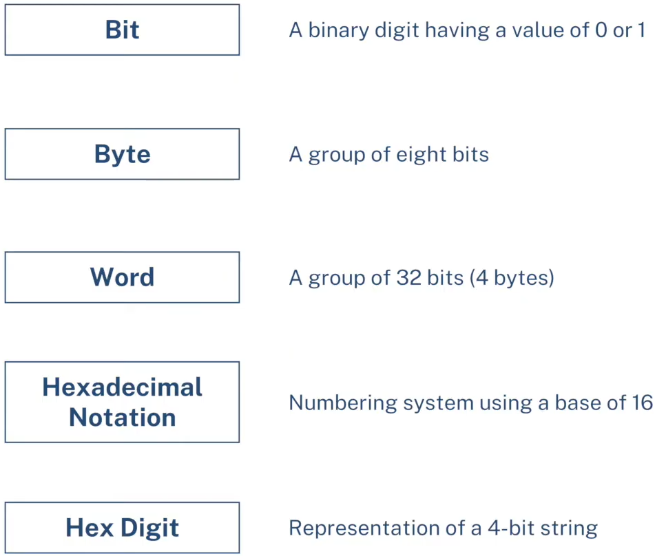

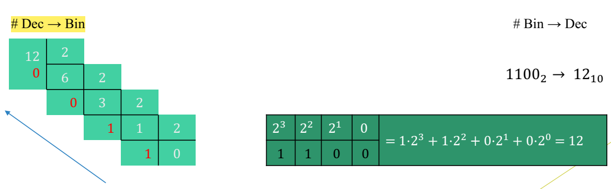

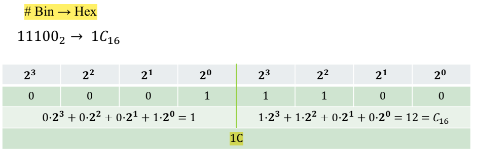

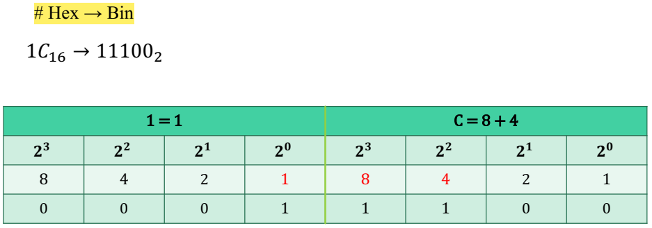

- **Toán tử bitwise** ∧, ∨, ⊕, ¬, ≪, ≫ (and, or, xor, not, shift left, shift right).

> 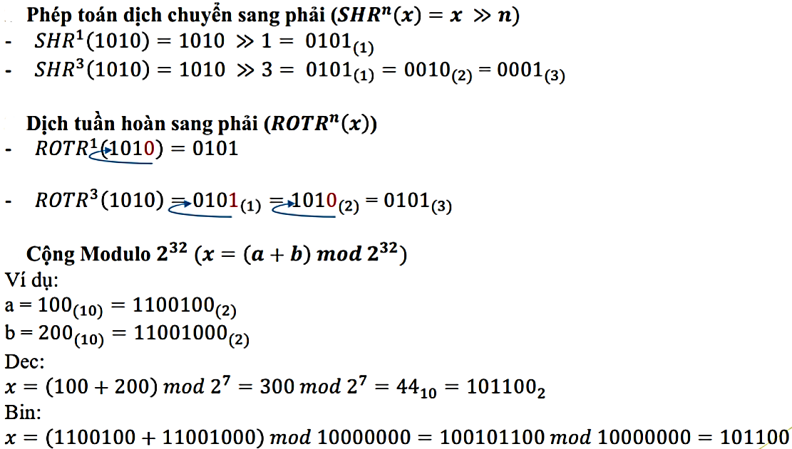
>
> 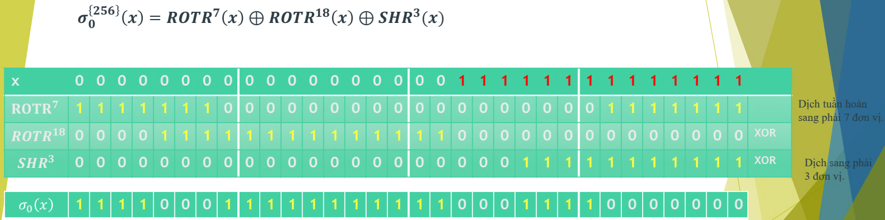
>
> 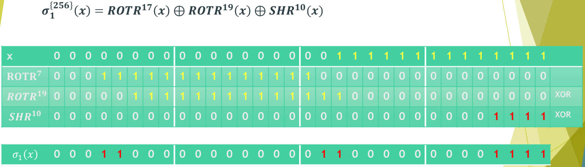
>
> 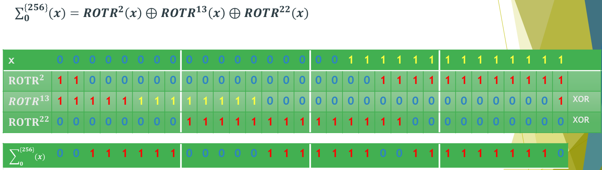
>
> 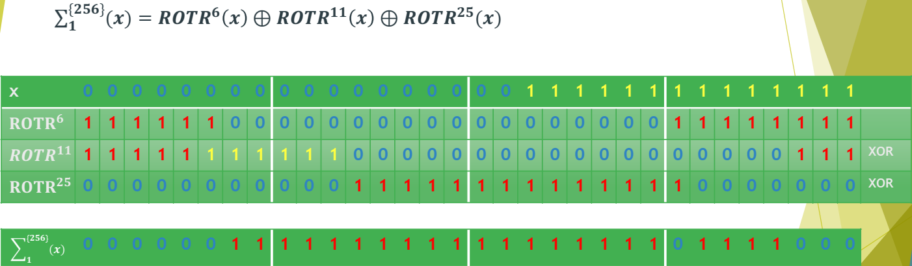
>
> 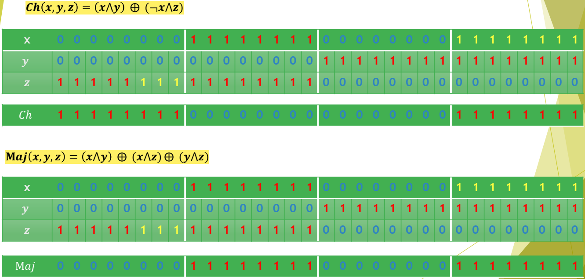
>
> 

### 11.5.2. Chi tiết về SHA-256 & Quy trình thực hiện

SHA-256 (Secure Hash Algorithm 256-bit) là một thuật toán băm mật mã thuộc gia đình SHA-2, được phát triển bởi Cơ quan An ninh Quốc gia Hoa Kỳ (NSA) và công bố bởi Viện Tiêu chuẩn và Công nghệ Quốc gia (NIST) vào năm 2001. Thuật toán này tạo ra một giá trị băm có độ dài cố định 256 bit (tương đương 32 byte) từ dữ liệu đầu vào bất kỳ.

SHA-256 xử lý dữ liệu đầu vào thông qua một loạt các bước tính toán phức tạp, bao gồm nhiều vòng lặp và các phép toán mật mã. Quá trình này được thiết kế để đảm bảo tính bảo mật, bao gồm tính kháng va chạm, kháng tiền ảnh, và khả năng bảo vệ tính toàn vẹn dữ liệu. Kết quả là một chuỗi băm 256 bit duy nhất, đại diện cho dữ liệu gốc một cách an toàn và hiệu quả.

SHA-256 được sử dụng rộng rãi trong các ứng dụng bảo mật như xác minh chữ ký số, bảo vệ mật khẩu, và đảm bảo an toàn cho các giao thức như SSL/TLS. Với độ dài đầu ra cố định và khả năng bảo mật cao, SHA-256 là một công cụ quan trọng trong việc duy trì tính an toàn và tin cậy của dữ liệu trong các hệ thống hiện đại.

***\***

***Quy trình thực hiện của thuật toán băm SHA-256:***

- ***Tiền xử lý***

  - Chuyển đổi tin nhắn ban đầu sang hệ nhị phân bằng cách sử dụng bảng mã ASCII.

    - **Ví dụ:** input: **abc** 🡪 byte \[97,98,99\] 🡪 Bin: 01100001 01100010 01100011

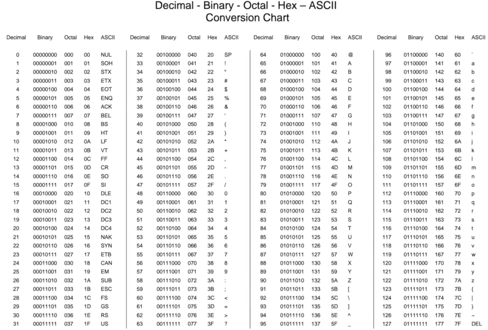
<figcaption>
Hình 84. Bảng chuyển đổi ký tự sang các hệ khác nhau
</figcaption>

- Thêm bộ đệm tin nhắn (padding the message) như đã mô tả ở mục III, để đảm bảo rằng chiều dài của tin nhắn được đệm là bội số của 512 bits. Ta tiến hành thêm 1 bit “1” vào cuối chuỗi tin nhắn đã chuyển sang nhị phân, sau đó đệm thêm *k* bit ‘0’, với *k* là nghiệm không âm nhỏ nhất của phương trình:

  $$
  l + 1 + k \equiv 448{mod}512
  $$
  Với $l$là chiều dài của chuỗi tin nhắn nhị phân. Cuối cùng, 64 bits cuối được dành riêng để chỉ ra độ dài của tin nhắn thực tế ở dạng nhị phân.

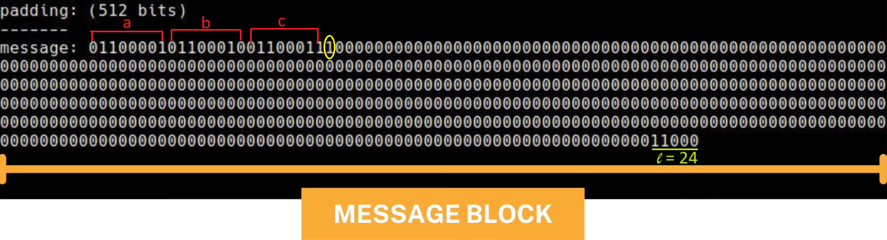
<figcaption>
Hình 85. Ví dụ SHA-256 - 1
</figcaption>

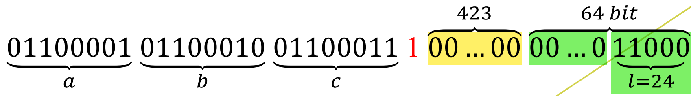

- *Phân tích cú pháp tin nhắn đệm:*

  - Nếu chuỗi tin nhắn đã được đệm dài hơn 512 bits, thì chia chuỗi tin nhắn đó thành *N* khối, mỗi khối có kích thước 512 bits, được ký hiệu lần lượt là $M^{(1)},M^{(2)},...,M^{(N)}$.

  - Mỗi khối thứ *i* có kích thước 512 bits lại được chia nhỏ thành 16 khối nữa, mỗi khối có kích thước 32 bits, và được ký hiệu lần lượt là $M_{0}^{(i)},M_{1}^{(i)},...M_{15}^{(i)}$. Đây chính là *lịch trình tin nhắn ban đầu (message schedule).*

*M*0 =

*M*1 =

*M*2 =

*M*3 =

*M*4 =

*M*5 =

*M*6 =

*M*7 =

*M*8 =

*M*9 =

*M*10 =

*M*11 =

*M*12 =

*M*13 =

*M*14 =

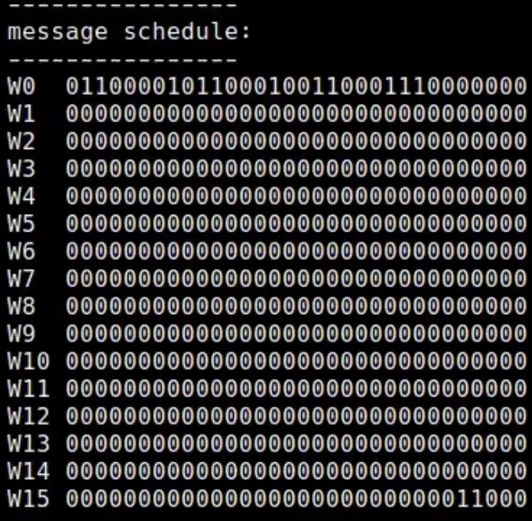
<figcaption>
<em>M</em>15 =
</figcaption>

Hình 86. Ví dụ SHA-256 - 2

- Với mỗi khối *i* thuộc $M^{(1)},M^{(2)},...,M^{(N)}$ ($i = 1,...,N$)*,* ta tiến hành mở rộng lịch trình tin nhắn bằng cách thêm 48 từ 32 bit theo công thức sau:

  $$
  W_t =
  \begin{cases}
    M_t^{(i)}, & 0 \le t \le 15, \\
    \sigma_1(W_{t-2}) + W_{t-7} + \sigma_0(W_{t-15}) + W_{t-16} \pmod{2^{32}}, & 16 \le t \le 63,
  \end{cases}
  $$
  Các phép cộng trong công thức được tính modulo $2^{32}$.
  Với $M_{t}^{(i)}$: từ 32 bit lấy từ 512 bit của khối tin nhắn.

  $W_{t}$: từ 32 bit được tạo từ công thức trên.

  Lưu ý: $\sigma_{0}^{\left\{ 256 \right\}}(x) = ROTR^{7}(x) \oplus ROTR^{18}(x) \oplus SHR^{3}(x)$

  $\sigma_{1}^{\left\{ 256 \right\}}(x) = ROTR^{17}(x) \oplus ROTR^{19}(x) \oplus SHR^{10}(x)$

  $ROTR^{n}(x)$: phép dịch tuần hoàn sang phải *n* vị trí của chuỗi nhị phân *x*.

  $SHR^{n}(x)$: Phép toán dịch chuyển *n* bit sang phải.

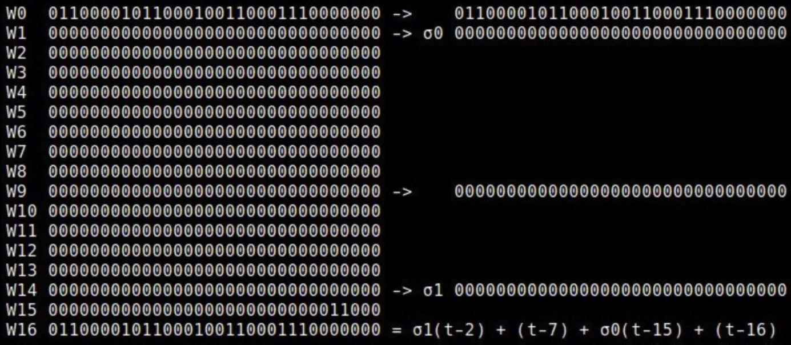

**…**

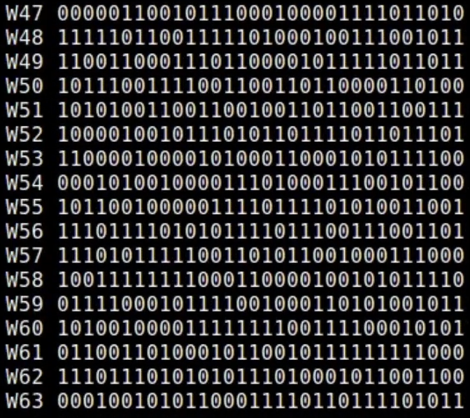
<figcaption>
Hình 87. Ví dụ SHA-256 - 3
</figcaption>

- ***Thiết lập giá trị băm ban đầu:*** Bao gồm 8 từ (word), mỗi từ 32 bit, bắt nguồn từ 32 bits đầu tiên các phần thập phân của căn bậc hai 8 số nguyên tố đầu tiên, bao gồm:

  $$
  \begin{aligned}
  H_0^{(0)} &= \left\lfloor 2^{32}\operatorname{frac}(\sqrt{2})\right\rfloor = \mathtt{6a09e667}, &
  H_1^{(0)} &= \left\lfloor 2^{32}\operatorname{frac}(\sqrt{3})\right\rfloor = \mathtt{bb67ae85}, \\
  H_2^{(0)} &= \left\lfloor 2^{32}\operatorname{frac}(\sqrt{5})\right\rfloor = \mathtt{3c6ef372}, &
  H_3^{(0)} &= \left\lfloor 2^{32}\operatorname{frac}(\sqrt{7})\right\rfloor = \mathtt{a54ff53a}, \\
  H_4^{(0)} &= \left\lfloor 2^{32}\operatorname{frac}(\sqrt{11})\right\rfloor = \mathtt{510e527f}, &
  H_5^{(0)} &= \left\lfloor 2^{32}\operatorname{frac}(\sqrt{13})\right\rfloor = \mathtt{9b05688c}, \\
  H_6^{(0)} &= \left\lfloor 2^{32}\operatorname{frac}(\sqrt{17})\right\rfloor = \mathtt{1f83d9ab}, &
  H_7^{(0)} &= \left\lfloor 2^{32}\operatorname{frac}(\sqrt{19})\right\rfloor = \mathtt{5be0cd19}.
  \end{aligned}
  $$
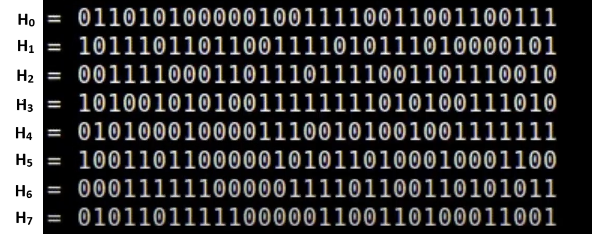
<figcaption>
Hình 88. Ví dụ SHA-256 - 4
</figcaption>

- ***Hằng số (constants):*** Bao gồm 64 từ, mỗi từ 32 bit, từ các **phần thập phân** **căn bậc ba của 64 số nguyên tố đầu tiên** được ký hiệu lần lượt: $K_{0}^{\left\{ 256 \right\}},K_{1}^{\left\{ 256 \right\}},...,K_{63}^{\left\{ 256 \right\}}$. Các từ hằng số theo hệ 16 này là (từ trái sang phải):

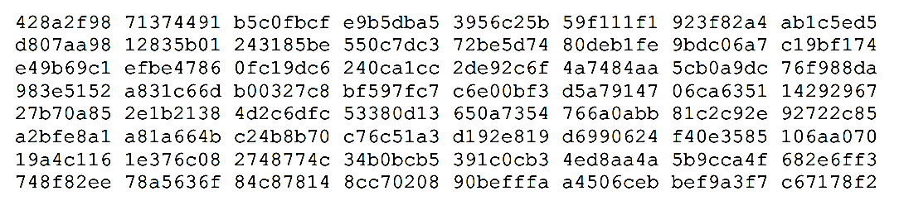
<figcaption>
Hình 89. Ví dụ SHA-256 - 5
</figcaption>

- ***Tính toán băm***

  - *a)* Thực hiện mở rộng lịch trình tin nhắn sao cho có tổng cộng 64 từ (word) theo mục 5.3.1.

  - *b)* Khởi tạo 8 biến làm việc $a,b,c,d,e,f,g,h$, là vị trí nơi các từ sẽ được lưu trữ trong quá trình nén, và chính là 8 giá trị băm ban đầu.

    $$
    \begin{aligned}
    a &= H_0^{(i-1)}, & b &= H_1^{(i-1)}, & c &= H_2^{(i-1)}, & d &= H_3^{(i-1)}, \\
    e &= H_4^{(i-1)}, & f &= H_5^{(i-1)}, & g &= H_6^{(i-1)}, & h &= H_7^{(i-1)}.
    \end{aligned}
    $$
  - *c) Chạy chu kỳ nén:* Cập nhật các giá trị của các biến làm việc bằng cách:

    Với mỗi vòng $t=0,1,\ldots,63$, tính:

    $$
    \begin{aligned}
    T_1 &= h + \Sigma_1(e) + \operatorname{Ch}(e,f,g) + K_t + W_t \pmod{2^{32}}, \\
    T_2 &= \Sigma_0(a) + \operatorname{Maj}(a,b,c) \pmod{2^{32}}, \\
    h &\leftarrow g, & g &\leftarrow f, & f &\leftarrow e, & e &\leftarrow d+T_1, \\
    d &\leftarrow c, & c &\leftarrow b, & b &\leftarrow a, & a &\leftarrow T_1+T_2.
    \end{aligned}
    $$

    Với: $T_{1}$: từ tạm 1.

    $T_{2}$: từ tạm 2.

    $a,b,c,d,e,f,g,h$: các biến làm việc.

    $\Sigma_0(x) = \operatorname{ROTR}^{2}(x) \oplus \operatorname{ROTR}^{13}(x) \oplus \operatorname{ROTR}^{22}(x)$.

    $\Sigma_1(x) = \operatorname{ROTR}^{6}(x) \oplus \operatorname{ROTR}^{11}(x) \oplus \operatorname{ROTR}^{25}(x)$.

    $K_{t}^{\left\{ 256 \right\}}$: các hằng số (constants).

    $W_{t}$: Các từ trong lịch trình tin nhắn.

    $Maj(a,b,c) = (a \land b) \oplus (a \land c) \oplus (b \land c)$: Hàm Majority.

    $Ch(e,f,g) = (e \land f) \oplus (\neg e \land g)$: Hàm chọn.

**Ví dụ:** Xét *t* = 0:

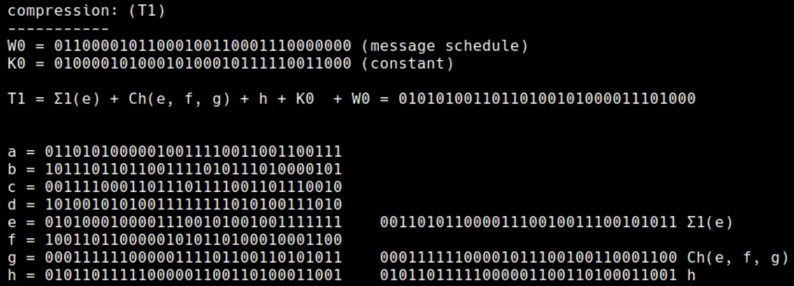
<figcaption>
Hình 90. Ví dụ SHA-256 - 6
</figcaption>

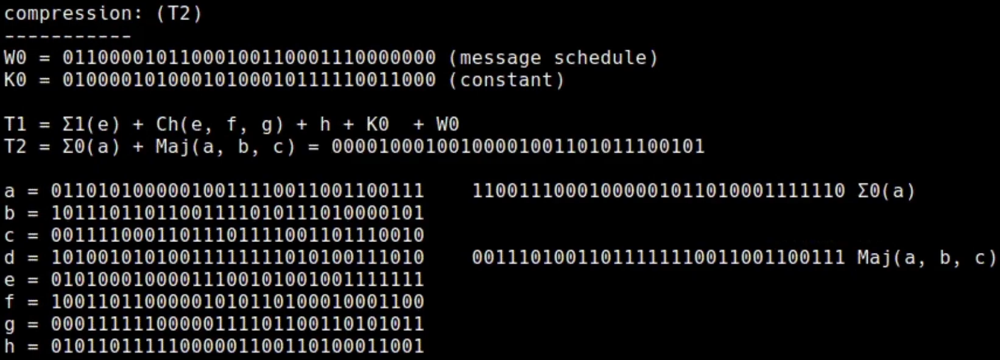
<figcaption>
Hình 91. Ví dụ SHA-256 - 7
</figcaption>

*Cập nhật giá trị các biến làm việc:*

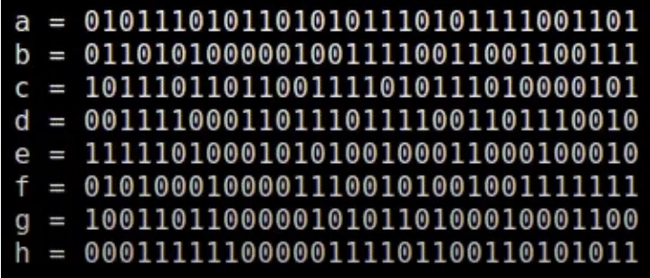
<figcaption>
Hình 92. Ví dụ SHA-256 - 8
</figcaption>

*Thực hiện 63 vòng còn lại tương tự như trên. Cuối cùng ta được giá trị các biến làm việc như sau:*

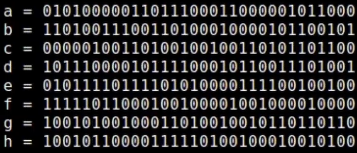
<figcaption>
Hình 93. Ví dụ SHA-256 - 9
</figcaption>

- *d) Tính giá trị hàm trung gian:* Lấy giá trị băm ban đầu, rồi cộng thêm biến làm việc được cập nhật tương ứng.

  $$
  \begin{aligned}
  H_0^{(i)} &\equiv H_0^{(i-1)} + a \pmod{2^{32}}, & H_1^{(i)} &\equiv H_1^{(i-1)} + b \pmod{2^{32}}, \\
  H_2^{(i)} &\equiv H_2^{(i-1)} + c \pmod{2^{32}}, & H_3^{(i)} &\equiv H_3^{(i-1)} + d \pmod{2^{32}}, \\
  H_4^{(i)} &\equiv H_4^{(i-1)} + e \pmod{2^{32}}, & H_5^{(i)} &\equiv H_5^{(i-1)} + f \pmod{2^{32}}, \\
  H_6^{(i)} &\equiv H_6^{(i-1)} + g \pmod{2^{32}}, & H_7^{(i)} &\equiv H_7^{(i-1)} + h \pmod{2^{32}}.
  \end{aligned}
  $$
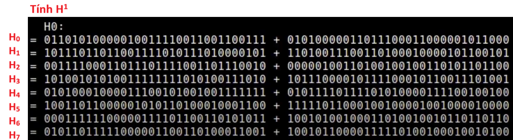
<figcaption>
Hình 94. Ví dụ SHA-256 - 10
</figcaption>

*Sau tính toán, ta được các giá trị hàm trung gian là:*

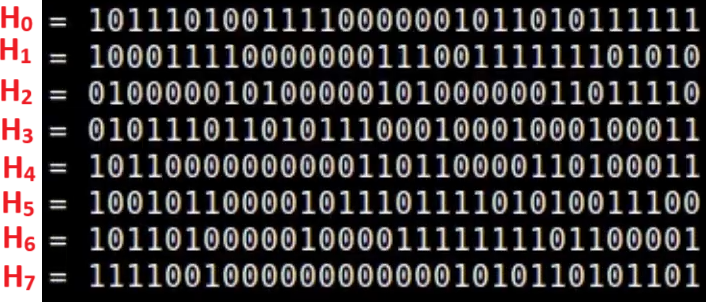
<figcaption>
Hình 95. Ví dụ SHA-256 - 11
</figcaption>

> Tiếp tục thực hiện $N - 1$ lần các bước *a), b), c), d)* với các khối 512 bits còn lại (nếu có).

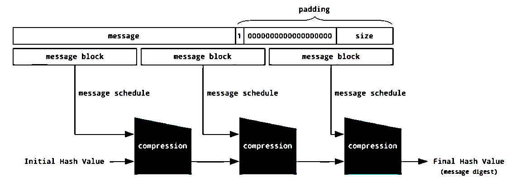
<figcaption>
Hình 96. Sơ lược quy trình SHA-256
</figcaption>

> Sau khi thực hiện ta có các giá trị băm:
>
> $$
> H_{0}^{(N)},H_{1}^{(N)},H_{2}^{(N)},H_{3}^{(N)},H_{4}^{(N)},H_{5}^{(N)},H_{6}^{(N)},H_{7}^{(N)}
> $$
- *e)* Chuyển đổi giá trị băm $H_{0}^{(N)},...,H_{7}^{(N)}$từ hệ nhị phân sang hệ Hex(16), sau đó nối các giá trị này lại với nhau. Cuối cùng ta được một chuỗi tin nhắn đã được chuyển đổi có kích thước 256 bits.

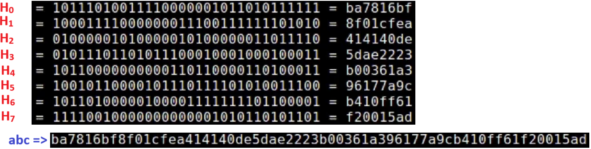
<figcaption>
Hình 97. Ví dụ SHA-256 - 12
</figcaption>
