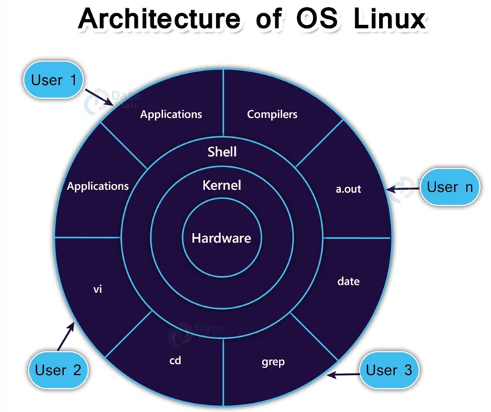
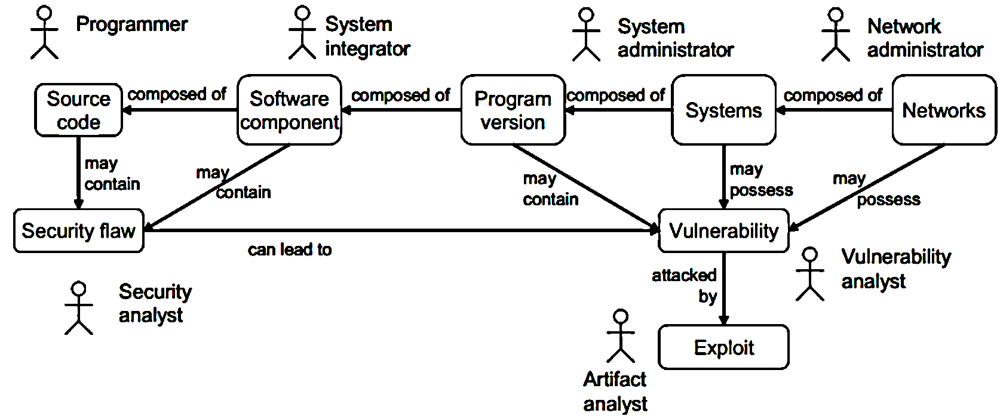

## 2.1. Kiến thức chung về lỗ hổng bảo mật

### 2.1.1. Lỗ hổng trong bảo mật máy tính là gì?

- là một lỗ hổng, điểm yếu **trong hệ thống hoặc mạng có thể bị khai thác** để gây ra thiệt hại hay cho phép kẻ tấn công thao túng hệ thống *<u>(Bản chất là tấn công hệ thống để lấy thông tin).</u>*

### 2.1.2. Các loại lỗ hổng bảo mật

- **Lỗ hổng hệ điều hành:** giành quyền truy cập vào nội dung mà hệ điều hành được cài đặt trên đó.

- **Lỗ hổng mạng:** những sự cố xảy ra với phần cứng hoặc phần mềm của mạng khiến mạng có thể bị xâm nhậm trái phép từ bên ngoài.

  - Ví dụ: điểm truy cập Wifi không an toàn, tường lửa được cấu hình kém.

- **Lỗ hổng quy trình:** Một số lỗ hổng có thể được tạo ra bởi các biện pháp kiểm soát quy trình cụ thể.

  - Ví dụ: việc sử dụng mật khẩu yếu

  - **🡪 Người ta khuyến nghị đặt mật khẩu dài ít nhất 12 ký tự, gồm chữ hoa, chữ thường, số và ký tự đặc biệt vì:**

    - **Chống tấn công brute-force (vét cạn)**:

      - Các hacker có thể sử dụng phương pháp brute-force (thử tất cả các khả năng có thể) để đoán mật khẩu.

      - Mật khẩu càng dài và phức tạp, số lượng tổ hợp có thể có càng lớn, khiến việc bẻ khóa mất nhiều thời gian hơn **(tối thiểu cần thử 1272 trường hợp).**

    - **Chống tấn công từ điển (dictionary attack)**:

      - Nếu mật khẩu chỉ là một từ có nghĩa (ví dụ: "password" hay "hello123"), hacker có thể dễ dàng đoán được bằng cách sử dụng danh sách mật khẩu phổ biến.

    - **Giảm rủi ro bị dò đoán**:

      - Nhiều người có thói quen đặt mật khẩu dễ nhớ như "123456", "qwerty", hoặc tên riêng.

      - Một mật khẩu dài với nhiều loại ký tự sẽ khó bị đoán bằng phương pháp xã hội học (social engineering).

    - **Đáp ứng các tiêu chuẩn bảo mật hiện đại**:

      - Các tổ chức và nền tảng lớn như NIST (Viện Tiêu chuẩn và Công nghệ Quốc gia Hoa Kỳ) khuyến nghị sử dụng mật khẩu dài và phức tạp để tăng cường bảo mật.

    - Ngoài ra, nên sử dụng **trình quản lý mật khẩu** để tạo và lưu trữ mật khẩu mạnh, thay vì cố gắng nhớ chúng.

- **Lỗ hổng từ người dùng:** Liên kết yếu nhất trong nhiều kiến trúc an ninh mạng là yếu tố con người. Lỗi người dùng có thể dễ dàng làm lộ dữ liệu nhạy cảm, tạo điểm truy cập có thể khai thác cho kẻ tấn công hoặc làm gián đoạn hệ thống

### 2.1.3. Các thành phần của hệ thống máy tính

- **Hệ thống phần cứng**

<figcaption>
Hình 5. Hệ thống phần cứng
</figcaption>

- **Vì sao AI dùng card màn hình (GPU) nhưng không dùng CPU để xử lý?**

  - vì GPU có **kiến trúc tối ưu hơn cho các phép toán song song**, đặc biệt là các tác vụ tính toán ma trận và vector trong học sâu (Deep Learning).

  - **GPU có nhiều lõi hơn, giúp xử lý song song tốt hơn**

    - **CPU có số lượng lõi ít hơn** (thường 4–64 lõi), mỗi lõi mạnh nhưng chuyên xử lý tác vụ tuần tự.

    - **GPU có hàng ngàn lõi xử lý nhỏ** (có thể lên đến hàng chục nghìn), tối ưu cho tính toán song song.

    - **Trong AI, các mô hình học máy cần thực hiện hàng triệu phép nhân ma trận cùng lúc, GPU có thể xử lý nhanh hơn nhiều.**

  - **Tối ưu cho các phép toán ma trận và vector**

    - Hầu hết các mô hình AI, đặc biệt là mạng nơ-ron nhân tạo (Neural Networks), dựa vào phép nhân ma trận (Matrix Multiplication).

    - GPU có các đơn vị tính toán chuyên dụng như *Tensor Cores (NVIDIA) hoặc Matrix Cores (AMD)* giúp thực hiện các phép toán này nhanh hơn nhiều so với CPU.

  - **Băng thông bộ nhớ cao hơn, giúp xử lý dữ liệu lớn nhanh hơn**

    - GPU có bộ nhớ băng thông cao, giúp truyền dữ liệu nhanh hơn nhiều so với RAM của CPU.

    - AI thường xử lý dữ liệu khổng lồ, GPU có thể load và xử lý dữ liệu từ VRAM nhanh hơn so với CPU xử lý từ RAM.

  - **Tiết kiệm thời gian huấn luyện mô hình AI**

    - Với CPU, một mô hình AI có thể mất vài ngày hoặc vài tuần để huấn luyện.

    - Với GPU, thời gian có thể giảm xuống chỉ còn vài giờ hoặc vài phút, giúp tăng tốc nghiên cứu và ứng dụng AI.

  - CPU tốt cho **xử lý logic, điều phối tác vụ, và tính toán tuần tự**.

  - GPU tốt cho **xử lý song song, huấn luyện AI, và tính toán ma trận**.

<!-- -->

- **Hệ thống phần mềm**

  - **Hệ điều hành:** Nhân hệ điều hành, các trình điều khiển thiết bị, Các trình cung cấp dịch vụ, tiện ích,…

  - **Các phần mềm ứng dụng:** Các dịch vụ (máy chủ web, CSDL, DNS,...), Trình duyệt web, các ứng dụng giao tiếp,… Các bộ ứng dụng văn phòng, lập trình…

<table>
<colgroup>
<col style="width: 47%" />
<col style="width: 52%" />
</colgroup>
<thead>
<tr>
<th style="text-align: center;">
Ảnh minh họa image2.png

Hình 6. Kiến trúc hệ điều hành Linux
</th>
<th><ul>
<li>
<strong>Hardware (Phần cứng):</strong> thực hiện đọc/ghi dữ liệu, quản lý bộ nhớ, hoặc điều khiển thiết bị
</li>
<li>
<strong>Kernel (Nhân hệ điều hành)</strong>:

<ul>
<li>
Là "trái tim" của Linux, giúp quản lý tài nguyên phần cứng.
</li>
<li>
xử lý các tác vụ như <em>quản lý tiến trình, quản lý bộ nhớ, hệ thống file, driver thiết bị, và điều phối dữ liệu giữa phần cứng và phần mềm.</em>
</li>
<li>
Kernel làm việc trực tiếp với phần cứng thông qua các driver.
</li>
</ul></li>
<li>
<strong>Shell (Trình thông dịch lệnh)</strong>: giúp người dùng giao tiếp với hệ điều hành thông qua các lệnh. Một số shell phổ biến trong Linux: Bash, Zsh, Sh, Csh…

<ul>
<li>
<em>Kernel có toàn quyền truy cập phần cứng, nhưng shell và các ứng dụng chỉ có thể truy cập thông qua các dịch vụ mà kernel cung cấp.</em>
</li>
</ul></li>
</ul></th>
</tr>
</thead>
<tbody>
<tr>
<td><ul>
<li>
<strong>Applications (Ứng dụng)</strong>:

<ul>
<li>
các chương trình mà người dùng sử dụng trực tiếp, như <em>trình soạn thảo vi, trình biên dịch (compiler), công cụ quản lý file (cd), công cụ tìm kiếm văn bản (grep), hiển thị ngày tháng (date)…</em>
</li>
<li>
Các ứng dụng này gửi yêu cầu thông qua shell để kernel thực thi các tác vụ liên quan đến phần cứng.
</li>
</ul></li>
</ul></td>
<td><ul>
<li>
<strong>Users (Người dùng):</strong>

<ul>
<li>
Các người dùng tương tác với hệ thống thông qua shell và các ứng dụng.
</li>
<li>
Mỗi người dùng có thể chạy các ứng dụng khác nhau nhưng đều thông qua shell để truy cập các tài nguyên mà kernel quản lý.
</li>
<li>
<strong>Các user có thể là người sử dụng thông thường hoặc các script tự động.</strong>
</li>
</ul></li>
</ul></td>
</tr>
</tbody>
</table>

<table>
<colgroup>
<col style="width: 45%" />
<col style="width: 54%" />
</colgroup>
<thead>
<tr>
<th><ul>
<li>
<strong>a.out:</strong> File thực thi đầu ra mặc định của trình biên dịch
</li>
</ul>

Hệ điều hành Linux cung cấp rất nhiều công cụ và chương trình khác mà sơ đồ này chưa thể hiện hết, ví dụ:

<ul>
<li>
<strong>ls</strong>: Liệt kê nội dung thư mục.
</li>
<li>
<strong>cp</strong>, <strong>mv</strong>, <strong>rm</strong>: Sao chép, di chuyển, xóa file.
</li>
<li>
<strong>chmod</strong>, <strong>chown</strong>: Thay đổi quyền và sở hữu file.
</li>
<li>
<strong>ping</strong>, <strong>netstat</strong>: Công cụ quản lý mạng.
</li>
<li>
<strong>top</strong>, <strong>htop</strong>, <strong>ps</strong>: Giám sát tiến trình hệ thống.
</li>
</ul></th>
<th>
<strong><mark>Dòng chảy của lệnh trong hệ thống Linux:</mark></strong>

<ul>
<li>
<strong>Người dùng</strong> nhập lệnh vào shell (ví dụ: <strong>cd /home</strong>).
</li>
<li>
<strong>Shell</strong> nhận lệnh và chuyển thành lời gọi hệ thống (system call).
</li>
<li>
<strong>Kernel</strong> xử lý system call này, ví dụ thay đổi thư mục làm việc hiện tại.
</li>
<li>
<strong>Kernel</strong> giao tiếp với <strong>phần cứng</strong> (nếu cần) để truy cập hoặc ghi dữ liệu.
</li>
<li>
<strong>Kernel</strong> gửi phản hồi về shell.
</li>
<li>
<strong>Shell</strong> hiển thị kết quả lên màn hình cho người dùng.
</li>
</ul></th>
</tr>
</thead>
<tbody>
</tbody>
</table>

### 2.1.4. Điểm yếu của hệ thống máy tính 

- Là các lỗi hay các khiếm khuyết (thiết kế, cài đặt, phần cứng, phần mềm) tồn tại trong hệ thống. Bao gồm:

- **Các kiểu tấn công**

  - **DDoS attack (Tấn công từ chối dịch vụ phân tán):** Tấn công bằng cách làm quá tải hệ thống với một lượng lớn yêu cầu cùng lúc, khiến hệ thống chậm hoặc ngừng hoạt động.

<table>
<caption>
Bảng 1. DoS và DDoS
</caption>
<colgroup>
<col style="width: 49%" />
<col style="width: 50%" />
</colgroup>
<thead>
<tr>
<th style="text-align: center;">
<strong>DoS Attack - Denial of Service – 
Tấn công từ chối dịch vụ</strong>
</th>
<th style="text-align: center;">
<strong>DDoS Attack – 
Distributed Denial of Service – 
Tấn công từ chối dịch vụ phân tán</strong>
</th>
</tr>
</thead>
<tbody>
<tr>
<td>
<strong>Mục đích:</strong> Làm gián đoạn hoặc ngừng hoạt động của một dịch vụ, website hoặc hệ thống bằng cách làm quá tải nó, khiến người dùng hợp pháp không thể truy cập
</td>
<td>
<strong>Mục đích:</strong> Giống DoS nhưng ở quy mô lớn hơn, làm hệ thống sập nhanh hơn và khó chống lại hơn.
</td>
</tr>
<tr>
<td>
<strong>Cách thức:</strong>

<ul>
<li>
<strong>Một máy tính</strong> Gửi lượng lớn yêu cầu (request) tới server, vượt quá khả năng xử lý.
</li>
<li>
Làm cạn kiệt tài nguyên (CPU, RAM, băng thông) khiến hệ thống chậm hoặc sập.
</li>
</ul></td>
<td>
<strong>Cách thức:</strong>

<ul>
<li>
Sử dụng <strong>mạng lưới nhiều máy tính bị nhiễm mã độc (botnet – các MT bị kiểm soát từ xa)</strong> để cùng tấn công mục tiêu.
</li>
<li>
Các máy tính trong botnet <strong>gửi lượng lớn yêu cầu tới hệ thống cùng lúc</strong>, làm nghẽn băng thông và cạn kiệt tài nguyên 🡪 Sập hệ thống.
</li>
</ul></td>
</tr>
<tr>
<td>
<strong>Đặc điểm:</strong>

<ul>
<li>
Thường chỉ từ <strong>một</strong> nguồn tấn công <strong>(một máy hoặc một IP).</strong>
</li>
<li>
Dễ phát hiện và chặn (bởi tường lửa/bộ lọc) vì có nguồn gốc rõ ràng.
</li>
</ul></td>
<td>
<strong>Đặc điểm:</strong>

<ul>
<li>
Tấn công từ nhiều nguồn khác nhau nên khó phát hiện và ngăn chặn.
</li>
<li>
Khó phân biệt giữa traffic thật và traffic tấn công.
</li>
</ul></td>
</tr>
<tr>
<td>
<strong>Ví dụ:</strong> Một máy tính gửi hàng ngàn yêu cầu cùng lúc tới một website, làm website không phản hồi được với người dùng thật.
</td>
<td>
<strong>Ví dụ:</strong>

<ul>
<li>
<strong>Tấn công SYN Flood:</strong> kẻ tấn công gửi hàng triệu yêu cầu kết nối TCP nhưng không hoàn thành, khiến máy chủ quá tải.
</li>
<li>
<strong>Tấn công HTTP Flood:</strong> Tấn công bằng cách gửi hàng triệu request HTTP đến website mục tiêu.
</li>
<li>
<strong>Tấn công DNS Amplification:</strong> Lợi dụng các máy chủ DNS để tạo ra lưu lượng truy cập lớn, áp đảo mục tiêu.
</li>
</ul></td>
</tr>
<tr>
<td>
<strong>Cách phòng chống:</strong> Dùng tường lửa, bộ lọc, giới hạn số lượng kết nối từ một địa chỉ IP trong một khoảng thời gian, cloud flare…
</td>
<td>
<strong>Cách phòng chống:</strong> Dùng IDS (hệ thống phát hiện tấn công), hệ thống chống botnet, giới hạn kích thước gói tin, giới hạn số lượng gói tin được gửi trong 1 khoảng thời gian, giới hạn số lượt đăng nhập của 1 tài khoản…
</td>
</tr>
</tbody>
</table>

- **Pharming – Tấn công giả mạo DNS:**

  - Là kiểu tấn công lừa đảo, dẫn người dùng đến các trang web giả mạo để đánh cắp thông tin nhạy cảm như mật khẩu, số thẻ tín dụng…

  - **Cách thức:**

    - **DNS Poisoning/ DNS Snoofing Attack:** Thay đổi hoặc làm giả bản ghi DNS trên máy chủ DNS, khiến người dùng khi truy cập vào địa chỉ web hợp lệ thì bịchuyển hướng tới website giả mạo.

    - **Tấn công vào file hosts** của máy tính hoặc vào máy chủ DNS.

  - **Đặc điểm:**

    - Rất khó phát hiện vì người dùng vẫn thấy địa chỉ trang web đúng nhưng nội dung là giả mạo.

    - Không cần người dùng nhấp vào link độc hại (như phishing), chỉ cần gõ đúng địa chỉ, nhưng vẫn bị chuyển tới trang giả.

  - **Cách phòng chống:**

    - Kiểm tra chứng chỉ SSL của website.

    - Không nhấp vào link đáng ngờ.

    - Sử dụng phần mềm diệt virus, cập nhật PM thường xuyên.

    - Dùng VPN hoặc DNS bảo mật (Google DNS 8.8.8.8 hay Cloudflare 1.1.1.1).

**\**

- **Tác động của các cuộc tấn công (Effects):**

  - **Hủy dữ liệu (Data destruction):** Xóa hoặc phá hỏng dữ liệu hoàn toàn.

  - **Thao tác dữ liệu (Data manipulation):** Thay đổi dữ liệu theo cách làm sai lệch thông tin.

  - **Sửa đổi dữ liệu (Data modification):** Chỉnh sửa dữ liệu mà không được phép.

  - **Lấy cắp dữ liệu (Data theft):** Trộm dữ liệu quan trọng như thông tin người dùng, tài khoản…

  - **Lấy cắp danh tính (Identity theft):** Dùng thông tin cá nhân của người khác để giả mạo họ, phục vụ cho mục đích xấu.

- **Lỗ hổng bảo mật (Vulnerabilities):** Các yếu tố khiến hệ thống dễ bị tấn công:

  - **Lỗ hổng vật lý:** Thiết bị phần cứng dễ bị đánh cắp, phá hoại.

  - **Mật khẩu yếu:** Dùng mật khẩu đơn giản, dễ đoán.

  - **Mô hình không an toàn:** Cách thiết kế hệ thống không đủ bảo mật.

  - **Phần mềm không an toàn:** Các phần mềm có lỗ hổng hoặc không được cập nhật.

  - **Thảm họa thiên nhiên:** Các yếu tố ngoài tầm kiểm soát như động đất, lũ lụt làm hỏng hệ thống.

### 2.1.5. Lỗ hổng bảo mật gây tổn hại đến?

- **Tính bảo mật (confidentiality)**

  - Chỉ những người có thẩm quyền được phép **truy nhập** đến thông tin/hệ thống;

  🡪 Hacker có thể lợi dụng lỗi an ninh trong hệ thống để đột nhập trái phép vào hệ thống;

  - **Ví dụ:** Một lỗ hổng trên hệ thống cho phép kẻ tấn công lấy được thông tin mật của tổ chức, công ty

- **Tính toàn vẹn (integrity):**

  - Hệ thống chỉ có thể được **sửa đổi** bởi những người dùng có thẩm quyền.

  - Hacker có thể lợi dụng lỗ hổng trong hệ thống để đột nhập sửa đổi thông tin hệ thống;

- **Tính Sẵn sàng (availability):**

  - Đảm bảo khả năng truy nhập đến thông tin/hệ thống cho người dùng hợp pháp;

  - Hacker có thể lợi dụng lỗ hổng để ngăn cản hoặc gây khó khăn cho người dùng truy cập vào hệ thống.

  - **Ví dụ:** Hacker sử dụng tấn công từ chối dịch vụ để ngăn người dùng truy cập vào hệ thống.

- **Các lỗ hổng bảo mật có mức độ nghiêm trọng khác nhau, phụ thuộc vào khả năng bị khai thác.**

### 2.1.6. Quan hệ giữa các đối tượng và vai trò trong hệ thống

<figcaption>
Hình 7. Quan hệ giữa các đối tượng trong hệ thống
</figcaption>

- **Lưu ý:**

  - **Sở hữu lỗ hổng bảo mật (may possess):** Hệ thống có tiềm ẩn các điểm yếu, nhưng những điểm yếu đó có thể chưa bị khai thác hoặc chưa ảnh hưởng trực tiếp. Ví dụ: một phần mềm có mật khẩu mặc định yếu nhưng chưa bị ai lợi dụng.

  - **Chứa các lỗi (may contain):** Hệ thống đã có các lỗi hiện diện, như lỗi thiết kế, cài đặt hoặc lập trình. Các lỗi này có thể hoặc chưa thể bị khai thác, nhưng chúng làm **suy yếu tính bảo mật hoặc khả năng hoạt động** của hệ thống.

#### 2.1.6.1. Mối quan hệ giữa các thành phần kỹ thuật & các nhân tố con người

- **Source code (Mã nguồn):**

  - Thành phần **cơ bản nhất,** khởi đầu cho chuỗi phát triển.

  - Được **lập trình viên (Programmer) tạo ra.**

  - Là thành phần cơ bản nhất, có thể chứa **<u>khiếm khuyết an ninh</u> (Security flaw).**

    - **Security flaw (khiếm khuyết an ninh):** Là lỗi hoặc sai sót trong thiết kế, cài đặt hoặc vận hành hệ thống. **Ví dụ:** Website không kiểm tra mật khẩu đủ mạnh khi tạo tài khoản.

- **Software component (Thành phần phần mềm)**:

  - Được **tạo thành từ mã nguồn**.

  - **Có thể chứa** <u>khiếm khuyết an ninh</u>, phát sinh từ mã nguồn.

- **Program version (Phiên bản chương trình)**:

  - Được **tạo thành từ các thành phần phần mềm**.

  - **Có thể chứa <u>lỗ hổng an ninh</u> (Vulnerability)**, di truyền từ các thành phần phần mềm.

    - **Vulnerability (lỗ hổng an ninh):** Là điểm yếu mà hacker có thể lợi dụng từ security flaw. **Ví dụ:** Vì website cho phép mật khẩu yếu, nên hacker dễ đoán được mật khẩu.

  - **Do nhân viên tích hợp hệ thống (System integrator)** tích hợp các thành phần PM thành phiên bản hoàn chỉnh.

  - *Version giúp phân biệt các bản phát hành khác nhau, theo dõi sự phát triển phần mềm và xác định mức độ thay đổi, cập nhật theo thời gian.*

    - **Cấu trúc thông dụng của phiên bản**

      - Hệ thống đánh số phiên bản phổ biến nhất là **Semantic Versioning (SemVer)**, có dạng: MAJOR.MINOR.PATCH

    - **Ý nghĩa của các số phiên bản**

      - **Major (Số chính)**: **Bản cập nhật lớn**, Tăng khi có thay đổi lớn, có thể thay đổi cấu trúc, có thể làm mất tương thích với phiên bản trước. Ví dụ: **1.0.0 → 2.0.0**.

      - **Minor (Số phụ)**: **Bản cập nhật nhỏ**, Tăng khi có tính năng mới nhưng vẫn tương thích với phiên bản cũ. Ví dụ: **2.1.0 → 2.2.0**

      - **Patch (Bản vá)**: **Bản vá lỗi** hoặc cải tiến nhỏ, Tăng khi sửa lỗi nhỏ, cải thiện hiệu suất mà không thay đổi chức năng chính. Ví dụ: **2.2.1 → 2.2.2**

    - **Các hậu tố đặc biệt trong phiên bản:** Ngoài ba số chính, có thể có thêm hậu tố để chỉ rõ trạng thái của phiên bản:

      - **Alpha (α)**: Phiên bản thử nghiệm đầu tiên, có thể còn nhiều lỗi. Ví dụ: **1.0.0-alpha**.

      - **Beta (β)**: Phiên bản thử nghiệm công khai, ít lỗi hơn Alpha nhưng chưa hoàn thiện. Ví dụ: **1.0.0-beta**.

      - **RC (Release Candidate)**: Ứng viên phát hành, gần như hoàn thiện, có thể trở thành phiên bản chính thức nếu **không có lỗi lớn**. Ví dụ: **1.0.0-RC1**.

      - **LTS (Long-Term Support)**: Phiên bản hỗ trợ dài hạn, thường dành cho các hệ thống cần sự ổn định cao. Ví dụ: **Ubuntu 20.04 LTS**.

    - **Các hệ thống đặt số phiên bản khác:** Ngoài **SemVer**, một số hệ thống đánh số phiên bản khác cũng được sử dụng:

      - **Định dạng ngày tháng**: Ví dụ: **Windows 10 22H2** (phát hành nửa cuối năm 2022).

      - **Số phiên bản liên tục**: Ví dụ: **Google Chrome 120.0.6099.129** (cập nhật theo chu kỳ liên tục).

      - **Hệ thống nội bộ**: Một số công ty sử dụng phiên bản nội bộ, như **v1, v2, v2.1**, không theo SemVer chuẩn.

- **Systems (Hệ thống)**:

  - Được nhân viên quản trị hệ thống (System administrator) quản lý.

  - **Tạo thành từ các phiên bản phần mềm**.

  - **Có thể sở hữu <u>lỗ hổng an ninh</u> (Vulnerability)**.

- **Networks (Mạng)**:

  - Được nhân viên quản trị mạng (Network administrator) quản lý.

  - **Tạo thành từ các hệ thống**.

  - **Có thể sở hữu <u>lỗ hổng an ninh</u>**.

#### 2.1.6.2. Mối quan hệ giữa lỗi bảo mật và lỗ hổng

- **Security flaw (khiếm khuyết an ninh):**

  - Có thể tồn tại trong mã nguồn, thành phần phần mềm, phiên bản phần mềm.

  - **Dẫn đến lỗ hổng an ninh (Vulnerability)** khi lỗi này tồn tại trong hệ thống hoặc mạng.

  - Do **Security analyst (nhân viên phân tích an ninh)** thực hiện **(theo dõi, phân tích, phát hiện lỗi, quản lý chúng)**

- **Vulnerability (Lỗ hổng bảo mật)**:

  - **Có thể bị khai thác (Exploit)**.

    - **Exploit (khai thác lỗ hổng):** Là hành động tấn công vào lỗ hổng để phá hoại hoặc xâm nhập hệ thống. Ví dụ: Hacker dùng **công cụ dò mật khẩu** để vào tài khoản người dùng.

  - Được các **vulnerability analyst (nhân viên phân tích lỗ hổng an ninh)** theo dõi và xử lý **(Xác định và đánh giá các lỗ hổng bảo mật)**.

- **Exploit (Khai thác lỗ hổng)**:

  - Do **artifact analyst (nhân viên phân tích)** phân tích khi hệ thống bị tấn công.

  - Họ sẽ ***Phân tích các phương pháp và bằng chứng khai thác lỗ hổng, đánh giá lỗ hổng tiềm ẩn, tìm hiểu cách thức tấn công (thông qua log, phân tích mã độc,…) để khắc phục, vá lỗi.***

#### 2.1.6.3. Luồng phát sinh và khai thác lỗ hổng

- Lỗi bảo mật (Security flaw) bắt nguồn từ mã nguồn → thành phần phần mềm → phiên bản phần mềm → hệ thống → mạng.

  - **Ví dụ:**

    - Giả sử bạn có một trang web cho phép người dùng đăng nhập.

    - **Lỗi trong mã nguồn (Source code):** Lập trình viên quên kiểm tra đầu vào của người dùng và viết truy vấn SQL như thế này:

      SELECT \* FROM Users WHERE username = '" + userInput + "' AND password = '" + passwordInput + "';

      - Ở đây, không có bất kỳ cơ chế nào để kiểm tra hay làm sạch dữ liệu người dùng nhập vào. Đây là một lỗi bảo mật nghiêm trọng.

    - **Ảnh hưởng tới thành phần phần mềm (Software component):** Phần xử lý đăng nhập là một thành phần của hệ thống web. Khi lỗi này tồn tại, bất kỳ ai cũng có thể khai thác nó.

**\**

- **Tác động đến phiên bản phần mềm (Program version):** Giả sử trang web này đang chạy phiên bản 1.0 và tất cả các bản cài đặt của phiên bản này đều có cùng lỗi. Điều đó có nghĩa là tất cả các hệ thống sử dụng phiên bản này đều gặp rủi ro.

- **Ảnh hưởng đến hệ thống (Systems):** Trang web bị khai thác bằng cách nhập vào đoạn lệnh đặc biệt: ' OR '1'='1

  🡪 Truy vấn SQL sẽ trở thành:

  SELECT \* FROM Users WHERE username = '' OR '1'='1' AND password = '';

  🡪 Điều này luôn đúng, cho phép kẻ tấn công đăng nhập mà không cần mật khẩu. Từ đây, họ có thể đánh cắp dữ liệu người dùng hoặc làm gián đoạn dịch vụ.

- **Tác động đến mạng (Networks):** Giả sử trang web này kết nối với nhiều hệ thống khác qua mạng nội bộ hoặc mạng internet (như hệ thống thanh toán, cơ sở dữ liệu khách hàng). Nếu kẻ tấn công xâm nhập được, họ có thể lan rộng cuộc tấn công ra các hệ thống liên kết.

- **Tóm lại:** Một lỗi nhỏ trong mã nguồn có thể dẫn đến việc cả hệ thống và mạng bị tấn công. Đây là lý do vì sao việc kiểm tra bảo mật từ giai đoạn viết code là vô cùng quan trọng!

<!-- -->

- Khi khiếm khuyết an ninh tồn tại trong hệ thống hoặc mạng, nó có khả năng trở thành **lỗ hổng an ninh**

- Nếu lỗ hổng không được khắc phục, hacker có thể **khai thác (Exploit)** nó để tấn công hệ thống.

- Sau khi lỗ hổng được phát hiện và được phân tích bởi Artifact analyst/nhân viên bảo mật khác, **system administrator** hoặc **network administrator** sẽ triển khai các bản vá hoặc cập nhật phiên bản phần mềm để loại bỏ lỗ hổng.

- **Security analyst** có thể chủ động kiểm tra **source code**, **software component**, **program version**, hoặc **systems** để phát hiện **security flaw** hoặc **vulnerability** và báo cho **system administrator** hoặc **network administrator**.

- **Vulnerability analyst** có thể theo dõi hệ thống và mạng để phát hiện các dấu hiệu bị khai thác hoặc các cuộc tấn công đang diễn ra. Khi phát hiện dấu hiệu bất thường, họ có thể phối hợp với **system administrator** để phản hồi nhanh, giảm thiểu thiệt hại.

- **System integrator** có thể đóng vai trò phê duyệt hoặc triển khai các thay đổi trong hệ thống sau khi đánh giá rủi ro và hiệu quả từ các bản vá hoặc cấu hình mới.

## 2.2. Lỗ hổng hệ điều hành

### 2.2.1. Các dạng lỗ hổng bảo mật thường gặp trong hệ điều hành và các phần mềm ứng dụng

#### 2.2.1.1. Vi phạm an toàn bộ nhớ (Memory safety violations) 

- **Lỗi tràn bộ đệm (buffer overflow):** xảy ra khi một ứng dụng cố gắng ghi dữ liệu vượt khỏi phạm vi bộ đệm.

  - có thể khiến ứng dụng ngừng hoạt động, gây mất dữ liệu hoặc thậm chí giúp kẻ tấn công kiểm soát hệ thống;

  - là lỗi trong khâu lập trình phần mềm

  - chiếm một tỷ lệ lớn cho số các lỗi gây lỗ hổng bảo mật;

  - Không phải tất cả các lỗi tràn bộ đệm có thể bị khai thác bởi kẻ tấn công.

  - **Các vùng nhớ chứa bộ đệm của ứng dụng:**

    - **Ngăn xếp (stack):** là một cấu trúc dữ liệu tuyến tính

      - Nếu hacker cố nhồi quá nhiều dữ liệu vào một biến (như mảng hoặc chuỗi) nằm trên Stack, nó **tràn sang vùng nhớ lân cận**, thậm chí **ghi đè lên địa chỉ trả về**. Từ đó hacker có thể **chuyển hướng chương trình** đến mã độc mà họ chèn vào.

    - **Heap:** Vùng nhớ này là giới hạn và khi chúng ta ***sử dụng quá nhiều tác vụ cấp phát động và quên không giải phóng*** vùng nhớ cấp phát đó thì sẽ sinh ra tràn bộ đệm.

  - **Các biện pháp phòng chống lỗi tràn bộ đệm:**

    - Lựa chọn ngôn ngữ lập trình. Nhiều ngôn ngữ cung cấp việc kiểm tra tại thời gian chạy, gửi cảnh báo **🡪 Tuy nhiên hiện nay hầu hết NNLT đã xử lý được vấn đề tràn bộ đệm.**

    - Sử dụng các thư viện an toàn, như The Better String Library, Arri Buffer API, Vstr.

    - Bảo vệ không gian thực thi, ngăn chặn thực hiện mã trong Stack (DEP Data Execution Prevention);

    - Sử dụng các cơ chế bảo vệ Stack: **Thêm một số ngẫu nhiên (canary) phía trước địa chỉ trả về của hàm**; Kiểm tra số ngẫu nhiên này trước khi quay về hàm gọi. Nếu bị thay đổi thì sẽ sinh ra nghi ngờ về tràn bộ đệm.

- **Con trỏ lơ lửng:**

  - không trỏ đến một đối tượng hơp lệ thuộc loại tương ứng.

  - xảy ra khi **một đối tượng bị xóa hoặc di chuyển mà không thay đổi giá trị của con trỏ thành null,** do đó con trỏ vẫn trỏ đến vị trí bộ nhớ nơi dữ liệu được lưu trữ trước đó.

  - **Loại này rất nguy hiểm,** và cùng với rò rỉ bộ nhớ, nó xảy ra rất thường xuyên

  - **Các biện pháp phòng chống:**

    - Một số ngôn ngữ lập trình làm giảm khá năng con trỏ bị treo (Java, Python, Go, Javascript..)

    - Các phương pháp để cải thiện bảo mật truy cập bộ nhớ

#### 2.2.1.2. Lỗi xác thực đầu vào (Input validation errors) 

- input data cần được kiểm tra để đảm bảo đạt các yêu cầu về định dạng và kích thước;

- **Các dạng dữ liệu nhập điển hình cần kiểm tra:**

  - Các trường dữ liệu text

  - Các lệnh được truyền qua URLđể kích hoạt chương trình

  - Các file âm thanh, hình ảnh, hoặc đồ họa do người dùng hoặc các tiến trình khác cung cấp

  - Các đối số đầu vào trong dòng lệnh

  - Các dữ liệu từ mạng hoặc các nguồn không tin cậy

- Hacker có thể **kiểm tra các dữ liệu đầu vào và thử tất cả các khả năng** có thể để khai thác.

**Ví dụ: Chèn mã độc SQL vào trường text:**

Dim searchString, sqlString

**Ban đầu, đoạn mã nhận đầu vào từ biến searchString, thực hiện tìm kiếm sản phẩm có tên "iPhone 14":**

searchString = “iPhone 14"

sqlString = "SELECT \* FROM tbl_products WHERE product_name = '" & searchString & “’”

==\> SELECT \* FROM tbl_products WHERE product_name = 'iPhone 14’

**Giả sử kẻ tấn công nhập vào searchString một chuỗi độc hại:**

searchString = "iPhone 14';DELETE FROM tbl_products;--"

sqlString = "SELECT \* FROM tbl_products WHERE product_name = '" & searchString & “’”

==\> SELECT \* FROM tbl_products WHERE product_name = 'iPhone 14'; DELETE FROM tbl_products; --'

**🡪 Cơ sở dữ liệu bị xóa hoàn toàn!**

**Ví dụ: Chèn mã SQL để đăng nhập mà không cần tài khoản và mật khẩu:**

Dim username, password, sqlString

username = “Antoanthongtin"

password = “lohonghethong"

sqlString = "SELECT \* FROM tbl_users WHERE username = '" & username & "' AND password = '" & password & “’”

==\> SELECT \* FROM tbl_users WHERE username = 'Antoanthongtin ' AND password = ' lohonghethong’

username = “aaaa’ OR 1=1 --"

password = "aaaa"

sqlString = "SELECT \* FROM tbl_users WHERE username = '" & username & "' AND password = '" & password & “’”

==\> SELECT \* FROM tbl_users WHERE username = ‘aaaa’ OR 1=1 --' AND password = 'aaaa'

🡪 OR 1=1 luôn **đúng**, nghĩa là toàn bộ điều kiện WHERE trở nên vô hiệu.

🡪 -- biến phần còn lại (AND password = 'aaaa') thành **comment**, không còn ảnh hưởng đến truy vấn.

🡪 Do đó, truy vấn trở thành: **SELECT \* FROM tbl_users WHERE TRUE**

🡪 Điều này có nghĩa là **bất kỳ tài khoản nào trong bảng cũng hợp lệ**, cho phép kẻ tấn công đăng nhập **mà không cần biết mật khẩu**.

- **Các biện pháp phòng chống:**

  - Kiểm tra tất cả các dữ liệu đầu vào, đặc biệt dữ liệu nhập từ người dùng và từ các nguồn không tin cậy;

  - Kiểm tra kích thước và định dạng dữ liệu đầu vào;

  - Kiểm tra sự hợp lý của nội dung dữ liệu;

  - Tạo các bộ lọc để lọc bỏ các ký tự đặc biệt và các từ khóa của các ngôn ngữ trong các trường hợp cần thiết mà kẻ tấn công có thể sử dụng:

    - **Các ký tự đặc biệt: \*, ‘, =,-**

    - **Các từ khóa: SELECT, INSERT, UPDATE, DELETE, DROP,....**

#### 2.2.1.3. Các vấn đề với điều khiển truy cập (access-control problems) 

- liên quan đến việc điều khiển **ai (chủ thể) được truy cập đến cái gì (đối tượng)**.

- có thể được thiết lập bởi *hệ điều hành hoặc mỗi ứng dụng*, thường gồm 2 bước:

  - **Xác thực (Authentication):** xác thực thông tin nhận dạng của chủ thể;

  - **Trao quyền (Authorization):** cấp quyền truy nhập cho chủ thể sau khi thông tin nhận dạng được xác thực.

- Các chủ thể được cấp quyền truy nhập vào hệ thống theo các cấp độ khác nhau dựa trên chính sách an ninh của tổ chức.

- Nếu kiểm soát truy nhập bị lỗi, một người dùng bình thường có thể đoạt quyền của người quản trị và toàn quyền truy nhập vào hệ thống;

- Các lỗ hổng kiểm soát truy cập thường có thể được ngăn chặn bằng phương pháp phòng thủ chuyên sâu và áp dụng các nguyên tắc sau:

  - **Không bao giờ chỉ dựa vào che giấu** để kiểm soát truy cập.

    - Ẩn đường link, giấu chức năng nhưng không có kiểm tra quyền → Hacker vẫn tìm ra và truy cập được.

  - Trừ khi một tài nguyên được thiết kế để truy cập công khai, **còn lại từ chối truy cập theo mặc định (DENY ALL).**

  - Bất cứ khi nào có thể, **hãy sử dụng một cơ chế duy nhất** trên toàn ứng dụng để thực thi các biện pháp kiểm soát truy cập.

  - Ở cấp mã (code), bắt buộc các nhà phát triển **phải khai báo ai được làm gì với từng tài nguyên và từ chối quyền truy cập theo mặc định.**

  - Kiểm tra kỹ lưỡng và kiểm tra các biện pháp kiểm soát truy cập để đảm bảo chúng hoạt động như thiết kế & **Phát hiện và khắc phục** **ngay các lỗ hổng**.

#### 2.2.1.4. Các điểm yếu trong xác thực, trao quyền hoặc các hệ mật mã (weaknesses in authentication, authorization, or cryptographic practices) 

- **Xác thực Authentication:**

  - Mật khẩu được lưu dưới dạng rõ (plain text) → nguy cơ bị lộ mật khẩu rất cao trong quá trình truyền thông tin xác thực;

  - Sử dụng mật khẩu đơn giản, dễ đoán, hoặc dùng mật khẩu trong thời gian dài;

  - Sử dụng cơ chế xác thực không đủ mạnh: ví dụ các cơ chế xác thực của giao thức HTTP

- **Trao quyền Authorization:** Cơ chế thực hiện trao quyền không đủ mạnh, dễ bị vượt qua;

- **Các vấn đề với các hệ mật mã**

  - Sử dụng giải thuật mã hóa/giải mã, hàm băm yếu, lạc hậu, hoặc có lỗ hổng (DES, MD4, MD5,...) 🡪 Chuyển sang dùng AES, SHA-256;

  - Sử dụng khóa mã hóa/giải mã yếu: Khóa có chiều dài ngắn; Khóa dễ đoán 🡪 Dễ bị bẻ khóa bằng vét cạn, Cần tạo mã ngẫu nhiên.

  - Các vấn đề trao đổi khóa bí mật: Bị nghe lén, mất an toàn 🡪 Dùng RSA để mã hóa và gửi khóa;

  - Các vấn đề xác thực người gửi/người nhận 🡪 Dùng chữ ký số, chứng chỉ số (SSL/TLS) để xác minh danh tính;

  - Chi phí tính toán lớn (đặc biệt đối với các hệ mã hóa khóa công khai): Mã hóa RSA tốn nhiều tài nguyên, thời gian, mặc dù nó an toàn 🡪 Kết hợp RSA để trao đổi khóa, và dùng AES để truyền dữ liệu.

#### 2.2.1.5. Các lỗ hổng bảo mật khác

- **Các thao tác không an toàn với files:**

  - Thực hiện đọc/ghi file lưu ở những nơi mà các người dùng khác cũng có thể ghi file đó;

  - Không kiểm tra chính xác loại file, định danh thiết bị, các links hoặc các thuộc tính khác của file trước khi sử dụng;

  - Không kiểm tra mã trả về sau mỗi thao tác với file;

  - Giả thiết **một file có đường dẫn cục bộ là file cục bộ** và bỏ qua các thủ tục kiểm tra: **File ở xa có thể được ánh xạ** vào hệ thống file cục bộ (bị thay thế thành file khác).

- **Các điều kiện đua tranh (Race conditions):**

  - Một điều kiện đua tranh tồn tại khi có **sự thay đổi trật tự** của 2 hay một số sự kiện **gây ra sự thay đổi hành vi của hệ thống;**

    - <u>chương trình chỉ có thể thực hiện đúng chức năng nếu các sự kiện phải xảy ra theo đúng trật tự;</u>

  - Kẻ tấn công có thể lợi dụng khoảng thời gian chờ giữa 2 sự kiện để **chèn mã độc, đổi tên file hoặc can thiệp** vào quá trình hoạt động bình thường của hệ thống.

### 2.2.2. Quản lý và khắc phục các lỗ hổng bảo mật

- **Nguyên tắc chung**

  - Việc quản lý, khắc phục các lỗ hổng bảo mật và tăng cường khả năng đề kháng cho hệ thống cần được thực hiện theo nguyên tắc chung là cân bằng giữa mức **An toàn (Secure), Chi phí hợp lý và tính hữu dụng (usable).**

  - Ý nghĩa cụ thể của nguyên tắc này là **đảm bảo an toàn cho hệ thống ở mức phù hợp với chi phí hợp lý và hệ thống vẫn phải hữu dụng**, hay có khả năng **cung cấp đầy đủ các tính năng hữu ích cho người dùng.**

- **Một số biện pháp cụ thể**

  - Thường xuyên cập nhật thông tin về các điểm yếu, lỗ hổng bảo mật từ các trang web chính thức.

  - Định kỳ cập nhật các bản vá, nâng cấp hệ điều hành và các phần mềm ứng dụng;

  - Sử dụng các hệ thống quản lý các bản vá và tự động cập nhật định kỳ.

  - Với các lỗ hổng nghiêm trọng, cần cập nhật tức thời

  - Cần có chính sách quản trị người dùng, mật khẩu và quyền truy nhập chặt chẽ *ở mức hệ điều hành và mức ứng dụng:*

    - Người dùng chỉ được cấp quyền truy nhập vừa đủ để thực hiện công việc được giao.

    - Nếu được cấp nhiều quyền hơn mức cần thiết → lạm dụng.

  - Sử dụng các biện pháp phòng vệ ở lớp ngoài như Firewall, proxy:

    - Chặn các dịch vụ/cổng không thực sự cần thiết;

    - Ghi logs các hoạt động truy nhập mạng.

  - Sử dụng các phần mềm rà quét lỗ hổng, rà quét các phần mềm độc hại 🡪 Có thể giảm thiểu nguy cơ bị lợi dụng, khai thác lỗ hổng bảo mật

#
