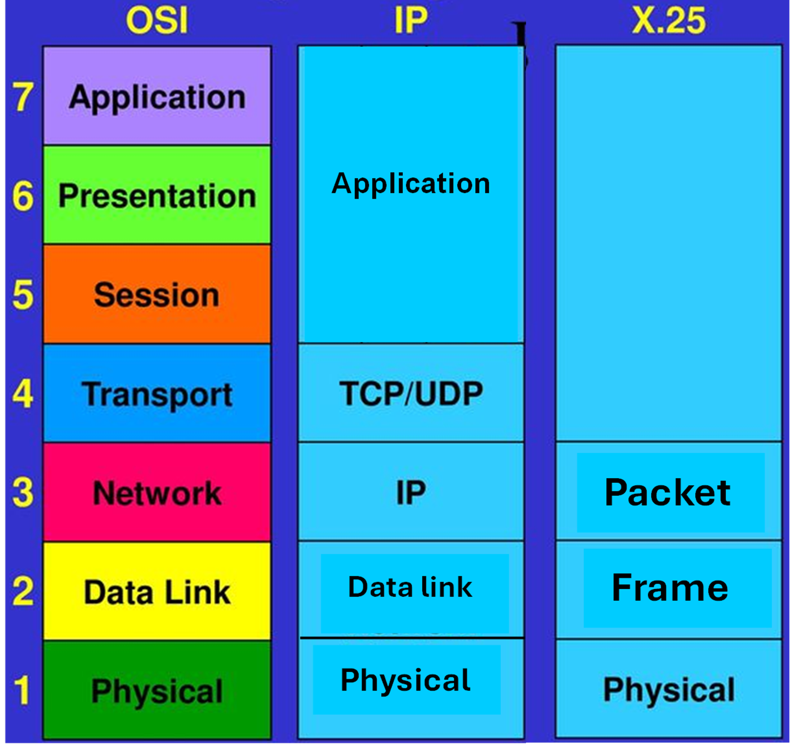
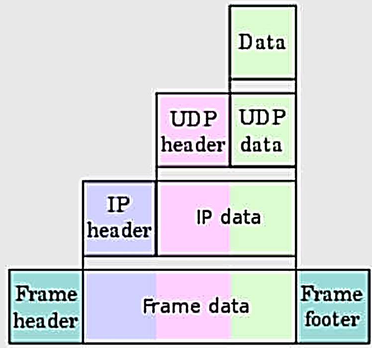
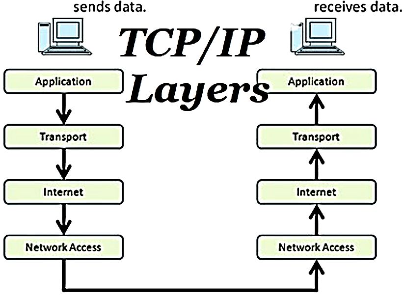
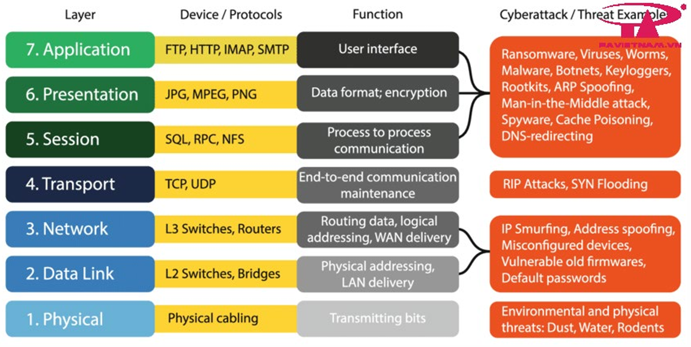
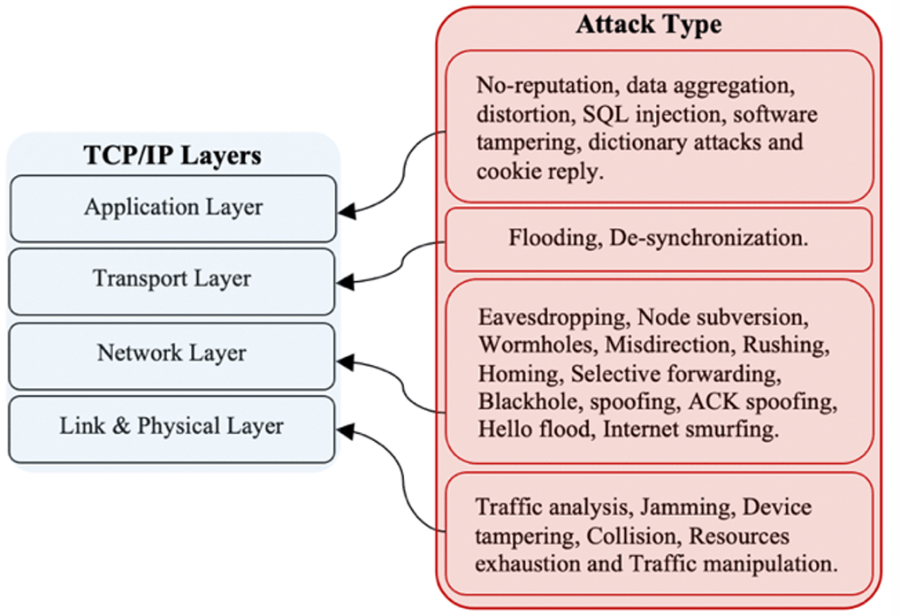
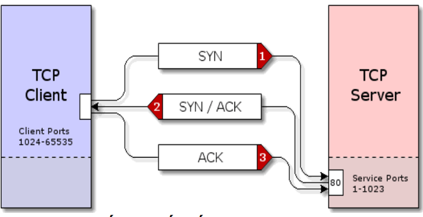
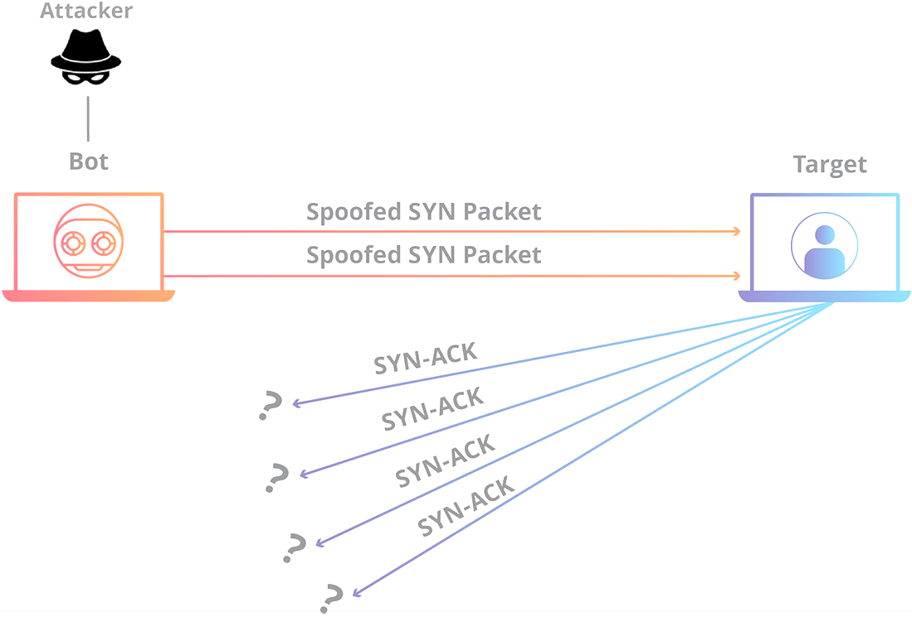
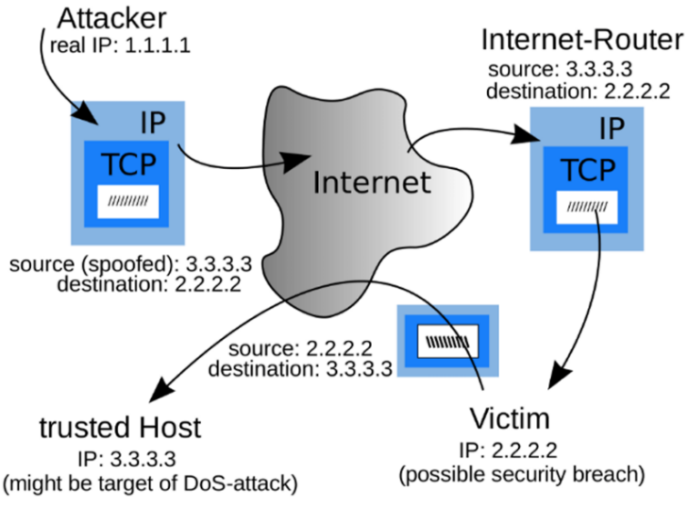
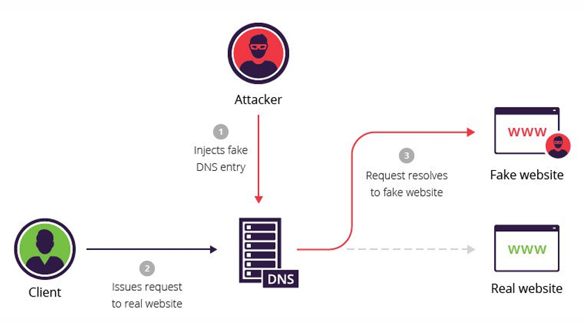

## 3.1. Lịch sử giao thức truyền thông

- 1960: ARPANET (U.S Advanced Research Projects Agency Network– Mạng lưới cơ quan dự án nghiên cứu cao cấp của Hoa Kỳ)

- 1970: Giao thức điều khiển mạng (Network Control Protocol– NCP) được triển khai trên ARPANET. Chương trình kiểm soát truyền tải (Transmission Control Program– TCP) cũng được xây dựng

- 1976: tiêu chuẩn X.25 phát triển dựa trên các mạch ảo của ITU-T

- 1982: Bộ quốc phòng Hoa Kỳ tuyên bố **TCP/IP là giao thức truyền thông tiêu chuẩn** cho tất cả các mạng máy tính quân sự 🡪 TCP/IP đã dần được phát triển như một bộ giao thức module phức tạp và đã trở thành một thành phần cốt lõi của Internet.

- **Cuộc chiến của giao thức truyền thông:**

<figcaption>
Hình 8. Cuộc chiến các giao thức truyền thông
</figcaption>

- Hiện tại áp dụng phổ biến **TCP/IP**

- **OSI** phù hợp cho điện toán đám mây.

- **X.25** cũng không biến mất hoàn toàn, nó được ứng dụng trong một số *thị trường ngách (là một phân khúc thị trường nhỏ).*

## 3.2. Giao thức truyền thông

### 3.2.1. Khái niệm và định nghĩa

- **Giao thức truyền thông - Communication protocol (giao thức giao tiếp, giao thức liên mạng, giao thức tương tác hay giao thức trao đổi thông tin),** là một tập hợp các quy tắc chuẩn cho phép hai hoặc nhiều thực thể trong một hệ thống thông tin liên lạc để trao đổi thông tin, dữ liệu qua các kênh truyền thông.

- Giao thức sẽ định nghĩa các *quy tắc (rule), cú pháp (syntax), ngữ nghĩa (semantics), sự đồng bộ (synchronization)* trong quá trình truyền thông và có thể thêm phương pháp khắc phục lỗi trên đường truyền.

- Giao thức truyền thông có thể được thực thi trên phần cứng, phần mềm hoặc cả hai.

### 3.2.2. Cách thức hoạt động

- **Mô hình OSI:** khi dữ liệu được truyền trên mạng sẽ được *chia thành nhiều giai đoạn xử lý,* bao gồm cả hệ thống. Ở mỗi giai đoạn sẽ lại có *một số hoạt động được diễn ra theo các mô hình về giao thức mạng* và khi đó *người dùng không thể biết được nó diễn ra ở giao đoạn nào* trong mô hình tiêu chuẩn.

- Tuy nhiên các giai đoạn sẽ hoạt động theo một trình tự nhất định giống nhau trên mỗi máy tính mạng.

  - Đối với những giai đoạn ở **máy tính gửi** thì sẽ phải được thực hiện **từ trên xuống dưới.**

  - Còn ở đối với **máy tính nhận** dữ liệu thì chúng phải được thực hiện **từ dưới lên.**

 

Hình 9. Mô hình TCP/IP

### 3.2.3. Các giao thức truyền thông

**a/ TCP (Transmission Control Protocol):**

- **Chức năng:** Thiết lập **kết nối ổn định** giữa các máy tính để truyền dữ liệu.

- **Cách hoạt động:** Chia dữ liệu thành **các gói nhỏ (packet)** và đảm bảo **gửi thành công** đến đúng nơi, đúng thứ tự.

- **Ví dụ:** Tải file, xem video, gửi email.

**b/ IP (Internet Protocol):**

- **Chức năng:** **Định tuyến (route)** gói dữ liệu qua Internet.

- **Cách hoạt động:** Xác định **địa chỉ IP nguồn và đích**, giúp dữ liệu **đến đúng nơi**.

- **Ví dụ:** Gửi thư cần đúng địa chỉ nhà, dữ liệu cũng vậy!

**c/ HTTP (Hypertext Transfer Protocol):**

- **Chức năng:** **Trao đổi thông tin dạng siêu văn bản (HTML)** qua Internet.

- **Cách hoạt động:** Trình duyệt dùng HTTP để **tải trang web**.

**d/ HTTPS (HTTP Secure):**

- **Chức năng:** Giống HTTP nhưng an toàn hơn.

- **Cách hoạt động: Dùng SSL/TLS mã hóa dữ liệu,** ngăn chặn việc đánh cắp thông tin.

**e/ SSH (Secure Shell):**

- **Chức năng:** **Quản lý thiết bị mạng** an toàn qua dòng lệnh.

- **Cách hoạt động:** Thay thế Telnet, **mã hóa dữ liệu** khi điều khiển máy từ xa.

**f/ FTP (File Transfer Protocol):**

- **Chức năng:** **Chuyển file** qua Internet.

- **Cách hoạt động:** Dùng để **tải lên hoặc tải xuống** file từ server.

- **Ví dụ:** Upload website lên hosting.

**g/ DNS (Domain Name System):**

- **Chức năng:** Chuyển đổi **tên miền thành địa chỉ IP**.

- **Cách hoạt động:** Khi gõ "google.com", DNS dịch thành **địa chỉ IP của Google**.

- **Ví dụ:** google.com → 142.250.182.206.

**h/SMTP (Simple Mail Transfer Protocol):**

- **Chức năng:** **Gửi email** qua Internet.

- **Cách hoạt động:** Chuyển email từ **người gửi đến server nhận**.

**i/ POP3 (Post Office Protocol v3):**

- **Chức năng:** **Nhận email** từ server về thiết bị của bạn.

- **Cách hoạt động:** Tải email xuống và **xóa khỏi server** (trừ khi cấu hình giữ lại).

**j/ MIME (Multipurpose Internet Mail Extension):**

- Một mở rộng của giao thức SMTP.

- **Chức năng:** Gửi **file đính kèm** qua email (hình ảnh, video, nhạc).

- **Cách hoạt động:** **Mã hóa file** để gửi kèm email.

**k/ WAP (Wireless Application Protocol):**

- **Chức năng:** **Trao đổi thông tin giữa thiết bị không dây** (điện thoại di động).

- **Cách hoạt động:** Dùng cho **trình duyệt web di động** đời cũ.

<figcaption>
Hình 10. Các tầng OSI và các mối đe dọa
</figcaption>

**<u>Giải thích 1 số thuật ngữ:</u>**

**RPC (Remote Procedure Call - Gọi Thủ Tục Từ Xa)** là một cơ chế cho phép một chương trình yêu cầu thực thi một hàm hoặc thủ tục trên một máy tính khác trong mạng, như thể nó đang gọi một hàm cục bộ. Điều này giúp các hệ thống phân tán giao tiếp với nhau một cách dễ dàng mà không cần quan tâm đến chi tiết mạng bên dưới.

**Cách hoạt động của RPC:**

1.  **Client gọi hàm:** Chương trình trên máy A (client) gọi một hàm như bình thường.

2.  **Chuyển đổi dữ liệu:** RPC hệ thống chuyển đổi tham số của hàm thành dạng phù hợp để truyền qua mạng (quá trình này gọi là "marshalling").

3.  **Truyền qua mạng:** Các tham số được gửi qua mạng đến máy B (server).

4.  **Thực thi hàm:** Máy B nhận yêu cầu, chuyển đổi lại dữ liệu – giải nén gói tin chứa tham số ("unmarshalling") và gọi hàm tương ứng.

5.  **Gửi kết quả:** Kết quả trả về được đóng gói và gửi lại qua mạng về máy A.

6.  **Client nhận kết quả:** Máy A nhận dữ liệu và sử dụng kết quả như một hàm bình thường.

**Ưu điểm:**

- Giúp hệ thống phân tán giao tiếp dễ dàng.

- Ẩn đi các phức tạp của việc truyền dữ liệu qua mạng.

- Cảm giác gọi hàm từ xa giống như gọi hàm cục bộ.

**Nhược điểm:**

- Phụ thuộc vào mạng — nếu mạng chậm, hàm gọi cũng chậm.

- Cần xử lý lỗi khi kết nối mạng hoặc server bị gián đoạn.

**NFS (Network File System)** là một giao thức cho phép máy tính truy cập và sử dụng file trên một máy tính khác thông qua mạng, giống như đang làm việc với file trên ổ cứng cục bộ.

Hãy tưởng tượng bạn có một **máy chủ lưu trữ file (file server) và nhiều máy trạm (clients)** **cần truy cập vào các file này.** Thay vì mỗi máy trạm phải có bản sao riêng của file, *<u>NFS giúp các máy trạm kết nối trực tiếp tới file server để đọc, ghi và thao tác file như thể các file đó đang nằm trên ổ cứng</u>* của máy trạm.

**Cách hoạt động của NFS:**

1.  **Máy chủ chia sẻ thư mục:** Trên server, một hoặc nhiều thư mục được “share” thông qua giao thức NFS.

2.  **Máy khách mount thư mục:** Máy client sẽ “mount” thư mục NFS này, làm cho thư mục từ xa xuất hiện trong hệ thống file cục bộ của máy client.

3.  **Truy cập file:** Máy client có thể mở, đọc, ghi, xóa hoặc thay đổi file trong thư mục này giống như thao tác với file trên ổ cứng nội bộ. NFS lo việc gửi các yêu cầu qua mạng và nhận phản hồi.

**\*\* Mount thư mục** nghĩa là "gắn" một thư mục hoặc thiết bị bên ngoài (như ổ cứng, USB, thư mục chia sẻ qua mạng) vào hệ thống, **để bạn truy cập nó như một thư mục bình thường.**

**Ví dụ:** Bạn có một thư mục chia sẻ trên mạng. Khi bạn mount nó vào thư mục /mnt/shared, bạn có thể mở, sao chép, chỉnh sửa file trong đó như thể nó nằm trên máy của bạn.

Khi không cần nữa, bạn **"unmount"** để ngắt kết nối.

**Ưu điểm:**

- Giúp chia sẻ file tập trung, tránh trùng lặp dữ liệu.

- Dễ quản lý backup và phân quyền.

- Máy client không cần lưu trữ quá nhiều dữ liệu cục bộ.

**Nhược điểm:**

- Phụ thuộc vào tốc độ và độ ổn định của mạng.

- Khi mạng chậm hoặc mất kết nối, việc truy cập file cũng bị gián đoạn.

- Vấn đề bảo mật nếu không cấu hình đúng.

**Các kiểu tấn công/mối đe dọa mạng trong mô hình OSI ở trên:**

**Tầng 7 + 6 + 5:**

- **Ransomware:** Mã độc mã hóa dữ liệu, buộc nạn nhân **phải trả tiền chuộc** để lấy lại dữ liệu.

- **Viruses:** Phần mềm độc hại tự gắn vào file, lây lan và phá hoại dữ liệu khi file được kích hoạt.

- **Worms:** Giống virus nhưng tự nhân bản và lây lan qua mạng mà không cần file trung gian.

- **Malware:** Thuật ngữ chung cho các phần mềm độc hại (virus, worms, spyware...).

- **Botnets:** Hệ thống các máy tính bị chiếm quyền điều khiển từ xa để thực hiện các cuộc tấn công.

- **Keyloggers:** Ghi lại mọi thao tác bàn phím để đánh cắp thông tin như mật khẩu, thẻ tín dụng.

- **Rootkits:** Phần mềm ẩn mình, giúp hacker truy cập và kiểm soát hệ thống mà không bị phát hiện.

- **ARP Spoofing:** Giả mạo địa chỉ MAC để đánh cắp dữ liệu hoặc nghe lén thông tin.

- **Man-in-the-Middle Attack (MitM):** Tấn công chặn dữ liệu truyền giữa hai bên và có thể chỉnh sửa thông tin.

- **Spyware:** Phần mềm gián điệp thu thập thông tin người dùng mà không được phép.

- **Cache Poisoning:** Tấn công làm thay đổi dữ liệu cache, dẫn người dùng đến các trang web giả mạo.

- **DNS Redirecting:** Chuyển hướng tên miền đến địa chỉ IP giả mạo, thường để lừa đảo hoặc đánh cắp thông tin.

**Tầng 4:**

- **RIP Attacks:** Tấn công vào giao thức định tuyến RIP, làm thay đổi đường đi của dữ liệu.

- **SYN Flooding:** Tấn công từ chối dịch vụ (DoS) bằng cách gửi liên tục yêu cầu SYN mà không hoàn tất kết nối, làm hệ thống quá tải.

**Tầng 3 + 2:**

- **IP Smurfing:** Giả mạo địa chỉ IP nguồn để gửi các gói tin yêu cầu, làm ngập mạng đích bằng các phản hồi.

- **Address Spoofing:** Giả mạo địa chỉ IP để che giấu danh tính hoặc thực hiện tấn công.

- **Misconfigured Devices:** Thiết bị cấu hình sai tạo ra lỗ hổng bảo mật.

- **Vulnerable Old Firmwares:** Phần mềm hệ thống (firmware) cũ chưa được cập nhật, dễ bị khai thác lỗ hổng.

- **Default Passwords:** Sử dụng mật khẩu mặc định khiến hacker dễ dàng xâm nhập.

**Tầng 1:**

- **Environmental and Physical Threats:** Các mối nguy vật lý như bụi bẩn, nước, động vật gặm nhấm làm hỏng thiết bị mạng (cáp, switch, router).

**l/ TCP/IP(Transmission Control Protocol/ Internet Protocol)**

- cho phép kết nối các hệ thống mạng không đồng nhất với nhau.

- là một giao thức mở nên các hacker có thể tìm thấy những lỗ hổng của nó một cách dễ dàng bằng cách thử nhiều kiểu tấn công khác nhau.

- Nhiều cuộc tấn công nhằm vào bộ giao thức TCP/IP bao gồm cả các cuộc *tấn công giả mạo, tấn công từ chối dịch vụ, tấn công xác thực định tuyến.*

- Công cụ để phân tích và xác định sự có mặt của các lỗ hổng và cách thức thực hiện khai thác: tường lửa, hệ thống phát hiện xâm nhập, phân tích giao thức, nghe lén và quét lỗ hổng.

**Các kiểu tấn công:**

**Application Layer (Lớp Ứng Dụng)**

- **No-reputation (Tấn công không uy tín)**: Làm giả danh tính để thực hiện các giao dịch bất hợp pháp.

- **Data aggregation (Tổng hợp dữ liệu)**: Thu thập và tổng hợp thông tin từ nhiều nguồn để phân tích, phục vụ cho việc khai thác lỗ hổng hoặc tấn công có chủ đích.

- **Distortion (Biến dạng dữ liệu)**: Thay đổi hoặc làm sai lệch thông tin được truyền, nhằm truyền thông tin giả mạo hoặc làm hệ thống hoạt động sai lệch..

- **SQL injection**: Chèn các đoạn mã SQL độc hại vào truy vấn để truy cập hoặc phá hủy dữ liệu.

- **Software tampering (Can thiệp phần mềm)**: Sửa đổi hoặc phá hoại các phần mềm đang hoạt động để thực hiện các chức năng độc hại như gián điệp, phá hoại.

- **Dictionary attacks (Tấn công từ điển)**: Thử đăng nhập bằng cách đoán mật khẩu từ danh sách phổ biến, thường áp dụng với các tài khoản không có mật khẩu mạnh.

- **Cookie reply (Tấn công cookie)**: Đánh cắp cookie của phiên làm việc và sử dụng lại để chiếm quyền truy cập.

**Transport Layer (Lớp Vận Chuyển)**

- **Flooding (Tấn công bão)**: Gửi một lượng lớn gói tin hoặc yêu cầu tới server để làm nghẽn hệ thống, khiến dịch vụ không thể đáp ứng được các yêu cầu hợp lệ.

- **De-synchronization (Làm mất đồng bộ)**: Chèn các gói tin giả mạo hoặc sai lệch để phá hoại quá trình đồng bộ dữ liệu giữa các thiết bị, làm kết nối bị gián đoạn hoặc lỗi.

**Network Layer (Lớp Mạng)**

- **Eavesdropping (Nghe lén)**: Chặn và đọc thông tin lưu lượng mạng trái phép, thường dùng các công cụ như Wireshark để thu thập dữ liệu nhạy cảm (mật khẩu, email…).

- **Node subversion (Chiếm quyền điều khiển nút)**: Tấn công và kiểm soát **một** thiết bị trong mạng (như router, switch), sau đó sử dụng nó để thao túng hoặc theo dõi lưu lượng mạng.

- **Wormholes (Tấn công đường hầm)**: Tạo một kênh truyền thông bí mật giữa hai thiết bị, khiến thông tin được định tuyến qua một đường không an toàn, từ đó nghe lén hoặc thay đổi dữ liệu.

- **Misdirection (Chỉ hướng sai)**: Điều hướng lưu lượng mạng đến một địa chỉ giả mạo hoặc độc hại, thường sử dụng tấn công ARP Spoofing hoặc DNS Spoofing.

- **Rushing (Tấn công vội vã)**: Gửi các gói tin nhanh với mục đích chiếm ưu tiên xử lý, khiến các gói tin quan trọng bị bỏ qua hoặc trì hoãn.

- **Homing (Tấn công tìm nguồn)**: Phân tích lưu lượng để xác định vị trí và thông tin của các thiết bị quan trọng trong mạng, từ đó thực hiện các cuộc tấn công nhắm mục tiêu.

- **Selective forwarding (Chặn chọn lọc)**: Chỉ chuyển tiếp một số gói tin nhất định và bỏ qua các gói tin khác, thường là gói tin quan trọng như gói xác thực hoặc điều khiển.

- **Blackhole (Tấn công lỗ đen)**: Thiết bị bị chiếm quyền điều khiển **chặn tất cả gói tin đi qua,** khiến dữ liệu không thể đến đích.

- **Spoofing (Giả mạo)**: Giả mạo địa chỉ IP, MAC hoặc thiết bị để lừa hệ **thống nhận dạng nhầm** và cung cấp quyền truy cập trái phép.

- **ACK spoofing (Giả mạo gói tin xác nhận)**: Giả mạo các gói ACK (xác nhận nhận dữ liệu) để đánh lừa hệ thống về trạng thái kết nối.

- **Hello flood (Bão gói tin Hello)**: Gửi số lượng lớn gói tin Hello để làm quá tải mạng, thường gặp trong giao thức định tuyến như OSPF.

- **Internet smurfing (Tấn công Smurf)**: Giả mạo IP nguồn và gửi nhiều gói tin yêu cầu phản hồi tới một mạng, khiến mạng này bị ngập bởi lượng lớn gói phản hồi.

**Link & Physical Layer (Lớp Liên Kết Dữ Liệu & Vật Lý)**

- **Traffic analysis (Phân tích lưu lượng)**: Theo dõi mô hình lưu lượng để xác định các thông tin như loại dịch vụ được sử dụng hoặc các thiết bị quan trọng.

- **Jamming (Nhiễu tín hiệu)**: Phát sóng hoặc tín hiệu gây nhiễu để làm gián đoạn hoặc ngắt kết nối mạng không dây.

- **Device tampering (Phá hoại thiết bị)**: Tấn công vật lý như tháo gỡ, thay thế hoặc cài đặt thiết bị độc hại vào hệ thống mạng.

- **Collision (Xung đột dữ liệu)**: Tạo ra các xung đột trên kênh truyền thông bằng cách gửi dữ liệu sai lệch hoặc liên tục để làm giảm hiệu suất mạng.

- **Resource exhaustion (Cạn kiệt tài nguyên)**: Tiêu tốn tài nguyên hệ thống như băng thông, bộ nhớ hoặc CPU bằng cách gửi lượng lớn yêu cầu hoặc gói tin.

- **Traffic manipulation (Thao túng lưu lượng)**: Thay đổi nội dung hoặc hướng đi của các gói tin nhằm làm sai lệch thông tin hoặc định tuyến mạng.

**m/ Giao thức IP**

- cung cấp khả năng kết nối các mạng con thành liên kết mạng để truyền dữ liệu.

- là một giao thức kiểu không liên kết (connectionlees), có nghĩa là không cần có giai đoạn thiết lập liên kết trước khi truyền dữ liệu.

- Đối với thực thể IP ở máy nguồn, khi nhận được một yêu cầu gửi từ tầng trên, nó thực hiện các bước sau đây:

  - Tạo một **IP datagram** dựa trên tham số nhận được.

  - Tính **checksum** và ghép vào header của gói tin.

  - Ra quyết định chọn đường: hoặc là **trạm đích nằm trên cùng mạng** hoặc **một gateway sẽ được chọn cho chặng tiếp theo.**

  - **Chuyển gói tin xuống tầng dưới** để truyền qua mạng.

**n/ Giao thức điều khiển truyền dữ liệu TCP**

<figcaption>
Hình 11. Cơ chế bắt tay 3 bước
</figcaption>

là một giao thức "hướng kết nối" (connection oriented), nghĩa là cần phải thiết lập liên kết giữa hai thực thể TCP trước khi chúng trao đổi dữ liệu với nhau.

- **Giữa client và server muốn thực hiện kết nối để trao đổi thông tin thì chúng phải thực hiện qua ba bước sau (cơ chế bắt tay ba bước)**

  - **Bước 1:** Client gửi gói tin SYN tới server thông báo yêu cầu thiết lập kết nối. Lúc này **một kết nối tiềm năng (potential connection) đã được thiết lập** giữa client và server.

    - **Nội dung gói tin SYN gồm:**

      - **Cờ SYN được bật** (SYN = 1)

      - **Sequence Number (SEQ):** Một số ngẫu nhiên (giả sử là x) được client chọn để bắt đầu phiên truyền dữ liệu.

      - **Port nguồn:** Cổng bất kỳ từ dải 1024-65535 (ví dụ: 54321)

      - **Port đích:** Cổng dịch vụ của server (thường là 80 – HTTP, 443 – HTTPS, v.v.)

  - **Bước 2:** Server sau khi nhận được tín hiệu SYN trên sẽ gửi lại cho client gói tin SYN/ACK xác nhận việc thiết lập liên kết.

    - **Nội dung gói tin SYN/ACK**

      - Cờ **SYN = 1, ACK = 1**

      - **Sequence Number (SEQ):** Server cũng chọn một số ngẫu nhiên (giả sử là y) để bắt đầu gửi dữ liệu.

      - **Acknowledgment Number (ACK):** x + 1 (Xác nhận đã nhận gói SYN từ client)

      - **Port nguồn:** Cổng dịch vụ của server (ví dụ: 80)

      - **Port đích:** Cổng client đã dùng (ví dụ: 54321)

  - **Bước 3:** Client sau khi nhận được gói tin SYN/ACK trên, nó sẽ gửi tiếp cho Server gói tin ACK. Kết thúc bước này giữa client và server đã hoàn thành một kết nối.

    - **Nội dung gói tin ACK:**

      - Cờ **ACK = 1**

      - **Sequence Number (SEQ)**: x + 1

      - **Acknowledgment Number (ACK)**: y + 1 (Xác nhận đã nhận gói SYN/ACK từ server)

  - **SYN:** là một bit cờ (flag) trong gói tin TCP/IP dùng đế thông báo bắt đầu kết nối,

  - **ACK:** là một bit cờ (flag) trong gói tin TCP/IP của bên nhận, gửi cho bên gửi để thông báo đã nhận được gói tin,

  - **SEQ:** là số thứ tự của gói tin, giúp các bên sắp xếp dữ liệu đúng thứ tự.

\
3.3. Tấn công TCP/IP
--------------------

### 3.3.1. Tấn công TCP Syn Flood

- tấn công trực tiếp vào máy chủ bằng cách tạo ra một số lượng lớn các kết nối TCP nhưng không hoàn thành các kết nối này.

- Hacker sử dụng cơ chế bắt tay ba bước trong quá trình thiết lập kết nối giữa hai thực thể TCP.

  - Máy hacker sử dụng một địa chỉ giả mạo và gửi hàng loạt bản tin yêu cầu kết nối tới máy tính nạn nhân với bit SYN được bật (bước 1)

  - khi đó nạn nhân nhận được gói tin này ngay lập tức nó sẽ dành một phần bộ nhớ cho kết nối này, & trả lời lại với bản tin bit ACK, SEQ được bật (bước 2) và chờ để hacker trả lời

  - nhưng hacker không trả lời 🡪 máy **tính nạn nhân luôn ở trong tình trạng chờ** và dần dần sẽ **cạn kiệt tài nguyên không thể phục vụ được nữa**

<figcaption>
Hình 12. Tấn công TCP SYN Flood
</figcaption>

### 3.3.2. Giả mạo địa chỉ IP (IP Spoofing)

<figcaption>
Hình 13. IP Spoofing
</figcaption>

tạo ra các gói TCP/IP sử dụng địa chỉ IP giả với mục đích để **che giấu danh tính hoặc giả mạo danh tính** chủ sở hữu của địa chỉ IP.

- Muốn thực hiện bất kỳ cuộc tấn công nào **cũng cần phải giả mạo địa chỉ IP trước**. Nếu không, khi điều tra ngược lại, hacker sẽ bị phát hiện.

- **Giả mạo địa chỉ IP cũng phải tuân theo các nguyên tắc** nhất định.

**\**

- **Attacker (Kẻ tấn công)**

  - Địa chỉ IP thật của kẻ tấn công là **1.1.1.1**

  - Nhưng kẻ tấn công **giả mạo địa chỉ IP nguồn** của họ thành **3.3.3.3** **(IP của trusted host).**

  - Gửi gói tin đến nạn nhân (Victim) với:

    - **Source (Nguồn)**: **3.3.3.3** (địa chỉ IP giả mạo)

    - **Destination (Đích)**: **2.2.2.2** (IP của nạn nhân)

- **Internet-Router**

  - Nhận gói tin và chuyển nó đến nạn nhân như bình thường.

  - Vì địa chỉ nguồn đã bị giả mạo, nên gói tin trông như được gửi từ **trusted host (3.3.3.3)**.

- **Victim (Nạn nhân)**

  - Địa chỉ IP: **2.2.2.2**

  - Tin rằng gói tin được gửi từ **3.3.3.3** nên sẽ phản hồi về IP đó.

  - Nếu đây là một cuộc tấn công DoS (Tấn công Từ chối Dịch vụ), lượng phản hồi lớn có thể làm **trusted host** bị quá tải.

  - Nếu đây là cuộc tấn công chiếm quyền, kẻ tấn công có thể lợi dụng lòng tin vào **trusted host** để vượt qua các biện pháp bảo mật.

- **Trusted Host (Máy chủ đáng tin cậy)**

  - IP: **3.3.3.3**

  - Không hề liên quan đến cuộc tấn công nhưng lại bị dồn dập nhận phản hồi từ **Victim**, dẫn đến khả năng bị gián đoạn dịch vụ (DoS).

<!-- -->

- Hành vi này có thể thực hiện các cuộc tấn công khác, gồm:

**a/ Tấn công từ chối dịch vụ (Denial of Service Attack- DoS):**

- Hacker có thể gửi một số lượng lớn các gói tin yêu cầu kết nối (SYN) tới máy nạn nhân mà không cần quan tâm phản hồi (ACK) vì Hacker sẽ không nhận được bất kỳ gói tin phản hồi từ các nạn nhân

- Tất cả gói phản hồi sẽ được hướng tới các địa chỉ IP giả mạo.

- danh tính của kẻ tấn công cũng sẽ không được tiết lộ.

- Cuộc tấn công này làm cho nạn nhân bị loại khỏi dịch vụ.

**b/ Tấn công từ chối dịch vụ phản xạ phân tán (Distributed Reflection DOS- DRDoS):**

Mục tiêu chính của DRDoS là chiếm đoạt toàn bộ băng thông của máy nạn nhân, làm tắc nghẽn hoàn toàn đường kết nối từ máy nạn nhân vào xương sống của Internet và làm tiêu hao tài nguyên.

Cách thức tấn công như sau:

1.  **Giả mạo địa chỉ IP:** Hacker giả mạo địa chỉ IP của máy nạn nhân trong các gói tin gửi đi.

2.  **Lợi dụng máy chủ trung gian:** Hacker gửi yêu cầu kết nối (SYN) đến các máy chủ có băng thông cao (gọi là máy chủ phản xạ), nhưng địa chỉ IP nguồn lại là IP của nạn nhân.

3.  **Nhân băng thông:** Các máy chủ phản xạ này phản hồi lại bằng các gói tin SYN/ACK, nhưng thay vì gửi cho hacker, chúng gửi thẳng đến máy nạn nhân.

4.  **Tắc nghẽn kết nối:** Vì có quá nhiều máy chủ phản xạ gửi phản hồi cùng lúc, băng thông của nạn nhân bị chiếm dụng hoàn toàn, khiến máy nạn nhân không thể hoạt động, và các dịch vụ như web (HTTP), email (POP3), FTP, DNS đều bị tê liệt.

**c/ Tấn công môi trường xác thực bằng địa chỉ IP:**

- Trong trường hợp mạng nội bộ, **khi xác thực bằng địa chỉ IP**, ta **không cần một tên đăng nhập hoặc mật khẩu** để truy cập.

- Hacker có thể giả địa chỉ IP để có được quyền truy cập trái phép vào máy tính nạn nhân mà không cần xác thực.

**d/ Kiểu tấn công người đứng giữa (Man in The Middle Attack):**

- Liên quan đến việc hack một phiên liên lạc được xác thực giữa hai máy tính A và B.

- Hacker sau khi hoàn thành các bước xác thực sẽ giả mạo địa chỉ IP của một nạn nhân A hoặc B đã được xác thực và nhận được các gói tin qua lại giữa hai máy A và B.

**Các biện pháp bảo vệ chống lại giả mạo địa chỉ IP (IP Spoofing):**

- Nguyên tắc bảo mật: zero-trust: qua lớp nào xác thực tại lớp đó.

- **Dùng mật mã xác thực:** ngăn chặn Man-in-the-Middle Attack

  - Sử dụng **xác thực mật mã** để đảm bảo rằng chỉ những thiết bị hoặc người dùng hợp lệ mới có thể giao tiếp với nhau.

  - **Mã hóa dữ liệu** giữa các thiết bị (ví dụ: giữa hai router hoặc giữa thiết bị đầu cuối và router) bằng **IPSec tunnel**, giúp ngăn chặn kẻ tấn công chặn và thay đổi dữ liệu.

- **Dùng danh sách kiểm tra truy cập Access Control List (ACL)** trên các interface của router.

  - chặn các gói tin có địa chỉ giả mạo từ bên ngoài nhưng lại mang địa chỉ IP nội bộ của mạng, ngăn chặn các cuộc tấn công từ chối dịch vụ (DDoS).

- **Bộ lọc các gói dữ liệu:** ngăn chặn các gói tin gửi đến mà không đáp ứng các tiêu chí chính sách bảo mật (như các yêu cầu ping từ bên ngoài mạng được lọc). Đồng thời gói tin đi ra cũng có thể được lọc dựa trên tiêu chí địa chỉ cổng, IP của nguồn hoặc đích.

- **Sử dụng lớp trên:**

  - Kiểm tra **số thứ tự của gói tin TCP** để ngăn hacker giả mạo gói tin.

  - Hacker cần đoán đúng số thứ tự mới có thể thực hiện tấn công, điều này làm cho việc giả mạo trở nên khó khăn hơn.

### 3.3.3. Hack kết nối (Connection Hacking)

Hacker có thể **chiếm quyền điều khiển phiên làm việc** giữa User và Server bằng hai cách chính:

- **Giả mạo địa chỉ IP để tiếp quản phiên làm việc**

  - Khi User và Server thiết lập kết nối ban đầu, quá trình xác thực chỉ diễn ra lúc bắt đầu.

  - Hacker có thể giả mạo địa chỉ IP của Server hoặc User để đánh lừa hệ thống, từ đó kiểm soát phiên làm việc mà không cần mật khẩu.

- **Đánh cắp cookie xác thực**

  - Hacker có thể lấy cookie của User bằng cách **nghe lén dữ liệu mạng (Sniffing)** hoặc **lấy cookie lưu trên máy nạn nhân**.

  - Sau đó, hacker sử dụng cookie này để đăng nhập vào website mà không cần nhập lại mật khẩu.

- **Cách phòng chống**

  - **Mã hóa dữ liệu**: Dùng **HTTPS, TLS/SSL** để mã hóa toàn bộ dữ liệu trao đổi giữa User và Server, ngăn hacker đọc trộm thông tin hoặc lấy cookie.

  - **Tái xác thực định kỳ**: Yêu cầu người dùng đăng nhập lại sau một khoảng thời gian nhất định để hạn chế hacker tiếp quản phiên làm việc lâu dài.

  - **Bảo vệ cookie**: Đặt cookie ở chế độ **Secure & HttpOnly**, ngăn hacker truy cập từ JavaScript hoặc qua mạng không an toàn.

### 3.3.4. Tấn công giao thức định tuyến RIP (Routing Information Protocol)

- Phiên bản chuẩn của RIP (v1) không có phần xác thực.

- Hacker có thể gửi bản tin RIP giả mạo để lừa router tin rằng, tuyến đường đi qua máy của hacker là tốt nhất 🡪 các router tin và định tuyến toàn bộ gói tin ra ngoài, đi qua máy hacker 🡪 Máy hacker có thể kiểm soát, chỉnh sửa, đánh cắp dữ liệu từ các gói tin này.

- **Phòng chống:**

  - Dùng RIP v2.

  - Dùng ACL để lọc gói tin.

  - Dùng các giao thức an toàn hơn: OSPF, EIGRP…

  - Dùng IPsec VPN (security): mã hóa thông tin định tuyến qua router, bảo mật dữ liệu khi truyền qua Internet.

  - Phân tích nhật ký (log) thường xuyên nhằm phát hiện bất thường.

    - Nếu không thể mở file log để kiểm tra, có thể sử dụng công cụ giám sát (monitoring) & trực quan hóa dữ liệu (visualization) để dễ dàng phân tích log, nhận diện xu hướng, phát hiện sự cố…

    - Các công cụ:

      - **Grafana** – Hiển thị dữ liệu theo thời gian thực với dashboard tùy chỉnh.

      - **Kibana** (thuộc bộ ELK - Elasticsearch, Logstash, Kibana) – Tìm kiếm, phân tích và vẽ biểu đồ từ log.

      - **Splunk** – Phân tích log mạnh mẽ, có khả năng tự động phát hiện sự cố.

      - **Prometheus** – Thu thập & giám sát log theo thời gian thực, thường dùng với Grafana.

      - **Graylog** – Lưu trữ, phân tích và cảnh báo dựa trên log.

### 3.3.5. Tấn công tràn ngập gói tin ICMP

- Giao thức Internet Control Message Protocol (ICMP) thực hiện truyền các thông báo điều khiển (báo cáo về tình trạng lỗi trên mạng ...) giữa các gateway hay các trạm của liên mạng.

  - Tình trạng lỗi có thể là: một datagram không thể tới đuợc đích của nó, hoặc một router không đủ bộ đệm để lưu và chuyển một datagram.

- Ping là một chương trình dùng để báo cho người sử dụng biết hai host trên mạng có thông với nhau không.

  - Ping dựa trên giao thức ICMP.

  - Nó cho phép người sử dụng gửi các gói tin tới một hệ thống ở xa và hiển thị khoảng thời gian từ khi gửi gói tin đến khi nhận được phản hồi từ phía nhận (Round Trip Time: RTT).

  - Gói tin được gửi đi là ICMP echo request, gói tin phản hồi là ICMP echo response.

- Cách thức tấn công

  - **Kẻ tấn công giả mạo IP của nạn nhân**, gửi hàng loạt gói tin **ICMP Echo Request (ping request)** đến địa chỉ broadcast của một mạng.

  - **Tất cả các thiết bị trong mạng nhận được yêu cầu ping này và phản hồi về nạn nhân** bằng ICMP Echo Response.

  - **Lưu lượng phản hồi lớn làm ngập băng thông của nạn nhân**, khiến thiết bị của họ không thể xử lý các kết nối hợp lệ, không thể giao dịch với các host khác trên mạng.

- Phòng chống:

  - Đối với các firewall cứng, kích hoạt cơ chế ICMP Flooding Protection.

  - Đối với các firewall mềm trên linux như iptables, có thể sử dụng luật sau: **\#iptables–A INPUT–picmp–mlimit–limit 2/second–limit-burst 2–j ACCEPT**

  - Đối với hệ điều hành window, chặn toàn bộ các gói tin ping bằng cách sử dụng lệnh sau trên cmd: **\#netsh firewall set icmpsetting type all mode disable**

### 3.3.6. Tấn công giả mạo DNS (DNS Snoofing Attack)

- là hình thức **tấn công lừa đảo** trong đó kẻ tấn công thay đổi bản ghi DNS để chuyển hướng người dùng đến **trang web giả mạo** thay vì trang web thật.

- **Cách thức hoạt động**

<figcaption>
Hình 14. Tấn công giả mạo DNS
</figcaption>

- **Bước 1: Kẻ tấn công chèn bản ghi DNS giả vào máy chủ DNS.**

  - Hacker tìm cách thay đổi/giả mạo bản ghi DNS trong hệ thống DNS mà client sử dụng thông qua:

  - Cache Poisoning (Đầu độc bộ nhớ DNS Cache): Kẻ tấn công gửi dữ liệu giả mạo đến DNS server, khiến server lưu trữ bản ghi giả (ví dụ: ánh xạ www.example.com đến IP của trang giả mạo).

  - Man-in-the-Middle Attack (Tấn công trung gian): Kẻ tấn công chặn và sửa đổi các phản hồi DNS trên mạng (thường qua mạng Wi-Fi công cộng không an toàn).

  - Thay đổi DNS server: Kẻ tấn công có thể cấu hình thiết bị của nạn nhân (hoặc router) để sử dụng một DNS server do họ kiểm soát.

- **Bước 2: Client gửi yêu cầu đến trang web thật**

  - Người dùng nhập tên miền của trang web thật vào trình duyệt hoặc nhấp vào một liên kết.

  - Trình duyệt gửi yêu cầu đến DNS server để phân giải tên miền thành địa chỉ IP.

- **Bước 3: Yêu cầu được phân giải đến trang web giả mạo**

  - DNS server trả về địa chỉ IP của trang web giả mạo thay vì trang web thật.

  - Trình duyệt của người dùng không biết điều này và kết nối đến trang giả mạo.

  - Trang giả thường được thiết kế giống hệt trang thật để lừa người dùng nhập thông tin nhạy cảm (như tài khoản, mật khẩu).

<!-- -->

- **Cách phòng chống**

  - Sử dụng xác thực dựa trên địa chỉ IPthay vì dựa trên tên miền.

  - Sử dụng mã hóa để ngăn chặn giả mạo DNS.

  - Sử dụng DNS an toàn: Google Public DNS (8.8.8.8) hoặc Cloudflare (1.1.1.1).

  - Kích hoạt **DNS over HTTPS (DoH)** hoặc **DNS over TLS (DoT)** để mã hóa truy vấn DNS, ngăn chặn giả mạo.

  - Kiểm tra chứng chỉ SSL/TLS: Nếu trình duyệt cảnh báo về chứng chỉ không hợp lệ, đừng tiếp tục truy cập.

  - Dùng công cụ như HSTS (HTTP Strict Transport Security) để ép trình duyệt luôn sử dụng HTTPS.

  - **Cảnh giác với mạng không an toàn:** Tránh sử dụng Wi-Fi công cộng không mã hóa, Sử dụng VPN để mã hóa toàn bộ lưu lượng mạng…

## 3.4. Công cụ bảo mật TCP/IP

### 3.4.1. Công cụ dò tìm mạng (Network Sniffer Tools)

- Giúp quản trị viên giám sát, phân tích và khắc phục sự cố mạng mà **không làm thay đổi hoặc chuyển hướng gói tin**.

<!-- -->

- **Wireshark**: Phần mềm phân tích gói tin mạnh mẽ, hỗ trợ nhiều giao thức mạng (Ethernet, Wi-Fi, PPP, loopback), hoạt động trên Windows, Linux, macOS,… Có giao diện đồ họa và dòng lệnh.

- **Tcpdump**: Công cụ dòng lệnh miễn phí, chuyên phân tích gói tin TCP/IP trên Linux và nhiều hệ điều hành khác (Solaris, BSD, Windows qua WinDump).

- **Kismet**: Kết hợp phân tích gói tin và hệ thống phát hiện xâm nhập (IDS), chuyên dùng cho mạng không dây (802.11a/b/g/n). Hoạt động trên Linux, BSD, macOS,…

- **Ettercap**: Công cụ nghe lén và tấn công mạng LAN, có thể phát hiện và theo dõi thiết bị trong mạng. Hỗ trợ Windows, Linux, macOS, BSD, Solaris.

### 3.4.2. Các công cụ quét lỗ hổng

Giúp tìm ra các điểm yếu trên mạng, hệ thống và ứng dụng. Chúng được sử dụng cả bởi hacker để khai thác lỗ hổng và quản trị viên để vá lỗi, ngăn chặn tấn công.

- **Nessus**: Ban đầu là mã nguồn mở, nay là thương mại. Phân tích mạng để tìm lỗ hổng, hỗ trợ Windows, Linux, macOS, có giao diện đồ họa dễ dùng.

- **OpenVAS**: Nhánh phát triển từ Nessus, miễn phí và quét hơn 25.000 lỗ hổng. Tích hợp trên hệ điều hành Backtrack.

- **Core Impact**: Công cụ thương mại chuyên khai thác lỗ hổng, có khả năng tự động cập nhật các phương thức tấn công mới.

- **Retina**: Quét lỗ hổng hệ thống mạng, có giao diện đồ họa nhưng chỉ hỗ trợ Windows và là phần mềm thương mại.

### 3.4.3. Công cụ phát hiện tấn công 

**Hệ thống phát hiện xâm nhập (IDS - Intrusion Detection System)** giúp nhận diện các cuộc tấn công nhưng không thể ngăn chặn chúng. Một loại IDS đặc biệt hoạt động ở lớp mạng gọi là **NIDS (Network Intrusion Detection System)**. Một số IDS phổ biến:

- **Firestorm**: Hiệu suất cao, phân tích nhiều giao thức để phát hiện mẫu độc hại, hỗ trợ quy tắc Snort. Chạy trên Linux, FreeBSD, OpenBSD, Solaris.

- **Prelude**: IDS lai, kết hợp quy tắc Snort và các IDS khác, dùng cảm biến để phát hiện gói tin độc hại. Hỗ trợ Linux, BSD.

- **Dragon**: IDS thương mại có thư viện phong phú, giao diện đồ họa thân thiện, giúp phát hiện nhiều loại tấn công.

- **Bro** (nay là Zeek): Mã nguồn mở, miễn phí trên Unix, hoạt động ở lớp mạng và ứng dụng, có thể phát hiện tấn công ẩn, mã hóa hoặc kỹ thuật né tránh phân tích.

### 3.4.4. Các công cụ phòng thủ

Hệ thống phòng thủ khác với IDS vì chúng không chỉ phát hiện mà còn có thể **ngăn chặn** các cuộc tấn công.

- **Intrusion Prevention System (IPS)**:

  - hệ thống ngăn ngừa xâm nhập, có chức năng theo dõi, ngăn ngừa kịp thời các hoạt động xâm nhập không mong muốn.

  - Chức năng chính của IPS là xác định các hoạt động nguy hại, lưu giữ các thông tin này. Sau đó kết hợp với firewall để dừng ngay các hoạt động này, và cuối cùng đưa ra các báo cáo chi tiết về các hoạt động xâm nhập trái phép trên.

  - là trường hợp mở rộng của hệ thống IDS, cách thức hoạt động cũng như đặc điểm của 2 hệ thống này tương tự nhau.

  - Điểm khác nhau duy nhất là hệ thống IPS ngoài khả năng theo dõi, giám sát thì còn có chức năng ngăn chặn kịp thời các hoạt động nguy hại đối với hệ thống.

  - Hệ thống IPS sử dụng tập luật giống như hệ thống IDS.

<!-- -->

- **Snort**:

  - IDPS mạnh mẽ nhất, hoạt động trên lớp mạng và lớp ứng dụng.

  - Phát hiện và ngăn chặn lỗi tràn bộ đệm, DDoS, quét cổng, tấn công CGI, SMB, v.v.

  - Mã nguồn mở, có nhiều nghiên cứu và phát triển.

<!-- -->

- **Suricata**:

  - Hệ thống phát hiện và phòng chống xâm nhập mã nguồn mở, miễn phí.

  - Chạy đa luồng, hiệu suất cao hơn so với nhiều IDS/IPS khác.

  - Phát hiện dựa trên nguyên tắc bất thường.

<!-- -->

- **Firewall**:

  - Phần cứng/phần mềm giúp chặn các liên lạc không mong muốn dựa trên quy tắc bảo mật.

  - Một số firewall có thể hoạt động trên lớp ứng dụng.

  - **🡪 Có thể tự tạo firewall bằng máy tính cá nhân, không cần hệ thống xịn.**

    - Điều kiện: tối thiểu có 2 cổng Ethernet: 1 cổng mạng vào, 1 cổng ra mạng nội bộ.

    - Router cũng có thể là firewall, nhưng yếu hơn.

    - Có thể đặt bao nhiêu firewall tùy ý, nhưng nếu đặt quá nhiều sẽ gây mất tính sẵn sàng – chậm.

<!-- -->

- **Netfilter**:

  - Mã nguồn mở, viết bằng C, chỉ hỗ trợ trên Linux.

  - Chạy trên giao diện dòng lệnh.

  - hỗ trợ các giao thức khác nhau trên IPv4 và bao gồm các mô-đun khác nhau để xử lý các giao thức.

<!-- -->

- **IPFilter (IPF)**:

  - Mã nguồn mở, hỗ trợ cả IPv4 và IPv6.

  - Chạy trên nhiều hệ điều hành như BSD, Linux, Solaris, AIX, OpenBSD, NetBSD, v.v.

### 3.4.5. Công cụ kiểm tra

Được sử dụng để kiểm tra lỗ hổng bảo mật trong hệ thống mạng. Chúng được cả hacker lẫn chuyên gia bảo mật sử dụng trong quá trình kiểm thử thâm nhập (Penetration Testing).

**Nmap (Network Mapper)**

- Công cụ quét, theo dõi và đánh giá bảo mật hệ thống mạng.

- Phát triển bởi **Gordon Lyon**, ban đầu dành cho Linux, sau hỗ trợ Windows, macOS, Solaris.

- Có giao diện dòng lệnh và giao diện đồ họa (Zenmap).

- Dùng để kiểm tra cổng mở, dịch vụ đang chạy, phát hiện hệ điều hành, dò tìm lỗ hổng bảo mật.

**Netcat**

- Công cụ nhỏ gọn, dễ sử dụng, được coi là **"dao đa năng"** trong mạng.

- Hỗ trợ kết nối TCP/UDP, tạo backdoor, kiểm tra phản hồi của hệ thống đối với các gói tin.

- Có thể sử dụng để **chuyển tiếp cổng (port forwarding)** và kiểm tra **dịch vụ đang chạy**.

**hping**

- Công cụ dòng lệnh mã nguồn mở để **phân tích gói tin TCP/IP**.

- Hỗ trợ nhiều giao thức: **ICMP, TCP, UDP, RAW-IP**.

- Dùng để kiểm tra firewall, tạo tấn công **DoS/DDoS giả lập**, quét cổng, kiểm tra bảo mật mạng.
