## 4.1. Tổng quan về mật mã

### 4.1.1. Nguồn gốc của mật mã học - Cryptography

- 2 nhu cầu cơ bản của con người: Giao tiếp và chia sẻ thông tin, Giao tiếp có chọn lọc

  🡪 Vì thế cần mã hóa các thông điệp truyền đi theo cách mà chỉ những người dự định mới có thể tiếp cận thông tin.

- **Tính bí mật trong bảo mật thông tin: mật mã** 🡪 'cryptography' = 'Krypto' (ẩn) + 'graphene' (viết).

- **Thuật toán atbash:** dùng một ký tự (chữ cái) thay thế cho một ký tự 🡪 thuật toán mã hóa thay thế đơn (monoalphabetic substitution).

  **🡪 thuật toán mã hóa thay thế khối (multiple alphabetic substitution):** thay thế một dãy ký tự gốc bởi một dãy ký tự mã hóa =\> nhiều khả năng tạo khóa hơn =\> khả năng bị tấn công càng giảm xuống.

- **Thuật toán “mã vòng” (cyclic code):** tương tự như thuật toán atbash nhưng là một sự thay thế theo hoán vị vòng quanh.

  - Julius Caesar **dùng hai vành tròn đồng tâm**, trên cả hai vành đều ghi bảng chữ cái La-tinh, vành trong ứng với plaintext còn vành ngoài ứng với ciphertext.

  - Chìa khóa mã hóa là **phép xoay vành tròn <u>bên ngoài</u> một số bước**, do đó các chữ cái thay đổi đi.

- **Máy mã hóa Enigma:** cơ sở từ nguyên lý mã hóa vòng 🡪 các nhà mật mã học Ba Lan đã bẻ khóa được thuật toán lập mã của Enigma 🡪 thời gian kéo dài của Thế chiến II bớt được 2 năm.

- **Tiêu chuẩn mật mã:**

  - **1975: Data Encryption Standard (DES) –** mật mã có thể truy cập công khai đầu tiên. Độ dài của khóa là 56bit, sau đó tăng lên 64 bit.

  - **2001: Advanced Encryption Standard (AES) –** Chính thức thay thế DES. Cho phép chọn độ dài khóa 128bit, 192bit, 256bit.

  - **1976: Giao thức trao đổi khóa Diffie-Hellman –** kích thích cho sự phát triển thuật toán chìa khóa bất đối xứng.

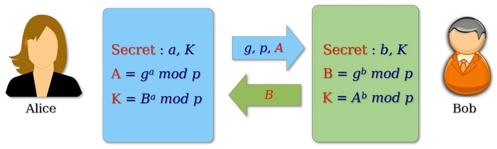
<figcaption>
Hình 15. Giao thức trao đổi khóa
</figcaption>

### 4.1.2. Khái niệm về mật mã hiện đại & các vấn đề liên quan

#### 4.1.2.1. Nguyên tắc của mật mã hiện đại

- **Mật mã hiện đại:** Quá trình mã hóa chuỗi nhị phân này thành chuỗi nhị phân khác.

- Thuật toán mã hóa dựa trên các nguyên lý toán phức tạp 🡪 Vì thế, kể cả khi biết thuật toán mã hóa, kẻ tấn công vẫn không thể đọc được dữ liệu, trừ khi có khóa bí mật.

- Các thuật toán quá phức tạp 🡪 cần được thực hiện bởi phần mềm máy tính hoặc thiết bị phần cứng chuyên dụng

- **Hiểu đơn giản:** mã hóa là một phương pháp bảo vệ thông tin, bằng cách chuyển đổi thông tin từ dạng có thể đọc và hiểu được thông thường sang dạng thông tin không thể hiểu theo cách thông thường và chỉ có người có quyền truy cập vào khóa giải mã hoặc có mật khẩu mới có thể đọc được nó. **🡪 không thể nào ngăn việc dữ liệu có thể bị đánh cắp, nhưng nó sẽ ngăn việc người khác có thể đọc được nội dung.**

- Mật mã hiện đại là nền tảng của bảo mật máy tính và truyền thông, dựa trên các khái niệm toán học: **Lý thuyết số, Lý thuyết độ phức tạp tính toán và Lý thuyết xác suất.**

- **Đặc điểm:** thông qua so sánh với mật mã cổ điển:

<table>
<caption>
Bảng 2. So sánh mật mã cổ điển &amp; mật mã hiện đại
</caption>
<colgroup>
<col style="width: 49%" />
<col style="width: 50%" />
</colgroup>
<thead>
<tr>
<th style="text-align: center;">
<strong>Mật mã cổ điển</strong>
</th>
<th style="text-align: center;">
<strong>Mật mã hiện đại</strong>
</th>
</tr>
</thead>
<tbody>
<tr>
<td>
Thao tác trực tiếp các chữ cái và chữ số
</td>
<td>
Hoạt động trên các chuỗi bit nhị phân
</td>
</tr>
<tr>
<td>
<strong>“bảo mật thông qua che khuất”:</strong> kỹ thuật được sử dụng để viết mã được giữ bí mật, chỉ những bên liên quan đến giao tiếp mới biết.
</td>
<td><ul>
<li>
Khóa bí mật được sử dụng làm hạt giống cho thuật toán.
</li>
<li>
Độ khó tính toán của thuật toán + không có khóa bí mật 🡪 kẻ tấn công không thể lấy được thông tin gốc, kể cả có biết tất cả thuật toán mã hõa.
</li>
</ul></td>
</tr>
<tr>
<td>
Toàn bộ <strong>hệ thống mật mã liên lạc</strong> một cách <strong>bí mật</strong>
</td>
<td>
Các bên liên quan đến thông tin an toàn <strong>cần sở hữu khóa bí mật</strong>
</td>
</tr>
</tbody>
</table>

- Mật mã học nghiên cứu về các hệ thống mật mã, có thể chia thành 2 nhánh:

  - **Mật mã (Cryptography):** nghệ thuật và khoa học tạo ra một hệ thống bảo mật thông tin (DL kỹ thuật số).

    - Dựa trên các thuật toán toán học, cung cấp các dịch vụ bảo mật thông tin cơ bản.

    - **Mật mã** như việc **thiết lập một bộ công cụ** lớn **chứa các kỹ thuật** khác nhau.

  - **Phân tích mật mã (Cryptanalysis):** Nghệ thuật và khoa học phá vỡ văn bản mật mã 🡪 không cần sử dụng key.

    - nghiên cứu cơ chế mật mã với mục đích phá vỡ chúng.

    - sử dụng trong **quá trình thiết kế các kỹ thuật mật mã <u>mới</u>** 🡪 kiểm tra sức mạnh bảo mật, đánh giá và cải thiện độ an toàn.

#### 4.1.2.2. Dịch vụ bảo mật mật mã

- **Tính bí mật (Confidentiality):** Đảm bao thông tin chỉ có thể truy cập bởi người có quyền.

  - Đôi khi được gọi là quyền riêng tư (privacy) hoặc bí mật (secrecy)

- **Tính toàn vẹn dữ liệu (Data integrity):** KT và đảm bảo dữ liệu không bị thay đổi trong quá trình lưu trữ, truyền đi.

- **Chứng thực (Authentication):** xác định người khởi tạo dữ liệu & xác minh họ. Có 2 biến thể:

  - **Chứng thực tin nhắn:** xác định người gửi tin nhắn, không quan tâm đến bộ định tuyến hay hệ thống đã gửi tin nhắn.

  - **Chứng thực thực thể:** đảm bảo rằng dữ liệu đã được nhận từ một thực thể cụ thể, chẳng hạn được nhận từ 1 trang web chính thống.

- **Không thoái thác (Non-repudiation):**

  - Một thực thể không thể từ chối quyền sở hữu của một cam kết hoặc một hành động trước đó (tạo hoặc truyền dữ liệu…).

  - Đảm bảo **tính xác thực** trong các giao dịch và tranh chấp.

- **Các nguyên tắc mật mã:** công cụ và kỹ thuật trong mật mã.

<table>
<caption>
Bảng 3. Các nguyên tắc mật mã
</caption>
<colgroup>
<col style="width: 19%" />
<col style="width: 20%" />
<col style="width: 19%" />
<col style="width: 20%" />
<col style="width: 20%" />
</colgroup>
<thead>
<tr>
<th style="text-align: right;">
<strong>Ng. tắc</strong>

<strong>Dịch vụ</strong>
</th>
<th style="text-align: center;">
<strong>Mã hóa (Encryption)</strong>
</th>
<th style="text-align: center;">
<strong>Hàm băm (Hash Functions)</strong>
</th>
<th style="text-align: center;">
<strong>Mã xác thực tin nhắn (Message Authentication codes - MAC)</strong>
</th>
<th style="text-align: center;">
<strong>Chữ ký số (Digital Signatures)</strong>
</th>
</tr>
</thead>
<tbody>
<tr>
<td>
<strong>Bí mật</strong>
</td>
<td style="text-align: center;">
Có
</td>
<td style="text-align: center;">
Không
</td>
<td style="text-align: center;">
Không
</td>
<td style="text-align: center;">
Không
</td>
</tr>
<tr>
<td>
<strong>Toàn vẹn</strong>
</td>
<td style="text-align: center;">
Không
</td>
<td style="text-align: center;">
Có thể có
</td>
<td style="text-align: center;">
Có
</td>
<td style="text-align: center;">
Có
</td>
</tr>
<tr>
<td>
<strong>Chứng thực</strong>
</td>
<td style="text-align: center;">
Không
</td>
<td style="text-align: center;">
Không
</td>
<td style="text-align: center;">
Có
</td>
<td style="text-align: center;">
Có
</td>
</tr>
<tr>
<td>
<strong>Không 
thoái thác</strong>
</td>
<td style="text-align: center;">
Không
</td>
<td style="text-align: center;">
Không
</td>
<td style="text-align: center;">
Có thể có
</td>
<td style="text-align: center;">
Có
</td>
</tr>
</tbody>
</table>

Các nguyên tắc mật mã có liên quan phức tạp và chúng **thường được kết hợp** để đạt được một tập hợp các dịch vụ bảo mật mong muốn từ hệ thống mật mã.

**<u>MAC - Message Authentication codes:</u>**

**Bước 1:** Gửi tin nhắn văn bản thuần túy + khóa bí mật vào hệ thống MAC, nó sử dụng các thuật toán để tạo mã MAC.

**Bước 2:** Gửi DL gốc cùng mã MAC đến nơi nhận.

**Bước 3:** Bên nhận sử dụng đúng thuật toán + khóa bí mật đó để tạo lại mã MAC cho DL họ nhận được.

**Bước 4:** So sánh mã MAC nhận được và MAC do bên nhận tính toán.

***- Nếu trùng khớp*** 🡪 DL không bị sửa đổi trong quá trình truyền.

***- Ngược lại*** 🡪 DL có thể bị loại bỏ, nhằm bảo vệ hệ thống của người nhận.

#### 4.1.2.3. Các yếu tố cơ bản của mật mã hiện đại:

- **Không khóa** – không sử dụng khóa trong quá trình xử lý. Ứng dụng:

  - Số ngẫu nhiên: Dùng trong sinh khóa/tạo giá trị ngẫu nhiên.

  - Hàm băm: tạo giá trị băm 🡪 toàn vẹn DL.

- **1 khóa** – sử dụng khóa đối xứng, cùng 1 khóa để mã hóa & giải mã. Ứng dụng:

  - Mã hóa với khóa bí mật:

    - Mã hóa khối (block cipher) – chia DL thành các khối cố định để mã hóa.

    - Mã hóa dòng (stream cipher) – mã hóa từng bit/byte liên tục.

  - MAC (Mã xác thực tin nhắn): xác thực tính toàn vẹn và nguồn gốc DL.

- **Nhiều khóa** – sử dụng khóa bất đối xứng, vói cặp khóa công khai – bí mật. Ứng dụng:

  - Mã hóa bất đối xứng: DL được mã háo bằng khóa công khai và giải mã bằng khóa bí mật (hay ngược lại).

  - Chữ ký số: xác thực danh tính, đảm bảo tính không thoái thác.

<!-- -->

- **Những hạn chế của mật mã hiện đại:**

  - **Khả năng truy cập thông tin bị hạn chế:**

    - Thông tin được mã hóa mạnh 🡪 khó truy cập ngay cả với người dùng hợp pháp trong các tình huống khẩn cấp.

    - Hệ thống mạng, máy chủ bị tấn công 🡪 không thể thực hiện giải mã đúng lúc.

  - **Không đảm bảo tính sẵn sàng cao:**

    - Mật mã chỉ bảo vệ thông tin khỏi bị truy cập trái phép, không đảm bảo hệ thống luôn hoạt động.

    - Các tấn công DoS có thể làm tê liệt hệ thống, DL không thể truy cập được dù bảo mật an toàn.

    - Cần kết hợp mật mã và các biện pháp bảo về (cân bằng tải, sao lưu, chống DdoS…)

  - **Không thay thế hoàn toàn quyền kiểm soát truy cập:**

    - không kiểm soát được ai có quyền truy cập.

    - kết hợp với các biện pháp kiểm soát hành chính như xác thực đa yếu tố (MFA), quyền truy cập theo vai trò (RBAC).

  - **Không bảo vệ khỏi lỗi thiết kế hệ thống**

    - Nếu hệ thống có lỗ hổng bảo mật hoặc giao thức kém, kẻ tấn công vẫn có thể khai thác để vượt qua lớp bảo mật mật mã.

    - Cần thiết kế hệ thống bảo mật toàn diện, kết hợp kiểm tra và đánh giá bảo mật định kỳ.

  - **Chi phí cao về thời gian và tài chính**

    - Việc bổ sung các kỹ thuật mật mã trong quá trình xử lý thông tin dẫn đến sự chậm trễ.

    - Việc sử dụng mật mã khóa công khai yêu cầu thiết lập và bảo trì cơ sở hạ tầng khóa công khai đòi hỏi ngân sách tài chính dồi dào.

#### 4.1.2.4. Tương lai của hệ thống mật mã hiện đại

- **Mật mã đường cong elliptic (ECC – elliptic-curve cryptography):**

  - là phương pháp mã hóa mạnh, cho phép truyền dữ liệu với độ bảo mật cao hơn so với các phương pháp khác.

  - Tuy nhiên, ECC vẫn cần được kiểm tra độ an toàn trước khi sử dụng rộng rãi.

  - Ứng dụng trong **mật mã kháng lượng tử, tạo hệ thống mã hóa công khai**.

  - Sử dụng các tính chất của đường cong elliptic: đường cong kì dị - khi ta biết nghiệm của phương trình vẫn không vẽ được đồ thị này.

  - Đường cong elliptic có rất nhiều nghiệm trên một trường số học lớn, thường là trường số nguyên modulo số nguyên tố hoặc một trường nhị phân. Do đó, số lượng nghiệm có thể rất lớn, làm tăng độ phức tạp của việc tìm khóa bí mật.

  - Bảo mật của ECC dựa trên độ phức tạp của bài toán logarit rời rạc trên đường cong elliptic, khiến việc tìm khóa bí mật trở nên cực kỳ khó khăn.

  - Hiệu ứng tuyết lở: một thay đổi nhỏ trong đầu vào (chẳng hạn như sai một bit) có thể dẫn đến sự thay đổi lớn trong đầu ra, đảm bảo tính bảo mật cao.

- **Tính toán lượng tử**

  - Các máy tính hiện đại lưu trữ dữ liệu bằng định dạng nhị phân được gọi là "bit", trong đó có thể lưu trữ "1" hoặc "0".

  - Máy tính lượng tử sử dụng **qubit** (bit lượng tử để lưu nhiều trạng thái) – có thể lưu 0 và 1 cùng lúc - thông qua hiện tượng **chồng chập lượng tử.**

    - Các hạt photon tồn tại một cách hỗn độn trên chính trục của nó, có thể ở trạng thái không xác định rõ ràng là đúng hoặc sai, cho đến khi được đo lường.

    - Điều này **giúp máy tính lượng tử trả về kết quả kể cả khi có lỗi/ hệ thống bị treo**.

    - **hiện tượng chồng chập lượng tử** giúp thực hiện tính toán nhanh hơn máy tính truyền thống, do có thể **xử lý song song nhiều phép tính**.

  - Hãy xem xét RSA-640, **một số có 193 chữ số**, có thể được phân tích bởi 80 máy tính với tốc độ 2,2 GHz trong khoảng thời gian 5 tháng, một máy tính lượng tử sẽ phân tích trong vòng chưa đầy 17 giây.

  - Khi máy tính lượng tử phát triển đầy đủ, nó có thể phá nhiều loại mã hóa trong vài giờ/vài phút.

### 4.1.3. Mật mã lượng tử

- Trong mật mã & truyền thông lượng tử, thông tin không còn được truyền dưới dạng tín hiệu điện/ tín hiệu bit, mà được mã hóa bởi các hạt photon.

- Điều này giúp tăng tốc độ truyền dữ liệu, cũng như giúp phát hiện nghe lén dễ dàng hơn.

- Hai ứng dụng mật mã lượng tử:

  - **Mật mã an toàn lượng tử (Post-Quantum Cryptography - PQC)**:

    - Còn được gọi là mật mã hậu lượng tử

    - **các thuật toán mật mã truyền thống được thiết kế để chống lại tấn công từ máy tính lượng tử**.

    - Không dựa vào thuộc tính lượng tử mà sử dụng các bài toán toán học phức tạp hơn.

  - **Phân phối khóa lượng tử (Quantum Key Distribution - QKD):**

    - **Sử dụng cơ học lượng tử để tạo và chia sẻ khóa mã hóa an toàn** giữa hai bên.

    - Dựa trên nguyên lý **nếu có kẻ nghe lén, trạng thái lượng tử của photon sẽ bị thay đổi**, giúp phát hiện sự xâm nhập.

    - Giao thức nổi tiếng nhất là **BB84**, cho phép hai bên thiết lập một khóa bí mật mà không bị lộ.

- **Mật mã lượng tử sử dụng các nguyên tắc của cơ học lượng tử để mã hóa dữ liệu và truyền dữ liệu theo cách không thể bị hack. Các nguyên tắc đó là:**

  - Các hạt tạo nên vũ trụ **vốn không chắc chắn** và có thể đồng thời tồn tại ở nhiều nơi hoặc nhiều trạng thái tồn tại.

  - Các photon được **tạo ra ngẫu nhiên ở một trong 2 trạng thái lượng tử.**

    - Trong hệ thống QKD BB84 Protocol, 2 trạng thái/2 cơ sở phân cực trực giao là:

      - **Horizontal-Vertical Polarizers** (Phân cực ngang-dọc):

        - **0**: Phân cực ngang (**—**)

        - **1**: Phân cực dọc (**\|**)

      - **Diagonal Polarizers** (Phân cực chéo):

        - **0**: Phân cực chéo 45° (**/**)

        - **1**: Phân cực chéo -45° (**\\**)

    - Mỗi photon chỉ tồn tại ở 1 trong 2 trạng thái này tại một thời điểm. Khi đo photon với một cơ sở không đúng với cơ sở ban đầu, KQ bị thay đổi một cách ngẫu nhiên. *(Xem ví dụ về cách hoạt động của lượng tử).*

  - **Nguyên lý bất định Heisenberg:** Bạn không thể đo một thuộc tính lượng tử mà không thay đổi hoặc làm xáo trộn nó.

    - Nếu kẻ nghe lén cố gắng đo photon, trạng thái của nó sẽ **bị thay đổi**, khiến những người đang giao tiếp với nhau phát hiện ra sự xâm nhập.

  - **Định lý không sao chép (No-Cloning Theorem):** Bạn có thể sao chép một số tính chất lượng tử của một hạt nhưng không phải toàn bộ hạt.

    - Điều này giúp bảo vệ tính bảo mật, vì kẻ tấn công không thể tạo ra một bản sao hoàn hảo của thông tin lượng tử được truyền đi.

- **Ví dụ về cách hoạt động của mã hóa lượng tử:**

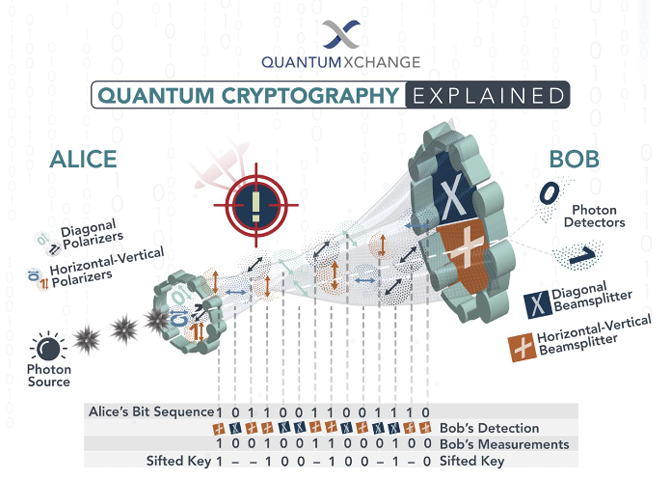
<figcaption>
Hình 16. Cách hoạt động mã hóa lượng tử
</figcaption>

- Alice gửi một chuỗi photon phân cực qua cáp quang để tạo khóa. Mỗi photon mang 1 bit (0 hoặc 1) và phân cực theo 1 trong 2 cơ sở (ngang-dọc hoặc chéo).

- Khi Bob nhận được photon từ Alice, Bob tiến hành đo photon: chọn cơ sở đo một cách ngẫu nhiên cho mỗi photon. **Có 2 bộ tách chùm tia (beam splitter)** được sử dụng:

  - **Diagonal Beamsplitter (Bộ tách chùm tia theo cơ sở chéo - "X")** 🡪 đo photon có phân cực theo cơ sở **chéo**

  - **Horizontal-Vertical Beamsplitter (Bộ tách chùm tia theo cơ sở ngang-dọc - "+") 🡪** đo photon có phân cực theo cơ sở **ngang-dọc**

- Nếu chọn đúng cơ sở, Bob nhận đúng giá trị bit của Alice. Ngược lại, giá trị bit nhận được là ngẫu nhiên.

- **Sàng lọc khóa (Sifted Key):** Alice và Bob công khai so sánh cơ sở họ đã sử dụng (nhưng không tiết lộ giá trị bit).

  - Những bit đo sai cơ sở sẽ bị loại bỏ, chỉ giữ lại những bit đo đúng.

  - Đây chính là **khóa lượng tử** chia sẻ giữa Alice và Bob.

- Nếu có kẻ nghe lén, hắn phải đọc từng photon để đọc được bí mật 🡪 trạng thái lượng tử của photon sẽ bị thay đổi 🡪Gây ra lỗi cho khóa lượng tử 🡪Nếu lỗi quá nhiều: Loại bỏ khóa đó & tạo khóa mới.

- Khi xác nhận rằng khóa không bị xâm phạm 🡪 Bob dùng khóa này để giải mã tin nhắn từ Alice.

<table>
<caption>
Bảng 4. So sánh mật mã truyền thống &amp; mật mã lượng tử
</caption>
<colgroup>
<col style="width: 49%" />
<col style="width: 50%" />
</colgroup>
<thead>
<tr>
<th style="text-align: center;">
<strong>Mật mã truyền thống</strong>
</th>
<th style="text-align: center;">
<strong>Mật mã lượng tử</strong>
</th>
</tr>
</thead>
<tbody>
<tr>
<td><ul>
<li>
Dựa trên logic kỹ thuật số
</li>
</ul></td>
<td><ul>
<li>
Dựa trên lý thuyết lượng tử
</li>
</ul></td>
</tr>
<tr>
<td><ul>
<li>
Gửi tín hiệu số sử dụng bits
</li>
</ul></td>
<td><ul>
<li>
Gửi dữ liệu thông qua các hạt hoặc photon
</li>
</ul></td>
</tr>
<tr>
<td><ul>
<li>
Không có phạm vi liên kết
</li>
</ul></td>
<td><ul>
<li>
Thường có một phạm vi liên kết (dây cáp quang và bộ repeater)
</li>
</ul></td>
</tr>
<tr>
<td><ul>
<li>
Mã hóa dựa trên các thuật toán toán học
</li>
</ul></td>
<td><ul>
<li>
Mã hóa dựa trên các thuộc tính của lượng tử
</li>
</ul></td>
</tr>
</tbody>
</table>

### 4.1.4. Hệ thống mật mã

#### 4.1.4.1. Khái niệm

- Hệ thống mật mã là việc triển khai các kỹ thuật mật mã và cơ sở hạ tầng đi kèm để cung cấp các dịch vụ bảo mật thông tin.

- Mô hình hệ thống mật mã cơ bản:

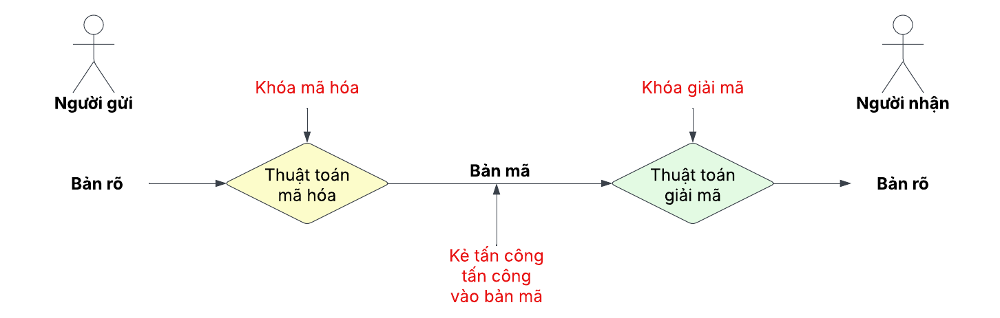
<figcaption>
Hình 17. Hệ thống mật mã cơ bản
</figcaption>

- **Bản rõ (Plaintext):** Dữ liệu gốc cần bảo vệ khi truyền.

- **Bản mã (Ciphertext):** Phiên bản đã mã hóa của bản rõ, được truyền qua kênh công khai và có thể bị chặn. Bản mã không được bảo vệ.

- **Thuật toán mã hóa (Encryption Algorithm):** quá trình toán học biến bản rõ thành bản mã bằng cách sử dụng khóa mã hóa.

- **Thuật toán giải mã (Decryption Algorithm):** Chuyển bản mã về bản rõ bằng khóa giải mã, hoạt động ngược với thuật toán mã hóa.

- **Khóa mã hóa (Encryption Key):** một giá trị mà người gửi đã biết. Giá trị do người gửi sử dụng để mã hóa dữ liệu. Người gửi nhập khóa mã hóa vào thuật toán mã hóa cùng với bản rõ để tính toán ra bản mã.

- **Khóa giải mã (Decryption Key):** là một giá trị được biết bởi người nhận. Giá trị do người nhận dùng để giải mã, có thể giống hoặc khác khóa mã hóa. Người nhận nhập khóa giải mã vào thuật toán giải mã cùng với bản mã để tính toán ra bản rõ.

<!-- -->

- **một tập hợp tất cả các khóa giải mã** có thể được gọi là **không gian khóa (key space).**

- **Kẻ tấn công (chặn – interceptor)** là một thực thể trái phép **cố gắng xác định bản rõ (plaintext).** Kẻ tấn công **có thể xem bản mã và có thể biết thuật toán giải mã.** Tuy nhiên interceptor <u>không bao giờ biết được khóa giải mã.</u>

#### 4.1.4.2. Các loại hệ thống mật mã

- **dựa trên cách thức mã hóa– giải mã:** có 2 loại hệ thống mật mã: Mã hóa khóa đối xứng & Mã hóa khóa bất đối xứng.

  - **mối quan hệ giữa khóa mã hóa và khóa giải mã:**

  - Về mặt logic, trong bất kỳ hệ thống mật mã nào, cả 2 khóa đều được liên kết chặt chẽ.

  - Thực tế, không thể giải mã bản mã bằng khóa không liên quan đến khóa mã hóa.

- **hệ thống mật mã không khóa:** hàm băm (Hash Function)

##### 4.1.4.2.1. a. Mã hóa khóa đối xứng (Symmetric Key Encryption)

- Các khóa giống nhau được sử dụng để mã hóa và giải mã thông tin 🡪 Dùng **cùng một khóa** để mã hóa và giải mã.

- Một số thuật toán nổi tiếng của mã hóa khóa đối xứng:

  - *Data Encryption Standard (DES – Tiêu chuẩn mã hóa dữ liệu)*

  - Triple-DES (3DES)

  - *AES –Rijndael (Advanced Encryption Standard – Tiêu chuẩn mã hóa tiên tiến)*

  - IDEA

  - BLOWFISH…

- **Rất khó có khả năng mã hóa đối xứng sẽ biến mất** vì nó có những ưu điểm nhất định so với mã hóa bất đối xứng.

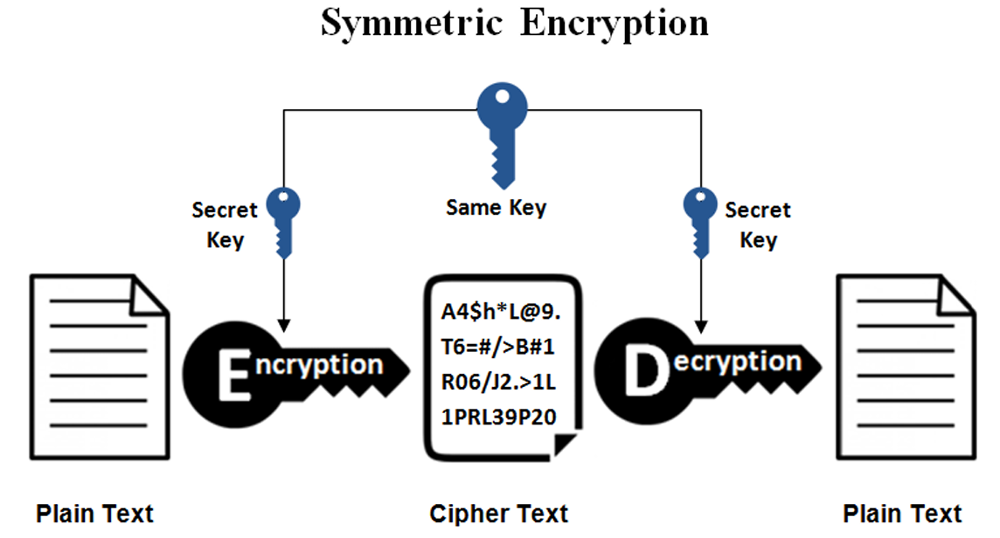
<figcaption>
Hình 18. Mã hóa khóa đối xứng
</figcaption>

- **Thách thức:**

  - **Thiết lập khóa:** Trước bất kỳ giao tiếp nào, cả người gửi và người nhận cần đồng ý về khóa bí mật. Nó yêu cầu một cơ chế thiết lập khóa an toàn tại chỗ.

  - **Sự cố tin cậy:** một yêu cầu ngầm định rằng người gửi và người nhận “tin tưởng” lẫn nhau.

    - Ví dụ: người nhận bị mất khóa vào tay kẻ tấn công và người gửi không được thông báo.

- Ngày nay, mọi người <u>cần trao đổi thông tin với những bên không quen biết và không tin cậy.</u> Những hạn chế này của mã hóa đối xứng đã dẫn đến các sơ đồ Mã hóa khóa bất đối xứng.

##### 4.1.4.2.2. b. Mã hóa khóa bất đối xứng

- các khóa khác nhau được sử dụng để mã hóa và giải mã thông tin 🡪 Dùng **hai khóa khác nhau**: khóa công khai để mã hóa và khóa riêng tư để giải mã.

- **Giải quyết vấn đề chia sẻ khóa** nhưng **hiệu suất chậm hơn** so với mã hóa đối xứng.

- Quá trình mã hóa:

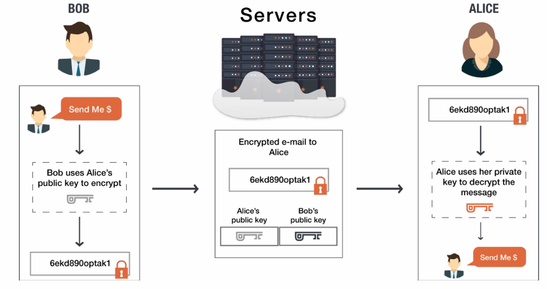
<figcaption>
Hình 19. Mã hóa khóa bất đối xứng
</figcaption>

- Bob sử dụng **khóa công khai của Alice** để mã hóa nội dung tin nhắn 🡪 Tạo ra bản mã (ciphertext).

- **Gửi bản mã qua máy chủ**. Máy chủ có thể chứa cả **khóa công khai của Alice và Bob**, nhưng không thể giải mã tin nhắn.

<!-- -->

- Alice nhận được email đã mã hóa. Dùng **khóa riêng tư của mình** để giải mã và đọc nội dung tin nhắn.

- **Lợi ích:**

  - **Bảo mật cao:** Chỉ người có khóa riêng tư mới có thể giải mã.

  - **Không cần chia sẻ khóa bí mật,** giảm rủi ro bị đánh cắp khóa.

- **Thách thức:**

  - Làm sao để người dùng tin tưởng rằng khóa công khai họ dùng để mã hóa thông tin thực sự thuộc về người họ muốn gửi, chứ không phải bị giả mạo bởi kẻ khác.

  - Để giải quyết vấn đề này, người ta thường dùng một hệ thống gọi là Cơ sở hạ tầng khóa công khai (PKI). Đây là một bên thứ ba đáng tin cậy, có nhiệm vụ **<u>quản lý và xác nhận rằng khóa công khai đó là chính xác.</u>** Khi bạn cần khóa công khai của ai đó, bên thứ ba này sẽ cung cấp và bạn tin rằng họ đưa đúng khóa.

  - Bên thứ ba này sẽ **kiểm tra danh tính của người dùng** qua các cách như chứng thực, giấy tờ công chứng hoặc một quy trình nào đó **để đảm bảo người đó là duy nhất.** Cách phổ biến nhất là **họ nhúng khóa công khai vào một chứng chỉ số, rồi ký điện tử lên chứng chỉ đó** để bạn yên tâm sử dụng.

  - Nhờ PKI, người dùng có thể **tin tưởng vào tính hợp lệ của khóa công khai**, giảm thiểu rủi ro bị giả mạo.

##### 4.1.4.2.3. c. Hàm băm - Hash function

- Hàm băm là một hàm toán học dùng để chuyển đổi một giá trị số đầu vào thành một giá trị số khác theo cách nén. Đặc điểm của hàm băm là:

<!-- -->

- **Đầu vào có thể có độ dài bất kỳ,** nhưng **đầu ra luôn có độ dài cố định.** Ví dụ:

  - SHA-256 luôn cho ra mã băm 256 bit (32 byte).

  - MD5 luôn tạo ra mã băm 128 bit (16 byte).

- Hàm băm **chỉ hoạt động theo một chiều, tức là không thể giải mã ngược lại** để lấy giá trị ban đầu (vì không có khóa).

  - an toàn cho nhiều ứng dụng như xác minh dữ liệu, bảo mật mật khẩu, chữ ký số, v.v.

  - Đây là điểm khác biệt với mã hóa đối xứng hoặc bất đối xứng (có khóa giải mã).

- Vì vậy, nó còn được gọi là **mã hóa một chiều.**

- Tuy nhiên, nếu một giá trị đầu vào phổ biến (ví dụ mật khẩu yếu) được băm, hacker có thể dò ra bằng cách tra bảng băm có sẵn (rainbow table) hoặc brute-force.

- Hàm băm được thiết kế để tính toán nhanh và hiệu quả.

<!-- -->

- **Nguyên tắc hoạt động của hàm băm mật mã**

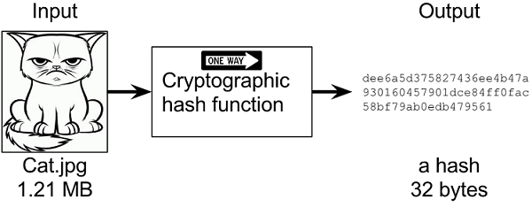
<figcaption>
Hình 20. Nguyên tắc hoạt động hàm băm - Hình 1
</figcaption>

***Creating a cryptographic hash of a cat picture.***

***Input is the cat picture and output is a big number of 32 bytes.***

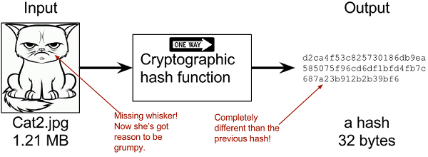
<figcaption>
Hình 21. Nguyên tắc hoạt động hàm băm - Hình 2
</figcaption>

***Hashing a modified cat picture. Can you spot the difference?***

***The cryptographic hash function certainly did.***

- **Input (Đầu vào)**

  - Ảnh một con mèo có kích thước **1.21 MB**.

  - Sau đó, hình ảnh bị thay đổi một chút: Một sợi ria mép bị mất (có thể bị chỉnh sửa).

  - Đây là một thay đổi rất nhỏ về mặt hình ảnh nhưng sẽ tạo ra sự khác biệt lớn trong kết quả băm.

- **Hàm băm mật mã (Cryptographic Hash Function)**

  - Là một hàm một chiều (One Way), tức là chỉ có thể băm dữ liệu chứ không thể đảo ngược để lấy lại dữ liệu gốc (hình ảnh con mèo).

  - Hàm này nhận đầu vào là bức ảnh và tạo ra một mã băm có độ dài cố định - gọi là **giá trị băm (hash)**.

- **Output (Đầu ra)**

  - Dãy ký tự hex (dạng mã băm) có độ dài **32 byte**.

  - Giá trị băm này có kích thước cố định, bất kể dữ liệu đầu vào lớn hay nhỏ 🡪 giúp việc lưu trữ và so sánh trở nên dễ dàng.

  - Khi chỉ thay đổi một chi tiết rất nhỏ trên ảnh đầu vào (bỏ đi một sợi ria mép), mã băm kết quả **hoàn toàn khác** so với mã băm trước đó.

  - Điều này minh họa **hiệu ứng tuyết lở (Avalanche Effect)**: Chỉ cần thay đổi một phần nhỏ của đầu vào, mã băm sẽ thay đổi toàn bộ.

<!-- -->

- **Các tính năng điển hình**

  - Hàm băm chuyển đổi dữ liệu có độ dài tùy ý thành độ dài cố định. Quá trình này được gọi là **băm dữ liệu.**

  - Hàm băm nhỏ hơn nhiều so với dữ liệu đầu vào, đó đó hàm băm đôi khi được gọi là hàm nén.

  - Vì hàm băm là đại diện nhỏ hơn của dữ liệu lớn hơn, nên nó còn được gọi là **bản tóm tắt/hàm nén** (đại diện cho dữ liệu gốc nhưng ở dạng ngắn gọn hơn).

  - **Hàm băm có đầu ra n bit được gọi là hàm băm n bit.**

  - Các hàm băm phổ biến tạo ra các giá trị từ 160 đến 512 bit.

  - Việc tính toán giá trị băm **nhanh hơn nhiều so với mã hóa đối xứng**, giúp tăng hiệu suất xử lý.

- **Thuộc tính**

  - **Chống nghịch ảnh (tính một chiều)**: Bạn không thể "đi ngược" từ giá trị băm để tìm ra dữ liệu gốc.

  - **Chống nghịch ảnh thứ hai (tính duy nhất)**: Với một dữ liệu đầu vào đã cho, **rất khó để tìm một dữ liệu đầu vào khác tạo ra cùng giá trị băm**. Điều này đảm bảo mỗi dữ liệu đầu vào có giá trị băm gần như duy nhất.

  - **Kháng va chạm**: Hai dữ liệu đầu vào khác nhau không thể tạo ra cùng một giá trị băm. Nói cách khác, hàm băm được thiết kế **để tránh "va chạm",** đảm bảo mỗi dữ liệu đầu vào cho ra một giá trị băm khác biệt.

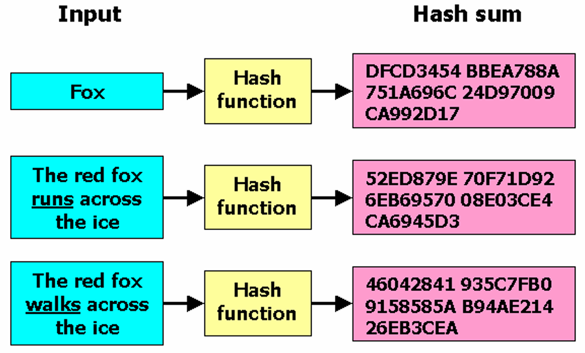
<figcaption>
Hình 22. Input &amp; output của hàm băm
</figcaption>

### 4.1.5. Đánh giá tính an toàn của một hệ mật mã

- **Kết luận hệ mã không an toàn (insecure)**: Chỉ cần chỉ ra cách phá hệ mã trong một mô hình tấn công (attack model) phổ biến, chứng minh các mục tiêu bảo mật không được đảm bảo.

- **Kết luận hệ mã an toàn**: Phức tạp hơn, cần đánh giá qua nhiều mô hình tấn công với độ khó tăng dần. Cách lý tưởng là đưa ra chứng minh toán học (formal proof), so sánh tính an toàn của hệ mã với một hệ mã kinh điển <u>đã được công nhận an toàn</u> từ lâu.

- **Phủ định tính an toàn**: Chỉ ra cách phá hệ mã trong một mô hình tấn công cụ thể, mô hình này xác định rõ năng lực của kẻ tấn công (tài nguyên tính toán, thông tin tiếp cận, khả năng tương tác với máy mật mã).

- **Mô hình tấn công**: Được xếp theo mức độ mạnh dần của kẻ tấn công. Nếu hệ mã bị phá trong mô hình cơ bản (kẻ tấn công có năng lực bình thường), hệ mã được coi là hoàn toàn không an toàn.

- **Các mô hình đánh giá tính an toàn của một hệ mật mã**

<!-- -->

- **Bảo mật vô điều kiện (unconditional security)**:

  - Mức bảo mật cao nhất, dựa trên lý thuyết thông tin và xác suất.

  - **“vô điều kiện”:** Kẻ tấn công có <u>năng lực tính toán không giới hạn</u> (có thể thực hiện bất kỳ khối lượng tính toán cực lớn nào đặt ra trong khoảng thời gian ngắn bất kỳ)<u>, nhưng chỉ biết bản mã</u> (người ngoài hoàn toàn) (tức là ứng với mô hình **tấn công chỉ biết bản mã**).

  - Hệ mật mã đạt mức này nếu vẫn an toàn trước kẻ địch như vậy, được gọi là **bí mật tuyệt đối (perfect secrecy)**.

<!-- -->

- **Bảo mật chứng minh được (provable security)**:

  - Mức bảo mật cao, lý tưởng.

  - Chứng minh bằng toán học rằng việc phá hệ mã tương đương với giải một bài toán **NP-khó** đã biết (như phân tích thừa số nguyên tố, tính logarit rời rạc...).

  - Nghĩa là kẻ tấn công phải thực hiện khối lượng tính toán cực lớn, tương đương hoặc hơn bài toán NP-khó.

<!-- -->

- **Bảo mật tính toán được (computational/practical security)**:

  - Mức bảo mật phổ biến trong thực tế <u>khi các mức cao hơn không đạt được.</u>

  - Đánh giá khối lượng tính toán cần để phá hệ mã bằng kiểu tấn công mạnh nhất đã biết, trong mô hình tấn công mạnh nhất.

  - So sánh khối lượng tính toán và thời gian thực hiện với thời gian cần đảm bảo tính mật, để xác định hệ mã có an toàn thực tiễn hay không.

  - Đôi khi dựa vào bài toán khó, nhưng không có chứng minh tương đương rõ ràng.

<!-- -->

- **Bảo mật tự tác (ad hoc security)**:

  - Áp dụng cho hệ mật mã do cá nhân/công ty tự tạo, dùng **nội bộ.**

  - Tác giả ước lượng khối lượng tính toán của kẻ địch dựa trên các tấn công mạnh đã biết, lập luận về tính bất khả thi thực tiễn.

  - Tuy nhiên, hệ mã có thể bị phá bởi các tấn công chưa biết tới, không có chứng minh đảm bảo, nên không đáng tin với đại chúng.

### 4.1.6. Các kiểu tấn công mật mã

#### 4.1.6.1. Tấn công chỉ biết bản mã (ciphertext-only attack)

- Kẻ tấn công (E) là người ngoài hoàn toàn, **chỉ có thể** nghe trộm trên đường truyền để **lấy các bản mã** (Y) – tức là thông tin đã mã hóa.

- Mục tiêu của E: **tìm ra nội dung bản rõ** (X) **hoặc lấy được khóa mật** (Z) để giải mã, bằng cách **phân tích (Analyze)** bản mã.

- Đây là mô hình tấn công cơ bản nhất, <u>kẻ địch không có mối quan hệ đặc biệt hay thông tin gì ngoài bản mã.</u>

- Nếu hệ mã không đủ mạnh, Eve có thể suy luận được bản rõ hoặc tìm ra khóa.

- Hệ mã an toàn phải đảm bảo rằng không thể giải mã chỉ từ bản mã.

- Nếu một hệ mã không vượt qua được mô hình này, nó được coi là không đáng tin cậy.

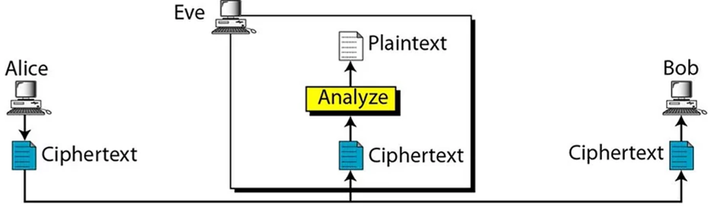
<figcaption>
Hình 23. Tấn công chỉ biết bản mã
</figcaption>

#### 4.1.6.2. Tấn công biết bản-rõ (Known-Plaintext Attack - KPA)

- Kẻ tấn công **Eve** không chỉ có bản mã (**Ciphertext**) mà còn biết trước một số bản rõ (**Plaintext**) tương ứng.

- Eve có thể lấy được những cặp này một cách tình cờ hoặc nhờ tay trong (như nhân viên cấp thấp).

- **Mục tiêu của Eve:**

  - Dùng những cặp (Plaintext, Ciphertext) đã biết để **tìm ra khóa mật**.

  - Nếu khóa mật bị lộ, Eve có thể giải mã các bản mã khác một cách dễ dàng.

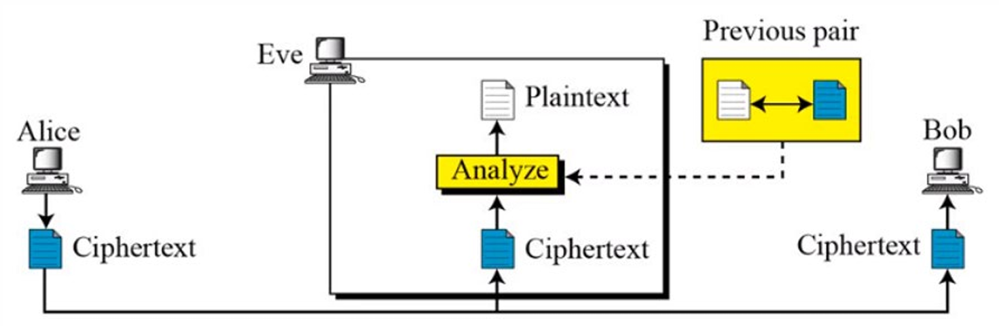
<figcaption>
Hình 24. Tấn công biết bản rõ
</figcaption>

- **Quy trình:**

  - Mọi văn bản, dù quan trọng hay không, đều phải được mã hóa khi gửi ra ngoài.

  - Nhân viên nội gián gửi một bản rõ (**Plaintext**) bình thường ra mạng. **Hệ thống mã hóa tự động (Aptomat)** sẽ mã hóa bản rõ này thành bản mã (**Ciphertext**).

  - Hacker cùng phe với nội gián nhận được **bản mã**.

  - Nhân viên nội gián **gửi lại bản rõ** cho hacker, giúp hacker có một cặp **(Plaintext, Ciphertext)**.

  - Hacker phân tích cặp này để tìm ra khóa mã hóa (Key).

  - **Nếu thành công, hacker có thể giải mã tất cả các bản mã sau đó**, vì chúng đều dùng chung một khóa.

- **Nguy hiểm hơn tấn công chỉ-biết-bản-mã vì:**

  - Eve có nhiều thông tin hơn để phân tích.

  - Có thể dùng phương pháp vét cạn không gian khóa (exhaustive key search), thử từng khóa cho đến khi tìm ra khóa đúng, tức là khóa thỏa mãn **Enc(K, X) = Y.**

  - Một số thuật toán mã hóa yếu có thể bị phá vỡ chỉ với một số cặp bản rõ - bản mã.

- Một hệ mật mã an toàn phải đảm bảo rằng ngay cả khi kẻ tấn công có một số bản rõ và bản mã, chúng vẫn **không thể tìm ra khóa hoặc đoán được bản rõ khác**.

#### 4.1.6.3. Tấn công bản rõ chọn sẵn (Chosen-Plaintext Attack - CPA)

Trong kiểu tấn công này, hacker không chỉ **có được một số cặp (bản rõ, bản mã)**, mà còn tự tạo ra một số bản rõ X theo ý muốn (**chosen plaintext**).

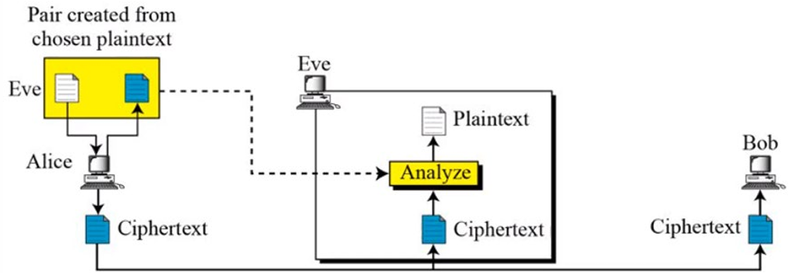
<figcaption>
Hình 25. Tấn công bản rõ chọn sẵn
</figcaption>

- Hacker **tự chọn nội dung bản rõ** để gửi vào hệ thống.

- Hệ thống của Alice mã hóa bản rõ mà Eve chọn thành bản mã (ciphertext).

- Bản mã này sau đó được gửi đi, và Eve có thể thu thập được nó (vì hắn ta có thể nghe trộm hoặc có quyền truy cập).

- **Eve giờ đây có một cặp (plaintext, ciphertext) do chính hắn ta tạo ra:** bản rõ mà cô ta chọn và bản mã tương ứng.

- Hắn quan sát **bản mã được tạo ra** để tìm quy luật mã hóa.

- Nếu thành công, hắn có thể **giải mã tài liệu quan trọng** sau này.

## 4.2. Các kỹ thuật giấu tin

### 4.2.1. Khái niệm giấu tin

Kỹ thuật **giấu tin (Information Hiding)** là phương pháp chèn (nhúng) 1 lượng thông tin số nào đó vào trong một đối tượng dữ liệu số khác, sao cho thông tin này không dễ dàng bị phát hiện. Mục đích của kỹ thuật này gồm hai yếu tố chính:

- **Bảo mật thông tin giấu**: Giữ cho thông tin giấu được an toàn và không bị lộ ra ngoài.

- **Bảo vệ đối tượng mang tin giấu**: Đảm bảo rằng đối tượng mang thông tin giấu không bị tổn hại hoặc xâm phạm.

**Từ hai mục đích này, ta có hai kỹ thuật chính:**

- **Giấu tin mật (Steganography)**: Mục tiêu chính của kỹ thuật này là bảo mật thông tin giấu. Thông tin được giấu sao cho người khác khó phát hiện và không biết có thông tin giấu trong đó hay không.

<table>
<colgroup>
<col style="width: 51%" />
<col style="width: 48%" />
</colgroup>
<thead>
<tr>
<th>
Ký hiệu tổng modulo 2

Hình 26. Giấu tin kỹ thuật số
</th>
<th><ul>
<li>
<strong>LSB (Least Significant Bit)</strong>: Phương pháp giấu tin bằng cách thay đổi bit ít quan trọng nhất trong dữ liệu của hình ảnh.
</li>
<li>
<strong>Mỗi pixel trong hình ảnh được biểu diễn bằng các giá trị số, thường là giá trị màu RGB:</strong> Red, Green, Blue; mỗi giá trị nằm trong khoảng 0-255 (8 bit).
</li>
<li>
Ví dụ: Giá trị 144 trong hệ thập phân là 10010000 trong hệ nhị phân. Bit LSB là bit cuối cùng (0 trong trường hợp này).
</li>
<li>
Thông điệp cần ẩn là chuỗi nhị phân "101001...".
</li>
</ul></th>
</tr>
</thead>
<tbody>
</tbody>
</table>

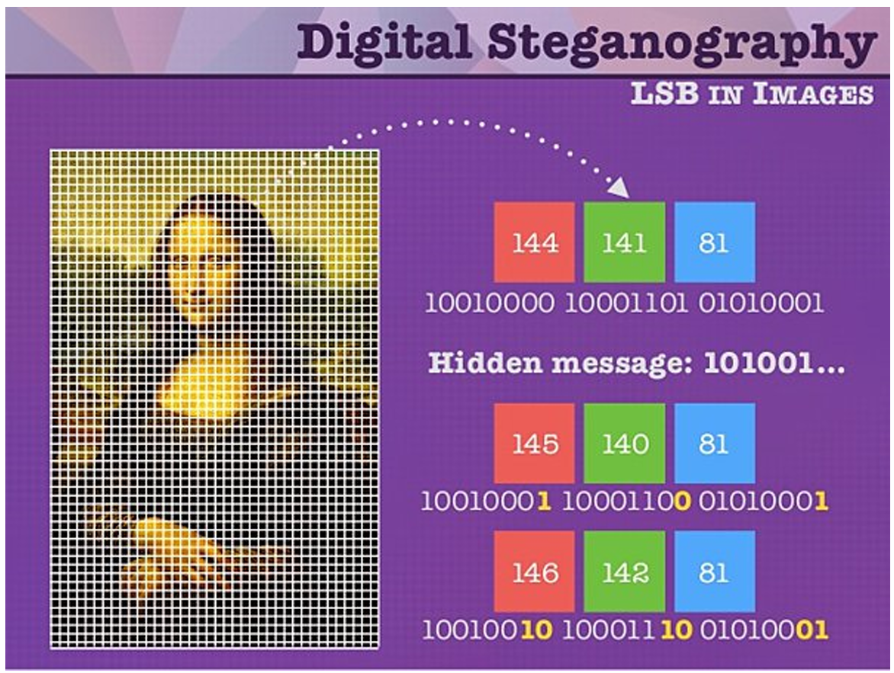

Để giấu thông điệp, ta thay đổi bit LSB của các giá trị màu trong pixel để khớp với các bit của thông điệp:

- **Hàng 1:** Giá trị ban đầu là 144 (10010000), 141 (10001101), 81 (01010001).

  - Bit LSB lần lượt là 0, 1, 1.

  - Đây là trạng thái ban đầu, chưa giấu thông điệp.

- **Hàng 2:** Giá trị thay đổi thành 145 (1001000**1**), 140 (1000110**0**), 81 (0101000**1**).

  - Bit LSB lần lượt là 1, 0, 1.

  - So với hàng 1, bit LSB của giá trị 144 đã đổi thành 1 (tương ứng với bit đầu tiên của thông điệp là 1), bit LSB của 141 đổi thành 0 (tương ứng với bit thứ hai của thông điệp là 0), bit LSB của 81 giữ nguyên là 1 (tương ứng với bit thứ ba của thông điệp là 1).

- **Hàng 3:** Giá trị thay đổi thành 146 (1001001**0**), 142 (1000111**0**), 81 (0101000**1**).

  - Bit LSB lần lượt là 0, 0, 1.

  - Tiếp tục giấu các bit tiếp theo của thông điệp (0, 0, 1).

- Sự thay đổi này rất nhỏ (ví dụ: 144 thành 145, 141 thành 140), nên hình ảnh hầu như không thay đổi khi nhìn bằng mắt thường.

- **Hạn chế:**

  - Nếu kẻ tấn công biết hình ảnh có thể chứa thông điệp ẩn và kiểm tra bit LSB của các pixel, họ có thể trích xuất thông điệp.

  - Phương pháp LSB không quá an toàn nếu không kết hợp với các kỹ thuật mã hóa khác, vì nó dễ bị phát hiện bởi các công cụ phân tích hình ảnh.

<!-- -->

- **Thủy vân số (Watermarking)**: Mục đích của kỹ thuật này là bảo vệ chính đối tượng chứa thông tin giấu, chẳng hạn như bảo vệ bản quyền hoặc phát hiện sự thay đổi của thông tin. Thủy vân số giúp đảm bảo một số các yêu cầu như: **tính bền vững, khẳng định bản quyền sở hữu hay phát hiện xuyên tạc thông tin.**

### 4.2.2. Mô hình kỹ thuật giấu thông tin cơ bản

\- Để giấu thông tin vào một đối tượng số (như ảnh, âm thanh, văn bản...), ta cần thực hiện một số bước nhất định. Những bước này tạo thành **các thủ tục giấu tin**, giúp nhúng thông tin vào môi trường chứa một cách an toàn và bảo mật.

\- Các thủ tục giấu tin thường được thực hiện với một khóa giống như các hệ mật mã để tăng tính bảo mật.

**- Các thành phần chính trong quá trình giấu tin:**

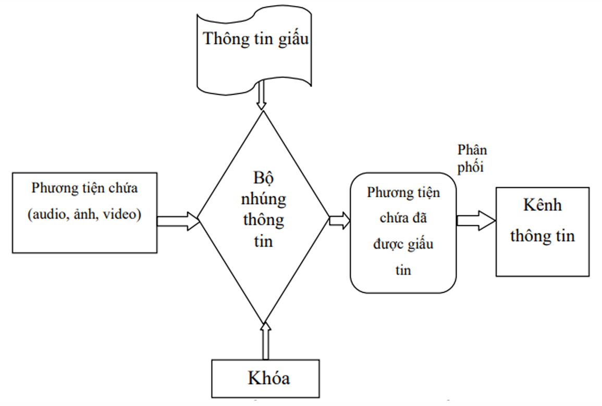
<figcaption>
Hình 27. Các thành phần của quá trình giấu tin
</figcaption>

- **Thông tin cần giấu:** Đây là dữ liệu mà ta muốn giấu đi, có thể là: **Thông điệp bí mật** (nội dung quan trọng cần giữ kín), **Logo hoặc hình ảnh bản quyền** (để bảo vệ quyền sở hữu).

- **Phương tiện chứa:** Là nơi chứa thông tin giấu, có thể là: **Ảnh (image), Văn bản (text), Âm thanh (audio), Video…**

- **Bộ nhúng thông tin**

  - Là các chương trình hoặc thuật toán giúp nhúng thông tin vào phương tiện chứa.

  - Các thuật toán này có thể sử dụng **khóa bảo mật**, giống như trong mật mã, giúp tăng độ an toàn cho dữ liệu giấu.

- **Đầu ra (phương tiện chứa sau khi giấu tin)**

  - Sau khi giấu tin, ta thu được một đối tượng chứa thông tin ẩn mà người khác khó nhận ra.

  - Đối tượng này *có thể được gửi đi hoặc phân phối qua các kênh thông tin* mà không gây nghi ngờ.

\- Nói một cách dễ hiểu, quá trình giấu tin giống như việc viết một tin nhắn bí mật vào một bức tranh sao cho người khác không biết có tin nhắn ở đó.

**- Tách thông tin giấu (quá trình ngược lại):** Khi cần lấy lại thông tin, ta sử dụng **thuật toán giải mã** để trích xuất dữ liệu từ đối tượng chứa.

- Sau khi nhận được đối tượng phương tiện chứa có giấu thông tin, quá trình giải mã được thực hiện thông qua **một bộ giải mã** tương ứng với **bộ nhúng thông tin cùng với khoá** của quá trình nhúng.

- Kết quả thu được gồm phương tiện chứa gốc và thông tin đã giấu.

- Bước tiếp theo thông tin đã giấu sẽ được xử lý kiểm định so sánh với thông tin ban đầu.

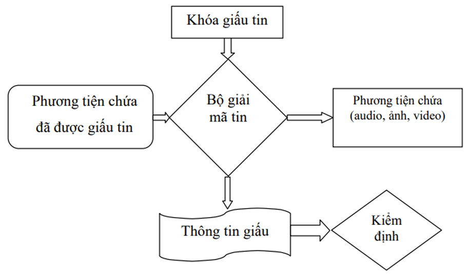
<figcaption>
Hình 28. Các thành phần của quá trình giải mã
</figcaption>

### 4.2.3. Môi trường giấu tin

#### 4.2.3.1. Giấu thông tin trong ảnh số (Data Hiding in Image)

**Giấu thông tin trong ảnh số** là một kỹ thuật quan trọng trong lĩnh vực **giấu tin**. Ở đây, ảnh số được sử dụng làm **phương tiện chứa**, nghĩa là thông tin sẽ được nhúng trực tiếp vào trong ảnh mà không làm thay đổi đáng kể chất lượng hoặc kích thước của ảnh.

**Vì sao giấu tin trong ảnh được sử dụng nhiều?**

1.  **Ảnh số có dung lượng lớn** → Có nhiều không gian để giấu thông tin mà không dễ bị phát hiện.

2.  **Khó nhận biết sự thay đổi** → Mắt người khó phân biệt ảnh gốc và ảnh đã bị nhúng thông tin.

3.  **Dễ phân phối qua internet** → Ảnh là một loại dữ liệu phổ biến, dễ dàng chia sẻ qua các nền tảng trực tuyến.

4.  **Ứng dụng trong bảo mật thông tin** → Giúp bảo vệ nội dung và quyền sở hữu số.

**Ứng dụng của giấu tin trong ảnh số**

- **Xác thực thông tin** → Kiểm tra xem ảnh có bị chỉnh sửa hay chưa.

- **Phát hiện thay đổi thông tin** → Phát hiện ai đó đã chỉnh sửa hoặc giả mạo nội dung ảnh.

- **Bảo vệ bản quyền tác giả** → Nhúng dấu hiệu bản quyền (watermark) vào ảnh để chống sao chép trái phép.

- **Điều khiển truy cập** → Chỉ những người có khóa giải mã mới đọc được thông tin giấu.

- **Giấu thông tin mật** → Che giấu dữ liệu quan trọng khỏi những người không có quyền truy cập.

Ngày nay, khi ảnh số trở nên phổ biến, kỹ thuật **giấu thông tin trong ảnh** đã được ứng dụng rộng rãi trong nhiều lĩnh vực quan trọng.

- **Xác thực danh tính trong ngân hàng và tài chính**

  - Ở các nước phát triển, **chữ ký tay** đã được số hóa và lưu trữ trong các hệ thống ngân hàng.

  - Kỹ thuật giấu tin giúp nhúng chữ ký vào ảnh, đảm bảo tính xác thực và bảo mật khi sử dụng thẻ tín dụng hoặc giao dịch trực tuyến.

- **Nhận diện và bảo mật thông tin cá nhân**

  - Các tài liệu quan trọng như **chứng minh thư, căn cước công dân, hộ chiếu** có thể chứa thông tin ẩn trong ảnh thẻ để kiểm tra tính xác thực.

  - Điều này giúp **chống giả mạo, phát hiện thay đổi** hoặc sai lệch thông tin cá nhân.

- **Truyền thông tin mật**

  - Thông tin được giấu vào ảnh một cách **“vô hình”**, có nghĩa là không ai có thể phát hiện ra sự thay đổi bằng mắt thường.

  - Điều này đặc biệt hữu ích trong các hệ thống an ninh, nơi cần trao đổi thông tin mà không bị phát hiện.

- **Ảnh màu và ảnh xám – Môi trường giấu tin lý tưởng**

  - Sau khi giấu tin, **chất lượng ảnh gần như không thay đổi**, đặc biệt là với ảnh màu hoặc ảnh xám.

  - Điều này giúp đảm bảo thông tin được giấu kín mà không ảnh hưởng đến trải nghiệm thị giác của người dùng.

#### 4.2.3.2. Giấu thông tin trong audio (Data Hiding inAudio)

**Điểm khác biệt giữa giấu tin trong audio và ảnh**

- **Giấu tin trong ảnh** dựa trên **hệ thống thị giác của con người (HVS – Human Vision System)**, nơi mắt khó phát hiện sự thay đổi nhỏ trong hình ảnh.

- **Giấu tin trong audio** dựa trên **hệ thống thính giác (HAS – Human Auditory System)**, nơi tai con người có thể nghe được tín hiệu trong dải tần rộng nhưng lại kém nhạy với sự thay đổi của các tần số khác nhau.

**Những thách thức**

- Con người có thể nhận biết những thay đổi nhỏ về âm thanh nếu không được giấu đúng cách.

- Tuy nhiên, **tai người khó phân biệt được sự khác nhau giữa các dải tần và cường độ âm**, giúp các kỹ thuật giấu tin có thể lợi dụng điều này.

- Khi truyền file audio qua mạng, đặc biệt là qua băng thông thấp, dữ liệu có thể bị suy hao.

- Điều này ảnh hưởng đến việc trích xuất thông tin đã giấu.

**Ứng dụng của giấu tin trong audio**

- **Bảo vệ bản quyền nhạc số** → Nhúng watermark vào file âm thanh để chứng minh quyền sở hữu.

- **Truyền thông tin bí mật** → Giấu tin trong file nhạc để trao đổi thông tin an toàn.

- **Xác thực nội dung âm thanh** → Kiểm tra xem file audio có bị chỉnh sửa hay không.

**Yêu cầu khi giấu tin trong audio**

- **Tính đồng bộ** → Đảm bảo thông tin được giấu có thể được trích xuất chính xác.

- **Tính bảo mật/an toàn** → Thông tin giấu phải khó bị phát hiện và giải mã nếu <u>không có khóa</u>.

- **Ảnh hưởng tối thiểu đến chất lượng âm thanh** → Không làm thay đổi đáng kể trải nghiệm nghe của người dùng.

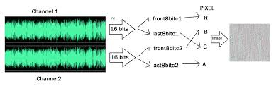
<figcaption>
Hình 29. Giấu tin trong audio
</figcaption>

- **Channel 1 và Channel 2**:

  - Đây là hai kênh âm thanh (thường là âm thanh **stereo, với kênh trái và kênh phải**).

  - Mỗi kênh được biểu diễn dưới dạng **sóng âm**

  - Dữ liệu âm thanh được lấy mẫu (sample) **thành các giá trị số, mỗi mẫu có độ dài 16 bit.**

- Từ mỗi kênh âm thanh, dữ liệu 16 bit của một mẫu được chia thành hai phần:

  - **front8bit**: 8 bit đầu tiên (bit quan trọng nhất).

  - **last8bit**: 8 bit cuối cùng (bit ít quan trọng hơn).

- Cụ thể:

  - Từ Channel 1:

    - 8 bit đầu tiên (front8bitc1) được gán cho kênh màu **R (Red)**.

    - 8 bit cuối cùng (last8bitc1) được gán cho kênh màu **B (Blue)**.

  - Từ Channel 2:

    - 8 bit đầu tiên (front8bitc2) được gán cho kênh màu **G (Green)**.

    - 8 bit cuối cùng (last8bitc2) được gán cho kênh màu **A (Alpha)** (kênh trong suốt, nếu hình ảnh hỗ trợ).

- Các giá trị R, G, B, A được kết hợp để tạo thành một pixel.

- Nhiều pixel như vậy được tạo ra từ các mẫu âm thanh liên tiếp, <u>cuối cùng hình thành một hình ảnh.</u>

- Hình ảnh đầu ra là một hình ảnh xám, có thể chứa thông tin ẩn từ dữ liệu âm thanh.

#### 4.2.3.3. Giấu thông tin trong video (Data Hiding in Video)

Phương pháp giấu tin trong video theo **COX** là một kỹ thuật phổ biến, trong đó **thông tin giấu được phân phối đều theo tần số của dữ liệu gốc**.

**Nguyên lý của phương pháp COX**

- **Phân bố dàn trải thông tin giấu** theo các dải tần số khác nhau trong video.

- **Sử dụng các hàm cosin riêng và hệ số truyền sóng riêng** để giấu tin, giúp thông tin hòa trộn tự nhiên vào video.

- **Tăng cường độ bền vững** → Thông tin giấu khó bị mất ngay cả khi video bị nén hoặc chỉnh sửa.

**Sự phát triển của kỹ thuật giấu tin trong video**

- **Trước đây**, chỉ có thể giấu ảnh vào trong video.

- **Hiện nay**, với các kỹ thuật mới, có thể **giấu cả hình ảnh và âm thanh** vào video, mở rộng phạm vi ứng dụng.

**Ứng dụng của giấu tin trong video**

- **Bảo vệ bản quyền** → Nhúng watermark vào video để chứng minh quyền sở hữu.

- **Xác thực nội dung** → Kiểm tra xem video có bị chỉnh sửa hoặc giả mạo hay không.

- **Truyền thông tin bảo mật** → Giấu thông tin nhạy cảm trong video để tránh bị phát hiện.

**Lợi ích của phương pháp phân bố đều**

- **Khó bị phát hiện** → Thông tin được dàn trải, không tập trung vào một khu vực cụ thể.

- **Chống lại tác động của nén video (như MP4, H.264, H.265)**.

- **Bền vững khi chỉnh sửa video** → Có thể trích xuất lại thông tin ngay cả khi video bị thay đổi một phần.

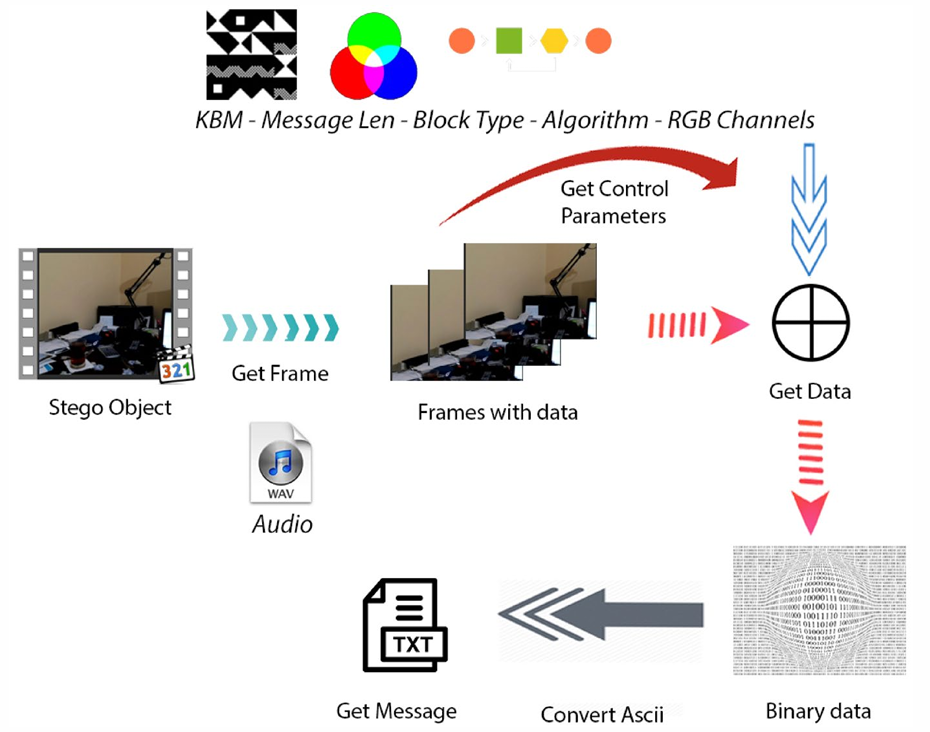
<figcaption>
Hình 30. Giấu tin trong video
</figcaption>

**Quy trình giấu tin:**

- **Bắt đầu với video (Stego Object)**:

  - Video gốc được chọn để giấu thông điệp.

  - Video này được chia thành các khung hình (frames) thông qua bước "Get Frame".

- **Lấy thông điệp cần giấu**:

  - Thông điệp có thể là **văn bản (TXT) hoặc âm thanh (WAV).**

  - Thông điệp được chuyển thành dạng **<u>nhị phân</u>**:

    - **Văn bản:** Chuyển từ **ASCII sang nhị phân**.

    - **Âm thanh:** Chuyển dữ liệu **âm thanh thành chuỗi nhị phân.**

- **Lấy tham số điều khiển (Get Control Parameters)**:

  - Xác định các tham số như **độ dài thông điệp, loại khối, thuật toán, và cách sử dụng kênh RGB** để giấu tin. Các tham số này được lấy <u>từ một nguồn</u> (có thể là người dùng hoặc hệ thống) để điều khiển quá trình giấu tin.

- **Giấu thông điệp vào khung hình**:

  - Sử dụng thuật toán giấu tin (dựa trên tham số điều khiển), **thông điệp nhị phân** được nhúng vào các **khung hình**.

  - **Ví dụ:** Nếu dùng phương pháp LSB, các bit của thông điệp sẽ **thay thế bit LSB** của giá trị màu R, G, B trong các pixel của khung hình.

- **Tạo khung hình chứa dữ liệu (Frames with data)**:

  - Sau khi giấu tin, các khung hình vẫn trông giống như ban đầu (vì thay đổi rất nhỏ), <u>nhưng đã chứa thông điệp ẩn</u>.

#
