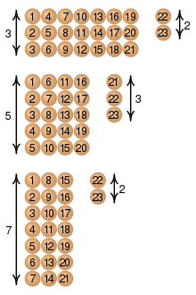
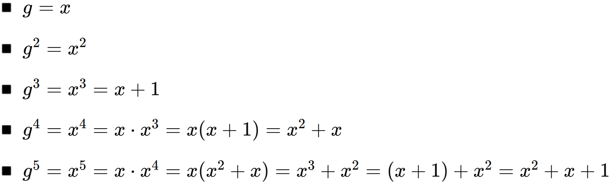
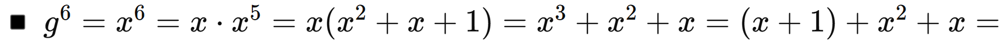
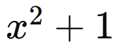
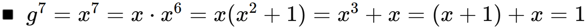
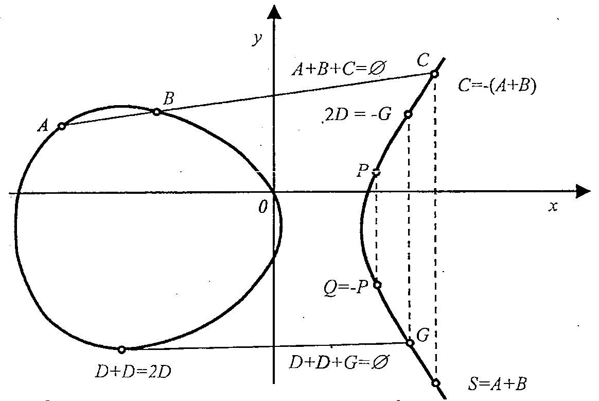

## 5.1. Thuật toán

- **Thuật toán** là một chuỗi hữu hạn các chỉ dẫn nghiêm ngặt được sử dụng để tìm lời giải cho một loại bài toán cụ thể.

- Các thuật toán được **sử dụng làm thông số kỹ thuật** để thực hiện tính toán và xử lý dữ liệu.

- Các thuật toán có thể **được thể hiện bằng nhiều loại ký hiệu**, bao gồm mã giả, lưu đồ, biểu đồ drakon, ngôn ngữ lập trình hay bảng điều khiển

- Một thuật toán tốt phải thỏa mãn các đặc tính sau:

  - **Tính hữu hạn:** Thuật toán phải kết thúc sau một số hữu hạn bước thực hiện.

  - **Tính xác định:**

    - Mỗi bước trong thuật toán phải rõ ràng, có ý nghĩa cụ thể.

    - Nếu thuật toán thực hiện nhiều lần với cùng một bộ dữ liệu đầu vào thì kết quả đầu ra phải giống nhau.

- **Độ phức tạp của thuật toán** dựa trên số các phép tính phải làm khi thực hiện thuật toán.

- Khi tiến hành cùng một thuật toán, số các phép tính phải thực hiện còn phụ thuộc vào độ lớn của dữ liệu đầu vào. Vì thế, độ phức tạp của thuật toán sẽ là một hàm số của độ lớn đầu vào.

- Độ phức tạp của một thuật toán còn được đo bằng số các phép tính bit. Phép tính bit là một phép tính logic hay số học thực hiện trên các bit 0 và 1. Việc đo bằng số phép tính bit giúp đánh giá **chi tiết hơn về chi phí thực sự mà máy tính phải thực hiện**.

## 5.2. Hàm XOR trong mật mã

- Độ dài (kích thước số bit) của khóa *K* rõ ràng có tác động rất lớn đến khả năng bảo mật của mã đối xứng.

- Nếu bạn dùng khóa có độ dài ***n* bit**, thì số khóa có thể tạo ra là 2*n*. Ví dụ:

  - Khóa dài **56 bit** ⇒ 256 ≈ 7.2×1016 khóa khác nhau.

  - Khóa dài **128 bit** ⇒ 2128 ≈ 3.4×1038 khóa — cực kỳ khó bị tấn công bằng brute-force.

    ⇒ **Độ dài khóa càng lớn → bảo mật càng cao**, vì số khả năng cần thử trong tấn công brute-force tăng theo cấp số mũ.

- Phép *XOR* thực hiện rất nhanh ở mức phần cứng (bitwise), chỉ cần **1 phép toán logic đơn giản** trên từng bit (chỉ so sánh và trả về giá trị 0 hoặc 1 dựa trên hai bit đầu vào). Do đó, **tốc độ mã hóa/giải mã cao** — rất phù hợp cho các ứng dụng yêu cầu **hiệu suất thời gian** cao như truyền thông, IoT, hoặc mã hóa theo luồng (stream cipher).

- Hơn nữa, *XOR* có **tính chất thuận nghịch**: Nếu *C* = *P* ⊕ *K*, thì *P* = *C* ⊕ *K*. Tính chất này cho phép sử dụng cùng một phép toán cho cả mã hóa và giải mã, giúp đơn giản hóa thiết kế thuật toán.

- Và vì các phép *OR* và *AND* **không** có tính thuận nghịch, do đó, *OR* và *AND* không phù hợp cho mã hóa vì không thể giải mã một cách đáng tin cậy.

  - **XOR là khả nghịch:** Nếu $C = A \oplus K$, thì ta có thể khôi phục lại $A = C \oplus K$ → Cùng một phép toán (XOR) có thể dùng để vừa mã hóa vừa giải mã.

  - **AND và OR thì không khả nghịch:** Nếu $C = A\text{ AND }K$, thì từ $C$ không thể biết chắc được $A$ là gì, vì thông tin đã bị mất (bit nào là 0 thì không thể phục hồi).

    - Ví dụ: $A = 1010$, $K = 1100$ → $C = A\text{ AND }K = 1000$

      → Không thể đảo ngược để tìm lại $A$.

## 5.3. Giải thuật Euclide

### 5.3.1. Ước số và số nguyên tố

- Với *a, b* ∈ ℤ ta nói rằng b chia hết cho *a*, nếu như ***b* có thể viết thành tích của *a* với một số nguyên khác**$\left( b = m.a,m\mathbb{\in Z} \right)$, lúc đó ta có thể nói rằng *b* chia hết cho *a*, hay *a* là một ước số của *b*, ký hiệu *a*\|*b*.

- **1 số tính chất:**

  - Nếu *a, b*, *c* ∈ ℤ và *a*\|*b* thì *a*\|*bc*;

  - Nếu *a*\|*b* và *b\|c* thì *a*\|*c*;

  - Nếu *a*\|*b* và a\|c thì *a*\|*b* ± 𝑐;

  - Nếu *a*\|*b* và a∤c thì *a*∤*b* ± 𝑐;

- Số tự nhiên **lớn hơn 1** mà không chia hết cho số tự nhiên nào khác, **trừ chính nó và 1** thì được gọi là số nguyên tố. Ngược lại, số đó được gọi là **hợp số.**

- **Hệ quả:**

  - Nếu *p* là một số nguyên tố và *p\|ab* thì ít nhất một trong 2 số *a, b* phải chia hết cho *p*.

  - Ước chung lớn nhất của 2 số tự nhiên *a*, *b* là số lớn nhất trong tập các ước chung của 2 số đó, được ký hiệu là *gcd(a,b) (Greatest common divisor).*

  - Khi **2 số tự nhiên** có ước chung lớn nhất *gcd(a,b)=1* thì chúng được gọi là **nguyên tố cùng nhau.**

### 5.3.2. Giải thuật Euclide & Euclide mở rộng

**Thuật toán Euclide ban đầu** được phát biểu như sau: *UCLN của hai số nguyên a và b (với b ≠ 0) không thay đổi khi thay số lớn hơn bằng hiệu của nó với số nhỏ hơn. Quá trình thay thế này được lặp đi lặp lại cho tới khi hai số bằng nhau, khi đó UCLN chính là một trong hai số.*

Tuy nhiên, thuật toán này không hiệu quả khi khoảng cách hai số là rất lớn. Ví dụ, tìm UCLN(1000000000, 1) thì thuật toán cần lặp 999999999 lần.

Vì thế, người ta cải tiến thuật toán Euclide như sau: *UCLN của hai số nguyên a và b (với b ≠ 0) không thay đổi nếu ta thay số lớn hơn bằng số dư của phép chia số lớn cho số nhỏ.* Nói cách khác, ta có: **UCLN(*a*, *b*) = UCLN(*b*, *a* % *b*).** *Thuật toán thực hiện việc thay thế này nhiều lần cho đến khi số dư bằng 0. Khi đó, số khác 0 còn lại chính là UCLN của hai số ban đầu.*

**Giải thuật Euclid mở rộng** sử dụng để giải phương trình vô định nguyên (phương trình Diophantos):

$a \cdot x + b \cdot y = d$ (1)

Với $a,b,c$là các hệ số nguyên; $x,y$là các biến nhận giá trị nguyên.

Để phương trình (1) có nghiệm (nguyên) cần thỏa: $d = UCLN(a,b)$.

*Quá trình thực hiện như sau:*

**a)** Cho hai số tự nhiên $a,b$với $a > b$. Thực hiện tìm $d = UCLN(a,b)$ theo **thuật toán Euclide** như sau:

- Cho 2 số nguyên *a, b (b ≠ 0)*, ta tìm UCLN(*a, b*) = *d* như sau:

- Nếu *b* là ước của *a*, thì *d* = *b*.

- Ngược lại, đặt $r_{0} = a,r_{1} = b$. Ta có $r_{o}$chia cho $r_{1}$được số dư $r_{2}$

> 
> $$
> {r_{0} = q_{1}r_{1} + r_{2},	0 \leq r_{2} < r_{1}
> }{r_{1} = q_{2}r_{2} + r_{3},	0 \leq r_{3} < r_{2}
> }{r_{2} = q_{3}r_{3} + r_{4},	0 \leq r_{4} < r_{3}}
> $$
- Do $r_{1} > r_{2} > ... \geq 0$nên phép chia như trên sẽ dừng sau một số hữu hạn bước. Gọi $r_{m + 2}$là số dư đầu tiên bằng 0. Ta có

> 
> $$
> {r_{m - 1} = q_{m}r_{m} + r_{m + 1},	0 \leq r_{m + 1} < r_{m}
> }{r_{m} = q_{m + 1}r_{m + 1} + 0}
> $$
- Khi đó *d* = $r_{m + 1}$. Dễ thấy thuật toán Euclide thông qua *m* bước để tìm được UCLN (*a, b*).

**b)** Bài toán đặt ra là tìm hai biến $x,y$sao cho $a \cdot x + b \cdot y = d\left( = r_{m + 1} \right)$.

Xây dựng công thức truy hồi: Tìm $x_{i},y_{i}$ sao cho: $a \cdot x_{i} + b \cdot y_{i} = r_{i}$ (2), với *i =* 0, 1, …

Vì ta đã đặt $r_{0} = a,r_{1} = b$ nên ta có:

$$
\left\{ \begin{aligned}
& a.1 + b.0 = a = r_{0} \\
& a.0 + b.1 = b = r_{1}
\end{aligned} \right.
$$

Nghĩa là:

$$
\left\{ \begin{aligned}
& x_{0} = 1,y_{0} = 0 \\
& x_{1} = 0,y_{1} = 1
\end{aligned} \right.
$$

(\*). Đây chính là các giá trị khởi tạo.

Ta cũng có: $a \cdot x_{i + 1} + b \cdot y_{i + 1} = r_{i + 1}$ (3) và

> $r_{i} = q_{i + 1}.r_{i + 1} + r_{i + 2} \Rightarrow r_{i + 2} = r_{i} - q_{i + 1}.r_{i + 1}$ (4)

Thay (2), (3) vào (4), ta được: $r_{i + 2} = \left( a \cdot x_{i} + b \cdot y_{i} \right) - q_{i + 1}\left( a \cdot x_{i + 1} + b \cdot y_{i + 1} \right)$

> 
> $$
> {	 \Leftrightarrow 	r_{i + 2} = a\left( x_{i} - q_{i + 1} \cdot x_{i + 1} \right) + b\left( y_{i} - q_{i + 1} \cdot y_{i + 1} \right)
> }{	 \Rightarrow 	\left\{ \begin{aligned}
>  & x_{i + 2} = x_{i} - q_{i + 1} \cdot x_{i + 1}(**) \\
>  & y_{i + 2} = y_{i} - q_{i + 1} \cdot y_{i + 1}(***)
> \end{aligned} \right.\ }
> $$
Khi *i = m – 1,* ta có được $x_{m + 1}$ &$y_{m + 1}$, chính là các biến *x, y* cần tìm.

Các công thức (\*), (\*\*), (\*\*\*) là các công thức truy hồi để tính *x, y*.

**Ví dụ:** Giả sử cho 𝑎 = 29, 𝑏 = 8, giải thuật trải qua các bước như sau:

<table>
<caption>
Bảng 5. Ví dụ thuật toán Euclide mở rộng
</caption>
<colgroup>
<col style="width: 9%" />
<col style="width: 9%" />
<col style="width: 8%" />
<col style="width: 8%" />
<col style="width: 9%" />
<col style="width: 8%" />
<col style="width: 8%" />
<col style="width: 8%" />
<col style="width: 8%" />
<col style="width: 8%" />
<col style="width: 9%" />
</colgroup>
<thead>
<tr>
<th style="text-align: center;">
<strong>Bước <em>i</em></strong>
</th>
<th style="text-align: center;">
𝒓𝒊
</th>
<th style="text-align: center;">
𝒓𝒊 + 𝟏
</th>
<th style="text-align: center;">
𝒓𝒊 + 𝟐
</th>
<th style="text-align: center;">
𝒒𝒊 + 𝟏
</th>
<th style="text-align: center;">
𝒙𝒊
</th>
<th style="text-align: center;">
𝒙𝒊 + 𝟏
</th>
<th style="text-align: center;">
𝒙𝒊 + 𝟐
</th>
<th style="text-align: center;">
𝒚𝒊
</th>
<th style="text-align: center;">
𝒚𝒊 + 𝟏
</th>
<th style="text-align: center;">
𝒚𝒊 + 𝟐
</th>
</tr>
</thead>
<tbody>
<tr>
<td style="text-align: center;">
0
</td>
<td style="text-align: center;">
29

= <em>r</em>0 = <em>a</em>
</td>
<td style="text-align: center;">
8

= <em>r</em>1 <em>= b</em>
</td>
<td style="text-align: center;">
5

= <em>r</em>2
</td>
<td style="text-align: center;">
3

= <em>q</em>1
</td>
<td style="text-align: center;">
1

= <em>x</em>0
</td>
<td style="text-align: center;">
0

= <em>x</em>1
</td>
<td style="text-align: center;">
1

= <em>x</em>2
</td>
<td style="text-align: center;">
0

= <em>y</em>0
</td>
<td style="text-align: center;">
1

= <em>y</em>1
</td>
<td style="text-align: center;">
-3

= <em>y</em>2
</td>
</tr>
<tr>
<td style="text-align: center;">
1
</td>
<td style="text-align: center;">
8
</td>
<td style="text-align: center;">
5
</td>
<td style="text-align: center;">
3
</td>
<td style="text-align: center;">
1
</td>
<td style="text-align: center;">
0
</td>
<td style="text-align: center;">
1
</td>
<td style="text-align: center;">
-1
</td>
<td style="text-align: center;">
1
</td>
<td style="text-align: center;">
-3
</td>
<td style="text-align: center;">
4
</td>
</tr>
<tr>
<td style="text-align: center;">
2
</td>
<td style="text-align: center;">
5
</td>
<td style="text-align: center;">
3
</td>
<td style="text-align: center;">
2
</td>
<td style="text-align: center;">
1
</td>
<td style="text-align: center;">
1
</td>
<td style="text-align: center;">
-1
</td>
<td style="text-align: center;">
2
</td>
<td style="text-align: center;">
-3
</td>
<td style="text-align: center;">
4
</td>
<td style="text-align: center;">
-7
</td>
</tr>
<tr>
<td style="text-align: center;">
3
</td>
<td style="text-align: center;">
3
</td>
<td style="text-align: center;">
2
</td>
<td style="text-align: center;">
1
</td>
<td style="text-align: center;">
1
</td>
<td style="text-align: center;">
-1
</td>
<td style="text-align: center;">
2
</td>
<td style="text-align: center;">
-3
</td>
<td style="text-align: center;">
<strong>4</strong>
</td>
<td style="text-align: center;">
-7
</td>
<td style="text-align: center;">
<strong>11</strong>
</td>
</tr>
<tr>
<td style="text-align: center;">
4
</td>
<td style="text-align: center;">
2
</td>
<td style="text-align: center;">
1
</td>
<td style="text-align: center;">
0
</td>
<td style="text-align: center;">
2
</td>
<td style="text-align: center;">
-
</td>
<td style="text-align: center;">
-
</td>
<td style="text-align: center;">
-
</td>
<td style="text-align: center;">
-
</td>
<td style="text-align: center;">
-
</td>
<td style="text-align: center;">
-
</td>
</tr>
<tr>
<td colspan="5" style="text-align: center;">
<em><strong>Thuật toán Euclide</strong></em>
</td>
<td colspan="6" style="text-align: center;">
<em><strong>Thuật toán Euclide mở rộng</strong></em>
</td>
</tr>
</tbody>
</table>

Giải thích **Bước 0:** Khởi tạo $r_{0} = 29 = a,r_{1} = 8 = b$,

$$
\left\{ \begin{aligned}
& x_{0} = 1,y_{0} = 0 \\
& x_{1} = 0,y_{1} = 1
\end{aligned} \right.
$$

Tính $q_{1} = \left\lbrack \frac{r_{o}}{r_{1}} \right\rbrack = \left\lbrack \frac{29}{8} \right\rbrack = 3$,

$$
\left\{ \begin{aligned}
& r_{2} = r_{0} - q_{1}.r_{1} = 29 - 3.8 = 5. \\
& x_{2} = x_{0} - q_{1}.x_{1} = 1 - 3.0 = 1. \\
& y_{2} = y_{0} - q_{1}.y_{1} = 0 - 3.1 = 3.
\end{aligned} \right.
$$

**Các bước còn lại thực hiện tương tự, đến khi số dư bằng 0 thì dừng.**

Kết quả thuật toán: *d* = *gcd*(29,8) = 1 và *x* = - 3, *y* = 11. Dễ dàng kiểm tra hệ thức 29. (-3) + 8.11 = 1.

### 5.3.3. Áp dụng giải thuật Euclid mở rộng tìm số nghịch đảo trong vành $\mathbb{Z}$*m*

Trong lý thuyết số, vành $\mathbb{Z}$***m*** được định nghĩa là **vành thương của** $\mathbb{Z}$ **(vành các số nguyên) với quan hệ đồng dư theo modulo *m***, mà các phần tử của nó là các lớp đồng dư theo modulo *m* **(*m* là một số nguyên \> 1).**

*Có thể hiểu đơn giản, vành như một tập hợp số có thể thực hiện phép cộng, nhân mà <u>phải tuân theo nguyên tắc nào đó.</u>*

Khi đó: $\mathbb{Z}_{m} = \left\{ 0,1,...,m - 1 \right\}$.

**Phép cộng và phép nhân** trong $\mathbb{Z}_{m}$ được định nghĩa như sau:

$$
\left\{ \begin{aligned}
& a + b = (a + b){mod}m \\
& a.b = (a.b){mod}m
\end{aligned} \right.
$$

Nghĩa là kết quả sau khi thực hiện phép cộng hoặc nhân phải nằm trong $\mathbb{Z}_{m}$ bằng cách chia lấy dư cho *m*.

Một phần tử $a \in \mathbb{Z}_{m}$được gọi là **khả đảo** (có nghịch đảo) (theo modulo *m*) nếu tồn tại phần tử $a' \in \mathbb{Z}_{m}$sao cho $a.a' \equiv 1\left( {mod}m \right)$. Khi đó $a'$được gọi là nghịch đảo modulo *m* theo *a*.

Ngoài ra *a* khả đảo khi và chỉ khi UCLN(*a, m*) = 1, hay *a* và *m* nguyên tố cùng nhau.

Khi đó tồn tại các số nguyên *x, y* sao cho *m.x + a.y =* 1 (5). Đẳng thức này lại chỉ ra ***y* là nghịch đảo của *a* theo modulo *m*.**

Điều này có thể giải thích như sau:

- Vì $a.a' \equiv 1\left( {mod}m \right)$ nên ta có thể viết thành $a.a' = q.m + 1 \Rightarrow a.a' - q.m = 1$ (6). Nếu ta đặt

  $$
  \left\{ \begin{aligned}
  & x = a' \\
  & y = - q
  \end{aligned} \right.
  $$

  thì (6) trở thành $ax + my = 1$. Đẳng thức này chỉ ra rằng *x* là nghịch đảo của *a* theo modulo *m.*

- Tuy nhiên trong đẳng thức (5), người ta lại quy ước rằng

  $$
  \left\{ \begin{aligned}
  & x = - q \\
  & y = a'
  \end{aligned} \right.
  $$

  để ra được đẳng thức này, và điều này không ảnh hưởng đến tính đúng đắn của thuật toán.

Do đó có thể tìm được phần tử nghịch đảo của *a* theo modulo *m* nhờ **thuật toán Euclid mở rộng** khi chia *m* cho *a.*

**Ví dụ:** Tìm số nghịch đảo (nếu có) của 30 theo modulo 101. Nghĩa là $30.a' \equiv 1\left( {mod}101 \right)$.

Vậy ta cũng lập bảng như thuật toán Euclid mở rộng, tuy nhiên chỉ cần thực hiện tính *y*.

| **Bước *i*** | **𝑚** | **𝑎** | **𝑟** | **𝑏** | **𝑦0** | **𝑦1** | **𝑦 (*y*2)** |
|:--:|:--:|:--:|:--:|:--:|:--:|:--:|:--:|
| 0 | 101 | 30 | 11 | 3 | 0 | 1 | -3 |
| 1 | 30 | 11 | 8 | 2 | 1 | -3 | 7 |
| 2 | 11 | 8 | 3 | 1 | -3 | 7 | -10 |
| 3 | 8 | 3 | 2 | 2 | 7 | -10 | 27 |
| 4 | 3 | 2 | 1 | 1 | -10 | 27 | **-37** |
| 5 | 2 | 1 | 0 | . | . | . | . |

Bảng 6. Ví dụ tìm số nghịch đảo trong vành

Kết quả tính toán trong bảng cho ta *y* = -37. Tuy nhiên $- 37 \notin \mathbb{Z}_{101}$, nên ta tiến hành lấy số đối của 37 theo modulo 101, bằng cách lấy -37 + 101 = 64. Vậy 30-1 mod 101 = 64.

## 5.4. Hàm modulo, đồng dư thức, định lý Fermat & định lý số dư Trung Hoa

### 5.4.1. Modulo và đồng dư thức

Hàm modulo có thể hiểu một cách đơn giản chính là **số dư trong phép chia các số nguyên**. Muốn tính *X* modulo *Y* (ký hiệu là *X* mod *Y*) ta chỉ cần làm phép chia *X* cho *Y* và tìm số dư trong phép chia đó.

*X* mod *Y* chỉ có thể lấy các giá trị từ 0, 1,… cho đến *Y* - 1.

Trong số học, hai số nguyên *a* và *b* được gọi là “**đồng dư** theo modulo *n*” nếu **chúng có cùng số dư** trong phép chia cho *n*. Ta ký hiệu: *a* ≡ *b* (mod *n*) và đọc là “*a* đồng dư với *b* theo modulo *n*”. Biểu thức đó gọi là một **đồng dư thức.**

*Một số tính chất của phép tính đồng dư:*

- *a* ≡ *a* (mod *n*);

- Nếu *a* ≡ *b* (mod *n*) thì *b* ≡ *a* (mod *n*);

- Nếu *a* ≡ *b* (mod *n*) và *b* ≡ *c* (mod *n*) thì *a* ≡ *c* (mod *n*);

- Nếu *a* ≡ *b* (mod *n*), *c* ≡ *d* (mod *n*) thì *a* ± *c* ≡ *b* ± *d* (mod *n*), *ac* ≡ *bd* (mod *n*);

- Nếu *a* ≡ *b* (mod *n*) và *d* = UC (*a*, *m*) thì *d* là ước của *b*.

Như vậy ta có thể tự do thực hiện các phép tính số học thông thường trên tập **ℤ**/*n***ℤ**.

Nếu *x* ∈ **ℤ**/*n***ℤ** (hay ℤ*n*) và UCLN(*x, n*) = 1*,* thì tồn tại các số *u*, *v* sao cho *u.x + v.n = 1*, tức là $u.x \equiv 1\left( {mod}n \right)$*,* nên người ta nói *x* có nghịch đảo (trong **ℤ**/*n***ℤ**) là *u*, ký hiệu *x*-1 hay 1/*x*.

**Ví dụ:** Xét vành ℤ/9ℤ = {0, 1, 2,..., 8}. Để tìm phần tử nghịch đảo của 5 (tức là 5-1) ta dùng thuật toán Euclid mở rộng, tức là phân tích:

> 9 = 1.5 + 4 ⇒ 4 = 9 – 1.5
>
> 5 = 1.4 +1 ⇒ 1 = 5 – 1.4 = 5 – 1.(9 – 1.5) = **2**.5 – 1.9
>
> 4 = 1.4 + 0
>
> Suy ra: 2.5 ≡ 1(mod 9) hay 5-1 = 2(mod 9)

Tập các phần tử trong **ℤ**/*n***ℤ** **mà có nghịch đảo** thường được ký hiệu là **ℤ**/*n***ℤ**\*.

Trên tập **ℤ**/*n***ℤ**, ta có thể đưa vào phép tính **cộng, trừ, nhân, chia.**

Nếu 𝑎 ≡ 𝑏 (mod 𝑛), 𝑐 ≡ *d* (mod 𝑛) với *gcd* (𝑐, 𝑛) = 1, thì: $ac^{- 1} \equiv bd^{- 1}\left( {mod}n \right)$ (Nghĩa là ta chia 2 vế của phép 𝑎 ≡ 𝑏 (mod 𝑛) cho *c* hoặc *d*, tức là ta nhân 2 vế với nghịch đảo của *c* hoặc *d*).

**Ví dụ:** Xét ℤ/9ℤ, ta có ℤ/9ℤ\* = {1, 2, 4, 5, 7, 8}, ta có 5-1 = 2(mod 9) và phép chia của 2 cho 5 (trong ℤ/9ℤ\*) được thực hiện như sau: $\frac{2}{5} = 2.5^{- 1} = 2.2 \equiv 4\left( {mod}9 \right)$. Từ đó, 2 = 5.4(mod 9) vì 5.4 = 20 = 2.9 + 2.

### 5.4.2. Phương trình đồng dư tuyến tính 

Có dạng $a.x \equiv b\left( {mod}m \right)$, với *a, b, m* $\mathbb{\in Z}$, *m* \> 0. Gọi *g* = UCLN (*a, m*). Có 2 trường hợp xảy ra:

***\* Trường hợp 1:*** *g =* 1 $\Rightarrow x \equiv a^{- 1}.b\left( {mod}m \right)$

***\* Trường hợp 2:** g* ≠ 1

> \+ Nếu $b \vdots g$, phương trình có nghiệm $x_{0} \equiv \left( \frac{a}{g} \right)^{- 1}.\frac{b}{g}\left( {mod}\frac{m}{g} \right)$, trong đó $\frac{a}{g}$nguyên tố cùng nhau với $\frac{m}{g}$, và phương trình này có *g* nghiệm. Khi đó tập nghiệm của phương trình sẽ là:
>
> $x = x_{0} + k.\frac{m}{g},k = \overline{0,(g - 1)}$.
>
> \+ Nếu $b\cancel{\vdots}g$, phương trình vô nghiệm.

**Ví dụ:** $6x \equiv 9\left( {mod}15 \right)$.

Ta có *g* = *gcd*(*a*, *m*) = *gcd*(6, 15) = 3 ≠ 1.

*Kiểm tra b có chia hết cho g không?* Dễ thấy 9 chia hết cho 3, tức là *b* chia hết cho *g*. Vậy phương trình có nghiệm $\Rightarrow x_{0} \equiv \left( \frac{a}{g} \right)^{- 1}.\frac{b}{g}\left( {mod}\frac{m}{g} \right) = 2^{- 1}.3\left( {mod}5 \right) = 3.3\left( {mod}5 \right) = 4{mod}5$.

Tập nghiệm của phương trình là: $x = x_{0} + k.\frac{m}{g} = 4 + 5k,k = 0,1,2.$

### 5.4.3. Định lý Fermat nhỏ

Dùng để đơn giản hóa việc tính toán các lũy thừa lớn.

- Nếu *p* là số nguyên tố, *a* là một số nguyên thì $a^{p} \equiv a\left( {mod}p \right)$.

- **Hệ quả:** Nếu *gcd (p, a) = 1* thì $a^{p - 1} \equiv 1\left( {mod}p \right)$.

  Ta có thể viết lại biểu thức trên như sau: $a^{p - 1} = k.p + 1 \Rightarrow a^{p - 1} - 1 = k.p \Rightarrow a^{p - 1} - 1 \equiv 0\left( {mod}p \right)$.

  Ngoài ra:

  $$
  \left. \ \begin{aligned}
  & a^{p - 1} \equiv 1\left( {mod}p \right) \\
  & a^{p - 1} = a.a^{p - 2}
  \end{aligned} \right\} \Rightarrow \left. \ \begin{aligned}
  & a.a^{p - 2} \equiv 1\left( {mod}p \right) \\
  & a.a^{- 1} \equiv 1\left( {mod}p \right)
  \end{aligned} \right\} \Rightarrow \boxed{a^{- 1} \equiv a^{p - 2}\left( {mod}p \right)}
  $$

  (7).

  **Ví dụ:** *a* = 2, *b* = 5.

  Theo định lý Fermat: $2^{5 - 1} = 2^{4} \equiv 1\left( {mod}5 \right)$.

  \(7\) $\Rightarrow 2^{- 1} \equiv 2^{5 - 2}\left( {mod}5 \right) \Rightarrow 2^{- 1} \equiv 2^{3}\left( {mod}5 \right) \Rightarrow 2^{- 1} \equiv 3\left( {mod}5 \right)$.

***Nhận xét:*** Ta có thể áp dụng hệ quả định lý Fermat để tìm nghịch đảo của 1 phần tử nằm trong **ℤ**/*n***ℤ.**

- ***Mở rộng:*** Nếu UCLN(*a, p*) = 1 thì $a^{\phi(p)} \equiv 1\left( {mod}p \right)$, với $\phi(p)$là hàm Euler.

> Trong trường hợp ***p* là số nguyên tố**, ta có $\phi(p) = p - 1$, và lúc đó ta cũng thu được định lý Fermat nhỏ.
>
> Hàm Euler $\phi(p)$đếm số lượng số nguyên dương nhỏ hơn *p* và nguyên tố cùng nhau với *p*, được tính bởi công thức tổng quát:
>
> $\phi(p) = p.\prod_{i = 1}^{m}\left( 1 - \frac{1}{p_{i}} \right)$, với $p = p_{1}^{k_{1}}.p_{2}^{k_{2}}.....p_{m}^{k_{m}}$ (p.tích *p* thành tích các thừa số nguyên tố).
>
> Tuy nhiên, ta có thể tính nhanh $\phi(p)$ bằng cách: $\boxed{\phi(p) = \prod_{i = 1}^{m}{\phi\left( p_{i} \right)}}$.
>
> **Ta kiểm tra công thức tổng quát** bằng phương pháp liệt kê.
>
> Giả sử cần tính$\phi(15) = 15.\left( 1 - \frac{1}{3} \right)\left( 1 - \frac{1}{5} \right) = 8$, nghĩa là có 8 số nguyên dương nhỏ hơn 15 và nguyên tố cùng nhau với 15.

Xét trong $\mathbb{Z}_{15}\backslash\left\{ 0 \right\} = \{ k_{i}\} = \{ 1,...,14\},\overline{i = 1,14}$, vì dễ thấy ƯCLN(*a*, 0) =\|*a*\|, với mọi *a* ≠ 0, vì mọi số khác 0 bất kỳ là ước của 0, và ước lớn nhất của *a* là \|*a*\|. Đây là trường hợp cơ sở trong thuật toán Euclid.

$$
{k_{1} = 1:\gcd(1,15) = 1
}{k_{2} = 2:\gcd(2,15) = 1
}{k_{3} = 3:\gcd(3,15) = 3
}{k_{4} = 4:\gcd(4,15) = 1
}{k_{5} = 5:\gcd(5,15) = 5
}{k_{6} = 6:\gcd(6,15) = 3
}
$$
$k_{7} = 7:\gcd(7,15) = 1$ $k_{8} = 8:\gcd(8,15) = 1$
$$
{k_{9} = 9:\gcd(9,15) = 3
}{k_{10} = 10:\gcd(10,15) = 3
}{k_{11} = 11:\gcd(11,15) = 1
}{k_{12} = 12:\gcd(12,15) = 3
}{k_{13} = 13:\gcd(13,15) = 1
}{k_{14} = 14:\gcd(14,15) = 1}
$$
Vậy có 8 giá trị nguyên dương nhỏ hơn 15 và nguyên tố cùng nhau với 15.

***Ta cũng có thể chứng minh:*** Nếu *p* là số nguyên tố thì $\phi(p) = p - 1$.

> \+ Nếu *p* là số nguyên tố, thì $\forall k \in \mathbb{Z}_{p}\backslash\left\{ 0 \right\}$đều nguyên tố cùng nhau với *p*.
>
> \+ Giả sử $\exists k_{i}:\gcd\left( k_{i},p \right) \neq 1,k_{i} < p$. Vậy dễ thấy rằng *p* không thể là số nguyên tố (!).
>
> \+ Suy ra số lượng số nguyên dương nhỏ hơn *p* và nguyên tố cùng nhau với *p* chính bằng số lượng phần tử nguyên thuộc đoạn \[1, *p* – 1\]. Vì thế ta có thể nói rằng $\phi(p) = p - 1$khi *p* là số nguyên tố (đpcm).
>
> **Ví dụ:** Với *p* = 15 ta có $\phi(15) = \phi(3).\phi(5) = 2.4 = 8$ và do đó với mỗi số nguyên *a* sao cho\
> *gcd (p, a) = 1*, ta có *78* ≡ 1 (mod 15), 118 ≡ 1 (mod 15), …

- **Vậy định lý Fermat lớn là gì?** $x^{n} + y^{n} = z^{n}$, với *n* \> 2 thì không tồn tại nghiệm nguyên khác 0 nào. Đây cũng chính là nền tảng để xây dựng nên định lý Pytago trong tam giác vuông quen thuộc.

- **Hệ quả 1:** Nếu UCLN(*c, n*) = 1, $a \equiv b\left( {mod}\phi(n) \right)$với *a, b* là các số tự nhiên, thì $c^{a} \equiv c^{b}\left( {mod}n \right)$ & ta có: $\boxed{c^{a}{mod}n = c^{b{mod}\phi(n)}{mod}n}$

  ***Nhận xét:*** Hệ quả này giúp ta giảm nhẹ sự phức tạp trong việc tính toán đồng dư của lũy thừa bậc cao một cách rất đáng kể.

  **Ví dụ:** Tính 51005 mod 14

  Ta có $\phi$ (14) = $\phi$ (7). $\phi$ (2) = 6. 1 = 6 và 1005 ≡ 3 (mod 6), suy ra:

  $$
  5^{1005}{mod}14 = 5^{3}{mod}14 = 125{mod}14 = 13.
  $$
- **Hệ quả 2:** Nếu *e, d* là các số nguyên thỏa mãn $e.d \equiv 1\left( {mod}\phi(n) \right)$ thì với mọi số *c* nguyên tố cùng nhau với *n*, ta có $\boxed{\left( c^{e} \right)^{d} \equiv c\left( {mod}n \right)}$.

Rõ ràng, với *a = e.d* và *b = 1*, từ Hệ quả 1 ta có ngay hệ quả 2.
  
  ### 5.4.4. Định lý số dư Trung Hoa
  
  Định lý số dư Trung Quốc (Chinese Theorem of Remainders) là tên người phương Tây đặt cho định lý này. Người Trung Quốc gọi nó là bài toán Hàn Tín điểm binh.
  
  Tương truyền rằng khi Hàn Tín điểm quân, ông cho quân lính xếp hàng 3, hàng 5, hàng 7\
  rồi báo cáo số dư. Từ đó ông tính chính xác quân số đến từng người.
  
  <table style="width:99%;">
  <colgroup>
  <col style="width: 46%" />
  <col style="width: 53%" />
  </colgroup>
  <thead>
  <tr>
  <th style="text-align: center;">
Ảnh minh họa image1.png

  
Hình 31. Ví dụ định lý số dư Trung Hoa
</th>
  <th>
Từ hình bên ta thấy:

  <ul>
  <li>
Khi xếp hàng 3 thì dư 2 người, suy ra số lượng binh sẽ có dạng 3<em>k</em> + 2, nghĩa là số chia cho 3 dư 2, và sẽ bao gồm các số: 2, 5, 8, 11, 14, 17, 20, <strong><mark>23</mark></strong>, 26, …
</li>
  <li>
Khi xếp hàng 5 thì dư 3 người, suy ra số lượng binh sẽ có dạng 5<em>k</em> + 3, nghĩa là số chia cho 5 dư 3, và sẽ bao gồm các số: 3, 8, 13, 18, <strong><mark>23</mark></strong>, 28, 35, …
</li>
  <li>
Khi xếp hàng 7 thì dư 2 người, suy ra số lượng binh sẽ có dạng 7<em>k</em> + 2, nghĩa là số chia cho 7 dư 2, và sẽ bao gồm các số 2, 9, 16, <strong><mark>23</mark></strong>, 30, 37, 43, …
</li>
  </ul>
  
Vậy ta có thể quy về bài toán tìm nghiệm

  
<math display="inline" xmlns="http://www.w3.org/1998/Math/MathML"><semantics><mrow><mi>x</mi><mo>=</mo><mrow><mo stretchy="true" form="prefix">{</mo><mtable><mtr><mtd columnalign="right" style="text-align: right; padding-right: 0"></mtd><mtd columnalign="left" style="text-align: left; padding-left: 0"><mn>3</mn><mi>k</mi><mo>+</mo><mn>2</mn></mtd></mtr><mtr><mtd columnalign="right" style="text-align: right; padding-right: 0"></mtd><mtd columnalign="left" style="text-align: left; padding-left: 0"><mn>5</mn><mi>k</mi><mo>+</mo><mn>3</mn></mtd></mtr><mtr><mtd columnalign="right" style="text-align: right; padding-right: 0"></mtd><mtd columnalign="left" style="text-align: left; padding-left: 0"><mn>7</mn><mi>k</mi><mo>+</mo><mn>2</mn></mtd></mtr></mtable></mrow><mspace width="0.222em"></mspace><mrow><mo stretchy="true" form="prefix">(</mo><mi>k</mi><mrow><mo mathvariant="double-struck">∈</mo><mi mathvariant="double-struck">ℤ</mi></mrow><mo stretchy="true" form="postfix">)</mo></mrow></mrow><annotation encoding="application/x-tex">x = \left\{ \begin{aligned}
  &amp; 3k + 2 \\
  &amp; 5k + 3 \\
  &amp; 7k + 2
  \end{aligned} \right.\ \left( k\mathbb{\in Z} \right)</annotation></semantics></math>.
</th>
  </tr>
  </thead>
  <tbody>
  </tbody>
  </table>
  
  
  
Hay ta có thể viết rằng:

$$
x \equiv \left\{ \begin{aligned}
& 2\left( {mod}3 \right) \\
& 3\left( {mod}5 \right) \\
& 2\left( {mod}7 \right)
\end{aligned} \right.
$$

Đây được gọi là *hệ phương trình đồng dư.*

Vậy nghiệm có dạng $x = 23 + 105k$, với $k \in \mathbb{Z}$.

**Ta có định lý:**

Cho *n* số nguyên dương $m_{1},m_{2},...,m_{n}$đôi một nguyên tố cùng nhau. Khi đó hệ đồng dư tuyến tính:

$$
\left\{ \begin{aligned}
& x \equiv a_{1}\left( {mod}m_{1} \right) \\
& x \equiv a_{2}\left( {mod}m_{2} \right) \\
& ... \\
& x \equiv a_{n}\left( {mod}m_{n} \right)
\end{aligned} \right.
$$

Hệ phương trình đồng dư nói trên có nghiệm duy nhất theo modulo $M = m_{1}m_{2}...m_{n}$:

$$
x \equiv a_{1}.M_{1}.y_{1} + a_{2}.M_{2}.y_{2} + ... + a_{n}.M_{n}.y_{n}\left( {mod}M \right)
$$
Với $M_{1} = \frac{M}{m_{1}},M_{2} = \frac{M}{m_{2}},...,M_{n} = \frac{M}{m_{n}}$ *(Mk bằng tích của các mi ngoại trừ mk)* và

$$
\left\{ \begin{aligned}
& y_{1} = M_{1}^{- 1}{mod}m_{1} \\
& y_{2} = M_{2}^{- 1}{mod}m_{2} \\
& ... \\
& y_{n} = M_{n}^{- 1}{mod}m_{n}
\end{aligned} \right.
$$

**Ví dụ:** Ta giải bài toán điểm binh trên như sau:

$$
x \equiv \left\{ \begin{aligned}
& 2\left( {mod}3 \right) \\
& 3\left( {mod}5 \right) \\
& 2\left( {mod}7 \right)
\end{aligned} \right.
$$

$$
\left\{ \begin{aligned}
& M_{1} = \frac{M}{m_{1}} = m_{2}.m_{3} = 5.7 = 35 \\
& M_{2} = \frac{M}{m_{2}} = m_{1}.m_{3} = 3.7 = 21 \\
& M_{3} = \frac{M}{m_{3}} = m_{1}.m_{2} = 5.3 = 15
\end{aligned} \right.
$$

$$
\left\{ \begin{aligned}
& y_{1} = M_{1}^{- 1}{mod}m_{1} = 35^{- 1}{mod}3 = 2 \\
& y_{2} = M_{2}^{- 1}{mod}m_{2} = 21^{- 1}{mod}5 = 1 \\
& y_{3} = M_{3}^{- 1}{mod}m_{3} = 15^{- 1}{mod}7 = 1
\end{aligned} \right.
$$
$$
M = m_{1}.m_{2}.m_{3} = 3.5.7 = 105
$$
$$
{\Rightarrow x \equiv a_{1}.M_{1}.y_{1} + a_{2}.M_{2}.y_{2} + a_{3}.M_{3}.y_{3}\left( {mod}M \right)
}{\Leftrightarrow x \equiv 2.35.2 + 3.21.1 + 2.15.1\left( {mod}105 \right)}
$$
$\Leftrightarrow x \equiv 233\left( {mod}105 \right)$, mà 233 mod 105 = 23 ⇒ 233 ≡ 23 (mod 105) $\Rightarrow x \equiv 23\left( {mod}105 \right)$

Như vậy, tập nghiệm *x* có dạng: *x* = 23 + 105.*k* $\left( k\mathbb{\in Z} \right)$.

\* Trong trường hợp các số nguyên dương $m_{1},m_{2},...,m_{n}$**không đôi một nguyên tố cùng nhau**, gọi $d_{ij}$là UCLN $\left( m_{i},m_{j} \right)$, điều kiện để hệ phương trình đồng dư trên có nghiệm là $d_{ij}$chia chẵn cho $\left| a_{i} - a_{j} \right|$.

\* **Giải nghĩa:** *a* chia chẵn cho *b* khi $a \vdots b$hoặc $b \vdots a$.

Định lý số dư Trung Quốc khẳng định về sự tồn tại duy nhất của một lớp thặng dư các số nguyên <u>thỏa mãn đồng thời nhiều đồng dư thức tuyến tính.</u> Do đó có thể sử dụng định lý để giải quyết những bài toán về **sự tồn tại và đếm các số nguyên thỏa mãn một hệ các điều kiện quan hệ đồng dư, chia hết**…, hay **đếm số nghiệm của phương trình đồng dư**. Bản chất của bài toán Hàn Tín điểm binh là việc giải hệ phương trình đồng dư bậc nhất.

## 5.5. Trường hữu hạn

### 5.5.1. Trường Gp

Khi $p\mathbb{\in Z},p > 1$, có thể thực hiện các phép **cộng (+), trừ (-), nhân (×)** trên tập $\mathbb{Z}/p\mathbb{Z}$.

Khi ***p* là số nguyên tố**, với mỗi phần tử $\alpha\mathbb{\in Z}/p\mathbb{Z}$  ≠ 0, ta luôn tìm được phần tử nghịch đảo $\alpha^{- 1}\mathbb{\in Z}/p\mathbb{Z}$. Do đó trong trường hợp này **ta vẫn thực hiện được phép chia** trên tập $\mathbb{Z}/p\mathbb{Z}$.

**Chỉ khi *p* là số nguyên tố,** $\mathbb{Z}\mathbf{/p}\mathbb{Z}$**mới thỏa cấu trúc của một trường.** Ta kí hiệu trường này là ***Gp*.** Vì trường này có hữu hạn số phần tử, nên được gọi là trường hữu hạn (Galois field). Ký hiệu của trường này ta có thể viết đầy đủ là **GF(p).**

\* **Hiểu đơn giản:** **Trường** là một tập hợp được trang bị hai phép toán **cộng** và **nhân**, thỏa mãn một số tính chất (giao hoán, phân phối, phần tử nghịch đảo, v.v.). Ví dụ: tập số thực **ℝ**, tập số hữu tỉ **ℚ**… là các trường.

\* Trường có vô hạn phần tử gọi là **trường vô hạn,** ví dụ **ℝ**, **ℚ** là các trường vô hạn. Ngược lại, trường có hữu hạn các phần tử gọi là **trường hữu hạn.** Chẳng hạn *Gp* là một trường hữu hạn.

***\* Bậc của một trường hữu hạn sẽ bằng số lượng phần tử trong trường đó.***

**Tập các phần tử khác 0** của trường *Gp* thỏa tính chất của một nhóm nhân, ký hiệu là *Gp*\*. Vì thế *Gp*\* = {1, 2, …, *p* – 1}, với *p* là số nguyên tố.

\* Để một tập hợp *G* với phép **nhân** tạo thành một **nhóm** (group) **(nhóm nhân),** thì cần thỏa mãn **4 tính chất** sau:

- **Đóng (Closure):** $\forall$ *a*, *b* ∈ *G*, thì *a* ∗ *b* ∈ *G*. Tức là nhân hai phần tử bất kỳ trong tập thì kết quả vẫn nằm trong tập.

- **Kết hợp (Associativity):** $\forall$ *a*, *b*, *c* ∈ *G*, ta có: (*a* \* *b*) \* *c* = *a* \* (*b* \* *c*)

- **Phần tử đơn vị (Identity element):** $\exists$ *e* ∈ *G* sao cho: *a* \* *e* = *e* \* *a* = *a*,$\forall$ *a* ∈ G. Nghĩa là *e* là phần tử không làm thay đổi giá trị của một phần tử khi nhân *e* với phần tử đó.

- **Phần tử nghịch đảo (Inverse element):** Với mỗi phần tử a ∈ G, tồn tại a−1 ∈ G sao cho:\
  a ∗ a−1 = a−1 ∗ a = e.

- Nếu phép nhân còn có **tính chất giao hoán (commutative):** a ∗ b = b ∗ a thì nhóm đó được gọi là **nhóm Abel** hoặc **nhóm giao hoán**.

Một phần tử $g \in G_{p}^{*}$được coi là **phần tử sinh (hoặc căn nguyên thủy)** nếu tập các lũy thừa của *g* sinh ra được nhóm *Gp*\*. Nghĩa là: $\left\{ g,g^{2},...,g^{p - 1} \right\} = \left\{ 1,2,...,p - 1 \right\}$.

**\* Nếu G\* tồn tại căn nguyên thủy thì được coi là nhóm cyclic (nhóm vòng).**

**\* Lưu ý: Một nhóm nhân có thể không phải là một trường hữu hạn.**

**Ví dụ:** Xét nhóm nhân $\mathbb{Z}_{p}^{*}$, *k =* 1, ..., *p* – 1.

<table style="width:90%;">
<colgroup>
<col style="width: 46%" />
<col style="width: 44%" />
</colgroup>
<thead>
<tr>
<th>
<em>p</em> = 11, {1, 2,..,10}

<strong>m: mk (mod 11)</strong>

1: 1

<strong>2: 2, 4, 8, 5, 10, 9, 7, 3, 6, 1</strong>

3: 3, 9, 5, 4, 1

4: 4, 5, 9, 3, 1,

5: 5, 3, 4, 9, 1,

<strong>6: 6, 3, 7, 9, 10, 5, 8, 4, 2, 1</strong>

<strong>7: 7, 5, 2, 3, 10, 4, 6, 9, 8, 1</strong>

<strong>8: 8, 9, 6, 4, 10, 3, 2, 5, 7, 1</strong>

9: 9, 4, 3, 5, 1

10: 10, 1

2, 6, 7, 8 căn nguyên thủy modulo 11.
</th>
<th>
<em>p</em> = 14, {1, 3, 5, 9, 11, 13}

<strong>m :</strong> <strong>mk (mod 14)</strong>

1: 1

<strong>3: 3, 9, 13, 11, 5, 1</strong>

<strong>5: 5, 11, 13, 9, 3, 1</strong>

9: 9, 11, 1

11: 11, 9, 1

13: 13, 1

3 và 5 là căn nguyên thủy của modulo 14.
</th>
</tr>
</thead>
<tbody>
</tbody>
</table>

**Số các phần tử sinh của nhóm *Gp*\*** chính bằng số các số nguyên tố cùng nhau với (*p-*1), nghĩa là bằng $\varphi(p - 1)$.

Nếu *g* là phần tử sinh của nhóm *Gp*\*, và có một số *b* nguyên tố cùng nhau với *p*-1, thì $g^{b}$cũng là một phần tử sinh của nhóm *Gp*\*.

**Ví dụ:** trên *G*11\*, ta tính được số phần tử sinh của nhóm này là:

$\varphi$ (11 – 1) = $\varphi$ (10) = $\varphi$ (2.5) = $\varphi$ (2). $\varphi$ (5) = (2 – 1) (5 – 1) = 4.

2 là phần tử sinh của *G*11\*. Thấy rằng 7 là số nguyên tố cùng nhau với 10 (= 11 - 1) cho nên\
27 mod 11 = 7 cũng là một phần tử sinh của *G*11\*.

Trong *Gp*\*, có đúng$\frac{p - 1}{2}$phần tử là số chính phương, nói cách khác, một nửa số phần tử trong *Gp*\* là số chính phương.

Bên cạnh đó, mọi phần tử $h \in G_{p}^{*}$có thể biểu diễn dưới dạng $h = g^{x}{mod}p$. Tuy nhiên việc tìm x để có được biểu diễn này là khó khăn, và đó cũng là **bài toán logarit rời rạc.** Bài toán này làm cơ sở cho các hệ mật mã hiện đại.

### 5.5.2. Trường $\text{G}_{\text{2}^{\text{n}}}$

Đây cũng là một trường hữu hạn, nhưng có sự khác biệt đối với trường *Gp.*

Ta lấy $G_{2}(x)$là **tập các đa thức có bậc bất kỳ**, với **hệ số nằm trong trường nhị phân *G2* = {0, 1}.** Tập hợp này là một vành đa thức trên *G2*.

Với mỗi $n\mathbb{\in N}$, có $2^{n + 1}$đa thức có bậc không vượt quá n. **Mỗi đa thức được biểu diễn dưới dạng tổng quát như sau:** $a_{n}x^{n} + a_{n - 1}x^{n - 1} + ... + a_{1}x + a_{o}$, với $a_{i} \in G_{2}$.

Ta thực hiện cộng hoặc nhân đa thức theo quy tắc thông thường, nhưng lưu ý rằng các hệ số phải thuộc trường *G2*. **Ví dụ:** $\left( x^{4} + x^{2} + x \right)\left( x^{2} + x \right) = x^{6} + x^{5} + x^{4} + \underbrace{x^{3} + x^{3}}_{0} + x^{2} = x^{6} + x^{5} + x^{4} + x^{2}$

Đa thức được gọi là **bất khả quy** *(trên một trường bất kỳ)* nếu nó không thể phân tích được thành tích của các đa thức có bậc nhỏ hơn. **Ở ví dụ trên,** $x^{6} + x^{5} + x^{4} + x^{2}$không phải là đa thức bất khả quy vì nó vẫn còn phân tích được thành tích của các đa thức có bậc nhỏ hơn. Thật vậy: $x^{6} + x^{5} + x^{4} + x^{2} = x^{2}\left( x^{4} + x^{3} + x^{2} + 1 \right)$.

**Xét ví dụ khác:** Xét 2 đa thức $x^{2} - 3$ và $x^{2} + 3$. Ta biết rằng nếu phương trình bậc 2 $ax^{2} + bx + c = 0$có 2 nghiệm $x_{1},x_{2}$thì $ax^{2} + bx + c = a\left( x - x_{1} \right)\left( x - x_{2} \right)$. Vì thế ta có thể kiểm tra tính bất khả quy của 2 đa thức ở ví dụ này bằng cách đi tìm nghiệm của chúng trong các trường tương ứng.

- Xét trên trường $\mathbb{Q}$ (số hữu tỷ):

  $$
  \left\{ \begin{aligned}
  & x^{2} + 3 = 0 \Leftrightarrow \cancel{\exists}x\mathbb{\notin Q} \\
  & x^{2} - 3 = 0 \Leftrightarrow x = \pm \sqrt{3}\mathbb{\notin Q}
  \end{aligned} \right.
  $$

  🡪 2 đa thức này bất khả quy trên $\mathbb{Q}$.

- Xét trên trường $\mathbb{R}$:

  - $x^{2} + 3 = 0 \Leftrightarrow \cancel{\exists}x\mathbb{\notin R}$ 🡪 $x^{2} + 3$bất khả quy trên $\mathbb{R}$.

  - $x^{2} - 3 = 0 \Leftrightarrow x = \pm \sqrt{3}\mathbb{\in R}$ 🡪 $x^{2} - 3$ khả quy trên $\mathbb{R}$. Thật vậy, $x^{2} - 3 = \left( x - \sqrt{3} \right)\left( x + \sqrt{3} \right)$.

Tập $G_{2}(x)$cũng có phép đồng dư theo modulo một đa thức. Khi đó $G_{2}(x)$sẽ được phân thành các **lớp** với các đại diện là các đa thức có bậc thấp hơn bậc của đa thức mà **ta lấy làm modulo. Ví dụ:** Nếu cho đa thức $x^{3} + x + 1$ (bất khả quy) làm modulo thì tập $G_{2}(x)/\left( x^{3} + x + 1 \right)$gồm các đa\
thức bậc nhỏ hơn 3, gồm {0, 1, *x*, *x* + 1, *x*2 + 1, *x*2 + *x* + 1}, trong đó phần tử 0 chính là đại diện của đa thức chọn làm modulo, nghĩa là $x^{3} + x + 1 = 0$.

**Tổng quát,** người ta chứng minh được rằng, với mỗi đa thức bất khả quy thuộc$GF_{d}(x)$có bậc *d*, tập hợp $G_{2}(x)/GF_{d}(x)$là một trường, chứa 2*d* phần tử. Trường này được ký hiệu là $G_{2^{d}}$. Mỗi phần tử trong trường này được đại diện bởi một đa thức có bậc không quá *d* – 1.

Người ta cũng chứng minh được rằng, tập các phần tử khác 0 của trường $G_{2^{d}}$cũng lập thành một nhóm nhân, ký hiệu là ${G_{2^{d}}}^{*}$. Phần tử sinh của nó phải có các lũy thừa có bậc là ước của $\left( 2^{d} - 1 \right)$và khác 1; số lượng phần tử sinh trong nhóm này là $\varphi\left( 2^{d} - 1 \right)$. **Ví dụ:** Ta dễ dàng thấy rằng x là phần tử sinh của $G_{2^{3}}^{*}$khi thực hiện phép đồng dư theo modulo đa thức $\left( x^{3} + x + 1 \right)$. Với *g* = *x*, ta có:

 

Một phần tử của nhóm ${G_{2^{d}}}^{*}$được gọi là **chính phương** khi nó là bình phương của một phần tử khác trong nhóm. **Ví dụ:** *x*2 là chính phương trong $G_{2^{3}}^{*}$vì nó là bình phương của phần tử *x*.

Mỗi phần tử của trường $G_{2^{d}}$ (hoặc nhóm ${G_{2^{d}}}^{*}$) có thể biểu diễn dễ dàng trên máy tính bởi một chuỗi nhị phân lập từ các **hệ số** của đa thức tương ứng. Vì thế, trường $G_{2^{d}}$thường được sử dụng nhiều hơn là trường *Gp*, nhất là khi *p* khá lớn*.* **Ví dụ:** $x^{4} + x^{2} + 1 = 1.x^{4} + 0.x^{3} + 1.x^{2} + 0.x + 1$sẽ được biểu diễn bởi chuỗi nhị phân **10101**.

Ta có thể xây dựng được trường hữu hạn dạng $G_{p^{d}}^{*}$, với p là số nguyên tố bất kỳ. Khi *p* \> 2, có thể chỉ ra rằng một phần tử là chính phương khi và chỉ khi lũy thừa của nó với bậc $\frac{\left( p^{d} - 1 \right)}{2}$đúng bằng 1.

## 5.6. Đường cong Elliptic

### 5.6.1. Khái niệm

Đường cong Elliptic là tập các điểm thỏa phương trình có dạng:$y^{2} + a_{1}xy + a_{3}y = x^{3} + a_{2}x^{2} + a_{4}x + a_{6}$ và được bổ sung thêm **1 điểm tại vô cùng,** được kí hiệu là $\varnothing$.

Trên tập điểm của đường cong ta thiết lập các quy tắc sau:

<figcaption>
Hình 32. Đường cong Elliptic
</figcaption>

***\* Quy tắc cộng:*** tổng của *A, B, C* thẳng hàng (cùng thuộc 1 đường cong) sẽ bằng điểm vô cùng (tại điểm vô cùng được quy ước là 0): $A + B + C = \varnothing$.

***\* Quy tắc điểm nghịch đảo:*** Xét 2 điểm *P, Q* thuộc đường cong.

> \+ Khi hai điểm *P, Q* cùng nằm trên một **đường thẳng đứng** thì nó thẳng hàng với điểm vô cùng: $P + Q + \varnothing = \varnothing$hay $P = - Q$.
>
> \+ Khi hai điểm *A, B* **không** nằm trên một **đường thẳng đứng** thì tồn tại điểm *C* thẳng hàng với hai điểm này, và theo quy tắc cộng ta có: $A + B + C = \varnothing$ hay $A + B = - C$, bên cạnh đó điểm đối xứng của *C* qua trục hoành, tức là điểm *S*, là kết quả của phép cộng 2 điểm này: ***A* + *B* = *S*.**

***\* Quy tắc cộng một điểm với chính nó:*** Xét điểm *D* thuộc đường cong: $D + D = 2D$. Vẽ một đường tiếp tuyến tại *D,* đường này sẽ cắt đường cong tại một điểm khác, đặt là *G*.

Theo quy tắc lấy điểm nghịch đảo ta có: 2*D* + *G* $= \varnothing$ hay 2*D* = - *G*.

Xét 2 điểm khác hoành độ $P_{1} = \left( x_{1},y_{1} \right),P_{2} = \left( x_{2},y_{2} \right),x_{1} \neq x_{2}$, phép cộng 2 điểm này biểu diễn bởi: $P_{1} + P_{2} = P_{3} = \left( x_{3},y_{3} \right)$. Ta tính $x_{3},y_{3}$dựa vào hai trường hợp:

*\* Trường hợp 1:* $x_{1} \neq x_{2}$thì

$$
\left\{ \begin{aligned}
& x_{3} = \alpha^{2} + a_{1}.\alpha - \left( x_{1} + x_{2} + a_{2} \right) \\
& y_{3} = \alpha\left( x_{1} - x_{3} \right) - a_{1}x_{3} - a_{3} - y_{1}
\end{aligned} \right.
$$

với $\alpha = \frac{y_{2} - y_{1}}{x_{2} - x_{1}}$: độ dốc của đường thẳng đi qua *P*1*, P*2 so với trục Ox.

*\* Trường hợp 2:* $P_{1} = P_{2}$ thì công thức tính $\alpha$phức tạp hơn nhiều (tính tiếp tuyến thông qua đạo hàm):

$\alpha = \frac{3x_{1}^{2} + 2a_{2}x_{1} + a_{4} - a_{1}y_{1}}{2y_{1} + a_{1}x_{1} + a_{3}}$.

Vì thế, để đơn giản hơn, ta sử dụng phương trình đường cong elliptic có dạng **Weierstrass**:

$\boxed{y^{2} = x^{3} + ax + b}$ (với $a_{1} = a_{2} = a_{3} = 0,a_{4} = a,a_{6} = b$), điều kiện là $4a^{3} + 27b^{2} \neq 0$.

Ta tính $x_{3},y_{3}$dựa vào hai trường hợp:

*\* Trường hợp 1:* $x_{1} \neq x_{2}$thì

$$
\left\{ \begin{aligned}
& x_{3} = \alpha^{2} - \left( x_{1} + x_{2} \right) \\
& y_{3} = - y_{1} + \alpha\left( x_{1} - x_{3} \right)
\end{aligned} \right.
$$

với $\alpha = \frac{y_{2} - y_{1}}{x_{2} - x_{1}}$.

*\* Trường hợp 2:* $P_{1} = P_{2}$ thì

$$
\left\{ \begin{aligned}
& x_{3} = \alpha'^{2} - 2x_{1} \\
& y_{2} = - y_{1} + \alpha'\left( x_{1} - x_{3} \right)
\end{aligned} \right.
$$

với $\alpha' = \frac{3x_{1}^{2} + a}{2y_{1}}$.

### 5.6.2. Đường cong elliptic trên trường hữu hạn

Xét đường cong *(E)* trên trường *Gp*, với *p \> 2* là số nguyên tố, tập hợp các điểm của đường cong *(E*) sẽ được ký hiệu là *E(Gp)*. Đây là một tập hợp điểm rời rạc, không phải là một “đường cong” theo nghĩa thông thường, và do đó không có hình ảnh minh họa như trường số thực.

Nếu ***g* là phần tử sinh** nhóm *Gp\** thì **các lũy thừa bậc chẵn của nó là số chính phương**.

Khi đặc số của trường không phải là 2 hay 3, bằng phép đổi biến tuyến tính, người ta luôn có thể đưa phương trình đường cong elliptic về dạng Weierstrass: $y^{2} = x^{3} + ax + b$ *(Dạng chuẩn tắc của đường cong Elliptic),* khi đó công thức cộng các điểm có dạng đã nêu ở phần trước.

\* **Đặc số** của một trường là **số lần ta cộng số 1 với chính nó** cho ra kết quả **bằng 0**.

> \+ Nếu cộng mãi mà không bao giờ ra 0 → **đặc số là 0.**
>
> \+ Nếu sau *p* lần cộng mà được 0 → **đặc số là *p.***

**Cách tìm các điểm (*x, y*) thuộc (*E*):**

*\* Bước 1:* Với mỗi giá trị *xi*$\in$*Gp,* ta thế vào vế phải của phương trình đường cong $y^{2} = x^{3} + ax + b$, giả sử ta được kết quả là *ai'*.

$$
a_{i}' \equiv x_{i}^{3} + ax_{i} + b\left( {mod}p \right)
$$
*\* Bước 2:* Bài toán trở thành tìm $y \in G_{p}$sao cho $y^{2} \equiv a_{i}'\left( {mod}p \right)$.

> \+ Nếu $a_{i}'$là số chính phương trong *Gp\** thì phương trình có 2 nghiệm.
>
> \+ Ngược lại thì phương trình vô nghiệm.

Một điểm D ∈ *E(Gp)* được coi là phần tử sinh trong *E(Gp)* nếu tập các bội của điểm này sinh được tập các điểm của *E(Gp)*.

**Ví dụ:** Với đường cong *E* có phương trình $y^{2} = x^{3} + 1$, tập điểm của trường $G_{5}$ nằm trên đường cong\
này, tức là tập *E*($G_{5}$) *(thực hiện phép đồng dư modulo 5)*, được xác định như sau:

Trên trường $G_{5} = \left\{ 0,1,2,3,4 \right\}$ chỉ có 3 phần tử “chính phương” là 0, 1, 4 (0 = 02, 1 = 12 = 42, 4 = 32 = 22), do đó với *x* = 1 hay 3 ta thấy ngay x3 + 1 không phải là chính phương.

Như vậy hoành độ của các điểm trên đường cong chỉ có thể là 1 trong các số còn lại của trường$G_{5}$: 0, 2, 4. Thế lần lượt $x = 0,2,4$ vào phương trình. Ta nhận được các điểm sau

>

> $$
> x = 0 \Rightarrow y^{2} = 0^{3} + 1 = 1 \Leftrightarrow y = \pm 1 \Rightarrow \left\{ \begin{aligned}
> & y = 1 \\
> & y = 4
> \end{aligned} \right.
> $$

> (do thực hiện với phép đồng dư modulo 5)

> $$
> \Rightarrow \left\{ \begin{aligned}
> & A = (0,1) \\
> & B = (0,4)
> \end{aligned} \right.
> $$

$$
x = 2 \Rightarrow y^{2} = 2^{3} + 1 = 9 \equiv 4\left( {mod}5 \right) \Leftrightarrow y = \pm 2 \Rightarrow \left\{ \begin{aligned}
 & y = 2 \\
 & y = 3
\end{aligned} \right.\  \Rightarrow \left\{ \begin{aligned}
 & C = (2,2) \\
 & D = (2,3)
\end{aligned} \right.
$$
$x = 4 \Rightarrow y^{2} = 4^{3} + 1 = 65 \equiv 0\left( {mod}5 \right) \Leftrightarrow y = 0 \Rightarrow G(4,0)$ và điểm ∅.

**Như vậy *E*(**$\mathbf{G}_{\mathbf{5}}$**) có 6 điểm rời rạc.**

Lấy điểm *D* = (2, 3) trên “đường cong”, ta tính được các bội của điểm này như sau:

- Tính 2*D* = $\left( x_{3},y_{3} \right)$:

  $$
  \left\{ \begin{aligned}
  & x_{3} = \left( \frac{3.2^{2} + 0}{2.3} \right)^{2} - 2.2 = 0 \\
  & y_{3} = - 3 + \left( \frac{3.2^{2} + 0}{2.3} \right)(2 - 0) = 1
  \end{aligned} \right.\  \Rightarrow
  $$

  2*D* = (0, 1) = *A*;

- Tính 3*D =* 2*D* + *D* = $\left( x_{4},y_{4} \right)$:

  $$
  \left\{ \begin{aligned}
  & x_{4} = \left( \frac{2 - 0}{3 - 1} \right)^{2} - (2 + 0) = - 1 \equiv 4\left( {mod}5 \right) \\
  & y_{4} = - 1 + \left( \frac{2 - 0}{3 - 1} \right)(0 - 4) = - 5 \equiv 0\left( {mod}5 \right)
  \end{aligned} \right.
  $$

> ⇒ 3*D* = (4, 0) = *G*;

- Tính 4*D =* 2.2*D* = $\left( x_{5},y_{5} \right)$:

  $$
  \left\{ \begin{aligned}
  & x_{5} = \left( \frac{3.0^{2} + 0}{2.1} \right)^{2} - 2.0 = 0 \\
  & y_{5} = - 1 + \left( \frac{3.0^{2} + 0}{2.1} \right).(0 - 0) = - 1 \equiv 4\left( {mod}5 \right)
  \end{aligned} \right.
  $$

> ⇒ 4*D* = (0, 4) = *B*;

- Tính 5*D =* 4*D* + *D* = $\left( x_{6},y_{6} \right)$:

  $$
  \left\{ \begin{aligned}
  & \alpha = \frac{3 - 4}{2 - 0} = \frac{- 1}{2} = - 2^{- 1} \equiv - 3 \equiv 2\left( {mod}5 \right) \\
  & x_{6} = 2^{2} - 2 = 2 \\
  & y_{6} = - 3 + 2(2 - 2) = - 3 \equiv 2\left( {mod}5 \right)
  \end{aligned} \right.
  $$

  ⇒ 5*D* = (2, 2) = *C*;

- 6*D* = 2*D* + 4*D* = ∅ (vì 2D và 4D có cùng hoành độ, nên là nghịch đảo của nhau).

Tóm lại, các bội của điểm D lại cho ta tất cả các điểm trên đường cong hay nói cách khác, **điểm D có thể được xem là phần tử sinh** của tập *E*($G_{5}$).
