- Hệ thống này đều dựa trên sơ đồ mã hóa đối xứng.

- Dịch vụ bảo mật duy nhất mà các hệ thống này cung cấp là tính bảo mật thông tin.

- Không giống như các hệ thống hiện đại (coi dữ liệu là hệ nhị phân (binary)), **các hệ thống cổ điển hoạt động trên bảng chữ cái như một thành phần cơ bản.**

- Có 2 loại mật mã cổ điển:

  - **Mật mã thay thế** (Substitution Cipher)

  - **Mật mã chuyển vị** (Transposition Cipher)

## 6.1. Phân loại

**a/ Mật mã thay thế (Substitution Cipher):**

- Bất kỳ ký tự nào của bản rõ từ tập hợp các ký tự cố định đã cho sẽ được thay thế bằng một số ký tự khác từ cùng một tập hợp (tùy thuộc vào khóa để có sự thay thế khác nhau).

**Ví dụ:** với độ dịch chuyển là 2 thì A sẽ được thay thế bằng C, B trở thành D, .v.v.

- **Mật mã thay thế** được chia thành:

  - ***Mật mã đơn chữ cái:*** **<u>mỗi</u>** ký tự trong bản rõ được ánh xạ tới **<u>một</u>** ký tự trong bản mã.

    - Cho dù một ký hiệu xuất hiện bao nhiêu lần trong bản rõ thì nó sẽ tương ứng với cùng một ký hiệu trong bản mã

    - Nghĩa là **độ dài của bản rõ và bản mã là như nhau.**

    - **Các loại mật mã:** Mật mã Shift (hay còn gọi là mật mã Caesar, mật mã cộng), Mật mã nhân, Mật mã Affine

  - ***Mật mã đa chữ cái:*** **<u>Một</u>** ký tự trong bản rõ có thể được thay thế bằng **<u>nhiều</u>** ký tự khác nhau trong bản mã, tùy vào vị trí xuất hiện.

    - Mỗi lần xuất hiện khác nhau của một ký tự có ánh xạ khác nhau tới bản mã.

    - **Các loại mật mã:** Mật mã Auto-key, Mật mã Vigenere, Mật mã Playfair, Mật mã Hill, One Time Pad, Mật mã Rotor

**b/ Mật mã chuyển vị:**

- **không xử lý việc thay thế ký tự này bằng một ký tự khác**.

- Nó tập trung vào việc **<u>thay đổi vị trí</u>** của các ký tự trong **bản rõ.**

- Một ký hiệu ở vị trí đầu tiên trong bản rõ có thể xuất hiện ở vị trí thứ 7 trong bản mã.

- **Các loại mật mã:** Mật mã chuyển vị cột, Mật mã Rail-Fence.

## 6.2. Mật mã thay thế - Mật mã Caesar

**Mỗi chữ cái được thay thế bằng một chữ cái nằm bên phải k ký tự** trong bảng chữ cái theo modulo bằng số chữ cái trong bảng chữ cái:

**Ck(j) = (j + k) (mod n)**

***Trong đó***:

- *j* – vị trí ban đầu của chữ cái trong bảng chữ cái.

- *k* là khóa dịch chuyển - số vị trí dịch (shift).

- *Ck(j)* – Số thứ tự của chữ cái thay thế

- *n* - sức mạnh của bảng chữ cái ban đầu (số lượng chữ cái trong bảng chữ cái)

**Công thức giải mã:**

- **Mục tiêu ta đi tìm j – vị trí ban đầu của ký tự trong bảng chữ cái.**

- **Đặt** $i = C_{k}(j) = (j + k){mod}n$. Xem như i là số dư của phép chia (j+k) mod n. Vậy ta có thể nói i và (j+k) đồng dư theo phép modulo n. Ta có thể viết:$j + k \equiv i\left( {mod}n \right)$

- Trừ k ở 2 vế để tìm j: $j \equiv i - k\left( {mod}n \right)$ (1)

- Vì i−k có thể âm (nếu i \< k), ta cần đảm bảo kết quả nằm trong khoảng \[0, n−1\]. Trong số học modulo, nếu i−k\<0, ta có thể **cộng thêm một bội số của n** để đưa về giá trị dương: $i - k + n \equiv i - k\left( {mod}n \right)$

- Vậy có thể viết lại (1) như sau: $j \equiv i - k + n\left( {mod}n \right) \Rightarrow j = i - k + n\left( {mod}n \right)$

$$
\Rightarrow j = \left\lbrack C_{k}(j) - k + n \right\rbrack{mod}n
$$
Có thể viết lại: $C_{k}^{- 1}(i) = C_{n - k} = (i + n - k)\left( {mod}n \right)$

**Ý nghĩa của công thức**

- Kết quả được tính **theo modulo n** (tức là nếu vượt quá n, sẽ quay vòng lại từ đầu bảng chữ cái).

- Nếu **j−k nhỏ hơn 0**, ta cộng thêm n để kết quả luôn hợp lệ trong modulo n.

- **Mã hóa** dịch chữ cái về bên phải k vị trí.

- **Giải mã** dịch chữ cái về bên trái k vị trí.

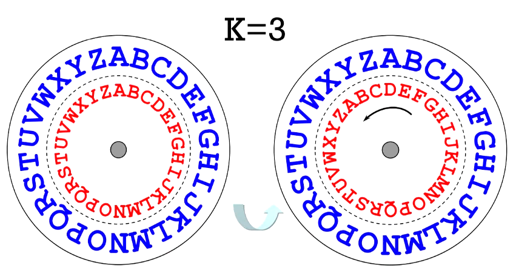
<figcaption>
Hình 33. Mật mã Caesar
</figcaption>

**<u>Ví dụ 1:</u>** Cho bản rõ: TOIYEUVIETNAM Khóa k = 4. Ta có thể viết lại bảng chữ cái mới như sau:

| **0** | **1** | **2** | **3** | **4** | **5** | **6** | **7** | **8** | **9** | **10** | **11** | **12** | **13** | **14** | **15** | **16** | **17** | **18** | **19** | **20** | **21** | **22** | **23** | **24** | **25** |
|:--:|:--:|:--:|:--:|:--:|:--:|:--:|:--:|:--:|:--:|:--:|:--:|:--:|:--:|:--:|:--:|:--:|:--:|:--:|:--:|:--:|:--:|:--:|:--:|:--:|:--:|
| **A** | **B** | **C** | **D** | **E** | **F** | **G** | **H** | **I** | **J** | **K** | **L** | **M** | **N** | **O** | **P** | **Q** | **R** | **S** | **T** | **U** | **V** | **W** | **X** | **Y** | **Z** |
| E | F | G | H | I | J | K | L | M | N | O | P | Q | R | S | T | U | V | W | X | Y | Z | A | B | C | D |

Bảng 7. Ví dụ mật mã Caesar - Bảng chuyển đổi

| **Bản rõ** | **T** | **O** | **I** | **Y** | **E** | **U** | **V** | **I** | **E** | **T** | **N** | **A** | **M** |
|:--:|:--:|:--:|:--:|:--:|:--:|:--:|:--:|:--:|:--:|:--:|:--:|:--:|:--:|
| **i** | 19 | 14 | 8 | 24 | 4 | 20 | 21 | 8 | 4 | 19 | 13 | 0 | 12 |
| **(i + k) mod 26** | 23 | 18 | 12 | 1 | 8 | 24 | 25 | 12 | 8 | 23 | 17 | 4 | 16 |
| **Bản mã** | X | S | M | B | I | Y | Z | M | I | X | R | E | Q |

Vậy bản mã là: XSMBIYZMIXREQ

- Trong loại mật mã Caesar này, **khóa được cho bởi số k (0 \<= 𝑘 \<= 𝑛 - 1)** và một từ khóa hoặc câu ngắn.

- **Trong trường hợp có từ khóa** để tránh tình huống tấn công vét cạn

  - Bảng chữ cái được viết ra, và bên dưới nó, **bắt đầu từ vị trí k là từ khoá.**

  - Các chữ cái còn lại được viết theo thứ tự bảng chữ cái **sau từ khóa**. Kết quả là, chúng ta nhận được tra cứu cho từng chữ cái.

  - Không bắt buộc tất cả các chữ cái của từ khóa phải khác nhau, tuy nhiên phải viết ra từ khóa vào bảng chữ cái mới nhưng **không lặp lại các chữ cái**.

**<u>Ví dụ 2:</u>**

<table>
<caption>
Bảng 8. Ví dụ mật mã Caesar - VD2
</caption>
<colgroup>
<col style="width: 23%" />
<col style="width: 76%" />
</colgroup>
<thead>
<tr>
<th colspan="2" style="text-align: center;"><strong><mark>Từ khoá: “yes”,</mark> k =2</strong></th>
</tr>
</thead>
<tbody>
<tr>
<td style="text-align: center;">Bảng gốc</td>
<td>a, b, c, d, e, f, g, h, i, j, k, l, m, n, o, p, q, r, s, t, u, v, w, x, y, z</td>
</tr>
<tr>
<td style="text-align: center;">Bảng mới</td>
<td>x, z, <strong>y, e, s</strong>, a, b, c, d, f, g, h, i, j, k, l, m, n, o, p, q, r, t, u, v, w</td>
</tr>
<tr>
<td style="text-align: center;">Văn bản nguồn</td>
<td>data</td>
</tr>
<tr>
<td style="text-align: center;">Văn bản mã hoá</td>
<td>expx</td>
</tr>
</tbody>
</table>

- *Số lượng chìa khóa trong hệ thống của Caesar **<u>với từ khóa</u>** là **n!.***

- *Để giải mã, cần sử dụng khóa mã hóa đã biết để xác định sự tương ứng của bản gốc, bản thay thế bảng chữ cái và thực hiện thay thế ngược lại.*

**Nhận xét:**

- Nếu cần thiết, bảng chữ cái có thể được mở rộng với dấu chấm câu, chữ in hoa, số, để mật mã có thể xử lý tất cả các ký tự của văn bản nguồn.

- Mật mã Caesar dễ bị **tấn công brute-force**, vì chỉ có **n khóa có thể có** (ví dụ, với tiếng Anh có 26 khóa).

- **3 đặc điểm chính để áp dụng tấn công theo kiểu brute-force trong thuật toán này**

  - Giải thuật mã hóa và giải mã được biết trước

  - Số khóa để thử rất ít

  - Ngôn ngữ của bản rõ được biết trước và dễ dàng nhận ra

- **Giải quyết vấn đề (tổng quát)**

  - Sử dụng nhiều khóa

  - Bản rõ có thể được nén lại (Huffman, ZIP) để cho người đọc khó nhận ra ngôn ngữ sử dụng.

## 6.3. Mật mã thay thế - Hệ thống mật mã Affine

- Vị trí của mỗi chữ cái trong bảng chữ cái được ánh xạ tới vị trí tương đương mới của bảng chữ cái đó. Vị trí mới được tính thông qua một hàm toán học tuyến tính.

- các chữ cái của bảng chữ cái có kích thước m được ánh xạ tới các số nguyên từ 0 đến m-1.

- Key cho mật mã Affine bao gồm 2 số a và b. Điều kiện là **a phải nguyên tố cùng nhau với m.**

- Công thức về mặt toán học có dạng: $E(x) = (ax + b){mod}m$

  - *m* là độ dài của bảng chữ cái.

  - *a* và *b*: khoá của mật mã.

  - gcd(a, m) = 1 🡪 a là phần tử khả nghịch.

  - *x:* vị trí của ký tự trong bảng chữ cái gốc.

- Nếu a = 1, ta quay về bài toán mật mã Caesar.

- Khi giải mã, chúng ta thực hiện các chức năng ngược lại (hoặc nghịch đảo) trên bản mã để lấy ra bản rõ.

> 
> $$
> D(y) = a^{- 1}(y - b){mod}m
> $$
- *y* là **số thứ tự** của chữ cái trong bảng chữ cái **mã hóa**.

- **a−1** là nghịch đảo modulo của a theo modulo m, nghĩa là $1 = a^{- 1}a{mod}m$.

- *D(y)* là số thứ tự của chữ cái trong bảng chữ cái **gốc**.

**Ví dụ:** Lấy k = (5,6)

| **0** | **1** | **2** | **3** | **4** | **5** | **6** | **7** | **8** | **9** | **10** | **11** | **12** | **13** | **14** | **15** | **16** | **17** | **18** | **19** | **20** | **21** | **22** | **23** | **24** | **25** |
|:--:|:--:|:--:|:--:|:--:|:--:|:--:|:--:|:--:|:--:|:--:|:--:|:--:|:--:|:--:|:--:|:--:|:--:|:--:|:--:|:--:|:--:|:--:|:--:|:--:|:--:|
| **A** | **B** | **C** | **D** | **E** | **F** | **G** | **H** | **I** | **J** | **K** | **L** | **M** | **N** | **O** | **P** | **Q** | **R** | **S** | **T** | **U** | **V** | **W** | **X** | **Y** | **Z** |

Bảng 9. Ví dụ mật mã Affine

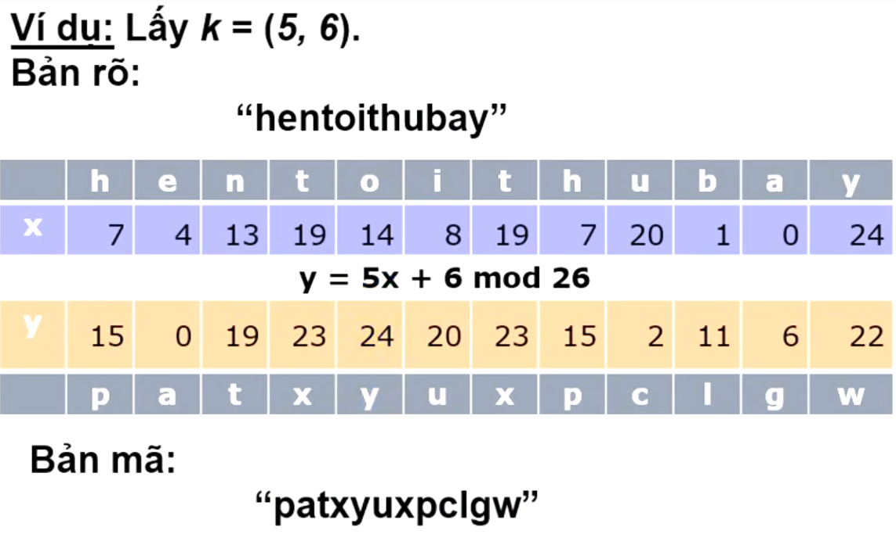

Thuật toán giải mã có dạng: $D(y) = 5^{- 1}(y - 6){mod}26 = 21(y - 6){mod}26$

**Cả mật mã Affine và mật mã Caesar** đều dễ bị phá bằng phương pháp **phân tích tần số** (frequency analysis), vì chúng là mật mã thay thế đơn chữ cái.

**Nguyên lý của phân tích tần số:**

- Trong một ngôn ngữ (ví dụ: tiếng Anh), tần suất xuất hiện của các chữ cái không đồng đều:

  - Chữ cái xuất hiện nhiều nhất: E (khoảng 12.7%), tiếp theo là T (9.1%), A (8.2%), v.v.

  - Chữ cái ít xuất hiện: Z (0.074%), Q (0.095%), v.v.

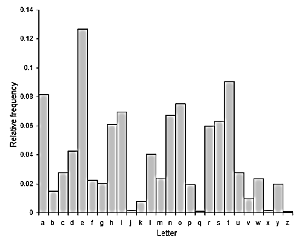
<figcaption>
Hình 34. Ví dụ phân tích tần số
</figcaption>

- Trong mật mã thay thế đơn chữ cái, mỗi chữ cái trong văn bản gốc luôn được thay thế bởi cùng một chữ cái trong văn bản mã hóa. Do đó, tần suất xuất hiện của các chữ cái trong văn bản mã hóa sẽ phản ánh tần suất của các chữ cái trong văn bản gốc.

  - **Ví dụ:**

    - Nếu chữ D xuất hiện nhiều nhất trong văn bản mã hóa, ta có thể giả định D tương ứng với E (chữ cái phổ biến nhất trong tiếng Anh).

    - Giả sử H (vị trí 7) và Q (vị trí 16) là hai chữ cái xuất hiện nhiều nhất, ta giả định chúng tương ứng với E (vị trí 4) và T (vị trí 19) trong tiếng Anh.

  - Sau đó áp dụng các công thức toán học để tìm khóa.

## 6.4. Mật mã thay thế - Mật mã **Vigenère**

- Khóa được đưa ra bởi một cụm từ của các chữ cái d.

- **Chữ cái của bản mã được tìm thấy tại giao điểm của:**

  - **cột** được xác định **bằng chữ cái của bản rõ**, và

  - **dòng** được xác định **bằng chữ cái của khóa.**

- Công thức mã hóa của mật mã Vigenère là: $Vig_{d}\left( m_{i} \right) = \left( m_{i} + k_{i{mod}d} \right)\left( {mod}n \right)$

  - *mi*: Số thứ tự của chữ cái thứ i trong bảng chữ cái (thuộc bản rõ).

  - *ki mod d*​: Số thứ tự của chữ cái thứ i trong bảng chữ cái (thuộc bản rõ).

  - $Vig_{d}\left( m_{i} \right)$: Số thứ tự của chữ cái thứ i trong bảng chữ cái (thuộc bản mã hóa).

  - *n:* Kích thước bảng chữ cái (ví dụ: n=26).

- Công thức giải mã (nghịch đảo) là: $Vig_{d}^{- 1}\left( c_{i} \right) = \left( c_{i} - k_{i{mod}d} + n \right)\left( {mod}n \right)$

  - *ci*: Số thứ tự của chữ cái thứ i trong bảng chữ cái (thuộc văn bản mã hóa).

  - *ki mod d*: Số thứ tự của chữ cái thứ i trong bảng chữ cái (thuộc khóa).

  - *n*: Kích thước bảng chữ cái.

- **Ví dụ:** Nếu khóa không đủ độ dài so với độ dài của bản rõ

  - **TH1: Lặp khóa:** Viết **lặp lại các ký tự** **trong khóa** từ phía sau của chuỗi khóa, đến khi nó bằng chiều dài của bản rõ thì thôi.

    - Văn bản gốc: "HELLO".

    - Khóa: "KEY" (K = 10, E = 4, Y = 24).

    - Độ dài khóa: d = 3.

    - Bảng chữ cái: n = 26.

> 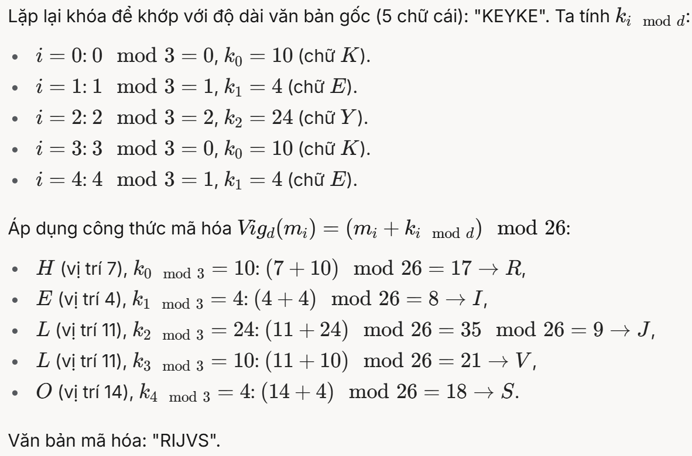
>
> 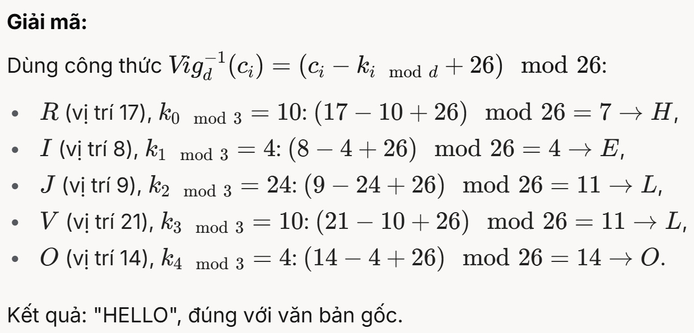

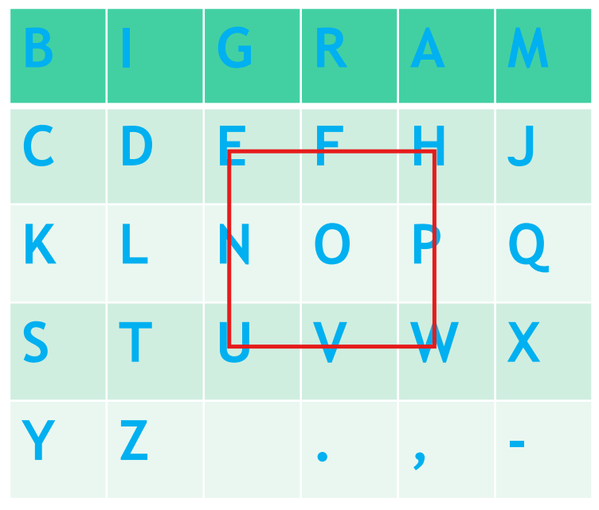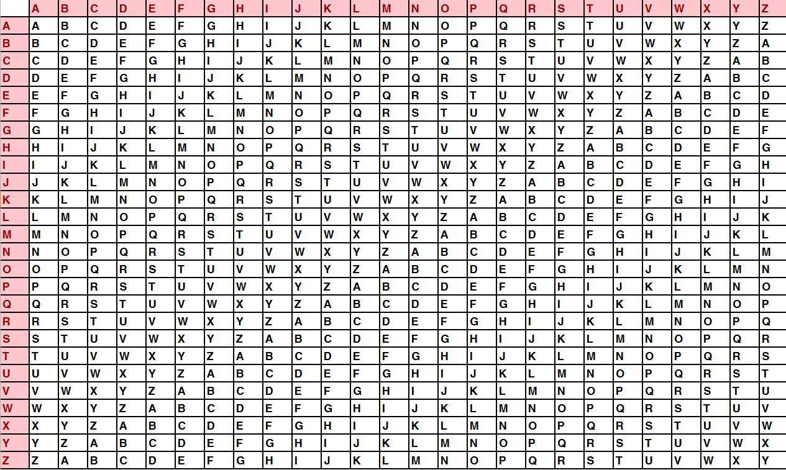

Hình 35. Mật mã Vigenère

- **TH2: Khóa tự động:** **Viết các ký tự trong bản rõ** từ phía sau của chuỗi khóa, đến khi nó bằng chiều dài của bản rõ thì thôi.

  - M = ALLWORKANDNOPLAYMA

  - K = WHENINRO

  - AutoKey = K + M

> 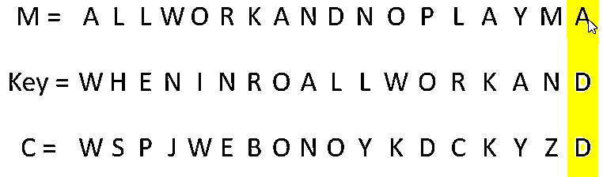

- **Sự khác biệt giữa mật mã Vigenère và mật mã đơn chữ cái**

  - Mật mã Vigenère thuộc lớp **mật mã thay thế đa chữ cái** (polyalphabetic substitution cipher), khác với mật mã Caesar và mật mã Affine (mật mã thay thế đơn chữ cái). Sự khác biệt chính là:

    - **<u>Mật mã đơn chữ cái (Caesar, Affine):</u>**

<!-- -->

- Mỗi chữ cái trong văn bản gốc luôn được thay thế bởi cùng một chữ cái trong văn bản mã hóa.

- Ví dụ: Trong mật mã Caesar với k = 3, A luôn thành D, B luôn thành E, v.v.

- Điều này làm cho mật mã dễ bị phá bằng **phân tích tần số**, vì tần suất chữ cái trong văn bản mã hóa phản ánh trực tiếp tần suất trong văn bản gốc.

  - **<u>Mật mã đa chữ cái (Vigenère):</u>**

<!-- -->

- Một chữ cái trong văn bản gốc có thể được thay thế bởi các chữ cái khác nhau trong văn bản mã hóa, tùy thuộc vào vị trí của nó và chữ cái tương ứng trong khóa.

- Ví dụ: Trong ví dụ trên, L ở vị trí 3 được mã hóa thành J (vì khóa là Y = 24), nhưng L ở vị trí 4 được mã hóa thành V (vì khóa là K = 10).

- **Điều này làm cho tần suất chữ cái trong văn bản mã hóa không còn phản ánh trực tiếp tần suất trong văn bản gốc**, khiến phân tích tần số thông thường trở nên vô nghĩa.

<!-- -->

- **Phá mật mã Vigenère bằng phương pháp Kasiski**

  - Mật mã Vigenère khó phá hơn mật mã Caesar hay Affine, nhưng vẫn có thể bị phá bằng **phương pháp Kasiski**, do nhà toán học người Đức Friedrich Kasiski đề xuất vào thế kỷ XIX.

  - **Nguyên lý của phương pháp Kasiski:**

<!-- -->

- **Tìm các đoạn lặp lại trong văn bản mã hóa:**

  - Nếu hai đoạn văn bản mã hóa giống hệt nhau, có khả năng chúng được mã hóa từ hai đoạn văn bản gốc giống nhau, và chúng được mã hóa bằng cùng một đoạn của khóa.

  - Khoảng cách giữa hai đoạn lặp lại sẽ là bội số của độ dài khóa.

- **Xác định độ dài khóa (l):**

  - **Tìm tất cả các đoạn lặp lại** trong văn bản mã hóa và **tính khoảng cách giữa chúng.**

  - **Ước chung lớn nhất** (hoặc các ước số chung) **của các khoảng cách này thường là độ dài của khóa.**

- **Phân tích tần số từng nhóm:**

  - Khi đã biết độ dài khóa l, chia văn bản mã hóa thành l nhóm, mỗi nhóm chứa các chữ cái được mã hóa bằng cùng một chữ cái của khóa.

  - Mỗi nhóm giờ đây tương đương với một mật mã Caesar (vì cùng một chữ cái khóa được sử dụng), và ta có thể áp dụng phân tích tần số để tìm từng chữ cái của khóa.

<!-- -->

- Để tăng độ dài của cụm mật khẩu và độ phức tạp của phân tích mật mã, bạn có thể sử dụng **thành phần mật mã Vigenere,** là **mã hóa nhiều Vigenere với các cụm mật khẩu khác nhau.**

  - Thay vì chỉ sử dụng một cụm mật khẩu, ta sử dụng nhiều cụm mật khẩu (ví dụ: k, l, ..., s).

  - Mỗi cụm mật khẩu có độ dài riêng (ví dụ: dk, dl,…, ds​).

  - Các cụm mật khẩu được áp dụng đồng thời lên văn bản gốc, tạo ra một chu kỳ lặp lại phức tạp hơn.

  - **Công thức mã hóa:\**
    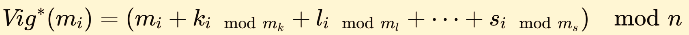

    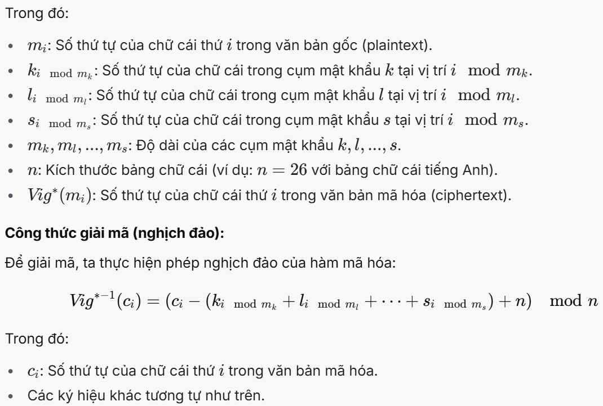

<!-- -->

- **Tại sao sử dụng nhiều cụm mật khẩu làm tăng độ phức tạp?**

> 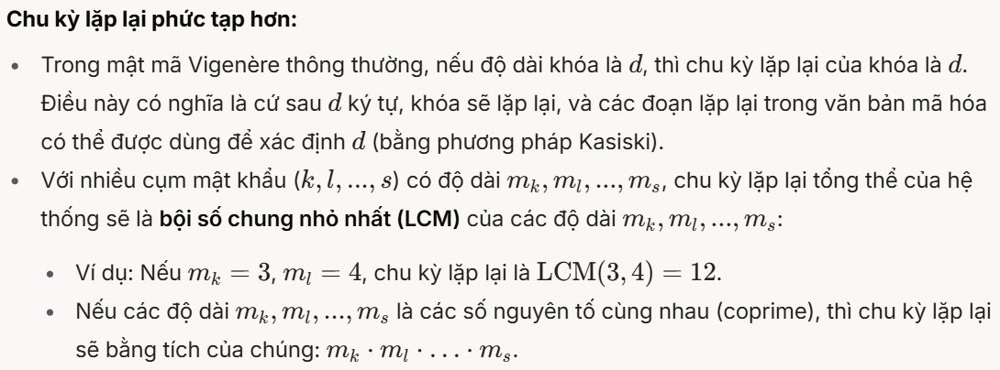

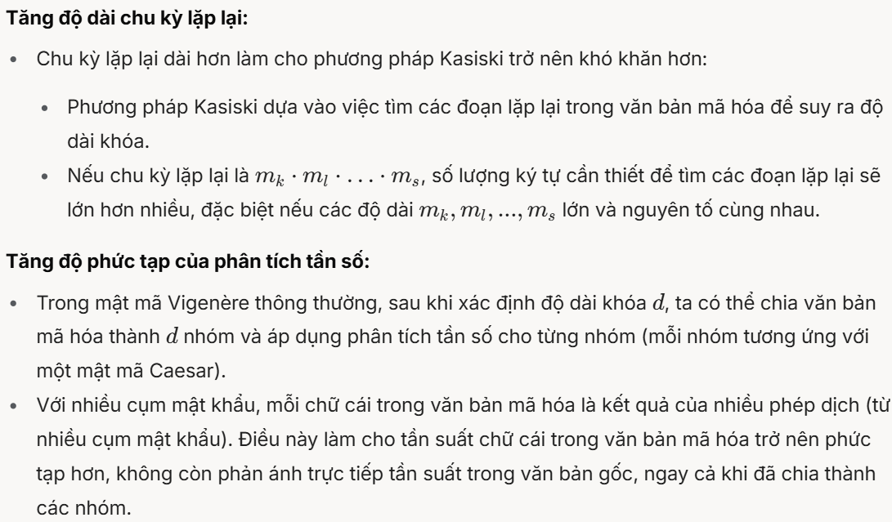

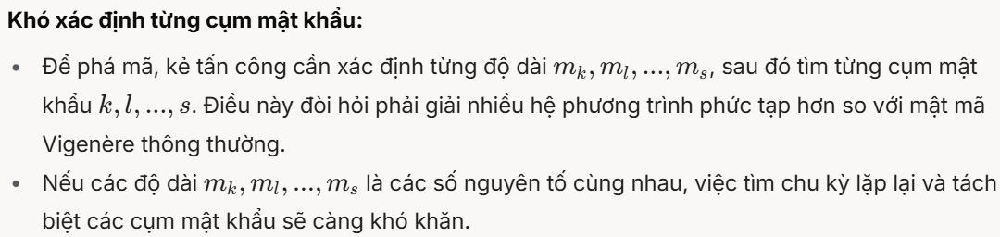

## 6.5. Hình vuông Polybus

- Bảng chữ cái được sắp xếp vào một ma trận (thường là 5×5 hoặc 6×6, tùy thuộc vào kích thước bảng chữ cái).

- Mỗi chữ cái được ánh xạ thành một cặp số (hàng, cột) tương ứng với vị trí của nó trong ma trận.

- Để mã hóa, mỗi chữ cái được thay thế bằng cặp số tọa độ của nó.

- Để giải mã, từ cặp số tọa độ, ta tìm lại chữ cái tương ứng trong ma trận.

- Ma trận được giữ bí mật và tạo thành khóa mã hóa.

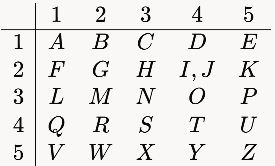
<figcaption>
Hình 36. Hình vuông Polybus
</figcaption>

- **Ví dụ:**

  - Câu mẫu: TRUONG GIAO THONG VAN TAI TPHCM

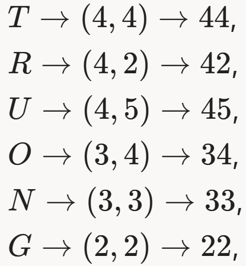 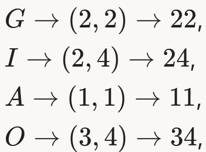 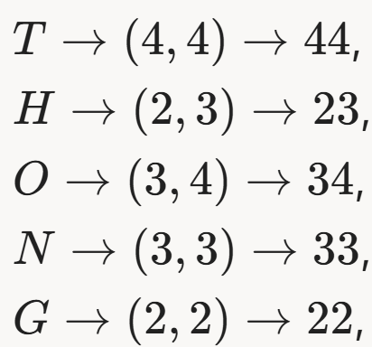 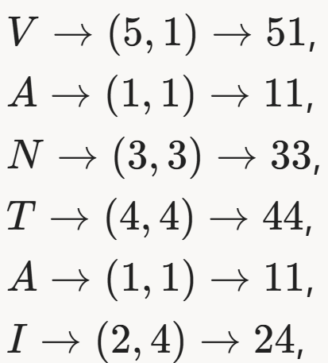 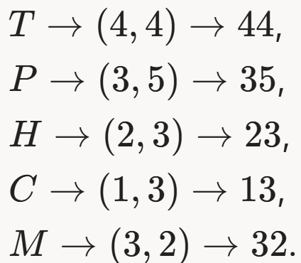

Hình 37. Ví dụ hình vuông Polybus

- Mật mã: 444245343322 22241134 4423343322 511133 441124 4435231332

- **Giải mã:** Chú ý **24 → I/J,** nên 24 có thể là I hoặc J. Tuy nhiên, dựa vào ngữ nghĩa của văn bản gốc ta chọn I cho các vị trí này (vị trí 8 và 22), vì "GIAO" và "TAI" có nghĩa trong tiếng Việt.

<!-- -->

- Hình vuông Polybius là một dạng mật mã thay thế đơn chữ cái (monoalphabetic substitution cipher), vì mỗi chữ cái trong văn bản gốc luôn được ánh xạ thành một cặp số cố định.

- Tuy nhiên, thay vì thay thế bằng một chữ cái khác, nó thay thế bằng một cặp số (bigram). Do đó, ta có thể áp dụng **phân tích tần số** trên các bigram (cặp số) trong văn bản mã hóa:

  - Các bigram xuất hiện nhiều nhất trong văn bản mã hóa sẽ tương ứng với các chữ cái phổ biến nhất trong ngôn ngữ (ví dụ: trong tiếng Anh, E, T, A; trong tiếng Việt, có thể là A, N, H).

  - Sau khi xác định một số bigram phổ biến, ta thay thế chúng và dùng ngữ nghĩa của văn bản để suy ra các chữ cái còn lại.

- **Tổng số khóa (các cách sắp xếp bảng chữ cái)**

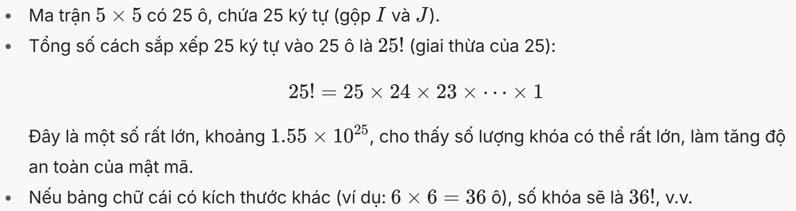

**🡪 Tổng số khóa (các tùy chọn khác nhau để đặt bảng chữ cái trong ma trận) là n!.**

## 6.6. Mã hoá BIGRAM (Mã hóa PLAYFAIR)

- Các cặp chữ cái (bigram) trong văn bản gốc (plaintext) được thay thế bằng các cặp chữ cái khác trong văn bản mã hóa (ciphertext) dựa trên một bảng thay thế (thường là ma trận).

- Phương pháp này **thuộc nhóm mật mã thay thế** (substitution cipher), nhưng thay vì thay thế từng chữ cái (như trong mật mã Caesar hay Affine), nó thay thế từng cặp chữ cái (bigram).

| **B** | **I** | **G** | **R** | **A** | **M** |
|-------|-------|-------|-------|-------|-------|
| **C** | **D** | **E** | **F** | **H** | **J** |
| **K** | **L** | **N** | **O** | **P** | **Q** |
| **S** | **T** | **U** | **V** | **W** | **X** |
| **Y** | **Z** |       | **.** | **,** | **-** |

Bảng 10. Mã hóa Bigram

*(ở đây từ khóa được chọn là BIGRAM, nếu chọn từ khóa khác, các ký tự trong ma trận sẽ có sự bố trí khác).*

- **Nguyên tắc:**

  - Nếu cả hai chữ cái bigram của văn bản gốc **thuộc cùng một cột** của bảng, thì các chữ cái của mật mã được coi là các **chữ cái nằm bên dưới chúng**. Do đó, ký tự RF cung cấp ký tự mật mã FO. (R 🡪 F, F 🡪 O)

    - Nếu **chữ cái của bản rõ ở hàng dưới cùng**, thì chữ cái **tương ứng từ hàng trên cùng được lấy làm mật mã**, ví dụ bigram SY cho ký tự mật mã YB. (S 🡪 Y, Y 🡪 B)

    - Biểu đồ của một chữ cái hoặc một cặp chữ cái giống hệt nhau cũng tuân theo quy tắc này và văn bản **GG** cung cấp cho mật mã **EE**.

  - Nếu cả hai chữ cái bigram của văn bản gốc **thuộc cùng một hàng** của bảng, thì các **chữ cái ở bên phải chúng** được coi là chữ cái của mật mã. Do đó, biểu đồ GR cung cấp văn bản mật mã RA. (G 🡪 R, R 🡪 A)

    - Nếu **ký tự** của bản rõ nằm **ở cột ngoài cùng bên phải**, thì một ký tự từ **cột ngoài cùng bên trái của cùng một hàng** được lấy cho mật mã và biểu đồ AM cung cấp cho mật mã MB. (A 🡪 M, M 🡪 B)

  - Nếu cả hai chữ cái bigram của văn bản gốc **nằm ở các hàng và cột khác nhau**, thì hai chữ cái như vậy được lấy thay thế, để cả bốn chữ cái đó đại diện cho **một hình chữ nhật**. Ví dụ: bigram EW được mã hóa là HU.

<figcaption>
Hình 38. Ví dụ mã hóa Bigram
</figcaption>

- Việc điền vào ô vuông với bảng chữ cái **có thể là ngẫu nhiên**, hoặc nó có thể được xác định bởi **một cụm từ khóa** nhất định. Tất cả các ký hiệu trong cụm từ khóa đó (nhưng không lặp lại) **được viết ở <u>đầu</u> ma trận** và sau đó là các chữ cái khác của bảng chữ cái được viết ra theo thứ tự.

- **Ví dụ:**

  - Key: "BIGRAM".

  - Văn bản gốc (plaintext): "HELLO-".

  - Bản mã: mã hóa từng cặp ký tự.

    - "HE": cùng hàng nên H 🡪 J, E 🡪 F

    - "LL": 2 ký tự giống nhau nên L 🡪 T.

    - "O-": 2 ký tự thuộc 2 nơi khác nhau 🡪 Tạo thành hình chữ nhật, do đó O 🡪 Q, - 🡪 .

    - Vậy bản mã là: JFTTQ.

- **<u>MÃ HOÁ BIGRAM VỚI HAI BẢNG VUÔNG</u>**

  - Mỗi cặp ký tự (**bigram**) từ bản rõ sẽ được mã hóa bằng cách sử dụng hai bảng khác nhau.

  - **Nếu hai ký tự không nằm trên cùng một hàng**, chúng sẽ tạo thành một hình chữ nhật trong hai bảng. Hai ký tự được mã hóa sẽ là **hai góc còn lại của hình chữ nhật**.

  - **Nếu hai ký tự nằm trên cùng một hàng**, chúng sẽ được thay thế bằng ký tự **cùng hàng nhưng ở cột tiếp theo**. Nếu ký tự ở cột cuối cùng, nó sẽ quay lại cột đầu tiên.

  - **Ví dụ:**

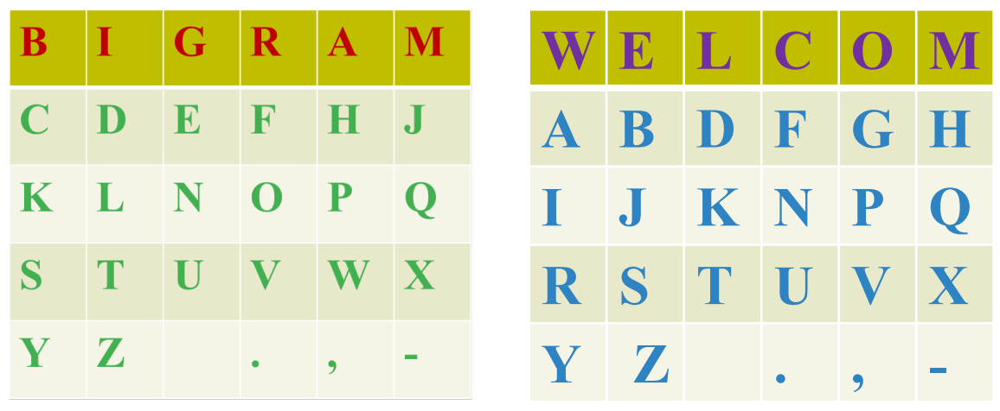
<figcaption>
Hình 39. Ví dụ mã hóa Bigram với 2 bảng vuông
</figcaption>

- Key: **BIGRAM** và **WELCOM**

- Bản rõ: **UKRAINA. 🡪** Bản mã: **TNWFCLC,**

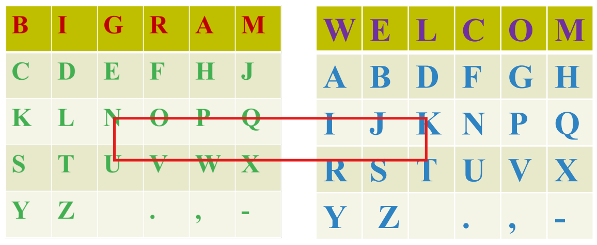 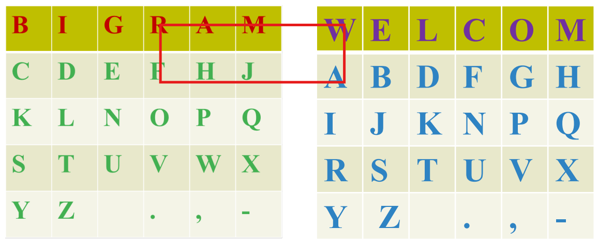

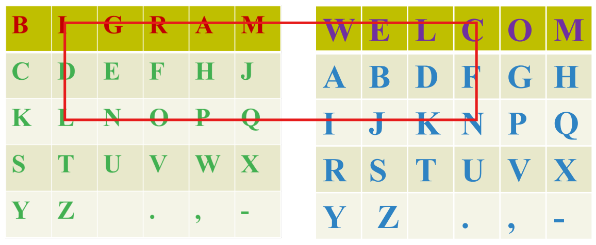 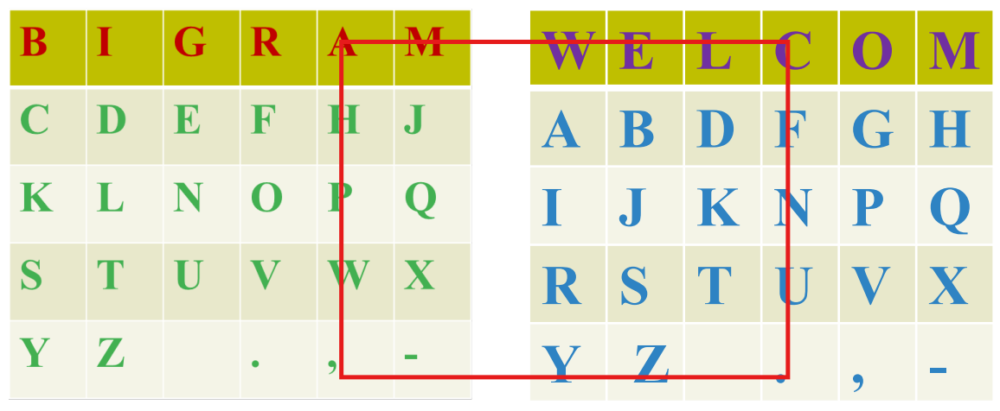

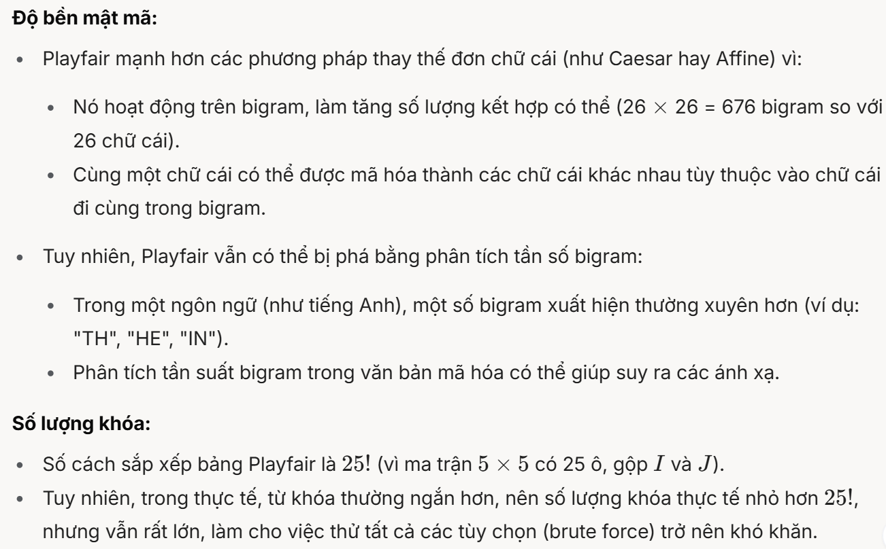
<figcaption>
Hình 40. Ví dụ khác mã hóa Bigram 2 bảng vuông
</figcaption>

## 6.7. Hình vuông cardano

- Đây là một kỹ thuật mã hóa dựa trên việc sử dụng một lưới (grid) có các ô được đục lỗ (hoặc đánh dấu) để che giấu thông điệp.

- Để mã hóa, nhà toán học và triết học người Ý J. Cardano đề xuất sử dụng một hình vuông với một số lỗ hở trên đó.

- Các lỗ được cắt theo cách sao cho khi xoay hình vuông 90, 180 và 270 độ, tất cả các vị trí của hình vuông ban đầu lần lượt xuất hiện trong các khe.

- Sau đó viết các ký tự của thông điệp vào các ô được đục lỗ.

- **Mã hóa**:

  - **Đặt lưới lên một tờ giấy N×N.**

  - Viết các ký tự của thông điệp vào các ô đục lỗ.

  - Xoay lưới 90 độ (theo chiều kim đồng hồ hoặc ngược lại), đặt lại lên tờ giấy, và tiếp tục viết các ký tự tiếp theo của thông điệp.

  - **Lặp lại bước xoay 4 lần (0°, 90°, 180°, 270°),** mỗi lần điền một phần thông điệp.

  - Sau 4 lần xoay, *các ô còn lại (không thuộc ô đục lỗ) được điền bằng các ký tự ngẫu nhiên để che giấu thông điệp (hoặc có thể để trắng tùy TH).*

- **Giải mã**:

  - Để giải mã thông điệp, bạn cần có một bản sao chính xác của hình vuông được sử dụng để mã hóa **(vị trí của các khe trên hình vuông là khóa)**

  - Sử dụng cùng một lưới Cardano.

  - Đặt lưới lên tờ giấy đã mã hóa, đọc các ký tự trong các ô đục lỗ.

  - Xoay lưới 90 độ và lặp lại 4 lần để đọc toàn bộ thông điệp.

- **Ví dụ:** Thông tin cần mã hóa: **ODESSA – UKRAINA**

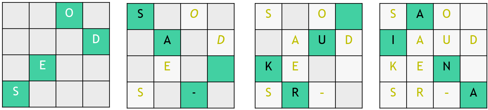

**0 độ 90 độ 180 độ 270 độ**

Hình 41. Ví dụ hình vuông cardano

**\*\* Các ô xanh là các ô đục lỗ**

Sau đó ta thu được bản mã bằng cách viết từng dòng của ma trận.

Bản mã: **SAO IAUDKEN SR-A**

- Số lượng các tùy chọn khác nhau cho vị trí của các khe trong hình vuông NxN là$4^{\left( \frac{N^{2}}{4} \right)}$, đối với hình vuông 6x6 cho 262.144 tùy chọn (tương đương với khóa 18 bit).

- Tuy nhiên, mật mã này (cũng như tất cả các hoán vị) bị suy yếu trong thực tế.

- Trong quá trình phân tích mật mã, có thể sử dụng các đặc điểm của ngữ âm của ngôn ngữ quốc gia bản địa (các tổ hợp ký hiệu phổ biến nhất hoặc không được chấp nhận cho ngôn ngữ này, độ dài trung bình của từ, v.v.).

## 6.8. Mật mã hoán vị với một từ khoá

- Các chữ cái của từ khóa **không lặp lại** được viết ở hàng đầu tiên của bảng, từ đó **xác định số cột của bảng** đó.

- Các chữ cái của tin nhắn được ghi lại trong bảng theo **từng dòng**, **từ trái sang phải, từ trên xuống dưới**, bao gồm khoảng trắng nếu có.

- Nếu thông điệp không đủ để điền đầy bảng, thêm ký tự đệm (thường là X).

- Bảng được hình thành theo cách này được sắp xếp theo cột, tiêu chí sắp xếp là thứ tự truyền ký tự của dòng đầu tiên trong bảng (ở ví dụ dưới, ta lật ngược lại bảng theo cột).

- Sau khi phân loại, văn bản được mã hóa được viết lại theo từng **<u>cột</u>**.

- **<u>Để giải mã</u>** ta viết chuỗi đã mã hóa lên bảng theo từng cột, sau đó lật ngược bảng, và viết lại bản rõ theo từng dòng.

- **Ví dụ:**

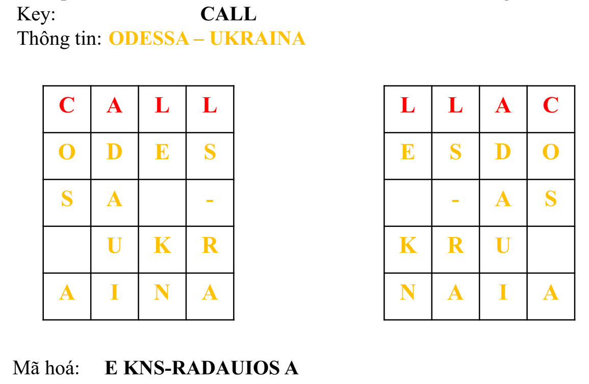
<figcaption>
Hình 42. Mã hóa hoán vị với một từ khóa
</figcaption>
