- Mã hóa khóa đối xứng là một loại sơ đồ hệ thống mã hóa trong đó **một khóa giống nhau** sẽ được **dùng cho cả mã hóa và giải mã dữ liệu**.

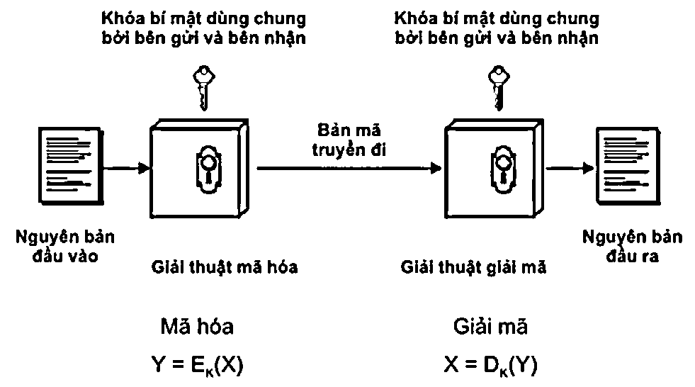
<figcaption>
Hình 43. Mã hóa khóa đối xứng
</figcaption>

- **Phân loại mã hóa đối xứng:** Dựa trên cách các chuỗi nhị phân được xử lý, một sơ đồ mã hóa đối xứng được phân loại thành 2 loại chính:

  - **<u>Mã hóa Khối (Block Ciphers)</u>**

    - ***Bên người gửi:***

      - Xử lý bản rõ theo từng khối bit có kích thước cố định (ví dụ: 64 bit, 128 bit, tùy thuộc vào thuật toán).

      - **Nếu bản rõ không đủ độ dài để lấp đầy khối, nó sẽ được đệm (padding)** để đạt bội số của kích thước khối.

      - Một khối bit bản rõ được chọn, sau đó **thực hiện các thao tác (thay thế, hoán vị, v.v.) để tạo ra một khối bit bản mã.**

      - Các khối bản mã sau khi mã hóa được ghép lại thành một bản mã hoàn chỉnh.

    - ***Bên người nhận:***

      - **Bản mã được chia lại thành các khối** có kích thước bằng nhau (tương ứng với kích thước khối ban đầu).

      - **Từng khối được giải mã** bằng khóa và chế độ hoạt động tương ứng.

      - Các phần đã giải mã được ghép lại, loại bỏ đệm (nếu có), để tái tạo thông điệp gốc (bản rõ).

    - **Số bit trong một khối là cố định.**

    - Ví dụ phổ biến: AES, DES.

  - **<u>Mã hóa Dòng (Stream Ciphers)</u>**

    - ***Bên người gửi:***

      - Xử lý bản rõ từng bit hoặc từng byte một (liên tục như một dòng dữ liệu).

      - Thuật toán tạo ra một ***keystream** (chuỗi khóa ngẫu nhiên)* *có độ dài bằng thông điệp*, sau đó **kết hợp từng bit/byte của bản rõ với keystream (thường bằng phép XOR) để tạo bản mã.**

    - ***Bên người nhận:***

      - Bản mã được giải mã bằng cách **tạo lại keystream (dùng cùng khóa bí mật) và kết hợp nó với bản mã (thường bằng phép XOR)** để khôi phục bản rõ.

      - Các phần giải mã được ghép lại một cách tự nhiên vì quá trình diễn ra liên tục, không cần chia thành các khối riêng lẻ.

    - Về mặt kỹ thuật, **có thể xem mã hóa Dòng như một trường hợp đặc biệt của mã hóa Khối với kích thước khối là 1 bit.**

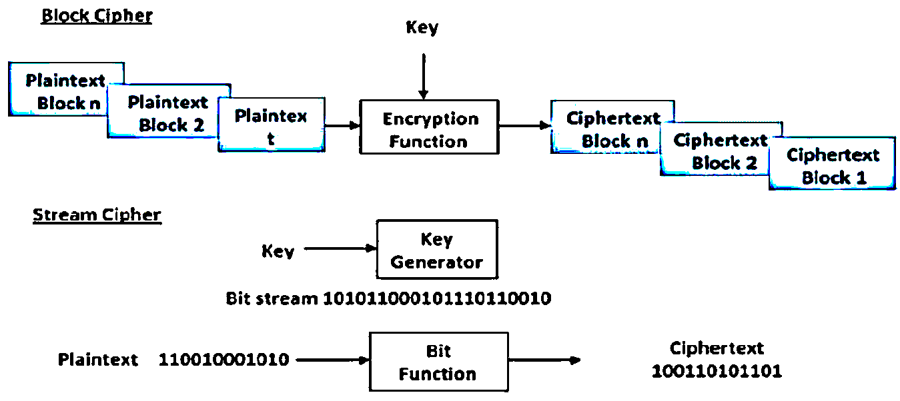
<figcaption>
Hình 44. Mã hóa khối và mã hóa dòng
</figcaption>

## 7.1. Mã hóa dòng

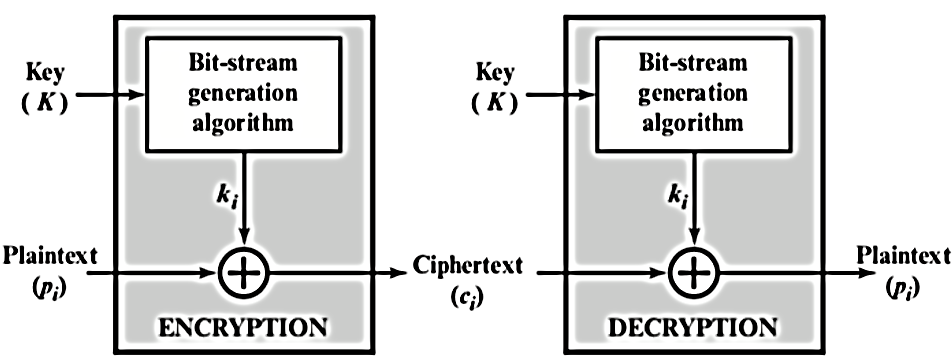
<figcaption>
Hình 45. Mã hóa dòng
</figcaption>

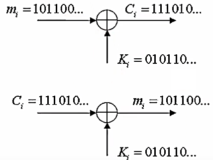
<figcaption>
Hình 46. Cơ chế mã hóa dòng
</figcaption>

mã hóa thông tin từng bit một cho mỗi chu kỳ mã hóa.

- trong số các hoạt động có bit chỉ có hai phép đảo ngược là tổng theo modulo 2 và XOR.

- **Mã hóa:** $c_{i} = m_{i} \oplus k_{i}$hay $c_{i} = \left( m_{i} + k_{i} \right){mod}2$

  - $m_{i}$là bit thứ i của bản rõ.

  - $k_{i}$​ là bit thứ i của chuỗi khóa.

  - $c_{i}$ là bit thứ i của bản mã.

  - ⊕ là phép XOR (modulo 2).

- **Giải mã:** $m_{i} = c_{i} \oplus k_{i}$hay $m_{i} = \left( c_{i} + k_{i} \right){mod}2$

  - Vì XOR là phép toán đảo ngược được với chính nó, áp dụng lại cùng ki sẽ khôi phục mi.

- Nếu biết ci​ và mi​, ta có thể suy ra $k_{i} = c_{i} \oplus m_{i}$​.

- **Dòng khóa, thường được ký hiệu là γ (gamma)** trong mật mã dòng, là yếu tố cốt lõi quyết định độ an toàn.

- **Nếu γ yếu** (ví dụ: chỉ toàn số 0), thì ci = mi⊕0 = mi​, **nghĩa là bản mã sẽ giống hệt bản rõ,** không có bảo mật.

- Do đó, chất lượng của trình tạo dòng khóa (keystream generator) là yếu tố then chốt. Một dòng khóa tốt cần:

  - **Ngẫu nhiên**: Không có mẫu hình nào có thể dự đoán.

  - **Dài đủ**: Ít nhất bằng độ dài của bản rõ.

  - **Không lặp lại**: Tránh tái sử dụng cùng một γ cho nhiều thông điệp (điều này làm lộ thông tin nếu kẻ tấn công có nhiều bản mã).

- Phương pháp tạo dòng khóa (keystream) γ trong mã hóa dòng: sử dụng **thanh ghi dịch chuyển phản hồi tuyến tính (LFSR - Linear Feedback Shift Register)**:

  - Thanh đăng ký dịch chuyển là một chuỗi các bit, được **dịch chuyển từ phải sang trái** trong mỗi chu kỳ mã hóa.

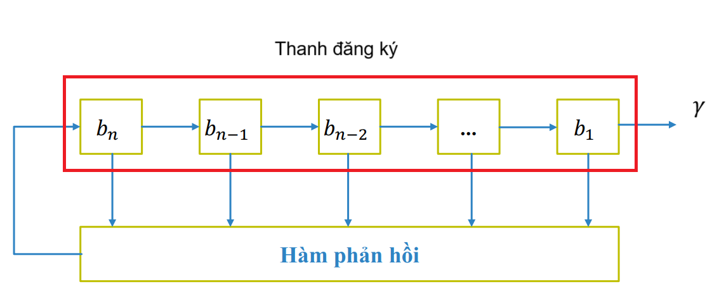
<figcaption>
Hình 47. Thanh đăng ký dịch chuyển
</figcaption>

- Mỗi chu kỳ, **bit ngoài cùng bên phải** (b1​) được **sử dụng làm đầu ra của dòng khóa γ,** đồng thời bit này cũng được đưa vào một hàm phản hồi (feedback function) để tính toán giá trị bit mới sẽ được thêm vào bên trái (bn​).

- $b_{i} = 0or1$được gọi là các trạng thái của các bit

- **Khóa mã hóa ban đầu (initial key)** được sử dụng để khởi tạo các bit trong thanh đăng ký.

- **Hàm phản hồi** quyết định giá trị bit mới được thêm vào thanh đăng ký. Ở đây **sử dụng hàm phản hồi tuyến tính (dựa trên phép XOR) 🡪 LSFR.**

- Đầu ra của thanh đăng ký (các bit γ) được sử dụng để mã hóa bản rõ bằng phép XOR.

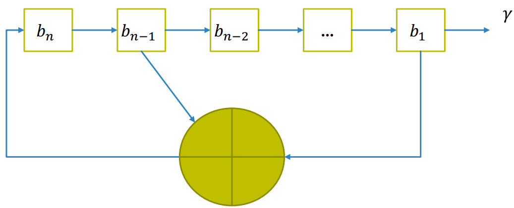
<figcaption>
Hình 48. Cơ chế thanh đăng ký dịch chuyển
</figcaption>

- Đây là một chuỗi tuần hoàn, nghĩa là **sau một số chu kỳ nhất định, chuỗi bit trong thanh đăng ký sẽ lặp lại.**

- Để đảm bảo an toàn, chu kỳ này cần đủ dài để tránh lặp lại trong quá trình mã hóa một thông điệp.

- **Ví dụ:**

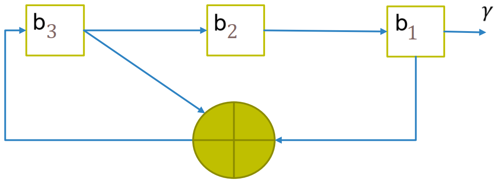
<figcaption>
Hình 49. Ví dụ mã hóa dòng
</figcaption>

- Giá trị ban đầu được nhập là 010 và giá trị đầu ra ở bảng dưới:

<table style="width:99%;">
<caption>
Bảng 11. Ví dụ mã hóa dòng và cơ chế
</caption>
<colgroup>
<col style="width: 20%" />
<col style="width: 20%" />
<col style="width: 19%" />
<col style="width: 19%" />
<col style="width: 19%" />
</colgroup>
<thead>
<tr>
<th rowspan="2" style="text-align: center;"><strong>Số chu kỳ</strong></th>
<th colspan="3" style="text-align: center;"><strong>Giá trị bit của thanh đăng ký</strong></th>
<th style="text-align: center;"><strong>Bit gamma</strong></th>
</tr>
<tr>
<th style="text-align: center;"><strong>b3</strong></th>
<th style="text-align: center;"><strong>b2</strong></th>
<th style="text-align: center;"><strong>b1</strong></th>
<th style="text-align: center;"></th>
</tr>
</thead>
<tbody>
<tr>
<td style="text-align: center;"><strong>Khởi đầu</strong></td>
<td style="text-align: center;">0</td>
<td style="text-align: center;">1</td>
<td style="text-align: center;">0</td>
<td style="text-align: center;"><strong>-</strong></td>
</tr>
<tr>
<td style="text-align: center;">1</td>
<td style="text-align: center;">0 = <math display="inline" xmlns="http://www.w3.org/1998/Math/MathML"><semantics><mrow><msub><mi>b</mi><mn>3</mn></msub><mo>⊕</mo><msub><mi>b</mi><mn>1</mn></msub></mrow><annotation encoding="application/x-tex">b_{3} \oplus b_{1}</annotation></semantics></math></td>
<td style="text-align: center;">0 (dịch bit tại b3 sang b2)</td>
<td style="text-align: center;">1 (dịch bit tại b2 sang b1)</td>
<td style="text-align: center;"><strong>0 (dịch bit tại b1 sang γ)</strong></td>
</tr>
<tr>
<td style="text-align: center;">2</td>
<td style="text-align: center;">1</td>
<td style="text-align: center;">0</td>
<td style="text-align: center;">0</td>
<td style="text-align: center;"><strong>1</strong></td>
</tr>
<tr>
<td style="text-align: center;">3</td>
<td style="text-align: center;">1</td>
<td style="text-align: center;">1</td>
<td style="text-align: center;">0</td>
<td style="text-align: center;"><strong>0</strong></td>
</tr>
<tr>
<td style="text-align: center;">4</td>
<td style="text-align: center;">1</td>
<td style="text-align: center;">1</td>
<td style="text-align: center;">1</td>
<td style="text-align: center;"><strong>0</strong></td>
</tr>
<tr>
<td style="text-align: center;">5</td>
<td style="text-align: center;">0</td>
<td style="text-align: center;">1</td>
<td style="text-align: center;">1</td>
<td style="text-align: center;"><strong>1</strong></td>
</tr>
<tr>
<td style="text-align: center;">6</td>
<td style="text-align: center;">1</td>
<td style="text-align: center;">0</td>
<td style="text-align: center;">1</td>
<td style="text-align: center;"><strong>1</strong></td>
</tr>
<tr>
<td style="text-align: center;">7</td>
<td style="text-align: center;">0</td>
<td style="text-align: center;">1</td>
<td style="text-align: center;">0</td>
<td style="text-align: center;"><strong>1</strong></td>
</tr>
<tr>
<td style="text-align: center;">8</td>
<td style="text-align: center;">0</td>
<td style="text-align: center;">0</td>
<td style="text-align: center;">1</td>
<td style="text-align: center;">0</td>
</tr>
</tbody>
</table>

- Chuỗi γ từ bảng: 0, 1, 0, 0, 1, 1, 1.

- Bảng này cho thấy trạng thái của LFSR được lặp lại sau 7 chu kỳ **(trạng thái ban đầu trùng với trạng thái của nó ở chu kỳ thứ 7).**

- Lặp lại trạng thái của LFSR có nghĩa là gamma sẽ được lặp lại định kỳ.

- **Sự lặp lại gamma** làm **giảm sức mạnh bảo mật** của các mật mã hiện tại, cho phép nhà phân tích mật mã phân tích bản mã thu được bằng cách mã hóa trên cùng một gamma.

- Đối với **LFSR có độ dài n bit,** **chu kỳ tối đa là chu kỳ 2n-1** (trạng thái khi tất cả các bit bằng không là không thể chấp nhận được).

> 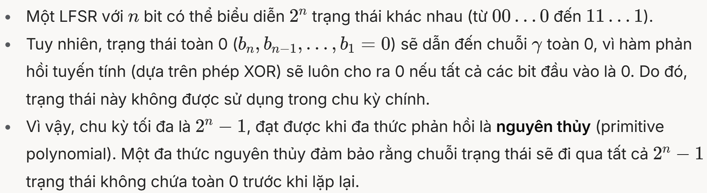

- **Cấu trúc của LFSR được mô tả bởi phương trình phản hồi tuyến tính (liên quan đến trường** $\mathbf{G}_{\mathbf{2}^{\mathbf{n}}}$**)**

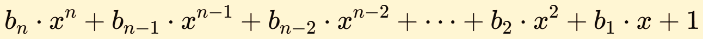

- Nếu $b_{i} = 1$, bit $b_{i}$ ​ được lấy để XOR (được sử dụng trong hàm phản hồi).

- Nếu $b_{i} = 0$, bit $b_{i}$ không được sử dụng.

<!-- -->

- **LFSR không an toàn do tính tuyến tính của nó**, và có thể bị tấn công bằng thuật toán **Berlekamp-Massey.**

> 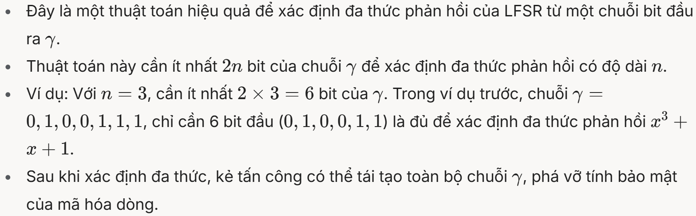

## 7.2. Mã hoá khối

### 7.2.1. Khái niệm và sơ lược phép mã hóa khối

- Chuyển đổi mật mã trên các **khối văn bản** thuần túy có **kích thước cố định (32, 64, 128, 256 bit).**

- Mật mã khối lấy một khối bit bản rõ và tạo ra một khối bit bản mã, thường có cùng kích thước. Kích thước của khối được cố định trong thuật toán. Việc **lựa chọn kích thước khối không ảnh hưởng trực tiếp đến độ mạnh của lược đồ mã hóa.**

- Độ mạnh của mật mã phụ thuộc vào độ dài của khóa.

- Kích thước khối: Trên lý thuyết bất kỳ kích thước nào của khối đều được chấp nhận, nhưng có các quy tắc được ghi nhớ trong khi chọn kích thước khối:

  - Tránh kích thước khối quá nhỏ: Giả sử kích thước khối là n bit, số lượng khối bản rõ có thể có là 2n.

    - *Nếu kích thước khối quá nhỏ*, & kẻ tấn công phát hiện ra **các khối bản rõ tương ứng với một số khối bản mã** ***đã được mã hóa bằng cùng một khóa*** đã gửi trước đó, thì kẻ tấn công có thể khởi chạy một kiểu “tấn công từ điển” bằng cách *xây dựng một từ điển gồm các cặp bản rõ/mã được gửi bằng khóa mã hóa đó*.

    - Kích thước khối lớn hơn khiến cuộc tấn công trở nên khó khăn hơn vì từ điển cần phải nhiều hơn.

  - Không nên để kích thước khối quá lớn: Với kích thước khối quá lớn, mật mã sẽ trở nên hoạt động kém hiệu quả.

    - Nếu bản rõ không đủ để lấp đầy kích thước một khối, chúng cần được đệm trước khi được mã hóa. Ví dụ: Với kích thước khối 256 bit, một thông điệp ngắn (ví dụ: 10 byte) sẽ cần đệm thêm 22 byte, gây lãng phí tài nguyên.

    - Kích thước khối lớn cũng làm **tăng độ phức tạp tính toán** trong mỗi vòng mã hóa, dẫn đến **thời gian xử lý lâu hơn và tiêu tốn nhiều tài nguyên** hơn.

  - Bội số của 8 bit: Kích thước khối nên là bội số của 8 vì nó dễ thực hiện vì hầu hết bộ xử lý máy tính xử lý dữ liệu theo bội số của 8 bit, ví dụ: 64 bit (8 byte), 128 bit (16 byte), 256 bit (32 byte).

    - Nếu kích thước khối không phải là bội số của 8 bit (ví dụ: 100 bit), việc xử lý dữ liệu sẽ phức tạp hơn, đòi hỏi các thao tác căn chỉnh (alignment) và có thể làm giảm hiệu suất.

- Một mật mã khối có thể được biểu diễn dưới dạng mật mã thay thế trên một bảng chữ cái rất lớn, ví dụ, **có 264 ký tự cho một khối 64 bit** (tương ứng với tất cả các giá trị có thể của một khối 64 bit).

- Tuy nhiên, **việc lưu trữ một bảng thay thế cho 264 ký tự là không khả thi** (cần 270 bit bộ nhớ cho một khóa, tức là khoảng 1021 byte, một con số khổng lồ). Do đó, sự tương ứng giữa đầu vào và đầu ra được mô tả bằng một thuật toán thay vì bảng tra cứu.

- **Thuật toán mã hóa khối:** Một khối văn bản đơn thuần **X** được chuyển đổi thành **một khối mật mã Y** có cùng kích thước **bằng cách sử dụng một số Khóa mã hóa**, có Khóa được thể hiện là:

  Y = Encrypt(X, Key)

  - Quy trình **giải mã** thực hiện chuyển đổi ngược lại bằng cách sử dụng cùng một khóa:

X = Encrypt(Y, Key)

- Các phép **phép chuyển đổi** này thường bao gồm:

  - **Xáo trộn bit (Diffusion)**:

<!-- -->

- Các bit trong khối bản rõ được "xáo trộn" với nhau để đảm bảo rằng một thay đổi nhỏ trong bản rõ (ví dụ: 1 bit) sẽ dẫn đến thay đổi lớn trong bản mã (hiệu ứng "lan tỏa").

- Điều này làm tăng tính bảo mật, khiến kẻ tấn công khó phân tích mối quan hệ giữa bản rõ và bản mã.

  - **Kết hợp với khóa (Confusion):**

- Các bit của khối bản rõ được kết hợp với các bit của khóa mã hóa Key, thường thông qua các phép toán logic hoặc số học.

- Điều này đảm bảo rằng bản mã phụ thuộc mạnh vào khóa, và không thể giải mã nếu không biết khóa.

  - **Xử lý dữ liệu dưới dạng số nguyên:**

- Mỗi khối được diễn giải như một số nguyên trong phạm vi \[0,…, 2k−1\], với k là kích thước khối (ví dụ: k = 64 cho khối 64 bit).

- Các phép toán số học hoặc logic được áp dụng trên các số nguyên này để tạo ra bản mã.

<!-- -->

- Để đảm bảo khả năng giải mã (tính đảo ngược), các phép biến đổi trong mã hóa khối phải sử dụng các phép toán có thể đảo ngược.

- Nếu một phép toán không đảo ngược được (ví dụ: mất thông tin trong quá trình biến đổi), thì không thể khôi phục bản rõ từ bản mã.

- Các phép toán đảo ngược được sử dụng thường xuyên nhất trong mật mã khối hiện đại được liệt kê:

<table>
<caption>
Bảng 12. Các phép toán đảo ngược sử dụng trong mã hóa khối
</caption>
<colgroup>
<col style="width: 11%" />
<col style="width: 23%" />
<col style="width: 35%" />
<col style="width: 29%" />
</colgroup>
<thead>
<tr>
<th style="text-align: center;">
<strong>Tên</strong>
</th>
<th style="text-align: center;">
<strong>Ký hiệu</strong>
</th>
<th style="text-align: center;">
<strong>Công thức chuyển đổi</strong>
</th>
<th style="text-align: center;">
<strong>Chuyển đổi ngược lại</strong>
</th>
</tr>
</thead>
<tbody>
<tr>
<td style="text-align: center;">
Phép cộng
</td>
<td style="text-align: center;">
Ký hiệu phép cộng
</td>
<td style="text-align: center;">
<strong>X′ = X + V</strong>

(có thể xem đây là phép XOR vì đều thực hiện trong modulo 2)
</td>
<td style="text-align: center;">
Phép trừ
</td>
</tr>
<tr>
<td style="text-align: center;">
Tổng theo modulo 2
</td>
<td style="text-align: center;">
Ký hiệu tổng modulo 2
</td>
<td style="text-align: center;">
<strong>X′ = X⊕V</strong>
</td>
<td style="text-align: center;">
Tự động trả về (Automatic return)
</td>
</tr>
<tr>
<td style="text-align: center;">
Nhân theo modulo 2N+1 (N là kích thước khối)
</td>
<td style="text-align: center;">
Ký hiệu phép nhân modulo
</td>
<td style="text-align: center;">
<strong>X′ = (X⋅V) mod (2N+1)</strong>

<em>Đây là phép nhân trong trường hữu hạn Z/(2N+1)</em>
</td>
<td style="text-align: center;">
Nhân tử chung có thể tìm được bằng thuật toán Euclid

Tìm V−1 sao cho (V⋅V−1) mod  (2N+1) = 1,

sau đó: X = (X′⋅V−1) mod  (2N+1)
</td>
</tr>
<tr>
<td style="text-align: center;">
Dịch chuyển theo chu kỳ sang phải/trái
</td>
<td style="text-align: center;">
Ký hiệu phép dịch vòng
</td>
<td style="text-align: center;">
X′=X ROR V hoặc X′=X ROL V
</td>
<td style="text-align: center;">
Dịch chuyển tuần hoàn theo hướng ngược lại
</td>
</tr>
<tr>
<td style="text-align: center;">
Hoán vị bit
</td>
<td style="text-align: center;">
Ký hiệu phép hoán vị bit
</td>
<td style="text-align: center;">
Sắp xếp lại vị trí các bit trong khối theo một quy tắc cố định.
</td>
<td style="text-align: center;">
Hoán vị ngược lại (theo quy tắc ngược).
</td>
</tr>
<tr>
<td style="text-align: center;">
Bằng thay thế
</td>
<td style="text-align: center;">
Ký hiệu phép thay thế
</td>
<td style="text-align: center;">
X′=SBox(X)

S-box là <strong><u>một bảng tra cứu</u></strong> ánh xạ mỗi giá trị đầu vào sang một giá trị đầu ra duy nhất.
</td>
<td style="text-align: center;">
Thay thế ngược lại, sử dụng bảng S-box ngược.
</td>
</tr>
</tbody>
</table>

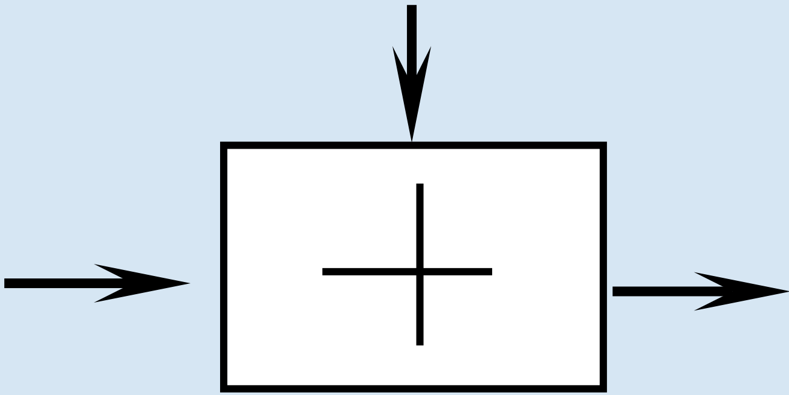
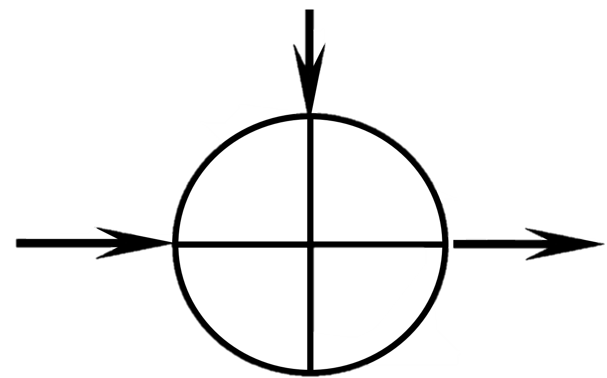
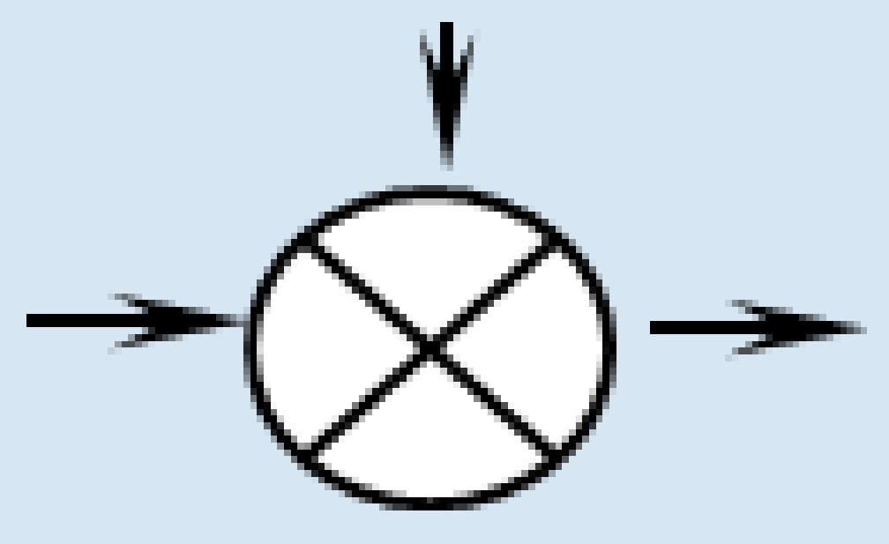
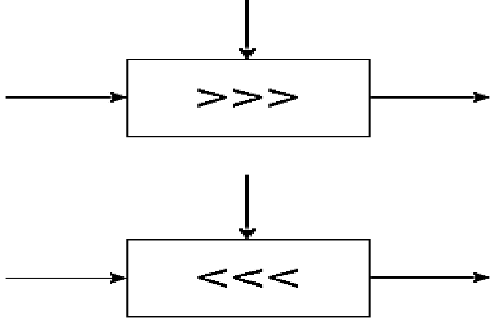
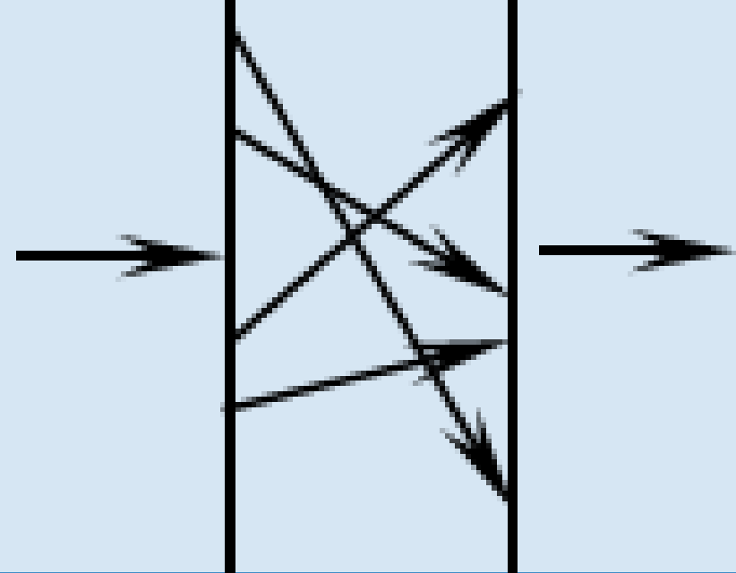
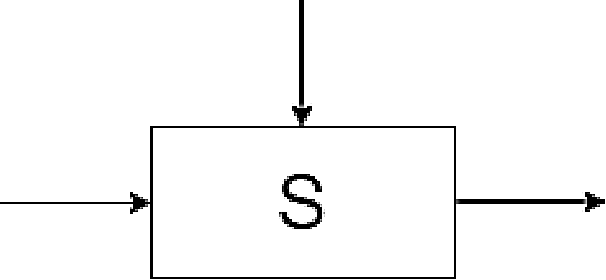

- **Phép nhân và thay thế (S-box)** đặc biệt quan trọng vì chúng mang lại **tính phi tuyến**:

  - **Tính phi tuyến**:

    - Các phép toán tuyến tính (như XOR, dịch chuyển, hoán vị) dễ bị tấn công bằng phân tích tuyến tính, vì kẻ tấn công có thể xây dựng các phương trình tuyến tính để dự đoán đầu ra.

    - Phép nhân (trong trường hữu hạn) và S-box phá vỡ tính tuyến tính, làm cho các phương trình trở nên phức tạp và khó giải.

  - **Chống phân tích tuyến tính**:

    - Phân tích tuyến tính (linear cryptanalysis) tìm kiếm các mối quan hệ tuyến tính giữa bản rõ, bản mã, và khóa.

    - S-box được thiết kế để giảm thiểu xác suất của các mối quan hệ tuyến tính, làm cho các cuộc tấn công này kém hiệu quả.

    - Ví dụ: S-box trong AES được xây dựng dựa trên phép nghịch đảo trong GF(28), kết hợp với một phép biến đổi affine, để tối ưu hóa tính phi tuyến.

- Một trong những nguyên tắc chính của việc xây dựng cấu trúc của các thuật toán mã hoá hiện đại là **nguyên tắc lặp lại.** Ý tưởng của nó là lặp đi lặp lại, bao gồm nhiều chu kỳ (hoặc vòng), xử lý một khối văn bản thuần túy bằng cách sử dụng một khóa đặc biệt của vòng trên mỗi chu kỳ, khóa này được tính toán trên cơ sở khóa mã hóa.

- **Số lượng chu kỳ có thể thay đổi** vì lý do kháng mật mã và hiệu quả triển khai thuật toán: tăng số chu kỳ dẫn đến tăng độ mạnh của mật mã, nhưng làm tăng thời gian mã hóa và tiêu tốn tài nguyên máy tính. Các cấu trúc tuần hoàn như vậy thường được gọi là mạng lưới và hầu hết các mật mã khối hiện đại được xây dựng bằng cách sử dụng kiến ​​trúc mạng lưới

  - Các thuật toán mã hóa khối hiện đại thường được xây dựng dưới dạng **mạng lưới (network)**, chẳng hạn:

    - **Mạng thay thế-hoán vị (Substitution-Permutation Network - SPN)**: Sử dụng S-box (thay thế) và hoán vị để tạo tính phi tuyến và lan tỏa. Ví dụ: AES.

    - **Mạng Feistel (Feistel Network)**: Chia khối thành hai nửa, áp dụng hàm vòng (round function) lên một nửa và kết hợp với nửa còn lại. Ví dụ: DES.

  - **Ưu điểm của kiến trúc mạng lưới**

    - **Tính lan tỏa (Diffusion)**: Đảm bảo rằng một thay đổi nhỏ trong bản rõ (1 bit) ảnh hưởng đến nhiều bit trong bản mã.

    - **Tính nhiễu (Confusion)**: Tạo mối quan hệ phức tạp giữa bản rõ, bản mã, và khóa, thông qua các phép toán phi tuyến như S-box.

    - **Tính lặp lại**: Nhiều vòng biến đổi làm tăng độ phức tạp, khiến việc phân tích trở nên khó khăn.

<table>
<caption>
Bảng 13. Sự khác biệt giữa Mật mã Khối và Mật mã Dòng
</caption>
<colgroup>
<col style="width: 49%" />
<col style="width: 50%" />
</colgroup>
<thead>
<tr>
<th style="text-align: center;"><strong>Mật mã Khối</strong></th>
<th style="text-align: center;"><strong>Mật mã Dòng</strong></th>
</tr>
</thead>
<tbody>
<tr>
<td>Chuyển đổi bản rõ thành bản mã bằng cách lấy 
từng khối của bản rõ</td>
<td>Chuyển đổi bản rõ thành bản mã bằng cách lấy 1 
byte bản rõ tại một thời điểm</td>
</tr>
<tr>
<td>Sử dụng 64 bit hoặc nhiều hơn</td>
<td>Sử dụng 8 bit (1 byte)</td>
</tr>
<tr>
<td>Mật mã khối <strong>không phức tạp</strong></td>
<td>Mật mã dòng phức tạp hơn</td>
</tr>
<tr>
<td>Mật mã khối sử dụng sự <mark>xáo trộn và khuếch tán</mark></td>
<td>Mật mã dòng <mark>chỉ sử dụng sự xáo trộn</mark></td>
</tr>
<tr>
<td>Bản rõ được <strong>mã hóa ngược rất khó</strong></td>
<td>Bản rõ được <strong>mã hóa ngược dễ dàng</strong></td>
</tr>
<tr>
<td>Các chế độ thuật toán được sử dụng trong mật 
mã khối là <strong><mark>ECB và CBC</mark></strong></td>
<td>Trong mật mã dòng là <strong><mark>CFB và OFB</mark></strong></td>
</tr>
<tr>
<td>Mật mã khối hoạt động trên các kỹ thuật chuyển 
vị như kỹ thuật <strong>rail-fence, kỹ thuật chuyển vị 
cột,</strong> …</td>
<td>Mật mã dòng hoạt động trên các <strong>kỹ thuật thay 
thế</strong>.</td>
</tr>
<tr>
<td>Mật mã khối chậm hơn so với mật mã dòng</td>
<td>Mật mã dòng nhanh hơn mật mã khối</td>
</tr>
</tbody>
</table>

### 7.2.2. Các chế độ hoạt động của mã hóa Khối:

#### 7.2.2.1. Electronic Code Book (ECB – cơ chế bảng tra điện tử)

- Chế độ này được gọi là **chế độ thay thế đơn giản**.

- Là chế độ đơn giản nhất trong các chế độ hoạt động của mã hóa khối.

- Thực hiện mã hóa trực tiếp từng khối bản rõ đầu vào và đầu ra ở dạng các khối bản mã được mã hóa.

- Giả sử một thuật toán có quy định kích thước mỗi khối là bội của n bit. Nếu **một thông điệp có kích thước lớn hơn n bit**, thì **nó có thể được chia thành nhiều khối có kích thước n bit**, và nếu tồn tại khối \< n bit thì ta đệm thêm vào phía sau khối đó 1 chuỗi bit để kích thước của nó là n bit (Chẳng hạn thêm 1 chuỗi 0 đệm phía sau khối).

- Kích thước n phụ thuộc vào thuật toán mã hóa.

- Mỗi khối của bản rõ sẽ được mã hóa **<u>độc lập</u>** với nhau, và cùng sử dụng 1 key, và các khối bản mã sau khi mã hóa cũng sẽ **độc lập** nhau, không có sự liên kết giữa các khối.

  - Điều này có nghĩa là nếu hai khối bản rõ giống nhau (Pi = Pj​), thì các khối bản mã tương ứng cũng giống nhau (Ci = Cj​).

<!-- -->

- Chế độ **Electronic Codebook (ECB)** trong mã hóa khối được gọi như vậy vì cách hoạt động của nó giống với một **"sổ mã (codebook)"** truyền thống trong mật mã học, nhưng được thực hiện dưới dạng điện tử (electronic).

  - Một **codebook** (sổ mã) là một bảng tra cứu (lookup table) được sử dụng để mã hóa và giải mã thông điệp. Sổ mã **chứa các cặp ánh xạ giữa bản rõ (plaintext) và bản mã (ciphertext).**

  - **Đặc điểm của sổ mã**:

    - Mỗi bản rõ được ánh xạ cố định sang một bản mã duy nhất.

    - Các ánh xạ là độc lập với nhau, không có sự phụ thuộc giữa các phần của thông điệp.

  - Thay vì sử dụng một sổ mã vật lý (như trong mật mã cổ điển), **ECB sử dụng thuật toán mã hóa khối (block cipher) để thực hiện ánh xạ này một cách điện tử,** thông qua tính toán.

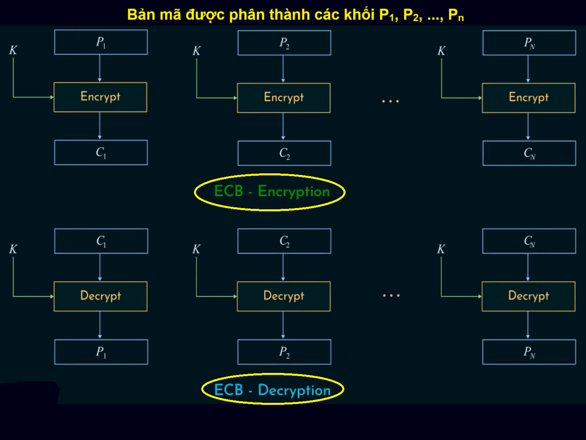
<figcaption>
Hình 50. ECB
</figcaption>

- **Pros**

  - Simplest mode.

  - Ideal for **<u>short</u>** amount of data. Ex: secure transfer of AES or DES key

  - Independent - Can encrypt any block.

  - Fast - Parallelism.

- **Cons**

  - Not secure for lenghthy messages.

    - Trong thông điệp có các khối có mẫu lặp lại 🡪 Kẻ tấn công khi nhận được các mẫu bản mã giống nhau sẽ biết được chắc chắn **trong bản rõ cũng có các mẫu giống nhau (mang tính quy luật),** làm giảm tính bảo mật, & là 1 cơ sở để kẻ tấn công có thể suy luận các vấn đề khác.

  - Attacker can exploit the regularities (quy luật) of the message.

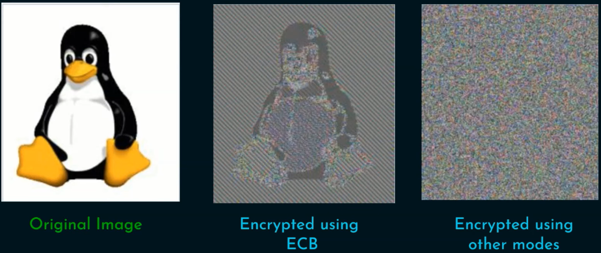
<figcaption>
Hình 51. Nhược điểm ECB
</figcaption>

🡪 Kẻ tấn công vẫn nhìn thấy được đó là con chim cánh cụt thông qua bản mã thực hiện bởi ECB.

#### 7.2.2.2. Cipher Block Chaining (CBC – cơ chế mã móc xích)

- CBC là một cải tiến được thực hiện trên ECB, do ECB dễ bị phá vỡ.

- Sử dụng một Key chung để mã hóa

- Khối trước móc vào khối sau & thực hiện mã hóa 🡪 Chaining

- **Ý tưởng chính**:

  - Dữ liệu được chia thành các khối bản rõ (plaintext) có kích thước cố định.

  - Mỗi khối bản rõ được **XOR** với khối bản mã trước đó trước khi mã hóa, tạo ra sự phụ thuộc giữa các khối (chaining).

  - **Khối đầu tiên** được XOR với một **vector khởi tạo (Initialization Vector - IV)** để bắt đầu chuỗi.

  - Kết quả là các khối bản mã không còn giống nhau ngay cả khi các khối bản rõ giống nhau, giúp che giấu mẫu dữ liệu.

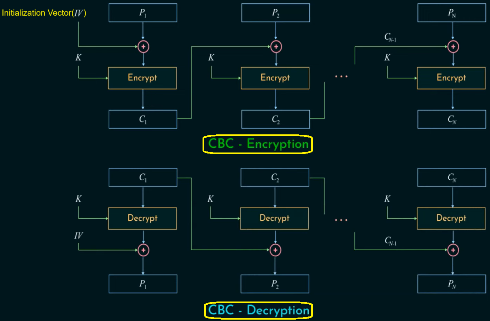
<figcaption>
Hình 52. CBC
</figcaption>

- **Vector khởi tạo có độ dài bằng với kích thước của mỗi khối.**

- Được dùng trong mã hóa CSDL, tập dữ liệu lớn…

- Pros

  - Appropriate mode for encrypting messages of **length greater than 'b' bits.**

  - **Confidentiality + Authentication** *(tin tưởng rằng thông điệp chỉ đến từ đúng nguồn tin cậy, vì chỉ có họ và người nhận mới biết được chuỗi vector khởi tạo)*

- Cons

  - Slow - **No parallelism**.

  - Cannot encrypt any block since we need the ciphertext of previous block.

  - **Initialization Vector (IV) which must be known** **to sender & receiver.**

#### 7.2.2.3. Cipher Feedback Mode (CFB)

- Trong chế độ này, **mật mã được cung cấp dưới dạng phản hồi cho khối mã hóa tiếp theo** với một thông số kỹ thuật mới

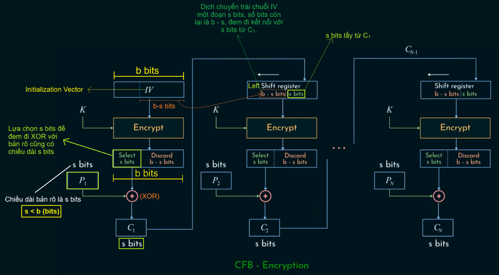
<figcaption>
Hình 53. CFB – Hình 1
</figcaption>

- **C1 hoạt động như một phản hồi (feedback), vì nó được sử dụng để sinh ra bản mã hóa tiếp theo C2.**

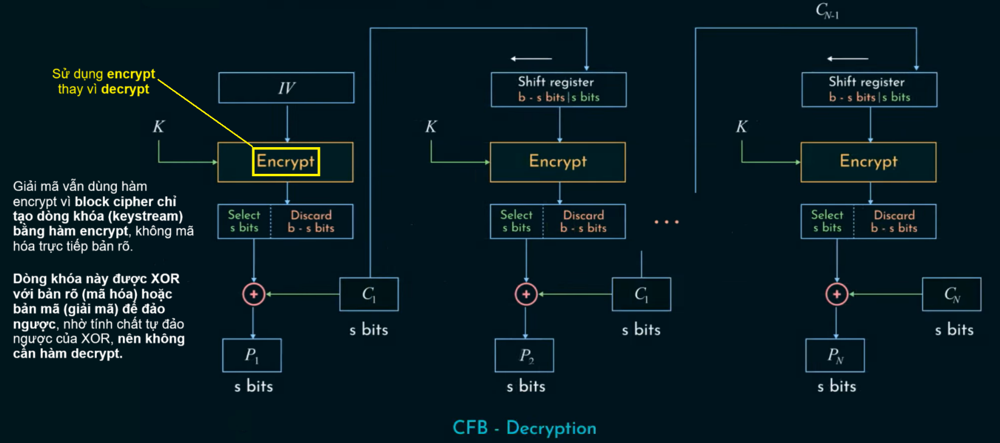
<figcaption>
Hình 54. CFB - Hình 2
</figcaption>

- **Pros**

  - Can operate in **real time.**

    - hoạt động như mã hóa dòng (stream cipher), nghĩa là chúng tạo dòng khóa (keystream) và XOR với dữ liệu đầu vào từng bit hoặc byte một. Điều này cho phép mã hóa và giải mã dữ liệu ngay khi nhận được, mà không cần chờ toàn bộ khối dữ liệu (như trong ECB hoặc CBC).

  - Need of padding is eliminated.

  - **Encryption function does decryption as well.**

  - Length of PT = Length of CT.

- **Cons**

  - Chances of wastage of transmission capacity.

    - Nếu bản rõ rất ngắn (chỉ 1 byte), nhưng IV là 128 bit, thì tổng dữ liệu truyền đi (128 bit IV + 8 bit bản mã) sẽ lớn hơn nhiều so với bản rõ ban đầu, gây lãng phí băng thông.

  - **Not a typical stream cipher.**

    - dựa trên mã hóa khối (block cipher) để tạo dòng khóa, nên hiệu suất có thể thấp hơn so với các mã hóa dòng chuyên dụng.

#### 7.2.2.4. Output Feedback Mode (OFB – chế độ mã hóa phản hồi đầu ra)

- Chế độ này tuân theo qui trình **gần giống** với chế độ CFB.

- Khác với CFB ở chỗ, **C1 không đóng vai trò là feedback nữa**, và bản rõ P1 được thực hiện XOR với **toàn bộ bits của IV** sau khi đưa vào thuật toán mã hóa**, thay vì chỉ s bits như CFB.**

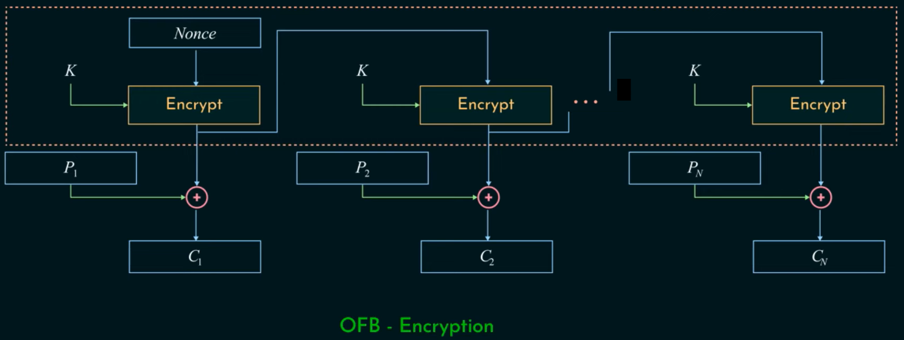
<figcaption>
<strong>IV</strong>
</figcaption>

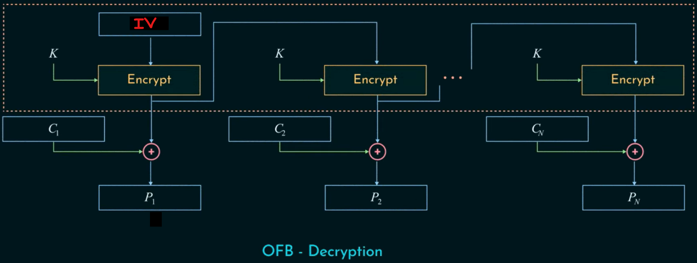
<figcaption>
Hình 55. OFB - Hình 1
</figcaption>

Hình 56. OFB - Hình 2

#### 7.2.2.5. Counter Mode (CTR)

- Chế độ này triển khai mật mã khối ***dựa trên một bộ đếm đơn giản.***

- Chế độ này tương tự như OFB với điểm khác biệt là nó sử dụng bộ đếm hoặc số thứ tự làm đầu vào cho thuật toán.

- Mỗi khi **một giá trị khởi tạo ngược** được mã hóa và được cung cấp làm đầu vào cho XOR với văn bản gốc dẫn đến khối mã hóa.

- **Chế độ CTR độc lập với việc sử dụng phản hồi** và do đó <u>có thể được thực hiện song song</u>

- Chuyển block cipher thành một dạng mã hóa dòng (stream cipher) bằng cách sử dụng một **bộ đếm (counter)** kết hợp với một **giá trị khởi tạo (nonce - number used once)** để tạo dòng khóa (keystream).

- **Quá trình giải mã tương tự,** sử dụng cùng bộ đếm để tạo lại dòng khóa và XOR với bản mã để khôi phục bản rõ.

- Dữ liệu đầu vào (bản rõ) được chia thành các khối có kích thước cố định. Nếu dữ liệu không đủ dài, nó sẽ được **đệm (padding)** để đạt kích thước khối.

- **Different counter value for each plaintext.**

- **Counter value is initialized, given to the first plain text block, and incremented after 1 encryption 🡪 different cipher text.**

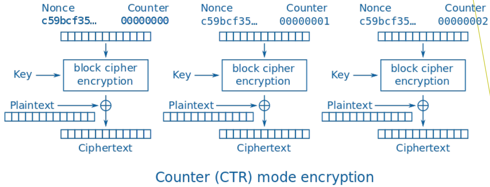
<figcaption>
Hình 57. CTR – Hình 1
</figcaption>

- **Chiều dài Nonce**: Thường từ 64 bit đến 96 bit (thường 96 bit với AES), tùy thuộc vào yêu cầu ngẫu nhiên và bảo mật.

- **Chiều dài Counter**: Phần còn lại của kích thước khối (thường 32 bit hoặc 64 bit), đủ để xử lý lượng dữ liệu trong một Nonce.

- **Tổng chiều dài**: Phải bằng kích thước khối của block cipher (ví dụ: 128 bit với AES).

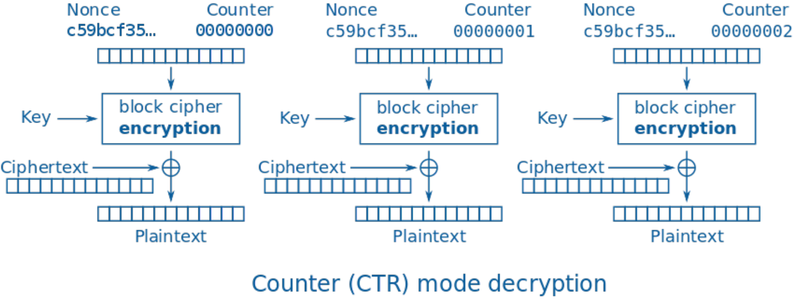

Hình 58. CTR - Hình 2

### 7.2.3. Khái niệm cấu trúc Feistel

- **Cấu trúc Feistel** là một mô hình thiết kế (design framework) dùng để xây dựng các mật mã khối đối xứng (symmetric block ciphers).

- Cấu trúc Feistel không phải là một thuật toán mã hóa cụ thể, mà là một **khuôn mẫu** (template) để xây dựng các thuật toán mã hóa khối.

- Ông đã phát triển cấu trúc này khi nghiên cứu và thiết kế **DES (Data Encryption Standard)**.

- Dựa trên nguyên tắc **khuếch tán (diffusion)** và **xáo trộn (confusion):**

  - **Khuếch tán (Diffusion)**

    - Một thay đổi nhỏ trong bản rõ (plaintext) hoặc khóa (key) sẽ ảnh hưởng đến nhiều bit trong bản mã (ciphertext) 🡪 **Hiệu ứng tuyết lở (Avalanche Effect)**:

    - **Mục đích:** **Che giấu các thuộc tính thống kê của bản rõ** (như tần suất xuất hiện của các ký tự) và làm cho việc phân tích thống kê để tìm khóa trở nên khó khăn.

    - **Ví dụ:** Trong DES, nếu thay đổi 1 bit trong bản rõ, sau 16 vòng, khoảng 32 bit trong bản mã 64 bit sẽ thay đổi.

  - **Xáo trộn (Confusion)**

    - làm cho **mối quan hệ giữa khóa và bản mã trở nên phức tạp nhất** có thể.

    - **Mục đích:** Ngăn chặn kẻ tấn công sử dụng phân tích thống kê để suy ra thông tin về khóa từ bản mã.

  - **Kết hợp khuếch tán và xáo trộn**:

    - Sự kết hợp này là **nền tảng của các hệ thống mật mã an toàn**, được Claude Shannon đề xuất trong lý thuyết mật mã hiện đại.

    - Khuếch tán làm lan tỏa sự thay đổi, còn xáo trộn làm mờ mối quan hệ giữa khóa và bản mã. Khi kết hợp, chúng tạo ra một hệ thống mật mã mạnh, khó bị phá vỡ bởi các cuộc tấn công thống kê.

- Mật mã khối được xây dựng trong cấu trúc mật mã Feistel. Mật mã khối có số vòng (Round) và Khóa (Key) cụ thể để tạo bản mã. Để xác định mức độ phức tạp của một thuật toán, một vài nguyên tắc thiết kế sẽ được xem xét như sau:

  - **Số vòng (round):**

    - Là **số lần lặp lại của quá trình xử lý** trong thuật toán mã hóa. Mỗi vòng thực hiện các bước *<u>thay thế (substitution) và hoán vị (permutation) để khuếch tán (diffusion) và xáo trộn (confusion) dữ liệu.</u>*

      - **Ví dụ:**

        - DES sử dụng 16 vòng.

        - AES (dù không dùng cấu trúc Feistel, mà dùng SPN - Substitution-Permutation Network) sử dụng 10 vòng cho khóa 128 bit, 12 vòng cho khóa 192 bit, và 14 vòng cho khóa 256 bit.

    - Số lượng vòng được sử dụng phụ thuộc vào độ bảo mật mong muốn từ hệ thống. Số vòng nhiều hơn cung cấp hệ thống an toàn hơn. *(vì mỗi vòng làm tăng mức độ khuếch tán và xáo trộn, khiến việc phân tích bản mã để tìm khóa trở nên khó hơn).*

    - Với số vòng đủ lớn, một thay đổi nhỏ trong bản rõ hoặc khóa sẽ lan tỏa (diffuse) ra toàn bộ bản mã, gọi là **hiệu ứng tuyết lở (avalanche effect)**.

    - Nhưng đồng thời, nhiều vòng hơn thì quá trình mã hóa và giải mã chậm và không hiệu quả.

    - Do đó, số lượng vòng trong các hệ thống phụ thuộc vào sự đánh đổi hiệu quả an ninh.

  - **Thiết kế hàm F:** <u>Phần cốt lõi của cấu trúc mật mã khối Feistel là Hàm vòng (Round Function),</u> thực hiện các phép toán để tạo xáo trộn và khuếch tán trong mỗi vòng.

    - Độ phức tạp của phân tích mã (cryptanalysis) có thể bắt nguồn từ Hàm vòng tức là **độ phức tạp đối với hàm round ngày càng tăng thì sẽ làm gia tăng độ khó của hệ thống mật mã.**

    - Để tăng độ phức tạp của round function, **hiệu ứng tuyết lở cũng nằm trong hàm vòng,** có nghĩa là bất kỳ 1 sự thay đổi nhỏ đơn lẻ nào trong bản rõ cũng sẽ tạo ra một đầu ra không chính xác.

  - **Thuật toán lịch trình khóa:**

    - Là quá trình sinh ra các **khóa con (subkeys)** từ khóa chính (master key) để sử dụng trong mỗi vòng của cấu trúc Feistel, giúp tăng độ phức tạp của phân tích mật mã.

      - Ví dụ:

        - Trong DES, từ khóa chính 64 bit (thực tế 56 bit sau khi bỏ bit kiểm tra), thuật toán sinh ra 16 khóa con, mỗi khóa con 48 bit, cho 16 vòng.

        - Mỗi khóa con được tạo bằng cách dịch chuyển (shift) và hoán vị (permutation) từ khóa chính.

      - Mỗi vòng dùng một khóa con khác nhau, làm tăng độ phức tạp của thuật toán và khiến việc phân tích để tìm khóa chính trở nên khó hơn.

      - Nếu tất cả các vòng dùng cùng một khóa, kẻ tấn công có thể dễ dàng tìm ra mối quan hệ giữa các vòng.

    - Hiệu ứng tuyết lở **làm cho việc lấy khóa con phức tạp hơn.**

    - Trong cấu trúc Feistel, giải mã sử dụng cùng thuật toán như mã hóa, **nhưng với thứ tự khóa con đảo ngược.**

    - Hiệu ứng tuyết lở trong lịch trình khóa có thể gây khó khăn nếu không cẩn thận, **vì một sai sót nhỏ trong việc tạo khóa con (hoặc trong quá trình giải mã) sẽ dẫn đến kết quả không chính xác.**

    - Do đó, cần đảm bảo rằng thuật toán lịch trình khóa được triển khai chính xác để tạo ra các khóa con đúng cho cả mã hóa và giải mã.

- Mã hóa Feistel không phải là một lược đồ cụ thể của mật mã khối. Nó là một mô hình thiết kế mà từ đó nhiều mật mã khối dựa trên mô hình này được tạo ra.

- **Quá trình mã hóa:** sử dụng cấu trúc Feistel bao gồm nhiều vòng xử lý bản rõ, mỗi vòng bao gồm một số bước “thay thế” theo sau là một bước hoán vị.

  - **Bất kỳ một hệ thống mã hóa nào cũng đều có 2 bước:** 1. Sinh khóa, 2. Xử lý mã hóa

<table>
<colgroup>
<col style="width: 60%" />
<col style="width: 39%" />
</colgroup>
<thead>
<tr>
<th style="text-align: center;">
Ảnh minh họa image26.png

Hình 59. Cấu trúc Feistel
</th>
<th><ul>
<li>
<strong><mark>Bước 1: Sinh khóa</mark></strong>

<ul>
<li>
Từ khóa ban đầu (master key), tùy vào mỗi thuật toán cụ thể mà có các thuật toán sinh khóa khác nhau để tạo thành tập hợp các khóa con <math display="inline" xmlns="http://www.w3.org/1998/Math/MathML"><semantics><mrow><mo stretchy="true" form="prefix">(</mo><msub><mi>K</mi><mn>1</mn></msub><mo>,</mo><msub><mi>K</mi><mn>2</mn></msub><mo>,</mo><mi>.</mi><mi>.</mi><mi>.</mi><mo>,</mo><msub><mi>K</mi><mi>n</mi></msub><mo stretchy="true" form="postfix">)</mo></mrow><annotation encoding="application/x-tex">\left( K_{1},K_{2},...,K_{n} \right)</annotation></semantics></math>, dùng để sử dụng mã hóa theo mỗi vòng (round).
</li>
<li>
Khóa con có độ dài bé hơn hoặc bằng khóa trạng thái (Khóa ban đầu).
</li>
</ul></li>
<li>
<strong><mark>Bước 2: Xử lý mã hóa</mark></strong>

<ul>
<li>
<strong>a/</strong> Khối (bit) bản rõ được chia làm 2 nửa: <strong>L (nửa bên trái), R (nửa bên phải)</strong>
</li>
<li>
<strong>b/ Cấu trúc Feistel thực hiện n vòng</strong> <em>(thường từ 8 đến 16 vòng, ví dụ DES có 16 vòng).</em> <strong>Trong mỗi vòng:</strong>
</li>
</ul></li>
</ul></th>
</tr>
</thead>
<tbody>
</tbody>
</table>

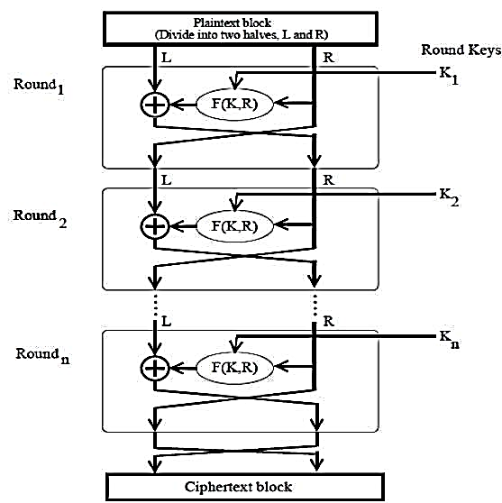

- **Li+1 = Ri**

  - Trong vòng thứ i, nửa bên phải Ri của dữ liệu ở vòng hiện tại sẽ trở thành nửa bên trái Li+1​ của vòng tiếp theo mà không thay đổi gì.

  - Đây là một bước sao chép trực tiếp,

- **Thực hiện hàm F(Ki, Ri)**

  - Hàm F thường bao gồm các bước sau (lấy ví dụ từ DES):

    - **Mở rộng (Expansion)**: Ri​ được mở rộng tùy theo thuật toán mã hóa (ví dụ: từ 32 bit lên 48 bit trong DES).

    - **XOR với khóa con**: XOR Ri​ (đã mở rộng) với Ki​.

    - **Thay thế (Substitution)**: Dùng S-boxes (substitution boxes) để thay thế các bit theo cách phi tuyến tính, tạo xáo trộn.

    - **Hoán vị (Permutation)**: Sắp xếp lại các bit để tạo khuếch tán.

  - **<u>Kết quả</u>** của F(Ki, Ri) là **một chuỗi bit có độ dài bằng Ri**, sẵn sàng để XOR với Li.

- **Ri+1 = Li ⊕ F(Ki, Ri).**

  - Nửa bên trái Li​ của vòng hiện tại được XOR với kết quả của hàm F(Ki, Ri), và kết quả trở thành nửa bên phải Ri+1 của vòng tiếp theo.

  - Điều này giúp lan tỏa (diffuse) sự thay đổi từ Ri​ (qua hàm F) sang Ri+1​, và tiếp tục lan tỏa qua các vòng sau.

<!-- -->

- **Bước 3: Vòng cuối cùng thực hiện bước hoán vị đổi vị trí L và R cho nhau:**

  - **Ln+1 = Rn.**

  - **Thực hiện hàm F(Kn, Rn).**

  - **Rn+1 = Ln ⊕ F(Kn, Rn).**

  - **Ln+1 = Rn+1.**

  - **Rn+1 = Ln+1.**

- **<u>Kết quả:</u>** Ln+1∣∣Rn+1 là khối bản mã (ciphertext).

- Giải mã là quá trình **ngược lại** quá trình mã hóa.

- Nếu không hoán đổi L và R ở vòng cuối của mã hóa, quá trình giải mã sẽ không thể khôi phục đúng bản rõ khi dùng cùng thuật toán. Hoán đổi cuối cùng đảm bảo tính đối xứng giữa mã hóa và giải mã.

- **Ưu điểm của mạng Feistel:**

  - Đơn giản hóa việc triển khai phần cứng trên cơ sở mã hoá hiện đại.

  - Đơn giản hóa việc triển khai phần mềm do thực tế là một phần quan trọng của các chức năng được hỗ trợ ở cấp độ phần cứng trong các máy tính hiện đại (ví dụ: tổng theo modulo 2, v.v.)

  - Nghiên cứu tốt các thuật toán dựa trên mạng Feistel

- **Nhược điểm:** chỉ một nửa khối đầu vào được mã hóa trong một vòng.
