## 8.1. Khái niệm

- Mã hóa đối xứng có nhược điểm lớn nhất là việc trao đổi khóa dễ bị lộ. Vì thế người ta sinh ra mã hóa bất đối xứng, để đảm bảo an toàn cho việc trao đổi khóa.

- **Mã hóa khóa bất đối xứng** (thường được gọi là **mã hóa khóa công khai**) sử dụng một **cặp khóa** cho quá trình **mã hóa và giải mã.**

- **Mặc dù các khóa khác nhau nhưng chúng có liên quan về mặt toán học**, do đó việc truy xuất bản rõ bằng cách giải mã bản mã là khả thi.

- Đặc điểm: **kích thước khóa rất lớn**, có thể lên đến hàng ngàn bit. Do vậy, các hệ mã hóa dạng này thường có **tốc độ thực thi chậm hơn nhiều lần so với các hệ mã hóa khóa đối xứng** có độ an toàn tương đương **=\> Mã hóa các file lớn thực sự không mấy hiệu quả.**

- Mặc dù vậy, các hệ mã hóa khóa bất đối xứng có khả năng đạt độ an toàn cao và ưu điểm nổi bật nhất là việc quản lý và phân phối khóa đơn giản hơn, do **chỉ khóa riêng trong cặp khóa cần giữ bí mật, còn khóa công khai có thể phân phối rộng rãi** trong môi trường mở như mạng Internet.

**<u>Ba loại chính của thuật toán mã hóa bất đối xứng:</u>**

***a. Phân tích số nguyên:***

- **Nguyên lý:** Dựa trên độ khó trong việc phân tích một số nguyên rất lớn thành các thừa số nguyên tố.

- **Ứng dụng:** **RSA** là ví dụ tiêu biểu. Trong RSA, hai số nguyên tố lớn được nhân với nhau để tạo ra khóa công khai. **Khóa riêng chỉ có thể tìm ra nếu phân tích được tích đó thành hai số nguyên tố ban đầu** – điều này cực kỳ khó khăn với máy tính hiện tại khi số đủ lớn.

***b. Logarit rời rạc:***

- **Nguyên lý:** Trong số học modulo, việc tính giá trị mũ là dễ dàng, nhưng **ngược lại** – tìm số mũ khi đã biết cơ số và kết quả – lại cực kỳ khó. Nói cách khác, việc tìm dữ liệu đầu vào mà chỉ biết kết quả là cực kỳ khó khăn.

- **Ví dụ:** Xét phương trình: 3k ≡ 13 (mod 17) =\> Tìm k là rất khó, chỉ có thể thử từng giá trị. **Không có 1 cơ sở nào để tính số mũ theo cách chung, chỉ sử dụng phép nhân thử.**

- **Ứng dụng:** Cơ sở của các thuật toán như **Diffie-Hellman**, **DSA (Digital Signature Algorithm)**...

***c. Đường cong Elliptic:***

- **Nguyên lý:** Sử dụng bài toán logarit rời rạc nhưng trong không gian của **đường cong elliptic** trên **trường hữu hạn**.

- **Đặc điểm:**

  - Các đường cong không có điểm nhọn hay điểm tự cắt.

  - Có thể thay đổi bằng cách chọn tham số a và b.

  - Hoạt động **trên các trường hữu hạn (finite field),** không phải số thực.

  - Bằng cách thay đổi các tham số a và/hoặc b, ta có thể xây dựng các đường cong Elliptic khác nhau

- Trong trường hợp này, đặc tính trường phải lớn hơn 3.

  - **Đặc tính của một trường** là số nguyên dương **nhỏ nhất p** sao cho: p ⋅ 1 = 0 trong trường đó (tức là cộng số 1 với chính nó p lần ra 0).

  - Với trường hữu hạn Fp​, đặc tính chính là số nguyên tố **p**.

  - **Người ta yêu cầu đặc tính trường \> 3** để tránh những vấn đề toán học phức tạp và đảm bảo tính an toàn của thuật toán.

- **Ưu điểm: Bảo mật cao** hơn so với RSA với **kích thước khóa nhỏ hơn** =\> tiết kiệm băng thông và tài nguyên.

- **Ứng dụng:** ECC được dùng nhiều trong thiết bị di động, ví dụ như **SSL/TLS hiện đại, ví tiền điện tử (cryptocurrency)**…

## 8.2. Thuật toán RSA

- Thuật toán này đóng vai trò là nền tảng cho các công cụ mật mã sinh học, trong đó các nguyên tắc mật mã có thể được sử dụng để bảo vệ mẫu sinh trắc học ...

- Thuật toán RSA bắt nguồn từ tập đoàn dữ liệu RSA và nó được đặt tên theo những người phát minh ra nó (Ron **Rivest**, Ali **Shamir**, Leonard **Adelman**).

- Thuật toán RSA **sử dụng sức mạnh của các số nguyên tố** để tạo cả khóa chung (public key) và khóa riêng (private key).

- Kích thước khóa thường là **2048** bit hoặc **4096** bit. Kích thước **1024** bit không còn an toàn nên đã bị loại bỏ khỏi hầu hết các ứng dụng chính thống.

- **Bản gốc và bản mã là các số nguyên** (chuyển về các số nguyên), **nằm trong đoạn \[0, n-1\], với n \< 2kích thước khóa.**

  - Vì mỗi bit có 2 trạng thái (0 hoặc 1), nên nếu bạn có n bit, bạn có thể biểu diễn 2n số khác nhau, từ 0 đến 2n-1.

- **Có 2 cách mã hóa:**

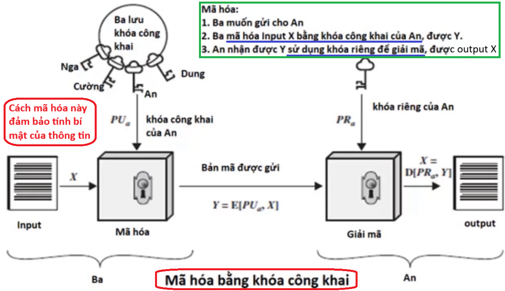
<figcaption>
Hình 60. Mã hóa bằng khóa công khai
</figcaption>

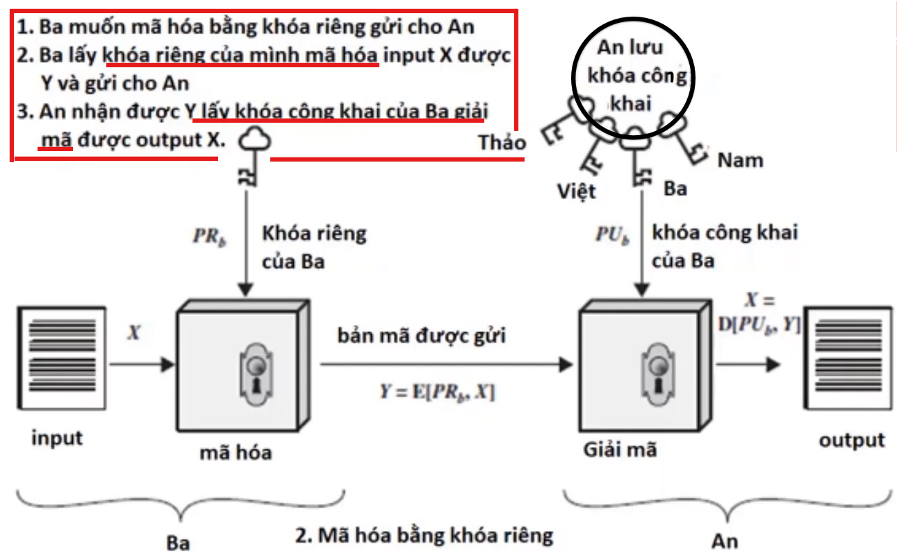
<figcaption>
Hình 61. Mã hóa bằng khóa riêng
</figcaption>

- **Quy trình của thuật toán mã hóa RSA:**

  - **B1. Sinh khóa (Key Generation):** Đây là bước tạo ra **cặp khóa công khai và khóa riêng**.

    - **Tạo/** **Chọn 2 số nguyên tố lớn**: p và q

    - Tính n = p × q, n sẽ được dùng làm **phần chung** trong cả khóa công khai và khóa riêng.

    - **Tính hàm Euler** (số phần tử nguyên tố cùng nhau với n): **φ(n)=(p−1)×(q−1)**

    - Chọn số nguyên tố e sao cho

      - **1 \< e \< φ(n)**

      - **e và φ(n) nguyên tố cùng nhau** (gcd(e, φ(n)) = 1)

    - **Tính d** là **nghịch đảo modular** của e theo φ(n):

      **d ≡ e−1 mod φ(n)** hay (d×e) modφ(n) = 1

    - **Kết quả:**

      - **Khóa công khai**: (n,e)

      - **Khóa riêng**: (n,d)

    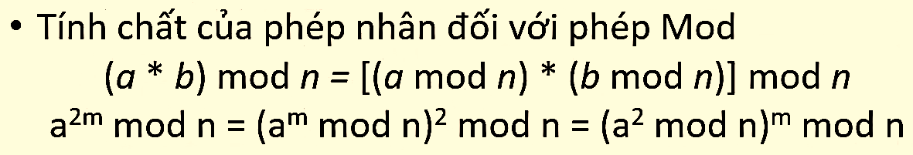

  - **B2. Mã hóa (Encryption)**

    - **Nếu theo cách 1: Mã hóa bằng khóa công khai**

      - **Người gửi** sử dụng **khóa công khai (n, e)** để mã hóa thông điệp.

      - Giả sử thông điệp được gửi đi là **<u>m \< n</u>.**

      - **Tính bản mã (ciphertext):** **c = me mod n** 🡪 Thu được văn bản mã hóa c.

    - **Nếu theo cách 2: Mã hóa bằng khóa mật/riêng**

      - **Người gửi** sử dụng **khóa private (n, d)** để mã hóa thông điệp.

      - Giả sử thông điệp được gửi đi là **<u>m \< n</u>.**

      - Tính bản mã: **c = mdmod n** 🡪 Thu được văn bản mã hóa c.

  - **B3. Giải mã (Decryption)**

    - **Nếu theo cách 1: Mã hóa bằng khóa công khai**

      - Người nhận sử dụng **khóa riêng (n, d)** để giải mã.

      - **Tính thông điệp gốc:** **m = cdmod n.**

    - **Nếu theo cách 2: Mã hóa bằng khóa mật/riêng**

      - Người nhận sử dụng **khóa công khai (n, e)** để giải mã.

      - **Tính thông điệp gốc:** **m = cemod n.**

- **Yêu cầu với các tham số sinh khóa 𝑝 và 𝑞 như sau:**

  - Các số nguyên tố 𝑝 và 𝑞 phải được chọn sao cho khi **phân tích một số nguyên rất lớn n (=p×q)** thành hai thừa số nguyên tố p, q là **không khả thi về mặt tính toán**.

  - **𝑝 và 𝑞 nên có cùng độ lớn** (tính bằng bit) và phải là **các số đủ lớn.** Nếu bạn chọn n có **2048 bit** (tiêu chuẩn hiện đại), thì **p và q** nên có kích thước khoảng **1024 bit mỗi số**.

  - Nếu p ≈ q, nghĩa là p−q rất nhỏ → $p \approx \sqrt{n}$ 🡪 có thể chọn các số nguyên tố ở gần $\sqrt{n}$ và thử lần lượt 🡪 Do đó, nên **chọn p và q cách xa nhau một lượng đủ lớn.**

  - Khi **có được 𝑝,** có thể

    - **tính 𝑞:** q=n/p

    - và **tìm ra d** là khóa bí mật từ khóa công khai e: d≡e−1modφ(n)

    - 🡪 Vì vậy, phải chọn p và q một cách **ngẫu nhiên** và **khác biệt**, không có mẫu chung.

    - 🡪 Nếu 𝑝 và 𝑞 được chọn ngẫu nhiên và 𝑝–𝑞 đủ lớn, khả năng hai số này bị phân tích từ 𝑛 sẽ giảm đi.

  - Các số nguyên tố **𝑝 và 𝑞 nên là số nguyên tố mạnh (strong prime).** Một số nguyên tố p được xem là một số nguyên tố mạnh nếu nó thỏa mãn 3 điều kiện sau:

    - **𝑝 – 1** khi phân tích sẽ có **một thừa số nguyên tố lớn, giả thiết là r;**

    - **𝑝 + 1** khi phân tích sẽ có một thừa số nguyên tố lớn;

    - **𝑟 – 1** khi phân tích cũng có một thừa số nguyên tố lớn;

- **Ví dụ:**

  - **Sinh khóa:**

    - Chọn 2 số nguyên tố p = 53, q = 73

    - Tính n=p. q=53.73=3869

    - Tính 𝜙(𝑛)= (𝑝−1). (𝑞−1) = 52.72 = 3744.

    - Chọn số e sao cho 0 \< e \< n 🡪 0 \< e \< 3744 và gcd (e, 𝜙(𝑛)) = 1 🡪 Chọn e = 5.

    - Tính d: d.e mod 𝜙(𝑛) = 1 🡪 (d.5) mod 3744 = 1 ⟹ d = 749

  - Do đó ta có: **<u>Khóa công khai là (3869, 5), và khóa riêng là (3869, 749)</u>**

  - **Mã hóa:** Với bản rõ “HI” tức là: “H” = 8, “I” = 9, có nghĩa là m = 89 *(để **đơn giản hóa để minh họa nguyên lý RSA**, người ta chọn giá trị số nguyên của các chữ cái theo thứ tự: A=1, B=2, C=3, … Tuy nhiên Trong thực tế, RSA:*

    - *Làm việc với **số nguyên rất lớn** (thường là hàng trăm chữ số),*

    - *Ký tự được **chuyển sang mã ASCII** hoặc mã nhị phân,*

    - *Ghép nhiều ký tự lại thành **một khối dữ liệu lớn** rồi mã hóa từng khối).*

    - $c = m^{e}{mod}n = 89^{5}{mod}3869$

> **Cách làm:** Tách mũ thành các bit nhị phân: 5 = 0000 0101 🡪 các số có **bit 1**: 1, 4 🡪 thực hiện tính $89^{5} = \left( 89^{1} \times 89^{4} \right){mod}3869$
>
> $$
> {89^{5}{mod}3869 \Rightarrow \left\langle \begin{aligned}
>  & 89{mod}3869 = 89 \\
>  & 89^{2}{mod}3869 = 183 \\
>  & 89^{3} = \left( 89 \times 89^{2} \right){mod}3869 \\
>  & 89^{4} = \left( 89^{2} \times 89^{2} \right){mod}3869 = 183 \times 183{mod}3869 \\
>  & 	 = 33489{mod}3869 = 2537
> \end{aligned} \right.
> }{\boxed{89^{5}{mod}3869} = \left( 89 \times 89^{4} \right){mod}3869 = (89 \times 2537){mod}3869 = 225793{mod}3869 = \boxed{1391}}
> $$
>
> 🡪 Vậy bản mã c=1391

- **Giải mã:** Với bản mã c=1391 🡪 $m = c^{d}{mod}n = 1391^{749}{mod}3869$

  - $749 = 1011101101 \rightarrow 1391^{749} = 1391^{1 + 4 + 8 + 32 + 64 + 128 + 2^{9}}$

  - Sau các bước tính toán ta được, $m = c^{d}{mod}n = 1391^{749}{mod}3869 = 89$

  - Vậy bản rõ m=89 tương ứng với “HI”

## 8.3. Thuật toán Diffie-Hellman

- Về thuật toán **bất đối xứng** Diffie Hellman, nó cũng được đặt theo tên của những người phát minh ra nó (White **Diffie** và Martin **Hellman**), còn được gọi là **“Thuật toán DH”.**

- Tuy nhiên, *thuật toán này không được sử dụng để mã hóa thông điệp*, mà thay vào đó, mục tiêu chính của nó là **thiết lập một khóa bí mật chung** để mã hóa dữ liệu **sử dụng trên kênh truyền thông không an toàn** mà không cần có sự thỏa thuận trước về khóa bí mật giữa hai bên.

- **Khóa bí mật** (trong ngữ cảnh của thuật toán này chính là **khóa phiên**) tạo ra sẽ được sử dụng để mã hóa dữ liệu với phương pháp **mã hóa khóa <u>đối xứng</u>.**

- **Cách hoạt động của thuật toán Diffie-Hellman như sau:**

  - **Giả sử hai bên là Alice (A) và Bob (B).**

  - Cả hai cùng thống nhất:

    - Một số nguyên lớn **p** (số nguyên tố)

    - Một số **g** (gọi là cơ sở – base, primitive root modulo p) 🡪 Hai số này **công khai** (public)

  - **Bên nhận** có quyền <u>sở hữu khóa chung (khóa công khai) và khóa riêng</u> đã được tạo, nhưng lần này chúng được tạo bởi thuật toán DH. (Alice tự tạo một bộ khóa chung-riêng)

    - **Khóa riêng (private key)**: Alice chọn Một số bí mật ngẫu nhiên (ví dụ a).

    - **Khóa chung (public key)**: Được tính từ khóa riêng bằng cách sử dụng hai giá trị công khai g (cơ số) và p (số nguyên tố), theo công thức A = ga mod p.

    - Alice gửi **A (khóa công khai)** cho Bob qua kênh.

  - **Bên gửi(sender)** *<u>nhận **khóa chung** do bên nhận (receiver) tạo</u>* **qua kênh không an toàn**, và bên gửi cũng sử dụng thuật toán DH để tạo một bộ khóa chung-riêng của riêng Bob**.**

    - **Khóa riêng:** Bob chọn số bí mật b.

    - Khóa công khai B = gb mod p.

    - Bob gửi **B (khóa công khai)** cho Alice qua kênh.

  - **Bên gửi (sender) sử dụng khóa công khai của bên nhận (receiver)** gửi kết hợp với khóa bí mật của bên gửi để tạo một **số bí mật, ngẫu nhiên** – số này được **gọi cụ thể là “khóa phiên (key session).**

    - **Khóa phiên được tạo bởi công thức:** **K = Ab mod p**

    - **số bí mật, ngẫu nhiên:** Khóa phiên K là **bí mật** vì chỉ Alice và Bob có thể tính ra nó (dựa trên a và b), và nó "ngẫu nhiên" nghĩa là **phụ thuộc vào các giá trị ngẫu nhiên a và b mà hai bên chọn.**

  - **Bên gửi (sender)** sử dụng **khóa phiên** để **mã hóa thêm thông điệp bản mã** *(dùng trong 1 thuật toán mã hóa khóa đối xứng)* và gửi chuyển tiếp tới bên nhận (receiver).

  - **Khi bên nhận cuối cùng cũng nhận được thông điệp bản mã** từ bên gửi (sender), khóa phiên có thể được suy ra bằng toán học.

    - Kết hợp khóa công khai B từ Bob và khóa riêng a của mình, Alice tính **K = Ba mod p**

    - **vì Ba mod p = Ab mod p**, **Alice sẽ có cùng khóa phiên K như Bob.**

  - Sau khi hoàn thành bước trên, **bên nhận (receiver) có thể giải mã phần còn lại** **của bản mã.**

    - Với khóa phiên K, Alice dùng thuật toán đối xứng (như AES) để giải mã thông điệp từ Bob, khôi phục lại nội dung gốc.

<table style="width:81%;">
<caption>
Bảng 14. Cơ chế thuật toán Diffie-Hellman
</caption>
<colgroup>
<col style="width: 40%" />
<col style="width: 40%" />
</colgroup>
<thead>
<tr>
<th style="text-align: center;">
<strong>Alice</strong>
</th>
<th style="text-align: center;">
<strong>Bob</strong>
</th>
</tr>
</thead>
<tbody>
<tr>
<td>
Khóa công khai có sẵn P, G
</td>
<td>
Khóa công khai có sẵn P, G
</td>
</tr>
<tr>
<td>
Khóa riêng được chọn a
</td>
<td>
Khóa riêng được chọn b
</td>
</tr>
<tr>
<td>
Khóa được tạo ra: <strong>𝑥 = 𝐺𝑎 mod 𝑃</strong>

<em>(là khóa công khai của Alice)</em>
</td>
<td>
Khóa được tạo ra: <strong>y = 𝐺𝑏 mod 𝑃</strong>

<em>(là khóa công khai của Bob)</em>
</td>
</tr>
<tr>
<td colspan="2" style="text-align: center;">
<strong>Trao đổi các khóa</strong> được tạo diễn ra giữa Alice và Bob
</td>
</tr>
<tr>
<td>
Khóa đã nhận y
</td>
<td>
Khóa đã nhận x
</td>
</tr>
<tr>
<td>
Khóa bí mật được tạo: <strong>𝑘𝑎 = 𝑦𝑎 mod 𝑃</strong>
</td>
<td>
Khóa bí mật được tạo: <strong>𝑘𝑏 = 𝑥𝑏 mod 𝑃</strong>
</td>
</tr>
<tr>
<td colspan="2" style="text-align: center;">
Về mặt đại số, ta có thể chỉ ra rằng <strong>𝑘𝑎 = 𝑘𝑏</strong> <em>(đây chính là khóa phiên)</em>
</td>
</tr>
</tbody>
</table>

- Hai số **P** và **G** là **các tham số công khai (public parameters)**, được chọn từ trước theo quy ước của hệ thống hoặc bởi một bên trung gian đáng tin cậy (**ví dụ:** trong một giao thức bảo mật như TLS/SSL hoặc bởi một máy chủ).

  - **P**: là một số nguyên tố lớn

  - **G**: là **primitive root modulo P** (một số sao cho khi lũy thừa G từ 1 đến P−1 rồi lấy mod P, ta nhận được tất cả các số từ 1 đến P−1 — tức là **G sinh ra toàn bộ nhóm ZP\***)

    **🡪 Cả hai giá trị này có thể được chọn sẵn và công bố cho cả hai bên (Alice và Bob).**

<!-- -->

- Về mặt đại số, ta có thể chỉ ra rằng **𝑘𝑎 = 𝑘𝑏**:

  $$
  \left\{ \begin{aligned}
  & k_{a} = y^{a}{mod}P = \left( G^{b}{mod}P \right)^{a}{mod}P = G^{ab}{mod}P \\
  & k_{b} = x^{b}{mod}P = \left( G^{a}{mod}P \right)^{b}{mod}P = G^{ab}{mod}P
  \end{aligned} \right.
  $$

- **Ví dụ:**

  - **Bước 1:** Alice và Bob lấy số công khai **P = 23, G = 9**

  - **Bước 2:** Alice chọn khóa riêng **a = 4** và Bob chọn khóa riêng **b = 3**

  - **Bước 3:** Alice và Bob tính giá trị công khai

    - ***Alice:*** $x = \left( 9^{4}{mod}23 \right) = \left( 6561{mod}23 \right) = 6$

    - ***Bob:*** $y = \left( 9^{3}{mod}23 \right) = \left( 729{mod}23 \right) = 16$

  - **Bước 4:** Alice và Bob trao đổi số công khai

  - **Bước 5:** Alice nhận khóa công khai y =16 và Bob nhận khóa công khai x = 6

  - **Bước 6:** Alice và Bob tính toán khóa đối xứng (khóa phiên)

    - ***Alice:*** $k_{a} = y^{a}{mod}P = 16^{4}{mod}23 = 65536{mod}23 = 9$

    - ***Bob:*** $k_{b} = x^{b}{mod}P = 6^{3}{mod}23 = 216{mod}23 = 9$

  - **Bước 7:** 9 là khóa bí mật được chia sẻ.

## 8.4. Hệ mật mã trên đường cong Elliptic (ECC)

- **Khái niệm cơ bản**:

  - ECC là một hệ thống mã hóa bất đối xứng được đề xuất vào năm 1985, dựa trên cấu trúc đại số của các đường cong elliptic trên **trường hữu hạn**.

  - Độ an toàn của ECC dựa trên độ khó của **Bài toán Logarit Rời rạc trên đường cong Elliptic (ECDLP - Elliptic Curve Discrete Logarithm Problem)**.

  - ECC thực hiện các chức năng chính: mã hóa, chữ ký số, và trao đổi khóa.

- **Ưu điểm so với RSA**:

  - ECC sử dụng **khóa nhỏ hơn** (ví dụ: 256 bit) nhưng vẫn đạt mức bảo mật tương đương hoặc cao hơn RSA (thường cần khóa 2048-3072 bit).

  - Tốc độ nhanh hơn trong việc tạo khóa, thỏa thuận khóa, và tạo chữ ký.

  - Kích thước chữ ký nhỏ hơn, phù hợp cho các ứng dụng cần tiết kiệm băng thông (như blockchain, Bitcoin).

- **Khóa ECC**:

  - Việc tạo khóa trong mật mã ECC cũng **đơn giản như tạo một số nguyên ngẫu nhiên** một cách an toàn **trong phạm vi nhất định,** vì vậy <u>quá trình này cực kỳ nhanh.</u> Bất kỳ số nào trong phạm vi đều là khóa riêng ECC hợp lệ

  <!-- -->

  - **Khóa riêng:** <u>Một số nguyên ngẫu nhiên (ví dụ: 256 bit),</u> dễ dàng tạo ra một cách an toàn.

    - **Ví dụ:** 0x51897b64e85c3f714bba707e867914295a1377a7463a9dae8ea6a8b914246319 (32 byte).

  - **Khóa công khai:** 1 khóa công khai trong ECC <u>là 1 điểm EC – cặp tọa độ nguyên {x, y}, nằm trên đường cong, có thể nén thành 257 bit</u> (256 bit + 1 bit chẵn/lẻ).

    - **Ví dụ:** 0x02f54ba86dc1ccb5bed0224d23f01ed87e4a443c47fc690d7797a13d41d2340e1a (33 byte ở định dạng nén).

<!-- -->

- **Đường cong và độ dài khóa**:

  - Các thuật toán mã hóa ECC có thể sử dụng các đường cong elliptic cơ bản khác nhau. Các đường cong khác nhau cung cấp mức bảo mật khác nhau (độ mạnh của mật mã), hiệu suất khác nhau (tốc độ mã hóa/giải mã) và độ dài khóa khác nhau. Cũng có thể liên quan đến các thuật toán khác nhau.

  - **Độ dài khóa phổ biến, phụ thuộc vào đường cong:**

    - 192 bit (đường cong secp192r1),

    - 233 bit (đường cong sect233k1),

    - 224 bit (đường cong secp224k1),

    - 256 bit (đường cong secp256k1, curve25519),

    - 283 bit (đường cong sect283k1),

    - 384 bit (đường cong p384 và secp384r1).

    - 409 bit (đường cong sect409r1),

    - 414 bit (đường cong Curve41417),

    - 448 bit (đường cong Curve448 Goldilocks),

    - 511 bit (đường cong M-511),

    - 521 bit (đường cong P-521),

    - 571 bit (đường cong sect571k1) *và nhiều loại khác.*

  - Đường cong **secp256k1** được sử dụng rộng rãi trong Bitcoin, Ethereum; **Curve25519** phổ biến trong các ứng dụng như Signal.

- **Các thuật toán ECC**:

  - **Chữ ký số**: ECDSA (cho đường cong cổ điển), EdDSA (cho đường cong Edwards xoắn).

  - **Mã hóa**: ECIES, EEECC (dựa trên ElGamal).

  - **Thỏa thuận khóa**: ECDH, X25519, FHMQV.

  - Tất cả đều dựa trên ECDLP (bài toán logarit rời rạc đường cong elliptic) và sử dụng cặp khóa công khai/riêng.

- **So sánh với RSA:**

| **Thuộc tính**  | **ECC (256 bit)**         | **RSA (2048 bit)**          |
|-----------------|---------------------------|-----------------------------|
| Kích thước khóa | 256 bit (~33 byte nén)    | 2048 bit (~256 byte)        |
| Mức bảo mật     | ~128 bit                  | ~112 bit                    |
| Tốc độ tạo khóa | Rất nhanh (số ngẫu nhiên) | Chậm hơn (số nguyên tố lớn) |
| Tốc độ chữ ký   | Nhanh                     | Chậm hơn                    |
| Ứng dụng        | Bitcoin, Signal, TLS      | TLS, SSH, VPN               |

Bảng 15. So sánh RSA & ECC

### 8.4.1. Đường cong Elliptic

- Trong toán học, đường cong elliptic là đường cong đại số phẳng, bao gồm tất cả các điểm {x, y}, được biểu diễn bởi phương trình (dạng Weierstras): $y^{2} = x^{3} + ax + b$.

<table>
<colgroup>
<col style="width: 42%" />
<col style="width: 57%" />
</colgroup>
<thead>
<tr>
<th>
A graph of function on a grid AI-generated content may be incorrect.

Hình 62. Đường cong Elliptic
</th>
<th><ul>
<li>
Đường cong <math display="inline" xmlns="http://www.w3.org/1998/Math/MathML"><semantics><mrow><msup><mi>y</mi><mn>2</mn></msup><mo>=</mo><msup><mi>x</mi><mn>3</mn></msup><mo>+</mo><mn>7</mn></mrow><annotation encoding="application/x-tex">y^{2} = x^{3} + 7</annotation></semantics></math>được vẽ trên tập số thực (<math display="inline" xmlns="http://www.w3.org/1998/Math/MathML"><semantics><mi mathvariant="double-struck">ℝ</mi><annotation encoding="application/x-tex">\mathbb{R}</annotation></semantics></math>) cho mục đích minh họa. Đây không phải là trường hữu hạn (như trong mật mã), mà là biểu diễn hình học để dễ hình dung.
</li>
<li>
Trên thực tế, trong mật mã ECC, đường cong được định nghĩa trên <strong>trường hữu hạn</strong> <strong>(như GF(p) hoặc GF(2m)),</strong> nên các điểm không liên tục mà là tập hợp rời rạc các tọa độ nguyên.
</li>
</ul></th>
</tr>
</thead>
<tbody>
</tbody>
</table>

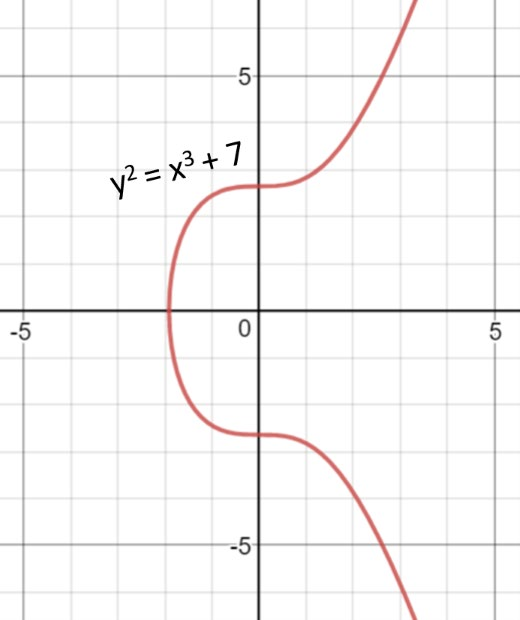

- **Đường cong Elliptic trên trường hữu hạn:**

  - Trong ECC, đường cong elliptic được định nghĩa trên trường hữu hạn:

    - **GF(p)**: Trường Galois với p là số nguyên tố (p\>3).

    - **GF(2m)**: Trường nhị phân với kích thước p=2m.

  <!-- -->

  - Phương trình trên trường hữu hạn có dạng: $y^{2} \equiv x^{3} + ax + b\left( {mod}p \right)$

  - Không giống như RSA, sử dụng các số nguyên trong khoảng {0, ..., p-1} (trường $\mathbb{Z}_{p}$) làm không gian khóa của nó.

  - ECC sử dụng các điểm {x, y} trong trường Galois $G_{p}$ (trong đó x và y là số nguyên trong\
    khoảng {0,...,p-1}

  - Một đường cong elliptic trên trường hữu hạn 𝐺𝐺𝑝𝑝 bao gồm:

    - 1 tập hợp các tọa độ nguyên {x, y} sao cho $0 \leq x,y \leq p$

    - Nằm trên đường cong elliptic $y^{2} \equiv x^{3} + ax + b\left( {mod}p \right)$

  - Ngoài ra, có một "điểm tại vô cực" (𝑂) đóng vai trò như phần tử đơn vị trong nhóm các điểm trên đường cong.

<table>
<colgroup>
<col style="width: 53%" />
<col style="width: 46%" />
</colgroup>
<thead>
<tr>
<th style="text-align: center;">
Ảnh minh họa image5.png

Hình 63. Ví dụ đường cong Elliptic - 1
</th>
<th><ul>
<li>
Ví dụ về đường cong elliptic trên trường hữu hạn GF17: <math display="inline" xmlns="http://www.w3.org/1998/Math/MathML"><semantics><mrow><msup><mi>y</mi><mn>2</mn></msup><mo>≡</mo><msup><mi>x</mi><mn>3</mn></msup><mo>+</mo><mn>7</mn><mrow><mo stretchy="true" form="prefix">(</mo><mrow><mi>m</mi><mi>o</mi><mi>d</mi></mrow><mn>17</mn><mo stretchy="true" form="postfix">)</mo></mrow></mrow><annotation encoding="application/x-tex">y^{2} \equiv x^{3} + 7\left( {mod}17 \right)</annotation></semantics></math>
</li>
<li>
Đường cong elliptic trên bao gồm các điểm màu xanh ở hình bên, nghĩa là trong thực tế, “đường cong elliptic” được sử dụng trong mật mã là “tập hợp các điểm trong ma trận vuông”, không phải là những “đường cong”.
</li>
<li>
<em>Đường cong trên cung cấp độ dài khóa rất nhỏ (4-5 bit).</em> Trong thực tế, mật mã đường cong elliptic thường sử dụng các đường cong từ 256 bit trở lên.
</li>
</ul></th>
</tr>
</thead>
<tbody>
<tr>
<td style="text-align: center;">
Ảnh minh họa image6.png

Hình 64. Ví dụ đường cong Elliptic - 2
</td>
<td><ul>
<li>
Khá dễ dàng để tính xem một điểm nào đó có thuộc một đường cong elliptic nào đó trên trường hữu hạn hay không.
</li>
<li>
Chẳng hạn, một điểm {x, y} thuộc đường cong <math display="inline" xmlns="http://www.w3.org/1998/Math/MathML"><semantics><mrow><msup><mi>y</mi><mn>2</mn></msup><mo>≡</mo><msup><mi>x</mi><mn>3</mn></msup><mo>+</mo><mn>7</mn><mrow><mo stretchy="true" form="prefix">(</mo><mrow><mi>m</mi><mi>o</mi><mi>d</mi></mrow><mn>17</mn><mo stretchy="true" form="postfix">)</mo></mrow></mrow><annotation encoding="application/x-tex">y^{2} \equiv x^{3} + 7\left( {mod}17 \right)</annotation></semantics></math> khi và chỉ khi: <math display="inline" xmlns="http://www.w3.org/1998/Math/MathML"><semantics><mrow><msup><mi>x</mi><mn>3</mn></msup><mo>+</mo><mn>7</mn><mo>−</mo><msup><mi>y</mi><mn>2</mn></msup><mo>≡</mo><mn>0</mn><mrow><mo stretchy="true" form="prefix">(</mo><mrow><mi>m</mi><mi>o</mi><mi>d</mi></mrow><mn>17</mn><mo stretchy="true" form="postfix">)</mo></mrow></mrow><annotation encoding="application/x-tex">x^{3} + 7 - y^{2} \equiv 0\left( {mod}17 \right)</annotation></semantics></math>.
</li>
<li>
Điểm P(5, 8) thuộc đường cong vì

(53 + 7 - 82) ≡ 0 (mod 17). Điểm (9, 15) không thuộc đường cong.
</li>
<li>
<strong>Tổng số điểm:</strong>

<ul>
<li>
Tập hợp các điểm trên đường cong bao gồm các cặp (x, y) thỏa mãn phương trình, cộng với "điểm tại vô cực" <em>O</em>.
</li>
<li>
Với p = 17, số điểm (bao gồm <em>O</em>) thường dao động quanh p + 1 (theo định lý Hasse). Tính toán chi tiết cho thấy đường cong này có <strong>18 điểm.</strong>
</li>
</ul></li>
</ul></td>
</tr>
</tbody>
</table>

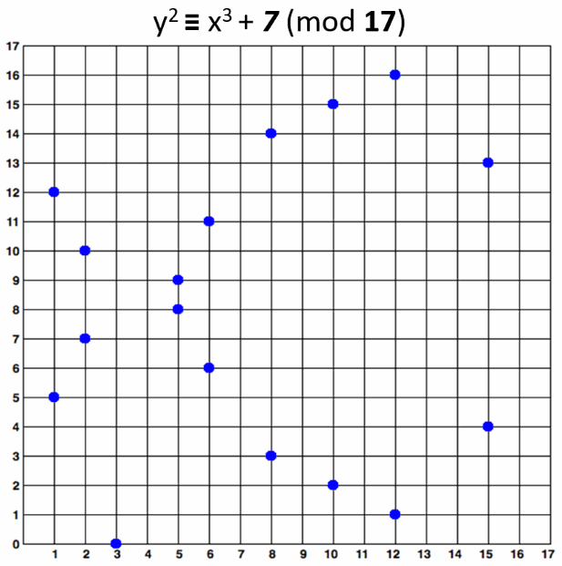
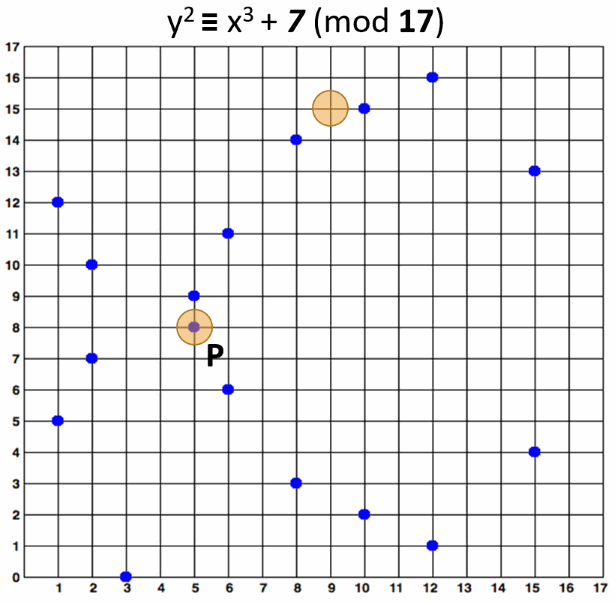

- **Nhóm con vòng (cyclic)**

  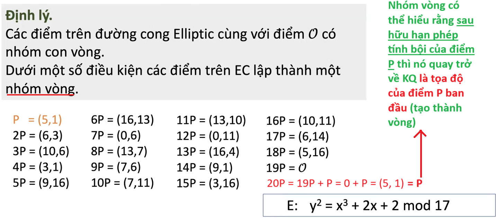

- **Nhân điểm ECC với số nguyên:**

  - Hai điểm trên 1 đường cong elliptic (điểm EC) có thể được thêm vào và **kết quả là một điểm khác.** Thao tác này được gọi là cộng điểm EC.

    - Nếu chúng ta thêm 1 điểm G vào chính nó, kết quả G+G=2G.

    - Nếu chúng ta thêm G 1 lần nữa vào kết quả thì sẽ thu được 3G,…

    - **Đây là phép nhân điểm EC được xác định.**

  - **Một điểm G trên đường cong** elliptic trên trường hữu hạn (điểm EC) có thể được **nhân với một số nguyên k**, và **kết quả là một điểm EC khác là P** trên <u>cùng 1 đường cong</u> và thao tác này là rất nhanh: **P = kG. Đây chính là bài toán logarit rời rạc trên đường cong elliptic.**

    - *Độ khó của **ECDLP** nằm ở chỗ: biết P và G, rất khó để tìm k sao cho P = kG*$\Leftrightarrow k = \log_{P}(Q)$*.*

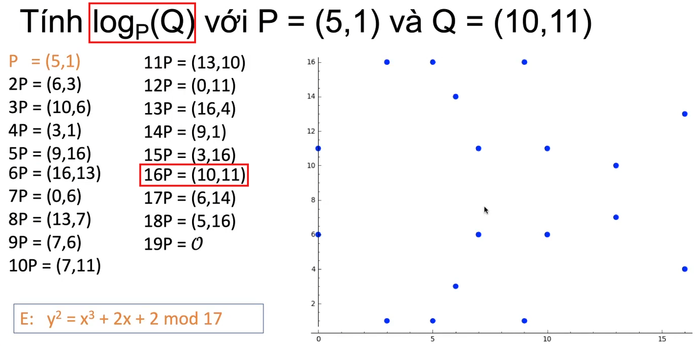
<figcaption>
Hình 65. Ví dụ nhân điểm ECC với số nguyên
</figcaption>

### 8.4.2. Các bước thực hiện mã hóa trên hệ đường cong Elliptic

- **Trao đổi khóa Diffie – Hellman**

  - $E_{q}(a,b)$ – đường cong elliptic với tham số **a, b, q**

    - Với q là số nguyên tố hoặc số nguyên có dạng lũy thừa của 2.

  - **G – điểm thuộc trong đường cong elliptic** (điểm sinh, được sử dụng để tạo khóa), **có bậc n** (số nguyên lớn, nG=*O*).

  - **Alice sinh khóa như sau:**

    - Chọn khóa riêng $n_{a}:$ $n_{a} < n$

    - Tính khóa công khai $P_{a}:$ $P_{a} = n_{a}.G$

  - **Bob sinh khóa như sau:**

    - Chọn khóa riêng $n_{b}:$ $n_{b} < n$

    - Tính khóa công khai $P_{b}:$ $P_{b} = n_{b}.G$

  - **Alice tính khóa bí mật:** $\mathbf{k =}\mathbf{n}_{\mathbf{a}}\mathbf{.}\mathbf{P}_{\mathbf{b}}$

  - **Bob tính khóa bí mật:** $\mathbf{k =}\mathbf{n}_{\mathbf{b}}\mathbf{.}\mathbf{P}_{\mathbf{a}}$

  - Dễ thấy $k = n_{a}.P_{b} = n_{a}.n_{b}.G = n_{b}.P_{a}$. Từ đây, Alice và Bob có thể bắt đầu sử dụng khóa chung này để mã hóa và giải mã bất kỳ tin nhắn nào.

- **Mã hóa:**

  - Alice muốn chuyển cho Bob một tin nhắn M (plaintext message)

  - Đầu tiên mã hóa tin nhắn *M* thành các điểm$P_{m}$trên đường cong elliptic. Mục tiêu là ánh xạ tin nhắn M thành tập điểm *Pm* = (*xm, ym*) sao cho (*xm, ym*) nằm trên đường cong, tức là: $y_{m}^{2} \equiv x_{m}^{3} + ax_{m} + b\left( {mod}q \right)$.

    - **Phương pháp Koblitz biểu diễn M thành các điểm Pm:**

  <!-- -->

  - **Chuyển đổi tin nhắn *M* thành các số nguyên:** Khi *M* là chuỗi ký tự vừa đủ dài, ta cần chuyển thành các số nguyên bằng cách mã hóa từng ký tự thông qua việc sử dụng mã ASCII.

    Ví dụ, trong tin nhắn *M* truyền đi có ký tự *Mi* = “*A*” thì mã ASCII của “*A*” là 65, tương ứng *mi* = 65.

    Với $i_{\min}$ và $i_{\max}$= *(chiều dài chuỗi – 1).*

  - **Tìm hoành độ *xi* của *Pm*:** Chọn ngẫu nhiên một tham số *k'* $\mathbb{\in Z}$. Ta gán$x_{i} = m_{i}.k' + j\left( {mod}q \right)$, trong đó *j* là một số nguyên lần lượt từ 1, 2, 3, … Ta dừng lựa chọn việc tìm *j* khi ta giải tìm được tung độ *y* của *Pm*.

    Thực tế, ta có thể tìm được *y* trước khi ta tính đến $x_{i} = m_{i}.k' + k - 1\left( {mod}q \right)$.

  - **Tìm tung độ *y* của *Pm*:** Ta thay *xi* vừa tìm được ở bước trên vào vế phải của phương trình (\*), ta được phương trình có dạng ${y_{i}}^{2} \equiv a'$ (\*\*). Giải phương trình (\*\*) để tìm *yi*.

    - Nếu $a'$là số chính phương trong trường $G_{q}$thì phương trình (\*\*) có hai nghiệm (phân biệt/ kép). Để đơn giản hóa việc tính toán, ta có thể chọn một trong hai nghiệm *yi* sao cho $y_{i} < \frac{q}{2}$.

    - Nếu $a'$ không là số chính phương trong trường $G_{q}$thì phương trình (3.2) vô nghiệm. Ta tiếp tục tăng *j* đến khi tìm được nghiệm*.*

  - *Điều kiện để chọn q:* $q > {m_{i}}_{\max}$, với $m_{i\max}$là giá trị nguyên lớn nhất có thể của một ký tự trong thông điệp.

  - **Ngoài phương pháp Koblitz còn một vài phương pháp khác để đưa tin nhắn về dạng điểm mật mã.**

  <!-- -->

  - Chọn **số nguyên <u>dương</u> k bất kỳ**

    - *k* này được chọn ngẫu nhiên trong khoảng {1, 2,…, n−1} (với *n* là bậc của G) và không liên quan đến *k* trong phương pháp Koblitz.

  - Khi đó tọa độ **điểm mật mã** sẽ là: $C_{m} = \left( k.G;P_{m} + k.P_{b} \right)$

  - Các điểm này sẽ gửi đến Bob.

- **Giải mã:**

  - Để giải mã, ta **nhân tọa độ x của điểm mật mã**, với **khóa bí mật của người nhận** (Bob): $(k.G).n_{b}$.

  - Sau đó thực hiện phép trừ giữa tọa độ y của điểm mật mã và ($k.G.n_{b}$): $P_{m} + k.P_{b} - \left( k.G.n_{b} \right)$ **(\*).**

  - Ta biết $P_{b} = n_{b}.G$ do đó **(\*) =\>** $P_{m} + k.P_{b} - \left( k.G.n_{b} \right) = P_{m} + k.P_{b} - k.P_{b}\boxed{= P_{m}}$

  - Bob nhận được các điểm *Pm*.

  - **Để chuyển các** *Pm* **về** *M,* Bob lấy mỗi hoành độ *xi* điểm *Pm* và áp dụng phương pháp Koblitz để có được *mi*, sau đó đối chiếu qua bảng mã ASCII để lấy lại tin nhắn gốc *M*. Cuối cùng, **Bob** có tin nhắn của Alice.

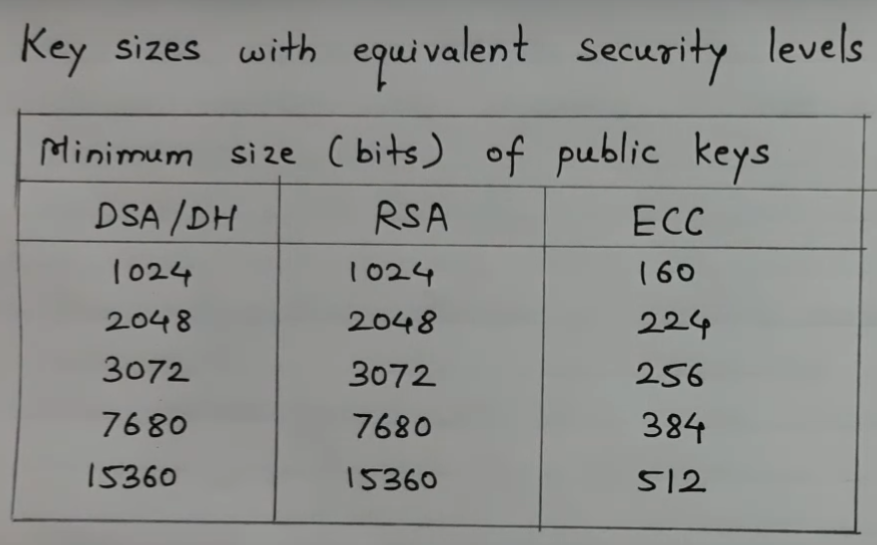
<figcaption>
Hình 66. Kích thước khóa công khai
</figcaption>

**<u>\
</u>**

## 8.5. Cơ sở hạ tầng khoá công khai (Public key infrastructure – PKI)

- Cơ sở hạ tầng khóa công khai (PKI) là công nghệ xác thực người dùng và thiết bị.

- Ý tưởng cơ bản là **để một hoặc nhiều bên đáng tin cậy ký điện tử vào các tài liệu** <u>xác nhận rằng một khóa mật mã</u> cụ thể <u>thuộc về một người dùng hoặc thiết bị cụ thể</u>. Sau đó, khóa có thể được sử dụng làm danh tính cho người dùng trong các mạng kỹ thuật số.

- Người dùng và thiết bị có khóa thường chỉ được gọi là các thực thể, hoặc nó có thể là một chương trình, quy trình, nhà sản xuất, thành phần hoặc thứ gì đó khác. Mục đích của PKI là liên kết an toàn một khóa với một thực thể.

- Cơ sở hạ tầng khóa công khai dựa trên công nghệ chữ ký số, sử dụng mật mã khóa công khai.

  - Ý tưởng cơ bản là **khóa bí mật của mỗi thực thể chỉ được biết bởi thực thể đó và được sử dụng để ký.** Khóa này được gọi là **khóa riêng.**

  - Có một khóa khác bắt nguồn từ nó, được gọi là **khóa chung**, được sử dụng để **xác minh chữ ký nhưng không thể được sử dụng để ký.** Khóa công khai này được cung cấp cho bất kỳ ai và thường được bao gồm trong tài liệu chứng chỉ.

- Một hệ thống quản lý các **khóa mật mã** và **chứng chỉ số** để đảm bảo an toàn cho các giao tiếp kỹ thuật số. PKI sử dụng mật mã khóa công khai (public-key cryptography) để:

  - **Xác thực danh tính**: Liên kết một khóa công khai với một thực thể cụ thể (người dùng, thiết bị, chương trình, v.v.).

  - **Bảo mật giao tiếp**: Cho phép mã hóa, ký số, và xác minh danh tính trong các mạng kỹ thuật số.

  - **Quản lý khóa**: Cung cấp, phân phối, và thu hồi các khóa công khai/chứng chỉ số.

- PKI dựa trên **chữ ký số** và các **cơ quan cấp chứng chỉ (Certificate Authority - CA)** để đảm bảo rằng một khóa công khai thực sự thuộc về một thực thể cụ thể.

- **Các loại khóa trong PKI**

  - **Khóa công khai (Public Key)**:

    - Được chứa trong **chứng chỉ số**.

    - Ai cũng có thể truy cập và sử dụng để:

      - **Mã hóa**: Gửi dữ liệu an toàn đến thực thể sở hữu khóa riêng tương ứng.

      - **Xác minh chữ ký**: Kiểm tra xem chữ ký số có được tạo bởi khóa riêng đúng hay không.

    - Ví dụ: Khi bạn truy cập một website HTTPS, trình duyệt dùng khóa công khai trong chứng chỉ của website để thiết lập kết nối an toàn.

  <!-- -->

  - **Khóa riêng (Private Key)**:

    - Chỉ được giữ bởi thực thể sở hữu (không bao giờ chia sẻ).

    - Được dùng để:

      - **Ký số**: Tạo chữ ký số để chứng minh danh tính hoặc tính toàn vẹn.

      - **Giải mã**: Giải mã dữ liệu được mã hóa bằng khóa công khai tương ứng.

    - Ví dụ: Máy chủ website dùng khóa riêng để ký dữ liệu, chứng minh rằng nó là máy chủ hợp lệ.

**\**

- **Khóa của CA**:

  - CA có cặp khóa riêng/công khai riêng:

    - **Khóa riêng của CA**: Dùng để ký các chứng chỉ số.

    - **Khóa công khai của CA**: Dùng để xác minh chữ ký trên chứng chỉ số.

  - Khóa công khai của CA thường được cài sẵn trong trình duyệt hoặc hệ điều hành (gọi là **root certificates**).

<!-- -->

- **Năm thành phần chính của PKI:**

  - **Public Key Certificate – Chứng chỉ khoá công khai, hay còn được gọi là Digital Certificate - Chứng chỉ kỹ thuật số**:

    - Chứng chỉ có thể được coi là thẻ căn cước được cấp cho người đó, dùng để **chứng minh danh tính.**

    - Chứng chỉ số không chỉ được cấp cho con người mà chúng có thể được *cấp cho máy tính, gói phần mềm hoặc bất kỳ thứ gì khác* cần chứng minh danh tính trong thế giới điện tử.

    - Chứng chỉ kỹ thuật số dựa trên tiêu chuẩn ITU X.509 xác định định dạng chứng chỉ tiêu chuẩn cho chứng chỉ khóa công khai và xác thực chứng chỉ. Do đó, chứng chỉ kỹ thuật số còn gọi là **chứng chỉ X.509**.

    - Là một tài liệu điện tử chứa:

      - **Khóa công khai** của một thực thể (người dùng, thiết bị, v.v.).

      - **Thông tin danh tính** của thực thể (tên, tổ chức, v.v.).

      - **Chữ ký số** của CA, xác nhận rằng khóa công khai này thuộc về thực thể đó.

    - **Ví dụ:** Trong một giao dịch HTTPS, trình duyệt kiểm tra chứng chỉ số của máy chủ để đảm bảo khóa công khai của máy chủ là hợp lệ.

    - Quá trình lấy chứng chỉ kỹ thuật số cho một người/tổ chức

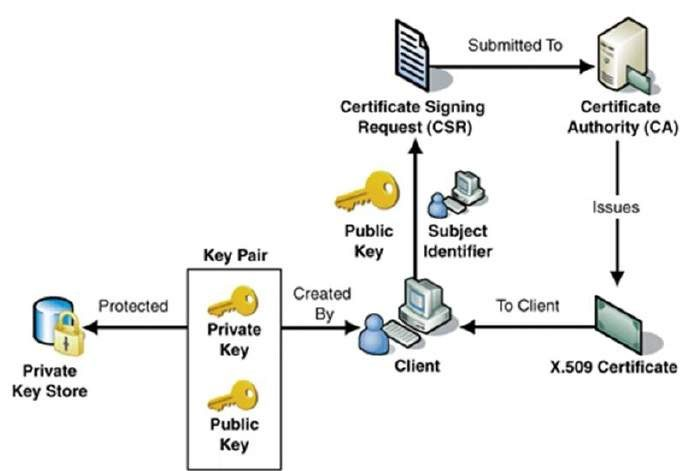
<figcaption>
Hình 67. Quy trình lấy chứng chỉ KTS
</figcaption>

- **Tạo cặp khóa (Key Pair)**: Trên Client (người dùng hoặc tổ chức), một cặp khóa được tạo ra, bao gồm Private Key (khóa bí mật) và Public Key (khóa công khai).

- **Bảo vệ Private Key**: Private Key phải được lưu trữ cẩn thận trong **Private Key Store** để đảm bảo an toàn. Private Key không bao giờ rời khỏi Client.

- **Tạo Certificate Signing Request (CSR)**: CSR bao gồm:

  - Public Key (khóa công khai vừa tạo)

  - Subject Identifier (thông tin nhận dạng của chủ thể như tên, địa chỉ, tổ chức...)

- **Gửi CSR đến Certificate Authority (CA)**: CSR được nộp lên cho Certificate Authority (CA) — cơ quan chứng thực.

- **CA xác minh thông tin**: CA sẽ kiểm tra tính hợp lệ của thông tin trong CSR và xác thực danh tính của Client.

- **CA cấp phát X.509 Certificate**: Nếu mọi thứ hợp lệ, CA sẽ phát hành một X.509 Certificate.

  - Chứng chỉ X.509 sẽ chứa:

    - Public Key

    - Thông tin nhận dạng (Subject Identifier)

    - Chữ ký số của CA (giúp đảm bảo tính xác thực của chứng chỉ)

- **Trả về cho Client**: Chứng chỉ số (Digital Certificate) được gửi lại cho Client để sử dụng.

<!-- -->

- **Certification Authority (CA-Cơ quan cấp chứng chỉ)**:

  - CA **cấp chứng chỉ cho khách hàng** và hỗ trợ những người dùng khác **xác minh\
    chứng chỉ.**

  - CA chịu trách nhiệm xác định chính xác danh tính của khách hàng yêu cầu cấp chứng chỉ và đảm bảo rằng thông tin có trong chứng chỉ là chính xác và ký điện tử vào chứng chỉ đó.

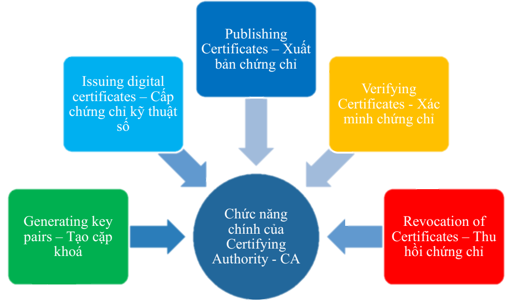
<figcaption>
Hình 68. Chức năng chính của CA
</figcaption>

- Có 4 loại chứng chỉ điển hình:

  - **Loại 1:** Có thể dễ dàng nhận được các chứng chỉ này bằng cách **cung cấp địa chỉ email.**

  - **Loại 2:** Các chứng chỉ này yêu cầu **cung cấp thêm thông tin cá nhân.**

  - **Loại 3:** Chỉ có thể mua các chứng chỉ này **sau khi đã kiểm tra danh tính** của người yêu cầu.

  - **Loại 4:** Chúng có thể được sử dụng bởi các **chính phủ và tổ chức tài chính** cần mức độ tin cậy rất cao.

- CA sử dụng **khóa riêng** của mình để ký chứng chỉ, đảm bảo rằng khóa công khai trong chứng chỉ thuộc về thực thể được chỉ định.

- **Vai trò:** Là trung tâm tin cậy của PKI, xác nhận tính hợp lệ của các chứng chỉ số.

<!-- -->

- **Registration Authority (RA-Cơ quan đăng ký)**:

  - **CA có thể sử dụng Cơ quan đăng ký bên thứ ba (RA) để thực hiện các kiểm tra** cần thiết đối với người hoặc công ty yêu cầu chứng chỉ để **xác nhận danh tính của họ.**

  - RA có thể xuất hiện với khách hàng dưới dạng CA, nhưng **họ không thực sự ký chứng chỉ được cấp.** Mục đích chính của RA là để giảm tải công việc của CA.

  - Là thực thể chịu trách nhiệm tiếp nhận và xác minh thông tin danh tính của các thực thể muốn nhận chứng chỉ số.

  - **Thực hiện:**

    - *Xác thực cá nhân, chủ thể đăng ký chứng thư số.*

    - *Kiểm tra tính hợp lệ của thông tin do chủ thể cung cấp.*

    - *Xác nhận quyền của chủ thể đối với những thuộc tính chứng thư số được yêu cầu.*

    - *Kiểm tra xem chủ thể có thực sự sở hữu khóa riêng đang được đăng ký hay không (chứng minh sở hữu).*

    - *Tạo cặp khóa bí mật, công khai. (nếu chủ thể yêu cầu)*

    - *Phân phối bí mật được chia sẻ đến thực thể cuối (ví dụ khóa công khai của CA).*

    - *Thay mặt chủ thể thực thể cuối khởi tạo quá trình đăng ký với CA.*

    - *Lưu trữ khóa riêng.*

    - *Khởi tạo quá trình khôi phục khóa.*

    - *Phân phối thẻ bài vật lý (thẻ thông minh)*

  - **Vai trò:** Kiểm tra xem một thực thể có hợp lệ để nhận chứng chỉ hay không, trước khi chuyển yêu cầu đến CA.

  - **Ví dụ:** Một công ty muốn nhận chứng chỉ số phải gửi thông tin danh tính (tên miền, giấy phép kinh doanh) đến cơ quan đăng ký.

- **Certificate Repository (Kho lưu trữ chứng chỉ)**:

  - Là nơi lưu trữ các **chứng chỉ số** đã được cấp bởi CA.

  - Hệ thống (có thể tập trung hoặc phân tán) **lưu trữ chứng chỉ và danh sách các chứng chỉ bị thu hồi**

  - Cung cấp cơ chế **phân phối** chứng chỉ và danh sách **thu hồi** chứng chỉ (CRLs - Certificate Revocatio Lists).

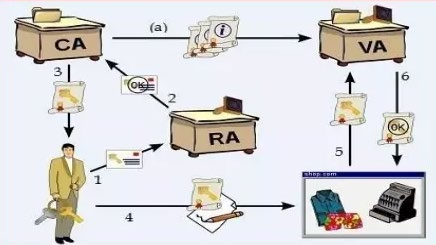
<figcaption>
Hình 69. Kho lưu trữ chứng chỉ
</figcaption>

- **(1):** Người dùng gửi yêu cầu **phát hành thẻ chứng chỉ số và khóa công khai** đến RA (Registration Authority);

- **(2):** **Sau khi xác nhận** tính hợp lệ định danh của người dùng thì **RA sẽ chuyển yêu cầu này đến CA** (Certifying Authority);

- **(3): CA phát hành thẻ chứng chỉ số** cho người dùng;

- **(4):** Sau đó người dùng **“ký” thông điệp trao đổi với thẻ chứng chỉ số** mới vừa nhận được từ CA và sử dụng chúng (thẻ chứng thực số + chữ ký số) trong giao dịch;

- **(5):** Định danh của người dùng được kiểm tra bởi đối tác thông qua sự hỗ trợ của **VA (Validation authority);**

- **(6):** Nếu chứng chỉ số của người dùng được xác nhận tính hợp lệ thì đối tác mới tin cậy người dùng và có thể bắt đầu quá trình trao đổi thông tin với nó (VA nhận thông tin về thẻ chứng chỉ số đã được phát hành từ CA)

<!-- -->

- **Vai trò:** Cho phép **các bên khác truy cập chứng chỉ số để xác minh khóa công khai** <u>của một thực thể.</u>

- **Ví dụ:** Máy chủ CA có thể duy trì một kho lưu trữ trực tuyến để các trình duyệt tải chứng chỉ số của một website.

<!-- -->

- **Private Key tokens (Mã thông báo khóa riêng)**:

  - Trong khi khóa công khai của khách hàng được lưu trữ trên chứng chỉ, **khóa riêng tư bí mật được liên kết có thể được lưu trữ trên máy tính của chủ sở hữu khóa.**

  - Nếu kẻ tấn công giành được quyền truy cập vào máy tính, họ có thể dễ dàng giành được quyền truy cập vào khóa riêng.

  - Vì lý do này, khóa riêng tư được lưu trữ trên **<u>thiết bị lưu trữ mã thông báo di động</u>** (USB Token), được bảo vệ an toàn thông qua mật khẩu.

  - Là **khóa riêng** của thực thể, được giữ bí mật và chỉ thực thể đó biết.

  - Khóa riêng được dùng để:

    - **Ký số**: Tạo chữ ký số để xác nhận danh tính hoặc tính toàn vẹn của dữ liệu.

    - **Giải mã**: Nếu dữ liệu được mã hóa bằng khóa công khai tương ứng.

  - **Vai trò:** Đảm bảo rằng chỉ thực thể sở hữu khóa riêng mới có thể thực hiện các hành động liên quan (ký hoặc giải mã).

  - **Ví dụ:** Một người dùng ký email bằng khóa riêng để chứng minh email đến từ họ.

<!-- -->

- **Hierarchy of CA – Phân cấp CA**

<!-- -->

- Với các mạng rộng lớn và các yêu cầu về liên lạc toàn cầu, thực tế là **không khả thi** **khi chỉ có một CA đáng tin cậy mà tất cả người dùng đều nhận được chứng chỉ đấy.** Hơn nữa, **chỉ có một CA có thể dẫn đến khó khăn nếu CA bị xâm phạm.**

- Trong trường hợp như vậy, mô hình chứng nhận phân cấp được quan tâm vì nó cho phép sử dụng chứng chỉ khóa công khai trong môi trường mà hai bên giao tiếp không có mối quan hệ tin cậy với cùng một CA.

  - **CA gốc nằm ở trên cùng** của hệ thống phân cấp CA và <u>chứng chỉ của CA gốc là chứng chỉ tự ký.</u>

  - **Các CA trực thuộc CA gốc** (Ví dụ: CA1 và CA2) <u>có chứng chỉ CA được ký bởi CA gốc.</u>

  - **Các CA bên dưới các CA cấp dưới** trong hệ thống phân cấp (Ví dụ: CA5 và CA6) có chứng chỉ CA của chúng <u>được ký bởi các CA cấp cao hơn chúng.</u>

- Hệ thống phân cấp của cơ quan cấp chứng chỉ (CA) được phản ánh trong các **chuỗi chứng chỉ.** Chuỗi chứng chỉ **theo dõi đường dẫn chứng chỉ từ một nhánh trong hệ thống phân cấp đến CA gốc** của hệ thống phân cấp.

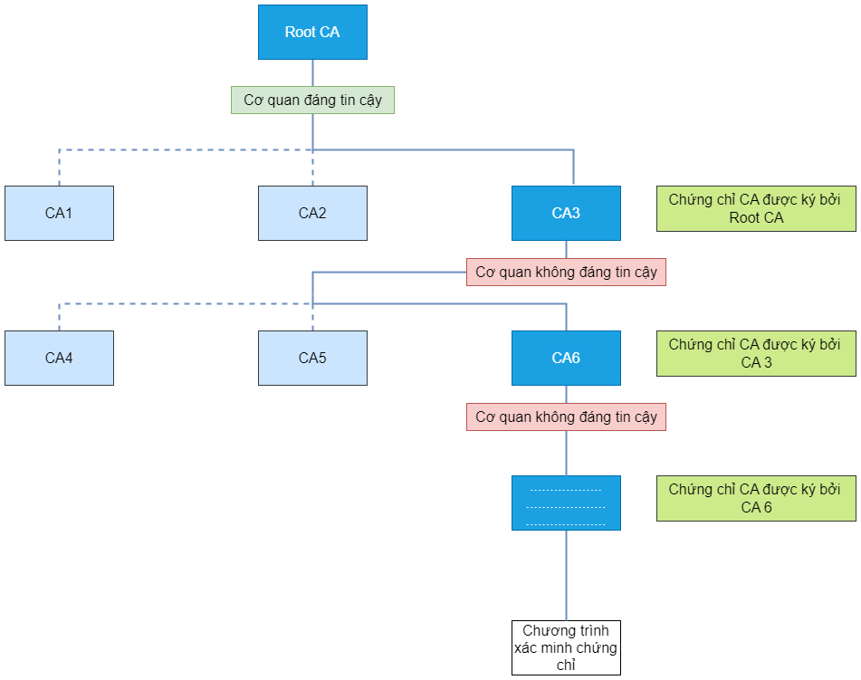
<figcaption>
Hình 70. Phân cấp CA
</figcaption>

- Xác minh chuỗi chứng chỉ là quá trình **đảm bảo rằng một chuỗi chứng chỉ cụ thể hợp lệ, được ký chính xác và đáng tin cậy.** Quy trình sau đây xác minh chuỗi chứng chỉ, bắt đầu bằng chứng chỉ được xuất trình để xác thực:

  - Máy khách cung cấp chứng chỉ của mình, kèm chuỗi chứng chỉ dẫn đến CA gốc.

  - Người xác minh dùng khóa công khai của CA phát hành (*nằm trong chuỗi bên cạnh chứng chỉ của khách hàng*) để kiểm tra chứng chỉ máy khách.

  - **Nếu CA cấp cao hơn** (ký chứng chỉ của CA phát hành) được tin cậy, quá trình xác minh **thành công và kết thúc.**

  - Nếu không, **tiếp tục xác minh chứng chỉ của CA phát hành theo cách tương tự,** lặp lại cho đến khi tìm được CA đáng tin cậy hoặc đến CA gốc.

<!-- -->

- **Chứng nhận X.509**

  - Chứng nhận X.509 là chuẩn chứng nhận khóa công khai phổ biến nhất, được Hiệp hội Viễn thông Quốc tế (ITU) quy định năm 1988 (**phiên bản 1**).

  - **Phiên bản 2** (1993): Thêm 2 trường nhận dạng duy nhất.

  - **Phiên bản 3** (1997): Thêm trường mở rộng.

  - Chứng nhận X.509 **liên kết khóa công khai với danh tính** của một người hoặc thiết bị, với hai thành phần chính là khóa công khai và tên thực thể sở hữu.

<!-- -->

- **Cấu trúc chứng nhận X.509**

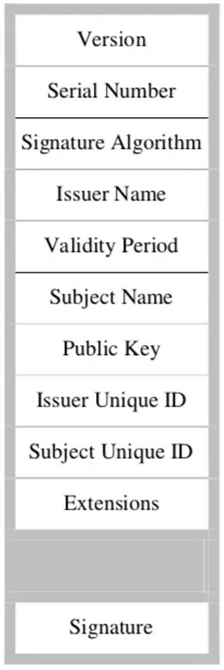
<figcaption>
Hình 71. Cấu trúc chứng nhận X.509
</figcaption>

**Version**: Phiên bản của chứng nhận X.509.

- **Serial Number**: Số thứ tự duy nhất do CA gán cho mỗi chứng nhận.

- **Signature Algorithm**: Thuật toán ký (ví dụ: SHA256 kết hợp RSA trong chứng nhận X.509) mà CA dùng để ký chứng nhận.

- **Issuer Name**: Tên CA phát hành, theo chuẩn X.500, không trùng lặp giữa các CA.

- **Validity Period**: Khoảng thời gian chứng nhận có hiệu lực, gồm:

  - **Not-before**: Thời điểm bắt đầu hiệu lực.

  - **Not-after**: Thời điểm hết hiệu lực. Thời gian được định dạng theo chuẩn quốc tế, chính xác đến **giây**.

- **Subject Name**: Tên chủ thể sở hữu chứng nhận và khóa công khai, theo chuẩn X.500. Một CA không cấp hai chứng nhận có cùng Subject Name.

- **Public Key**: Xác định thuật toán khóa công khai (ví dụ: RSA) và khóa công khai.

- **Issuer Unique ID, Subject Unique ID**: Trường thêm ở phiên bản 2 để phân biệt CA hoặc chủ thể có cùng tên X.500, nhưng RFC 2459 khuyên không dùng.

- **Extensions**: Thông tin bổ sung mà người thao tác CA muốn đặt vào chứng nhận, thêm ở phiên bản 3.

- **Signature**: Chữ ký số của CA, dùng khóa bí mật, xác nhận toàn bộ nội dung chứng nhận.

<!-- -->

- **Định dạng tệp phổ biến**

  - **.cer**: Chứng nhận mã hóa theo luật mã hóa tiêu chuẩn (Canonical Encoding Rules – CER).

  - **.der**: Chứng nhận mã hóa theo luật mã hóa phân biệt (Distinguished Encoding Rules – DER).

  - **.pem (Privacy-Enhanced Electronic Mail)**: Lưu trữ dữ liệu ở định dạng DER mã hóa base64, chứa các khóa bí mật (RSA và DSA), khóa công khai (RSA và DSA) và các chứng nhận X509, nằm giữa "-----BEGIN CERTIFICATE-----" và "-----END CERTIFICATE-----", dễ trao đổi dạng văn bản.

  - **.p7b, .p7c**: Định dạng PKCS#7, lưu chứng nhận và chuỗi chứng nhận dưới dạng ASCII, dùng để trả về chứng nhận hoặc gia hạn.

  - **.pfx, .p12**: Định dạng PKCS#12, lưu chứng nhận và khóa bí mật dưới dạng ASCII, thường dùng khi CA tạo khóa và cấp chứng nhận cùng lúc.
