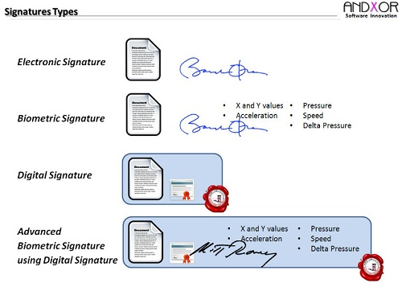
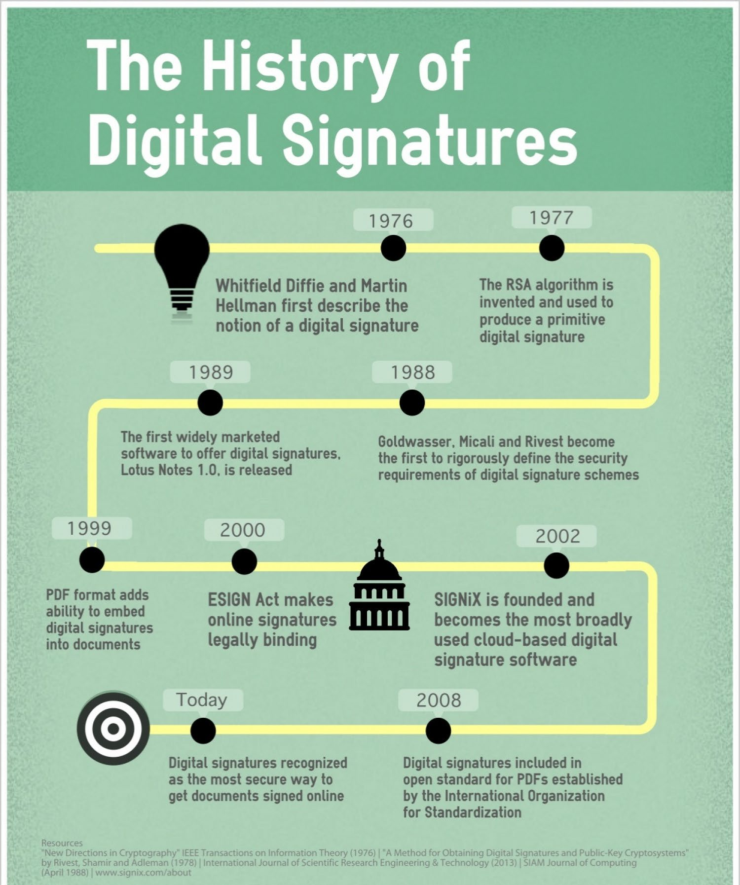
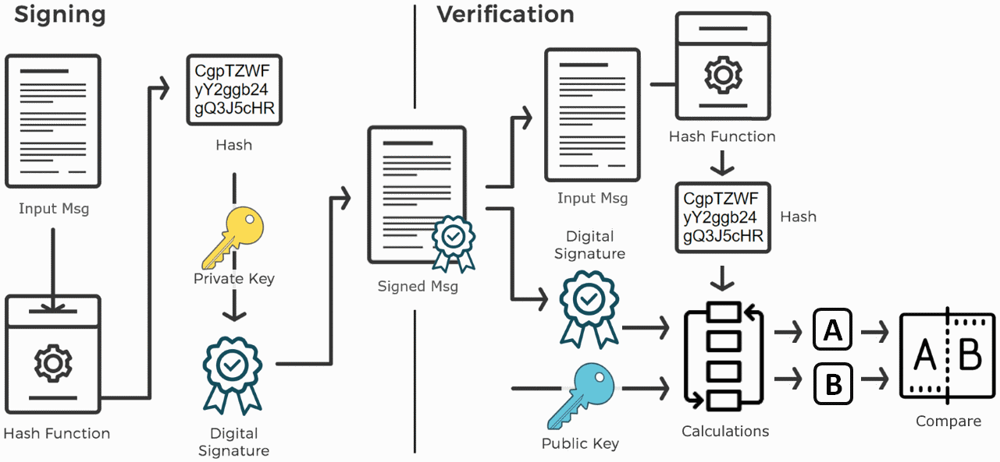
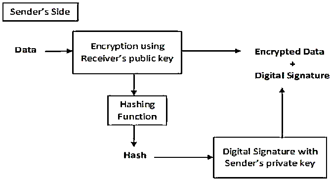

## 9.1. Chữ ký số

### 9.1.1. Khái niệm

- Ý tưởng mô phỏng **chữ ký tay** trong môi trường số đã xuất hiện từ lâu. Tuy nhiên, chỉ đến khi **hệ mật mã khóa công khai** (Public Key Cryptography) ra đời, ý tưởng này mới thực sự có thể hiện thực hóa.

- Trước đây, **mật mã đối xứng** – tức cả hai bên dùng chung một khóa – được sử dụng phổ biến nhưng không thể đảm bảo **tính đại diện duy nhất** cho một cá nhân, **do bất kỳ ai biết khóa đều có thể mã hóa/giải mã dữ liệu.**

- Ngược lại, với **mật mã khóa công khai**, mỗi cá nhân có một cặp khóa: **khóa riêng (private key)** và **khóa công khai (public key)**. Điều này <u>tạo ra nền tảng cho **chữ ký điện tử**, nơi chỉ người sở hữu **khóa riêng** mới có thể tạo ra chữ ký, còn bất kỳ ai có **khóa công khai** đều có thể xác minh tính hợp lệ.</u>

- Nhờ vào điều đó, chữ ký điện tử giúp:

  - Xác thực danh tính người ký.

  - Đảm bảo tính toàn vẹn của nội dung văn bản.

  - Không thể chối bỏ (non-repudiation).

- Chữ ký điện tử **không hoàn toàn giống chữ ký tay**:

  - **Chữ ký tay** là dấu hiệu vật lý viết trên giấy – độc lập với phần nội dung văn bản. Việc cắt dán, giả mạo bị hạn chế bởi tính chất vật lý.

  - Trong **môi trường số hóa**, nếu không có biện pháp kỹ thuật, thì bất kỳ ai cũng có thể **sao chép, cắt ghép nội dung và chữ ký** một cách dễ dàng mà không bị phát hiện.

  - Chính vì thế, cần có các kỹ thuật mật mã để **ràng buộc chặt chữ ký với nội dung văn bản**, đảm bảo không thể bị thay đổi hoặc giả mạo.

### 9.1.2. Các loại chữ ký và thời điểm sử dụng

#### 9.1.2.1. Chữ ký ướt (Wet Signature)

- Chữ ký ướt là hình thức chữ ký truyền thống, trong đó người ký sử dụng **mực để viết tay** trên tài liệu giấy. Thuật ngữ “ướt” xuất phát từ việc sử dụng **mực ướt** để ký vào văn bản. Ngoài chữ viết tay, chữ ký ướt có thể bao gồm **con dấu cá nhân** hoặc **dấu pháp lý**.

- **Khi nào nên sử dụng chữ ký ướt?**

  - Ký kết **hợp đồng tài chính**, **văn bản cho vay**.

  - **Thanh toán thẻ tín dụng** trên hóa đơn in.

  - **Đồng ý thủ tục y tế khẩn cấp** tại bệnh viện.

  - **Khám sức khỏe trực tiếp**.

  - Khi tổ chức yêu cầu **bản sao vật lý** của tài liệu.

- **Ưu điểm**

  - Tính xác thực cao tại chỗ: Cả hai bên thường phải có mặt, điều này tạo cơ hội để xác nhận chi tiết và cơ sở liên lạc trước khi chính thức hóa thỏa thuận.

  - Có thể công chứng dễ dàng: Chữ ký có thể được **chứng thực bởi công chứng viên**, tạo hiệu lực pháp lý cao hơn.

  - Phù hợp với quy trình truyền thống: Một số cơ quan, tổ chức nhà nước, ngân hàng vẫn yêu cầu dạng chữ ký này.

<!-- -->

- **Nhược điểm**

  - Tốn chi phí lưu trữ: Cần không gian và công sức để bảo quản giấy tờ vật lý.

  - Chậm trễ xử lý: Quy trình ký và chuyển văn bản mất thời gian, đặc biệt nếu nhiều bộ phận liên quan.

  - Khó tra cứu, xác minh: Không dễ dàng kiểm tra lại nội dung đã ký nếu không có bản sao đúng.

#### 9.1.2.2. Chữ ký điện tử (Electronic Signature)

- Chữ ký điện tử là phiên bản **số hóa** của chữ ký ướt, dùng để xác nhận sự đồng ý của một cá nhân đối với nội dung của tài liệu hoặc thỏa thuận điện tử. Đây là phương thức được sử dụng phổ biến trong các giao dịch trực tuyến và có giá trị pháp lý tương đương chữ ký truyền thống trong nhiều quốc gia.

- **Khi nào nên sử dụng chữ ký điện tử?**

  - Đồng ý với **điều khoản đăng ký** trực tuyến.

  - Ký **tờ khai thuế điện tử**.

  - Nhập tên ở cuối email như một dạng xác nhận.

  - Sử dụng **mã PIN tại máy ATM**.

  - Ký trực tiếp trên **màn hình cảm ứng** khi thanh toán.

  - Quét và gửi hình ảnh chữ ký viết tay (dưới dạng số hóa).

- Thông thường, bạn không cần in tài liệu đã ký điện tử, nhưng vẫn có thể lưu bản sao trên thiết bị hoặc đám mây để làm hồ sơ cá nhân.

- **Ưu điểm**

  - Tiện lợi & nhanh chóng: Không cần gặp mặt trực tiếp, có thể ký từ bất kỳ đâu.

  - Tiết kiệm chi phí & thời gian: Loại bỏ việc in ấn, gửi thư và lưu trữ giấy tờ.

  - Thúc đẩy dịch vụ trực tuyến: Giúp các nền tảng như Netflix, Spotify, ngân hàng điện tử,... hoạt động hiệu quả.

  - Thân thiện môi trường: Giảm sử dụng giấy, mực và các vật liệu in ấn.

<!-- -->

- **Nhược điểm**

  - Không phù hợp với một số tình huống cần xác minh cao: Trong các thỏa thuận quan trọng, việc ký trực tiếp giúp hạn chế gian lận.

  - Thiếu tính "giao tiếp trực tiếp": Không có cơ hội gặp mặt để đàm phán, giải thích điều khoản, gây hạn chế trong xây dựng mối quan hệ.

  - Có thể bị giả mạo nếu không bảo mật tốt: Nếu không dùng nền tảng uy tín, chữ ký có thể bị sao chép hoặc sử dụng trái phép.

#### 9.1.2.3. Chữ ký số (Digital Signature)

- Mặc dù thường bị nhầm lẫn với **chữ ký điện tử**, chữ ký số thực chất là một loại **chữ ký điện tử nâng cao**, sử dụng kỹ thuật mã hóa để đảm bảo **tính xác thực**, **tính toàn vẹn**, và **tính không thể chối bỏ** của tài liệu.

- Chữ ký số là một phương thức xác thực cho phép mã được đính kèm dưới dạng chữ ký. Các cơ quan chứng nhận bên thứ ba cấp chữ ký số và các khóa liên quan.

**Chữ ký số = chữ ký điện tử + xác minh danh tính + mã hóa**

- Chữ ký số được cấp bởi các **tổ chức chứng thực (CA – Certificate Authority)** đáng tin cậy và đi kèm với **cặp khóa mã hóa**: khóa công khai và khóa riêng.

- **Cách hoạt động:** Bạn có thể hình dung chữ ký số như **dấu vân tay điện tử** được đính kèm với tài liệu – không chỉ ký mà còn xác minh danh tính của người ký và đảm bảo rằng nội dung tài liệu không bị thay đổi sau khi ký.

- **Khi nào nên sử dụng chữ ký số?**

  - Ký văn bản pháp lý, hợp đồng quan trọng.

  - Khai báo thuế qua mạng (Thuế điện tử).

  - Giao dịch ngân hàng số.

  - Hóa đơn điện tử.

  - Giao dịch thương mại quốc tế (e-contracts).

  - Chứng thư số trên các hệ thống bảo mật như Outlook, email bảo mật,...

- Chữ ký số là một phần của quy trình ẩn bên trong mà bạn thậm chí không nhận thấy. **Ví dụ:** Nếu bạn sử dụng Microsoft Outlook để xử lý email của mình, thì bạn đang sử dụng chữ ký điện tử mỗi khi gửi email. *Microsoft đặt chữ ký điện tử trên mọi email được gửi từ máy chủ của mình.*

- **Ưu điểm**

  - Bảo mật cao: Mã hóa nội dung giúp bảo vệ khỏi sửa đổi hoặc giả mạo.

  - Xác minh danh tính: Chỉ người sở hữu khóa riêng mới có thể ký tài liệu.

  - Tính pháp lý mạnh: Được công nhận trong các giao dịch chính thức và pháp lý.

  - Bảo mật riêng tư: Tài liệu chỉ có thể đọc được bởi người nhận được ủy quyền.

<!-- -->

- **Nhược điểm**

  - Chi phí: Việc đăng ký và duy trì dịch vụ chữ ký số có thể tốn phí.

  - Thời gian triển khai: Cần có thủ tục cấp chứng thư số, đôi khi khá mất thời gian.

  - Yêu cầu kỹ thuật: Người dùng cần cài đặt phần mềm, thiết bị đọc USB token hoặc hiểu rõ quy trình kỹ thuật.

#### 9.1.2.4. Phân biệt giữa chữ ký điện tử (Electronic Signature) và chữ ký số (Digital Signature)

- **Giống nhau**: Tính duy nhất của cả hai loại chữ ký này đó là đều **thay thế cho chữ ký viết tay truyền thống** và được sử dụng trong các giao dịch trực tuyến.

- **Khác nhau:**

<table style="width:99%;">
<caption>
Bảng 16. So sánh chữ ký điện tử &amp; chữ ký số
</caption>
<colgroup>
<col style="width: 20%" />
<col style="width: 39%" />
<col style="width: 39%" />
</colgroup>
<thead>
<tr>
<th style="text-align: center;">
<strong>Yếu tố so sánh</strong>
</th>
<th style="text-align: center;">
<strong>Chữ ký điện tử</strong>

<strong>(Electronic Signature)</strong>
</th>
<th style="text-align: center;">
<strong>Chữ ký số (Digital Signature)</strong>
</th>
</tr>
</thead>
<tbody>
<tr>
<td>
<em>Tính chất</em>
</td>
<td>
Có thể là bất kỳ biểu tượng, hình ảnh, quy trình nào được đính kèm với tin nhắn hoặc tài liệu biểu thị danh tính của người ký và hành động đồng ý với nó.
</td>
<td>
Có thể được hình dung như một “dấu vân tay” điện tử, được mã hóa và xác định danh tính người thực sự ký nó.
</td>
</tr>
<tr>
<td>
<em>Tiêu chuẩn</em>
</td>
<td>
Không phụ thuộc vào các tiêu chuẩn. Không sử dụng mã hóa.
</td>
<td>
Sử dụng các phương thức <strong>mã hóa mật mã</strong>.
</td>
</tr>
<tr>
<td>
<em>Cơ chế xác thực</em>
</td>
<td>
Xác minh danh tính người ký thông qua email, mã PIN điện thoại, v.v.
</td>
<td>
ID kỹ thuật số dựa trên <strong>chứng chỉ – Digital Signature Certificate (DSC)</strong>.
</td>
</tr>
<tr>
<td>
<em>Tính năng</em>
</td>
<td>
<strong>Xác minh</strong> một tài liệu.
</td>
<td>
<strong>Bảo mật</strong> một tài liệu.
</td>
</tr>
<tr>
<td>
<em>Xác nhận</em>
</td>
<td>
Không có quá trình xác nhận cụ thể.
</td>
<td>
Được thực hiện bởi các <strong>cơ quan chứng nhận tin cậy</strong> hoặc <strong>nhà cung cấp dịch vụ ủy thác</strong>.
</td>
</tr>
<tr>
<td>
<em>Bảo mật</em>
</td>
<td>
Dễ bị giả mạo.
</td>
<td>
Độ an toàn cao.
</td>
</tr>
<tr>
<td>
<em>Phần mềm độc quyền</em>
</td>
<td>
Có thể được xác nhận bởi bất cứ ai mà không cần phần mềm xác minh độc quyền
</td>
<td>
Trong nhiều trường hợp, chữ ký số không được ràng buộc về mặt pháp lý và sẽ yêu cầu phần mềm độc quyền để xác nhận chữ ký số.
</td>
</tr>
</tbody>
</table>

#### 9.1.2.5. Chữ ký Clickwrap (Clickwrap Signature)

- Không phải là chữ ký theo nghĩa thông thường, nhưng kết quả tương tự như các phương pháp khác.

- Chữ ký **clickwrap** (còn gọi là **"thỏa thuận nhấp để đồng ý"**) là hình thức người dùng **tích vào ô "Tôi đồng ý"** hoặc **nhấp nút "Chấp nhận"** để xác nhận rằng họ đã đọc và đồng ý với các điều khoản của một dịch vụ hoặc phần mềm.

- Bạn đã gặp clickwrap khi:

  - Cài ứng dụng và phải "chấp nhận điều khoản sử dụng"

  - Đăng ký tài khoản trên một website

  - Mua hàng và đồng ý với điều kiện bảo hành

- **Ứng dụng thực tế**

  - **Đăng ký tài khoản, đăng nhập hệ thống**

  - **Tham gia diễn đàn, phòng chat** (đồng ý quy tắc cộng đồng)

  - **Đặt hàng, thanh toán online** (đồng ý chính sách hoàn trả, giao hàng)

  - **Truy cập tài nguyên riêng** (ví dụ: tài liệu nội bộ, phần mềm)

- **Ưu điểm**

  - Đơn giản, tiện lợi: Chỉ cần nhấp chuột – nhanh hơn nhiều so với in, ký tay, scan.

  - Tự động ghi nhận đồng ý: Hệ thống lưu lại dấu vết hành vi người dùng, làm bằng chứng pháp lý.

  - Dễ tích hợp: Dễ cài đặt vào bất kỳ website hoặc ứng dụng nào.

  - Thân thiện với người dùng: Trực quan, không cần kiến thức kỹ thuật để sử dụng.

<!-- -->

- **Lưu ý khi dùng clickwrap**

  - Cần **hiển thị rõ ràng các điều khoản** để người dùng có thể đọc trước khi chấp nhận.

  - Ghi nhận **ngày, giờ, địa chỉ IP hoặc user ID** khi người dùng đồng ý – giúp tăng tính pháp lý.

  - Không nên ẩn checkbox trong các nội dung dài hoặc đặt ở nơi khó thấy.

<figcaption>
Hình 72. Các loại chữ ký
</figcaption>

### 9.1.3. Chữ ký số

<figcaption>
Hình 73. LỊch sử hình thành &amp; phát triển chữ ký số
</figcaption>

- Chữ ký số là một kỹ thuật toán học được sử dụng để xác nhận **tính xác thực, tính toàn vẹn và tính không thoái thác** của một thông điệp, phần mềm hoặc tài liệu kỹ thuật số.

- **Đặc điểm chữ ký số:**

  - Một kỹ thuật **liên kết một người/thực thể với dữ liệu số**. Sự ràng buộc này có thể được xác minh độc lập bởi người nhận cũng như bất kỳ bên thứ ba nào.

  - Một **giá trị mật mã được tính toán từ dữ liệu và khóa bí mật** chỉ người ký mới biết.

  - Trong thế giới thực, người nhận tin nhắn cần **đảm bảo rằng tin nhắn đó thuộc về người gửi.** Người gửi không thể thoái thác nguồn gốc của tin nhắn đó. Yêu cầu này rất quan trọng trong các ứng dụng kinh doanh, vì khả năng xảy ra tranh chấp về dữ liệu được trao đổi là rất cao.

- **Sơ đồ chữ ký số dựa trên mật mã khóa công khai:**

<figcaption>
Hình 74. Sơ đồ chữ ký số dựa trên mật mã khóa công khai
</figcaption>

- **Bên trái: Quy trình ký số (Signing)**

  - **Thông điệp đầu vào (Input Msg)** được đưa qua **hàm băm (hash function)** để tạo ra một giá trị băm (hash value) – một chuỗi duy nhất đại diện cho thông điệp (ví dụ: "CgpTZWF yY2gb24 gQ3J5cCHR"). Hàm băm đảm bảo nếu thông điệp thay đổi, giá trị băm cũng sẽ khác.

  - Giá trị băm được mã hóa bằng **khóa bí mật (Private Key)** của người gửi, tạo ra **Digital Signature (Chữ ký số)**.

  - Chữ ký số được gắn vào thông điệp gốc, tạo thành **Signed Msg (Thông điệp đã ký),** sau đó được gửi đi.

<!-- -->

- **Bên phải: Quy trình xác minh (Verification)**

<!-- -->

- Bên nhận nhận được thông điệp kèm chữ ký số.

- Thông điệp và chữ ký số được tách ra. Thực hiện hai bước song song:

  - **Xử lý thông điệp**: Thông điệp gốc được đưa qua hàm băm (giống hàm băm bên gửi) để tạo giá trị băm **A**.

  - **Xử lý chữ ký số**: Chữ ký số được giải mã bằng **Public Key (Khóa công khai)** của người gửi, thu được giá trị băm **B**.

- **Compare (So sánh)**: So sánh giá trị băm **A** (từ thông điệp nhận được) với giá trị băm **B** (từ chữ ký số).

  - Nếu **A = B**: Thông điệp không bị thay đổi, chữ ký hợp lệ, người gửi đáng tin cậy.

  - Nếu **A ≠ B**: Thông điệp có thể đã bị thay đổi hoặc chữ ký không hợp lệ.

<!-- -->

- **Tầm quan trọng của chữ ký số:** Trong số tất cả các nguyên tắc mật mã, chữ ký số sử dụng mật mã khóa công khai được coi là công cụ rất quan trọng và hữu ích để đạt được an toàn thông tin. Ngoài khả năng cung cấp tính năng chống từ chối thông điệp, chữ ký số còn cung cấp khả năng xác thực thông điệp và tính toàn vẹn của dữ liệu.

<!-- -->

- **Xác thực tin nhắn:** Khi người **xác minh** xác thực chữ ký số **bằng khóa chung** (public key) của người gửi, họ được đảm bảo rằng **chữ ký chỉ được tạo bởi người gửi sở hữu khóa bí mật** (private key) tương ứng chứ không phải ai khác.

- **Tính toàn vẹn của dữ liệu:** Trong trường hợp kẻ tấn công có quyền truy cập vào dữ liệu và sửa đổi dữ liệu đó, thì việc **xác minh chữ ký số ở đầu nhận không thành công**. Hàm băm của dữ liệu đã sửa đổi và đầu ra do thuật toán xác minh cung cấp sẽ không khớp. Do đó, người nhận có thể từ chối thông báo một cách an toàn với giả định rằng tính toàn vẹn của dữ liệu đã bị vi phạm.

- **Không thoái thác:** Vì người ta cho rằng chỉ người ký mới biết về khóa chữ ký, nên anh ta chỉ có thể tạo chữ ký duy nhất trên một dữ liệu nhất định. Do đó, người nhận có thể giải trình dữ liệu và chữ ký số với bên thứ ba làm bằng chứng nếu có bất kỳ tranh chấp nào phát sinh trong tương lai.

<!-- -->

- **Các yêu cầu khi tạo chữ ký số:**

  - Chữ ký phải là một mẫu bit phụ thuộc vào thông điệp được ký.

  - Chữ ký phải sử dụng một số thông tin chỉ người gửi mới biết để tránh bị giả mạo và từ chối.

  - Việc tạo ra chữ ký điện tử phải tương đối dễ dàng.

  - Nó phải tương đối dễ dàng để nhận ra và xác minh chữ ký điện tử.

  - Việc giả mạo chữ ký số phải không khả thi về mặt tính toán.

  - Thực tế là phải giữ lại một bản sao của chữ ký điện tử trong kho lưu trữ.

- **Mã hóa chữ ký số:**

  - Trong nhiều giao tiếp kỹ thuật số, ta luôn mong muốn trao đổi một tin nhắn được mã hóa hơn là văn bản gốc để đạt được tính bảo mật. Tuy nhiên, với mã hóa khóa công khai, khóa công khai của người gửi có sẵn trên internet, nên kẻ xấu có thể giả mạo danh tính và gửi thông điệp mã hóa giả đến người nhận.

  - Để giải quyết, người dùng cần kết hợp chữ ký số với dữ liệu mã hóa, đảm bảo tính **xác thực** và **không thể chối bỏ/không thoái thác** (non-repudiation).

  - Có hai cách kết hợp:

    - **Ký rồi mã hóa**: Dữ liệu được ký trước, sau đó mã hóa. Tuy nhiên, cách này không an toàn vì người nhận có thể khai thác để giả mạo danh tính người gửi và gửi dữ liệu cho bên thứ ba.

    - **Mã hóa rồi ký**: Dữ liệu được mã hóa trước, sau đó ký. Cách này đáng tin cậy hơn và được sử dụng rộng rãi.

  - **Quá trình mã hóa rồi ký** được mô tả trong hình sau:

<figcaption>
Hình 75. Quá trình mã hóa rồi ký
</figcaption>

- Người gửi mã hóa dữ liệu bằng **khóa công khai** của *người nhận* (Encryption using Receiver’s Public Key), tạo dữ liệu mã hóa.

- Dữ liệu mã hóa (Encrypted Data) được băm (hash) để tạo giá trị băm.

- Giá trị băm được ký bằng **khóa bí mật** của người gửi (Digital Sign with Sender’s Private Key), tạo chữ ký số.

- Dữ liệu mã hóa và chữ ký số được gửi cùng nhau.

- Người nhận sau khi nhận được dữ liệu được mã hóa và chữ ký trên đó, trước tiên sẽ xác minh chữ ký bằng khóa chung của người gửi.

- Nếu chữ ký hợp lệ, dùng khóa bí mật của mình để giải mã và lấy thông điệp gốc.

### 9.1.4. Các loại tấn công vào chữ ký số

*Có 3 loại tấn công thường nhắm vào chữ ký số:*

**a/ Tấn công bằng thông điệp đã chọn (Chosen message attack):** Phương pháp tấn công được chọn có hai loại:

- **Phương pháp được chọn chung –** Trong phương pháp này, C đánh lừa A để ký điện tử vào các thông điệp mà A không có ý định thực hiện, mà không cần biết về khóa công khai của A.

- **Phương pháp được chọn trực tiếp –** Trong phương pháp này, C có kiến ​thức về khóa công khai của A, có được chữ ký của A trên các tin nhắn, rồi thay tin nhắn gốc bằng tin nhắn C muốn, giữ nguyên chữ ký của A.

**b/ Tấn công bằng thông điệp đã biết:**

- C có sẵn một số tin nhắn và chữ ký trước đó của A.

- C dùng phương pháp phân tích (vũ phu) dữ liệu cũ để tạo lại & giả mạo chữ ký của A trên tài liệu mà A không muốn ký, tương tự tấn công văn bản đơn giản trong mã hóa.

**c/ Tấn công chỉ dùng khóa:**

- Khóa công khai của A có sẵn cho mọi người.

- C lợi dụng điều này để giả mạo chữ ký của A trên các tài liệu/tin nhắn A không muốn ký, gây nguy cơ lớn vì A khó chối bỏ việc ký (ảnh hưởng tính không chối bỏ).

### 9.1.5. Ứng dụng của chữ ký số

- **Văn bản pháp lý và hợp đồng:** Chữ ký số có giá trị pháp lý, xác thực chữ ký và đảm bảo tài liệu không bị thay đổi.

- **Hợp đồng mua bán:** Xác nhận danh tính người bán/người mua, đảm bảo chữ ký và điều khoản hợp đồng không bị chỉnh sửa.

- **Tài liệu tài chính:** Ký hóa đơn điện tử để khách hàng tin tưởng đó là yêu cầu thanh toán thật, tránh lừa đảo.

- **Dữ liệu sức khỏe:** Bảo vệ hồ sơ bệnh nhân và dữ liệu nghiên cứu, đảm bảo thông tin không bị sửa đổi khi truyền.

- **Cơ quan chính phủ**: Tăng hiệu quả phê duyệt giấy phép, bảng chấm công, đảm bảo đúng người phê duyệt.

- **Chứng từ vận chuyển**: Đảm bảo bản kê khai hàng hóa chính xác, tránh lỗi vận chuyển; ký điện tử giúp truy cập nhanh, kiểm tra dễ dàng, ngăn giả mạo.

### 9.1.6. Một số loại chữ ký số thông dụng trên thị trường hiện nay

- **Chữ ký số USB token**

  - Ra đời đầu tiên trên thị trường, **loại truyền thống, dùng thiết bị USB để lưu khóa bí mật và tạo chữ ký số.**

  - *Ưu điểm:* Dễ dùng, bảo mật cao, khó làm giả.

  - *Nhược điểm:* Cần kết nối USB với máy tính, không ký từ xa được, không hỗ trợ nhiều người dùng cùng lúc.

- **Chữ ký số Smartcard**

  - Tích hợp trên SIM, cho phép ký số trên điện thoại.

  - *Ưu điểm:* Linh hoạt, ký nhanh.

  - *Nhược điểm:* Phụ thuộc vào loại SIM và vùng phủ sóng, nếu ngoài vùng phủ sóng thì không ký được.

- **Chữ ký số HSM (Hardware security module)**

  - Thiết bị phần cứng bảo vệ khóa, tăng tốc xác thực và mã hóa.

  - Ưu điểm: Phù hợp hệ thống lớn, hiệu năng cao, bảo mật tốt, hỗ trợ nhiều người ký (dưới 20 điểm truy cập).

  - Nhược điểm: Giá cao, chỉ phù hợp doanh nghiệp lớn có hạ tầng tốt.

- **Chữ ký số từ xa** **(Remote Signature)**

  - Dùng công nghệ đám mây, không cần thiết bị phần cứng, ký số linh hoạt trên mọi thiết bị.

  - *Ưu điểm:* Ký mọi lúc, mọi nơi.

  - *Nhược điểm:* Chưa phổ biến do lo ngại bảo mật, yêu cầu nhà cung cấp có hạ tầng công nghệ và tuân thủ tiêu chuẩn bảo mật cao.

## 9.2. Chứng chỉ số

- Chứng chỉ số được cấp bởi một bên thứ ba đáng tin cậy **chứng minh danh tính của người gửi** đối với người nhận và **danh tính của người nhận** đối với người gửi.

- Chứng chỉ kỹ thuật số là chứng chỉ **do Tổ chức phát hành chứng chỉ (CA) cấp** để xác minh danh tính của chủ sở hữu chứng chỉ. CA cấp chứng chỉ kỹ thuật số được mã hóa có **chứa khóa công khai của người nộp đơn và nhiều thông tin nhận dạng khác.** Chứng chỉ số dùng để đính kèm khóa công khai với một cá nhân hoặc một tổ chức cụ thể.

- **Chứng chỉ số bao gồm:**

  - *Tên người được cấp chứng chỉ.*

  - *Số sê-ri được sử dụng để xác định duy nhất một chứng chỉ, cá nhân hoặc tổ chức được xác định bởi chứng chỉ*

  - *Ngày hết hạn.*

  - *Bản sao khóa công khai của chủ sở hữu chứng chỉ. (được sử dụng để giải mã tin nhắn và chữ ký số).*

  - *Chữ ký số của cơ quan cấp chứng chỉ.*

- Chứng chỉ số cũng được gửi cùng với chữ ký số và thông điệp.

- **Chứng chỉ số & chữ ký số:**

  - Chữ ký số được sử dụng để xác minh tính xác thực, tính toàn vẹn, không từ chối, tức là đảm bảo rằng tin nhắn được gửi bởi người dùng đã biết và không bị sửa đổi.

  - Trong khi chứng chỉ số được sử dụng để xác minh danh tính của người dùng, có thể là người gửi hoặc người nhận.

  - Do đó, chữ ký số và chứng chỉ là những thứ khác nhau nhưng cả hai đều được sử dụng để bảo mật.

  - Hầu hết các trang web sử dụng **chứng chỉ kỹ thuật số** để tăng cường sự tin tưởng của người dùng của họ

<table>
<caption>
Bảng 17. So sánh chữ ký số &amp; Giấy chứng nhận điện tử
</caption>
<colgroup>
<col style="width: 19%" />
<col style="width: 40%" />
<col style="width: 40%" />
</colgroup>
<thead>
<tr>
<th style="text-align: center;"><strong>Tính năng</strong></th>
<th style="text-align: center;"><strong>Chữ ký số</strong></th>
<th style="text-align: center;"><strong>Giấy chứng nhận điện tử</strong></th>
</tr>
</thead>
<tbody>
<tr>
<td><em>Khái niệm cơ bản/ Định nghĩa</em></td>
<td>Chữ ký điện tử giống như dấu vân tay hoặc file đính kèm vào tài liệu kỹ thuật số để đảm bảo tính xác thực và tính toàn vẹn của nó.</td>
<td>Chứng chỉ kỹ thuật số là một file đảm bảo danh tính của chủ sở hữu và cung cấp bảo mật.</td>
</tr>
<tr>
<td><em>Quy trình/ 
Các bước</em></td>
<td>Giá trị băm của tin nhắn gốc được mã hóa bằng khóa bí mật của người gửi để tạo chữ ký số.</td>
<td>Nó được tạo bởi CA (Cơ quan chứng nhận) bao gồm bốn bước: <em>Sinh khóa, Đăng ký, Xác minh, Tạo.</em></td>
</tr>
<tr>
<td><em>Dịch vụ an ninh</em></td>
<td>Tính xác thực của người gửi, tính toàn vẹn của tài liệu và tính chống từ chối.</td>
<td>Nó cung cấp bảo mật và tính xác thực của chủ sở hữu chứng chỉ.</td>
</tr>
<tr>
<td><em>Tiêu chuẩn</em></td>
<td>Tuân theo Tiêu chuẩn Chữ ký Số (Digital Signature Standard - DSS).</td>
<td>Tuân theo định dạng chuẩn X.509</td>
</tr>
</tbody>
</table>
