# Chương 1. TỔNG QUAN VỀ C/ C++

## 1.1. Chương trình máy tính

<table>
<colgroup>
<col style="width: 76%" />
<col style="width: 23%" />
</colgroup>
<thead>
<tr>
<th><p>- Là một dãy những chỉ thị thực hiện một nhiệm vụ đã được xác định. Các chỉ thị này được mã hóa dưới dạng dãy các bit 0 hoặc 1, và chúng được lưu vào bộ nhớ giống như các dữ liệu thông thường.</p>
<p>- Nói cách khác, chương trình cũng là một loại dữ liệu, và máy tính chỉ làm việc đơn giản là đọc và thực thi một cách tuần tự trên những dữ liệu như vậy. <em>(Theo Bách khoa toàn thư - WIKIPEDIA)</em></p>
<p>- Một chương trình sau khi được biên dịch thành mã máy (binary code) sẽ được nạp vào bộ nhớ chính (primary memory) như là một tập các lệnh viết bằng ngôn ngữ mà máy tính hiểu được, tức là một dãy tuần tự các số nhị phân (binary digits).</p>
<p>- Tại bất cứ một thời điểm nào, máy tính sẽ ở một trạng thái (state) nào đó. Đặc điểm cơ bản của trạng thái là con trỏ lệnh (instruction pointer) trỏ tới lệnh tiếp theo để thực hiện 🡪 Các câu lệnh thực hiện trong máy tính đều thực hiện 1 cách tuần tự.</p>
<p>- Thứ tự thực hiện các nhóm lệnh được gọi là luồng điều khiển (flow of control).</p></th>
<th style="text-align: left;"><p>A diagram of a flowchart Description automatically generated</p></th>
</tr>
</thead>
<tbody>
</tbody>
</table>

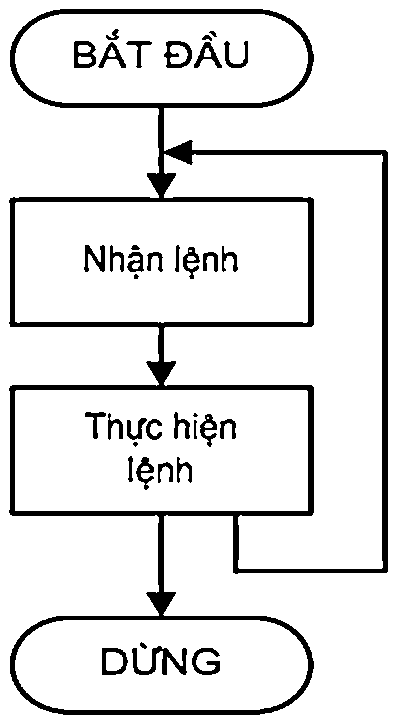

## 1.2. Ngôn ngữ lập trình

### 1.2.1. Lập trình (Programming)

\- Kỹ thuật cài đặt thuật toán bằng NNLT tạo ra CTMT.

### 1.2.2. NNLT (Programming language)

\- Là một hệ thống các ký hiệu dùng để liên lạc, trao đổi với máy tính nhằm thực thi một nhiệm vụ tính toán.

\- Được thiết kế, chuẩn hóa để truyền chỉ thị cho MT. **NNLT** tạo ra CT nhằm điều khiển MT hoặc mô tả thuật toán để người khác đọc hiểu.

**- Một NNLT gồm 2 yếu tố:** Cú pháp & Ký hiệu.

**- NNLT xếp vào 2 nhóm:**

\+ GPL: có mục đích sử dụng chung (dùng khi nào cũng được) (Python, Java...).

\+ DSL: có mục đích sử dụng riêng (Mylab, Latex…).

**- Có 3 thành phần cơ bản cho bất kỳ NNLT nào:**

*+ Mô thức ngôn ngữ - Language paradigm* là những nguyên tắc chung cơ bản, dùng bởi LTV để xây dựng chương trình.

*+ Cú pháp - Syntax* là cách để xác định những gì là hợp lệ trong cấu trúc các câu của ngôn ngữ; Nắm được cú pháp là cách để đọc và tạo ra các câu trong các ngôn ngữ tự nhiên, như tiếng Việt, tiếng Anh và LT. Tuy nhiên điều đó không có nghĩa là nó giúp chúng ta hiểu hết ý nghĩa của câu văn.

*+ Ngữ nghĩa – semantics* của 1 CT trong ngôn ngữ ấy. Rõ ràng, nếu không có ngữ nghĩa, 1 NNLT sẽ chỉ là 1 mớ các câu văn vô nghĩa; như vậy ngữ nghĩa là 1 thành phần không thể thiếu của 1 ngôn ngữ.

**- Phân loại NNLT**

**\* NN máy** (mã máy: 0/1): Các CT viết các NN khác =\> NNM =\> thực thi.

\+ Là những chuỗi số, đặc tả các lệnh của máy tính. Máy tính chỉ nhận các tín hiệu điện tử - có, không có – tương ứng với các dòng bits. Một chương trình ở dạng đó gọi là mã máy (machine code).

\+ Phụ thuộc phần cứng. Mỗi kiểu máy có tập lệnh riêng.

\+ NN nền tảng của bộ vi xử lý, NN duy nhất máy tính hiểu.

\+ Ngày nay, rất khó có thể ra lệnh trực tiếp kiểu này cho các chương trình thực tế và lớn. Chuỗi lệnh sẽ được sinh ra tự động từ bộ chuyển ngữ (compiler) từ ngôn ngữ cấp cao.

**\* Hợp ngữ:** CT hợp ngữ =\> mã máy: thông qua trình hợp dịch (assembler).

\+ Gần như NNM, dùng ký hiệu gợi nhớ (mã lệnh hình thức) biểu diễn các mã lệnh của máy.

\+ Sử dụng các từ viết tắt trong tiếng Anh để biểu diễn các tác vụ tính toán cơ bản.

\+ Bộ chuyển ngữ (sang mã máy) cho ngôn ngữ này là “Assembler”.

\+ Ngày nay, ngôn ngữ này vẫn còn được sử dụng, và thường kết hợp với ngôn ngữ cấp cao. Nó được dùng để tối ưu một số khối xử lý trong toàn bộ chương trình.

**<u>Ví dụ:</u>**

LOAD BASEPAY

ADD OVERPAY

STORE GROSSPAY

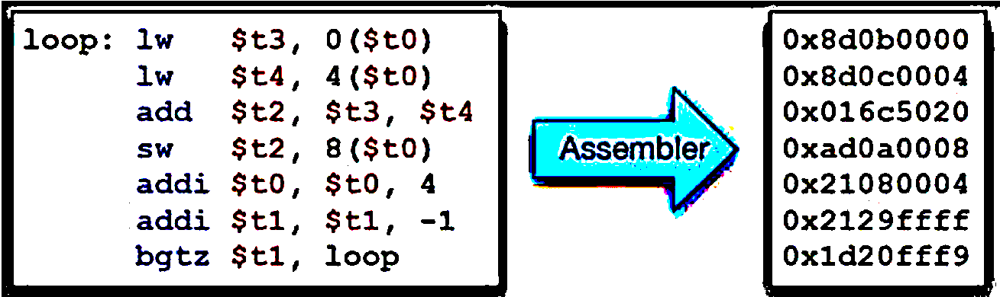

**\* NN cấp cao**

\+ Mã được viết ra gần với ngôn ngữ tự nhiên, so với mã của các loại ngôn ngữ khác. Tên các biến, hằng, hàm, etc do người lập trình đặt có cú pháp dễ đọc. Các cấu trúc điều khiển cũng dễ đọc hơn rất nhiều.

\+ Danh từ, động từ, ký hiệu toán học, liên hệ, thao tác luận lý.

\+ Bộ chuyển ngữ (sang mã máy hay mã trung gian) cho loại ngôn ngữ này là bộ biên dịch (compiler) hay thông dịch (interpreter).

\+ CT viết bằng NN cấp cao chạy trên các loại MT khác nhau (sử dụng các bộ vi xử lý khác nhau).

\+ Ngày nay, ngôn ngữ loại là phổ thông nhất, như, C, C++, C#, Java, etc

\+ Ví dụ: grossPay = basePay + overTimePay

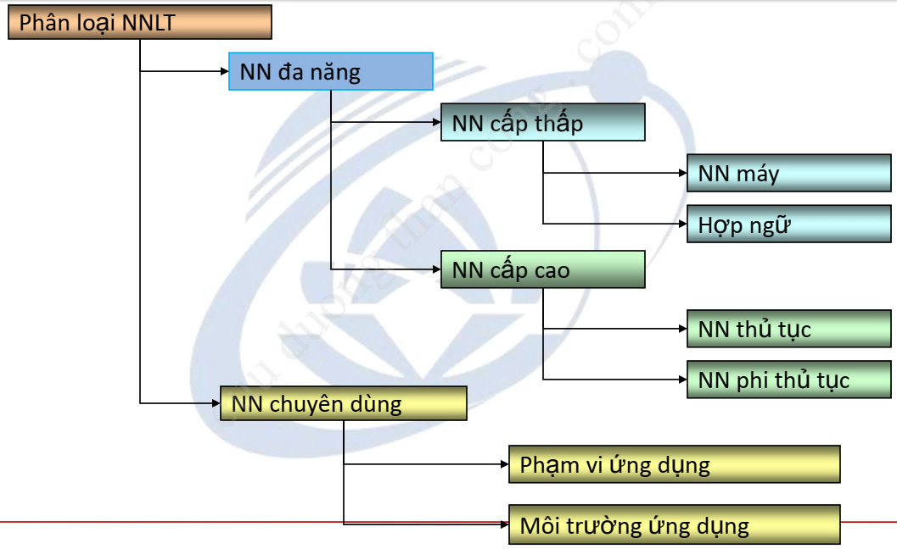

### 1.2.3. Trình dịch - Compiler?

\- Là chương trình thực hiện biên *<u>dịch toàn bộ</u> các lệnh của chương trình nguồn thành mã máy* trước khi thực hiện.

\- Trước khi muốn làm bất kỳ điều gì về chương trình, cần phải compile trước.

\- IDE báo toàn bộ các lỗi.

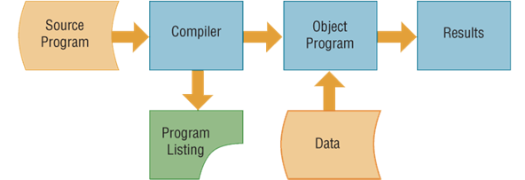

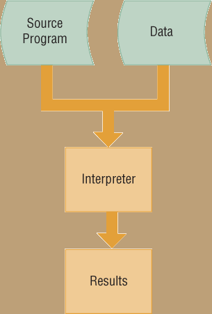

### 1.2.4 Thông dịch - Interpreter?

\- Là chương trình dịch và thực hiện *<u>từng dòng lệnh</u>* của chương trình cùng lúc.

\- Không tạo ra object program.

\- Dịch từ ngôn ngữ này sang ngôn ngữ khác, không tạo ra chương trình dạng mã máy hay assembly.

\- IDE báo từng lỗi một, không báo toàn bộ.

## 1.3. Sơ bộ về giải thuật

**- Giải thuật là gì?** Là các bước để giải quyết một bài toán

\- **Bằng cách nào mô tả giải thuật?**

***+ Dùng mã giả (pseudocode)***

Mục tiêu: giải thuật được viết bằng mã giả là dùng cho con người đọc để giải thuật và họ có thể chuyển sang mã ngôn ngữ lập trình dễ dàng

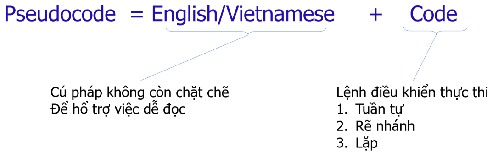

*\* Phần đầu của giải thuật:* Tên giải thuật, Thông số và kiểu của nó, Mục đích của giải thuật, Điều kiện cần thỏa trước khi giải thuật thực thi, Điều kiện cần thỏa sau khi giải thuật thực thi, Giá trị trả về

*\* Phần thân của giải thuật:* Các phát biểu, Chỉ số phát biểu, Các biến, Chú thích, Các cấu trúc điều khiển

**<u>Ví dụ 1:</u>**

```cpp
Algorithm average (N is integer)
```

**Preconsition**: N lớn hơn hay bằng 0

**Postcondition**: các số được đọc và giá trị trung bình của chúng được in ra màn hình

1\. sum = 0

2\. **for** i = 1 **to** N **do**

1\. number = *read from keyboard a value*

2\. sum = sum + number

**end-for**

3\. averaged = sum / N

4\. *print averaged to screen*

5\. return

**End** average

**<u>Ví dụ 2:</u>** Thuật giải phương trình bậc 2

**vào:** a,b,c

**ra:** kết luận về nghiệm begin

```cpp
delta: = b*b – 4*a*c;

if delta=0 then
```

phương trình có nghiệm kép x=-b/(2\*a);

```cpp
else begin

if delta<0 then
```

phương trình vô nghiệm

else

begin

PT có 2 nghiệm x1=(-b+sqrt(delta))/(2\*a) x2=(-b+sqrt(delta))/(2\*a)

end

end

END.

\* Mỗi phát biểu của mã giả không được quá trừ tượng hay tổng quát

\* Để điều khiển dòng thực thi, mã giả cũng nên chỉ dùng 3 dạng cấu trúc điều khiển như ngôn ngữ lập trình cấp cao (có cấu trúc).

***+ Dùng sơ đồ (flowchart):***

\* Flowchart được biểu diễn bởi các hình cơ bản, mỗi chúng có ý nghĩa đã được quy định trước

\* Mục tiêu: tương tự mã giả. Nhưng sơ đồ có vẻ dể đọc hơn cho người không quen lập trình

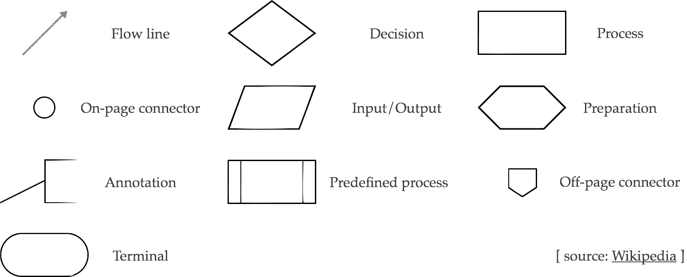

- *Terminal: Điểm đầu hay cuối*

- *Input/output: Nhập và xuất dữ liệu của chương trình*

- *Flow line: Mô tả dòng điều khiển của chương trình, Sự thực thi đi theo con đường này*

- *Decision: Cho phép kiểm tra một điều kiện, Biểu thức luận lý được dùng*

- *Process: Khối xử lý công việc*

- *Predefined process: Khối xử lý tạo sẵn (thư viện), có thể mô tả bởi một flowchart khác*

- *On-page connector: Điểm tập kết của dòng điều khiển (flow line) trên một flowchart*

- *Off-page connector: Điểm tập kết của dòng điều khiển (flow line) từ trang khác*

- *Preparation: Các bước chuẩn bị, thiết lập điều kiện đầu*

- *Annotation: Giải thích*

***+ Dùng chính mã lập trình***

\* Mục tiêu: Mã được viết bởi ngôn ngữ lập trình như C, chỉ được trao đổi giữa những người có chuyên môn với nhau. Mục tiêu của mã này là để có thể chuyển ngữ dễ dàng và có chương trình thực thi ngay.

\* Không nên dùng mã này để trình cho các đối tượng người dùng phổ thông.

## 1.4. Chương trình và qui trình viết, thực thi, phát triển CT

\- Chương trình là những chuỗi lệnh được thực thi tuần tự. Sự thực thi tuân theo nguyên tắc điều khiển (rẽ nhánh + lặp).

\- Do đó, hai yếu tố quan trọng tạo thành chương trình:

\+ Dữ liệu và cấu trúc để tổ chức dữ liệu

\+ Giải thuật xử lý, nghĩa là, các chuỗi của những lệnh nào và chọn lựa thực thi ra sao

\- ***Program development cycle?*** Là các bước mà LTV dùng để xây dựng CT

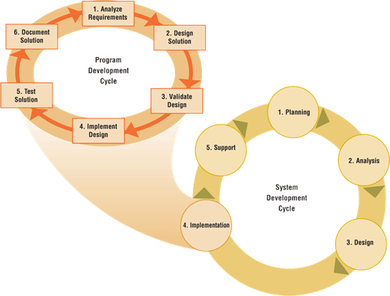

***+ Ý tưởng, phân tích yêu cầu (requirements analysis);***

\* Khảo sát và Thiết lập các yêu cầu

\* XD các mô hình phân tích

\* Xác định đầu vào, đầu ra và các xử lý cùng các thành phần dữ liệu.

**IPO chart -** Xác định đầu vào, đầu ra và các bước xử lý

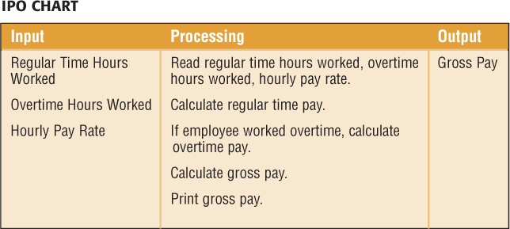

***+ Đặc tả (specification);***

***+ Thiết kế (design and architecture);***

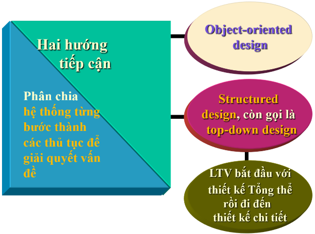

**Sơ đồ phân cấp chức năng- hierarchy chart?**

\* Trực quan hóa các modules chương trình

\* Còn gọi là sơ đồ cấu trúc

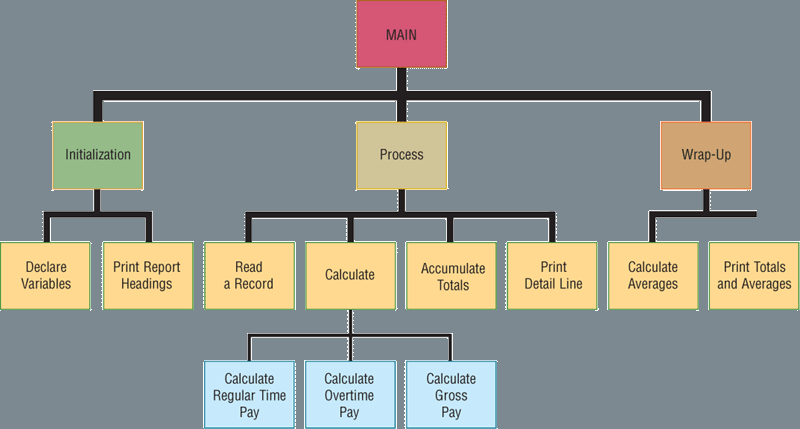

***+ Lập trình (coding);***

- **Viết code:** dịch từ thiết kế thành program

- **Syntax**—Quy tắc xác định cách viết các lệnh

- **Comments**—program documentation

- **Extreme programming (XP)—**coding và testing ngay sau khi các yêu cầu được xác định

***+ Biên dịch (compilation):*** Là quá trình chuyển đổi từ mã nguồn (do người viết) thành chương trình ở dạng mã máy để có thể thực thi được.

**\* Tiền xử lý (Preprocess)**

. Đối tượng thực hiện: Preprocessor (bộ tiền xử lý), thuộc IDE

. Công việc thực hiện: tiền xử lý chương trình, như, thay các “macro” trong bởi phần định nghĩa của nó, chèn các tập tin khai báo thư viện (v.d., stdio.h)

**\* Biên dịch (Compile)**

. Đối tượng thực hiện: Compiler (bộ biên dịch), thuộc IDE

. Công việc thực hiện: Chuyển mã, từ mã C sang mã đối tượng, cho từng tập tin mã nguồn

\* **Liên kết (Link)**

. Đối tượng thực hiện: Linker (bộ liên kết), thuộc IDE

. Công việc thực hiện: Liên kết các tập tin mã đối tượng và thư viện của C để tạo chương trình thực thi

. Đầu ra: tập tin thực thi (\*.exe)

***\*\*\* Cho phép dịch từng file riêng rẽ giúp:***

- Dễ phân chia và quản lý từng phần của chương trình

- Khi cần thay đổi, chỉ cần sửa đổi file liên quan 🡪 giảm thời gian bảo trì, sửa đổi

- Chỉ cần dịch lại những file có thay đổi khi cần thiết 🡪 giảm thời gian dịch

- Các trình biên dịch hiện đại còn cho phép tối ưu hoá dữ liệu và mã lệnh

*Một số trình biên dịch thông dụng:* MS Visual C++, gcc, Intel, C++ Compiler, Watcom C/C++, ...

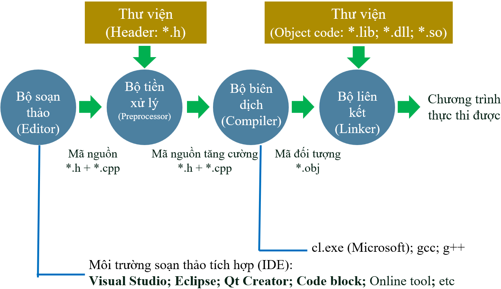

***+ Kiểm thử (testing):***

\* Đảm bảo CT chạy thông và cho kết qủa chính xác

\* Debugging—Tìm và sửa các lỗi syntax và logic errors

\* Kiểm tra phiên bản beta, giao cho Users dùng thử và thu thập phản hồi

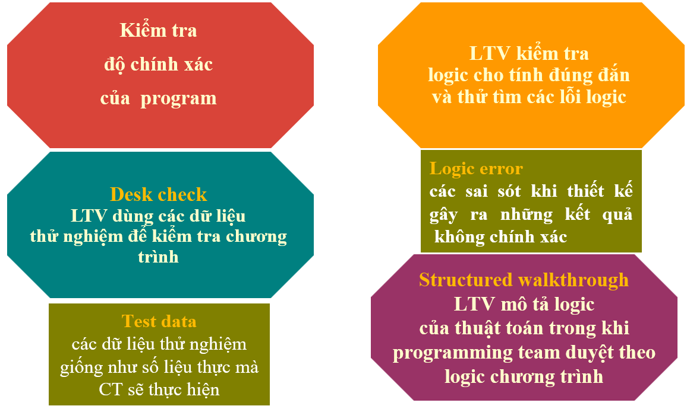

***+ Viết tài liệu (documentation);***

\* Rà soát lại program code—loại bỏ các **dead code**, tức các lệnh mà CT không bao giờ gọi đến

\* Rà soát, hoàn thiện tài liệu

***+ Bảo trì (maintenance).***

## 1.5. Giải quyết vấn đề

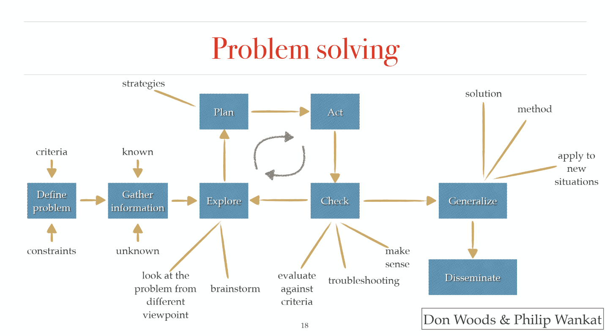

\- **<u>Nguyên tắc:</u>** chia vấn đề lớn thành những phần nhỏ hơn

\- Chúng ta tận dụng khả năng của máy tính bằng cách thực hiện các kỹ thuật lặp đi lặp lại để giải quyết dần dần các vấn đề phức tạp.

\- Hai cách tiếp cận cơ bản

***+ Vòng lặp (Iterative):*** giải quyết một phần của vấn đề, lặp lại quy trình trên vấn đề còn lại cho đến khi giải quyết được vấn đề ban đầu.

***+ Đệ quy (Recursive):*** xác định cách giải quyết các vấn đề đơn giản nhất. Sau đó, chúng ta chia vấn đề thành những phần ngày càng đơn giản hơn cho đến khi chúng đạt đến mức mà máy tính có thể giải quyết được.

## 1.6. Cấu trúc của một chương trình (Structure of a program)

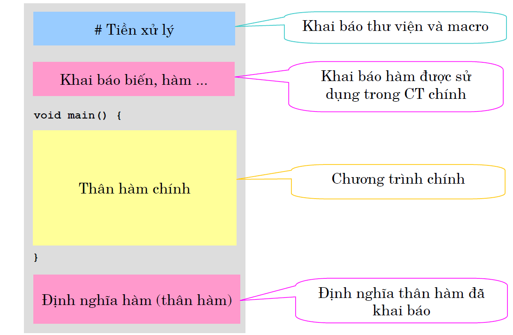

**<u>Ví dụ:</u>** Hàm hoán đổi

```cpp
#include <iostream>

#include <cmath>

using namespace std;

void swap(int&, int&);

int main()

{

int x, y;

cout << "Nhap x,y = ";

cin >> x >> y;

swap(x, y);

cout << " x= " << x << "y = " << y;

system("pause");

return 0;

}

void swap(int& a, int& b)

{

int t;

t = a; a = b; b = t;

}
```

## 1.7. Bộ kí tự và từ khóa (Character set and keyword)

**Bộ kí tự (Character set):** Có phân biệt hoa thường

- 26 chữ cái Latinh lớn: A, B, C..., Z

- 26 chữ cái Latinh nhỏ: a, b, c ..., z

- 10 chữ số thập phân: 0, 1, 2...9

- Các ký hiệu toán học: +, -, \*, /, =, \<, \>

- Các ký hiệu đặc biệt: . , ; : " ' \_ % \# ! ^ \[ \] { } ( ) ...

- Dấu cách hay khoảng trống, xuống hàng (\n) và tab (\t)

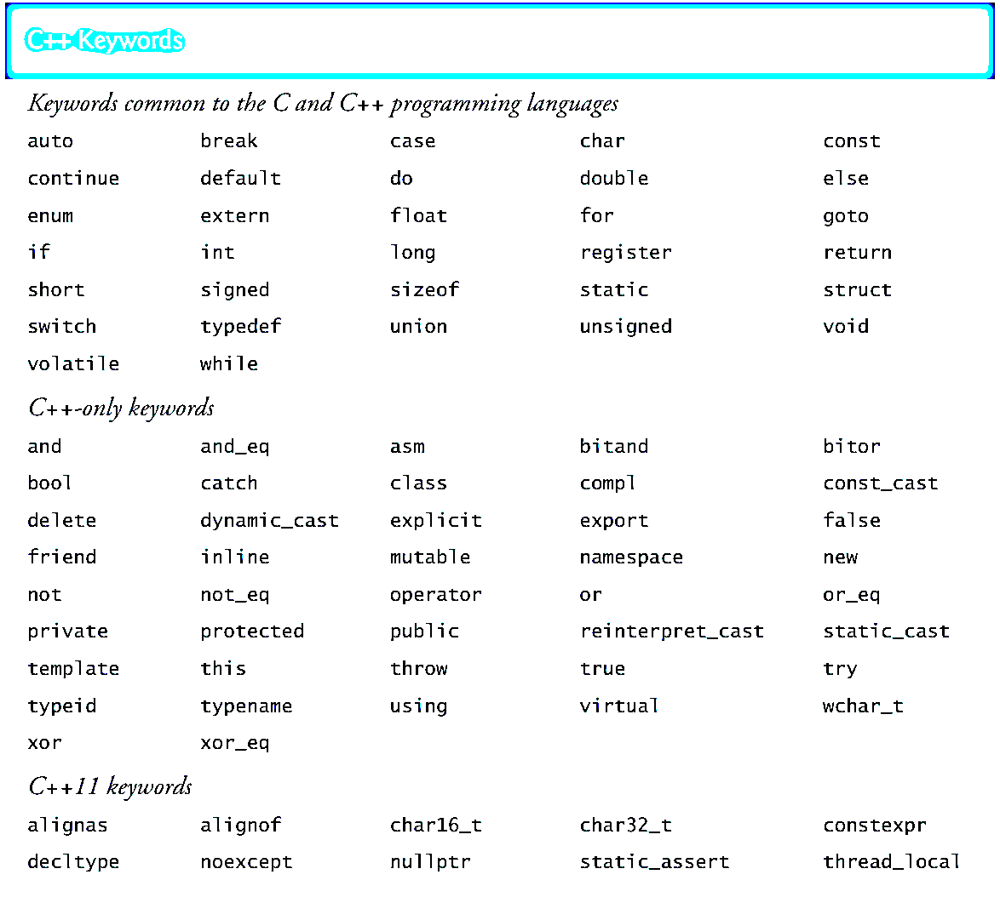

## 1.8. Định danh (identifier)

\- Một dãy kí tự để đặt tên: biến, hằng, hàm, mảng,…

**- <u>Qui tắc:</u>**

- Dùng: chữ cái (A..Z,a..z), chữ số (0..9)

- Dấu gạch dưới ‘\_’

- Không bắt đầu bằng số.

- Không trùng với từ khóa.

**<u>Ví dụ:</u>** **nhap_mang_1_chieu** (đúng), **2vonglap** (sai: bắt đầu bằng chữ số), **typedef** (sai: trùng với từ khóa).

\- Để thuận tiện trong làm việc nhóm, thống nhất với nhau cách đặt tên để đỡ tốn công sức và chi phí thời gian, thường dùng quy tắc đặt tên theo kiểu “lạc đà” (Camel case) hoặc theo phong cách Hung-ga-ri.

## 1.9. Các lệnh vào/ ra dữ liệu (Input/output)

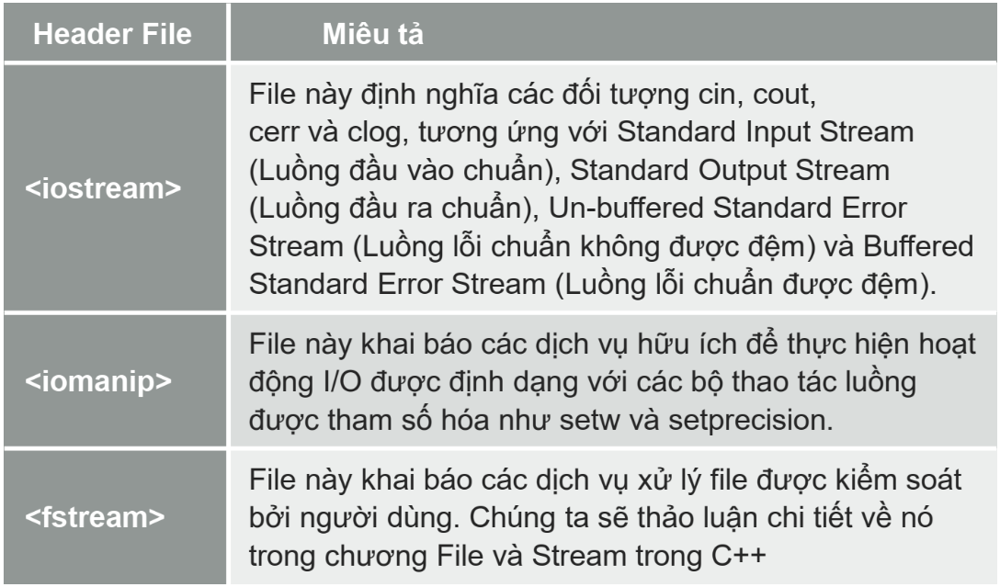

### 1.9.1. Standard Output Stream (cout) trong C++

Cần khai báo đầu chương trình:

> \#include\<iostream\>
>
> using namespace std;

\- Đối tượng tiền định nghĩa cout là một minh họa của lớp ostream. Đối tượng cout được xem như "được kết nối tới" thiết bị đầu ra chuẩn, thường là màn hình.

\- Đối tượng cout được sử dụng kết hợp với toán tử chèn luồng (insertion operator), được viết là \<\<.

\- Toán tử chèn luồng \<\< có thể được sử dụng nhiều hơn một lần trong một lệnh và endl được sử dụng để thêm một dòng mới tại cuối dòng đó.

> **cout \<\< bt_1 ;**
>
> **cout \<\< bt_2 ;**
>
> **cout \<\< bt_3 ;**
>
> **…**

hoặc:

> **cout \<\< bt_1\<\< bt_2 \<\< bt_3…\<\< bt_n ;**

\* Biểu thức chuỗi ký tự thì đặt nội dung trong “ ”.

**<u>Ví dụ 1:</u>**

```cpp
#include <iostream>

using namespace std;

int main() {

char str[] = "Xin chao C++";

cout << "Gia tri cua str la: " << str << endl;

}
```

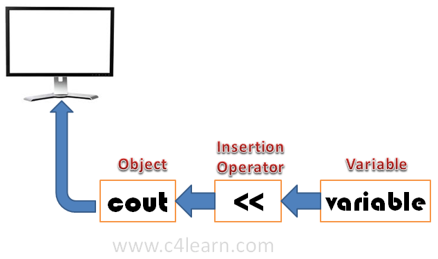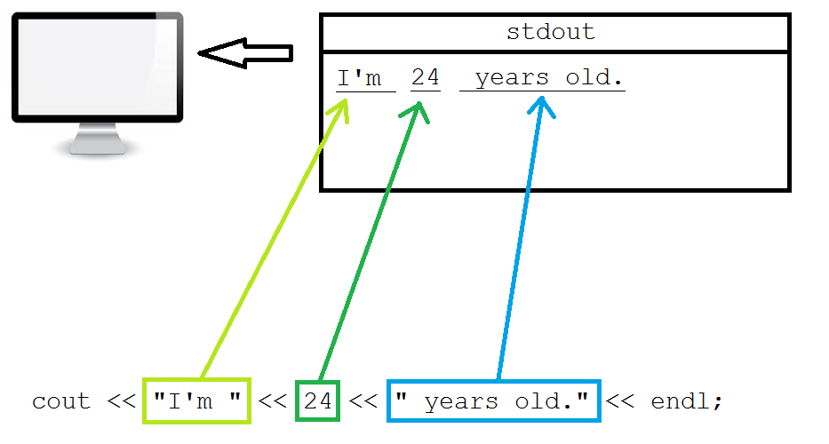

### 1.9.2. Standard Input Stream (cin) trong C++

\- Đối tượng tiền định nghĩa cin là một minh họa của lớp isrtream. Đối tượng cin được xem như đính kèm với thiết bị đầu vào chuẩn, mà thường là bàn phím. Đối tượng cin được sử dụng kết hợp với toán tử trích luồng (extraction operator), viết là \>\>.

\- Bộ biên dịch C++ cũng quyết định kiểu dữ liệu của giá trị đã nhập và chọn toán tử trích luồng thích hợp để trích giá trị và lưu giữ nó trong các biến đã cung cấp.

\- Toán tử trích luồng \>\> có thể được sử dụng nhiều hơn một lần trong một lệnh.

```cpp
cin >> biến_1 ;

cin >> biến_2 ;

cin >> biến_3 ;
```

hoặc:

```cpp
cin >> biến_1 >> biến_2 >> biến_3 ;
```

\- Đối tượng cin khiến chương trình phải đợi cho đến khi dữ liệu được nhập vào bàn phím và nhấn phím Enter.

\- C++ tự động chuyển đổi dữ liệu đọc từ bàn phím sang kiểu dữ liệu của biến.

**<u>Ví dụ 2:</u>**

```cpp
#include <iostream>

using namespace std;

int main() {

char ten[50];

cout << "Nhap ten cua ban (viet lien): ";

cin >> ten;

cout << "Ten ban la: " << ten << endl;

return 0;

}
```

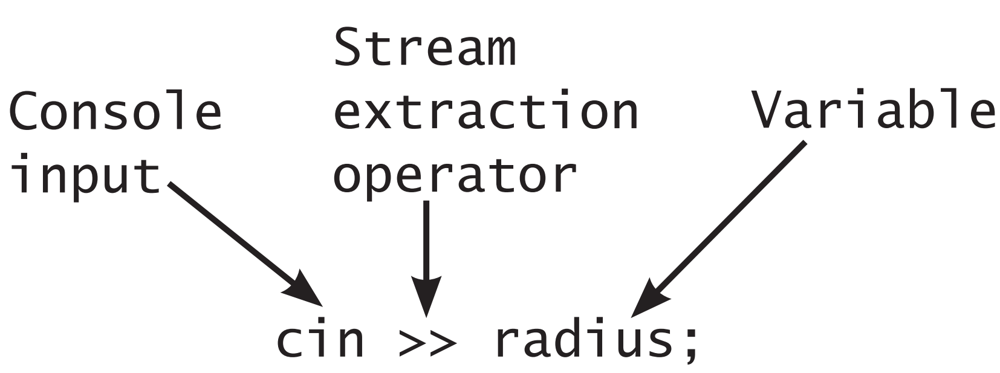

- \>\> chỉ ra rằng dữ liệu “chảy” từ cin đến một biến.

- \<\< cho biết dữ liệu “chảy” từ một biến hoặc một chuỗi tới cout.

- Có thể coi toán tử trích luồng \>\> như một mũi tên trỏ đến biến và toán tử chèn luồng \<\< như một mũi tên trỏ đến cout.

### 1.9.3. Một số lệnh vào/ ra đặc biệt

**\* cin.get(c):** nhập một kí tự vào biến kí tự c

**\* cin.getline(s, n):** nhập tối đa n-1 kí tự vào xâu s (mảng ký tự : char s\[100\])

Hoặc cũng có thể sử dụng: **cin.get(s, n);**

*Tuy nhiên:*

***+ cin.get(s, n):***

. Đọc toàn bộ dòng nhập vào, bao gồm cả ký tự kết thúc dòng ('\n').

. Ký tự kết thúc dòng ('\n') không bị loại bỏ khỏi hàng đợi đầu vào.

. Điều này cho phép bạn xem ký tự kết thúc dòng là một phần của đầu vào tiếp theo.

. Thường được sử dụng khi bạn muốn đọc một dòng nguyên thô từ đầu vào.

. Khi sử dụng cin.get() để nhập tên file, ký tự '\n' (khi bạn nhấn Enter) vẫn còn trong hàng đợi đầu vào.

***🡪 Vì vậy khi nhập các chuỗi liên tiếp nhau, sau khi nhập chuỗi đầu tiên, ta cần thêm cin.ignore() để loại bỏ ký tự xuống dòng trước khi nhập chuỗi tiếp theo.***

***+ cin.getline(s, n):***

. Đọc toàn bộ dòng nhập vào, nhưng nó loại bỏ ký tự kết thúc dòng ('\n') khỏi hàng đợi đầu vào.

. Điều này đảm bảo rằng dòng tiếp theo sẽ bắt đầu ngay sau ký tự kết thúc dòng.

. Thường được sử dụng để đọc từng dòng trong tệp văn bản hoặc để nhập chuỗi không chứa ký tự kết thúc dòng.

. Khi sử dụng cin.getline() để nhập tên file, ký tự '\n' không còn trong hàng đợi đầu vào.

**\* getline(cin, s):** Nhập chuỗi nhưng khai báo **string s và \#include \<string\>**

**\* cin.ignore(\[n\], \[delim\]):** để lấy ra kí tự xuống dòng còn sót lại trong bộ đệm.

Trong đó n là số ký tự cần trích xuất, và delim là ký tự phân tách cần tìm.

**<u>Ví dụ 3.1:</u>**

```cpp
#include <iostream>

using namespace std;

int main() {

char first, last;

cout << "Nhap ho ten cach nhau boi dau cach: \n";
```

first = cin.get(); //Dùng hàm get để lấy ký tự đầu tiên

```cpp
cin.ignore(256, ' '); //Bỏ qua cho tới khi tìm thấy dấu cách
```

last = cin.get(); //Dùng hàm get để lấy ký tự tiếp theo

```cpp
cout << "Ten viet tat cua ban: " << first << last << '\n';

return 0;

}
```

***Kết quả:***

Nhap ho ten cach nhau boi dau cach:

Tran Hoang

Ten viet tat cua ban: TH

**<u>Ví dụ 3.2:</u>**

```cpp
#include <iostream>

#include <string>

using namespace std;

int main()

{

cout << "Enter your age: ";

int nAge;

cin >> nAge;

/* Xóa khỏi bộ nhớ đệm 32767 ký tự, hoặc đến khi gặp ký tự '\n’ */

std::cin.ignore(32767, '\n');

cout << "Enter your name: ";

string strName;

getline(cin, strName);

cout << "Hello, " << strName << endl;

cout << "Your age " << nAge << endl;

return 0;

}
```

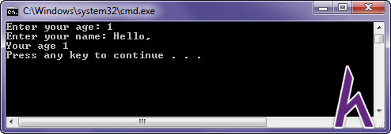 🡪 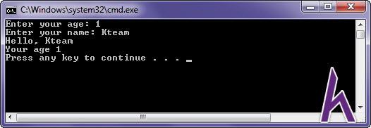

\- Toán tử **\>\> (extraction operator) **được dùng chung với **std::cin** chỉ cho phép đọc một dãy gồm các ký tự liền nhau (không có khoảng trắng), nên nó sẽ trả về các ký tự đến khoảng trắng đầu tiên trong chuỗi vừa nhập.

<span class="mark">- Khi nhập, mọi ký tự gõ vào bàn phím (kể cả ký tự Enter **\n**) đều được đẩy vào bộ nhớ đệm trước khi được gán vào biến.</span>

\- Trong chương trình trên, khi nhập số bằng **std:: cin**, chúng chỉ nhận số chứ không nhận được ký tự **Enter** (**‘\n’**), và ký tự **Enter** vẫn còn trong bộ nhớ đệm. Đến khi nhập chuỗi, hàm std::getline() nhận được ký tự **Enter** từ bộ nhớ đệm thì kết thúc nhập và chương trình vẫn chạy tiếp. Điều này khiến kết quả bị sai.

\- Để xóa ký tự **Enter ‘\n’ **sau khi sử dụng std::cin, ta sử dụng phương thức ***cin*.*ignore*()** thuộc **namespace std.**

🡪 *Nên xóa ký tự Enter ‘\n’ trong bộ nhớ đệm <u>trước</u> khi nhập chuỗi bất kỳ, **khi trước đó nhập bằng std::cin**.*

**<u>Ví dụ 4:</u>** Minh họa về cách sử dụng hàm cin.getline()

```cpp
#include <iostream>

using namespace std;

int main()

{

char hoten[30];

cout << "Nhap vao ho va ten cua ban:\n";

cin.getline(hoten, 30); //Nhap cho chuoi hoten toi da 29 ki tu

cout << "Xin chao: " << hoten;

}
```

**\*\*\* Ghi chú**:

*Ngoài ra trong C++ còn cung cấp các hàm **cin.get(c), c = getchar(), c = getche(), c = getch()** để nhập vào cho biến kí tự c 1 kí tự từ bàn phím. Để dùng các hàm **getch()** và **getche()** thì đầu chương trình ta cần khai báo **\#include\<conio.h\>***

***\* Định dạng in ra màn hình:* Cần khai báo \#include\<iomanip\>**

<table>
<colgroup>
<col style="width: 40%" />
<col style="width: 59%" />
</colgroup>
<thead>
<tr>
<th style="text-align: center;"><p><strong>setw(int n)</strong></p></th>
<th style="text-align: center;"><p><strong>cout.width(n)</strong></p></th>
</tr>
</thead>
<tbody>
<tr>
<td><p>Qui định độ rộng dành để in ra các giá trị là n cột màn hình.</p>
<p><strong>+ Các khoảng trắng sẽ được thêm vào bên trái hoặc bên phải dữ liệu xuất</strong> (để <strong>tổng số ký tự là n</strong>). Dữ liệu khi in ra sẽ được <strong>canh trái hoặc canh phải</strong>.</p>
<p>+ Toán tử <strong>std::left</strong> và <strong>std::right</strong> <strong>dùng chung với std::setw(n)</strong> <strong>để canh lề trái hoặc lề phải</strong>.</p>
<p>+ Toán tử <strong>std::setfill(ch)</strong> dùng chung với <strong>std::setw(n)</strong> để <strong>quy định ký tự ch được thêm vào thay vì dùng khoảng trắng mặc định</strong>. Ví dụ: nếu dùng std::setfill(‘-’) thì dấu ‘-‘ sẽ được thay cho khoảng trắng.</p></td>
<td><p>n là độ rộng mới.</p>
<p><strong>Chú ý:</strong> độ rộng quy định n chỉ có tác dụng cho một giá trị xuất. Sau đó C++ lại áp dụng độ rộng quy định bằng 0.</p>
<p>Hình minh họa</p></td>
</tr>
</tbody>
</table>

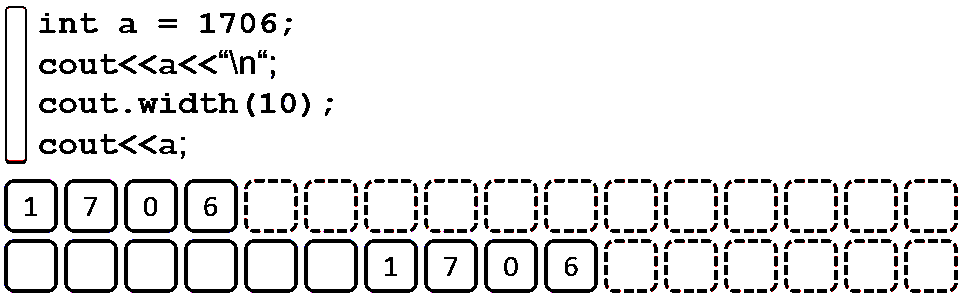

**<u>Ví dụ 5:</u>**

```cpp
#include <iostream>

#include \ // for std::setw(n), std::setfill(ch), std::left, std::right

using namespace std;

int main()

{

cout << "Kteam Solutions and Entertainment" << endl;

cout << "HowKteam.com" << endl << endl;

cout << setw(5) << left << "ID"; // độ rộng 5 ký tự, canh trái ID

cout << setw(30) << left << "Name"; // độ rộng 30 ký tự, canh trái Name

cout << setw(20) << right << "Address" << endl; // độ rộng 20 ký tự, canh phải Address

cout << setfill('-'); // set fill bằng ký tự '-' thay vì ' '

cout << setw(55) << "-" << endl; // fill 55 ký tự '-'

// reset fill bằng ký tự ' '

cout << setfill(' ');

// in thông tin theo format như trên

cout << setw(5) << left << 1;

cout << setw(30) << left << "Nguyen Doan Ngoc Giau";

cout << setw(20) << right << "Sai Gon" << endl;

cout << setw(5) << left << 2;

cout << setw(30) << left << "Tran Kim Long";

cout << setw(20) << right << "Da Lat" << endl;

cout << setw(5) << left << 3;

cout << setw(30) << left << "Nguyen Son Tung";

cout << setw(20) << right << "Dong Nai" << endl;

return 0;

}
```

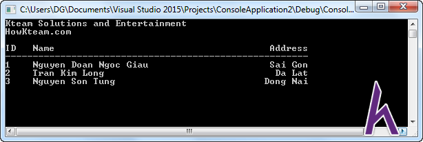

**\* setprecision(n):** Chỉ định **số chữ số in ra là n (bao gồm phần nguyên và phần thập phân).**

**\* setprecision(n) kết hợp với fixed:** Chỉ định **<u>số chữ số của <span class="mark">phần thập phân</span> in ra là n.</u>** Số sẽ được làm tròn trước khi in ra.

**<u>Ví dụ 6:</u>**

```cpp
#include <iostream>

#include \   // thu vien setprecision

using namespace std;

int main () {

double f =3.14159;

cout << setprecision(5) << f << '\n';

cout << setprecision(9) << f << '\n';

cout << setprecision(5) << fixed << f << '\n';

cout << setprecision(9) << fixed << f << '\n';

return 0;

}
```

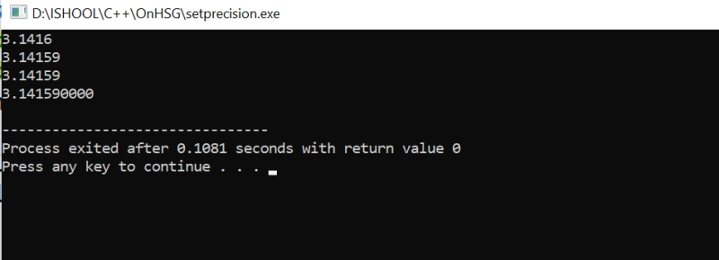

**<u>Ví dụ 7:</u>**

```cpp
#include <iostream>

#include \ // for std::setprecision()

using namespace std;

int main()

{

cout << std::setprecision(20); // Show 20 digits
```

**float** f{ 9.66666666666666666666f }; // Initializations

```cpp
cout << f << endl;
```

**double** d{ 9.66666666666666666666 }; // Initializations

```cpp
cout << d << endl;

return 0;

}
```

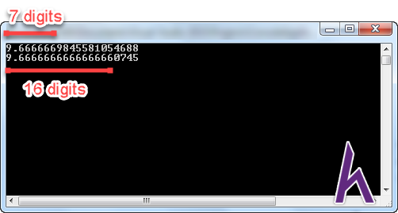 *(Sẽ giải thích ở phần số chấm động)*

**\* setiosflags(ios::showpoint)**: *Phương thức setprecision chỉ có tác dụng trên một dòng in. Để cố định các giá trị đã đặt cho mọi dòng in (cho đến khi đặt lại giá trị mới) ta sử dụng phương thức setiosflags(ios::showpoint).*

**\* cout.precision(n):** n là độ chính xác áp dụng.

***Chú ý:*** độ chính xác được thiết lập sẽ có hiệu lực cho tới khi gặp một câu lệnh thiết lập độ chính xác mới.

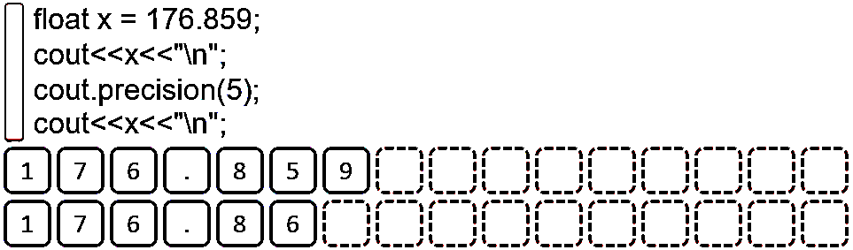

## 1.10. Biến và hằng (Variable and constant)

### 1.10.1. Biến (Variable)

\- Để lưu trữ dữ liệu trong bộ nhớ máy tính do người LT định nghĩa (khai báo biến) đặt bởi một tên.

\- Có thể thay đổi giá trị, kiểu dữ liệu thì không.

\- Dùng thì phải khai báo. Chương trình tự động cấp phát vùng nhờ khi gặp một khai báo biến.

#### 1.10.1.1. Khai báo biến

**kiểu_dữ \_liệu** tên_biến **;**

*Khai báo nhiều biến có cùng một kiểu dữ liệu:*

**kiểu_dữ \_liệu** tên_biến1**,** tên_biến2**,**…**;**

\- Khi khai báo biến cần xác định:

\+ Biến lưu trữ dữ liệu gì? 🡪 xác định được kiểu

\+ Ý nghĩa của biến là gì? 🡪 xác định được tên sẽ được đặt cho nó

\* **<u>Ví dụ: Khi giải Phương trình bậc 2:</u>**

. Lưu trữ hệ số: Kiểu: float hoặc double; Tên: a, b, c.

. Lưu trữ delta: Kiểu: float hoặc double; Tên: delta

. Lưu trữ nghiệm: Kiểu: float hoặc double; Tên: x1, x2, s1, s2, sol1, sol2, v.v.

#### 1.10.1.2. Gán biến

Sau khi khai báo biến trong C++, chúng ta có thể gán một giá trị cụ thể cho biến đó bằng cách sử dụng toán tử bằng = như sau:

```cpp
name = value;
```

- name là tên biến đã được khai báo

- value là giá trị để gán vào biến. Lưu ý là kiểu của giá trị không nhất thiết phải giống với kiểu giá trị của biến khi khai báo *(đối với C)*/ chỉ có thể gán một giá trị vào một biến có kiểu giống nó *(đối với C++)*.

**<u>Ví dụ:</u>**

\+ Có thể gán giá trị cho biến ngay sau khi khai báo

> int num1;
>
> num1 = 10;

\+ Có thể khai báo biến, sau đó làm một số xử lý khác, sau đó gán giá trị cho biến đó khi cần sử dụng

> int num1;
>
> cout \<\<"hello";
>
> num1 = 10;

\+ Cũng có thể **gán giá trị ban đầu cho biến** ngay trong khi **khởi tạo biến**

> int num1 = 10;
>
> int num2 = 11, num3 = 12, num4 = 13;

\+ Sau khi đã gán giá trị cho biến, chúng ta có thể sử dụng biến này thay cho giá trị trong chương trình

> \#include \<iostream\>
>
> using namespace std;
>
> int main(){
>
> int num1;
>
> num1 = 10;
>
> cout \<\< num1;//10
>
> return 0;
>
> }

**+ Gán biến trong C++ bằng giá trị của một biến khác**

> \#include \<iostream\>
>
> using namespace std;
>
> int main(){
>
> int num1, num2 ;
>
> num1 = 100;
>
> num2 = num1;
>
> cout \<\< "num1= "\<\<num1\<\<endl; //num1=100
>
> cout \<\< "num2= "\<\<num2\<\<endl; //num2=100
>
> return 0;
>
> }

\+ Lúc này chúng ta gán một giá trị mới vào biến num1, thì giá trị của biến num2 vẫn sẽ không thay đổi.

> \#include \<iostream\>
>
> using namespace std;
>
> int main(){
>
> int num1, num2 ;
>
> num1 = 100;
>
> num2 = num1;
>
> cout \<\< "num1= "\<\< num1 \<\<endl;//num1=100
>
> cout \<\< "num2= "\<\< num2 \<\<endl;//num2=100
>
> num1 = 300;
>
> cout \<\< "num1= "\<\<num1 \<\< endl;//num1=300
>
> cout \<\< "num2= "\<\<num2 \<\< endl;//num2=100
>
> return 0;
>
> }

. Tại thời điểm chưa thay đổi giá trị num1, thì cả hai biến num1 và num2 đều chỉ chung một địa chỉ tới vùng ghi dữ liệu 100 trong bộ nhớ.

. Tuy nhiên sau khi thay đổi giá trị của num1 thành 300, thì đơn giản là num1 đã bị thay đổi thành địa chỉ tới vùng ghi dữ liệu 300 trong bộ nhớ, trong khi num2 vẫn giữ nguyên, là địa chỉ tới vùng lưu trữ dữ liệu 100 trong bộ nhớ.

. Do đó kể cả khi num1 thay đổi thì giá trị của num2 cũng không bị thay đổi như ở trên.

#### 1.10.1.3. ***Khởi tạo biến***

(*Khởi tạo và khai báo biến là khác nhau*) Có 3 cách để khởi tạo 1 biến:

**\# Khởi tạo sao chép giá trị cho biến với toán tử gán =**

```cpp
int nVarName = 69; // copy initialization
```

**\# Khởi tạo trực tiếp giá trị cho biến với dấu ngoặc đơn ( )**

```cpp
int nVarName(69); // direct initialization
```

**\# Uniform initialization in C++11 (khởi tạo đồng nhất):** cũng được gọi là danh sách khởi tạo (list initialization): Khởi tạo sao chép và khởi tạo trực tiếp chỉ sử dụng cho một số loại biến, không thể sử dụng để khởi tạo một biến chứa danh sách các giá trị. Vì vậy, có thể sử dụng cách khởi tạo đồng nhất.

// Uniform initialization

**int** nVarName{69}; // Khởi tạo giá trị 69

**int** nVarName{}; // Khởi tạo giá trị 0 (hoặc empty, tùy kiểu dữ liệu)

// Không như khởi tạo trực tiếp và khởi tạo sao chép, Compiler sẽ ném một

// thông báo lỗi nếu giá trị khởi tạo đồng nhất không cùng kiểu

**int** nVarName{6.9};

***<u>Tổng quát:</u>***

**<span class="mark">\[optional\] \<type\> \<variable name\>\[\<array declaration\>\]\[=assigned values\]</span>**

```cpp
int valueInteger = 12;
```

*// (1) Chúng ta có một vùng nhớ để chứa 1 số nguyên*

```cpp
float valueFloat = 5.394;
```

*// (2) Xin hệ điều hành thêm một vùng nhớ để chứa 1 số thực*

```cpp
string myName = "Minh Vu";
```

*// (3) Biến này chứa được một dãy các kí tự*

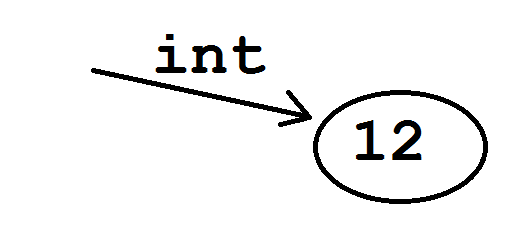 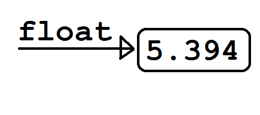 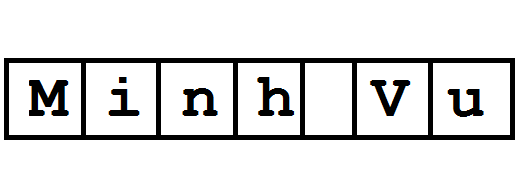

*Tên biến giúp ngôn ngữ C++ xác định vùng nhớ mà chúng ta đã cấp phát, mỗi lần sử dụng biến, compiler sẽ tìm đến vùng nhớ mà chúng ta đã đặt tên cho nó và lấy giá trị ra để sử dụng. Kiểu dữ liệu sẽ phân loại giá trị của biến (kí tự, số nguyên, số thực, ...)*

**<u>Định nghĩa biến ở đâu (Where to define variables)</u>**

**- C++ cho phép** định nghĩa các biến ở **bất kỳ đâu** trong hàm, khuyến khích gần nơi sử dụng biến đó. Một số lý do nên định nghĩa biến gần nơi sử dụng:

\- Định nghĩa tất cả biến ở đầu hàm sẽ khó xác định được ý nghĩa của biến đó cho đến khi tìm ra nơi sử dụng biến đó.

\- Định nghĩa biến ở nơi sử dụng sẽ chắc chắn rằng biến này không ảnh hưởng bởi những dòng lệnh phía trên, giúp thu hẹp phạm vi ảnh hưởng tốt hơn.

\- Giảm thiểu khả năng biến định nghĩa mà không sử dụng, hoặc sử dụng biến chưa được khởi tạo (uninitialized), định nghĩa ngay khi sử dụng sẽ đảm bảo biến đó sẽ được dùng ngay.

**- Chú ý:** Nên định nghĩa biến càng gần nơi sử dụng càng tốt.

#### 1.10.1.4. Các tầm vực của biến

\- Tầm vực là gì? Là vùng chương trình mà một biến tồn tại và sử dụng được

\- Các loại tầm vực:

***+ Toàn cục:*** bên ngoài tất cả các hàm

. Có thể được sử dụng ở bất kì đâu trong chương trình, ngay sau khi nó được khai báo.

. Theo quy ước, **biến toàn cục **được khai báo ở **đầu của một tập tin**, bên dưới #include.

. Đối với biến toàn cục (được khai báo bên ngoài khối lệnh của hàm main), nó sẽ tồn tại cho đến khi chương trình kết thúc hoặc bị kết thúc bởi người dùng.

. Vì thế chỉ nên sử dụng biến toàn cục khi cần thiết, để tránh việc vùng nhớ của biến toàn cục được cấp phát nhưng bị chiếm giữ quá lâu gây ảnh hưởng đến việc cấp phát bộ nhớ cho những chương trình khác.

***+ Cục bộ:***

. Thân hàm: <u>từ dấu { đến dấu } của thân hàm</u>

. Hoặc các khối con (<u>từ dấu { đến dấu } của khối</u>)

. Được tạo tại thời điểm định nghĩa, và bị hủy khi ra khỏi khối lệnh mà biến đó được định nghĩa.

. Phạm vi bên trong khối lệnh, không truy cập được biến khi ở bên ngoài khối lệnh.

. Thông số của hàm: <u>từ { đến } của thân hàm</u>

```cpp
int main()
```

{ // start outer block

```cpp
int x(6);
```

{ // start nested block

```cpp
int y(9);

// we can see both x and y from here

cout << x << " + " << y << " = " << x + y;
```

} // y destroyed here

// y can not be used here because it was already destroyed!

```cpp
return 0;
```

} // x is destroyed here

```cpp
#include <iostream>

using namespace std;

// add's x can only be seen/used within function add()

int add(int x, int y) // add's x is created here

{

return x + y;
```

} // add's x is destroyed here

// main's x can only be seen/used within function main()

```cpp
int main()

{

int x = 6; // main's x is created here

int y = 9;

// the value from main's x is copied into add's x

cout << add(x, y) << endl;

return 0;
```

} // main's x is destroyed here

. Một biến bên trong một khối lệnh lồng nhau **có thể có cùng tên** với một biến ở khối lệnh bên ngoài. Trong trường hợp này, **biến ở khối lệnh lồng sẽ "ẩn" biến bên ngoài**. Nó được gọi tên ẩn (hiding) hoặc shadowing.

. Nếu một biến chỉ được sử dụng trong một khối lệnh lồng nhau, nó phải được định nghĩa bên trong khối lệnh lồng nhau.

```cpp
#include <iostream>

using namespace std;

int main()
```

{ // outer block

```cpp
int apples(6); // here's the outer block apples

if (apples >= 6) // refers to outer block apples
```

{ // nested block

```cpp
int apples; // hides previous variable named apples

// apples now refers to the nested block apples

// the outer block apples is temporarily hidden

apples = 9;

// this assigns value 10 to nested block apples, not outer block apples

cout << apples << endl; // print value of nested block apples
```

} // nested block apples destroyed

// apples now refers to the outer block apples again

```cpp
cout << apples << endl; // prints value of outer block apples

return 0;
```

} // outer block apples destroyed

```cpp
#include <iostream>

using namespace std;

int main()

{

// we're declaring y here because we need it in this outer block later

int y(6);

{

int x;

cin >> x;

// if we declared y here, immediately before its actual first use...

if (x == 9)

y = 9;
```

} // ... it would be destroyed here

```cpp
cout << y; // and we need y to exist here

return 0;

}
```

**\*\*\* Nguyên tắc: **Biến phải được **định nghĩa trong phạm vi nhỏ nhất có thể**.

\+ Có thể sử dụng **toán tử phân giải phạm vi** **(scope operator :: ) **để thông báo cho trình biên dịch biết đó là **<u>biến toàn cục.</u>**

```cpp
int value(6); // global variable

int main()

{

int value = 9; // hides the global variable value
```

value++; // increments local value, not global value

::value--; // decrements global value, not local value

```cpp
cout << "global value: " << ::value << "\n";

cout << "local value: " << value << "\n";

return 0;
```

} // local value is destroyed

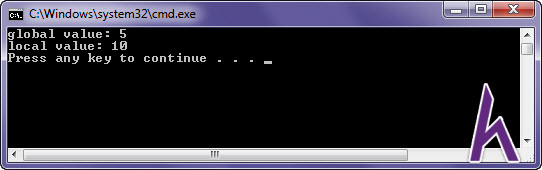

**Chú ý:** Cần** tránh **việc đặt tên **biến toàn cục (global variables)** và** biến cục bộ (global variables)** trùng nhau. Theo quy ước, nên đặt **tiền tố "g\_"** **trước các biến toàn cục (global variables)**. Điều này vừa giúp** xác định các biến toàn cục** cũng như **tránh đặt tên xung đột** với các biến cục bộ.

**+ Sử dụng biến toàn cục là nguy hiểm:**

**. Biến toàn cục** là một trong những khái niệm **bị lạm dụng nhất** trong lập trình. Mặc dù nó có vẻ vô hại trong các chương trình nhỏ, nhưng lại thường cực kỳ nguy hiểm ở những chương trình lớn.

**. Biến toàn cục (non-const)** làm cho mỗi lời gọi hàm** tiềm ẩn những nguy hiểm**, lập trình viên khó kiểm soát được hàm nào đang tác động đến nó! **Biến cục bộ (local variables) sẽ an toàn hơn **vì mỗi hàm sẽ **độc lập và không ảnh hưởng** tới nhau.

. Biến toàn cục có thể sử dụng bất cứ nơi nào, làm tăng phạm vi ảnh hưởng và khó kiểm soát đối với chương trình lớn.

**. Biến toàn cục** cũng làm cho chương trình của bạn** ít module **và **kém linh hoạt**.

. Mỗi hàm thực hiện **một chức năng khác nhau**, truyền dữ liệu thông qua **tham số (paramater)**, và nó **hoạt động độc lập **với nhau. Một hàm sử dụng biến toàn cục sẽ **không thể tái sử dụng**, và **hoạt động độc lập** được.

**. Lập trình viên mới thường có thói quen sử dụng rất nhiều biến toàn cục**, vì sử dụng nó khá đơn giản, bạn chỉ khai báo một lần và sử dụng nó trong tất cả các hàm của chương trình nếu bạn muốn. Tuy nhiên, đây không phải là một ý tưởng hay.

. Nhiều nhà phát triển tin rằng nên **tránh hoàn toàn** việc sử dụng các biến toàn cục **(non-const global variables). **Ở đây **đang nói về biến toàn cục (non-const), **không phải nói về tất cả**.**

. Lý do lớn nhất khiến **biến toàn cục (non-const) nguy hiểm **vì giá trị của nó có thể được **thay đổi bởi bất cứ hàm nào** mỗi khi hàm đó được gọi. Khiến lập trình viên **khó kiểm soát **được chuyện gì đang xảy ra với biến toàn cục của mình.

. Nhưng trong một số trường hợp, sử dụng đúng đắn của các biến toàn cục (non-const) có thể làm giảm sự phức tạp cho chương trình.

. Ví dụ trong trường hợp bạn có những loại dữ liệu muốn sử dụng cho toàn bộ chương trình. (configuration settings, database, …)

// declare global variable

```cpp
int g_nMode;

void doSomething()

{
```

g_nMode = 2; // set the global g_mode variable to 2

}

```cpp
int main()

{

// note: this sets the global g_mode variable to 1.

// It does not declare a local g_mode variable!

g_nMode = 1;

doSomething();

// Programmer still expects g_mode to be 1

// But doSomething changed it to 2!

if (g_nMode == 1)

cout << "Khong bi thay doi." << endl;

else

cout << "Bi thay doi." << endl;

return 0;

}
```

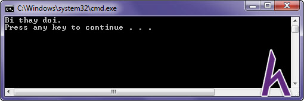

#### 1.10.1.5. Biến tĩnh (Static Variables)

\- Biến tĩnh được tạo ra bên trong một khối lệnh (cục bộ) có khả năng lưu giữ giá trị của nó cho dù chương trình đã chạy ra bên ngoài khối lệnh chứa nó.

\- Được tạo ra **duy nhất một lần** **<u>khi gọi hàm lần đầu tiên</u>** và nó sẽ tiếp tục tồn trong suốt vòng đời của chương trình. Đây là sự khác biệt giữa biến tĩnh và biến cục bộ.

\- Là loại biến** lưỡng tính**, vừa có tính chất của 1 **biến toàn cục (global variables)**, vừa mang tính chất của 1 **biến cục bộ (local variables)**:

\- Theo quy ước, nên **đặt tiền tố “s\_” trước các biến tĩnh (static variables)** để dễ dàng phân biệt với những biến khác.

```cpp
#include <iostream>

using namespace std;

// Static duration

void doSomeThing_static()

{

// static duration via static keyword. This line is only executed once.
```

**static** **int** s_value(0);

++s_value;

```cpp
cout << s_value << endl;
```

} // s_value is not destroyed here, but becomes inaccessible

**\**

```cpp
int main()

{

// Static variables

doSomeThing_static();

doSomeThing_static();

doSomeThing_static();

return 0;

}
```

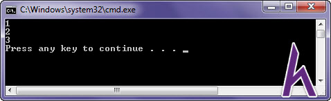

**- Có hai dạng:**

**+ Liên kết bên ngoài (external linkage):** Khai báo ở ngoài mọi hàm (như là biến toàn cục)

> **int** g_value;
>
> **void** doSomeThing()
>
> {…}

**+ Liên kết nội bộ (internal linkage):**

. Khai báo trong hàm với từ khóa static

> **void** doSomeThing()
>
> {
>
> **static** **int** s_value(0);

. Khai báo ngoài hàm với từ khóa static (như là biến toàn cục)

> **static** **int** g_value;
>
> **void** doSomeThing()
>
> {
>
> }

**- Khi nào nên sử dụng biến tĩnh**: Sử dụng biến tĩnh **khi có nhu cầu giữ giá trị của biến** trong chương trình.

**Ví dụ: ** ứng dụng vào chương trình có chức năng tạo ID không trùng nhau, bạn có thể sử dụng biến tĩnh để làm thực hiện nó.

```cpp
#include <iostream>

#include <string>

using namespace std;

int generateID()

{
```

**static** **int** s_id(0);

++s_id;

```cpp
return s_id;

}

int main()

{

int nID1 = generateID();

string strName1("Kteam");

int nID2 = generateID();

string strName2("FreeEducation");

int nID3 = generateID();

string strName3("HowKteam.com");

cout << nID1 << " : " + strName1 << endl;

cout << nID2 << " : " + strName2 << endl;

cout << nID3 << " : " + strName3 << endl;

return 0;

}
```

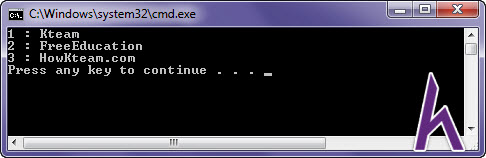

### 1.10.2. Hằng (Constant)

\- Không đổi trong suốt quá trình thực thi của CT.

\- Có thể là một chuỗi ký tự, ký tự, con số xác định.

\- Phải được xác định tại thời điểm biên dịch (lập chương trình)

#### 1.10.2.1. ***Khai báo***

\- Có 2 cách chính

> **<span class="mark">\#define Tên_hằng Giá_trị</span>**
>
> **<span class="mark">const Kiểu_dữ \_liệu TÊN_HẰNG = Giá_trị ;</span>**

*(có thể sử dụng từ khóa const trước hoặc sau kiểu dữ liệu của biến)*

**- Định nghĩa về macro:**

- **\#define/ \#undef:** chỉ thị tiền xử lý

- Mở rộng trên một dòng mã

- **Không có dấu chấm phẩy ";" cuối cùng**

**<u>Ví dụ:</u>**

> \#define PI 3.14
>
> const int MAX = 100;
>
> \#define sub(a, b)
>
> \#define sub(a, b) a - b
>
> \#define sub(a, b) ((a) - (b))
>
> \#define swap(a, b, c) {
>
> a = b;
>
> b = c;
>
> c = a;
>
> }

- **Toán tử đặc biệt:**

\#: tạo một chuỗi ký tự chứa đối số

> \#define text(a) \#a
>
> cout \<\< text(Be careful) \<\< endl; // print "Be careful"

\##: nối hai đối số

> \#define glue(a, b) a \## b
>
> glue(c, out) \<\< "Weird way to write code\n"; // but acceptable

#### 1.10.2.2. Kiểu enum

\+ Với các chương trình lớn, một hằng số như 1, 2, v.v không mang đến thông tin về ý nghĩa con số này. Nó có thể là:

- Lựa chọn mà người dùng nhập vào

- Một tháng trong năm hay một ngày trong tháng

- Một ký hiệu về màu sắc

- V.v

**<u>Ví dụ:</u>** muốn sử dụng các giá trị từ 1 đến 7 để đại diện cho 7 ngày trong tuần (1 đại diện cho ngày chủ nhật, 7 đại diện cho thứ 7), như vậy cần ít nhất là 7 biến để lưu trữ các giá trị này:

**const** **int** SUNDAY = 1;

**const** **int** MONDAY = 2;

**const** **int** TUESDAY = 3;

**const** **int** WEDNESDAY = 4;

**const** **int** THURSDAY = 5;

**const** **int** FRIDAY = 6;

**const** **int** SATURDAY = 7;

\+ Không nên sử dụng mảng một chiều trong trường hợp này vì:

```cpp
int DAYS_OF_WEEK[7] = { 1, 2, 3, 4, 5, 6, 7 };
```

Những con số cụ thể không mang lại ý nghĩa cho người đọc mã nguồn chương trình. Việc sử dụng tên của các biến hằng số sẽ giúp chương trình chúng ta rõ ràng hơn.

Nhưng việc khai báo các hằng số như trên vẫn có một số nhược điểm:

*. Có thể khai báo thiếu sót một vài giá trị khi danh sách các hằng số là quá nhiều.*

*. Có thể khai báo không theo một quy luật (hay thứ tự) nhất định khiến chúng ta khó tìm trong chương trình.*

**<u>Ví dụ:</u>**

> **const** **int** WEDNESDAY = 4;
>
> **const** **int** SUNDAY = 1;
>
> **const** **int** TUESDAY = 3;
>
> **const** **int** FRIDAY = 6;
>
> **const** **int** MONDAY = 2;
>
> **const** **int** SATURDAY = 7;
>
> **const** **int** THURSDAY = 5;

\+ Có một số hằng số không liên quan đến nhau nhưng được khai báo gần nhau khiến chúng ta dễ rối.

**<u>Ví dụ:</u>**

> **const** float PI = 3.14;
>
> **const** float ACCELERATION_OF_GRAVITY = 9.8;
>
> **const** int MAX_SIZE_OF_ARRAY = 255;
>
> *//..............*

\+ Để tăng tính dễ đọc, hiểu, bảo trì, cần tìm cách để tập hợp các hằng số có ý nghĩa tương đương nhau thành những nhóm hằng số riêng biệt, các hằng số nên được ký hiệu hoá bởi một tên, tên này được người lập trình chọn để lồng ghép ý nghĩa của tên này. Ở trường hợp này nên dùng enum

**+ Công dụng của kiểu liệt kê**

. Kiểu liệt kê có tác dụng giúp thay thế các con số (giá trị cụ thể) bằng những cái tên có ý nghĩa, và nó còn giúp chúng ta tập hợp các giá trị có ý nghĩa liên quan với nhau thành từng nhóm.

. Mỗi nhóm hằng số này khi đưa vào kiểu liệt kê sẽ trở thành *một kiểu dữ liệu mới* (người ta thường gọi enumeration là một kiểu dữ liệu trong C++ vì nó có cách khai báo tương tự như khai báo biến).

. Các giá trị enum có thể coi là một hằng số. Việc sử dụng enum giúp đảm bảo giá trị các biến chỉ nhận các giá trị mong đợi.

**+ Khai báo:**

> **enum** \<**name_of_enumeration**\>
>
> {
>
> //list all **of** values inside this block
>
> //each enumerator is separated by a comma, not a semicolon
>
> };

\+ Việc khai báo kiểu dữ liệu mới (như kiểu **enum**) không yêu cầu chương trình cấp phát bộ nhớ, lúc nào chúng ta sử dụng kiểu **enum** vừa đã được định nghĩa để tạo ra biến kiểu **enum** thì chương trình mới cấp phát bộ nhớ.

\+ Mỗi giá trị trong block của kiểu enum cách nhau bởi một dấu phẩy (đối với giá trị cuối cùng thì không cần sử dụng dấu phẩy).

**<u>Ví dụ:</u>**

```cpp
enum DaysOfWeek

{
```

SUNDAY,

MONDAY,

TUESDAY,

WEDNESDAY,

THURSDAY,

FRIDAY,

SATURDAY

};

Hoặc:

```cpp
enum DaysOfWeek { SUNDAY,MONDAY,TUESDAY,WEDNESDAY,THURSDAY,FRIDAY,SATURDAY };
```

*Tập màu sắc:*

```cpp
enum colors {RED, GREEN, BLUE};
```

*Tập các tháng:*

```cpp
enum months {JAN, FEB, MAR, APR, MAY, JUN, JUL, AUG, SEP, OCT, NOV, DEC};
```

*Tập các lựa chọn cho người một chương trình:*

```cpp
enum user_choices {LOAD_DATA, INPUT_DATA, PRINT_DATA};
```

\+ Về bản chất, các giá trị trong tập hợp (enum) được TỰ ĐỘNG gán một con số nguyên. Hằng đầu tiên là 0, kế tiếp là 1, v.v. Tuy nhiên lập trình viên không nên giả thiết các hằng đó là 0, 1, …

```cpp
int main(){

enum Alphabet

{
```

LETTER_A,

LETTER_B,

LETTER_C,

LETTER_D,

LETTER_E

};

```cpp
cout << LETTER_A << endl;

cout << LETTER_B << endl;

cout << LETTER_C << endl;

cout << LETTER_D << endl;

cout << LETTER_E << endl;

return 0;

}
```

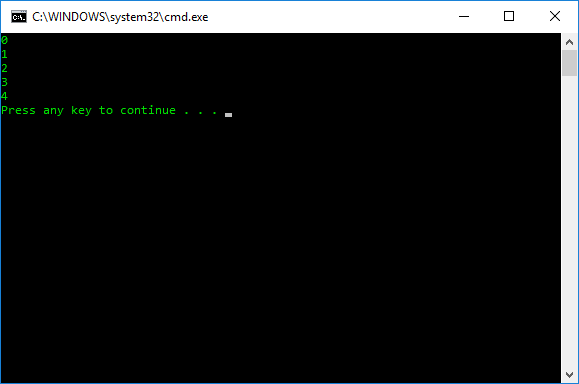

\+ Chúng ta cũng có thể chủ động thay đổi giá trị cho chúng (**nhưng chỉ có thể thay đổi giá trị trong phần khai báo**), một enum sau khi đã định nghĩa xong thì không thể thay đổi những giá trị của danh sách các phần tử nữa.

```cpp
enum Direction

{
```

UP = 1, //assigned 1 by programmer

DOWN = 3, //assigned 3 by programmer

LEFT, //assigned 4 by compiler

RIGHT //assigned 5 by compiler

};

```cpp
cout << UP << " " << DOWN << " " << LEFT << " " << RIGHT << endl;
```

Đoạn chương trình này sẽ in ra: 1 3 4 5

\+ Ngoại trừ phần tử đầu tiên trong **enum**, những hằng số khác sẽ được gán giá trị bằng phần tử trước nó cộng thêm 1.

**Lưu ý:** *những hằng số trong cùng một enum có thể có cùng giá trị với nhau.*

**+ Sử dụng kiểu enum đã định nghĩa như một kiểu dữ liệu thông thường**

. Tuy nó chỉ là tập hợp danh sách các hằng số có ý nghĩa tương quan với nhau, nhưng bản chất nó vẫn là một kiểu dữ liệu (kiểu liệt kê) nên chúng ta có thể sử dụng chúng để tạo ra các biến.

```cpp
enum Color

{
```

COLOR_BLACK,

COLOR_RED,

COLOR_BLUE,

COLOR_GREEN,

COLOR_WHITE,

COLOR_CYAN,

COLOR_YELLOW

};

```cpp
Color backgroundColor;
```

Biến **backgroundColor** chỉ có tác dụng lưu trữ giá trị của một trong số tất cả các hằng số đã được liệt kê bên trong kiểu **Color**. Việc thực hiện gán các giá trị khác kiểu **Color** sẽ gây ra lỗi về mặt cú pháp.

```cpp
Color backgroundColor = 5; *//error*

Color backgroundColor = COLOR_GREEN;
```

***Lưu ý:*** biến kiểu enum chỉ có thể được gán giá trị là một trong số các hằng đã khai báo bên trong kiểu dữ liệu của chính nó, không thể sử dụng hằng của kiểu enum khác.

```cpp
enum Test

{
```

TEST1,

TEST2,

TEST3

};

```cpp
enum Color

{
```

COLOR_BLACK,

COLOR_RED,

COLOR_BLUE,

COLOR_GREEN,

COLOR_WHITE,

COLOR_CYAN,

COLOR_YELLOW

};

```cpp
Color backgroundColor = TEST1; //this line makes an error
```

Compiler sẽ thông báo lỗi: "a value of type Test cannot be used to initialize an entity of type Color".

**+ Những ví dụ về việc sử dụng enum**

. Trên thực tế, chúng ta thường sử dụng kiểu enum để đưa ra lựa chọn hàm hoặc phương thức để thực thi.

```cpp
enum ItemTypes

{
```

LAPTOP,

DESKTOP,

MOBILE,

NETWORK

};

```cpp
void showAllLaptop() {

}

void showAllDesktop() {

}

void showAllMobile() {

}

void showAllNetworkItem() {

}
```

**\**

```cpp
void showProducts(ItemTypes type) {

switch (type)

{

case LAPTOP:

showAllLaptop();

break;

case DESKTOP:

showAllDesktop();

break;

case MOBILE:

showAllMobile();

break;

case NETWORK:

showAllNetworkItem();

break;

default:

break;

}

}

int main() {

ItemTypes type = LAPTOP;

showProducts(type);

return 0;

}
```

. Vì biến kiểu **enum** lưu trữ giá trị số nguyên, nên ta có thể đưa vào làm biểu thức mệnh đề cho câu lệnh **switch-case**. Dựa trên loại Item mà người dùng chọn, ứng dụng của chúng ta sẽ trả về thông tin của toàn bộ sản phẩm hiện có trong kho hàng.

. Thông thường, sau mỗi nhãn case chúng ta sẽ đặt một giá trị số nguyên ứng với mỗi trường hợp, nhưng bây giờ chúng ta có thể thay thế những con số bằng các định danh của enum.

```cpp
bool initialize() {
```

*//init all component*

*//if something wrong, return false*

```cpp
return false;

}

bool loadResource() {
```

*//load data from file*

*//if something wrong, return false*

```cpp
return false;

}

int main() {

if (initialize() == false) {

return -1;

}

if (loadResource() == false) {

return -2;

}

bool isRunning = true;

while (isRunning) {
```

*//Application event loop*

```cpp
return -3;

}

return 0;

}
```

Đoạn chương trình này sử dụng những giá trị âm để biểu diễn các lỗi có thể xảy ra. Mỗi chức năng trong chương trình gây ra lỗi thì chương trình sẽ trả về một giá trị khác nhau. Tuy nhiên, những con số cụ thể thường không mang nhiều ý nghĩa, do đó chúng ta thay thế chúng bằng kiểu enum để code của chúng ta rõ ràng hơn.

```cpp
enum ReturnValue

{
```

SUCCESS = 0,

INITIALIZE_ERROR = -1,

LOAD_RESOURCE_ERROR = -2,

RUN_TIME_ERROR = -3

};

```cpp
int main(){

if (initialize() == false) {

return INITIALIZE_ERROR;

}

if (loadResource() == false) {

return LOAD_RESOURCE_ERROR;

}

bool isRunning = true;

while (isRunning) {

//Application event loop

return RUN_TIME_ERROR;

}

return SUCCESS;

}
```

Khi chúng ta viết một game với nhân vật có nhiều trạng thái khác nhau, mỗi trạng thái sẽ khiến nhân vật phản ứng bằng một hành động tương ứng, chúng ta có thể làm như sau:

```cpp
enum BossState

{
```

IDLING,

RUNNING,

JUMPING,

DYING

};

```cpp
BossState state;

void initBoss()

{
```

*//init something*

```cpp
state = IDLING;

}
```

**\**

```cpp
void attack()

{
```

*//............*

}

```cpp
void activated()

{
```

*//............*

}

```cpp
void updateAnimation(BossState state)

{

switch(state)

{

case IDLING:

standStill();

break;

case RUNNING:

setRunningAnimation();

break;

case JUMPING:

setJumpingAnimation();

break;

case DYING:

setDyingAnimation();

break;
```

**default**;

```cpp
break;

}

}
```

**+ Phạm vi sử dụng kiểu enum**

*. Phạm vi sử dụng của một khai báo enum cũng tương tự như phạm vi sử dụng khi khai báo biến.* Nếu chúng ta muốn sử dụng kiểu enum tại tất cả các khối lệnh trong chương trình, chúng ta nên khai báo kiểu enum phía trên cùng của các khối lệnh (giống như khai báo biến toàn cục).

```cpp
enum ItemTypes

{
```

LAPTOP,

DESKTOP,

MOBILE,

NETWORK

};

```cpp
void foo()

{

cout << MOBILE << endl;

}

int main() {

cout << LAPTOP << endl;

cout << DESKTOP << endl;

return 0;

}
```

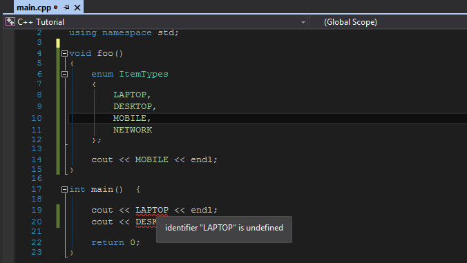

. Thông thường, chúng ta nên định nghĩa kiểu dữ liệu enum bên ngoài các khối lệnh, vì việc khai báo kiểu enum mới không yêu cầu cấp phát bộ nhớ nên không hề ảnh hưởng đến tài nguyên của hệ thống.

. Việc định nghĩa kiểu enum bên ngoài các khối lệnh không những có thể sử dụng bất cứ đâu trong chương trình mà còn có thể sử dụng tại file chương trình khác của dự án.

## 1.11. Dữ liệu và Kiểu dữ liệu

**- Tại sao phải cần đến kiểu dữ liệu?** Mọi chương trình đều cần đến dữ liệu

**<u>Ví dụ:</u>**

\+ Một chương trình giải Phương trình bậc 2

Dữ liệu: Các hệ số A,B,C của Phương trình bậc 2; Delta; Các nghiệm của phương trình

\+ Một chương trình Quản lý nhân sự

Dữ liệu: Mã số nhân sự, họ tên, hệ số lương, v.v.

\- Người lập trình cần vùng nhớ (thuộc RAM của máy tính) để lưu trữ dữ liệu trong quá trình chương trình thực thi

\- Khi người dùng nhập dữ liệu (thông qua bàn phím, chọn trên màn hình, đọc từ sensor, v.v): dữ liệu sẽ được lưu vào các vùng nhớ của RAM

**<u>Ví dụ:</u>** Đọc các hệ số A,B,và C cho Phương trình bậc 2 từ bàn phím

\- Trong quá trình chương trình thực thi: các vùng nhớ này có thể đọc và xử lý

**<u>Ví dụ:</u>** khi tính DELTA trong giải Phương trình bậc 2, các hệ số sẽ được đọc và các giá trị sẽ được dùng trong biểu thức để tính DELTA

(DELTA = B\*B – 4\*A\*C;)

\- Dữ liệu mà chương trình lưu trữ có thể thuộc nhiều dạng (gọi là **<u>kiểu</u>** hay **<u>kiểu dữ liệu</u>**, **<u>data type</u>**) khác nhau.

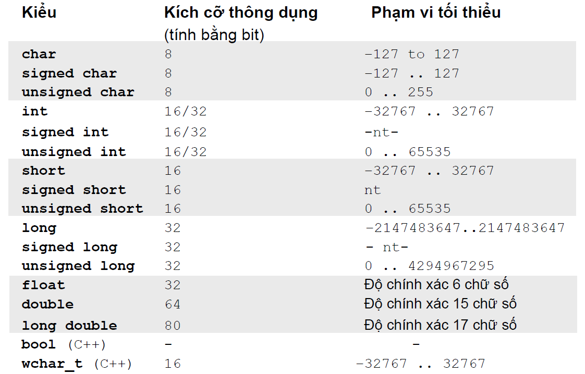

\- Ngoài tính chất lưu trữ khác nhau, chương trình cũng cần thiết phân biệt các kiểu dữ liệu nói trên, vì mỗi kiểu quy định thông tin đi kèm khác nhau

*+ Cách tổ chức các bit (lưu trữ)*

**<u>Ví dụ:</u>**

. Với số nguyên: Ý nghĩa bit có trọng số lớn nhất (MSB) phụ thuộc vào nó có kiểu là số có dấu hay không dấu

\# Số không dấu: bit này tham gia vào tính độ lớn giá trị

\# Số có dấu: bit này chỉ ra là số dương hay âm

*+ Các phép toán*

**<u>Ví dụ:</u>**

. Với hai con số: có thể thực hiện phép toán: nhân hay chia

. Không thực hiện nhân hay chia với hai chuỗi ký tự

**- Ngôn ngữ lập trình phân biệt kiểu dữ liệu như thế nào?**

\+ Ngôn ngữ C/C++ (các ngôn ngữ khác cũng vậy) gắn ngữ nghĩa (quy ước ngữ nghĩa) với một loạt các tên kiểu mà nó cung cấp sẵn.

\+ Các kiểu này được gọi là kiểu cơ bản (fundamental data types)

\+ Tên các kiểu có sẵn này đã được gắn sẵn ngữ nghĩa nên nó là **<u>từ khoá.</u>** Người lập trình không được dùng tên này để đặt tên cho các kiểu (hàm, biến, v.v) mà họ tạo ra.

**- Các loại kiểu**

***+ Kiểu dữ liệu cơ bản (fundamental data type)***

. Tên kiểu là từ khoá

. Ngữ nghĩa của tên này được quy định bởi ngôn ngữ lập trình

***+ Kiểu dữ liệu do người lập trình định nghĩa (user-defined data type)***

. Tên kiểu do người lập trình đặt ra

. Ngữ nghĩa do người lập trình quy định thông qua

\# Kiểu người lập trình tạo ra trước đó

\# Và/hoặc, kiểu dữ liệu cơ bản

. Các kiểu nổi tiếng của C/C++: C: struct, enum; C++: class

***+ Kiểu dữ liệu dẫn xuất (derived data type)***

. C/C++ cung cấp các ký hiệu để tạo ra kiểu mới từ các kiểu khác (cơ bản hay người lập trình định nghĩa)

**<u>Ví dụ:</u>**

\# Mảng (array): Mảng của các ký tự, của các số nguyên, của các số thực, v.v.

\# Con trỏ (pointer): Con trỏ đến ký tự, đến con số, v.v.

\- Để xác định kích thước của một kiểu dữ liệu trên một máy tính cụ thể, dung toán tử **<span class="mark">sizeof (kiểu_dữ_liệu),</span>** là toán tử một ngôi, **nhận vào một kiểu dữ liệu hoặc một biến**, và **trả về kích thước (byte)** của của kiểu dữ liệu hoặc biến đó.

**- Các kiểu dữ liệu cơ bản:**

### 1.11.1. Số nguyên

Là các số nguyên dương (1, 2, 3, …), các số đối (-1, -2, -3, …) và số 0. C++ có 5 loại số nguyên cơ bản để sử dụng:

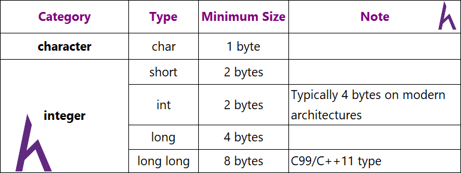

**- Chú ý:** Char là một kiểu dữ liệu đặc biệt, nó vừa là kiểu số nguyên, cũng vừa là kiểu ký tự.

**- Số nguyên có dấu** là những số nguyên dương (1, 2, 3, …), các số đối (-1, -2, -3, …) và số 0. Có 2 cách để khai báo:

// Khai báo không tường minh, thường được sử dụng

```cpp
char c;

short s;

int n;

// Hoặc khai báo tường minh, sử dụng từ khóa signed
```

**signed** **char** c;

**signed** **short** s;

**signed** **int** n;

**- Số nguyên không dấu** là những số nguyên dương (1, 2, 3, …) và số 0. Đôi khi chương trình của bạn có những biến không cần lưu trữ các số âm (Ví dụ: chiều cao, cân nặng, độ dài, chỉ số danh sách, …). Để khai báo số nguyên không dấu, sử dụng từ khóa unsigned.

// Sử dụng từ khóa unsigned

**unsigned** **char** uc;

**unsigned** **short** us;

**unsigned** **int** un;

<span class="mark">**Lưu ý:** Một số nguyên không dấu không thể lưu trữ các số âm, nhưng nó có thể lưu trữ số dương lớn hơn gấp 2 lần số nguyên có dấu.</span>

### 1.11.2. Số chấm động (Floating point numbers) 

\+ Trong C++, kiểu số chấm động đại diện cho số thực (Ví dụ: 69.9696, 3.14159, 0.00001 …), dùng để lưu trữ những số rất lớn hoặc rất nhỏ.

**+ Số chấm động không có **từ khóa **unsigned.** Có 3 kiểu số chấm động khác nhau trong C++: <span class="mark">**float, double, long double**.</span>

\+ Khi bạn sử dụng một **hằng số dưới dạng một số chấm động**, quy ước số đó <span class="mark">**phải có ít nhất 1 chữ số thập phân**,</span> điều này giúp phân biệt số chấm động và số nguyên.

// Initializations of floating point numbers

**float** fVarName{4.0f};  // 4.0 means floating point (f suffix means float)

**double** dVarName2{4.0}; // 4.0 means floating point (double by default)

**long** **double** dVarName3{4.0L}; // 4.0 means floating point (L suffix means long double)

**int** nVarName4{4};            // 4 means integer

***+ Chú ý: Mặc định** một **hằng** **số thực sẽ là kiểu double**. Để có một số thực kiểu **float**, bạn cần **thêm hậu tố ‘f’**.*

*+ Số chấm động bao gồm những số hữu hạn và vô hạn.* Đối với số vô hạn, nghĩa là phần thập phân sẽ có chiều dài vô hạn (Ví dụ: 1/6 = 0.1666666666666…, PI = 3.141592653589793…), nhưng bộ nhớ máy tính và kích thước kiểu dữ liệu thì hữu hạn. **<u>Nên biến số chấm động chỉ lưu được một độ chính xác nhất định, và phần số còn lại phía sau sẽ bị mất.</u>**

\+ Khi xuất một số chấm động bằng **std::cout,** mặc định số có 6 chữ số. Những số ngoài phạm vi sẽ bị cắt bỏ và làm tròn lên 1 đơn vị nếu số bị cắt sau nó lớn hơn 5, hoặc số đó có thể được chuyển sang ký hiệu khoa học.

\+ Ta vẫn có thể thay đổi được độ chính xác 6 chữ số bằng cách sử dụng hàm <span class="mark">**std::setprecision()** </span>thuộc thư viện **\<iomanip\>**. *(Đã đề cập ở phần vào/ra trong C++).*

**+ Thông thường** số chấm động kiểu **float có độ chính xác đơn** **(single-precision)**,** chính xác đến 7 chữ số**. **Double có độ chính xác kép (double-precision), chính xác đến 16 chữ số**. Đó là lý do tại sao chương trình lại có những số rác sau khoảng chính xác.

**+ Chú ý: Không bao giờ so sánh** **hai giá trị dấu chấm động bằng nhau hay không**. Hầu như luôn luôn có sự khác biệt nhỏ giữa hai số chấm động. Cách phổ biến để so sánh 2 số chấm động là tính khoảng cách giữa 2 số đó, nếu khoảng cách đó là rất nhỏ thì ta cho là bằng nhau. Giá trị dùng để so sánh với khoảng cách đó thường được gọi là **epsilon**.

### 1.11.3. Kiểu ký tự

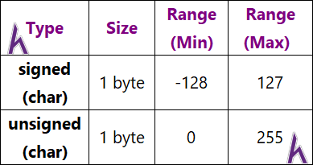

**- ASCII** (**American Standard Code for Information Interchange **- Chuẩn mã trao đổi thông tin Hoa Kỳ) là bộ kí tự và bộ mã kí tự dựa trên bảng chữ cái La Tinh trong tiếng Anh.

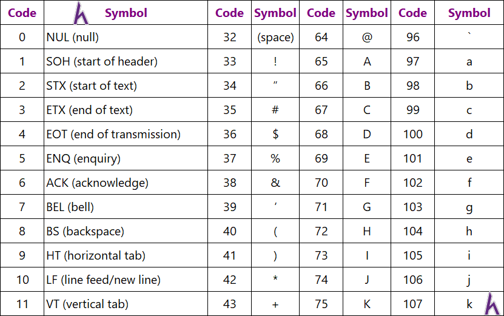

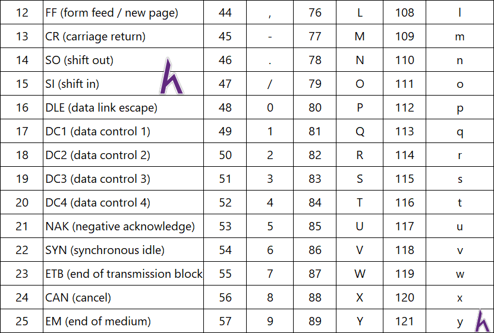

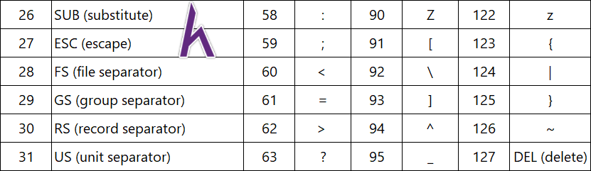

**- Có 2 loại ký tự trong bảng mã ASCII:**

\+ Ký tự không in được (ký tự điều kiển) có mã từ 0 🡪 31 và 127 bao gồm các ký tự dùng để điều khiển hay dùng như: backspace (7), new line (10), escape (27), bell (7) …

\+ Ký tự in được có mã từ 32 🡪 126 bao gồm các chữ cái (a, b, c, …), số (1, 2, 3, …), toán tử (+, -, …), dấu câu (~, {, ^ …)

\+ Bảng mã ASCII chuẩn có 128 ký tự, bảng mã ASCII mở rộng có 255 ký tự.

***- Khai báo, khởi tạo và gán giá trị một biến ký tự***

**char** ch1{ 'K' };// khởi tạo biến character với ký tự 'K' (mã ASCII 75)

**char** ch2{ 75 }; // khởi tạo biến character với mã ASCII 75 (ký tự 'K')

```cpp
char ch3(75); // khởi tạo biến character với mã ASCII 75 (ký tự 'K')

char ch4 = 'K'; // khởi tạo biến character với ký tự 'K' (mã ASCII 75)

char ch5; // khai báo biến kiểu character
```

ch1 = 75; // gán mã ASCII 75 (ký tự 'K') cho biến character

\+ Vì bản chất của kiểu **char **cũng là số nguyên, nên khi khởi tạo hoặc gán giá trị cho biến kiểu **char, **bạn hoàn toàn có thể dùng số nguyên (mã ASCII) hoặc ký tự.

**char** ch1{ 75 }; // mã ASCII 75 (ký tự 'K')

**char** ch2{ 'K' }; // ký tự 'K' (mã ASCII 75)

**<span class="mark">\*\*\* Luôn đặt KÝ TỰ trong dấu nháy ĐƠN, đặt CHUỖI trong NGOẶC KÉP.</span>**

\+ Hai cách khởi tạo bên dưới hoàn toàn khác nhau:

**char** ch1{ '7' }; // khởi tạo biến character với ký tự '7' (mã ASCII 55)

**char** ch2{ 7 }; // khởi tạo biến character với mã ASCII 7 (tiếng “beep”)

**- In ký tự ra màn hình**

\+ Dù khi khởi tạo hoặc gán giá trị cho biến kiểu **char, **bạn hoàn toàn có thể dùng số nguyên (mã ASCII) hoặc ký tự. Nhưng khi in ra màn hình, nó hiển thị một ký tự ASCII thay vì một số nguyên.

```cpp
#include <iostream>

using namespace std;

int main()

{
```

**char** ch1{ 75 }; // mã ASCII 75 (ký tự 'K')

```cpp
cout << ch1 << endl; // ký tự 'K' với mã ASCII 75 được hiển thị ra màn hình
```

**char** ch2{ 'K' }; // ký tự 'K' (mã ASCII 75)

```cpp
cout << ch2 << endl; // ký tự 'K' trực tiếp được hiển thị ra màn hình

return 0;

}
```

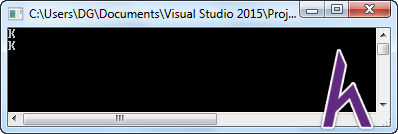

**- Các ký tự đặc biệt:**

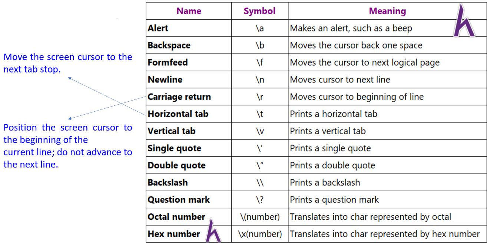

***\*\*\* Newline ‘\n’ và std::endl***: Đều dùng để xuống dòng, nhưng bản chất hoàn toàn khác nhau:

> **std**::**cout** \<\< **std**::endl;
>
> // Tương đương với:
>
> **std**::**cout** \<\< "\n" \<\< **std**::flush;

\+ Khi sử dụng **std::endl** (sử dụng toán tử phạm vi để truy cập vào đối tượng **endl** bên trong namespace **std**), output sẽ được đẩy vào vùng bộ nhớ đệm, đối tượng **cout** có thể không chuyển text trực tiếp đến thiết bị đầu ra ngay lập tức.

\+ Cả kí tự '\n' và đối tượng **endl** đều chuyển con trỏ đến vị trí đầu dòng tiếp theo, thêm vào đó, đối tượng **endl** đảm bảo thứ tự trên thiết bị đầu ra đúng với lúc nhập dữ liệu từ đầu vào.

\+ Sử dụng đối tượng **std::endl** sẽ làm sạch luôn *stream,* trong khi đó, sử dụng kí tự **'\n'** chỉ đơn giản là đưa kí tự xuống dòng lên màn hình.lệnh endl sẽ có tốc độ xử lý chậm hơn so với lệnh \n. 

Vậy, khi nào nên sử dụng **std::endl** và **‘\n’:**

*. Sử dụng **std::endl** khi bạn cần đảm bảo cho ra kết quả ngay lập tức, cụ thể khi làm việc trên các thiết bị đầu ra chậm.*

*. Ngoài ra, những trường hợp khác nên sử dụng **‘\n’**.*

### 1.11.4. Kiểu luận lý (Bool)

**-** Lưu trữ tính đúng, sai của một mệnh đề trong máy tính.

\- Kích thước 1 byte, và chỉ lưu được 2 giá trị: **true (1), false (0).**

**- Khai báo: <span class="mark">bool \<tên biến\>;  </span>**<span class="mark">  // khai báo biến  có kiểu bool</span>

**- Khởi tạo và gán giá trị:** sử dụng từ khóa true (1), false (0):

```cpp
bool b1(true); // true = 1
```

**bool** b2{ **false** }; // false = 0

```cpp
bool b3 = 1; // 1 = true
```

**\**

**- Phủ định:** dùng not (!)

```cpp
bool b1(!True); // b1 = NOT true = false (0)
```

**bool** b2{ !**False** }; // b2 = NOT false = true (1)

```cpp
bool b3 = !1; // b3 = NOT 1 = false (0)
```

**- Giá trị của biến kiểu bool trong máy tính được biểu diễn dưới dạng 0 (false) hoặc 1 (true)**. Vì vậy, khi in một biến kiểu bool, giá trị được in ra sẽ là 0 (false) hoặc 1 (true).

```cpp
#include <iostream>

using namespace std;

int main()

{
```

**bool** b1{ **true** }; // b1 is true

```cpp
cout << b1 << endl; // in 1 ra màn hình

cout << !b1 << endl; // in 0 ra màn hình
```

**bool** b2{ **false** }; // b1 is false

```cpp
cout << b2 << endl; // in 0 ra màn hình

cout << !b2 << endl; // in 1 ra màn hình

return 0;

}
```

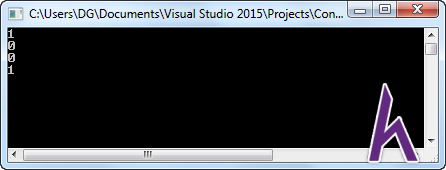

**\* Chú ý:** khi khởi tạo hoặc gán giá trị dưới dạng số nguyên cho biến kiểu bool, **mọi giá trị khác 0 sẽ mặc định là true (1).**

```cpp
bool b1(6); // b1 = true (1)

bool b3 = !-9; // b2 = NOT true = false (0)
```

\- Nếu bạn muốn giá trị của biến boolean khi được in ra là **true** **hoặc** **false** **thay vì 0 hoặc 1**, bạn có thể sử dụng **std::boolalpha**. Nếu bạn muốn in giá trị biến kiểu boolean như mặc định thì có thể sử dụng **std::noboolalpha.**

```cpp
#include <iostream>

using namespace std;

int main()

{

cout << std::boolalpha; // in "true" hoặc "false" với kiểu bool

cout << true << endl; // in "true" ra màn hình

cout << false << endl; // in "false" ra màn hình

cout << std::noboolalpha; // in 1 hoặc 0 với kiểu bool

cout << true << endl; // in 1 ra màn hình

cout << false << endl; // in 0 ra màn hình

return 0;

}
```

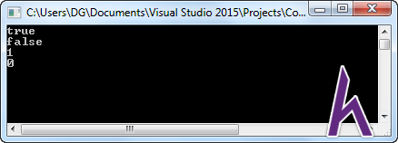

### 1.11.5. Chuyển đổi kiểu (type conversion) 

**- Chuyển đổi kiểu ngầm định:**

\+ Trong cùng 1 biểu thức, nếu các toán hạng không cùng kiểu với nhau thì trước khi tính toán giá trị của biểu thức, chương trình dịch sẽ thực hiện việc chuyển đổi kiểu ngầm định (nếu được) theo nguyên tắc “Kiểu có phạm vi giá trị biểu diễn nhỏ hơn sẽ được chuyển sang kiểu có phạm vị giá trị biểu diễn lớn hơn”.

\+ Sơ đồ chuyển đổi kiểu ngầm định:

***char*** → ***int*** → ***long*** → ***float*** → ***double*** → ***long double***

**- Chuyển đổi kiểu tường minh**

**+ Ép kiểu C_style (Cách 1)**: Trong một số trường hợp, ta bắt buộc phải sử dụng ép kiểu để tạo ra một biểu thức hợp lệ như sau:

**(\<tên kiểu\>) (\<biểu thức\>)**

Ví dụ, để tạo biểu thức số học hợp lệ sau 8.0 % 3, ta cần thực hiện ép kiểu như sau:

(int) 8.0 % 3

```cpp
#include <iostream>

using namespace std;

int main()

{

int n1 = 3;

int n2 = 2;

double d = (double)n1 / n2;

cout << d << endl;

return 0;

}
```

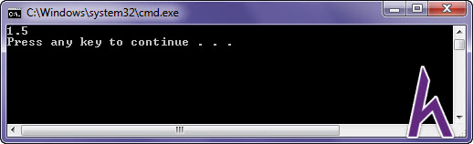

Trình biên dịch (compiler) chuyển đổi biến n1 từ kiểu int sang kiểu double thông qua ép kiểu. Sau đó biểu thức có 2 toán hạng có kiểu double và kiểu int, nên toán hạng kiểu int sẽ được chuyển đổi ngầm định sang kiểu double. Vì vậy, kết quả của biểu thức là phép chia giữa 2 số chấm động kiểu double.

**+ Ép kiểu static cast (Cách 2):**

**<span class="mark">static_cast\<Type-id\>(expression)</span>**

. Lệnh **static cast** sẽ chuyển đổi giá trị của **expression** thành một giá trị có kiểu **Type-id **(char, int, double, …), và trả về giá trị đó.

```cpp
#include <iostream>

#include \ // for std::setprecision()

using namespace std;

int main()

{
```

**int** n{ 75 };

```cpp
cout (n) << endl; // in ký tự với mã ASCII 75
```

**char** ch{ 'K' };

```cpp
cout (ch) << endl; // in mã ASCII của ký tự 'K'

return 0;

}
```

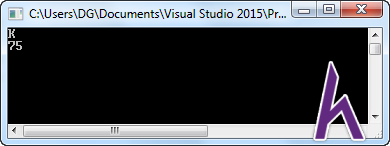

. Ưu điểm của toán tử static_cast là nó yêu cầu compiler kiểm tra kiểu dữ liệu tại thời điểm biên dịch chương trình, hạn chế được những lỗi ngoài ý muốn.

**Chú ý:** **Nên sử dụng toán tử static_cast thay vì ép kiểu C-style.**

**\*\*\* Lưu ý:**

\+ Chuyển đổi giá trị sang một kiểu dữ liệu có miền giá trị nhỏ hơn sẽ gây ra kết quả không mong muốn (tràn số).

```cpp
#include <iostream>

using namespace std;

int main()

{

int n = 500;

char c = n;

cout (c) << endl;

return 0;

}
```

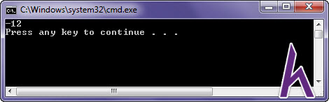

\+ Đối với kiểu **số chấm động (floating point)**, **chuyển đổi giá trị về kiểu dữ liệu nhỏ hơn** có thể gây **mất độ chính xác**.

```cpp
#include <iostream>

#include <iomanip>

using namespace std;

int main()

{

// double value 0.123456789 has 9 significant digits, but float can

//only support about 7

float f = 0.123456789;

cout << setprecision(9) << f << endl;

// std::setprecision defined in iomanip header

return 0;

}
```

\+ Chuyển đổi một giá trị từ số chấm động sang số nguyên sẽ làm mất đi phần thập phân.

```cpp
#include <iostream>

using namespace std;

int main()

{

double d = 1.5;

int n = d;

cout << n << endl;

return 0;

}
```

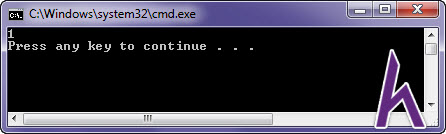


## 1.12. Biểu thức và các loại toán tử

### 1.12.1. Biểu thức

\- Sự kết hợp các toán tử và các toán hạng: 🡪

\- Biểu thức số học có thể được biểu diễn trong C/C++ bằng cách sử dụng các toán tử số học

**++i % 7**

**5 + (c = 3 + 8)**

**a \* (b + c/d) - 22**

### 1.12.2. Toán tử

#### 1.12.2.1. Toán tử gán (Assignment operator)

**-** Toán tử gán (=) có thể được dùng với bất kỳ biểu thức C/C++ hợp lệ nào.


**+ Gán liên tiếp**

\# Nhiều biến có thể được gán với cùng một giá trị trong một câu lệnh đơn

a = b = c = 10; ✔

\# Tuy nhiên, không thể áp dụng quy tắc trên khi khai báo biến

```cpp
int a = int b = int b = int c = 10; X
```

#### 1.12.2.2. Toán tử số học (Arithmetic operator)

**+ Toán tử một ngôi:** toán tử chỉ có 1 toán hạng trong biểu thức


**\*\*\* Chú ý:**

**. Unary plus (+)** trả về giá trị của chính toán hạng đó, bạn sẽ không cần phải sử dụng toán tử này vì nó **không cần thiết.**

**. Unary minus (-)** trả về số đối của toán hạng đó.

**. Nên đặt 2 toán tử một ngôi số đối ngay trước toán hạn **để dễ dàng phân biệt với các toán tử số học khác. **Ví dụ:** -a, không nên - a.

**. Tránh nhầm lẫn **giữa toán tử 1 ngôi (+, -) và toán tử 2 ngôi (+, -). **Ví dụ:** x = 6 - -9.

**\# Toán tử tăng và giảm một đơn vị (Increment and decrement)**


**@ Toán tử ++**

**Tăng trước:** Ví dụ: (++x – y)

Tăng giá trị của x lên trước

Dùng giá trị của x đã tăng vào biểu thức (cộng với y)

Do đó: Nếu x = 4 và y = 5 trước khi đánh giá biểu thức

Thì (++x – y) cho giá trị là: 0

**Tăng sau: x++:** Ví dụ: (x++ – y)

Đánh giá biểu thức dựa trên giá trị của x đang có trước

Sau đó, tăng x lên 1 sau

Do đó: Nếu x = 4 và y = 5 trước khi đánh giá biểu thức

Thì (x++ – y) cho giá trị là: -1

*🡪 Trong cả 2 ví dụ trên: giá trị của x đều là 5 sau khi đánh giá biểu thức.*

> a++;
>
> a+=1;
>
> a=a+1

🡪 Các câu lệnh là tương đương.

<table>
<colgroup>
<col style="width: 44%" />
<col style="width: 55%" />
</colgroup>
<thead>
<tr>
<th style="text-align: left;"><strong>B=3;<br />
A=++B;</strong><br />
<em>// A is 4, B is 4</em></th>
<th style="text-align: left;"><strong>B=3;<br />
A=B++;</strong><br />
<em>// A is 3, B is 4</em></th>
</tr>
</thead>
<tbody>
</tbody>
</table>

**@ Toán tử --**: Thứ tự đánh giá phép toán tương tự như ++

**@ Trường hợp thường dùng của ++ và --:** Để điều chỉnh giá trị biến điều khiển trong các vòng lặp (for, while và do…while)

**+ Toán tử hai ngôi: toán tử có 2 toán hạng trong biểu thức**


**<u>Ví dụ:</u>**

```cpp
number_of_cows = number_of_cows + 10;
```


**\*\*\*Chú ý khi thực hiện phép chia lấy phần nguyên (/):**

\# Nếu 2 toán hạng là số nguyên sẽ cho kết quả là số nguyên. **Ví dụ:** 9 / 6 = 1

**\# Nếu 1 trong 2, hoặc cả 2 toán hạng là số chấm động thì sẽ cho kết quả là số chấm động** (**Ví dụ:** 9.0 / 6 = 9 / 6.0 = 9.0/ 6.0 = 1.5). <span class="mark">Bạn có thể **ép kiểu** hoặc **nhân** một trong 2 toán hạng với 1.0 để có kết quả là một số chấm động.</span>

**+ Các toán tử gán phức hợp (Compound assignment operators)**


- **a += 5;** tương đương với **a = a + 5;**

- **a -= 5;** tương đương với **a = a - 5;**

- **a /= b;** tương đương với **a = a / b;**

- **a \*= b + 1;** tương đương với **a = a \* (b + 1);**

#### 1.12.2.3. Toán tử quan hệ và so sánh (Relational and comparison operators)

\- Kết quả cho true hoặc false.


#### 1.12.2.4. Toán tử logic (Logical operator)

|  |  |
|:--:|:--:|
| **Toán tử** | **Ý nghĩa** |
| && | **AND**: Kết quả là True khi cả 2 điều kiện đều đúng |
| \|\| | **OR** : Kết quả là True khi chỉ một trong hai điều kiện là đúng |
| ! | **NOT**: Tác động trên các giá trị riêng lẻ, chuyển đổi True thành False và ngược lại |

**Ví dụ:** if (a\>10) && (a\<20)

#### 1.12.2.5. Toán tử thao tác bit (Bitwise operator)

<table>
<colgroup>
<col style="width: 18%" />
<col style="width: 41%" />
<col style="width: 39%" />
</colgroup>
<tbody>
<tr>
<td style="text-align: center;"><p><strong>Toán tử</strong></p></td>
<td colspan="2" style="text-align: center;"><p><strong>Mô tả</strong></p></td>
</tr>
<tr>
<td rowspan="6" style="text-align: center;"><p><em>Bitwise AND</em></p>
<p><em>(x &amp; y)</em></p></td>
<td colspan="2" style="text-align: center;"><p>Mỗi vị trí của bit trả về kết quả là 1 nếu bit của hai toán hạng là 1, còn lại là 0</p></td>
</tr>
<tr>
<td style="text-align: center;"><p><strong>Ví dụ</strong></p></td>
<td style="text-align: center;"><p><strong>Kết quả</strong></p></td>
</tr>
<tr>
<td style="text-align: center;"><p>0b00<strong>1</strong>1 &amp; 0b10<strong>1</strong>0</p></td>
<td style="text-align: center;"><p>0b00<strong>1</strong>0</p></td>
</tr>
<tr>
<td style="text-align: center;"><p>0b1111 &amp; 0b0000</p></td>
<td style="text-align: center;"><p>0b0000</p></td>
</tr>
<tr>
<td style="text-align: center;"><p>0b1010 &amp; 0b0101</p></td>
<td style="text-align: center;"><p>0b0000</p></td>
</tr>
<tr>
<td style="text-align: center;"><p>0b<strong>1</strong>1<strong>1</strong>1 &amp; 0b<strong>1</strong>0<strong>1</strong>0</p></td>
<td style="text-align: center;"><p>0b<strong>1</strong>0<strong>1</strong>0</p></td>
</tr>
<tr>
<td rowspan="6" style="text-align: center;"><p><em>Bitwise OR</em></p>
<p><em>(x | y)</em></p></td>
<td colspan="2" style="text-align: center;"><p>Mỗi vị trí của bit trả về kết quả là 1 nếu bit của một trong hai toán hạng là 1.</p></td>
</tr>
<tr>
<td style="text-align: center;"><p><strong>Ví dụ</strong></p></td>
<td style="text-align: center;"><p><strong>Kết quả</strong></p></td>
</tr>
<tr>
<td style="text-align: center;"><p>0b0<strong>0</strong>11 | 0b1<strong>0</strong>10</p></td>
<td style="text-align: center;"><p>0b1<strong>0</strong>11</p></td>
</tr>
<tr>
<td style="text-align: center;"><p>0b111<strong>0</strong> | 0b000<strong>0</strong></p></td>
<td style="text-align: center;"><p>0b111<strong>0</strong></p></td>
</tr>
<tr>
<td style="text-align: center;"><p>0b1010 | 0b0101</p></td>
<td style="text-align: center;"><p>0b1111</p></td>
</tr>
<tr>
<td style="text-align: center;"><p>0b1111 | 0b1010</p></td>
<td style="text-align: center;"><p>0b1111</p></td>
</tr>
<tr>
<td rowspan="6" style="text-align: center;"><p><em>Bitwise NOT</em></p>
<p><em>(Complement)</em></p>
<p><em>(~ x)</em></p></td>
<td colspan="2" style="text-align: center;"><p>Ðảo ngược giá trị của toán hạng (1 thành 0 và ngược lại).</p></td>
</tr>
<tr>
<td style="text-align: center;"><p><strong>Ví dụ</strong></p></td>
<td style="text-align: center;"><p><strong>Kết quả</strong></p></td>
</tr>
<tr>
<td style="text-align: center;"><p>~0b0011</p></td>
<td style="text-align: center;"><p>0b1100</p></td>
</tr>
<tr>
<td style="text-align: center;"><p>~0b0000</p></td>
<td style="text-align: center;"><p>0b1111</p></td>
</tr>
<tr>
<td style="text-align: center;"><p>~0b0101</p></td>
<td style="text-align: center;"><p>0b1010</p></td>
</tr>
<tr>
<td style="text-align: center;"><p>~0b1111</p></td>
<td style="text-align: center;"><p>0b0000</p></td>
</tr>
</tbody>
</table>

<table>
<colgroup>
<col style="width: 18%" />
<col style="width: 40%" />
<col style="width: 40%" />
</colgroup>
<tbody>
<tr>
<td rowspan="7" style="text-align: center;"><p><em>Bitwise XOR</em></p>
<p><em>(x ^ y)</em></p></td>
<td colspan="2" style="text-align: center;"><p>Giống nhau cho 0, khác nhau cho 1</p>
<p>(<strong>0^0 = 0, 1^1 = 0</strong>, 0^1 = 1, 1^0 = 1)</p></td>
</tr>
<tr>
<td style="text-align: center;"><p><strong>Ví dụ</strong></p></td>
<td style="text-align: center;"><p><strong>Kết quả</strong></p></td>
</tr>
<tr>
<td style="text-align: center;"><p>0b0<strong>0</strong>1<strong>1</strong> ^ 0b<strong>1</strong>01<strong>0</strong></p></td>
<td style="text-align: center;"><p>0b<strong>1</strong>00<strong>1</strong></p></td>
</tr>
<tr>
<td style="text-align: center;"><p>0b111<strong>0</strong> ^ 0b000<strong>0</strong></p></td>
<td style="text-align: center;"><p>0b111<strong>0</strong></p></td>
</tr>
<tr>
<td style="text-align: center;"><p>0b1010 ^ 0b0101</p></td>
<td style="text-align: center;"><p>0b1111</p></td>
</tr>
<tr>
<td style="text-align: center;"><p>0b<strong>1</strong>1<strong>1</strong>1 ^ 0b<strong>1</strong>0<strong>1</strong>0</p></td>
<td style="text-align: center;"><p>0b<strong>0</strong>1<strong>0</strong>1</p></td>
</tr>
<tr>
<td colspan="2" style="text-align: center;"><p>Hình minh họa</p>
<p><em>Cột cuối cùng chính là kết quả của phép toán XOR.</em></p>
<p><em><strong>Nhận xét:</strong></em> Phép toán ^ (XOR) có thể biểu diễn (tính) qua các phép tính cộng, nhân và phủ định lôgic. Tất cả các phép toán lôgic đều biểu diễn được qua ba phép tính cơ bản là nhân, cộng và phủ định lôgic.</p></td>
</tr>
<tr>
<td style="text-align: center;"><p><em>Bitwise SHL (Shift left)</em></p>
<p><em>(x &lt;&lt; n)</em></p></td>
<td colspan="2" style="text-align: center;"><p>Dịch sang trái n bit, tương đương x* 2<sup>n</sup> (<em>Các bit được dịch sang trái, bit ngoài cùng bên trái bị loại bỏ và bit ngoài cùng bên phải được đặt thành 0</em>).</p>
<p>Binary shift</p></td>
</tr>
<tr>
<td style="text-align: center;"><p><em>Bitwise SHR</em></p>
<p><em>(Shift right)</em></p>
<p><em>(x &gt;&gt; n)</em></p></td>
<td colspan="2" style="text-align: center;"><p>Dịch sang phải n bit, tương đương x/ 2<sup>n</sup> (<em>Các bit được dịch sang phải, bit ngoài cùng bên phải bị loại bỏ và bit ngoài cùng bên trái được đặt thành 0</em>).</p>
<p>Shift Instructions in 8086 Microprocessor - SHL, SAL, SHR & SAR</p></td>
</tr>
</tbody>
</table>


**\* Tại sao cần thao tác trên bit? **Trong quá khứ, bộ nhớ máy tính chưa phát triển, vấn đề về quản lý bộ nhớ là rất quan trọng. Vì vậy, người lập trình cần tận dụng tối đa các bit trong bộ nhớ.

**Ví dụ:** Các biến được lưu trong bộ nhớ ở một địa chỉ duy nhất, những địa chỉ này được xác định với đơn vị nhỏ nhất là byte**. Xét kiểu dữ liệu bool**, nó chỉ nắm **giữ 2 giá trị true (1)** hoặc **false (0)**. Kiểu bool chỉ cần 1 bit để lưu trữ dữ liệu, nhưng nó lại chiếm giữ 1 byte trong bộ nhớ, vậy 7 bit còn lại sẽ là lãng phí. Sử dụng toán tử trên bit giúp bạn có thể chứa 8 biến kiểu bool vào 1 byte duy nhất, và tiết kiệm bộ nhớ đáng kể.

Trong quá khứ, sử dụng toán tử trên bit rất được ưa chuộng. Ngày nay, bộ nhớ máy tính đã phát triển và rẻ hơn, lập trình viên thường **quan tâm đến tính dễ hiểu và dễ nâng cấp của mã nguồn**. Do đó, việc **thao tác trên bit không còn được ưu chuộng**, ngoại **trừ những trường hợp cần tối ưu tối đa tốc độ, bộ nhớ **(những chương trình thao tác big data, những game lớn, lập trình nhúng …).

**Ví dụ**

| 10 & 15  | 🡪 **1010 & 1111**      | 🡪**1010** | 🡪 10 |
|----------|------------------------|-----------|------|
| 10 \| 15 | 🡪 **1010** \| **1111** | 🡪**1111** | 🡪 15 |
| 10 ^ 15  | 🡪 **1010** ^ **1111**  | 🡪**0101** | 🡪 5  |

#### 1.12.2.6. Một số toán tử khác (other operators)

<table>
<colgroup>
<col style="width: 22%" />
<col style="width: 77%" />
</colgroup>
<thead>
<tr>
<th style="text-align: center;"><p><strong>Toán tử</strong></p></th>
<th style="text-align: center;"><p><strong>Ý nghĩa</strong></p></th>
</tr>
</thead>
<tbody>
<tr>
<td style="text-align: center;"><p><strong>sizeof</strong></p></td>
<td><p>Toán tử sizeof trả về kích cỡ của một biến. Ví dụ: sizeof(a), với a là int, sẽ trả về 4</p></td>
</tr>
<tr>
<td style="text-align: center;"><p><strong>Điều kiện ? X : Y</strong></p></td>
<td><p>Toán tử điều kiện. Nếu điều kiện là true? thì nó trả về giá trị X : nếu không thì trả về Y</p>
<p>s1 = (1 &gt; 2) ? 2912 : 1706; s1=1706 (do 1&gt;2 sai)</p>
<p><strong><mark>🡪 <em>Là toán tử 3 ngôi duy nhất trong C++.</em></mark></strong></p></td>
</tr>
<tr>
<td style="text-align: center;"><p><strong>,</strong></p>
<p><code><strong>x = (a++, b = b + 2);</strong></code></p>
<p>// Tương đương với</p>
<p><strong>a++; b = b + 2; x = b;</strong></p></td>
<td><p>Toán tử phẩy làm cho một dãy hoạt động được thực hiện. Giá trị của toàn biểu thức phẩy là giá trị của biểu thức cuối cùng trong danh sách được phân biệt bởi dấu phẩy.</p>
<p><strong>(biểu _thức_1, biểu_thức_2,…, biểu_thức_n)</strong></p></td>
</tr>
<tr>
<td style="text-align: center;"><p><strong>. (dot) và -&gt; (arrow)</strong></p></td>
<td><p>Toán tử thành viên được sử dụng để tham chiếu các phần tử đơn của các lớp, các cấu trúc, và union</p></td>
</tr>
<tr>
<td style="text-align: center;"><p><strong>cast</strong></p></td>
<td><p>Toán tử ép kiểu (Casting) trong C++ biến đổi một kiểu dữ liệu thành kiểu khác.</p>
<p>Ví dụ: int(2.2000) sẽ trả về 2.</p>
<p>Cú pháp: <strong>type_cast &lt;new_type&gt; (expression);</strong></p>
<p><strong>type: const, dynamic, reinterpret, static</strong></p>
<p>Ví dụ: reinterpret_cast&lt;char*&gt;(&amp;x);</p></td>
</tr>
<tr>
<td style="text-align: center;"><p><strong>&amp;</strong></p></td>
<td><p>Toán tử con trỏ &amp;  trả về địa chỉ của một biến.</p>
<p>Ví du: &amp;a; sẽ trả về địa chỉ thực sự của biến này</p></td>
</tr>
<tr>
<td style="text-align: center;"><p><strong>*</strong></p></td>
<td><p>Toán tử con trỏ *  là trỏ tới một biến.</p>
<p>Ví dụ: *var sẽ trỏ tới một biến var.</p></td>
</tr>
</tbody>
</table>

**+ Toán tử điều kiện:** Sẽ nhắc đến ở chương II

**+ Toán tử phẩy**

. Các biểu thức đặt cách nhau bằng dấu ,

. Các biểu thức con lần lượt được tính từ trái sang phải.

. Biểu thức mới nhận được là giá trị của biểu thức bên phải cùng.

Ví dụ

```cpp
x = (a++, b = b + 2); ⬄ a++; b = b + 2; x = b;
```

#### 1.12.2.7. Độ ưu tiên của toán tử (Precedence of operators)

<table style="width:99%;">
<colgroup>
<col style="width: 14%" />
<col style="width: 28%" />
<col style="width: 28%" />
<col style="width: 27%" />
</colgroup>
<thead>
<tr>
<th style="text-align: center;"><p><strong>Level</strong></p>
<p><strong>(Độ ưu tiên)</strong></p></th>
<th style="text-align: center;"><p><strong>Precedence group</strong></p>
<p><strong>(Nhóm ưu tiên)</strong></p></th>
<th style="text-align: center;"><p><strong>Operator</strong></p>
<p><strong>(Toán tử)</strong></p></th>
<th style="text-align: center;"><p><strong>Grouping</strong></p>
<p><strong>(Thứ tự thực hiện)</strong></p></th>
</tr>
</thead>
<tbody>
<tr>
<td style="text-align: center;"><p><strong>1</strong></p></td>
<td style="text-align: center;"><p>Scope (Phạm vi)</p></td>
<td style="text-align: center;"><p>::</p></td>
<td style="text-align: center;"><p>Left-to-right</p></td>
</tr>
<tr>
<td rowspan="4" style="text-align: center;"><p><strong>2</strong></p></td>
<td rowspan="4" style="text-align: center;"><p>Postfix (unary)</p>
<p>Hậu tố (một ngôi)</p></td>
<td style="text-align: center;"><p>++ --</p></td>
<td rowspan="4" style="text-align: center;"><p>Left-to-right</p></td>
</tr>
<tr>
<td style="text-align: center;"><p>()</p></td>
</tr>
<tr>
<td style="text-align: center;"><p>[]</p></td>
</tr>
<tr>
<td style="text-align: center;"><p>. -&gt;</p></td>
</tr>
<tr>
<td rowspan="7" style="text-align: center;"><p><strong>3</strong></p></td>
<td rowspan="7" style="text-align: center;"><p>Prefix (unary)</p>
<p>Tiền tố (một ngôi)</p></td>
<td style="text-align: center;"><p>++ --</p></td>
<td rowspan="7" style="text-align: center;"><p>Right-to-left</p></td>
</tr>
<tr>
<td style="text-align: center;"><p>~ !</p></td>
</tr>
<tr>
<td style="text-align: center;"><p>+ -</p></td>
</tr>
<tr>
<td style="text-align: center;"><p>&amp; *</p></td>
</tr>
<tr>
<td style="text-align: center;"><p>new delete</p></td>
</tr>
<tr>
<td style="text-align: center;"><p>sizeof</p></td>
</tr>
<tr>
<td style="text-align: center;"><p>(type)</p></td>
</tr>
<tr>
<td style="text-align: center;"><p><strong>4</strong></p></td>
<td style="text-align: center;"><p>Pointer-to-member (Trỏ đến thành viên)</p></td>
<td style="text-align: center;"><p>.* -&gt;*</p></td>
<td style="text-align: center;"><p>Left-to-right</p></td>
</tr>
<tr>
<td style="text-align: center;"><p><strong>5</strong></p></td>
<td style="text-align: center;"><p>Arithmetic: scaling (Số học: tỷ lệ)</p></td>
<td style="text-align: center;"><p>* / %</p></td>
<td style="text-align: center;"><p>Left-to-right</p></td>
</tr>
<tr>
<td style="text-align: center;"><p><strong>6</strong></p></td>
<td style="text-align: center;"><p>Arithmetic: addition (Số học: tăng giảm)</p></td>
<td style="text-align: center;"><p>+ -</p></td>
<td style="text-align: center;"><p>Left-to-right</p></td>
</tr>
<tr>
<td style="text-align: center;"><p><strong>7</strong></p></td>
<td style="text-align: center;"><p>Bitwise shift (Dịch bit)</p></td>
<td style="text-align: center;"><p>&lt;&lt; &gt;&gt;</p></td>
<td style="text-align: center;"><p>Left-to-right</p></td>
</tr>
<tr>
<td style="text-align: center;"><p><strong>8</strong></p></td>
<td style="text-align: center;"><p>Relational (So sánh hơn)</p></td>
<td style="text-align: center;"><p>&lt; &gt; &lt;= &gt;=</p></td>
<td style="text-align: center;"><p>Left-to-right</p></td>
</tr>
<tr>
<td style="text-align: center;"><p><strong>9</strong></p></td>
<td style="text-align: center;"><p>Equality (So sánh bằng)</p></td>
<td style="text-align: center;"><p>== !=</p></td>
<td style="text-align: center;"><p>Left-to-right</p></td>
</tr>
<tr>
<td style="text-align: center;"><p><strong>10</strong></p></td>
<td style="text-align: center;"><p>Bit AND</p></td>
<td style="text-align: center;"><p>&amp;</p></td>
<td style="text-align: center;"><p>Left-to-right</p></td>
</tr>
<tr>
<td style="text-align: center;"><p><strong>11</strong></p></td>
<td style="text-align: center;"><p>Bit XOR</p></td>
<td style="text-align: center;"><p>^</p></td>
<td style="text-align: center;"><p>Left-to-right</p></td>
</tr>
<tr>
<td style="text-align: center;"><p><strong>12</strong></p></td>
<td style="text-align: center;"><p>Bit OR</p></td>
<td style="text-align: center;"><p>|</p></td>
<td style="text-align: center;"><p>Left-to-right</p></td>
</tr>
<tr>
<td style="text-align: center;"><p><strong>13</strong></p></td>
<td style="text-align: center;"><p>Logical AND</p></td>
<td style="text-align: center;"><p>&amp;&amp;</p></td>
<td style="text-align: center;"><p>Left-to-right</p></td>
</tr>
<tr>
<td style="text-align: center;"><p><strong>14</strong></p></td>
<td style="text-align: center;"><p>Logical OR</p></td>
<td style="text-align: center;"><p>||</p></td>
<td style="text-align: center;"><p>Left-to-right</p></td>
</tr>
<tr>
<td rowspan="2" style="text-align: center;"><p><strong>15</strong></p></td>
<td rowspan="2" style="text-align: center;"><p>Assignment-level expressions (Gán)</p></td>
<td style="text-align: center;"><p>= *= /= %= += -=<br />
&gt;&gt;= &lt;&lt;= &amp;= ^= |=</p></td>
<td rowspan="2" style="text-align: center;"><p>Right-to-left</p></td>
</tr>
<tr>
<td style="text-align: center;"><p>?:</p></td>
</tr>
<tr>
<td style="text-align: center;"><p><strong>16</strong></p></td>
<td style="text-align: center;"><p>Sequencing (Sắp xếp)</p></td>
<td style="text-align: center;"><p>,</p></td>
<td style="text-align: center;"><p>Left-to-right</p></td>
</tr>
</tbody>
</table>

#### 1.12.2.8. Viết biểu thức cho các mệnh đề

x lớn hơn hay bằng 3

**x \>= 3**

a và b cùng dấu

**((a\>0) && (b\>0)) \|\| ((a\<0) && (b\<0)) (a\>0 && b\>0) \|\| (a\<0 && b\<0)**

p bằng q bằng r

**(p == q) && (q == r) hoặc (p == q && q == r)**

–5 \< x \< 5

**(x \> –5) && (x \< 5) hoặc (x \> –5 && x \< 5)**

## 1.13. Câu lệnh và khối lệnh (statement and block statement) 

### 1.13.1. Câu lệnh

\- Một đơn vị độc lập nhỏ nhất.

\- Một chỉ thị nhằm ra lệnh cho chương trình thực hiện một tác vụ cụ thể nào đó.

\- Mỗi câu lệnh có thể được viết trên một hoặc nhiều dòng.

<span class="mark">- Mỗi câu lệnh được kết thúc bằng ***dấu chấm phẩy.***</span> (*dấu chấm phẩy dùng ngăn cách các câu lệnh).*

\- Câu lệnh được phân chia thành 3 loại:

**+ Câu lệnh đơn**: *Là câu lệnh không chứa câu lệnh khác.*

*Ví dụ: câu lệnh gán, lệnh khai báo, lệnh xuất nhập...*

**+ Câu lệnh phức**: *Là câu lệnh có chứa câu lệnh khác bên trong nó.*

Một danh sách các câu lệnh được thực hiện cùng nhau. Đánh dấu danh sách này bằng cặp dấu: **{ và }**

**{**

\<câu lệnh 1\>

\<câu lệnh 2\>

//...

**}**

Các cấu trúc điều khiển (if, if-else, switch, for, while, và do … while) cũng được xem là câu lệnh phức

**+ Câu lệnh rỗng (câu rỗng):** *chỉ có dấu **;** đứng cuối*

*Vẫn cho phép trong C/C++ nhưng không hữu dụng nhiều*

*\*\*\* Tại một thời điểm, chương trình chỉ có thể thực hiện được 1 dòng lệnh. Các dòng lệnh được thực hiện tuần tự từ trên xuống dưới.*

### 1.13.2. Khối lệnh

\- Gồm một hoặc nhiều câu lệnh đơn được bao bởi cặp dấu ngoặc **{}**.

\- Một khối lệnh có thể lồng bên trong nó một hoặc nhiều khối lệnh khác.

## 1.14. Chú thích (Comment)

\- Trên một dòng: **<span class="mark">//nội dung</span>** 🡪 **Compiler** sẽ bỏ qua mọi thứ từ ký hiệu **// **đến cuối dòng.

\+ Thường được đặt phía trên của dòng code cần giải thích.

\+ Chú thích kết thúc khi ta ấn phím enter.

***Ví dụ:***

```cpp
cout << "Hello HowKTeam.com!" << endl; // Mọi thứ bên phải ký hiệu này đều bị bỏ qua

cout << "Free education!" << endl; // Dùng để giải thích cho dòng code này
```

**Không khuyến khích.**

// Mọi thứ bên phải ký hiệu này đều bị bỏ qua

```cpp
cout << "Hello HowKTeam.com!" << endl;

// Dùng để giải thích cho dòng code này

cout << "Free education!" << endl;
```

\- Một hoặc nhiều dòng: **<span class="mark">/\* nội dung \*/</span>** 🡪 **Compiler** sẽ bỏ qua mọi thứ ở giữa ký hiệu** /\* và \*/.** 

\+ Bất kỳ vị trí nào trong CT

/\*

Đây là comment nhiều dòng

Mọi thứ bên trong ký hiệu này sẽ được bỏ qua

Bạn có thể viết cả bài văn vào đây...

\*/

\+ Bạn có thể comment giữa dòng code của bạn. Ví dụ:

```cpp
return /* Bỏ qua mọi thứ trong này */ 0;
```

\+ Hoặc bạn cũng có thể làm cho comment đẹp hơn bằng cách:

/\*

Đây là comment nhiều dòng

Mọi thứ bên trong ký hiệu này sẽ được bỏ qua

Bạn có thể viết cả bài văn vào đây...

\*/

**+ Quy tắc: comment nhiều dòng** không được lồng nhau. Ví dụ:

/\* Đây là comment cha /\* comment con \*/ lỗi rồi \*/

// Comment 1 dòng /\* comment nhiều dòng \*/ vẫn là comment

\- Ở mức **library, program hoặc function**, một **good** **comment **sẽ mô tả được library, program hoặc function đó có **nhiệm vụ gì**

\- Bên trong **library, program hoặc function**, một **good** **comment **sẽ mô tả được library, program hoặc function đó **thực hiện như thế nào**

\- Ở mức** từng dòng code, **một **good** **comment** sẽ giải thích **tại sao**. Một **bad comment** sẽ giải thích dòng code đó **làm gì.**

**Commenting out code:** Comment không chỉ dừng ở mục đích giải thích đoạn code của bạn. Đôi khi bạn sẽ gặp vài tình huống như:

\+ Bạn đang cần chạy một chương trình, và có vài dòng code trong chương trình của bạn đang gặp lỗi nên compiler không cho phép. Nhưng bạn muốn chạy chương trình ngay.

\+ Bạn đang nâng cấp một đoạn code, bạn muốn giữ đoạn code cũ để tham khảo cho đến khi đoạn code mới của bạn hoàn thành. Hoặc để phục hồi lại đoạn code cũ nếu đoạn code mới của bạn chạy gặp vấn đề.

\+ Khi gặp những tình huống này, bạn có thể dùng comment out code, mọi đoạn code mà bạn comment sẽ được bỏ qua bởi compiler.

## 1.15. Thư viện

\- Trong C++, một thư viện là một tập hợp các file định nghĩa hằng số, kiểu dữ liệu, hàm và lớp để giúp việc phát triển phần mềm. Thư viện cung cấp một số các hàm và lớp đã được định nghĩa sẵn để giảm thiểu việc phát triển lại từ đầu các phần mềm, giúp cho việc lập trình trở nên nhanh chóng và dễ dàng hơn.

\- Cú pháp:

```cpp
#include <string>
```

Ex: \#include \<iostream\>

*- Một số trình biên dịch sẽ không biên dịch nếu bạn đặt thêm khoảng trắng giữa \< và iostream hoặc giữa iostream và \>. Khoảng trống thừa sẽ trở thành một phần của tên file header. Để đảm bảo chương trình của bạn sẽ hoạt động với tất cả các trình biên dịch, đừng đặt thêm dấu cách trong những trường hợp này.*

```cpp
#include “tên_thư_viện”
```

Ex: \#include "mylibrary.h"

\- Một số thư viện chuẩn:

> \<math.h\>, \<cmath\>
>
> \<string.h\>, \<cstring\>
>
> \<stdio.h\> \<cstdio\>
>
> \<assert.h\>, \<cassert\>
>
> \<errno.h\>, \<cerrno\>
>
> \<time.h\>, \<ctime\>… (<http://en.cppreference.com/w/cpp/header>)

### 1.15.1. Thư viện iostream

```cpp
#include <iostream>
```

\+ Là một chỉ thị tiền xử lý của trình biên dịch, yêu cầu trình biên dịch đưa thư viện iostream vào chương trình này. Thư viện này cần thiết để hỗ trợ input và output của console.

\+ Thư viện C++ chứa mã được xác định trước để phát triển chương trình C++.

\+ Thư viện như iostream được gọi là tệp tiêu đề (header file) trong C++, vì nó thường được đặt ở phần đầu của chương trình.

### 1.15.2. Thư viện cmath

```cpp
#include <iostream>
```

\+ Khai báo một tập hợp các hàm để tính toán các phép toán toán học thông thường:

. Các hàm lượng giác (sin, cos, tan, v.v.)

. Hàm hyperbol (sinh, cosh, tanh, v.v.)

. Hàm mũ và logarit (exp, log, v.v.)

. Hàm tính bình phương (pow, sqrt, v.v.)

. Chức năng làm tròn và lấy số dư (ceil, floor, v.v.)

/\* sin example \*/

```cpp
#include <iostream>

#include \ /* sin */
```

\#define PI 3.14159265

```cpp
using namespace std;

int main()

{

double param, result;

param = 30.0;

result = sin(param * PI / 180);

cout << "The sine of " << param << " degrees is " << result << endl;

return 0;

}
```

***Kết quả:*** The sine of 30 degrees is 0.5

### 1.15.3. Thư viện\<bits/stdc++.h\>

```cpp
#include <cmath>
```

Là một header file bao gồm mọi thư viện tiêu chuẩn.

**+ Ưu điểm:**

- Sử dụng hiệu quả ở các cuộc thi, giảm bớt thời gian code.

- Giảm bớt việc include các thư viện cần thiết 1 cách riêng lẻ, thủ công.

- *Ví dụ: để sử dụng hàm sqrt( ), trong thư viện \<bits/stdc++.h\> chúng ta không cần phải \#include \<cmath\>.*

**+ Nhược điểm:**

- Do bit/stdc++.h là header file không chuẩn (non-standard) của thư viện GNU C++. Vì vậy, nếu bạn cố gắng biên dịch mã của mình bằng một số trình biên dịch khác ngoài GCC thì mã có thể không thành công; ví dụ. MSVC.

- Thư viện \<bits/stdc++.h\> định nghĩa nhiều thư viện không cần thiết làm tăng thời gian biên dịch của chương trình, dẫn đến làm giảm tốc độ xử lý của chương trình.

- Nhiều LTV mới lạm dụng thư viện này, dẫn đến việc bỏ qua tìm hiểu các thư viện cụ thể khác.

## 1.16. Using namespace std;

- Báo cho trình biên dịch sử dụng standard namespace (không gian tên tiêu chuẩn).

- **std là viết tắt của standard.**

- **namespace** là một cơ chế để tránh xung đột đặt tên trong một chương trình lớn.

- Một standard namespace được định nghĩa sẵn một lượng lớn các class, object, function thường được sử dụng, là namespace mặc định. Khi tham chiếu đến các class, object, function trong namespace std thì không cần tiền tố std::.

- Nếu dùng namespace std, ta có thể viết: **cout \<\< “Hello World” \<\< endl;**

- Nếu không dùng, ta phải viết thêm tiền tố: **std::cout \<\< “Hello World” \<\< std::endl;**

***\* Một số lưu ý về namespace:***


\- Giả sử khai báo một namespace riêng có tên là MyNamespace. Trong namespace này lại khai báo 2 class có trùng tên là Person. Khi sử dụng class Person để khởi tạo đối tượng trong hàm main(), chương trình ngay lập tức báo lỗi "Person" is ambiguous, tức là nó "mơ hồ" không hiểu phải sử dụng class Person ở trên hay Person ở dưới.

\- Từ đó có thể kết luận: Trong cùng một namespace sẽ không được phép có 2 class có tên giống nhau.

\- Để khắc phục lỗi này, có thể sửa tên class thứ hai thành Person2, để tránh trùng tên với class thứ nhất. Hoặc cũng có thể tạo thêm một namespace khác, và đưa 1 trong 2 class Person này sang namespace mới vừa tạo. Sau đó sẽ chỉ định rằng muốn sử dụng class Person của namespace nào bằng toán tử :: . Khi ấy, việc tồn tại 2 class cùng có tên là Person, nhưng nằm ở 2 namespace khác nhau, thì lại hoàn toàn hợp lệ.


\- Khi đi làm sẽ hay sử dụng toán tử :: hơn là using namespace, để giúp tránh lỗi xung đột tên giữa các namespace với nhau


\- Ngoài ra, một namespace không nhất thiết chỉ xuất hiện trong 1 file, mà nó có thể nằm ở nhiều file riêng lẻ.

Ví dụ như trong thư viện iostream, heap, deque, ... cũng sẽ thấy sẽ thấy sự xuất hiện của namespace std bao bọc lấy xung quanh đoạn code của các thư viện này. Điều này chỉ ra rằng: những hàm, biến, class, ... được khai báo bên trong đó đều thuộc về namespace std.

\- Đó cũng là lý do tại sao khi include các thư viện này chỉ cần "using namespace std” là có thể sử dung được các biến, hàm, class, ... nằm trong tất cả những thư viện ấy


## 1.17. Hàm int main( ){…}

- **<u>Nơi bắt đầu của một chương trình.</u>**

- Có thể viết là **void main ( ),** nhưng đó đã là “tàn tích của chế độ cũ”.

- Đó là dòng bắt buộc phải có nếu muốn mã nguồn C++ có thể hoạt động được.

- Trong một thời điểm, máy tính của chúng ta chỉ có thể thực hiện 1 dòng lệnh. Và ở thời điểm chương trình C++ bắt đầu chạy, nó sẽ tìm tới nơi có khai báo là main để thực hiện mã lệnh ở trong đó đầu tiên.

- Chương trình của C++ sẽ thực hiện từng dòng lệnh trong cặp ngoặc nhọn { } ở phía sau hàm main một cách <u>**có thứ tự** từ trên xuống dưới.</u>

## 1.18. return 0;

- Hàm main() có kiểu int nên bắt buộc phải có một câu lệnh return giá trị kiểu int. Khi chương trình thực thi kết thúc, hàm main() sẽ return một giá trị cho hệ điều hành, dù nó chạy thành công hay không.

- *Nếu giá trị trả về là 0, nghĩa là mọi thứ đã chạy thành công.*

- *Nếu giá trị trả về khác 0, nghĩa là đã có gì đó đã chạy sai và chương trình đã dừng lại.*

- *Một số trình biên dịch sẽ hoạt động tốt nếu câu lệnh này bị bỏ qua; tuy nhiên, các trình biên dịch khác thì không. Một cách tốt là luôn bao gồm câu lệnh này để chương trình của bạn hoạt động với tất cả các trình biên dịch C++.*
