Chương 2. CÁC CẤU TRÚC ĐIỀU KHIỂN\
(CONTROL FLOW STRUCTURES)
==================================

## 2.1. Cấu trúc tuần tự

\- Các lệnh được thực hiện tuần tự **nối tiếp nhau từ trên xuống dưới và từ trái sang phải..**

**<u>Ví dụ:</u>** chương trình tính tổng 2 số nguyên:

```cpp
#include <iostream>

using namespace std;

int main()

{

int a, b, s;

cout << "Nhap vao hai so nguyen:\n";

cin >> a >> b;

s = a + b;

cout << "Tong hai so vua nhap la " << s << '\n';

}
```

\- Trình tự thực hiện:

- Khai báo 3 biến a, b, s có kiểu int, máy tính sẽ cấp phát 3 ô nhớ để lưu trữ cho 3 giá trị.

- Xuất ra màn hình dòng chữ: Nhap vao hai so nguyen

- Nhập 2 giá trị cho biến a, b từ bàn phím.

- Thực hiện phép tính tổng cho a và b và gán vào cho biến s.

- Xuất dòng chữ: Tong hai so vua nhap la và tiếp theo là giá trị của s.

## 2.2. Cấu trúc rẽ nhánh

### 2.2.1. Ứng dụng

Ví dụ

**+ Bài toán 1: Nhập một ngày (gồm ngày, tháng, năm)**

. Một chương trình tốt KHÔNG giả sử ngày, tháng và năm được đọc vào đã thuộc miền giá trị cho phép

. Để khắc phục trường hợp lỗi với tháng, có thể cấu trúc sau đã sử dụng.

> **if** ( (tháng \< 0) hoặc (tháng \> 12) )
>
> Xử lý lỗi với tháng
>
> endif

**+ Bài toán 2: Giải Phương trình bậc 2 (PTB2)**

. Nếu ứng dụng cho phép nhập các hệ số A, B, C của PTB2

\# A và B: không chắc sẽ khác 0

\# Phương trình đầu vào chưa chắc đã là bậc 2 hay bậc 1

🡪 Chương trình có thể có lỗi thực thi khi không kiểm tra xem A và B có khác 0 hay không

🡪 Đã dùng đến cấu trúc rẽ nhánh để kiểm tra điều kiện nói trên

**+ Bài toán 3: Hiện thực cách tương tác của người sử dụng cho một phần mềm (có giao diện đồ hoạ hay không)**

. Chương trình phải lắng nghe sự kiện xảy ra trên ứng dụng

\# Có giao diện đồ hoạ: Sự kiện, chuột trái, phải, giữa, chọn menu A, menu B, v.v

\# Trên console: Đó là mã công việc (con số, chữ) được nhập vào

. Chương trình phải thực hiện các công việc khác nhau tương ứng với từng sự kiện hay mã công việc.

🡪 Cần đến cấu trúc rẽ nhánh (switch, vì có nhiều trường hợp).

### 2.2.2. Lệnh if (If thiếu)

<table>
<colgroup>
<col style="width: 29%" />
<col style="width: 33%" />
<col style="width: 36%" />
</colgroup>
<thead>
<tr>
<th><p><code><strong>if (</strong> Điều_kiện <strong>)</strong></code></p>
<p><code><strong>{</strong></code></p>
<p><strong>&lt;</strong>lệnh&gt;<strong>;</strong></p>
<p><code><strong>}</strong></code></p></th>
<th><p><code><strong>if (</strong> Điều_kiện <strong>)</strong> &lt;Lệnh&gt;<strong>;</strong></code></p>
<p><strong>//Lệnh chỉ có 1 dòng</strong></p></th>
<th style="text-align: center;"><p>A diagram of a statement Description automatically generated</p></th>
</tr>
</thead>
<tbody>
</tbody>
</table>

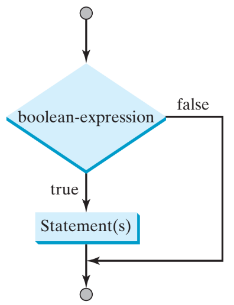

*Nên đặt các câu lệnh của câu điều kiện If bên trong cặp dấu ngoặc nhọn {}, dù nó chỉ có một dòng lệnh. Điều này giúp chương trình rõ ràng hơn, dễ hiểu hơn.*

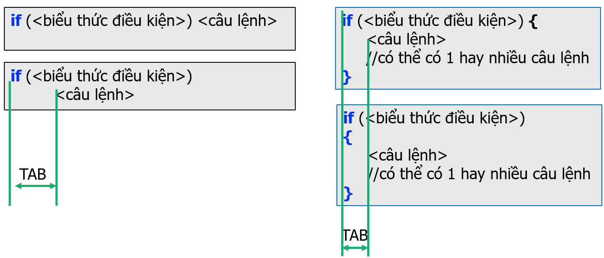

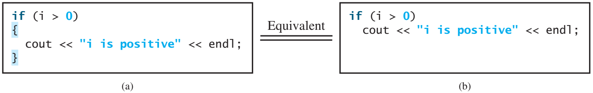

**<u>\
</u>**

**<u>Ví dụ:</u>**

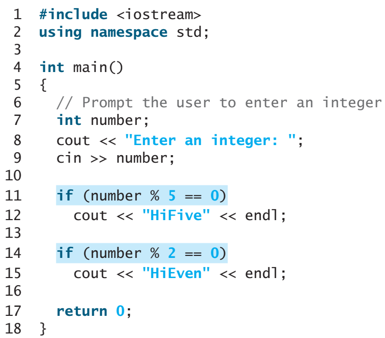 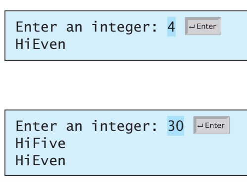

### 2.2.3. Lệnh if – else (If đủ)

<table>
<colgroup>
<col style="width: 53%" />
<col style="width: 46%" />
</colgroup>
<thead>
<tr>
<th style="text-align: center;"><p><code><strong>if (</strong> Điều_kiện <strong>)</strong></code></p>
<p><code><strong>{</strong></code></p>
<p>lệnh_1 <strong>;</strong></p>
<p><code><strong>}</strong></code></p>
<p><code><strong>else</strong></code></p>
<p><code><strong>{</strong></code></p>
<p>lệnh_2 <strong>;</strong></p>
<p><code><strong>}</strong></code></p>
<p><strong>* Điều kiện:</strong> là một biểu thức, thông thường là biểu thức logic.</p>
<p><strong>* &lt;lệnh_1&gt;, &lt;lệnh_2&gt;</strong> là câu lệnh hợp lệ bất kỳ: câu lệnh đơn, hoặc câu lệnh ghép, hoặc câu lệnh điều khiển.</p>
<p><strong><u># Lưu ý:</u></strong></p>
<p>- Chương trình <strong>KHÔNG</strong> thực hiện cả hai lệnh 1 và 2 trong <strong>BẤT KỲ</strong> trường hợp nào.</p>
<p>- Nếu điều kiện có giá trị <em>true</em> (đúng) thì lệnh_1 được thực hiện, không thực hiện lệnh_2, ngược lại nghĩa là điều điện có giá trị <em>false</em> (sai) thì không thực hiện lệnh_1 mà chỉ thực hiện lệnh_2.</p></th>
<th style="text-align: center;"><p>Hình minh họa</p></th>
</tr>
</thead>
<tbody>
<tr>
<td style="text-align: center;"><p>A screenshot of a computer code Description automatically generated</p>
<p><em>Phong cách này chỉ nên dùng khi cả hai câu lệnh là câu đơn giản.</em></p></td>
<td style="text-align: center;"><p>A screenshot of a computer code Description automatically generated</p></td>
</tr>
</tbody>
</table>

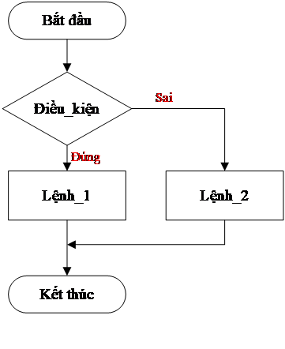

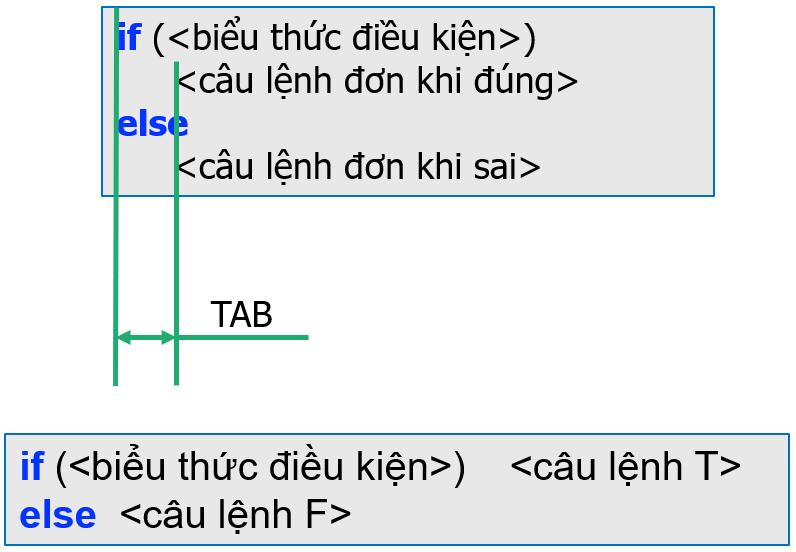

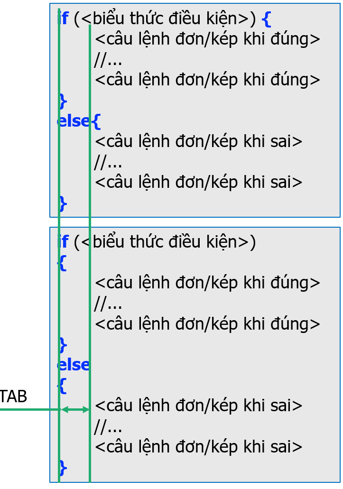

**<u>Ví dụ 1:</u>** Tính căn bậc hai của một số.

```cpp
#include <iostream>

#include <cmath>

using namespace std;

int main()

{

float x;

cout << "Nhap x = ";

cin >> x;

if (x < 0)

cout << "Khong ton tai can bac hai cua " << x;

else

cout << "Can bac hai cua " << x << " bang " << sqrt(x);

}
```

**<u>Ví dụ 2:</u>** nhập 1 số nguyên, kiểm tra số đó là số chẵn hay lẻ.

```cpp
#include <iostream>

using namespace std;

int main()

{

int x;

cout << "Nhap x = ";

cin >> x;

if (x % 2 == 0)

cout << x << " la so chan";

else

cout << x << " la so le";

return 0;

}
```

***Kết quả:*** Nhap x = 2

2 la so chan

**<u>Ví dụ 3:</u>** Viết chương trình giải hệ phương trình bậc nhất 2 ẩn sau:

$$
\left\{
\begin{aligned}
ax + by &= c \\
dx + ey &= f
\end{aligned}
\right.
$$

```cpp
#include <iostream>

using namespace std;

int main()

{

float a, b, c, d, e, f, x, y, D, Dx, Dy;

cout << "Giai he phuong trinh:\n";

cout << "ax + by = c\ndx + ey = f" << endl;

cout << "Nhap lan luot cac he so a, b, c, d, e, f:\n";

cin >> a >> b >> c >> d >> e >> f;

D = a * e - b * d; Dx = c * e - f * b; Dy = a * f - d * c;

if (D == 0) {

if (Dx == 0 && Dy == 0)

cout << "He da cho co vo so nghiem\n";

else

cout << "He da cho vo nghiem\n";

}

else {

cout << "Nghiem cua he la:\n";

cout << "x = " << Dx / D;

cout << "\ny = " << Dy / D;

}

return 0;

}
```

***Kết quả:***

Giai he phuong trinh:

ax + by = c

dx + ey = f

Nhap lan luot cac he so a, b, c, d, e, f:

1 2 18

-1 3 0

Nghiem cua he la:

x = 10.8

y = 3.6

### 2.2.4. If – else lồng nhau (Nested if – else)

\- Câu lệnh **if bên trong** được cho là **“được lồng” bên trong câu lệnh if bên ngoài**. Câu lệnh if bên trong có thể chứa câu lệnh if khác; trên thực tế, không có giới hạn về độ sâu của việc lồng nhau này.

**<u>Ví dụ:</u>**

```cpp
if (i > k) {

if (j > k) cout << "i and j are greater than k" << endl;

}

else cout << "i is less than or equal to k" << endl;
```

*- Câu lệnh if có thể lồng vào nhau và else sẽ tương ứng với if gần nó nhất.*

```cpp
if (a != 0)

if (b > 0)

cout << "a != 0 va b > 0";

else

cout << "a != 0 va b <= 0";
```

Tương đương với:

```cpp
if (a != 0) {

if (b > 0)

cout << "a != 0 va b > 0";

else

cout << "a != 0 va b <= 0";

}
```

*- Nên dùng else để loại trừ trường hợp.*

<table>
<colgroup>
<col style="width: 49%" />
<col style="width: 50%" />
</colgroup>
<thead>
<tr>
<th style="text-align: left;"><p><code>if (delta &lt; 0)</code></p>
<p><code>cout &lt;&lt; "PT vo nghiem";</code></p>
<p><code>if (delta == 0)</code></p>
<p><code>cout &lt;&lt; "PT co nghiem kep";</code></p>
<p><code>if (delta &gt; 0)</code></p>
<p><code>cout &lt;&lt; "PT co 2 nghiem";</code></p></th>
<th style="text-align: left;"><p><code>if (delta &lt; 0)</code></p>
<p><code>cout &lt;&lt; "PT vo nghiem";</code></p>
<p><code>else // delta &gt;= 0</code></p>
<p><code>if (delta == 0)</code></p>
<p><code>cout &lt;&lt; "PT co nghiem kep";</code></p>
<p><code>else</code></p>
<p><code>cout &lt;&lt; "PT co 2 nghiem";</code></p></th>
</tr>
</thead>
<tbody>
</tbody>
</table>

### 2.2.5. If – else if – else

<table>
<colgroup>
<col style="width: 25%" />
<col style="width: 74%" />
</colgroup>
<thead>
<tr>
<th><p><code><strong>if (condition)</strong></code></p>
<p><code><strong>{</strong></code></p>
<p><strong>// do A</strong></p>
<p><code><strong>}</strong></code></p>
<p><code><strong>else if (another_condition)</strong></code></p>
<p><code><strong>{</strong></code></p>
<p><strong>// do B</strong></p>
<p><code><strong>}</strong></code></p>
<p><code><strong>else if (one_more_condition)</strong></code></p>
<p><code><strong>{</strong></code></p>
<p><strong>// do C</strong></p>
<p><code><strong>}</strong></code></p>
<p><code><strong>else</strong></code></p>
<p><code><strong>{</strong></code></p>
<p><strong>// do D</strong></p>
<p><code><strong>}</strong></code></p></th>
<th><p>A white background with blue text and black text Description automatically generated</p>
<p>Sử dụng khi muốn kiểm tra nhiều hơn 2 trường hợp trong một câu điều kiện If.</p></th>
</tr>
</thead>
<tbody>
</tbody>
</table>

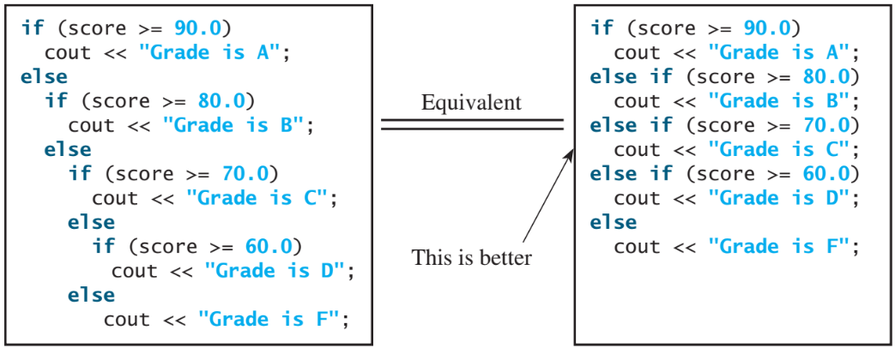

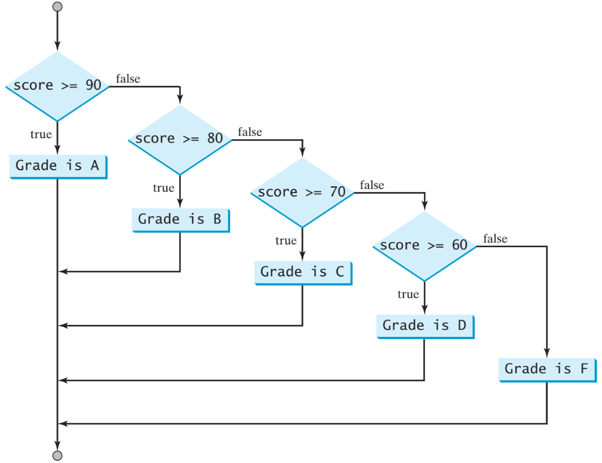

\- Có nhiều cách biểu diễn:

```cpp
if () \

else if () \

else if () \

else \
```

Hoặc:

```cpp
if ()
```

\<Câu lệnh thực thi 1\>

```cpp
else if ()
```

\<Câu lệnh thực thi 2\>

```cpp
else if ()
```

\<Câu lệnh thực thi 3\>

else

\<Câu lệnh thực thi 4\>

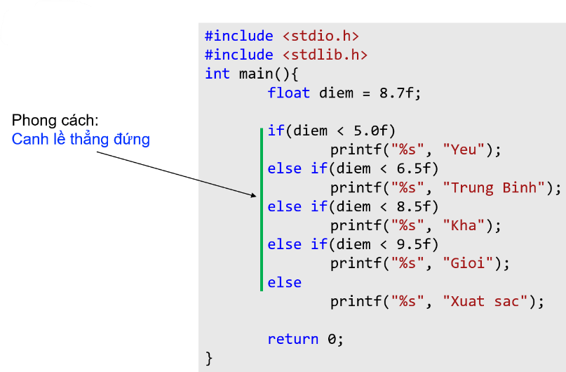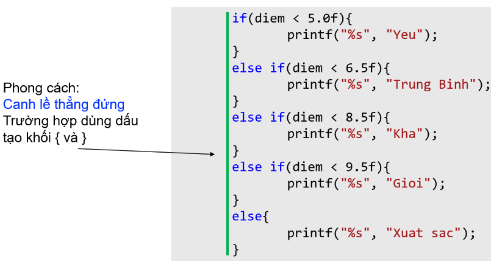

### 2.2.6. Toán tử điều kiện (Conditional operator)

**- Cấu trúc câu điều kiện if/else**:

```cpp
if (condition)     // nếu condition là true
```

**expression1;  // thực thi câu lệnh này**

**else**

**expression2;  // nếu condition là false, thực thi câu lệnh này**

**Hoặc :**

```cpp
if (condition)     // nếu condition là true
```

**x = value1;   // x = value 1**

**else**

**x = value2;   // nếu condition là false, x = value 2**

**- Viết lại dưới dạng toán tử điều kiện ( ?: )**:

**<span class="mark">(condition) ? expression1 : expression2;</span>**

**Hoặc:**

```cpp
x = (condition) ? value1 : value2;
```

*- Toán tử điều kiện “?:” là toán tử 3 ngôi duy nhất trong C++ (vì nó chứa 3 toán hạng). Có thể dùng để thay thế câu lệnh if/else cơ bản.*

**- Chú ý: **Các toán hạng của toán tử điều kiện không phải là một câu lệnh, nên sẽ không chứa dấu chấm phẩy “;”

<table>
<colgroup>
<col style="width: 43%" />
<col style="width: 56%" />
</colgroup>
<thead>
<tr>
<th><p><code><strong>int</strong> a(10), b(20), max;</code></p>
<p><code><strong>if</strong> (a &gt; b)</code></p>
<p>{ max = a; }</p>
<p><code><strong>else</strong></code></p>
<p>{ max = b; }</p>
<p>Có thể viết lại ở dạng toán tử điều kiện:</p>
<p><code><strong>int</strong> a(10, b(20);</code></p>
<p><code><strong>int</strong> max = (a &gt; b) ? a : b;</code></p></th>
<th><p><code><strong>if</strong> (1 &gt; 0)</code></p>
<p>{ <strong>cout</strong> &lt;&lt; 1 &lt;&lt; endl; }</p>
<p><code><strong>else</strong></code></p>
<p>{ <strong>cout</strong> &lt;&lt; 0 &lt;&lt; endl;}</p>
<p>Có thể viết lại ở dạng toán tử điều kiện:</p>
<p>// Cách 1</p>
<p>(1 &gt; 0) ? (<strong>cout</strong> &lt;&lt; 1 &lt;&lt; endl) : (<strong>cout</strong> &lt;&lt; 0 &lt;&lt; endl);</p>
<p>// Cách 2</p>
<p><code><strong>cout</strong> &lt;&lt; ((1 &gt; 0) ? 1 : 0) &lt;&lt; endl;</code></p></th>
</tr>
</thead>
<tbody>
</tbody>
</table>

**- Kinh nghiệm: **Khi viết các câu lệnh có nhiều toán tử,** luôn sử dụng dấu ngoặc tròn** để hạn chế sai sót về độ ưu tiên của toán tử.

### 2.2.7. Những lỗi sai thường gặp về if – else

***- Quên cặp ngoặc nhọn:***

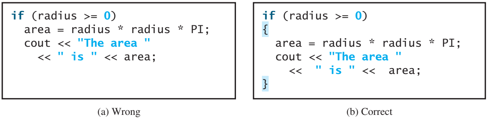

\+ Phần câu lệnh (a) tương đương với phần câu lệnh bên dưới:

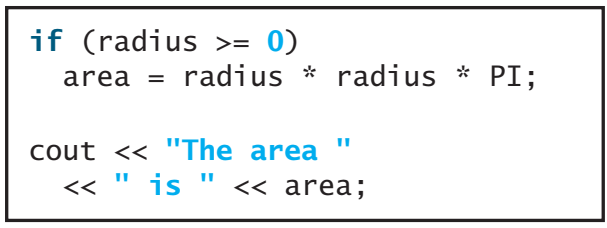

\+ Dấu chấm phẩy sai ở dòng if:

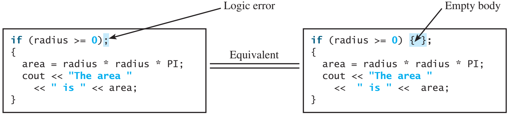

Lỗi này rất khó tìm ra vì nó không phải là lỗi biên dịch hay lỗi thời gian chạy; đó là một lỗi logic. Mã ở (a) tương đương với mã ở (b) với phần Empty body.

***- Sử dụng = thay vì ==:***

\+ Toán tử kiểm tra đẳng thức là hai dấu bằng (==). Trong C++ nếu sử dụng nhầm = cho == sẽ dẫn đến lỗi logic.

```cpp
if (count = 3)

cout << "count is zero" << endl;

else

cout << "count is not zero" << endl;
```

Nó luôn hiển thị "**count is zero**", vì count = 3 gán 3 cho **count** và biểu thức gán được đánh giá là 3. Vì 3 là giá trị khác 0 nên nó được hiểu là điều kiện đúng bởi câu lệnh if. Mọi giá trị khác 0 đều được đánh giá là đúng và giá trị 0 được đánh giá là sai.

***- Viết điều kiện dư thừa:***

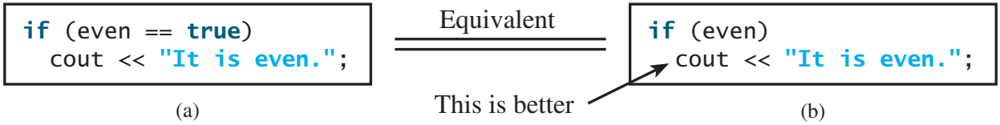

Sử dụng toán tử = thay vì toán tử == để so sánh sự bằng nhau của hai vế trong điều kiện kiểm tra là một lỗi phổ biến. Nó có thể dẫn tới sự sai sót sau đây:

```cpp
if (even = true)

cout << "It is even.";
```

Câu lệnh này gán giá trị true cho even để cho even luôn luôn true. Vì vậy, điều kiện của câu lệnh if luôn đúng.

***- Sự mơ hồ về lệnh else:***

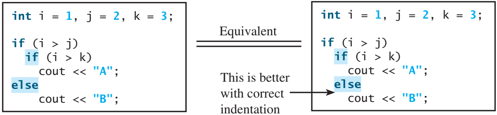

- Mã trong (a) bên dưới có hai mệnh đề if và một mệnh đề khác. Mệnh đề if nào khớp với mệnh đề else? Việc thụt lề chỉ ra rằng mệnh đề else khớp với mệnh đề if đầu tiên.

- Tuy nhiên, mệnh đề else thực sự khớp với mệnh đề if thứ hai. Tình huống này được gọi là sự mơ hồ lệnh else. Mệnh đề else luôn khớp với mệnh đề if gần nhất trong cùng một khối.

- Vì vậy, câu lệnh trong (a) tương đương với mã trong (b).

- Vì (i \> j) sai nên không có gì được hiển thị. Để buộc mệnh đề else khớp với mệnh đề if đầu tiên, bạn phải thêm một cặp dấu ngoặc nhọn:

> **int** i = **1**, j = **2**, k = **3**;
>
> **if** (i \> j)
>
> **<span class="mark">{</span>**
>
> **if** (i \> k)
>
> cout \<\< **"A"**;
>
> **<span class="mark">}</span>**
>
> **else**
>
> cout \<\< **"B"**;

***Kết quả:*** **B**

***- Kiểm tra sự bằng nhau của hai số chấm động:***

```cpp
double x = 1.0 - 0.1 - 0.1 - 0.1 - 0.1 - 0.1;

if (x == 0.5)

cout << "x is 0.5" << endl;

else

cout << "x is not 0.5" << endl;
```

- Bạn mong đợi đoạn mã sau hiển thị **x is 0.5**, nhưng đáng ngạc nhiên là nó hiển thị **x is not 0.5**.

- Ở đây, **x** **không chính xác là** **0,5 mà rất gần với 0,5.** Bạn không thể kiểm tra sự bằng nhau của hai giá trị dấu phẩy động một cách đáng tin cậy. Tuy nhiên, bạn có thể so sánh xem chúng có đủ gần hay không bằng cách kiểm tra xem hiệu của hai số có nhỏ hơn ngưỡng nào đó hay không.

- Nghĩa là hai số x và y rất gần nhau nếu *\|x – y\| \< ε*, với *ε* rất nhỏ.

- ε: epsilon, thường được dùng để biểu thị (chứng tỏ) một giá trị rất nhỏ. Thông thường, bạn đặt *ε* thành 10<sup>-14</sup> để so sánh hai giá trị của kiểu **double** và thành 10<sup>-7</sup> để so sánh hai giá trị của kiểu **float**.

**const double** EPSILON = **1E-14**;

```cpp
double x = 1.0 - 0.1 - 0.1 - 0.1 - 0.1 - 0.1;

if (abs(x - 0.5) < EPSILON)

cout << "x is approximately 0.5" << endl;
```

sẽ xuất ra màn hình: x is approximately 0.5

\*\*\* Hàm **abs(a)** trong thư viện **cmath** có thể được sử dụng để trả về giá trị tuyệt đối của **a**.

***- Đơn giản hóa:***

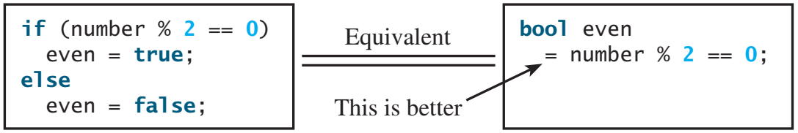

Đây không phải là lỗi nhưng tốt hơn nên viết như ở phần (b).

***- Tránh trùng lặp code trong các trường hợp khác nhau:***

```cpp
if (inState)

{

tuition = 5000;

cout << "The tuition is " << tuition << endl;

}

else

{

tuition = 15000;

cout << "The tuition is " << tuition << endl;

}
```

Nên viết:

```cpp
if (inState)

{

tuition = 5000;

}

else

{

tuition = 15000;

}

cout << "The tuition is " << tuition << endl;
```

***- Các giá trị nguyên có thể được sử dụng làm giá trị Boolean:***

- Trong C++, giá trị Boolean true được coi là 1 và false là 0.

- Một giá trị số có thể được sử dụng làm giá trị Boolean. Cụ thể, C++ chuyển đổi giá trị khác 0 thành true và 0 thành false.

- Giá trị Boolean có thể được sử dụng làm số nguyên. Điều này có thể dẫn đến các lỗi logic tiềm ẩn.

- Ví dụ: đoạn mã trong (a) có lỗi logic. Giả sử **amount** là 40, mã sẽ hiển thị **Amount is more than 50**, vì **!amount** ước tính là 0 và 0 \<= 50 là đúng. Mã đúng phải như trong (b).

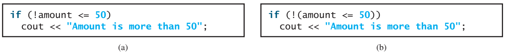

### 2.2.8. Lệnh switch – case

<table>
<colgroup>
<col style="width: 32%" />
<col style="width: 67%" />
</colgroup>
<thead>
<tr>
<th><p><code>switch(biến/ biểu_thức)</code></p>
<p><code>{</code></p>
<p><code>case giá_trị_1:</code></p>
<p>{lệnh_1; break;}</p>
<p><code>case giá_trị_2:</code></p>
<p>{lệnh_2; break;}</p>
<p>......</p>
<p><code>default: {lệnh_n ;}</code></p>
<p><code>}</code></p></th>
<th><p><em># Có { … } hay không đều được, nhưng phải có break.</em></p>
<p><em># Default có thể không có; không cần break vì là trường hợp cuối cùng.</em></p>
<p>- Nếu <em>biến/biểu_thức (số nguyên, các hằng kí tự hoặc biểu thức hằng)</em> có giá trị là <em>giá_trị_i</em> thì các lệnh bắt đầu từ <em>lệnh_i</em> sẽ được thực hiện cho đến khi nào gặp lệnh <strong>break</strong> hoặc dấu <strong>}</strong> thì thoát khỏi <strong>switch</strong>.</p>
<p>- Ngược lại thì <em>lệnh_n</em> sau từ khóa <strong>default</strong> sẽ được thực hiện.</p>
<p><strong>- Chú ý:</strong> biến/biểu thức trong switch chỉ áp dụng cho kiểu số nguyên hoặc kí tự.</p>
<p>- Số lượng các <strong>case</strong> là <strong>không giới hạn</strong>, và <strong>không có trường hợp trùng nhau</strong> giữa các case.</p>
<p><strong>- switch case statement</strong> thường được dùng để thay thế cho <strong>if statement</strong> trong trường hợp số lượng trường hợp cần so sánh quá dài. Mặc dù chúng ta có thể sử dụng kỹ thuật <strong>chaining if statement (if – else if – else)</strong> để nối các trường hợp cần kiểm tra lại với nhau, nhưng nó khiến chương trình khó đọc.</p></th>
</tr>
</thead>
<tbody>
</tbody>
</table>

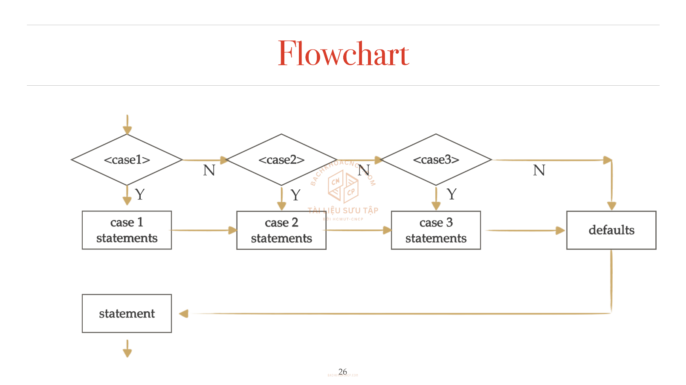

**<u>Ví dụ 1:</u>** Nhập vào số thứ tự, xuất ra tên tương ứng

```cpp
#include <iostream>

using namespace std;

int main()

{

int x;

cout << "Nhap so thu tu "; cin >> x;

switch (x)

{

case 1: cout << "Cao Van Hau\n"; break;

case 2: cout << "Ly Tuan Kiet\n"; break;

case 3: cout << "Van Tuan Anh\n"; break;

default: cout << "Khong co du lieu\n";

}

}
```

**<u>Ví dụ 2:</u>** viết chương trình lựa chọn phép toán số học mà người dùng nhập vào để tính toán và xuất ra biểu thức toán học tương ứng của 2 số nguyên.

```cpp
#include <iostream>

using namespace std;

int main()

{

int x, y;

char phep_toan;

cout << "Nhap vao 2 so nguyen:\nx = ";

cin >> x;

cout << "y = "; cin >> y;

cout << "Nhap vao phep toan: ";

cin >> phep_toan;

cout << "Bieu thuc ket qua can tinh la:\n";

switch (phep_toan)

{

case '+': cout << x << " + " << y << " = " << x + y; break;

case '-': cout << x << " - " << y << " = " << x - y; break;

case '*': cout << x << " * " << y << " = " << x * y; break;

case '/':

if (y != 0)

cout << x << " + " << y << " = " << x / y;

else

cout << "Khong thuc hien duoc";

break;

case '%': cout << x << " % " << y << " = " << x % y; break;

default: "Chi nhap cac phep toan + - * / %";

}

return 0;

}
```

**<u>Ví dụ 3:</u>** Chương trình sau sẽ xuất ra màn hình số ngày có trong 1 tháng của 1 năm nào đó do người dùng nhập vào. (*Lưu ý ở đây là tùy vào năm mà người dùng nhập vào thì tháng 2 sẽ có 28 ngày nếu là năm thường hoặc 29 ngày nếu là năm nhuận. Trong đó năm nhuận là năm chia hết cho 4 và không chia hết cho 100 hoặc là năm mà chia hết cho 400*).

```cpp
#include <iostream>

using namespace std;

int main()

{

int thang, nam;

cout << "Nhap vao thang: ";

cin >> thang;

cout << "Nhap vao nam: ";

cin >> nam;

cout << "Thang " << thang << " cua nam " << nam << " co ";

switch (thang)

{

case 1: case 3: case 5: case 7: case 8: case 10: case 12:

cout << "31 ngay";

break;

case 4: case 6: case 9: case 11:

cout << "30 ngay";

break;

case 2:

if (nam % 4 == 0 && nam % 100 != 0 || nam % 400 == 0)

cout << "29 ngay";

else

cout << "28 ngay";

break;

default: "Chi nhap thang tu 1 den 12";

}

return 0;

}
```

***Kết quả:***

Nhap vao thang: 2

Nhap vao nam: 2020

Thang 2 cua nam 2020 co 29 ngay

**\*\*\* <u>Lưu ý:</u>**

- Phải đặt biểu thức của switch (…) trong dấu ngoặc đơn.

- Ý nghĩa của lệnh switch() là chia ra các trường hợp để chương trình lựa chọn và thực hiện. Các trường hợp này được chỉ ra sau từ khóa case.

- Nội dung của switch() phải nằm trong cặp ngoặc {}. Nhưng các lệnh sau từ khóa case không cần nằm trong cặp ngoặc {}

- giá_trị_l, ..., giá_trị_n-1 là các biểu thức hằng số nguyên hoặc ký tự, nghĩa là chúng không thể chứa các biến, chẳng hạn như 1 + x.

- Nếu giá trị của biểu thức điều kiện bằng giá trị chỉ ra sau các từ khóa case (ở ví dụ trên là các giá trị ‘+’, ‘-‘, ‘\*’, ‘/’,’%’ ) thì các lệnh bắt đầu từ sau dấu : liền đó cho đến khi gặp lệnh break đầu tiên của switch() sẽ được thực hiện (hoặc thực hiện đến trước dấu } nếu không có break).

- Các lệnh sau từ khóa default sẽ mặc định được thực hiện nếu trước đó trong cấu trúc switch() chương trình chưa gặp lệnh break. Lệnh default có thể có hoặc không và vị trí của nó là bất kỳ trong switch().

- Lệnh break có thể có hoặc không và nó được dùng khi ta muốn sớm thoát khỏi switch().

\*\*\* Nếu không có break ở mỗi case: **fall-through**.

```cpp
switch (2)

{

case 1: // Does not match

cout << 1 << '\n'; // skipped

case 2: // Match!

cout << 2 << '\n';// Execution begins here

case 3:

cout << 3 << '\n'; //This is also executed

case 4:

cout << 4 << '\n'; //This is also executed

default:

cout << 5 << '\n'; //This is also executed

}
```

***Kết quả:*** **2**

**3**

**4**

**5**

\- Bạn có thể khai báo các biến bên trong các case statement, các biến được khai báo trong một case có thể sử dụng trong các case bên dưới.

\- Thông thường, bạn không thể khởi tạo biến bên trong một case. Trừ trường hợp đó là case cuối cùng, hoặc bạn đang khởi tạo bên trong một khối lệnh (block).

```cpp
#include <iostream>

using namespace std;

int main()

{

int month;

cout << "Month: ";

cin >> month;

switch (month)

{

case 1:

case 3:

case 5:

case 7:

case 8:

case 10:

case 12:

// Lỗi: không được phép KHỞI TẠO biến khi vẫn còn case bên dưới.

//int year = 2017;

int day; // Okay, có thể khai báo biến tại đây
```

day = 30; // Okay, có thể gán giá trị cho biến

```cpp
cout << day << endl;

break;

case 4:

case 6:

case 9:

case 11:

{

int year = 2017; // Okay: có thể khởi tạo biến nếu sử dụng khối lệnh
```

day = 31; // Okay, có thể sử dụng biến ở những case bên dưới

```cpp
cout << day << endl;

break;

}

default:

day = 28;

cout << day << endl;

}

return 0;

}
```

***Kết quả:*** Month: 12

30

\- Tận dụng tính chất khi bỏ break:

<table style="width:92%;">
<colgroup>
<col style="width: 46%" />
<col style="width: 46%" />
</colgroup>
<thead>
<tr>
<th style="text-align: left;"><p><code>switch (a)</code></p>
<p><code>{</code></p>
<p><code>case 1: cout &lt;&lt; "So le"; break;</code></p>
<p><code>case 2: cout &lt;&lt; "So chan"; break;</code></p>
<p><code>case 3: cout &lt;&lt; "So le"; break;</code></p>
<p><code>case 4: cout &lt;&lt; "So chan"; break;</code></p>
<p><code>}</code></p></th>
<th style="text-align: left;"><p><code>switch (a)</code></p>
<p><code>{</code></p>
<p><code>case 1:</code></p>
<p><code>case 3: cout &lt;&lt; "So le"; break;</code></p>
<p><code>case 2:</code></p>
<p><code>case 4: cout &lt;&lt; "So chan"; <del>break;</del></code></p>
<p><code>}</code></p></th>
</tr>
</thead>
<tbody>
</tbody>
</table>

\- Dùng switch thay vì if và ngược lại trong một số trường hợp:

<table style="width:92%;">
<colgroup>
<col style="width: 45%" />
<col style="width: 46%" />
</colgroup>
<thead>
<tr>
<th style="text-align: left;"><p><code>if (a == 1)</code></p>
<p><code>cout &lt;&lt; "Mot";</code></p>
<p><code>if (a == 2)</code></p>
<p><code>cout &lt;&lt; "Hai";</code></p>
<p><code>if (a == 3)</code></p>
<p><code>cout &lt;&lt; "Ba";</code></p>
<p><code>if (a == 4)</code></p>
<p><code>cout &lt;&lt; "Bon";</code></p>
<p><code>if (a == 5)</code></p>
<p><code>cout &lt;&lt; "Nam";</code></p></th>
<th style="text-align: left;"><p><code>switch (a)</code></p>
<p><code>{</code></p>
<p><code>case 1:</code></p>
<p><code>cout &lt;&lt; "Mot";</code></p>
<p><code>break;</code></p>
<p><code>case 2:</code></p>
<p><code>cout &lt;&lt; "Hai";</code></p>
<p><code>break;</code></p>
<p><code>case 3:</code></p>
<p><code>cout &lt;&lt; "Ba";</code></p>
<p><code>break;</code></p>
<p><code>case 4:</code></p>
<p><code>cout &lt;&lt; "Bon";</code></p>
<p><code>break;</code></p>
<p><code>case 5:</code></p>
<p><code>cout &lt;&lt; "Nam";</code></p>
<p><code>}</code></p></th>
</tr>
</thead>
<tbody>
<tr>
<td style="text-align: left;"><p><code>if (a == 3.14)</code></p>
<p><code>cout &lt;&lt; "OK";</code></p>
<p><code>if (a &lt; 10)</code></p>
<p><code>cout &lt;&lt; "OK";</code></p>
<p><code>if (a == 1)</code></p>
<p><code>cout &lt;&lt; "OK";</code></p>
<p><code>if (a == 2 || a == 3)</code></p>
<p><code>cout &lt;&lt; "OK";</code></p></td>
<td style="text-align: left;"><p><code>switch (a)</code></p>
<p><code>{</code></p>
<p><code><del>case 3.14: //Lỗi!</del></code></p>
<p><code><del>case &lt; 10:</del></code></p>
<p><code>case 1:</code></p>
<p><code>cout &lt;&lt; "OK";</code></p>
<p><code>break;</code></p>
<p><code>case 2:</code></p>
<p><code>case 3:</code></p>
<p><code>cout &lt;&lt; "OK";</code></p>
<p><code>break;</code></p>
<p><code>}</code></p></td>
</tr>
</tbody>
</table>

## 2.3. Cấu trúc lặp

### 2.3.1. Ứng dụng

- ***Xử lý dữ liệu:*** Trong quản lý sinh viên, quản lý hàng hoá, xử lý điểm ảnh, xử lý facebook…

- ***Thuật toán:*** Bài toán xấp xỉ các hàm phi tuyến: sin(x), cos(x); Bài toán tìm nghiệm của phương trình…

### 2.3.2. Vòng lặp while

<table>
<colgroup>
<col style="width: 30%" />
<col style="width: 28%" />
<col style="width: 41%" />
</colgroup>
<thead>
<tr>
<th><p><code>while(điều_kiện_lặp)</code></p>
<p><code>{</code></p>
<p>/*thân vòng lặp*/</p>
<p>Lệnh;</p>
<p><code>}</code></p></th>
<th><p><code><strong>while </strong>(<strong>expression</strong>)<br />
    <strong>statement</strong>;</code></p></th>
<th rowspan="2"><p>Hình minh họa</p></th>
</tr>
<tr>
<th colspan="2"><p>- Nếu <strong>expression/ điều_kiện_lặp</strong> là <strong>true (khác 0)</strong>, các câu lệnh bên trong khối lệnh sẽ được thực thi.</p>
<p>- Điều kiện tiếp tục vòng lặp phải luôn xuất hiện bên trong dấu ngoặc đơn.</p>
<p>- Các dấu ngoặc nhọn bao quanh thân vòng lặp chỉ có thể được bỏ qua nếu thân vòng lặp chứa một câu lệnh hoặc không chứa câu lệnh nào.</p></th>
</tr>
</thead>
<tbody>
</tbody>
</table>

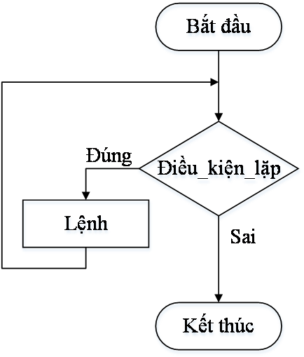

\- Một vòng lặp while có thể được thực hiện **nhiều lần **hoặc **không được thực hiện lần nào**.

**<u>Ví dụ 1:</u>** Xuất ra màn hình các số chẵn nhỏ hơn n

```cpp
#include <iostream>

using namespace std;

int main()

{

int n, x = 0;

cout << "Nhap n = ";

cin >> n;

while (x )

{

cout << x << '\t';

x += 2;

}

}
```

***Kết quả:***

```cpp
Nhap n = 10
```

0 2 4 6 8

**<u>Ví dụ 2:</u>** chương trình tính tổng các chữ số của một số nguyên bất kỳ.

```cpp
#include <iostream>

#include\ // Khai báo này để sử dụng hàm abs trong chương trình

using namespace std;

int main()

{

int n, tong = 0, x;

cout << "n = "; cin >> n;
```

x = abs(n); // Hàm abs dùng để lấy giá trị tuyệt đối của một số

```cpp
while (x > 0)

{

tong += x % 10;
```

<span class="mark">x /= 10;</span> // Lệnh này tương đương với x = x/10

}

```cpp
cout << "Tong cac chu so cua " << n << " la " << tong;

return 0;

}
```

***Kết quả:***

n = 12345

Tong cac chu so cua 12345 la 15

\- Một vòng lặp có thể không được thực hiện lần nào, nếu biểu thức điều kiện sai ngay từ đầu:

```cpp
#include <iostream>

using namespace std;

int main()

{

int count(1000);

while (count <= 10)

{

cout << count << " ";
```

++count;

}

```cpp
cout << "done!" << endl;

return 0;

}
```

***Kết quả:*** done!

\- Nếu biểu thức điều kiện luôn đúng, vòng lặp while sẽ thực hiện mãi mãi. Đây gọi là một vòng lặp vô hạn. Vì vậy, cần đảm bảo rằng điều kiện tiếp tục vòng lặp cuối cùng trở thành sai để vòng lặp kết thúc.

```cpp
#include <iostream>

using namespace std;

int main()

{

int count(1);

while (count < 10) // điều kiện luôn đúng vì count luôn = 1

cout << count << " ";

return 0; // dòng lệnh này không bao giờ được thực thi

}
```

***Kết quả:***

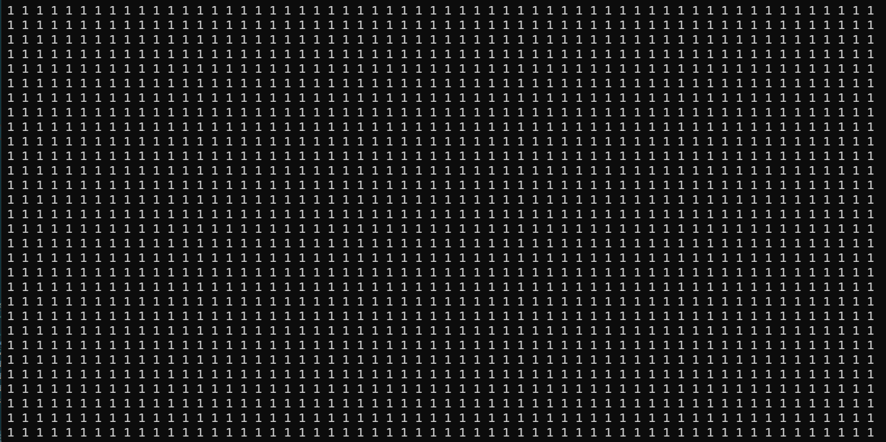

```cpp
while (true)

{

//This loop will be executed forever

}
```

\- Thông thường, người ta thường sử dụng một biến vòng lặp để giới hạn số lần lặp của vòng lặp. Biến vòng lặp là một biến số nguyên với mục đích duy nhất là đếm số lần lặp đã được thực hiện.

\- Trong những ví dụ trên, các biến **count** là một biến vòng lặp.

\*\*\***Nguyên tắc:** Không sử dụng kiểu số nguyên không dấu (unsigned) cho các biến vòng lặp.

```cpp
int main()

{
```

unsigned int count = 10;

// count from 10 down to 0

```cpp
while (count >= 0)

{

cout << count << " ";
```

--count;

}

```cpp
return 0;

}
```

***Kết quả:***

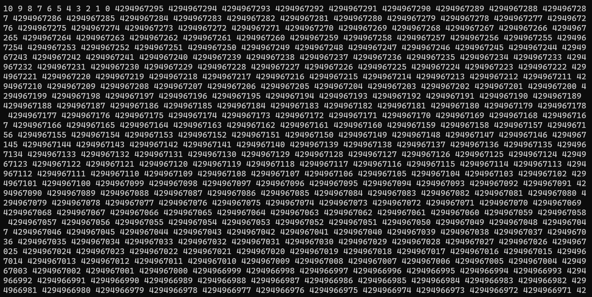

Ví dụ trên là một chương trình **lặp vô hạn**, nó in ra màn hình dãy số: “10 9 8 7 6 5 4 3 2 1 0 4294967295 4294967294 …”. Tại sao như vậy, biến **count** có kiểu dữ liệu **unsigned** **int**, nên sẽ không có giá trị âm, nên vòng lặp sẽ không bao giờ chấm dứt. Nếu giá trị của **count** **= 0**, khi giảm đi 1 sẽ tràn số và quay lại 4294967295, suy ra điều kiện lặp **count \>= 0** sẽ luôn luôn đúng.

\- Để dừng vòng lặp vô hạn, nếu bạn đang chạy chương trình từ cửa sổ lệnh, hãy nhấn CTRL+C để dừng nó, hoặc sử dụng một trong những từ khóa: **return**, **break**, **exit()**, **goto**, **throw**, hoặc bạn tự tắt chương trình.

*- Các biến vòng lặp thường được đặt những tên đơn giản (**ví dụ:** i, j, k, iii, jjj, kkk, …). Nhưng để dễ phân biệt hơn, nên đặt cho nó những tên có ý nghĩa cho từng mục đích, ví dụ như count.*

\- Một vòng lặp while có thể lồng vào trong một vòng lặp khác.

```cpp
#include <iostream>

using namespace std;

int main()

{

// Loop between 1 and 5

int outer(1);

while (outer <= 5)

{

// loop between 1 and outer

int inner(1);

while (inner <= outer)

{

cout << inner << " ";
```

++inner;

}

// print a newline at the end of each row

```cpp
cout << "\n";
```

++outer;

}

```cpp
return 0;

}
```

***Kết quả:***

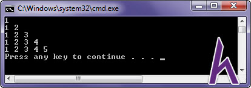

\- Không được thêm ; ngay sau lệnh lệnh while.

<table style="width:92%;">
<colgroup>
<col style="width: 34%" />
<col style="width: 19%" />
<col style="width: 38%" />
</colgroup>
<thead>
<tr>
<th style="text-align: left;"><p><code>int n = 0;</code></p>
<p><code>while (n &lt; 10)<mark>;</mark></code></p>
<p><code>{</code></p>
<p><code>cout &lt;&lt; n &lt;&lt; endl;</code></p>
<p>n++;</p>
<p><code>}</code></p></th>
<th style="text-align: center;"><p>Tương đương với</p></th>
<th style="text-align: left;"><p><code>int n = 0;</code></p>
<p><code>while (n &lt; 10)</code></p>
<p><code><mark>{</mark></code></p>
<p><code><mark>};</mark></code></p>
<p><code>{</code></p>
<p><code>cout &lt;&lt; n &lt;&lt; endl;</code></p>
<p>n++;</p>
<p><code>}</code></p></th>
</tr>
</thead>
<tbody>
</tbody>
</table>

**\*\*\* Các bước thiết kế vòng lặp:**

**Bước 1:** Xác định những câu lệnh cần lặp lại.

**Bước 2:** Đưa các câu lệnh này trong một vòng lặp như sau:

> while (true)
>
> {
>
> //statements;
>
> }

**Bước 3:** Viết điều kiện tiếp tục vòng lặp và thêm các câu lệnh thích hợp để kiểm soát vòng lặp.

```cpp
while (/*Điều_kiện_tiếp_tục_vòng_lặp*/)

{

//Câu lệnh;

//Các câu lệnh kiểm soát vòng lặp;

}
```

### 2.3.3. Vòng lặp do...while

\- Trong thực tế, có rất nhiều trường hợp cần sử dụng vòng lặp để giải quyết, và có những trường hợp yêu cầu vòng lặp phải thực hiện ít nhất 1 lần. Ví dụ như chương trình hiển thị menu chờ người dùng chọn, …

\- Để giải quyết vấn đề đó, C++ cung cấp cấu trúc **vòng lặp do-while.**

\- Biểu thức điều kiện xuất hiện ở **cuối cùng của vòng lặp**, vì vậy **các lệnh** trong vòng lặp sẽ được <u>**thực thi ít nhất 1 lần**.</u> Sau đó điều kiện lặp sẽ được kiểm tra, nếu điều kiện là true, CPU sẽ quay lại thực thi khối lệnh bên trong vòng lặp. Tiến trình này lặp đi lặp lại tới khi nào điều kiện lặp trở thành false.

<table>
<colgroup>
<col style="width: 36%" />
<col style="width: 63%" />
</colgroup>
<thead>
<tr>
<th><p><code>do</code></p>
<p><code>{</code></p>
<p>/*thân vòng lặp*/</p>
<p>Lệnh;</p>
<p><code>}</code></p>
<p><code>while(điều_kiện_lặp)<mark>;</mark></code></p></th>
<th rowspan="2"><p><strong><u>Ví dụ 1:</u></strong> Nhập/xuất kí tự cho đến khi nhập khoảng trống</p>
<p><code>#include&lt;iostream&gt;</code></p>
<p><code>using namespace std;</code></p>
<p><code>int main()</code></p>
<p><code>{</code></p>
<p><code>char kt;</code></p>
<p><code>do</code></p>
<p><code>{</code></p>
<p><code>cout &lt;&lt; "Nhap vao mot ki tu: ";</code></p>
<p><code>cin.get(kt);</code></p>
<p><code>cout &lt;&lt; "Ban vua nhap: " &lt;&lt; kt &lt;&lt; endl;</code></p>
<p><code>cin.ignore();</code></p>
<p>} while (kt != ' ');</p>
<p><code>return 0;</code></p>
<p><code>}</code></p>
<p><em><strong>Kết quả:</strong></em></p>
<p>Nhap vao mot ki tu: a</p>
<p>Ban vua nhap: a</p>
<p>Nhap vao mot ki tu: <em>(Nhập khoảng trắng)</em></p>
<p>Ban vua nhap: <em>(khoảng trắng)</em></p></th>
</tr>
<tr>
<th style="text-align: center;"><p>Hình minh họa</p></th>
</tr>
</thead>
<tbody>
</tbody>
</table>

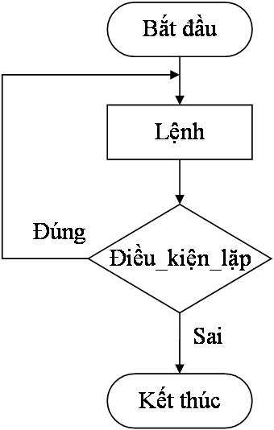

\- Có một điều đáng chú ý trong vòng lặp **do-while** là biến vòng lặp dùng cho biểu thức điều kiện cần được khai báo trước vòng lặp **do-while**. Vì từ khóa while được đặt bên ngoài khối lệnh của vòng lặp nên những biến khai báo bên trong khối lệnh sẽ bị hủy trước khi đến biểu thức điều kiện.

**<u>Ví dụ 2:</u>** Chương trình tính diện tích hình chữ nhật lặp lại đến khi ấn phím 0 (false) hoặc 1(true) để dừng hay tiếp tục.

```cpp
#include <iostream>

using namespace std;

int main()

{

int check, chieu_dai, chieu_rong;

cout << "Chuong trinh tinh dien tich cua trinh chu nhat:\n";

do {

cout << "Nhap chieu dai: "; cin >> chieu_dai;

cout << "Nhap chieu rong: "; cin >> chieu_rong;

cout << "Dien tich cua hinh chu nhat la: ";

cout << chieu_dai * chieu_rong;

cout << "\nBan co muon tiep tuc khong ? (0/1): ";

cin >> check;

} while (check);

return 0;

}
```

***Kết quả:***

Chuong trinh tinh dien tich cua trinh chu nhat:

Nhap chieu dai: 2

Nhap chieu rong: 3

Dien tich cua hinh chu nhat la: 6

Ban co muon tiep tuc khong ? (0/1): 1

Nhap chieu dai: 2

Nhap chieu rong: 6

Dien tich cua hinh chu nhat la: 12

Ban co muon tiep tuc khong ? (0/1): 0

**<u>Ví dụ 3:</u>** Nhập mật khẩu

```cpp
#include <iostream>

#include <string>

using namespace std;
```

const string ID("kteam");

const string PASSWORD("howkteam.com");

```cpp
int main()

{

string id;

string password;

do

{

system("cls");

cout << "ID: ";

getline(cin, id);

cout << "Password: ";

getline(cin, password);

} while (id != ID || password != PASSWORD);

cout << "Login succeed!" << endl;

// do something

return 0;

}
```

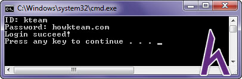

**<u>Ví dụ 4:</u>** Tạo menu

```cpp
#include <iostream>

using namespace std;

int main()

{

int selection;

do {

cout << "______Please make a selection______" << endl;

cout << "1/ Addition" << endl;

cout << "2/ Subtraction" << endl;

cout << "3/ Multiplication" << endl;

cout << "4/ Division" << endl;

cout << "Your selection: ";

cin >> selection;

cout << "Do something with your selection here" << endl;

} while (selection >= 1 && selection <= 4);

cout << "Loop exit." << endl;

return 0;

}
```

Kết quả:

\_\_\_\_\_\_Please make a selection\_\_\_\_\_\_

1/ Addition

2/ Subtraction

3/ Multiplication

4/ Division

Your selection: 1

Do something with your selection here

\_\_\_\_\_\_Please make a selection\_\_\_\_\_\_

1/ Addition

2/ Subtraction

3/ Multiplication

4/ Division

Your selection: 0

Do something with your selection here

Loop exit.

\- Câu lệnh do… while là một câu lệnh đơn và có thể lồng nhau.

```cpp
#include <iostream>

using namespace std;

int main()

{

int a = 1, b;

do

{

b = 1;

do

{

cout << a + b << endl;

b = b + 2;

} while (b < 20);
```

a++;

```cpp
} while (a < 20);

return 0;

}
```

\- Câu lệnh do… while có thể bị lặp vô tận.

```cpp
#include <iostream>

using namespace std;

int main()

{

int n = 1;

do {

cout << n;
```

n--;

```cpp
} while (n < 10);

return 0;

}
```

### 2.3.4. Vòng lặp for

<table style="width:99%;">
<colgroup>
<col style="width: 66%" />
<col style="width: 33%" />
</colgroup>
<thead>
<tr>
<th><p><code>for(khởi_tạo; điều_kiện_lặp; cập_nhật)</code></p>
<p><code>{</code></p>
<p>/*thân vòng lặp*/</p>
<p>Lệnh;</p>
<p><code>}</code></p>
<p>- Thông thường bạn viết một vòng lặp theo dạng phổ biến sau:</p>
<p>i = initialValue; // Initialize loop-control variable</p>
<p><code>while (i &lt; endValue)</code></p>
<p><code>{</code></p>
<p>// Loop body</p>
<p>...</p>
<p>i++; // Adjust loop-control variable</p>
<p><code>}</code></p>
<p>- Vòng lặp for có thể được sử dụng để đơn giản hóa vòng lặp trên:</p>
<p><code>for (i = initialValue; i &lt; endValue; i++)</code></p>
<p><code>{</code></p>
<p>// Loop body</p>
<p>...</p>
<p><code>}</code></p></th>
<th><p>Hình minh họa</p></th>
</tr>
</thead>
<tbody>
</tbody>
</table>

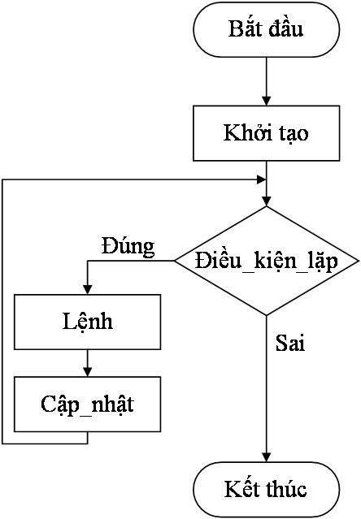

**<u>Ví dụ 1:</u>** Chương trình xuất các số lẻ nhỏ hơn 10

```cpp
#include <iostream>

using namespace std;

int main()

{

int i;

for (i = 1; i < 10; i = i + 2)

cout << i << "\t";

return 0;

}
```

***Kết quả:*** 1 3 5 7 9

\- Bài toán tiêu biểu dùng với câu lệnh for.

\+ Rất phù hợp với bài toán cần lặp với số lần lặp xác định (số lần này là số nguyên)

. Rất nhiều bài toán trong kỹ thuật dùng mảng để lưu trữ dữ liệu

. Để xử lý dữ liệu trên mảng (duyệt qua các phần tử), cấu trúc for là phù hợp nhất.

\+ Câu lệnh for, khi kết hợp break, cũng có thể dừng câu lệnh lặp.

**- Lưu ý về mặt cú pháp:** Giữa dấu ( và dấu ) của for luôn luôn có đúng 3 dấu chấm phẩy (;). Chia ra 3 phạm vi: Khởi tạo, Biểu thức điều kiện, Thay đổi giá trị (Cập nhật)

**<span class="mark">\*\*\* 1 trong 3/ Cả ba vùng này có thể trống</span>**

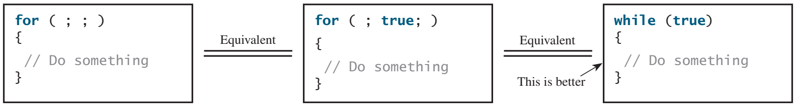

@ Trong câu lệnh for, có thể sẽ không có phần \<Khởi tạo\> (\<Khởi đầu\>).

<table style="width:80%;">
<colgroup>
<col style="width: 40%" />
<col style="width: 40%" />
</colgroup>
<thead>
<tr>
<th style="text-align: left;"><p><code>int i;</code></p>
<p><code>for (i = 0; i &lt; 10; i++)</code></p>
<p><code>cout &lt;&lt; i &lt;&lt; endl;</code></p></th>
<th style="text-align: left;"><p><code>int i = 0;</code></p>
<p><code>for (; i &lt; 10; i++)</code></p>
<p><code>cout &lt;&lt; i &lt;&lt; endl;</code></p></th>
</tr>
</thead>
<tbody>
</tbody>
</table>

@ Trong câu lệnh for, có thể sẽ không có phần \<Bước nhảy\> **(\<Cập nhật\>).**

<table style="width:80%;">
<colgroup>
<col style="width: 40%" />
<col style="width: 40%" />
</colgroup>
<thead>
<tr>
<th style="text-align: left;"><p><code>int i;</code></p>
<p><code>for (i = 0; i &lt; 10; i++)</code></p>
<p><code>cout &lt;&lt; i &lt;&lt; endl;</code></p></th>
<th style="text-align: left;"><p><code>int i;</code></p>
<p><code>for (i = 0; i &lt; 10; )</code></p>
<p><code>{</code></p>
<p><code>cout &lt;&lt; i &lt;&lt; endl;</code></p>
<p>i++;</p>
<p><code>}</code></p></th>
</tr>
</thead>
<tbody>
</tbody>
</table>

@ Trong câu lệnh for, có thể sẽ không có phần \<Đ/K lặp\>

<table style="width:98%;">
<colgroup>
<col style="width: 32%" />
<col style="width: 32%" />
<col style="width: 33%" />
</colgroup>
<thead>
<tr>
<th style="text-align: left;"><p><code>int i;</code></p>
<p><code>for (i = 0; i &lt; 10; i++)</code></p>
<p><code>cout &lt;&lt; i &lt;&lt; endl;</code></p></th>
<th style="text-align: left;"><p><code>for (i = 0; ; i++)</code></p>
<p><code>cout &lt;&lt; i &lt;&lt; endl;</code></p></th>
<th style="text-align: left;"><p><code>for (i = 0; ; i++)</code></p>
<p><code>{</code></p>
<p><code>if (i &gt;= 10)</code></p>
<p><code>break;</code></p>
<p><code>cout &lt;&lt; i &lt;&lt; endl;</code></p>
<p><code>}</code></p></th>
</tr>
</thead>
<tbody>
</tbody>
</table>

**- Nhiều thành phần trong mỗi phần của vòng lặp for**

Trong trường hợp vòng lặp for **cần làm việc với nhiều biến**, có **nhiều điều kiện dừng**, hoặc có **nhiều biến cần cập nhật giá trị**, lập trình viên có thể sử dụng **toán tử phẩy “,”** để tạo thêm nhiều thành phần trong mỗi phần.

```cpp
#include <iostream>

using namespace std;

int main()

{

for (int i = 5, j = 10; i + j < 20; i++, j++)

{

cout << i << " + " << j << " = " << (i + j) << '\n';

}

return 0;

}
```

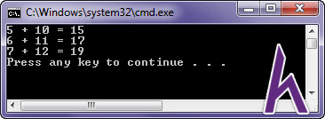

- Biến điều khiển phải được khai báo bên trong cấu trúc điều khiển của vòng lặp hoặc trước vòng lặp.

- Nếu biến điều khiển vòng lặp chỉ được sử dụng trong vòng lặp chứ không được sử dụng ở nơi khác, thì cách tốt nhất là khai báo biến đó trong phần \<khởi tạo\> của vòng lặp for.

- Biến được khai báo trong for.

- Chỉ được dùng trong for

- Không nhìn thấy và không dùng được ở các lệnh theo sau for (không thể được tham chiếu bên ngoài vòng lặp).

**- for lồng nhau:**

\+ Được sử dụng khi cần xử lý mảng nhiều chiều

\+ Khi cần truy cập những dữ liệu có trúc mảng trong mảng

Ví dụ: khi cần truy cập thông tin sinh viên, ta có thể truy cập theo: Duyệt qua tất cả các lớp, Ứng với mỗi lớp, truy cập thông tin của từng sinh viên

```cpp
#include <iostream>

using namespace std;

int main()

{

for (int i = 0; i <= 5; i++)

{

for (int j = 0; j <= i; j++)

cout << j << " ";

cout << endl;

}

return 0;

}
```

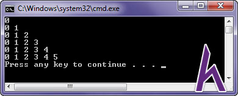

### 2.3.5. Một số lỗi thường gặp

**- Lặp vô hạn**

\+ Chương trình không “chạm” đến điều kiện dừng

\+ Chương trình “chạm” đến được nhưng biểu thức điều kiện không đáp ứng

```cpp
#include <iostream>

using namespace std;

int main()

{

int N;

cin >> N;

for (int i = 0; i < N; i++) {

int j = 2;

cout << i << ": ";

while (j \

if (i % j == 0) {

cout << j << " ";
```

j++;

}

}

```cpp
cout << endl;

}

}
```

Kết quả: 5

0:

1:

2:

3:

**- Dư thừa dấu chấm phẩy:**


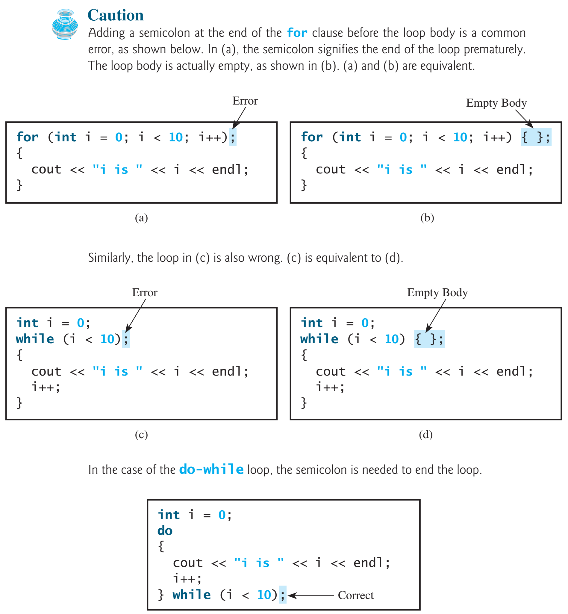

**\*\*\* Nên dùng vòng lặp nào?**

- Bạn có thể sử dụng vòng lặp for, vòng lặp while hoặc vòng lặp do-while, tùy theo điều kiện nào thuận tiện.

- Vòng lặp while và vòng lặp for được gọi là vòng lặp pretest vì điều kiện tiếp tục được kiểm tra trước khi thân vòng lặp được thực thi.

- Vòng lặp do-while được gọi là vòng lặp posttest vì điều kiện được kiểm tra sau khi thân vòng lặp được thực thi.

- Ba dạng câu lệnh vòng lặp—while, do-while, và for—có ý nghĩa tương đương nhau; nghĩa là bạn có thể viết một vòng lặp ở bất kỳ dạng nào trong ba dạng này.

- Ví dụ, vòng lặp while ở (a) trong hình dưới đây luôn có thể được chuyển đổi thành vòng lặp for ở (b).

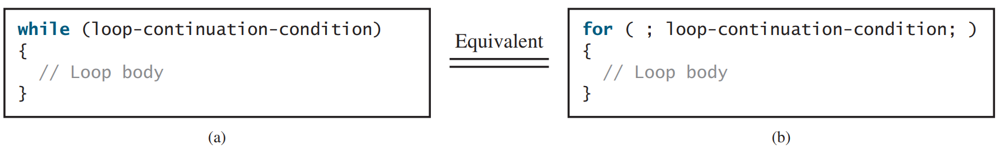

- Nói chung, vòng lặp for có thể được sử dụng nếu biết trước số lần lặp lại, chẳng hạn như khi bạn cần hiển thị thông báo 100 lần.

- Vòng lặp while có thể được sử dụng nếu số lần lặp lại không cố định, như trong trường hợp đọc các số cho đến khi đầu vào bằng 0.

- Vòng lặp do-while có thể được sử dụng để thay thế vòng lặp while nếu thân vòng lặp phải được thực thi trước khi điều kiện tiếp tục được kiểm tra.

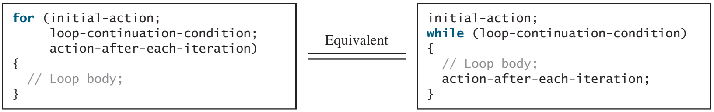

## 2.4. Lệnh nhảy vô điều kiện

### 2.4.1. Câu lệnh break;

\- Khi câu lệnh for thực thi đến lệnh **break**; nó sẽ thoát khỏi vòng lặp ngay lập tức. Nghĩa là chương trình nhảy đến thực thi lệnh theo sau for.

\- Có thể dùng để kết thúc sớm quá trình thực thi của một **vòng lặp**.

\- Thường dùng để kết thúc một vòng lặp vô hạn.

**<u>Ví dụ 1:</u>**

```cpp
#include <iostream>

using namespace std;

int main()

{

// An example of a standard for loop

for (int i = 1; i < 10; i++)

{

cout << i << '\n';

// exit loop if i == 4

if (i == 4)

break;

}

return 0;

}
```

***Kết quả:*** 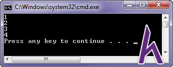

**<u>Ví dụ 2:</u>**

```cpp
#include <iostream>

using namespace std;

int main()

{

while (true)

{

cout << "Enter a number (0 to exit): ";

int num;

cin >> num;

// exit loop if user enters 0

if (num == 0)

break;

}

return 0;

}
```

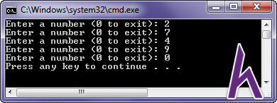

**<u>Ví dụ 3:</u>** Tìm số lớn nhất trong khoảng (a, b) chia hết cho c.

```cpp
#include <iostream>

using namespace std;

int main()

{

int i, a, b, c;

cout << "Nhap vao a,b,c: ";

cin >> a >> b >> c;

cout << "Trong khoang (" << a << ',' << b << ')';

if (c > a && c < b)

{

for (i = b - 1; i > a; i--)

if (i % c == 0) break;

cout << " so lon nhat chia het cho " << c << " la " << i;

}

else

cout << " khong co so nao chia het cho " << c << '\n';

}
```

**<u>Ví dụ 4:</u>** chương trình kiểm tra số nguyên tố

```cpp
#include <iostream>

using namespace std;

int main()

{

int n, i;

cout << "n = "; cin >> n;

if (n < 2) cout << n << " khong phai la so nguyen to";

if (n == 2) cout << n << " la so nguyen to";

if (n > 2)

{

for (i = 2; i <= n; i++)

if (n % i == 0) break;

if (i == n) cout << n << " la so nguyen to";

else cout << n << " khong phai la so nguyen to";

}

}
```

### 2.4.2. Câu lệnh continue;

\- Khi câu lệnh for thực thi đến lệnh **continue**; nó không thực thi các lệnh còn lại (theo sau **continue**) của vòng lặp hiện tại. Nó đi đến bước kiểm tra điều kiện để xem có thực thi vòng lặp kế tiếp hay không.

\- Ít được sử dụng trong vòng lặp while và do-while.

\- Đối với vòng lặp while và do-while, các biến vòng lặp thường được thay đổi giá trị bên trong vòng lặp, từ khóa continue có thể bỏ qua những phần cập nhật các biến vòng lặp, dẫn tới vòng lặp vô hạn.

**<u>Ví dụ 1:</u>** In ra các số từ 10 đến 20 nhưng bỏ qua số 13 và 17.

```cpp
#include <iostream>

using namespace std;

int main()

{

for (int i = 10; i <= 20; i++)

{

if (i == 13 || i == 17)

continue;

cout << i << ", ";

}

cout << '\n';

}
```

***Kết quả:*** 10, 11, 12, 14, 15, 16, 18, 19, 20,

### 2.4.3. Lệnh nhảy goto 

\- Nhảy chương trình về thực hiện lệnh từ vị trí được gán nhãn.

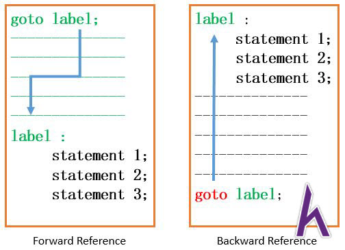

**<u>Ví dụ 1:</u>** In ra các số từ 1 đến 9.

```cpp
#include <iostream>

using namespace std;

int main()

{

int n = 1;
```

Lap: //Đây là nhãn

```cpp
cout << n << " ";
```

n++;

```cpp
if (n < 10) goto Lap; //Nhảy về nhãn Lap

cout << '\n';

}
```

***Kết quả:*** 1 2 3 4 5 6 7 8 9

**<u>Ví dụ 2:</u>**

```cpp
#include <iostream>

using namespace std;

int main() {

int a, b, c, tt;
```

Vi_Tri_3:

```cpp
cout << "\nNhap vao 3 so nguyen:\n";

cin >> a >> b >> c;
```

Vi_Tri_4:

```cpp
cout << "\nBam so 1 de tim so lon nhat: ";

cout << "\nBam so 2 de tim so nho nhat: ";

cout << "\nBam so 3 de nhap lai 3 so: ";

cout << "\nBam so 0 de thoat khoi chuong trinh: ";

cin >> tt;

if (tt == 1) goto Vi_Tri_1;

if (tt == 2) goto Vi_Tri_2;

if (tt == 3) goto Vi_Tri_3;

if (tt == 0) goto Vi_Tri_0;
```

Vi_Tri_1:

```cpp
cout << "So lon nhat la: " << (a > b ? (a > c ? a : c) : (b > c ? b : c));
```

goto Vi_Tri_4;

Vi_Tri_2:

```cpp
cout << "So nho nhat la: " << (a < b ? (a < c ? a : c) : (b < c ? b : c));
```

goto Vi_Tri_4;

Vi_Tri_0:

```cpp
return 0; //Tra ve cho ham main gia tri 0 va thoat khoi chuong trinh

}
```

**\* Phạm vi của nhãn trong câu lệnh Goto:** Nhãn trong câu lệnh Goto có phạm vi hàm. Các lệnh goto và nhãn tương ứng của nó phải nằm trong cùng một hàm.

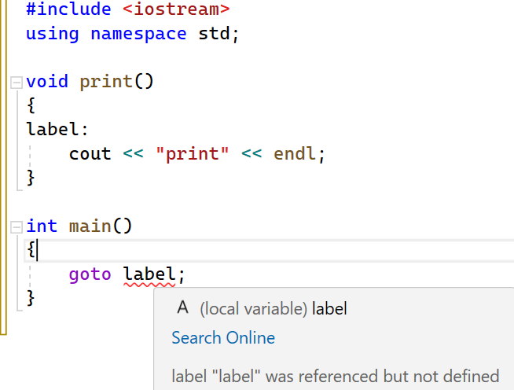

**\* Hạn chế của câu lệnh Goto**

\+ Bạn không thể nhảy qua một câu lệnh khởi tạo biến trong cùng một khối lệnh.

\+ Nhìn chung, bạn không nên sử dụng câu lệnh Goto. Vì nó gây khó khăn cho việc theo dấu dòng điều khiển của một chương trình, làm cho chương trình khó hiểu và khó chỉnh sửa.

\+ Trong C++ (và hầu hết các ngôn ngữ bậc cao khác), câu lệnh Goto hầu như không bao giờ được sử dụng. Bất kỳ chương trình nào sử dụng câu lệnh goto đều có thể được viết lại rõ ràng hơn khi sử dụng các cấu trúc khác trong C++.

## 2.5. Vòng lặp for each trong C++11

\- Phiên bản **C++11** cung cấp một loại vòng lặp mới, có** **cú pháp đơn giản, dễ sử dụng hơn for loop, được gọi là **for-each loop (Range-based for loop)**.

**- For-each loop** được sử dụng *để lặp qua các phần tử* trên 1 mảng (hoặc các cấu trúc danh sách khác như **vectors**, **linked lists**, **trees**, và **maps**).

### 2.5.1 Cú pháp vòng lặp for-each

> **for **(**element_declaration** : **array**)
>
>                          **statement(s)**;

***Trong đó:***

- **element_declaration**: là một *khai báo biến (int a)* hoặc *tham chiếu* có *kiểu trùng với kiểu của các phần tử* trong array. Thường sử dụng *từ khóa auto.*

- **array**: tên mảng hoặc cấu trúc danh sách cần lặp.

- **statement**: câu lệnh đơn hoặc khối lệnh.

**Ví dụ: **sử dụng **for-each loop** để truy cập vào từng phần tử của mảng:

```cpp
#include <iostream>

using namespace std;

int main()

{

int arr[] = { 14, 3, 6, 27, 12 };

for (int item: arr)

{

// biến item đại diện cho phần tử mảng ở mỗi vòng lặp

cout << item << " ";

}

cout << endl;

return 0;

}
```

**Output: **14 3 6 27 12

\- Trong chương trình trên, vòng lặp** for-each** sẽ lặp qua từng phần tử trong mảng **arr**, gán giá trị phần tử hiện tại vào biến **item**. Biến **item **nên có cùng kiểu dữ liệu với phần tử trong mảng **arr**.

> **Chú ý: **Biến **element_declaration** đại diện cho phần tử của **array **ở vòng lặp hiện tại, **không phải** là chỉ số của **array**.

### 2.5.2. Vòng lặp for-each và từ khóa auto

\- Vì biến **element_declaration** nên có cùng kiểu dữ liệu với phần tử trong mảng, nên cách tốt nhất là sử dụng từ khóa **auto **để khai báo. **Compiler **sẽ tự dộng xác định kiểu cho biến.

```cpp
#include <iostream>

using namespace std;

int main()

{

int arr[] = { 14, 3, 6, 27, 12 };

for (auto item: arr) // compiler tự dộng xác định kiểu cho item

{

cout << item << " ";

cout << endl;

return 0;

}
```

**Output: **14 3 6 27 12

### 2.5.3. Vòng lặp for-each và tham chiếu

Trong các ví dụ trên, vòng lặp** for-each** sử dụng các** biến giá trị **cho mỗi lần lặp:

```cpp
int arr[] = { 14, 3, 6, 27, 12 };

for (auto item: arr) // item là 1 bản copy của phần tử hiện tại

{

cout << item << " ";

}
```

\- Với phương pháp này, các biến sẽ được sao chép giá trị của phần tử hiện tại trong mảng sau mỗi lần lặp. Điều này gây giảm hiệu suất và tốn vùng nhớ khi sao chép. Để khắc phục trường hợp này, ta sử dụng biến tham chiếu.

\- Sử dụng biến tham chiếu cho vòng lặp for-each giúp CPU **truy cập trực tiếp** vào phần tử của mảng, không mất thời gian và vùng nhớ để **khởi tạo bản sao** cho biến. Tuy nhiên, tham chiếu có thể làm **thay đổi giá trị **của phần tử mảng.

```cpp
int arr[] = { 14, 3, 6, 27, 12 };

for (auto &item: arr) // item là 1 biến tham chiếu đến phần tử hiện tại

{

cout << item << " ";

}
```

\- Trường hợp không muốn thay đổi giá trị của phần tử trong mảng, bạn có thể sử dụng **tham chiếu hằng (const reference)**.

```cpp
int arr[] = { 14, 3, 6, 27, 12 };

for (const auto &item: arr) // item là 1 tham chiếu hằng đến phần tử hiện tại

{

cout << item << " ";

}
```

> **Chú ý: **Sử dụng **tham chiếu (reference)** hoặc** tham chiếu hằng (const reference) **cho biến khai báo trong vòng lặp for-each vì lý do hiệu suất.

### 2.5.4 Vòng lặp for-each không làm việc với con trỏ mảng

\- Để lặp qua 1 mảng, vòng lặp **for-each** phải biết được kích thước của mảng đó. Con trỏ đến 1 mảng không cho biết kích thước của mảng đó, nên vòng lặp for-each sẽ không làm việc.

```cpp
#include <iostream>

using namespace std;

void printArray(int arr[])

{

for (const auto &item : arr) // lỗi biên dịch vì arr chỉ là 1 con trỏ

{

cout << item << " ";

}

}

int main()

{

int arr[] = { 14, 3, 6, 27, 12 };

printArray(arr);

return 0;

}
```

> **Chú ý: **Vòng lặp for-each **không **làm việc với con trỏ đến một mảng.

### **2.5.5.** Xem chỉ số phần tử hiện tại trong vòng lặp for-each

Vòng lặp** for-each** **không **cung cấp phương thức trực tiếp nào để xem được chỉ số phần tử hiện tại. Với những yêu cầu liên quan đến chỉ số phần tử, bạn có thể sử dụng **vòng lặp for trong C++**
