Chương 3. HÀM - MẢNG - CHUỖI KÝ TỰ\
(FUNCTION - ARRAY - CHARACTER SEQUENCES)
========================================

## 3.1. Hàm (Function)

### 3.1.1. Khái niệm

\- Một đoạn chương trình có tên, đầu vào và đầu ra.

\- Một nhóm các câu lệnh có liên quan, đi cùng nhau, để thực hiện một nhiệm vụ, một phần công việc nào đó trong một chương trình.

\- Có chức năng giải quyết một số vấn đề chuyên biệt cho chương trình chính.

\- Có thể gọi nhiều lần tại một số vị trí trong chương trình, với các tham số khác nhau.

\- Được sử dụng khi có nhu cầu: Tái sử dụng; Sửa lỗi và cải tiến.

**<u>Ví dụ:</u>** trong thư viện \<math.h\>

\+ Hàm sin(x): Là chuỗi các lệnh tính toán để tính giá trị sin của một góc x được truyền vào, góc x có đơn vị tính là radian; hàm sin(x) trả về một số thực

\+ Hàm sqrt(x): Là chuỗi các lệnh tính toán để tính căn bậc 2 của đại lượng x được truyền vào, đại lượng x có đơn vị tính là một số thực (float hay double); hàm sqrt trả về một số thực.

\- Tất cả các hàm C++ (trừ trường hợp đặc biệt của hàm main) phải có:

***+ Khai báo:*** câu lệnh nêu cách 1 hàm được gọi.

***+ Định nghĩa:*** (các) câu lệnh của tác vụ mà hàm thực hiện khi được gọi.

\- Một function (hàm) được tạo ra từ những yếu tố sau:

***+ Kiểu trả về của hàm (data type of output):*** Hàm có thể có giá trị trả về hoặc không có giá trị trả về.

*\* Được xác định dựa vào mục đích của hàm*

*\* Trong thân hàm, phải trả về đúng \<kiểu trả về\> đã định ban đầu.*

*\* Nếu các hàm không trả về giá trị ta phải khai báo kiểu void.*

***+ Tên hàm (function name):*** Hàm bắt buộc phải có tên, quy tắc đặt tên giống với quy tắc đặt tên biến.

***+ Danh sách tham số (function parameters):*** Hàm có thể có 1 tham số, nhiều tham số hoặc không có tham số nào.

***+ Khối lệnh (block of statements):*** Khối lệnh phía sau hàm chứa những dòng lệnh mà nó sẽ được thực hiện trong mỗi lần gọi hàm.

\- int main() là một hàm đặc biệt được tạo ra đầu mỗi chương trình.

\+ Mọi hàm khác được gọi một cách trực tiếp hay gián tiếp thông qua hàm main ().

\+ Một chương trình khi chạy sẽ chạy vào hàm main() đầu tiên, và chạy các câu lệnh trong hàm main() trước.

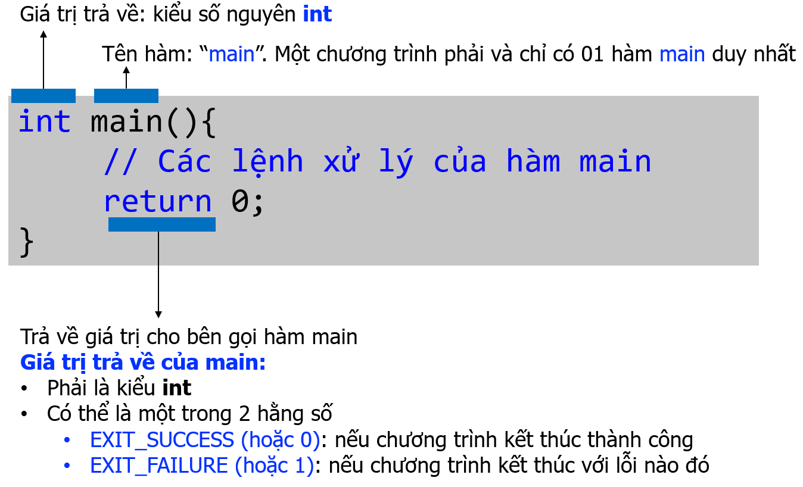

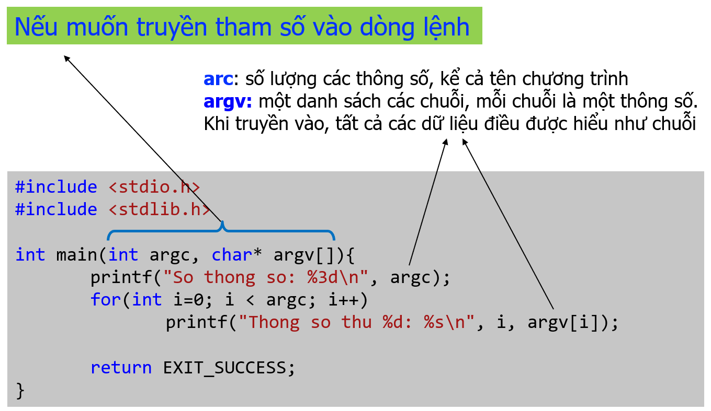

\+ Sau khi biên dịch chương trình thành công, tạo ra tập tin “Program.exe”

\+ Chạy chương trình “Program.exe” bằng dòng lệnh như sau:

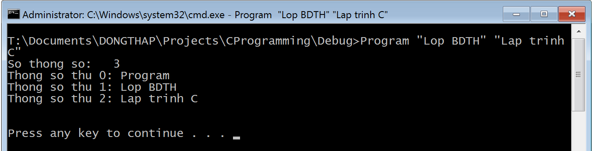

\+ Cách truyền tham số dòng lệnh trong Visual Studio

- Nhấn chuột phải trên \<dự án\> trong cửa sổ “Solution Explorer”

- Chọn “Debug” \> “Command Arguments”

- Xổ chọn “Edit …” trong danh sách chức năng của “Command Arguments”

- Gõ vào danh sách thông số: các thông số cách nhau bởi khoảng trắng hay dấu “,”

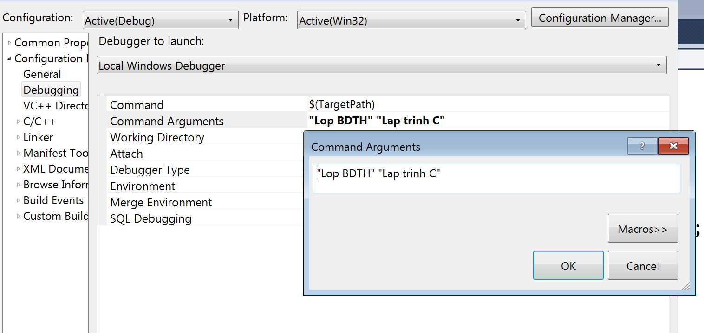

\- **Các bước viết hàm:**

Cần xác định các thông tin sau đây:

§ Tên hàm.

§ Hàm sẽ thực hiện công việc gì.

§ Các đầu vào (nếu có).

§ Đầu ra (nếu có)

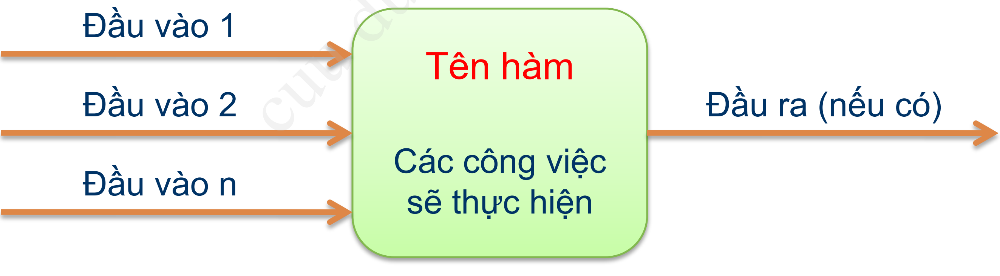

**<u>Ví dụ:</u>**

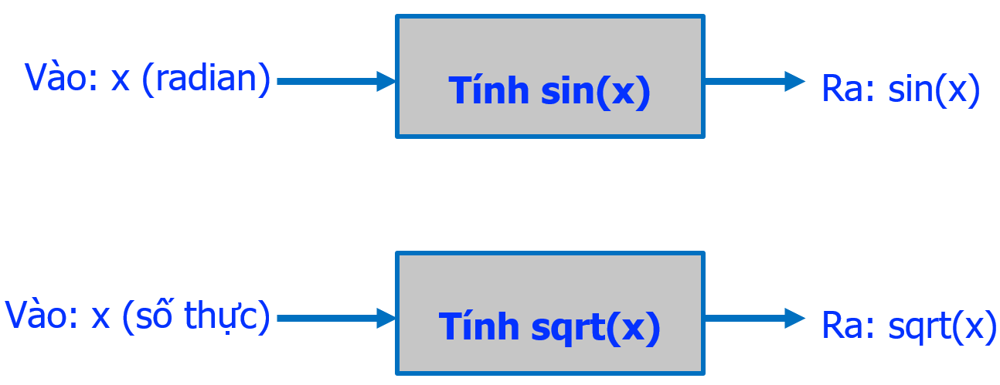

Hàm cộng hai số:

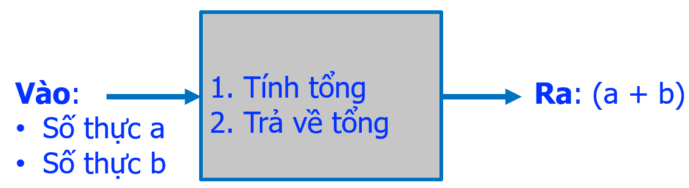

\- Lý do sử dụng hàm:

\+ Tránh lặp lại mã nguồn: Tiết kiệm thời gian phát triển, Thay đổi đoạn mã nguồn trong hàm nhanh và dễ dàng, chỉ tại một nơi

\+ Sử dụng lại một đơn vị tính toán mà không phải viết lại:

- Tiết kiệm thời gian phát triển

- Có thể chia sẽ đơn vị tính toán không chỉ cho một dự án mà cho nhiều dự án

- Ví dụ: hãy xem xét trường hợp mà mọi dự án đều viết lại các hàm toán học: sin(x), sqrt(x), v.v.

  🡪 tốn kém và lãng phí 🡪 sử dụng thư viện \<math.h\>

\+ Giúp cho việc phát triển giải thuật, việc tổ chức chương trình dễ dàng

### 3.1.2. Cú pháp định nghĩa hàm

**\<Kiểu_trả_về\> Tên_hàm (\[\<Kiểu và Danh_sách_tham_số\>\])**

**{**

**/\*Thân hàm\*/**

Các_câu_lệnh;

**\[return giá_trị/biểu thức\];**

**}**

- **\<Kiểu trả về\>:** kiểu bất kỳ của C++ (bool, char, int, long, float,…). Nếu không trả về là void.

- **\<Tên hàm\>:** theo quy tắc đặt tên định danh.

- \<**Danh sách tham số\>:** tham số hình thức đầu vào giống khai báo biến, cách nhau bằng dấu **,**

- **\<giá_trị/biểu thức\>:** trả về cho hàm qua lệnh return.

Ví dụ:

> int tinhTong(int a, int b)
>
> {
>
> int s;
>
> s = a + b;
>
> return s;
>
> }

**- Khai báo nguyên mẫu hàm:** Khai báo nguyên mẫu hàm sẽ cung cấp cho trình biên dịch mô tả về một hàm sẽ được định nghĩa ở một vị trí nào đó trong chương trình:

<span class="mark">***\<Kiểu_trả_về\> \<***tên_hàm\> **(\[\<*kiểu và*** danh_sách_tham_số**\>\]);** </span>

**<u>Ví dụ 1:</u>**

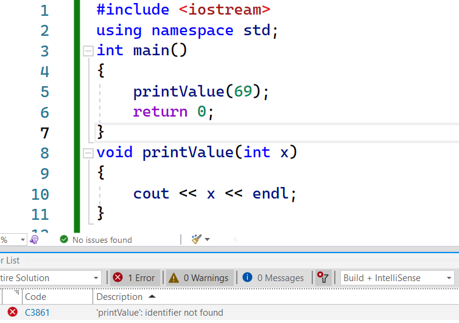

Trong C++, các dòng lệnh được **compile từ trên xuống dưới**. Khi compiler đọc đến câu lệnh **printValue(69)** ở dòng 6, compiler không hiểu hàm **printValue(int** **x)** là gì vì đến dòng 11 hàm mới được định nghĩa. Dẫn đến lỗi **“identifier not found”**.

🡪 Sửa lỗi:

```cpp
#include <iostream>

using namespace std;

void printValue(int x)

{

cout << x << endl;

}

int main()

{

printValue(69);

return 0;
```

***Kết quả:*** 69

Đặt trường hợp chương trình của bạn có rất nhiều hàm cần được xử lý, thế rồi các bạn định nghĩa hàm tràn lan ra file mã nguồn. Đến khi nhìn lại mã nguồn sẽ rất rối mắt. Thay vào đó, chúng ta khai báo hết các nguyên mẫu hàm cần sử dụng phía trên cùng của file mã nguồn, sau đó phần định nghĩa nằm bên dưới. Lúc cần tìm xem chương trình của chúng ta có những hàm nào, chỉ cần kéo lên trên để xem là được.

- *Tiền khai báo (forward declaration) giúp compiler biết được về sự tồn tại của một định danh (một type, function, hoặc class) trước khi thực sự định nghĩa nó.*

- Khi compiler gặp một lời gọi hàm đã tồn tại câu lệnh tiền khai báo (forward declaration), nó sẽ hiểu rằng đó là một lời gọi hàm và kiểm tra tính hợp lệ của lời gọi hàm (danh sách đối số, kiểu trả về), mặc dù compiler chưa biết hàm đó thực hiện những công việc gì và nó được định nghĩa ở đâu.

- Để tạo tiền khai báo cho một hàm, chúng ta sử dụng một câu lệnh khai báo gọi là **nguyên mẫu hàm (function prototypes).** Nguyên mẫu hàm bao gồm: **kiểu trả về của hàm, tên hàm, tham số, nhưng không có thân hàm và được kết thúc bằng dấu chấm phẩy “;”.**

**<u>Ví dụ 2:</u>**

```cpp
#include <iostream>

using namespace std;

long factorial(int n); //Khai báo nguyên mẫu cho hàm factorial

int main()

{

cout << "6! = " << factorial(6); //Gọi hàm factorial với tham số là 6

}

long factorial(int n)//Định nghĩa hàm factorial với 1 tham số nguyên n

{

long p = 1, i;

if (n >= 0) // Chỉ tính giai thừa cho số không âm

{

for (i = 2; i <= n; i++) p *= i;

return p; //Trả về cho hàm factorial giá trị bằng p

}

else cout << "Khong tinh duoc giai thua so am";

}
```

**\*\*\* Nguyên mẫu hàm có thể không cần tên tham số cụ thể:**

**// Function prototype includes return type, name, parameters, and semicolon.**

**// No function body!**

```cpp
void printValue(int);

int add(int, int);
```

- Nguyên mẫu hàm nên có tên của tham số, vì nó sẽ giúp bạn hiểu rõ mục đích của từng tham số mà không cần đi đến phần định nghĩa của hàm.

***Lưu ý:*** C++ không cho phép các hàm lồng nhau, nghĩa là phần định nghĩa của hàm này phải độc lập hoàn toàn với hàm khác.

***\# <u>Phân biệt khai báo và định nghĩa trong C++:</u>***

**- Khai báo (declarations) **là giới thiệu sự tồn tại của một định danh (một type, function, hoặc class) và mô tả nó. Khai báo (declarations) giúp compiler biết được về sự tồn tại của một định danh trước khi chúng ta định nghĩa nó. **Compiler không cần phải cấp vùng nhớ khi khai báo.**

**extern** **int** n;

**extern** **int** add(**int**, **int**);

```cpp
double div(int, double); // extern can be omitted for function declarations

class foo; // no extern allowed for type declarations
```

Từ khóa **extern** cho biết rằng định danh này được định nghĩa ở chỗ khác. Có nghĩa compiler không cần phải cấp vùng nhớ cho định danh này.

**- Định nghĩa (definitions) **là trình bày rõ kiểu dữ liệu hoặc giá trị khởi tạo của biến (variables), cấu trúc và nội dung của hàm (functions), lớp (classes). **Compiler cần phải cấp vùng nhớ khi định nghĩa.**

```cpp
int n;

int add(int a, int b) { return a + b; }

double div(int i, double d){ return i / d; }

class foo {}
```

**Một định danh có thể được khai báo nhiều lần:**

```cpp
double f(int, double);

double f(int, double);
```

**extern** **double** f(**int**, **double**); // the same as the two above

**extern** **double** f(**int**, **double**);

*Tuy nhiên, định danh chỉ được định nghĩa một lần duy nhất. Nếu một định danh được định nghĩa 2 lần, compiler sẽ thông báo lỗi.*

**<u>Chú ý:</u>** Khi một định danh được khai báo nhưng không định nghĩa, nếu định danh đó không được sử dụng trong chương trình, thì chương trình vẫn được biên dịch và chạy thành công.

Nhưng nếu sử dụng một định danh khi chưa định nghĩa chúng, compiler vẫn biên dịch thành công, nhưng trình liên kết (linker) sẽ thông báo lỗi.

### 3.1.3. Lời gọi hàm

Gọi tên của hàm đồng thời truyền các đối số (hằng, biến, biểu thức) cho các tham số theo đúng thứ tự đã được khai báo trong hàm.

§ Các biến hoặc trị này cách nhau bằng dấu ,

§ Các đối số này được được đặt trong cặp dấu ngoặc đơn ( )

**<span class="mark">\<tên hàm\> (\[\<đối số 1\>,… , \<đối số n\>\]);</span>**

**<u>Ví dụ 1:</u>**

```cpp
#include <iostream>

using namespace std;

void XuatTong(int x, int y)

{

int s;

s = x + y;

cout << x << " cong " << y << " bang " << s;

}

int main()

{

int a = 1, b = 2;

XuatTong(1, 2);

//XuatTong(1, b);

//XuatTong(a, b);

}
```

***Kết quả:*** 1 cong 2 bang 3

**<u>Ví dụ 2:</u>**

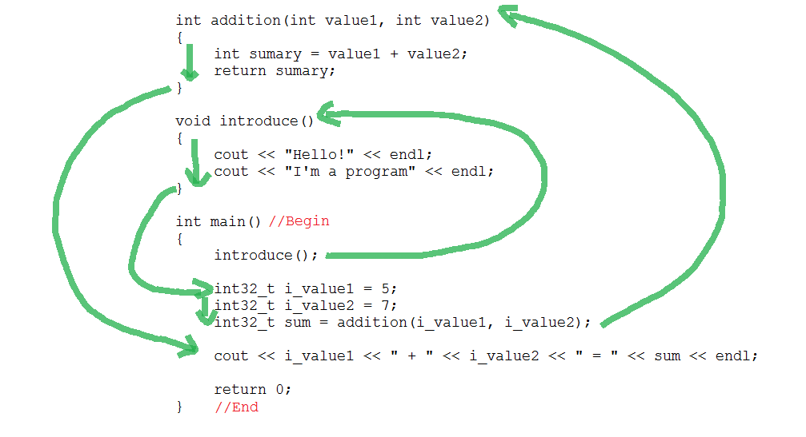

**Cách gọi hàm:**

<table style="width:99%;">
<colgroup>
<col style="width: 49%" />
<col style="width: 50%" />
</colgroup>
<thead>
<tr>
<th style="text-align: center;"><p><em>Đối với hàm không có giá trị trả về</em></p></th>
<th style="text-align: center;"><p><em>Đối với hàm có giá trị trả về</em></p></th>
</tr>
</thead>
<tbody>
<tr>
<td style="text-align: left;"><p><code>void func_Name(int a);</code></p>
<p><code>int main() {</code></p>
<p><code>int a = 1;</code></p>
<p><code>func_Name(a);</code></p>
<p><code>return 0;</code></p>
<p><code>}</code></p>
<p><code>void func_Name(int a) {</code></p>
<p>…</p>
<p><code>}</code></p></td>
<td style="text-align: left;"><p><code>int func_Name(int a);</code></p>
<p><code>int main() {</code></p>
<p><code>int a = 1;</code></p>
<p><code>cout &lt;&lt; func_Name(a);</code></p>
<p><code>return 0;</code></p>
<p><code>}</code></p>
<p><code>int func_Name(int a) {</code></p>
<p>…</p>
<p><code>}</code></p></td>
</tr>
</tbody>
</table>

### 3.1.4. Nguyên tắc hoạt động của hàm

\- Khi máy gặp lời gọi hàm ở một vị trí nào đó trong chương trình, máy sẽ tạm dời chỗ đó (bộ nhớ lưu trữ vị trí, trạng thái,… gọi là context (ngữ cảnh)) và chuyển đến hàm tương ứng.

\- Khi lời gọi hàm được thực thi thì bộ thực thi sẽ làm các công việc

- Lưu vết: lệnh kế tiếp của lệnh gọi hàm

- Copy các thông số cho hàm được gọi

- Cấp phát bộ nhớ cho các biến cục bộ (cả tham số).

- Gán giá trị của các đối số cho các tham số tương ứng.

- Chuyển điều khiển thực thi cho hàm được gọi để nó thực thi lệnh đầu tiên trong hàm được gọi.

- Hàm được gọi thực thi các lệnh.

- Khi hàm được gọi thực hiện lệnh return hoặc gặp dấu }.

\+ Khi gặp câu lệnh return hoặc dấu } cuối cùng của thân hàm thì máy sẽ xoá các tham số hình thức, biến cục bộ và ra khỏi hàm.

\+ Nếu trở về từ một câu lệnh return có chứa biểu thức thì giá trị của biểu thức được gán cho hàm. Giá trị của hàm sẽ được sử dụng trong các biểu thức chứa nó.

\+ Trả điều khiển về lệnh theo sau lệnh gọi hàm

- Hàm gọi giải phóng các thông số đã truyền và thực thi lệnh kế tiếp theo lệnh gọi hàm.

### 3.1.5. Giá trị trả về

*- Đối với hàm int main () {…}, hàm main() có kiểu int nên bắt buộc phải có một câu lệnh return giá trị kiểu int. Khi chương trình thực thi kết thúc, hàm main() sẽ return một giá trị cho hệ điều hành, để thông báo là nó chạy thành công hay không.*

\- Khi tạo ra một hàm mới, tùy vào mục đích của hàm mà bạn có thể quyết định hàm đó có trả về một giá trị nào đó hay không.

*- Để tạo ra một hàm có giá trị trả về, bạn cần:*

*+ Thiết lập kiểu trả về trong định nghĩa của hàm*

*+ Sử dụng câu lệnh return để trả về một giá trị.*

**<u>Chú ý:</u>** **Khi gặp câu lệnh return, hàm sẽ trả về giá trị ngay tại thời điểm đó. Tất cả câu lệnh trong hàm, sau dòng lệnh return sẽ được bỏ qua.**

**<u>Ví dụ:</u>**

```cpp
#include <iostream>

using namespace std;

// int means the function returns an integer value to the caller

int return69()

{

// this function returns an integer, so a return statement is needed

return 69; // we're going to return integer value 69 back to the caller of this function

}

int main()

{

cout << return69() << endl; // prints 69

int sum = return69() + 1;

cout << sum << endl; // prints 70
```

return69(); // okay: the value 69 is returned, but is discarded

```cpp
return 0;

}
```

***Kết quả:*** 69

70

***- Đối với hàm có kiểu void:***

\+ Những hàm có mục đích tính toán thường sẽ return một giá trị khi kết thúc hàm. Đối với những hàm không có mục đích tính toán (Vd: hàm setter, hàm print, …), C++ hỗ trợ sử dụng kiểu dữ liệu void cho những hàm không có giá trị trả về.

**<u>Ví dụ:</u>**

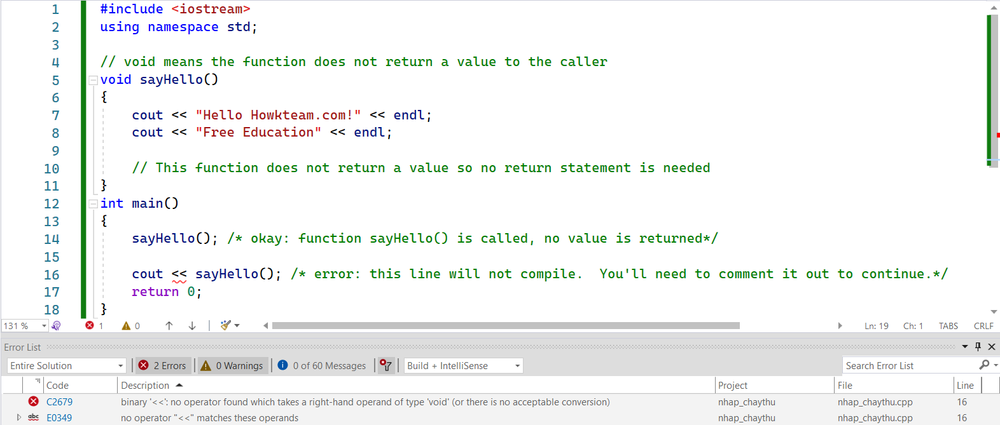

Trong chương trình trên, hàm **sayHello()** có **kiểu void nên sẽ không trả về giá trị**. Nên compiler sẽ **thông báo lỗi** không thể in giá trị của hàm **sayHello()** ra màn hình trong lần gọi hàm thứ 2.

\- Hàm có giá trị trả về **có thể đặt riêng biệt**, hoặc **bên trong một biểu thức.**

**- Khi** **sử dụng câu lệnh return**, **hàm chỉ có thể trả về một giá trị duy nhất**. 

\- Tuy nhiên, bạn có thể sử dụng phương pháp **truyền tham chiếu** hoặc **truyền địa chỉ** cho hàm để có thể **lấy được nhiều giá trị**:

- Phương pháp **truyền tham chiếu**.

- Phương pháp **truyền địa chỉ (con trỏ)**. *(Phần sau)*

### 3.1.6. Tham số và đối số của hàm (Function parameters and arguments)

\- Để chuyển thông tin vào một hàm để tính toán, bạn cần biết đến khái niệm **tham số **và **đối số của hàm (function parameters and arguments)**:

- **Tham số (parameters)**: là các biến được **sử dụng trong một hàm** mà giá trị của biến đó được **cung cấp bởi lời gọi hàm**. Các tham số được đặt bên trong dấu ngoặc đơn, cú pháp giống khai báo biến, **cách nhau bằng dấu phẩy “,”**.

- **Đối số (arguments)**: là các **giá trị truyền vào** hàm ***qua lời gọi hàm***, cách nhau bởi **dấu phẩy “,”**. Số lượng đối số tương ứng với số lượng tham số của hàm.

**<u>Ví dụ 1:</u>**

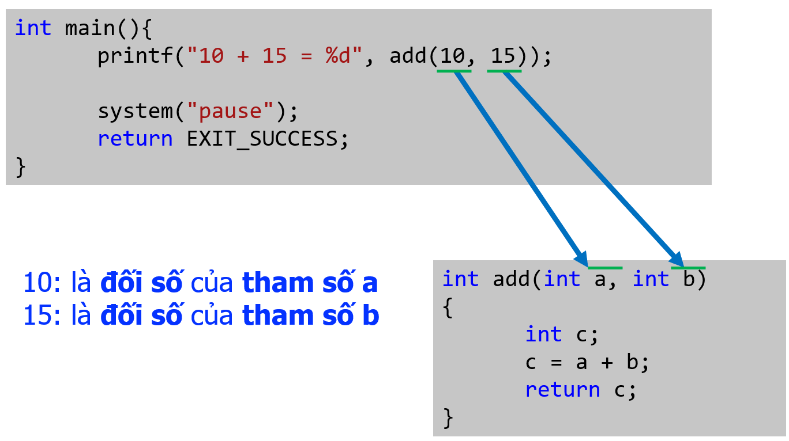

**<u>Ví dụ 2:</u>**

```cpp
#include <iostream>

using namespace std;

void sayHello()

{

cout << "Hello Howkteam.com!" << endl;

}

void printValue(int x)

{

cout << x << endl;

}

int add(int x, int y)

{

return x + y;

}

int main()

{

sayHello();
```

printValue(69); /\* 69 is the argument passed to function printValue()\*/

```cpp
cout << add(6, 9) << endl; /* 6 and 9 are the arguments passed to function add()*/

return 0;

}
```

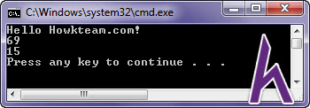

### 3.1.7. Truyền giá trị cho hàm (Passing arguments by value)

\- Truyền đối số vào hàm là giá trị có nghĩa là chúng ta sẽ đưa giá trị vào hàm và các tham số sẽ tiếp nhận những giá trị được truyền vào.

\+ Mặc định đối số được truyền ở dạng giá trị (sao chép giá trị vào cho tham số thực sự).

*+ Có thể truyền hằng, biến, biểu thức nhưng hàm chỉ nhận giá trị.*

**<u>Ví dụ 1:</u>**

```cpp
void hoanVi(int a, int b) {

int t = a; a = b; b = t;

}

int main()

{

int x = 5, y = 10;

hoanVi(7, 12);

hoanVi(x, y);

hoanVi(2 * x + y, y - 2);

}
```

\+ Khi truyền đối số cho hàm ở dạng giá trị, giá trị của đối số được ***sao chép*** vào tham số của hàm.

**<u>Ví dụ 2:</u>**

```cpp
int add(int x, int y)

{

return x + y;

}
```

Hàm add trên sẽ hoạt động như sau:

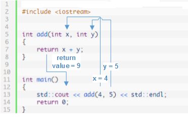

\* Với lời gọi hàm **add(4,5)** thì giá trị 4 sẽ truyền vào cho biến **x** của tham số đầu tiên, giá trị 5 sẽ được gán cho biến **y** của tham số thứ hai.

\* Biến **x** và **y** được khai báo làm tham số của hàm **add** đóng vai trò như là biến cục bộ hoạt động bên trong hàm **add**. Vì thế, tại thời điểm kết thúc phiên làm việc của hàm, các biến tham số này sẽ bị hủy và những giá trị được truyền vào không còn tồn tại.

\- Điều gì xảy ra khi truyền đối số cho hàm là giá trị của một biến (variable)?

```cpp
#include <iostream>

using namespace std;

void swapValue(int value1, int value2)

{

cout << "Swap value in function" << endl;

int temp = value1;

value1 = value2;

value2 = temp;

cout << "value 1: " << value1 << endl;

cout << "value 2: " << value2 << endl;

}

int main()

{

int a = 1;

int b = 2;

swapValue(a, b);

cout << "===============================" << endl;

cout << "After the function call" << endl;

cout << "value 1: " << a << endl;

cout << "value 2: " << b << endl;

system("pause");

return 0;

}
```

\+ Đối số được truyền vào cho hàm **swapValue** lần lượt là giá trị của biến **a** và giá trị của biến **b** sẽ được tiếp nhận bởi tham số **value1** và **value2**. Chúng ta sẽ có kết quả trên màn hình là giá trị của 2 biến **a** và **b** sau khi thực hiện hoán vị bên trong hàm, và giá trị của 2 biến **a** và **b** sau khi thực hiện lời gọi hàm **swapValue**.

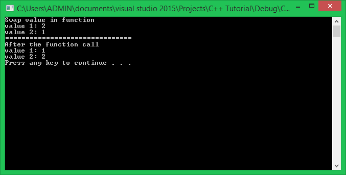

\+ Giá trị của 2 biến **value1** và **value2** (nhận được từ đối số là giá trị của biến **a** và **b**) đã bị hoán vị cho nhau. Nhưng sau khi thực hiện xong công việc bên trong hàm **swapValue** và trở lại thực hiện công việc còn lại bên trong hàm **main**, giá trị của 2 biến **a** và **b** vẫn không có gì thay đổi.

\+ Điều này có nghĩa cái mà tham số **value1** và **value2** tiếp nhận chỉ là 2 bản sao giá trị của biến **a** và **b**. Mọi thay đổi giá trị của tham số bên trong hàm không tác động gì đến giá trị gốc mà đối số đang nắm giữ.

**<u>Ví dụ 3:</u>**

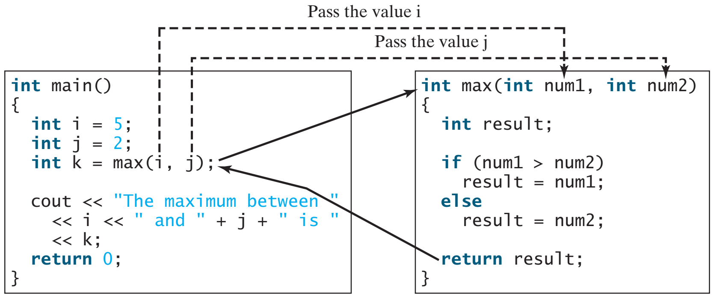

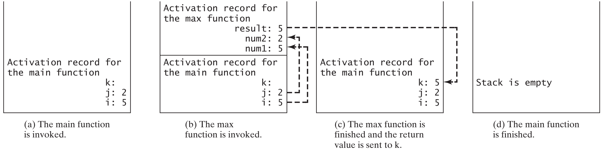

**<u>Ví dụ 4:</u>**

<table style="width:99%;">
<colgroup>
<col style="width: 49%" />
<col style="width: 50%" />
</colgroup>
<thead>
<tr>
<th><p><code>#include &lt;iostream&gt;</code></p>
<p><code><strong>using</strong> <strong>namespace</strong> <strong>std</strong>;</code></p>
<p><code><strong>void</strong> callByValue(<strong>int</strong> y)</code></p>
<p><code>{</code></p>
<p><code><strong>cout</strong> &lt;&lt; "y = " &lt;&lt; y &lt;&lt; endl;</code></p>
<p><code>y = 69;</code></p>
<p><code><strong>cout</strong> &lt;&lt; "y = " &lt;&lt; y &lt;&lt; endl;</code></p>
<p>} // y is destroyed here</p>
<p><code><strong>int</strong> main()</code></p>
<p><code>{</code></p>
<p><code><strong>int</strong> x(1);</code></p>
<p><code><strong>cout</strong> &lt;&lt; "x = " &lt;&lt; x &lt;&lt; endl;</code></p>
<p><code>callByValue(x);</code></p>
<p><code><strong>cout</strong> &lt;&lt; "x = " &lt;&lt; x &lt;&lt; endl;</code></p>
<p><code><strong>return</strong> 0;</code></p>
<p><code>}</code></p></th>
<th><p><em><strong>Kết quả:</strong></em></p>
<p>Truyền Giá Trị cho Hàm (Passing Arguments by Value)</p>
<p><em>Trong chương trình trên, biến x truyền vào hàm <strong>callByValue(int</strong> <strong>y)</strong> ở dạng giá trị, nên nó không bị thay đổi sau lời gọi hàm. Kết quả cuối cùng của biến <strong>x</strong> vẫn là 1.</em></p></th>
</tr>
</thead>
<tbody>
</tbody>
</table>

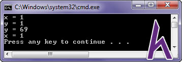

**- Ưu điểm:**

\+ Đối số có thể là **biến** (Vd: x, y), **hằng** (Vd: 1, 2), **biểu thức** (Vd: x + 1), **structs**, **classes**, hoặc **enumerators**.

\+ Đối số **không bị thay đổi **sau lời gọi hàm, hạn chế tác động không mong muốn của hàm lên đối số.

**- Nhược điểm:**

**+ Gây tốn thêm vùng nhớ** do hàm phải tạo các tham số là bản sao của các đối số.

\+ Gây **giảm hiệu suất** trong trường hợp đối số là **kiểu cấu trúc (structs)** hoặc các **lớp (classes)**, đặc biệt là nếu hàm đó **được gọi nhiều lần**. Vì mỗi lần gọi hàm đều phải sao chép giá trị của đối số vào tham số của hàm.

\+ Hàm **chỉ có thể trả về một giá trị duy nhất** bằng câu lệnh **return**.

**- Khi nào nên sử dụng:**

\+ <span class="mark">Khi đối số là các **kiểu dữ liệu cơ bản**.</span>

\+ <span class="mark">Khi **không có nhu cầu thay đổi giá trị** của đối số sau khi thực hiện hàm.</span>

**- Khi nào không nên sử dụng:**

\+ <span class="mark">Khi đối số là các **mảng (arrays)**, **kiểu cấu trúc (structs)**, hoặc các **lớp (classes)**.</span>

\- Trong đa số trường hợp, **truyền giá trị cho hàm (Passing arguments by value) **là phương pháp **thường được sử dụng nhất**, vì **tính linh hoạt (truyền đối số ở nhiều dạng)** và **an toàn (đối số không bị thay đổi bởi hàm)** của nó.

### 3.1.8. Truyền tham chiếu cho hàm (Passing arguments by reference)

***Truyền giá trị cho hàm (Passing arguments by value)** vẫn có 2 hạn chế:*

- *Gây **giảm hiệu suất **trong trường hợp đối số là **kiểu cấu trúc (structs)** hoặc **các lớp (classes)**, đặc biệt là nếu hàm đó **được gọi nhiều lần**. Vì mỗi lần gọi hàm đều phải sao chép giá trị của đối số vào tham số của hàm.*

- *Hàm **chỉ có thể trả về một giá trị duy nhất** bằng câu lệnh **return**. Trong nhiều trường hợp, hàm cần trả về nhiều thông tin hơn, cách này không đáp ứng được.*

#### 3.1.8.1. Địa chỉ của biến (Address of a variable)

\- Để dễ hình dung, trên vùng nhớ RAM (Random access memory) được chia thành các ô, mỗi ô 1 byte và được đánh số từ 0x00000000 đến 0xFFFFFFFF (tùy dung lượng). *Các số hệ 16 này được gọi là địa chỉ của biến.*

\- Khi khai báo một biến, thì biến đó được cấp phát một vùng nhớ và địa chỉ của biến đó là địa chỉ của ô nhớ (byte) đầu tiên.

\- Tên biến đại diện cho địa chỉ, gọi biến a chính là đang thao tác địa chỉ này, địa chỉ là duy nhất 🡪 Tên biến khác nhau. Do địa chỉ là ***<u>1 dãy số hexa</u>*** rất khó nhớ nên người ta đã sáng lập ra tên biến, giúp thao tác dễ dàng hơn.

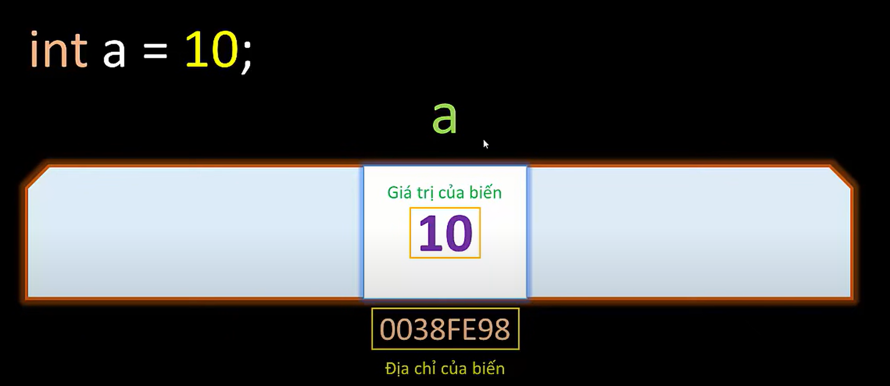

\- C++ cung cấp một toán tử một ngôi & để lấy địa chỉ của các biến trong vùng nhớ RAM (ngoại trừ biến mảng và xâu kí tự). Nếu x là một biến thì &x là địa chỉ của x: **&tên biến;**

**<u>Ví dụ:</u>**

```cpp
int x; // khai báo biến nguyên x
```

long long y; // khai báo biến nguyên dài y

```cpp
char s[9]; // khai báo mảng kí tự s

cout << "Dia chi cua x la:" << &x;
```

<table>
<colgroup>
<col style="width: 6%" />
<col style="width: 6%" />
<col style="width: 5%" />
<col style="width: 6%" />
<col style="width: 6%" />
<col style="width: 6%" />
<col style="width: 6%" />
<col style="width: 5%" />
<col style="width: 6%" />
<col style="width: 6%" />
<col style="width: 5%" />
<col style="width: 5%" />
<col style="width: 5%" />
<col style="width: 5%" />
<col style="width: 5%" />
<col style="width: 5%" />
<col style="width: 7%" />
</colgroup>
<tbody>
<tr>
<td style="text-align: center;">200</td>
<td style="text-align: center;">201</td>
<td style="text-align: center;"></td>
<td style="text-align: center;">500</td>
<td style="text-align: center;">501</td>
<td style="text-align: center;">502</td>
<td style="text-align: center;">503</td>
<td style="text-align: center;"></td>
<td style="text-align: center;">650</td>
<td style="text-align: center;">651</td>
<td style="text-align: center;">…</td>
<td style="text-align: center;"></td>
<td style="text-align: center;"></td>
<td style="text-align: center;"></td>
<td style="text-align: center;"></td>
<td style="text-align: center;">…</td>
<td style="text-align: center;">658</td>
</tr>
<tr>
<td style="text-align: center;">1</td>
<td style="text-align: center;">2</td>
<td style="text-align: center;"></td>
<td style="text-align: center;">4</td>
<td style="text-align: center;">3</td>
<td style="text-align: center;">2</td>
<td style="text-align: center;">1</td>
<td style="text-align: center;"></td>
<td style="text-align: center;">H</td>
<td style="text-align: center;">E</td>
<td style="text-align: center;">L</td>
<td style="text-align: center;">L</td>
<td style="text-align: center;">O</td>
<td style="text-align: center;">\0</td>
<td style="text-align: center;"></td>
<td style="text-align: center;"></td>
<td style="text-align: center;"></td>
</tr>
<tr>
<td colspan="2" style="text-align: center;">X</td>
<td style="text-align: center;"></td>
<td colspan="4" style="text-align: center;">Y</td>
<td style="text-align: center;"></td>
<td colspan="9" style="text-align: center;">s</td>
</tr>
</tbody>
</table>

Biến x chiếm 2 byte nhớ, có địa chỉ là 200, biến y có địa chỉ là 500 và chiếm 4 byte nhớ. Xâu s chiếm 9 byte nhớ tại địa chỉ 650. Các byte nhớ của một biến là liền nhau.

// Toán tử địa chỉ: &

```cpp
int a = 10;

cout << "Gia tri cua bien a : " << a << endl;

cout << "Dia chi cua bien a : " << &a;
```

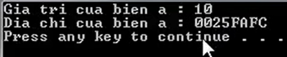 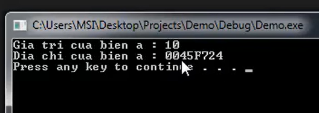

🡪 Khi chạy lại chương trình, địa chỉ của biến đã thay đổi, không cố định.

*- Đối với biến bình thường, khi xuất địa chỉ phải có &, nhưng khi xuất địa chỉ chuỗi/ mảng thì không cần & (Do tên mảng là địa chỉ).*

\* Ví dụ địa chỉ của mảng a chính là a (không phải &a). Mặt khác địa chỉ của mảng a cũng chính là địa chỉ của byte đầu tiên mà mảng a chiếm và nó cũng chính là địa chỉ của phần tử đầu tiên của mảng a. Do vậy địa chỉ của mảng a là địa chỉ của phần tử a\[0\] tức &a\[0\]. Tóm lại, địa chỉ của mảng a là a hoặc &a\[0\].

```cpp
int a[5];

cout << &a[0] << endl;

cout << a << endl;
```

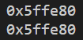

*- Các phép toán liên quan đến địa chỉ được gọi là **số học địa chỉ**.*

\- Các thao tác được phép trên địa chỉ vẫn phải thông qua các **biến trung gian** chứa địa chỉ, được gọi là **biến con trỏ** *(chương sau).*

#### 3.1.8.2. Tham chiếu (reference) 

**+ Biến tham chiếu** là tên gọi bí danh mới của một biến khác, khi đó chỗ nào xuất hiện biến thì cũng tương đương như dùng bí danh và ngược lại. Ý nghĩa thực tế của việc đặt bí danh cho biến là cho phép "tham chiếu" tới một biến khác cùng kiểu của nó, tức sử dụng biến khác nhưng bằng tên của biến tham chiếu.

\+ Về bản chất là 2 biến sử dụng chung 1 vùng nhớ.

\+ Biến tham chiếu và biến được tham chiếu phải **cùng kiểu**, **duy nhất** và được **khởi tạo** khi khai báo.

*+ Mọi thay đổi trên biến tham chiếu cũng chính là thay đổi trên biến được tham chiếu.*

\+ Khai báo: *Giống khai báo biến bình thường, tuy nhiên trước tên biến ta thêm dấu và (&). Có thể tạm phân biến thành 3 loại: biến thường với tên thường, biến con trỏ với dấu \* trước tên và biến tham chiếu với dấu &.*

**<span class="mark">kiểu <u>&</u>biến tham chiếu = biến được tham chiếu;</span>**

**<u>Ví dụ 1:</u>**

> int x=5;
>
> int **&y=x**;
>
> cout\<\<y;

**<u>Ví dụ 2:</u>**

```cpp
int number = 5;

int& reference = number;
```

reference = 10; //change value of number variable through its reference

```cpp
cout << number << endl;
```

\+ Khi một trong hai biến bị hủy (biến tham chiếu hay biến gốc bị hủy do ra khỏi khối lệnh mà nó được khai báo), vùng nhớ mà 2 biến này kiểm soát vẫn chưa bị hủy nếu còn ít nhất 1 biến quản lý nó, cái bị hủy sẽ chỉ là tên biến.

**<u>Ví dụ 3:</u>**

```cpp
int main()

{

int n = 0;

int& ref = n;

{

int n2 = 5;

ref = n2;

}

cout << ref << endl;

return 0;

}
```

\+ Như ví dụ này, biến **ref** tham chiếu đến biến **n2** trong khối lệnh con của hàm **main**, khi ra khỏi khối lệnh con, biến **n2** bị hủy nhưng vùng nhớ được cấp phát cho nó vẫn còn và vẫn đang được biến **ref** quản lý..

**<u>Ví dụ 4:</u>**

```cpp
#include <iostream>

using namespace std;

int main()

{

int x = 12, y = 33, & a = x, & b = y;

cout << x << "\t" << a << endl;

cout << y << "\t" << b << endl;
```

x++, y++;

```cpp
cout << x << "\t" << a << endl;

cout << y << "\t" << b << endl;
```

a++, b++;

```cpp
cout << x << "\t" << a << endl;

cout << y << "\t" << b << endl;

}
```

***Kết quả chạy chương trình:***

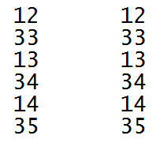

**Chú ý**:

- *Biến tham chiếu phải được khởi tạo khi khai báo.*

- *Tuy giống con trỏ nhưng không dùng được các phép toán con trỏ cho biến tham chiếu. Nói chung chỉ nên dùng trong truyền đối cho hàm.*

- *Cách tổ chức bên trong của một biến tham chiếu khác với biến thường ở chỗ nội dung của nó là địa chỉ của biến mà nó đại diện.*

#### 3.1.8.3. Truyền tham chiếu

\- Cách hoạt động của hàm nhận đầu vào (**input**) là giá trị khá dễ hiểu và dễ cài đặt, nhưng nó có một số hạn chế như sau:

- Khi truyền đối số cho hàm là giá trị, cách duy nhất để có được đầu ra (**output**) là trả về giá trị thông qua từ khóa return.

- Khi truyền đối số cho hàm là giá trị, hảm chỉ có thể trả về 1 giá trị duy nhất tại 1 lần gọi hàm (nếu hàm có kiểu trả về).

**<u>Ví dụ 1:</u>**

```cpp
int addOne(int value)

{

return value + 1;

}
```

Ta vừa định nghĩa một hàm có chức năng cộng thêm vào đối số 1 đơn vị. Cách duy nhất để nhận được giá trị đầu ra của hàm này là định nghĩa hàm có kiểu trả về và sử dụng từ khóa **return**.

```cpp
int main()

{

int number = 9;
```

**number** = addOne(**number**); //**function** **call**

```cpp
system("pause");

return 0;

}
```

Vì thế, nếu muốn lấy được giá trị đầu ra của hàm **addOne**, ta phải sử dụng phép gán giá trị trả về của hàm cho biến làm đối số.

**🡪 *Thực hiện truyền đối số cho hàm là tham chiếu (pass argument by reference) sẽ giúp chúng ta khắc phục 2 nhược điểm trên.***

\- Để truyền đối số cho hàm là tham chiếu, chúng ta đơn giản thêm vào toán tử & lúc khai báo tham số cho hàm.

**- Khi truyền tham chiếu** cho hàm, **đối số chỉ có thể là biến**.

\- Có nhu cầu thay đổi giá trị của đối số sau khi thực hiện hàm.

\*\*\****Chú ý:*** có thể viết **int& x** hoặc **int & x** hoặc **int &x**.

\- Khác với truyền giá trị cho hàm, chương trình sẽ không tạo ra một vùng nhớ riêng để nhận giá trị của đối số nữa, **mà nó sẽ tạo ra một biến tham chiếu và tham chiếu trực tiếp đến vùng nhớ của đối số.**

\- Sau khi ra khỏi hàm, biến tham chiếu bị hủy, nhưng vẫn còn một biến (được dùng làm đối số) đang quản lý vùng nhớ đó nên chỉ có tên của biến tham chiếu bị hủy.

**<u>Ví dụ 2:</u>** Hàm hoán vị

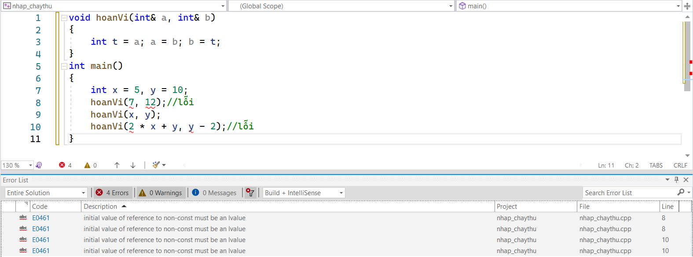

**\**

**🡪 Sửa:**

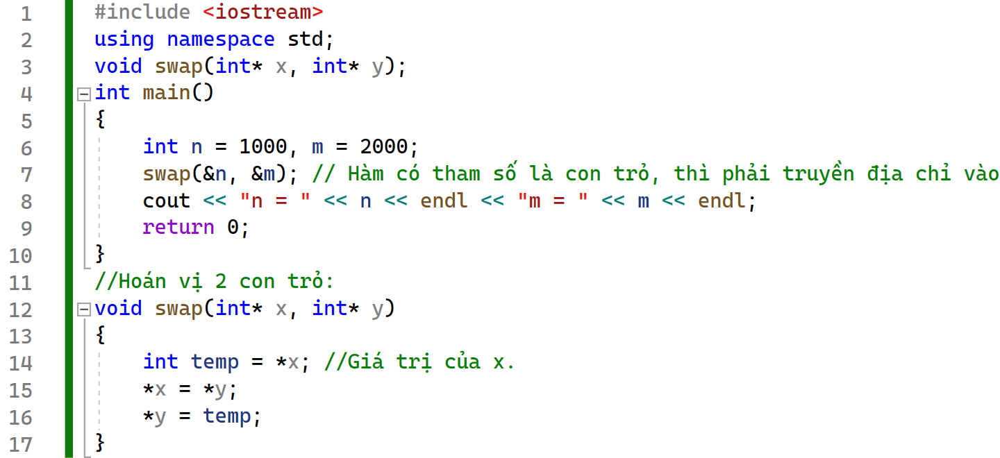

***Kết quả:***

n = 2000

m = 1000

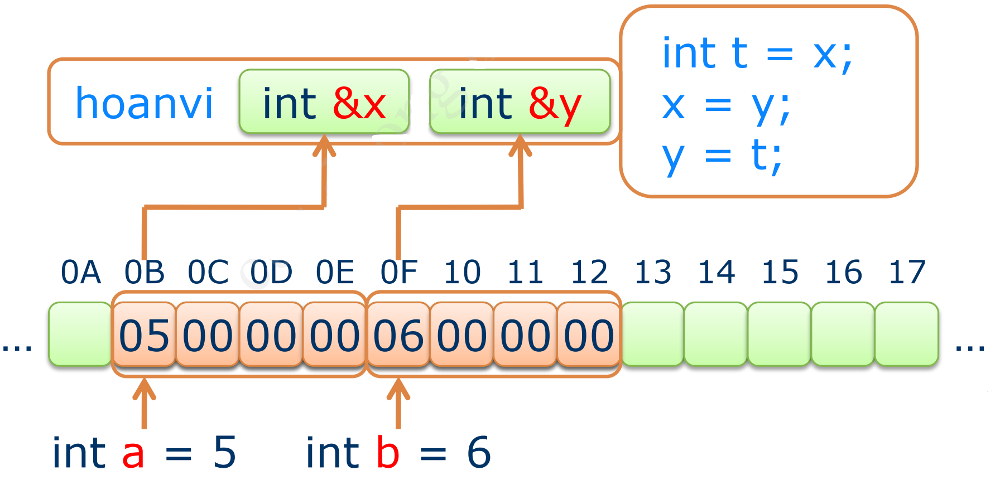

**<u>Ví dụ 3:</u>**

```cpp
#include <iostream>

using namespace std;

void callByReferences(int& y) // y is a reference variable

{

cout << "y = " << y << endl;

y = 69;

cout << "y = " << y << endl;
```

} // y is destroyed here

```cpp
int main()

{

int x(1);

cout << "x = " << x << endl;

callByReferences(x);

cout << "x = " << x << endl;

return 0;

}
```

***Kết quả:***

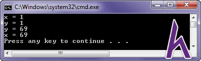

Trong chương trình trên, khi hàm **callByReferences(int &y) được gọi, y sẽ trở thành một tham chiếu đến đối số x. Mọi thay đổi của biến y bên trong hàm callByReferences(int &y)** cũng chính là thay đổi trên biến **x**.

**<u>Ví dụ 4:</u>**

```cpp
#include <iostream>

using namespace std;

void calculator(int x, int y, int& addOut, int& subOut)

{

addOut = x + y;

subOut = x - y;

}

int main()

{

int a(6), b(9);

int add, sub;

/* calculator will return the addOut and subOut in variables add and sub*/

calculator(a, b, add, sub);

cout << " a + b = " << add << endl;

cout << " a - b = " << sub << endl;

return 0;

}
```

***Kết quả:***

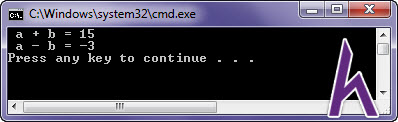

**<u>Ví dụ 5:</u>**

```cpp
#include <iostream>

using namespace std;

int tham_tri(int x)

{

x = 100;

return x;

}

int tham_chieu(int& x)

{

x = 100;

return x;

}

int main()

{

int x = 2;

tham_tri(x);

cout << "Ket qua truyen theo tham tri: x = " << x << endl;

tham_chieu(x);

cout << "Ket qua truyen theo tham chieu: x = " << x;

}
```

***Kết quả chạy chương trình:***

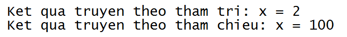

**Nhận xét**: *Truyền theo tham chiếu sẽ làm thay đổi giá trị của biến ngoài, còn truyền tham trị thì không*.

#### 3.1.8.4. Trả về nhiều giá trị thông qua nhiều tham số

\- Thỉnh thoảng, chúng ta cần 1 hàm trả về nhiều giá trị trong khi sử dụng từ khóa return chỉ trả về được 1 giá trị, đó là lúc chúng ta sử dụng biến tham chiếu làm tham số cho hàm.

```cpp
#include <iostream>
```

\#define PI 3.14

```cpp
using namespace std;

void getSinCos(float degrees, float& sinOut, float& cosOut)

{

float radian = (degrees * PI) / 180.0;

sinOut = sin(radian);

cosOut = cos(radian);

}

int main()

{

float degrees = 180.0, Sin, Cos;

getSinCos(degrees, Sin, Cos);

cout << "sin = " << Sin << endl;

cout << "cos = " << Cos << endl;

system("pause");

return 0;

}
```

\- Hàm getSinCos nhận giá trị đầu vào đầu tiên là giá trị, trả về 2 giá trị đầu ra thông qua 2 biến tham chiếu.

***Kết quả:***

sin = 0.00159255

cos = -0.999999

**\*\*\* Tổng kết**

**- Truyền đối số vào hàm là giá trị**

- *Ưu điểm:*

  - Giá trị làm đối số có thể là 1 giá trị xác định, giá trị của biến, biểu thức, ...

  - Đối số truyền vào hàm sẽ không bị hàm tác động trực tiếp đến, đảm bảo an toàn dữ liệu khi sử dụng hàm.

- *Nhược điểm:*

  - Chương trình tạo ra những bản sao giá trị gây tốn thêm vùng nhớ sử dụng.

  - Cách duy nhất để lấy được đầu ra (**output**) là thông qua từ khóa return với hàm có kiểu trả về.

  - Không thể truyền mảng một chiều vào hàm bằng giá trị.

**\**

**- Truyền đối số vào hàm là tham chiếu**

- *Ưu điểm:*

  - Cho phép thay đổi giá trị của đối số.

  - Chương trình không tạo bản sao giá trị của đối số nên tiết kiệm bộ nhớ và hoạt động nhanh hơn.

  - Có thể trả về nhiều giá trị trong một lần gọi hàm.

- *Nhược điểm:*

  - Sử dụng tham số là tham chiếu không hợp lý có thể gây sai sót dữ liệu.

### 3.1.9. Truyền tham số hằng (const parameters)

\- Đặt từ khóa const trước kiểu dữ liệu của tham số hoặc tên biến của tham số:

\- Cú pháp:

```cpp
void receiveInput(const int param1, const float param2)

{

//................

}
```

\- Khác với việc khởi tạo giá trị cho biến hằng số thông thường, tham số hằng sẽ được khởi tạo giá trị lúc gọi hàm. Vì phần định nghĩa hàm chỉ mới chỉ ra cách mà hàm hoạt động, khi gọi hàm và truyền đối số vào hàm, hệ điều hành lúc đó mới cấp phát vùng nhớ cho các tham số và biến cục bộ bên trong hàm.

\- Có thể nhận đối số là hằng số hoặc không phải hằng số. Vì chúng ta sử dụng phương thức truyền đối số là giá trị, nên một bản copy của đối số sẽ được tạo ra để làm giá trị khởi tạo cho tham số hằng, và tham số của hàm lúc này chỉ tương tác bên trong hàm chứ không làm ảnh hưởng đến đối số được truyền vào.

**<u>Ví dụ 1:</u>**

```cpp
#include <iostream>

using namespace std;

void printMessage(const string message)

{

cout << message << endl;

}

int main()

{

string non_const_msg = "This is non-const message";
```

const string const_msg = "This is const message";

```cpp
printMessage(non_const_msg);

printMessage(const_msg);

system("pause");

return 0;

}
```

***Kết quả:***

This is non-const message

This is const message

**<u>Ví dụ 2:</u>**

<table>
<colgroup>
<col style="width: 52%" />
<col style="width: 47%" />
</colgroup>
<thead>
<tr>
<th style="text-align: center;"><p>A screenshot of a computer program Description automatically generated</p></th>
<th><p>Mặc dù tham số của hàm đã tham chiếu đến 1 vùng nhớ của biến không phải hằng, nhưng tham số của hàm là hằng, nên mọi câu lệnh có hành vi thay đổi giá trị bên trong vùng nhớ mà biến str đang nắm giữ là không cho phép.</p>
<p>Hình minh họa</p>
<p>Trong khi đó, biến str không phải là hằng, nên nó có thể thay đổi giá trị trong vùng nhớ mà nó đang nắm giữ.</p>
<p>Mặc dù 2 đối tượng str và tham chiếu của str đều sử dụng chung 1 vùng nhớ, nhưng đối tượng là tham chiếu của str là hằng, nên nó không thể tự ý thay đổi giá trị của str trong khi đối tượng str thì có thể.</p></th>
</tr>
</thead>
<tbody>
</tbody>
</table>

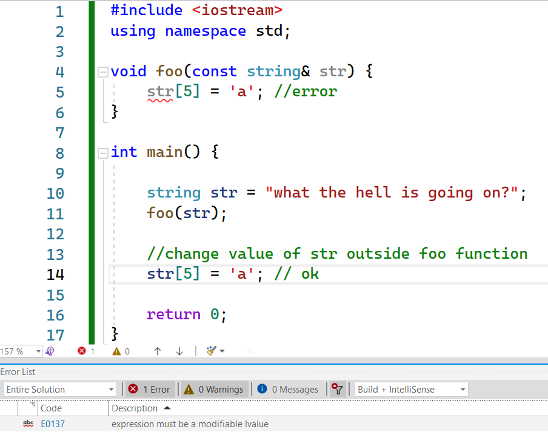

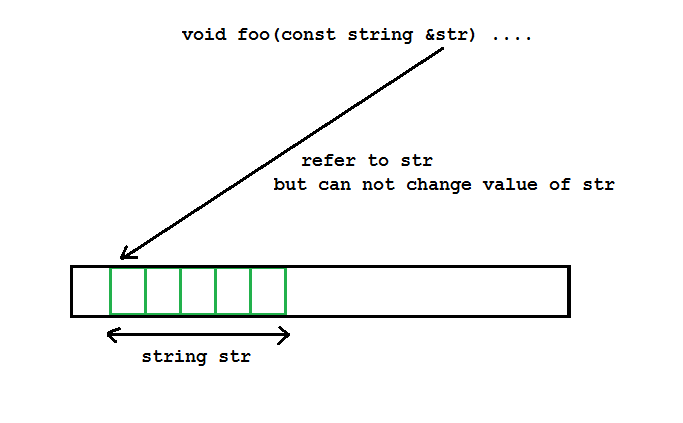

***Mục đích của việc khai báo tham số hằng là để đảm bảo rằng hàm đó không thể thay đổi giá trị của đối số truyền vào (cho dù truyền bằng tham chiếu). Khi chương trình phát sinh lỗi, chúng ta có thể loại bớt trường hợp lỗi do hàm có tham số hằng gây ra, giúp chúng ta dễ dàng sửa lỗi hơn.***

**<u>Ví dụ 3:</u>**

<table>
<colgroup>
<col style="width: 63%" />
<col style="width: 36%" />
</colgroup>
<thead>
<tr>
<th><p>A computer screen shot of a program Description automatically generated</p></th>
<th><p>Trong chương trình trên, vì value là tham chiếu hằng, giá trị của nó không thể thay đổi. Nên dòng lệnh </p>
<p>value = 69; bên trong hàm </p>
<p>printValue(const int &amp;value) </p>
<p>đã tạo ra một lỗi biên dịch.</p></th>
</tr>
</thead>
<tbody>
</tbody>
</table>

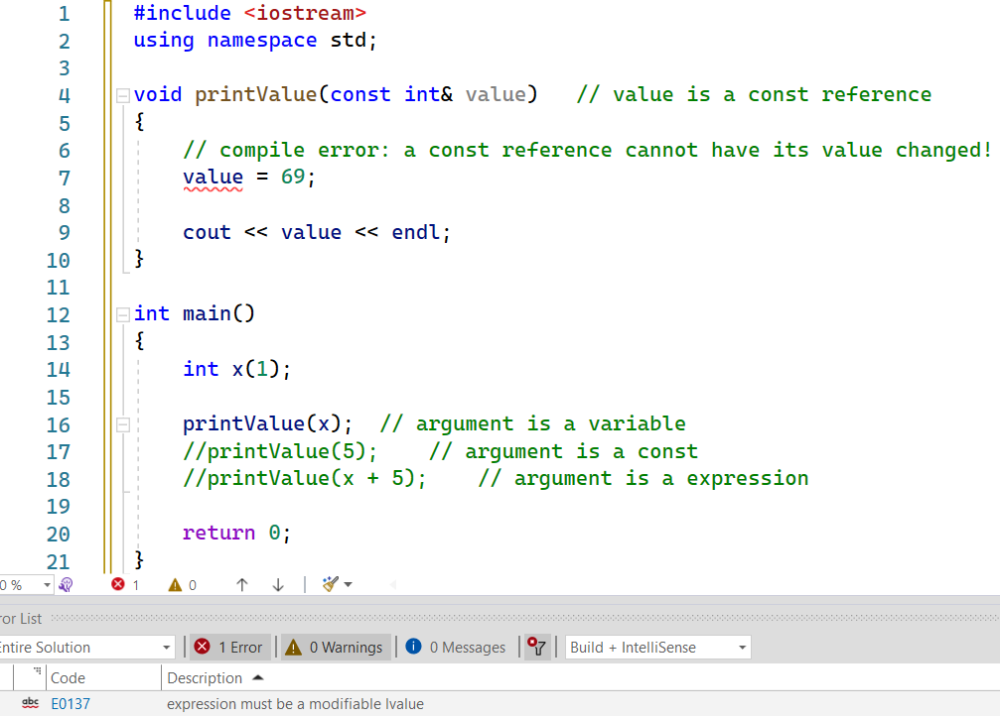

***Ưu điểm:***

- Đảm bảo các đối số sẽ không bị thay đổi ngoài ý muốn. Compiler sẽ thông báo lỗi nếu bạn cố thay đổi một tham chiếu hằng.

- Giúp lập trình viên biết hàm đó sẽ không làm thay đổi giá trị của đối số.

- Bạn không thể truyền đối số là một hằng số (const argument) cho tham số của hàm là một biến tham chiếu (non-const reference parameter). Nhưng khi tham số của hàm là một tham chiếu hằng, bạn có thể truyền đối số là một biến số hoặc một hằng số cho nó.

**<u>Chú ý:</u>** Khi truyền tham chiếu cho hàm, luôn sử dụng một tham chiếu hằng (const reference), trừ khi bạn cần thay đổi giá trị của các đối số

- Không mất thời gian và bộ nhớ để sao chép giá trị của đối số vào tham số của hàm.

- Hàm có thể trả về nhiều giá trị thông qua tham chiếu.

**Nhược điểm:**

- Đối số khi truyền tham chiếu non-const bắt buộc phải là biến số (variables).

- Khó phân biệt được tham số khi truyền tham chiếu non-const là tham số input, output hay cả 2.

**Khi nào nên sử dụng:**

- Khi đối số là kiểu cấu trúc (structs) hoặc các lớp (classes). Sử dụng tham chiếu hằng (const reference) nếu không muốn hàm thay đổi giá trị của đối số.

- Khi có nhu cầu thay đổi giá trị của đối số sau khi thực hiện hàm.

**Khi nào không nên sử dụng:** Khi đối số có kiểu dữ liệu cơ bản (sử dụng truyền giá trị).

### 3.1.10. Truyền địa chỉ (Call/pass by address)

\- Chi tiết ở phần con trỏ.

- Đối số phải là địa chỉ của biến.

- Khai báo hàm thì các tham số phải khai báo con trỏ.

- Sử dụng khi có nhu cầu thay đổi giá trị của đối số sau khi thực hiện hàm.

**<u>Ví dụ 1:</u>**

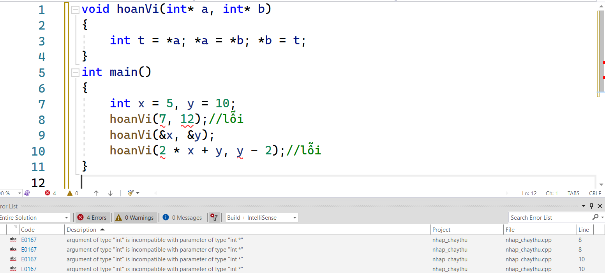

**<u>Ví dụ 2:</u>**

```cpp
#include <iostream>

using namespace std;

int tham_tri(int x)

{

x = 100;

return x;

}

int dan_tro(int* x)

{
```

\*x = 100;

```cpp
return *x;

}

int main()

{

int x = 2, * p = &x;

tham_tri(x);

cout << "Ket qua truyen theo tham tri: x = " << x << endl;

dan_tro(p);

cout << "Ket qua truyen theo dan tro: x = " << x;

}
```

***Kết quả chạy chương trình:***

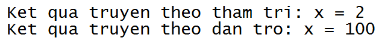

**Nhận xét**: *Truyền tham đối cho hàm bằng biến con trỏ cũng làm thay đổi giá trị của biến ngoài được truyền tương tự cách truyền tham chiếu nhưng cách viết phức tạp hơn tham chiếu.*

- **<u>Lưu ý:</u>**

\- Trong một hàm các tham số có thể truyền theo nhiều cách

> void vidu1(int x, int& y)

\- Có thể sử dụng tham chiếu để trả về giá trị

> void tinhtong(int x, int y, int& tong)
>
> {
>
> tong = x + y;
>
> }

### 3.1.11. Tham số mặc định (default parameter)

\- Tham số mặc định là tham số có một giá trị khởi tạo tại thời điểm khai báo.

\- Khi người dùng không cung cấp đối số cho tham số mặc định, giá trị mặc định sẽ được sử dụng.

\- Khi người dùng cung cấp đối số cho tham số mặc định, tham số sẽ được gán lại bằng giá trị của đối số được truyền vào.

\- Khai báo: sử dụng toán tử assignment (=) như lúc khởi tạo cho biến thông thường.

**<u>Ví dụ:</u>**

```cpp
void printValue(int x, int y = 10)

{

cout << "x: " << x << endl;

cout << "y: " << y << endl;

}
```

\- Vì tham số thứ 2 của hàm printValue đã có giá trị mặc định nên khi gọi hàm, chúng ta có thể chỉ truyền vào 1 đối số cho tham số x.

//...........

```cpp
printValue(5);

//...........
```

Hoặc muốn thay đổi giá trị khác cho tham số y, chúng ta truyền vào giá trị mới cho nó.

//........

```cpp
printValue(5, 5);

//........
```

<table>
<colgroup>
<col style="width: 50%" />
<col style="width: 49%" />
</colgroup>
<thead>
<tr>
<th><p>A screenshot of a computer program Description automatically generated</p></th>
<th><p>Sử dụng tham số mặc định giúp người dùng có nhiều lựa chọn hơn trong việc truyền đối số. Nhưng có 1 yêu cầu đặt ra khi khai báo hàm có tham số mặc định, đó là mọi tham số mặc định khi khai báo phải đặt phía sau tham số không có giá trị mặc định.</p>
<p>Vì tham số mặc định là tham số tùy chọn, chương trình không ràng buộc người dùng phải truyền đối số cho tham số mặc định khi gọi hàm. Trong khi đó, với tham số không có giá trị mặc định thì bắt buộc phải truyền đối số khi gọi hàm. Vì thế, đặt tham số mặc định trước tham số không có giá trị mặc định sẽ gây mâu thuẫn về ngữ nghĩa.</p></th>
</tr>
</thead>
<tbody>
</tbody>
</table>

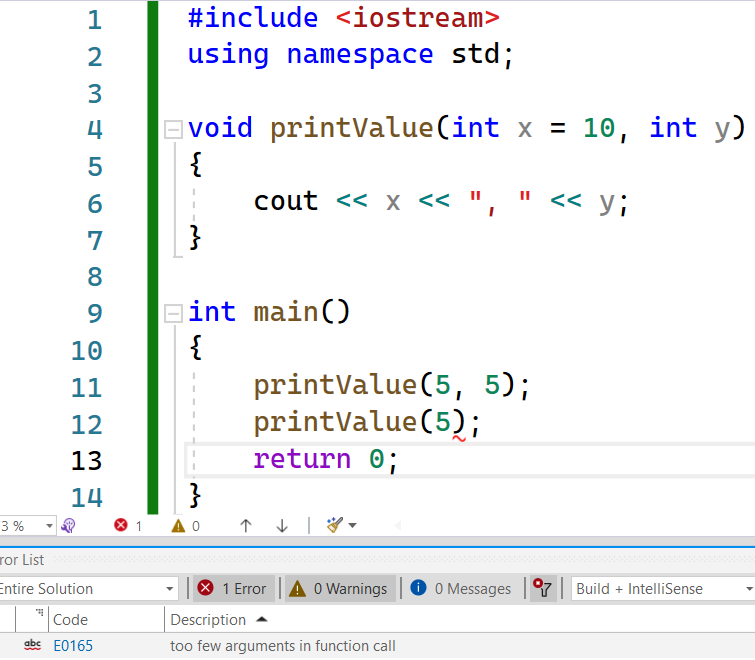

### 3.1.12. Nạp chồng hàm (Function Overloading)

- Function overloading là một đặc trưng của ngôn ngữ C++, nó cho phép lập trình viên tạo ra nhiều hàm có cùng tên, với điều kiện các hàm này khác số lượng tham số hoặc kiểu tham số.

- Kĩ thuật này chỉ được cho phép trong ngôn ngữ C++, không thể áp dụng vào ngôn ngữ C.

**<u>Ví dụ 1:</u>**

```cpp
#include <iostream>

using namespace std;

int add(int i1, int i2)

{

return i1 + i2;

}

float add(float f1, float f2)

{

return f1 + f2;

}

int main()

{

int add(int i1, int i2); //int version

float add(float f1, float f2); //float version

return 0;

}
```

***Kết quả:*** 2 hàm riêng biệt với địa chỉ khác nhau trong vùng nhớ.

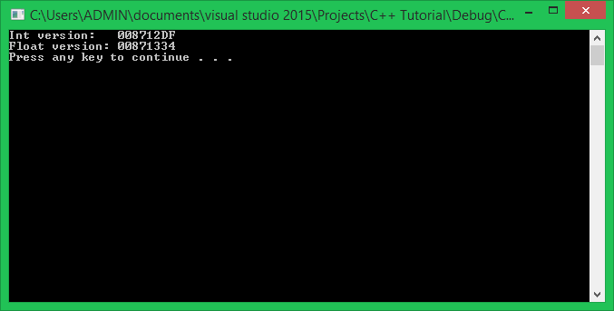

- Việc quyết định cần gọi đến phiên bản hàm nào phụ thuộc vào đối số mà bạn truyền vào khi gọi hàm.

- Nếu bạn cung cấp 2 đối số kiểu số nguyên, phiên bản add(int i1, int i2) sẽ được sử dụng. Ngược lại, nếu bạn truyền vào 2 số thực, C++ sẽ biết rằng cần phải gọi phiên bản kiểu số thực. Và chúng ta còn có thể định nghĩa thêm nhiều hàm có tên add nữa, với điều kiện những hàm này có số lượng tham số khác nhau hoặc khác về kiểu dữ liệu của tham số. 

- Các hàm được nạp chồng phải có danh sách tham số khác nhau (kiểu dữ liệu và số lượng của chúng). Bạn không thể nạp chồng các hàm dựa trên kiểu trả về khác nhau.

**<u>Ví dụ 2:</u>**

```cpp
int foo() {

return 10;

}


double foo() { // compiler error

return 0.5;

}
```

**<u>Ví dụ 3:</u>** Các hàm toán học bị nạp chồng trong file header \<cmath\>. Ví dụ: có ba hàm được nạp chồng cho hàm sin:

```cpp
float sin(float)

double sin(double)
```

long double sin(long double)

**\* Tham số hàm kiểu typedef:** Khai báo typedef chỉ là một bí danh (không phải kiểu dữ liệu mới), vì vậy chương trình sẽ gặp lỗi:

**<u>Ví dụ 4:</u>**

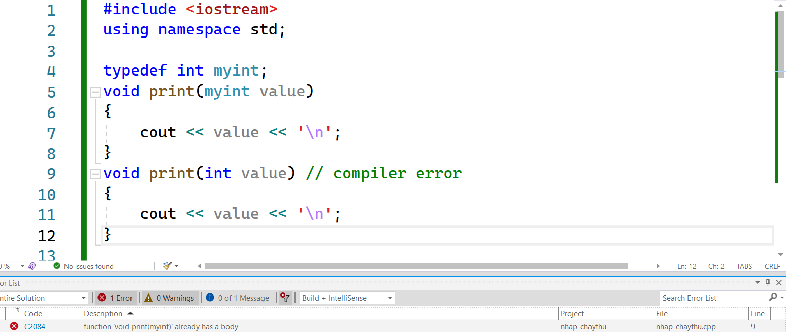

**\* Tham số hàm kiểu con trỏ \* và mảng \[\]:** Tham số hàm con trỏ \* và mảng \[\] là tương đương. Lúc này, khai báo mảng \[\] được chuyển đổi ngầm định thành một con trỏ.

```cpp
int foo(int *x);

int foo(int x[]); // compiler error
```

Hai hàm trên giống nhau về tham số (int\*), vì vậy trình biên dịch sẽ báo lỗi.

**\* Nạp chồng hàm và từ khóa const:**

Xét 2 ví dụ dưới đây, chương trình 1 biên dịch thất bại, nhưng chương trình 2 biên dịch và chạy tốt.

**<u>Ví dụ 5:</u>**

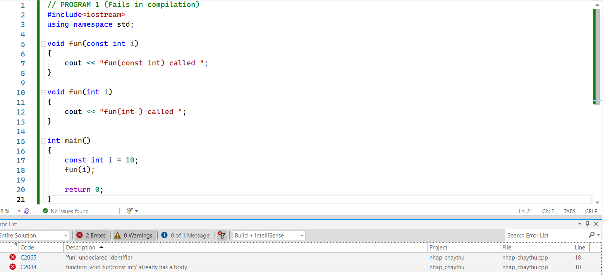

**<u>Ví dụ 6:</u>**

// PROGRAM 2 (Compiles and runs fine)

```cpp
#include <iostream>

using namespace std;

void fun(char* a)

{

cout << "non-const fun() " << a;

}

void fun(const char* a)

{

cout << "const fun() " << a;

}

int main()

{
```

const char\* ptr = "Howkteam";

fun(ptr); // output: const fun () Howkteam

```cpp
system("pause");

return 0;

}
```

***Kết quả:*** const fun() Howkteam

- C++ cho phép nạp chồng hàm với tham số là const** chỉ khi **tham số const là **tham chiếu** hoặc **con trỏ**. Đó là lý do tại sao chương trình 1 gặp lỗi biên dịch, nhưng chương trình 2 hoạt động.

- Trong chương trình 1, tham số '**i**' được truyền theo giá trị, vì vậy '**i**' trong fun() là **bản sao** của 'i' trong main(). Do đó, fun() không thể sửa đổi '**i**' của hàm main(). Vì vậy, không quan trọng việc '**i**' được nhận dưới dạng tham số **const **hay tham số bình thường.

- Khi tham số là tham chiếu hoặc con trỏ, chúng ta có thể sửa đổi giá trị được tham chiếu hoặc được trỏ tới, do đó chúng ta có thể có hai phiên bản của hàm, một phiên bản có thể sửa đổi giá trị được tham chiếu hoặc trỏ tới, một phiên bản không thể thay đổi.

**Chú ý: **C++ cho phép nạp chồng hàm với tham số là const chỉ khi tham số const là tham chiếu hoặc con trỏ.

### 3.1.13. Hàm nội tuyến (Inline Functions)

- Đối với các hàm lớn hoặc các tác vụ phức tạp, tổng chi phí của lệnh gọi hàm thường không đáng kể so với lượng thời gian mà hàm mất để chạy. Tuy nhiên, đối với ***các hàm nhỏ (1 dòng)***, thường được sử dụng, thời gian cần thiết để thực hiện lệnh gọi hàm thường nhiều hơn rất nhiều so với thời gian cần thiết để thực thi mã của hàm.

- Trong C, chúng ta thường sử dụng hàm Macro, một kỹ thuật tối ưu hóa được sử dụng bởi trình biên dịch để giảm thời gian thực hiện. C++ cung cấp một khái niệm mới tốt hơn, đó là hàm nội tuyến (inline functions).

- Cú pháp:

**inline return-type function-name(parameters)**

**{**

**// function code**

**}**

**<u>Ví dụ:</u>**

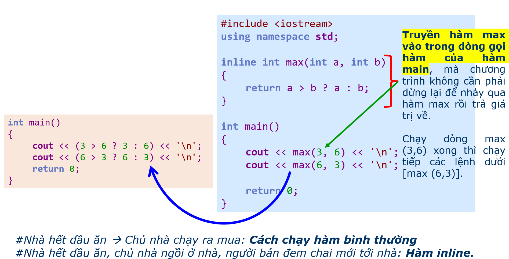

- Từ khóa** inline (nội tuyến)** **chỉ là một yêu cầu **cho trình biên dịch, không phải là một lệnh bắt buộc.

- Trình biên dịch **có thể không thực hiện nội tuyến** trong các trường hợp như:

  - *Hàm chứa vòng lặp (for, while, do-while).*

  - *Hàm chứa các biến tĩnh.*

  - *Hàm đệ quy.*

  - *Hàm chứa câu lệnh switch hoặc goto.*

- Hầu hết các trình biên dịch hiện đại sẽ tự động đặt các hàm nội tuyến nếu cần thiết. Do đó, trong hầu hết các trường hợp, nếu không có nhu cầu cụ thể để sử dụng từ khóa nội tuyến, hãy để trình biên dịch xử lý các hàm nội tuyến cho bạn.

- **Ưu điểm:**

<!-- -->

- Tiết kiệm chi phí gọi hàm.

- Tiết kiệm chi phí của các biến trên ngăn xếp khi hàm được gọi.

- Tiết kiệm chi phí cuộc gọi trả về từ một hàm.

- Có thể đặt định nghĩa hàm nội tuyến (inline functions) trong file tiêu đề (**\*.h**) (nghĩa là nó có thể được **include** trong nhiều đơn vị biên dịch, hàm thông thường sẽ gây ra lỗi).

<!-- -->

- **Nhược điểm:**

  - Tăng kích thước file thực thi do sự trùng lặp của cùng một mã.

  - Khi được sử dụng trong file tiêu đề (\*.h), nó làm cho file tiêu đề của bạn lớn hơn.

  - Hàm nội tuyến có thể không hữu ích cho nhiều hệ thống nhúng. Vì trong các hệ thống nhúng, kích thước mã quan trọng hơn tốc độ.

## 3.2. Mảng (Array)

Đặt vấn đề:

\- Chương trình cần lưu trữ 3 số nguyên? =\> Khai báo 3 biến int a1, a2, a3;

\- Chương trình cần lưu trữ 100 số nguyên? =\> Khai báo 100 biến kiểu số nguyên!

\- Người dùng muốn nhập n số nguyên? =\> Không thực hiện được!

\- Giải pháp: Kiểu dữ liệu mới cho phép lưu trữ một dãy các số nguyên và dễ dàng truy xuất.

### 3.2.1. Khái niệm

\- Mảng là một tập hợp hữu hạn các phần tử có **<u>cùng kiểu dữ liệu</u>.**

\- Các phần tử của mảng được lưu trữ trong **một khối gồm các <u>ô nhớ liên tục nhau</u>, có cùng tên** (cũng là tên của mảng) ***nhưng phân biệt với nhau ở chỉ số.***

\- Chỉ số này xác định vị trí của nó trong mảng, chỉ số từ **0 đến \<tổng số phần tử\>-1**

\- Kích thước được xác định ngay khi khai báo và không bao giờ thay đổi.

**\* Bộ nhớ sử dụng = \<tổng số phần tử\>\*sizeof(\<kiểu dữ liệu\>).**

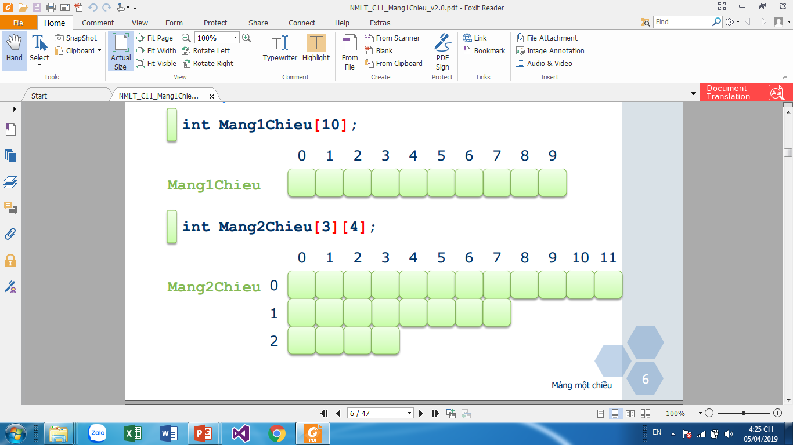

**<u>Ví dụ:</u>**

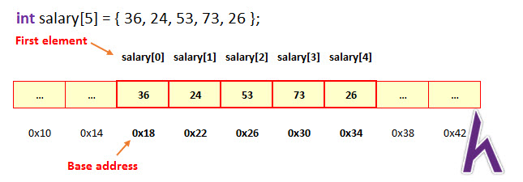

Mỗi ô nhớ trong RAM có kích thước 4 byte, **salary** là 1 mảng kiểu **int**, nên mỗi phần sẽ nằm trong 1 ô nhớ, và những ô nhớ đó là liên tiếp nhau.

### 3.2.2. Mảng 1 chiều (array 1 dimensional)

#### 3.2.2.1. Khai báo

*- Tường minh:*

**<span class="mark">\<Kiểu_dữ_liệu\> Tên_mảng \[\<số_phần_tử\>\] ;</span>**

- **\<Kiểu_dữ_liệu\>** có thể char, int, float,...

- **Tên_mảng:** theo quy tắc đặt tên

- **số_phần_tử (kích thước của mảng)**

\- *Phải được xác định ngay tại thời điểm khai báo*

*- Phải là hằng số*

**<u>Ví dụ 1:</u>** **int a\[100\];**

*Compiler phân bố không gian cho 10 phần tử int cho mảng a, khi một mảng được khai báo, các phần tử của mảng được gán giá trị tùy ý.*

***Khi một mảng chưa khởi tạo giá trị cho các phần tử, các phần tử sẽ mang giá trị rác.***

**<u>Ví dụ 2:</u>** Minh họa mảng int c\[5\]

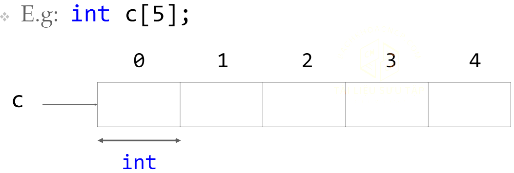

*- Không tường minh (thông qua khai báo kiểu)*

> **<span class="mark">typedef \<kiểu cơ sở\> \<tên kiểu mảng\>\[\<số phần tử\>\];</span>**
>
> **<span class="mark">\<tên kiểu mảng\> \<tên biến mảng\>;</span>**

**<u>Ví dụ 3:</u>**

**typedef int Mang1Chieu\[10\];**

**Mang1Chieu m1, m2, m3;**

#### 3.2.2.2. Khởi tạo giá trị cho mảng một chiều khi khai báo

<span class="mark">**Kiểu_dữ_liệu** Tên_mảng**\[**số_phần_tử**\] = {** giá_trị_1**,** giá_trị_2**,**…**};**</span>

*Trong đó:*

- giá_trị_1, giá_trị_2,… là các giá trị tương ứng được khởi tạo cho từng phần tử của mảng theo đúng thứ tự.

- Số lượng các giá trị không được vượt quá kích thước của mảng.

**<u>Ví dụ 1</u>:**

\- Khởi tạo giá trị cho tất cả các phần tử của mảng: int A\[5\]={1,5,-8,7,0};

\- Khởi tạo vài giá trị đầu của mảng, *các phần tử sau mặc định bằng 0:* int A\[5\]={2,4,1};

\- Khởi tạo giá trị 0 cho tất cả các phần tử: int A\[5\]={0}; hoặc int A\[5\] = { };

\- Khởi tạo mảng mà không khai báo kích thước: int A\[ \]={1,5,-8};

*Khi đó mảng A sẽ tự động có kích thước bằng 3 vì nó có 3 phần tử.*

\- Sử dụng khởi tạo đồng nhất (uniform initialization) trong C++11

> **int array1\[4\] { 5, 8, 2, 7 }; // 5 8 2 7**
>
> **int array2\[4\] { 5, 8 }; // 5 8 0 0**
>
> **int array3\[4\] { }; // 0 0 0 0**
>
> **int array4\[\] { 5, 8, 2, 7 }; // 5 8 2 7**

**<u>Ví dụ 2:</u>**

```cpp
#include <iostream>

using namespace std;

int main()

{

int a[6]; //Giá trị từng phần tử chưa xác định

int b[6] = { 10, 20, 30 }; /*Giá trị 3 phần tử đầu là: 10, 20, và 30, Giá trị 3 phần tử sau
```

chưa xác định\*/

```cpp
int c[6] = { 10, 20, 30, 40, 50, 60 }; /*Giá trị các phần tử lần lượt là: 10, 20, 30, 40,
```

50, và 60\*/

}

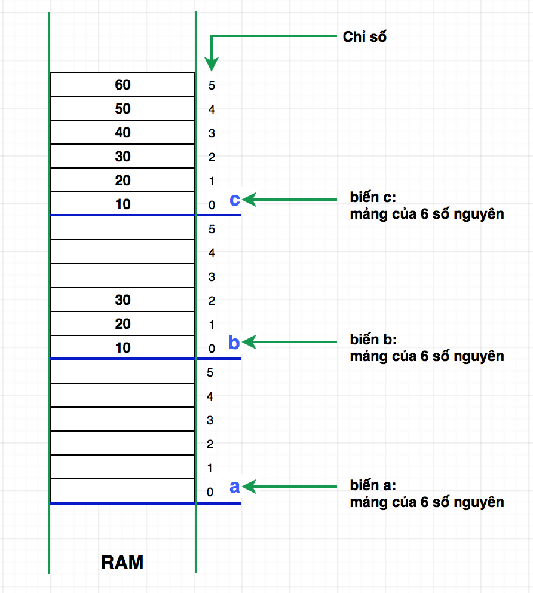

**Lưu ý:**

\+ Cả a, b, và c đều là mảng của 6 phần tử.

\+ Do đó, ***chỉ số các phần tử phải từ 0 đến 5***

*- Số phần tử của mảng:*

\+ Phải biết trước thời điểm biên dịch

\+ Là hằng số không âm.

. Sử dụng macro: \#define MAX_SIZE

. Khai báo hằng số nguyên: const int max_size

\- Không được sử dụng biến để khai báo số phần tử của mảng: **int n1 = 10; int a\[n1\];**

\- Nên sử dụng chỉ thị tiền xử lý \#define để định nghĩa số phần tử mảng

> **\#define n1 10**
>
> **\#define n2 20**
>
> **int a\[n1\]; //** ⬄ **int a\[10\];**
>
> **int b\[n1\]\[n2\]; //** ⬄ **int b\[10\]\[20\];**

#### 3.2.2.3. Truy xuất dữ liệu trong mảng

\- Các phần tử trong mảng được đánh **<u>chỉ số</u>** để truy xuất

\+ Phần tử đầu tiên LUÔN LUÔN CÓ chỉ số là 0

\+ Các phần tử kế tiếp theo là 1,2, v.v

\+ Do đó, một mảng có **N** phần tử thì chỉ số các phần tử là 0,1, … và cuối cùng là (**N-1**) - **không phải N**

\- Truy xuất các phần tử của mảng theo cú pháp: **<span class="mark">Tên_mảng\[chỉ_số\]</span>**

Trong đó chỉ_số *(Index)* <span class="mark">là số nguyên bắt đầu từ 0 đến n-1,</span> với n là kích thước của mảng.

**<u>Ví dụ 1:</u>** Mảng A có 4 phần tử, phần tử thứ 2 là A\[1\]= - 7

|             |                |                |                |                |
|:-----------:|:--------------:|:--------------:|:--------------:|:--------------:|
| **Chỉ số**  |       0        |       1        |       2        |       3        |
| **Mảng A**  |     **4**      |     **-7**     |     **3**      |     **2**      |
| **Phần tử** | A**\[**0**\]** | A**\[**1**\]** | A**\[**2**\]** | A**\[**3**\]** |

\- Các truy xuất:

**+ Hợp lệ:** array\[0\], array\[1\], array\[2\], array\[3\]

**+ Không hợp lệ:** array\[-1\], array\[4\], array\[5\], … =\> cho kết quả không như mong muốn (có thể gây chết chương trình).

***Chú ý:*** khi truy xuất một phần tử mảng, luôn đảm bảo chỉ số của phần tử đó là hợp lệ trong phạm vi của mảng.

**<u>Ví dụ 2:</u>** Chương trình khởi tạo và xuất các phần tử mảng:

> \#include \<iostream\>
>
> \#include \<string\>
>
> **using** **namespace** **std**;
>
>  
>
> // định nghĩa số phần tử mảng
>
> \#define MAX 3
>
> **int** main()
>
> {
>
> // khởi tạo mảng string 3 phần tử
>
> **string** arrKteam\[MAX\]{ "Hello Howkteam.com!", "Free Education", "Share to be better" };
>
>  
>
> // xuất giá trị các phần tử mảng
>
> **for** (**int** i = 0; i \< MAX; i++)
>
> {
>
> **cout** \<\< arrKteam\[i\] \<\< endl;
>
> }
>
> **return** 0;
>
> }

***Kết quả:***

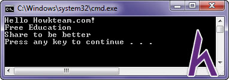

\- Để tính địa chỉ của ô nhớ có chỉ số k, chương trình dùng công thức sau:

*Địa chỉ = địa chỉ phần tử đầu tiên + k \*(kích thước phần tử)*

Do đó, chương trình dễ dàng chỉ ra ngày một phần tử có chỉ số bất kỳ =\> TRUY CẬP NGẪU NHIÊN

Tuy nhiên, Trình biên dịch đã biết trước kích thước của phần tử trong mảng

Do đó, công thức lấy địa chỉ của phần tử có chỉ số k là

<span class="mark">Địa chỉ của phần tử có chỉ số k = **first + k**</span>

first: địa chỉ của phần tử đầu tiên của mảng, cũng chính là tên biến kiểu mảng

#### 3.2.2.4. Nhập dữ liệu cho mảng 1 chiều

\- Để gán giá trị cho phần tử trong mảng, ta sử dụng cú pháp:

**<span class="mark">\<tên biến mảng\>\[\<chỉ số thứ i\>\] = \<giá trị\>;</span>**

**Trong đó:**

**\<chỉ số thứ i\>** là chỉ số phần tử trong mảng.

Nếu mảng có N phần tử, \<chỉ số thứ i\> sẽ nằm trong **khoảng từ 0 đến N – 1.**

**- Chú ý: **khi truy cập một phần tử mảng, luôn đảm bảo chỉ số của phần tử đó là hợp lệ trong phạm vi của mảng.

**<u>Ví dụ 1:</u>**

```cpp
#include <iostream>

#include <iostream>

using namespace std;

// định nghĩa số phần tử mảng
```

\#define MAX 3

**\**

```cpp
int main()

{

int arr[MAX];

// nhập mảng

cout << "Array input:" << endl;

for (int i = 0; i < MAX; i++)

{

cout << "arr[" << i << "] = ";

cin >> arr[i];

}

// xuất mảng

for (int i = 0; i < MAX; i++)

{

cout << arr[i] << " ";

}

return 0;

}
```

***Kết quả:***

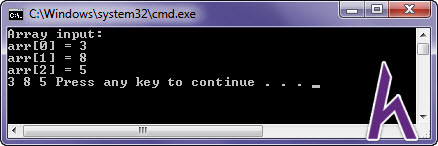

**<u>Ví dụ 2:</u>** các phép gán **KHÔNG hợp lệ **(gây chết chương trình):

```cpp
string arrKteam[3];

arrKteam[-1] = "Hello Howkteam.com!";

arrKteam[4] = "Free Education";

arrKteam[5] = "Share to be better";
```

**<u>Ví dụ 3:</u>**

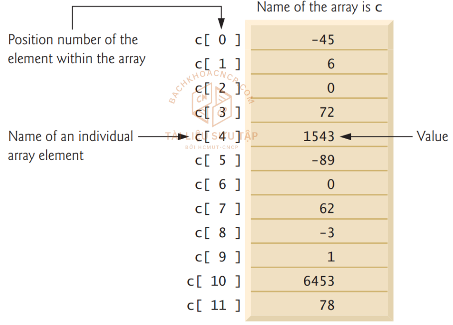

#### 3.2.2.5. Gán dữ liệu kiểu mảng

\- Không được sử dụng phép gán thông thường, mà phải gán trực tiếp giữa các phần tử tương ứng.

**~~\<biến mảng đích\> = \<biến mảng nguồn\>;~~ //sai**

**<span class="mark">\<biến mảng đích\>\[\<chỉ số thứ i\>\] = \<giá trị\>;</span>**

***Ví dụ:***

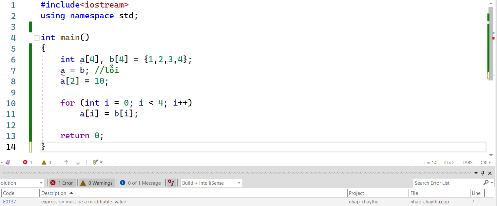

***Sửa lỗi:***

```cpp
#include <iostream>

using namespace std;

int main()

{

int a[4], b[4] = {1,2,3,4};

//a[2] = 10;

for (int i = 0; i < 4; i++)

a[i] = b[i];

for (int j = 0; j < 4; j++)

cout << a[j] << " ";

return 0;

}
```

***Kết quả:*** 1 2 3 4

#### 3.2.2.6. ***Truyền mảng cho hàm***

Tham số kiểu mảng trong khai báo hàm giống như khai báo biến mảng.

> void sapXepTang(int a\[100\]);
>
> void sapXepTang(int a\[\]);
>
> void sapXepTang(int \*a);

\* *Lời gọi hàm*: **sapXepTang(a);**

\+ Tham số kiểu mảng truyền cho hàm chính là địa chỉ của phần tử đầu tiên của mảng.

\+ Có thể bỏ số lượng phần tử hoặc sử dụng con trỏ.

\+ Mảng có thể thay đổi nội dung sau khi thực hiện hàm.

#### 3.2.2.7. Một số lỗi thường gặp

*- Khai báo không chỉ rõ số lượng phần tử:* int a\[\]; =\> int a\[100\];

*- Số lượng phần tử liên quan đến biến:* int n1 = 10; int a\[n1\]; =\> int a\[10\];

*- Khởi tạo cách biệt với khai báo:* int a\[4\]; a = {2912, 1706, 1506, 1904};

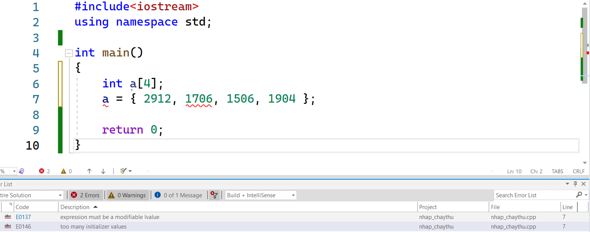

=\> int a\[4\] = {2912, 1706, 1506, 1904};

*- Chỉ số mảng không hợp lệ:* int a\[4\];

```cpp
a[-1] = 1; a[10] = 0;
```

*- Nhầm phần tử đầu tiên của mảng có chỉ số là 1 thay vì 0, dẫn đến lỗi dùng \<= thay vì \< trong vòng lặp for:*

```cpp
for (int i = 0; i < ARRAY_SIZE; i++)

cout << list[i] << " ";
```

**<span class="mark">\<= nên được thay thế bằng \<</span>**

#### 3.2.2.8. Một số kỹ thuật cơ bản trên mảng 1 chiều

*\*\*\* Một số kỹ thuật dưới đây có sử dụng các hàm bổ trợ sau:*

▪ Hàm void HoanVi(int &x, int &y): hoán vị giá trị của hai số nguyên.

```cpp
void HoanVi(int& x, int& y)

{

int tam = x; x = y; y = tam;

}
```

▪ Hàm int LaSNT(int n): kiểm tra một số có phải là số nguyên tố. Trả về 1 nếu n là số nguyên tố, ngược lại trả về 0.

```cpp
int LaSNT(int n)

{

int i, dem = 0;

for (i = 1; i <= n; i++)

if (n % i == 0)
```

dem++;

```cpp
if (dem == 2)

return 1;

else return 0;

}
```

***\***

***- Nhập mảng.***

\+ Yêu cầu: Cho phép nhập mảng a, số lượng phần tử n

\+ Ý tưởng

▪ Cho trước một mảng có số lượng phần tử là MAX.

▪ Nhập số lượng phần tử thực sự n của mảng.

▪ Nhập từng phần tử cho mảng từ chỉ số 0 đến n – 1.

```cpp
void NhapMang(int a[], int& n)

{

cout << "Nhap so luong phan tu n: ";

cin >> n;

for (int i = 0; i < n; i++)

{

cout << "Nhap phan tu thu " << i << " : ";

cin >> a[i];

}

}
```

***\* Nhập mảng với giá trị ngẫu nhiên:***

```cpp
for (int i = 0; i < n; i++)

{

a[i] = rand() % 100;

}
```

***- Xuất mảng.***

❖Yêu cầu: Cho trước mảng a, số lượng phần tử n. Hãy xuất nội dung mảng a ra màn hình.

❖Ý tưởng: Xuất giá trị từng phần tử của mảng từ chỉ số 0 đến n-1

```cpp
void XuatMang(int a[], int n)

{

cout << "Noi dung cua mang la : ";

for (int i = 0; i < n; i++)

cout << a[i] << " ";

cout << "\n";

}
```

***- Tính tổng các phần tử trong mảng:***

```cpp
int tinhTong(int a[], int n) {

int total = 0;

for (int i = 0; i < n; i++)

{

total += a[i];

}

return total;

}
```

***- Tìm kiếm một phần tử trong mảng.***

❖ Yêu cầu: Tìm xem phần tử x có nằm trong mảng a kích thước n hay không? Nếu có thì nó nằm ở vị trí đầu tiên nào.

❖ Ý tưởng: Xét từng phần của mảng a. Nếu phần tử đang xét bằng x thì trả về vị trí đó. Nếu không tìm được thì trả về -1.

*\*

*\* Dùng while:*

```cpp
int TimKiem(int a[], int n, int x)

{

int vt = 0;

while (vt < n && a[vt] != x)
```

vt++;

```cpp
if (vt < n)

return vt;

else

return -1;

}
```

*\* Dùng for:*

```cpp
int TimKiem(int a[], int n, int x)

{

for (int vt = 0; vt < n; vt++)

if (a[vt] == x)

return vt;

return -1;

}
```

***- Kiểm tra tính chất của mảng (Ví dụ: KT mảng có toàn bộ là số nguyên tố hay không).***

❖Yêu cầu: Cho trước mảng a, số lượng phần tử n. Mảng a có phải là mảng toàn các số nguyên tố hay không?

❖ Ý tưởng

▪ Cách 1: Đếm số lượng số ngtố của mảng. Nếu số lượng này bằng đúng n thì mảng toàn ngtố.

```cpp
int KiemTra_C1(int a[], int n)

{

int dem = 0;

for (int i = 0; i < n; i++)

if (LaSNT(a[i]) == 1) // có thể bỏ == 1
```

dem++;

```cpp
if (dem == n)

return 1;

return 0;

}
```

▪ Cách 2: Đếm số lượng số không phải ngtố của mảng. Nếu số lượng này bằng 0 thì mảng toàn ngtố.

```cpp
int KiemTra_C2(int a[], int n)

{

int dem = 0;

for (int i = 0; i < n; i++)

if (LaSNT(a[i]) == 0) // Có thể sử dụng !
```

dem++;

```cpp
if (dem == 0)

return 1;

return 0;

}
```

▪ Cách 3: Tìm xem có phần tử nào không phải số ngtố không. Nếu có thì mảng không toàn số ngtố.

```cpp
int KiemTra_C3(int a[], int n)

{

for (int i = 0; i < n; i++)

if (LaSNT(a[i]) == 0)

return 0;

return 1;

}
```

***- Tách các phần tử thỏa điều kiện (Ví dụ: đưa các số nguyên tố vào mảng mới).***

❖Yêu cầu: Cho trước mảng a, số lượng phần tử na. Tách các số nguyên tố có trong mảng a vào mảng b.

❖Ý tưởng: Duyệt từ phần tử của mảng a, nếu đó là số nguyên tố thì đưa vào mảng b.

```cpp
void TachSNT(int a[], int na, int b[], int& nb)

{

nb = 0;

for (int i = 0; i < na; i++)

if (LaSNT(a[i]) == 1)

{

b[nb] = a[i];
```

nb++;

}

}

***- Tách mảng thành 2 mảng con (Ví dụ: 1 mảng chứa số nguyên tố, 1 mảng là các số còn lại)***

❖Yêu cầu: Cho trước mảng a, số lượng phần tử na. Tách mảng a thành 2 mảng b (chứa số nguyên tố) và mảng c (các số còn lại).

❖Ý tưởng

▪ **Cách 1:** viết 1 hàm tách các số nguyên tố từ mảng a sang mảng b và 1 hàm tách các số không phải nguyên tố từ mảng a sang mảng c.

▪ **Cách 2:** Duyệt từ phần tử của mảng a, nếu đó là số nguyên tố thì đưa vào mảng b, ngược lại đưa vào mảng c.

```cpp
void TachSNT2(int a[], int na,

int b[], int& nb, int c[], int& nc)

{

nb = 0;

nc = 0;

for (int i = 0; i < na; i++)

if (LaSNT(a[i]) == 1)

{

b[nb] = a[i]; nb++;

}

else

{

c[nc] = a[i]; nc++;

}

}
```

***- Gộp 2 mảng thành một mảng.***

❖Yêu cầu: Cho trước mảng a, số lượng phần tử na và mảng b số lượng phần tử nb. Gộp 2 mảng trên theo tứ tự đó thành mảng c, số lượng phần tử nc.

❖Ý tưởng

▪ Chuyển các phần tử của mảng a sang mảng c =\> nc = na

▪ Tiếp tục đưa các phần tử của mảng b sang mảng c =\> nc = nc + nb

```cpp
void GopMang(int a[], int na, int b[], int nb,

int c[], int& nc)

{

nc = 0;

for (int i = 0; i < na; i++)

{

c[nc] = a[i]; nc++; // c[nc++] = a[i];

}

for (int i = 0; i < nb; i++)

{

c[nc] = b[i]; nc++; // c[nc++] = b[i];

}

}
```

***- Tìm giá trị lớn nhất của mảng.***

❖Yêu cầu: Cho trước mảng a có n phần tử. Tìm giá trị lớn nhất trong a (gọi là max)

❖Ý tưởng

▪ Giả sử giá trị max hiện tại là giá trị phần tử đầu tiên a\[0\]

▪ Lần lượt kiểm tra các phần tử còn lại để cập nhật max.

```cpp
int TimMax(int a[], int n)

{

int max = a[0];

for (int i = 1; i < n; i++)

if (a[i] > max)

max = a[i];

return max;

}
```

***- Tìm giá trị nhỏ nhất của mảng & vị trí của phần tử đó.***

```cpp
int findMin(int a[], int n) {

int max = a[0];

int indexOfMax = 0;

for (int i = 1; i < n; i++)

{

if (a[i] > max)

{

max = a[i];

indexOfMax = i;

}

}

}
```

***- Sắp xếp mảng tăng dần.***

❖Yêu cầu: Cho trước mảng a kích thước n. Hãy sắp xếp mảng a đó sao cho các phần tử có giá trị tăng dần.

❖Ý tưởng: Sử dụng 2 biến i và j để so sánh tất cả cặp phần tử với nhau và hoán vị các cặp nghịch thế (sai thứ tự).

```cpp
void SapXepTang(int a[], int n)

{

int i, j;

for (i = 0; i < n-1; i++)

{

for (j = i + 1; j < n; j++)

{

if (a[i] > a[j])

HoanVi(a[i], a[j]);

}

}

}
```

***- Thêm một phần tử vào mảng.***

❖Yêu cầu: Thêm phần tử x vào mảng a kích thước n tại vị trí vt.

❖Ý tưởng:

▪ “Đẩy” các phần tử bắt đầu tại vị trí vt sang phải 1 vị trí.

▪ Đưa x vào vị trí vt trong mảng.

▪ Tăng n lên 1 đơn vị

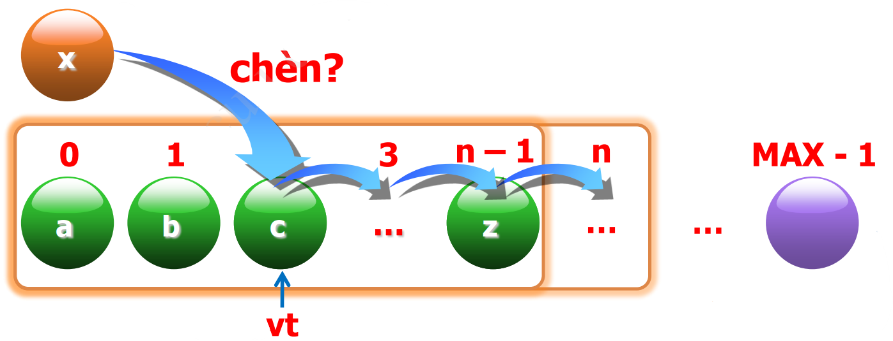

```cpp
void Them(int a[], int& n, int vt, int x)

{

if (vt >= 0 && vt <= n)

{

for (int i = n; i > vt; i--)

a[i] = a[i - 1];

a[vt] = x;
```

n++;

}

}

***- Xóa một phần tử trong mảng.***

❖Yêu cầu: Xóa một phần tử trong mảng a kích thước n tại vị trí vt

❖Ý tưởng:

▪ “Kéo” các phần tử bên phải vị trí vt sang trái 1 vị trí.

▪ Giảm n xuống 1 đơn vị

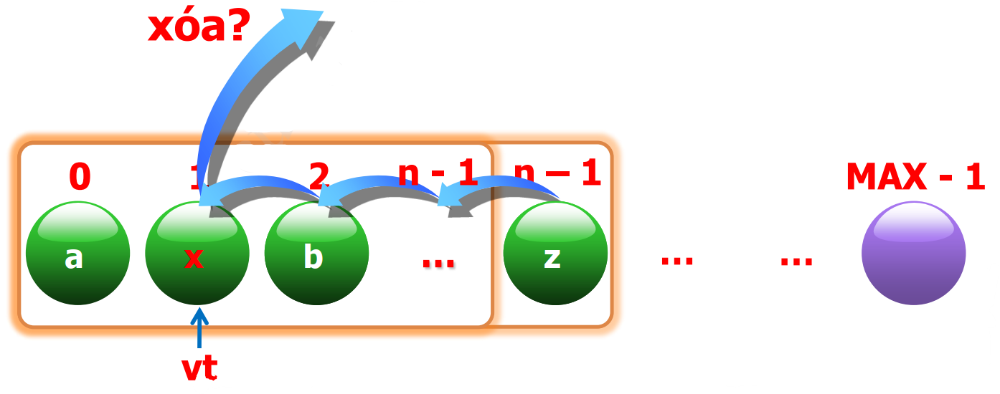

```cpp
void Xoa(int a[], int& n, int vt)

{

if (vt >= 0 && vt < n)

{

for (int i = vt; i < n - 1; i++)

a[i] = a[i + 1];
```

n--;

}

}

***- Xáo trộn ngẫu nhiên (Random shuffling):*** Trong nhiều chương trình, bạn cần sắp xếp lại các phần tử trong mảng một cách ngẫu nhiên. Điều này được gọi là xáo trộn.

Để thực hiện điều này, đối với mỗi phần tử myList\[i\], hãy tạo ngẫu nhiên một chỉ mục j và hoán đổi myList\[i\] với myList\[j\], như sau:

<table>
<colgroup>
<col style="width: 64%" />
<col style="width: 35%" />
</colgroup>
<thead>
<tr>
<th style="text-align: left;"><p><code>void shuffing(int a[], int n) {</code></p>
<p><code>srand(time(0));</code></p>
<p><code>for (int i = n - 1; i &gt; 0; i--)</code></p>
<p><code>{</code></p>
<p>// Generate an index j randomly with 0 &lt;= j &lt;=i</p>
<p><code>int j = rand() % (i + 1);</code></p>
<p>// Swap myList[i] with myList[j]</p>
<p><code>int temp = a[i];</code></p>
<p><code>a[i] = a[j];</code></p>
<p><code>a[j] = temp;</code></p>
<p><code>}</code></p>
<p><code>}</code></p></th>
<th><p>Hình minh họa</p></th>
</tr>
</thead>
<tbody>
</tbody>
</table>

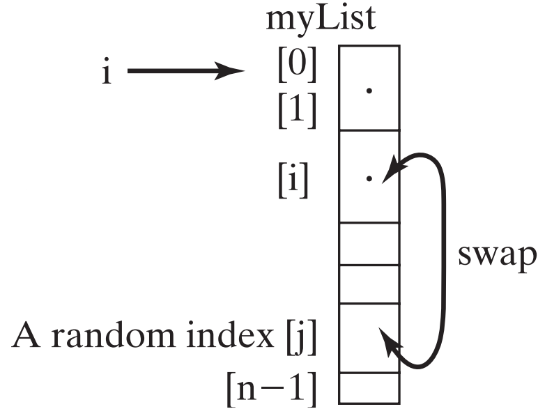

***- Dịch chuyển các phần tử (Shifting elements):*** Đôi khi bạn cần dịch chuyển các phần tử sang trái hoặc sang phải.

Ví dụ: bạn có thể dịch chuyển các phần tử sang trái một vị trí và điền phần tử cuối cùng bằng phần tử đầu tiên:


```cpp
void shiftElements(int a[], int n) {

int temp = a[0]; // Retain the first element

// Shift elements left

for (int i = 1; i < n; i++)

{
```

a\[i - 1\] = a\[i\];

}

// Move the first element to fill in the last position

a\[n - 1\] = temp;

}

### 3.2.3. Mảng 2 chiều (array 2 dimensional)

**\* Mảng nhiều chiều:**

\- Để thuận tiện trong việc biểu diễn các loại dữ liệu phức tạp như ma trận hoặc các bảng biểu có nhiều chỉ tiêu, C++ đưa ra kiểu dữ liệu mảng nhiều chiều. Tuy nhiên, việc sử dụng mảng nhiều chiều rất khó lập trình vì vậy trong mục này chúng ta chỉ bàn đến mảng hai chiều.

**- Mảng 2 chiều:**

\+ Các ma trận trong toán học (Đại số tuyến tính) là những mảng 2 chiều

\+ Ảnh là mảng 2 chiều của các điểm ảnh (pixel)

\+ Đồ thị (mạng của các đối tượng) có thể được biểu diễn dùng mảng 2 chiều

\+ Các phần tử được lưu trữ liên tục, hết hàng đến hàng

\+ Các phần tử trong mảng 2 chiều được đánh chỉ số để truy cập, dùng 2 chỉ số.

*Gọi **row** và **col** là chỉ số của một phần tử*

*Chỉ số row và col bắt đầu từ 0 đến (Số hàng -1) và (Số cột -1) tương ứng*

\+ Chương trình có thể tính địa chỉ của ô nhớ bắt đầu của phần tử có chỉ số \[row, col\] dễ dàng

*Địa chỉ của phần tử \[row, col\] = địa chỉ của phần tử đầu tiên +\
\[row\* (số phần tử trên một hàng) + col\] \* kích thước phần tử*

Bộ biên dịch đã biết trước kích thước phần tử. Do đó, người lập trình tính toán địa chỉ của phần tử tại \[row, col\]

<span class="mark">Địa chỉ của phần tử **\[row, col\]** = **first** **+** \[**row**\* **COLS** + **col**\]</span>

**first**: địa chỉ của phần tử đầu tiên, chính là tên mảng

**COLS**: số phần tử trên mỗi hàng

#### 3.2.3.1. Khai báo

\- Tường minh:

<span class="mark">**Kiểu_dữ_liệu** Tên_mảng**\[**số_hàng**\]\[**số_cột**\] ;**</span>

- **Kiểu_dữ_liệu** là kiểu của (số_hàng\*số_cột) phần tử trong mảng

- Khi đó **<u>kích thước</u> mảng sẽ là <span class="mark">tích (số_hàng\*số_cột)</span>**

- Bộ nhớ sử dụng = \<tổng số phần tử\> \* sizeof(\<kiểu dữ liệu\>).

- *Khi một mảng chưa khởi tạo, các phần tử của mảng sẽ mang giá trị rác.*

- Nên sử dụng chỉ thị tiền xử lý #define để định nghĩa \<số phần tử\> mảng.

**<u>Ví dụ 1:</u>** **float A\[3\]\[4\];** */\*Mảng số thực A gồm 12 phần tử được chia thành 3 hàng, 4 cột\*/*

\- Không tường minh (thông qua kiểu)

> **<span class="mark">typedef \<kiểu cơ sở\> \<tên kiểu\>\[\<N1\>\]\[\<N2\>\];</span>**
>
> **<span class="mark">\<tên kiểu\> \<tên biến\>;</span>**
>
> <span class="mark">**\<tên kiểu\> \<tên biến 1\>, \<tên biến 2\>;**</span>

**<u>Ví dụ 2:</u>**

typedef int MaTran10x20\[10\]\[20\];

typedef int MaTran5x10\[5\]\[10\];

MaTran10x20 a, b;

```cpp
MaTran11x11 c;

MaTran10x20 d;
```

#### 3.2.3.2. Khởi tạo giá trị cho mảng hai chiều khi khai báo

**<u>Ví dụ 1:</u>**

\- Khởi tạo mảng số nguyên A\[3\]\[2\] giống mảng 1 chiều: **int A\[3\]\[2\] = {2, 7, 9, 0, 4, -3};**

\- Khởi tạo theo từng dòng (hàng), các phần tử của mỗi dòng sẽ nằm trong một cặp dấu {}:

**int A\[3\]\[2\]={{2, 7}, {9, 0}, {4,-3}};**

\- Khởi tạo giá trị cho vài phần tử ở đầu mảng, *các phần tử còn lại sẽ tự động nhận giá trị 0:*

**int A\[3\]\[2\]={{2, 7}, {9}, {4,-3}};**

\- Khởi tạo giá trị 0 cho tất cả các phần tử của mảng:

**int A\[3\]\[2\]={0};** hoặc **int A\[3\]\[2\]={ };**

\- Khởi tạo giá trị cho mảng mà không bao gồm khai báo chiều thứ nhất hay số hàng ***(chiều thứ hai hay số cột bắt buộc phải có):***

**int A\[\]\[2\]={{2, 7}, {9, 0}, {4,-3}};**

**<u>Ví dụ 2:</u>**


**<u>Ví dụ 3:</u>** Sử dụng khởi tạo đồng nhất (uniform initialization) trong C++11 (tương tự như những cách trên, nhưng bỏ đi dấu bằng “=”).

**int** a\[2\]\[3\]

{

     { 6, 4, 3 }, // row 1

     { 7, 2, 8 }  // row 2

};

 

**int** b\[2\]\[3\]

{

     { 6 },       // row 1

     { 7, 2, 8 }  // row 2

};

 

**int** c\[2\]\[3\] {};

 

**int** d\[\]\[3\]

{

     { 6, 4, 3 }, // row 1

     { 7, 2, 8 }  // row 2

#### 3.2.3.3. Truy xuất các phần tử của mảng

\- Mỗi phần tử của mảng có dạng: **<span class="mark">Tên_mảng\[chỉ_số_hàng\]\[chỉ_số_cột\]</span>**

Trong đó, chỉ_số_hàng có giá trị từ 0 đến (số_hàng -1)và chỉ_số_cột có giá trị từ 0 đến (số_cột - 1).

**<u>Ví dụ 1:</u>** Mảng int A\[3\]\[2\] được minh họa như hình dưới:

<table>
<colgroup>
<col style="width: 81%" />
<col style="width: 18%" />
</colgroup>
<thead>
<tr>
<th><table style="width:88%;">
<colgroup>
<col style="width: 12%" />
<col style="width: 12%" />
<col style="width: 12%" />
<col style="width: 12%" />
<col style="width: 12%" />
<col style="width: 12%" />
<col style="width: 12%" />
</colgroup>
<tbody>
<tr>
<td style="text-align: center;"><strong>Chỉ số</strong></td>
<td style="text-align: center;"><strong>(0, 0)</strong></td>
<td style="text-align: center;"><strong>(0, 1)</strong></td>
<td style="text-align: center;"><strong>(1, 0)</strong></td>
<td style="text-align: center;"><strong>(1, 1)</strong></td>
<td style="text-align: center;"><strong>(2, 0)</strong></td>
<td style="text-align: center;"><strong>(2, 1)</strong></td>
</tr>
<tr>
<td style="text-align: center;"><strong>Mảng A</strong></td>
<td style="text-align: center;"><strong>6</strong></td>
<td style="text-align: center;"><strong>2</strong></td>
<td style="text-align: center;"><strong>-9</strong></td>
<td style="text-align: center;"><strong>0</strong></td>
<td style="text-align: center;"><strong>1</strong></td>
<td style="text-align: center;"><strong>5</strong></td>
</tr>
<tr>
<td style="text-align: center;">Phần tử</td>
<td style="text-align: center;"><strong>A</strong>[<strong>0</strong>][<strong>0</strong>]</td>
<td style="text-align: center;"><strong>A</strong>[<strong>0</strong>][<strong>1</strong>]</td>
<td style="text-align: center;"><strong>A</strong>[<strong>1</strong>][<strong>0</strong>]</td>
<td style="text-align: center;"><strong>A</strong>[<strong>1</strong>][<strong>1</strong>]</td>
<td style="text-align: center;"><strong>A</strong>[<strong>2</strong>][<strong>0</strong>]</td>
<td style="text-align: center;"><strong>A</strong>[<strong>2</strong>][<strong>1</strong>]</td>
</tr>
</tbody>
</table></th>
<th><table style="width:18%;">
<colgroup>
<col style="width: 6%" />
<col style="width: 6%" />
<col style="width: 6%" />
</colgroup>
<thead>
<tr>
<th style="text-align: right;"></th>
<th style="text-align: center;"><strong>0</strong></th>
<th style="text-align: center;"><strong>1</strong></th>
</tr>
</thead>
<tbody>
<tr>
<td style="text-align: right;"><strong>0</strong></td>
<td style="text-align: center;"><strong>6</strong></td>
<td style="text-align: center;"><strong>2</strong></td>
</tr>
<tr>
<td style="text-align: right;"><strong>1</strong></td>
<td style="text-align: center;"><strong>-9</strong></td>
<td style="text-align: center;"><strong>0</strong></td>
</tr>
<tr>
<td style="text-align: right;"><strong>2</strong></td>
<td style="text-align: center;"><strong>1</strong></td>
<td style="text-align: center;"><strong>5</strong></td>
</tr>
</tbody>
</table></th>
</tr>
</thead>
<tbody>
</tbody>
</table>

**+ Hợp lệ:** a\[0\]\[0\], a\[0\]\[1\], …, a\[1\]\[1\], a\[1\]\[2\]

**+ Không hợp lệ:** a\[-1\]\[0\], a\[0\]\[-1\], a\[2\]\[3\], … =\> cho kết quả không như mong muốn (có thể gây chết chương trình).

**<u>Ví dụ 2:</u>** Hình bên minh họa mảng 2 chiều với 3 dòng và 4 cột.

Thực chất trong bộ nhớ, tất cả 12 phần tử của mảng được sắp liên tiếp theo từng dòng của mảng như minh hoạ trong hình dưới đây.

|       |      **0**      |      **1**      |      **2**      |      **3**      |
|:-----:|:---------------:|:---------------:|:---------------:|:---------------:|
| **0** | **A\[0\]\[0\]** | **A\[0\]\[1\]** | **A\[0\]\[2\]** | **A\[0\]\[3\]** |
| **1** | **A\[1\]\[0\]** | **A\[1\]\[1\]** | **A\[1\]\[2\]** | **A\[1\]\[3\]** |
| **2** | **A\[2\]\[0\]** | **A\[2\]\[1\]** | **A\[2\]\[2\]** | **A\[2\]\[3\]** |

<table>
<colgroup>
<col style="width: 8%" />
<col style="width: 8%" />
<col style="width: 8%" />
<col style="width: 8%" />
<col style="width: 8%" />
<col style="width: 8%" />
<col style="width: 8%" />
<col style="width: 8%" />
<col style="width: 8%" />
<col style="width: 8%" />
<col style="width: 8%" />
<col style="width: 8%" />
</colgroup>
<thead>
<tr>
<th style="text-align: center;"><strong>A[0][0]</strong></th>
<th style="text-align: center;"><strong>A[0][1]</strong></th>
<th style="text-align: center;"><strong>A[0][2]</strong></th>
<th style="text-align: center;"><strong>A[0][3]</strong></th>
<th style="text-align: center;"><strong>A[1][0]</strong></th>
<th style="text-align: center;"><strong>A[1][1]</strong></th>
<th style="text-align: center;"><strong>A[1][2]</strong></th>
<th style="text-align: center;"><strong>A[1][3]</strong></th>
<th style="text-align: center;"><strong>A[2][0]</strong></th>
<th style="text-align: center;"><strong>A[2][1]</strong></th>
<th style="text-align: center;"><strong>A[2][2]</strong></th>
<th style="text-align: center;"><strong>A[2][3]</strong></th>
</tr>
</thead>
<tbody>
<tr>
<td colspan="4" style="text-align: center;"><em>Dòng 0</em></td>
<td colspan="4" style="text-align: center;"><em>Dòng 1</em></td>
<td colspan="4" style="text-align: center;"><em>Dòng 2</em></td>
</tr>
</tbody>
</table>

**<u>Ví dụ 3:</u>**


\*\*\* Dù mảng **a** là **2 chiều **hay** nhiều chiều**, nhưng bản chất khi lưu vào bộ nhớ RAM, nó vẫn là **1 vùng nhớ gồm những ô nhớ liên tiếp nhau**.

#### 3.2.3.4. Gán dữ liệu kiểu mảng

**-** Không được sử dụng phép gán thông thường, mà phải gán trực tiếp giữa các phần tử tương ứng.

**~~\<biến mảng đích\> = \<biến mảng nguồn\>;~~ //sai**

**\<biến mảng đích\>\[\<giá trị cs1\>\]\[giá trị cs2\] = \<giá trị\>;**

**<u>Ví dụ:</u>**

int a\[5\]\[10\], b\[5\]\[10\];

//b = a; // lỗi

```cpp
int i, j;

for (i = 0; i < 5; i++)

for (j = 0; j < 10; j++)

b[i][j] = a[i][j];
```

#### 3.2.3.5. Truyền mảng cho hàm 

\- Tham số kiểu mảng trong khai báo hàm giống như khai báo biến mảng

```cpp
void NhapMaTran(int a[50][100]);
```

\- Tham số kiểu mảng truyền cho hàm chính là địa chỉ của phần tử đầu tiên của mảng

• Có thể bỏ số lượng phần tử của dòng, hoặc sử dụng con trỏ.\
• Mảng có thể thay đổi nội dung sau khi thực hiện hàm.

**void NhapMaTran(int a\[\]\[100\]);\
```cpp
void NhapMaTran(int (*a)[100]);**
```

***\* Lời gọi hàm***

```cpp
void NhapMaTran(int a[][100], int& m, int& n);

void XuatMaTran(int a[][100], int m, int n);

int main()

{
```

int a\[50\]\[100\], m, n;

```cpp
NhapMaTran(a, m, n);

XuatMaTran(a, m, n);

}
```

\- Số lượng phần tử thực sự truyền qua biến khác:

```cpp
void XuatMaTran(int a[50][100], int m, int n);

void XuatMaTran(int a[][100], int m, int n);

void XuatMaTran(int(*a)[100], int m, int n);
```

❖ Lời gọi hàm

```cpp
void NhapMaTran(int a[][100], int& m, int& n);

void XuatMaTran(int a[][100], int m, int n);

int main() {
```

int a\[50\]\[100\], m, n;

```cpp
NhapMaTran(a, m, n);

XuatMaTran(a, m, n);

}
```

#### 3.2.3.6. Liên hệ giữa chỉ số mảng 1 chiều và chỉ số mảng 2 chiều


#### 3.2.3.7. Ma trận vuông: Số dòng = số cột


#### 3.2.3.8. Một số kỹ thuật cơ bản trên mảng 2 chiều

***\*\*\* Một số quy ước:***

❖Kiểu dữ liệu

**\#define MAXD 50**

**\#define MAXC 100**

❖Các chương trình con: Hàm void HoanVi(int x, int y) & Hàm int LaSNT(int n): ***đã đề cập ở phần mảng 1 chiều.***

***- Nhập mảng:***

❖Yêu cầu: Cho phép nhập mảng a, m dòng, n cột

❖Ý tưởng

▪ Cho trước một mảng 2 chiều có dòng tối đa là MAXD, số cột tối đa là MAXC.

▪ Nhập số lượng phần tử thực sự m, n của mỗi chiều.

▪ Nhập từng phần tử từ \[0\]\[0\] đến \[m-1\]\[n-1\].

```cpp
void NhapMaTran(int a[][MAXC], int& m, int& n)

{

cout << "Nhap so dong, so cot cua ma tran: ";

cin >> m >> n;

int i, j;

for (i = 0; i < m; i++)

for (j = 0; j < n; j++)

{

cout << "Nhap a[" << i << "][" << j << "]: ";

cin >> a[i][j];

}

}
```

***- Xuất mảng:***

❖Yêu cầu: Cho phép nhập mảng a, m dòng, n cột

❖Ý tưởng: Xuất giá trị từng phần tử của mảng 2 chiều từ dòng có 0 đến dòng m-1, mỗi dòng xuất giá giá trị của cột 0 đến cột n-1 trên dòng đó.

```cpp
void XuatMaTran(int a[][MAXC], int m, int n)

{

int i, j;

for (i = 0; i < m; i++)

{

for (j = 0; j < n; j++)

cout << a[i][j] << " ";

cout << "\n";

}

}
```

***- Tìm kiếm một phần tử trong mảng:***

❖Yêu cầu: Tìm xem phần tử x có nằm trong ma trận a kích thước mxn hay không?

❖Ý tưởng: Duyệt từng phần của ma trận a. Nếu phần tử đang xét bằng x thì trả về có (1), ngược lại trả về không có (0).

```cpp
int TimKiem(int a[][MAXC], int m, int n, int x)

{

int i, j;

for (i = 0; i < m; i++)

for (j = 0; j < n; j++)

if (a[i][j] == x)

return 1;

return 0;

}
```

***- Kiểm tra tính chất của mảng:***

❖Yêu cầu: Cho trước ma trận a kích thước mxn. Ma trận a có phải là ma trậntoàn các số nguyên tố hay không?

❖Ý tưởng

▪ Cách 1: Đếm số lượng số ngtố của ma trận. Nếu số lượng này bằng đúng mxn thì ma trận toàn ngtố.

```cpp
int KiemTra_C1(int a[][MAXC], int m, int n)

{

int i, j, dem = 0;

for (i = 0; i < m; i++)

for (j = 0; j < n; j++)

if (LaSNT(a[i][j] == 1))
```

dem++;

```cpp
if (dem == m * n)

return 1;

return 0;

}
```

▪ Cách 2: Đếm số lượng số không phải ngtố của ma trận. Nếu số lượng này bằng 0 thì ma trận toàn ngtố.

```cpp
int KiemTra_C2(int a[][MAXC], int m, int n)

{

int i, j, dem = 0;

for (i = 0; i < m; i++)

for (j = 0; j < n; j++)

if (LaSNT(a[i][j] == 0))
```

dem++;

```cpp
if (dem == 0)

return 1;

return 0;

}
```

▪ Cách 3: Tìm xem có phần tử nào không phải số ngtố không. Nếu có thì ma trận không toàn số ngtố.

```cpp
int KiemTra_C3(int a[][MAXC], int m, int n)

{

int i, j, dem = 0;

for (i = 0; i < m; i++)

for (j = 0; j < n; j++)

if (LaSNT(a[i][j] == 0))

return 0;

return 1;

}
```

***- Tính tổng các phần tử trên dòng/cột/toàn ma trận/đường chéo chính/nửa trên/nửa dưới***

❖Yêu cầu: Cho trước ma trận a, kích thước mxn. Tính tổng các phần tử trên:

• Dòng d, cột c

• Đường chéo chính, đường chéo phụ (ma trận vuông)

• Nửa trên/dưới đường chéo chính (ma trận vuông)

• Nửa trên/dưới đường chéo phụ (ma trận vuông)

❖Ý tưởng: Duyệt ma trận và cộng dồn các phần tử có tọa độ (dòng, cột) thỏa yêu cầu.

***+ Hàm tính tổng trên dòng:***

```cpp
int TongDong(int a[][MAXC], int m, int n, int d)

{

int j, tong;

tong = 0;

for (j = 0; j < n; j++) // Duyệt các cột

tong = tong + a[d][j];

return tong;

}
```

***+ Tìm dòng có tổng lớn nhất:***

```cpp
void maxSumRow(int a[][MAXC], int m, int n) {

int maxRow = 0;

int indexOfMaxRow = 0;

// Get sum of the first row in maxRow

for (int column = 0; column < n; column++)

maxRow += a[0][column];

for (int row = 1; row < m; row++)

{

int totalOfThisRow = 0;

for (int column = 0; column < n; column++)

totalOfThisRow += a[row][column];

if (totalOfThisRow > maxRow)

{

maxRow = totalOfThisRow;

indexOfMaxRow = row;

}

}

cout << "Row " << indexOfMaxRow
```

\<\< " has the maximum sum of " \<\< maxRow \<\< endl;

}

***+ Hàm tính tổng trên cột:***

```cpp
int TongCot(int a[][MAXC], int m, int c)

{

int i, tong;

tong = 0;

for (i = 0; i < m; i++) // Duyệt các dòng

tong = tong + a[i][c];

return tong;

}
```

***+ Hàm tính tổng đường chéo chính:***

```cpp
int TongDCChinh(int a[][MAXC], int n)

{

int i, tong;

tong = 0;

for (i = 0; i < n; i++)

tong = tong + a[i][i];

return tong;

}
```

***+ Hàm tính tổng trên đường chéo chính:***

```cpp
int TongTrenDCChinh(int a[][MAXC], int n)

{

int i, j, tong;

tong = 0;

for (i = 0; i < n; i++)

for (j = 0; j < n; j++)

if (i < j)

tong = tong + a[i][j];

return tong;

}
```

***+ Hàm tính tổng dưới đường chéo chính:***

```cpp
int TongDuoiDCChinh(int a[][MAXC], int n)

{

int i, j, tong;

tong = 0;

for (i = 0; i < n; i++)

for (j = 0; j < n; j++)

if (i > j)

tong = tong + a[i][j];

return tong;

}
```

***+ Hàm tính tổng trên đường chéo phụ:***

```cpp
int TongDCPhu(int a[][MAXC], int n)

{

int i, tong;

tong = 0;

for (i = 0; i < n; i++)

tong = tong + a[i][n - i - 1];

return tong;

}
```

***+ Hàm tính tổng toàn ma trận:***

```cpp
int tongMaTran(int a[][MAXC], int m, int n) {

int total = 0;

for (int row = 0; row < m; row++)

{

for (int column = 0; column < n; column++)

{

total += a[row][column];

}

}

}
```

***- Tìm giá trị lớn nhất của mảng***

❖Yêu cầu: Cho trước ma trận a, kích thước mxn. Tìm giá trị lớn nhất trong ma trận a (gọi là max)

❖Ý tưởng:

▪ Giả sử giá trị max hiện tại là giá trị phần tử đầu tiên a\[0\]\[0\]

▪ Lần lượt kiểm tra các phần tử còn lại để cập nhật max.

```cpp
int TimMax(int a[][MAXC], int m, int n)

{

int i, j, max;

max = a[0][0];

for (i = 0; i < m; i++)

for (j = 0; j < n; j++)

if (a[i][j] > max)

max = a[i][j];

return max;

}
```

***- Tìm giá trị nhỏ nhất của mảng***

```cpp
#include <iostream>

using namespace std;

int main()

{
```

float a\[100\]\[100\], min;// a chứa tối đa 10000 số

```cpp
int i, j, m, n;

cout << "Nhap so hang va so cot:\n"; cin >> m >> n;

for (i = 0; i < m; i++)

for (j = 0; j < n; j++)

{

cout << "a[" << i << "][" << j << "] = "; cin >> a[i][j];

}
```

min = a\[0\]\[0\];//Gán min bằng phần tử đầu tiên

```cpp
for (i = 0; i < n; i++)

for (j = 0; j < n; j++)

if (a[i][j] < min) min = a[i][j];

cout << "So be nhat la " << min << '\n';

}
```

***- Xáo trộn ngẫu nhiên:*** Làm cách nào để xáo trộn tất cả các phần tử trong mảng hai chiều? Để thực hiện điều này, với mỗi phần tử ma trận\[i\]\[j\], tạo ngẫu nhiên các chỉ số i1 và j1 và hoán đổi ma trận \[i\] \[j\] với ma trận \[i1\] \[j1\], như sau:

```cpp
void randomShuffing(int a[][MAXC], int m, int n) {

srand(time(0));

for (int i = 0; i < m; i++)

{

for (int j = 0; j < n; j++)

{

int i1 = rand() % m;

int j1 = rand() % n;

// Swap matrix[i][j] with matrix[i1][j1]

double temp = a[i][j];

a[i][j] = a[i1][j1];

a[i1][j1] = temp;

}

}

}
```

#### 3.2.3.9. Thư viện array trong STL

\- Đây là một thư viện giúp chúng ta sử dụng mảng một chiều một cách hiệu quả, rõ ràng hơn, ngoài ra nó còn giúp chúng ta hạn chế được lỗi thường gặp như truy cập đến chỉ số vượt ngoài giới hạn số phần tử đang sử dụng.

***- Cú pháp:***

> \#include \<array\>
>
> using namespace std;

\- Thư viện **array** cung cấp cho chúng ta kiểu dữ liệu **array**, biến được tạo ra bởi kiểu dữ liệu này chỉ là một biến đơn, nhưng vùng nhớ mà nó quản lý sẽ tương đương với số lượng phần tử tối đa mà chúng ta khai báo từ trước (gần giống như mảng một chiều).

\- Đối tượng được tạo ra bởi lớp **array** chỉ cung cấp cho chúng ta một vùng nhớ để lưu trữ một số lượng phần tử xác định trước, nhưng thông qua một số phương thức được định nghĩa bên trong lớp **array** này, chúng ta còn có thể truy xuất một số thông tin liên quan như số lượng phần tử, kiểm tra mảng có rỗng hay không, ...

***- Khai báo biến với kiểu dữ liệu array***

\* Một đối tượng có kiểu array khi được khai báo cần xác định được 2 điều:

\+ Kiểu dữ liệu của các phần tử mà biến array sẽ chứa.

\+ Số lượng phần tử tối đa của mảng.

\* Cú pháp khai báo biến kiểu **array**:

**array\< \<data_type\>, \<number_of_elements\> \> \<array_name\>;**

Ví dụ chúng ta cần sử dụng một mảng kiểu **int32_t** có 10 phần tử, chúng ta khai báo như sau:

```cpp
array<int32_t, 10> arr;
```

***- Khởi tạo giá trị***

\* Khi chưa khởi tạo giá trị cho biến kiểu **array**, chúng ta sẽ nhận được những giá trị không có ý nghĩa khi in chúng ra màn hình. Ví dụ với mảng **arr** trên:


\* Chúng ta có thể khởi tạo giá trị cho toàn bộ phần tử trong mảng chỉ với 1 dòng lệnh:

```cpp
.assign();
```

Giả sử muốn gán giá trị 10 cho toàn bộ phần tử trong mảng **arr**, ta viết như sau:

```cpp
arr.assign(10);
```

Kết quả của việc in mảng arr ra màn hình sau khi khởi tạo:


***- Truy xuất đến các thành phần trong biến có kiểu array***

\+ Chúng ta có thể truy cập đến một phần tử của đối tượng của lớp **array** bằng toán tử \[ \] như lúc các bạn sử dụng mảng một chiều. Ví dụ:

arr\[1\];

\+ Hoặc các bạn có thể sử dụng phương thức **at(\<index\>)** được định nghĩa trong lớp **array** như sau:

```cpp
arr.at(1);
```

Sử dụng **arr\[1\]** và **arr.at(1)** đều trả về kết quả là giá trị của phần tử thứ 2 trong mảng.

***- Truy xuất một số thông tin bên trong đối tượng của lớp array***

\+ Chúng ta có thể truy xuất một vài thông tin liên quan đến mảng một chiều bằng một số phương thức bên trong đối tượng của lớp **array**.

*\* Xem số lượng phần tử mà đối tượng của lớp **array** có thể chứa:*

```cpp
cout << "Number of elements: " << arr.size() << endl;
```

Phương thức size() trả về số lượng phần tử mà bạn đã khai báo lúc tạo ra đối tượng của class **array**.

*\* Kiểm tra xem mảng một chiều được chứa bên trong đối tượng của lớp **array** có rỗng hay không:*

Mảng một chiều rỗng nghĩa là số lượng phần tử bằng 0.

> **if**(arr.empty())
>
> cout \<\< "Array is empty." \<\< endl;
>
> **else**
>
> cout \<\< "Number of elements: " \<\< arr.size() \<\< endl;

Phương thức **empty()** trả về giá trị **true** nếu mảng bên trong đối tượng **arr** có số lượng phần tử là 0.

*\* Truy xuất đến phần tử đầu tiên và phần tử cuối cùng của mảng bên trong đối tượng của lớp **array**:*

> cout \<\< "The first element: " \<\< arr.front() \<\< endl;
>
> cout \<\< "The last element: " \<\< arr.back() \<\< endl;

Ví dụ mảng một chiều được khởi tạo giá trị là 1 2 3 4 5. Kết quả in ra màn hình sẽ là:


Phương thức **front()** sẽ trả về giá trị của phần tử đầu tiên trong mảng, ngược lại, phương thức **back()** sẽ trả về giá trị của phần tử cuối cùng trong mảng.

***- Nhập dữ liệu cho đối tượng của lớp array***

Tương tự lúc các bạn nhập dữ liệu cho mảng một chiều thông thường, chúng ta sử dụng đối tượng **cin** để đưa giá trị được nhập từ bàn phím vào trong mỗi phần tử mà đối tượng của lớp **array** đang nắm giữ.

> **for** (**int** i = 0; i \< arr.size(); i++) {
>
> cout \<\< "Enter value to element " \<\< i + 1 \<\< ": ";
>
> cin \>\> arr\[i\];
>
> }

***- Lớp array ngăn chặn hành vi truy cập phần tử có chỉ số không phù hợp***

Chúng ta chỉ có thể truy xuất đến các phần tử trong đối tượng của lớp **array** với chỉ số trong phạm vi từ 0 đến (size() - 1). Sau đây là những hành vi truy xuất hợp lệ:

> **\#define ARRAY_SIZE 10**
>
> array\<**int32_t**, ARRAY_SIZE\> arr;
>
> arr.assign(10);
>
> *//Access to all of elements of arr object*
>
> **for** (**int32_t** index = 0; index \<= arr.size() - 1; index++) {
>
> cout \<\< arr\[index\] \<\< " ";
>
> }
>
> cout \<\< endl;

Và dưới đây là một số hành vi truy xuất giá trị của đối tượng arr bằng những chỉ số không hợp lệ:

> //Try to access array with wrong index
>
> arr\[-1\];
>
> arr\[arr.size() + 10\];

Khi gặp những dòng lệnh này, **compiler** sẽ đưa ra cảnh báo:


Vì bên trong lớp **array** có sử dụng thư viện **cassert** để đặt ra những **Assertion**, những Assertion này kiểm tra về chỉ số mà bạn đưa vào cho toán tử **\[ \]** và phương thức **at()** để kiểm tra sự hợp lệ của chỉ số trước khi thực hiện lệnh. Mọi hành vì không phù hợp với điều kiện trong **Assertion** sẽ bị ngăn chặn.

#### 3.2.3.10. Thư viện cassert

\- Thư viện **cassert** cung cấp cho chúng ta macro có tên là assert(expression) giúp chúng ta tạo ra những **Assertion** trong chương trình.

\- Khi gặp macro **assert(expression)**, chương trình sẽ kiểm tra biểu thức *expression* (là một biểu thức điều kiện có thể trả về giá trị **true/false**) và có hai trường hợp có thể xảy ra:

**+ expression** trả về giá trị **true**: Chương trình sẽ tiếp tục thực hiện các dòng lệnh phía sau **Assertion** một cách bình thường. Ví dụ:

```cpp
float f_value = 1.0;

assert(typeid(f_value) == typeid(float));
```

f_value++;

```cpp
cout << f_value << endl;
```

Đoạn chương trình trên có 1 **Assertion** thực hiện công việc kiểm tra kiểu dữ liệu của biến **f_value**. Vì biểu thức typeid(f_value) == typeid(float) trả về giá trị **true**, nên chương trình vẫn được tiếp tục hoạt động.

**+ expression** trả về giá trị **false**: Chương trình sẽ dừng lại tại thời điểm phát hiện biểu thức bên trong **Assertion** cho giá trị **false**.

\#define ARRAY_SIZE 5

```cpp
array<int32_t, ARRAY_SIZE> arr;

for(int32_t index = 0; index <= arr.size(); index++) {

assert(index >= 0 && index <= arr.size() - 1);

cin >> arr[index];

}
```

Đoạn chương trình trên thực hiện nhập dữ liệu cho đối tượng **arr** có kiểu **array**. Bên trong vòng lặp **for**, đặt 1 **Assertion** nhằm kiểm tra chỉ số của mảng có được cung cấp chính xác hay không. Chỉ số chính xác sẽ nằm trong khoảng từ 0 đến (arr.size() - 1).

[](https://github.com/nguyenchiemminhvu/CPP-Tutorial/blob/master/5-kieu-du-lieu-mang/5-2-thu-vien-array-trong-STL/4.png?raw=true)

Ngoài việc chương trình đưa ra cửa sổ thông báo lỗi và bắt các bạn Abort chương trình đang chạy, trên cửa sổ console còn đưa ra thông báo lỗi tại dòng ta đặt **Assertion**.

Trước khi lỗi xảy ra, vẫn có thể nhập dữ liệu bình thường. Vì lúc đó chỉ số index của vòng lặp **for** vẫn thõa mãn biểu thức điều kiện bên trong **Assertion**. Nhưng mà vòng lặp for lại lặp với biến index chạy từ 0 đến **arr.size()**, vì thế, giá trị index tại lần lặp cuối cùng đã vi phạm biểu thức trong **Assertion** vừa đặt ra.

## 3.3. Chuỗi ký tự (Character sequences)

### 3.3.1. Khái niệm

\- Kiểu **char** chỉ chứa được một ký tự. Để lưu trữ một chuỗi (nhiều ký tự) ta sử dụng mảng (một chiều) các ký tự.

**- Chuỗi ký tự kết thúc bằng ký tự '\0' (null) 🡪 Độ dài chuỗi = kích thước mảng – 1**

**🡪 Chuỗi này được gọi là C-string.**

**<u>Ví dụ 1:</u>**

```cpp
char city1[] = "Dallas"; // C-string

char city2[] = { 'D', 'a', 'l', 'l', 'a', 's' }; // Not a C-string
```

*Độ dài chuỗi là số kí tự tối đa có thể có trong xâu. Độ dài thực sự của xâu chỉ tính từ đầu mảng đến dấu kết thúc xâu (không kể dấu kết thúc xâu ‘\0’). Do vậy trong khai báo độ dài của mảng cần phải khai báo thừa ra một phần tử.*


**<u>Ví dụ 2:</u>**

```cpp
char Hoten[30]; // Dài tối đa 29 ký tự

char NgaySinh[9]; //Dài tối đa 8 ký tự
```

**<u>Ví dụ 3:</u>**

|  **0**   | **1** | **2** |  **3**   | **4** | **5** |  **6**   |  **7**   |
|:--------:|:-----:|:-----:|:--------:|:-----:|:-----:|:--------:|:--------:|
|   *T*    |  *I*  |  *N*  |   *H*    |  *O*  |  *C*  | ***\0*** |          |
|   *T*    |  *I*  |  *N*  | ***\0*** |  *H*  |  *O*  |   *C*    | ***\0*** |
| ***\0*** |  *T*  |  *I*  |   *H*    |  *O*  |  *C*  | ***\0*** |          |

Hình vẽ trên minh hoạ 3 xâu, mỗi xâu được chứa trong mảng kí tự có độ dài tối đa là 8.

Nội dung xâu thứ nhất là “TINHOC" có độ dài thực tế là 6 kí tự, chiếm 7 ô trong mảng (thêm ô chứa kí tự kết thúc '\0').

Xâu thứ hai có nội dung “TIN" với độ dài 3 (chiếm 4 ô) và xâu cuối cùng biểu thị một xâu rỗng (chiếm 1 ô).

*Mảng kí tự được khai báo với độ dài 8 tuy nhiên các xâu có thể chỉ chiếm một số kí tự nào đó trong mảng này và tối đa là 7 kí tự.*

### 3.3.2. Khai báo

```cpp
char Tên_chuỗi[kích_thước_mảng]; // không khởi tạo
```

**char \<tên chuỗi\>\[kích_thước_mảng\] = “\<xâu kí tự\>” ;** // có khởi tạo

**char \<tên chuỗi\>\[\] = xâu kí tự ;** // có khởi tạo

Trong đó *kích_thước_mảng = Độ dài chuỗi + 1 (ký tự kết thúc)*

### 3.3.3. Khởi tạo

**- Độ dài cụ thể:**

```cpp
char s[10]={'c', 'h', 'a', 'o', ' ', 'b', 'a', 'n','\0'};
```

🡪 Khởi động chuỗi theo cách khởi động mảng 🡪 **cần kết thúc bằng ‘\0’**

```cpp
char s[10]="chao ban"; // Tự động thêm '\0'
```

**🡪 Khởi động bằng hằng chuỗi 🡪 không cần ghi ’\0’**


**- Tự xác định độ dài:**

```cpp
char s[]={'c', 'h', 'a', 'o', ' ', 'b', 'a', 'n','\0'};

char s[]="chao ban"; // Tự động thêm '\0'
```


\- Bản chất của mảng ký tự cũng là mảng 1 chiều, nghĩa là bạn có khởi tạo chuỗi ký tự, nhưng bạn không thể gán chuỗi ký tự trực tiếp cho nó.

**Ví dụ** các phép gán hợp lệ:

> **char** sz\[\] = "Kteam"; // Tự động thêm '\0' vào cuối chuỗi
>
> sz\[0\] = 'F';
>
> sz\[1\] = 'r';
>
> sz\[2\] = 'e’;
>
> sz\[3\] = 'e';
>
> sz\[4\] = 'E';

**Ví dụ** các phép gán **KHÔNG hợp lệ**:

> **char** sz\[\] = "Kteam"; // Tự động thêm '\0' vào cuối chuỗi
>
> sz = "FreeE"; // Lỗi, không được gán trực tiếp

### 3.3.4. Xuất/nhập

#### 3.3.4.1. Xuất

\- Không giống như mảng 1 chiều thông thường cần sử dụng vòng lặp để xuất từng phần tử, mảng ký tự cho phép sử dụng đối tượng std::cout để in toàn bộ ký tự ra màn hình.

\- Khi in mảng ký tự (C-style strings), đối tượng std::cout sẽ in tất cả ký tự cho đến khi gặp ký tự ‘\0’ (null).

**<u>Ví dụ:</u>**

```cpp
#include <iostream>

using namespace std;

int main()

{

// 0 1 2 3 4 5

// K t e a m \0

char szKteam[] = "Kteam";

cout << szKteam << endl; // "Kteam"

// 0 1 2 3 4 5 6 7 8 9

// F r e e E d u \0 \0 \0

char szFreeEdu[10] = "FreeEdu";

cout << szFreeEdu << endl; // "FreeEdu"

/* ký tự szFreeEdu[7] là '\0' (null), nên chỉ in chuỗi đến vị trí 6*/

// 0 1 2 3 4 5 6 7 8 9

// F r e e E d u \0 \0 a

szFreeEdu[9] = 'a';

cout << szFreeEdu << endl; // "FreeEdu"

return 0;

}
```

***Kết quả:*** Kteam

FreeEdu

FreeEdu

#### 3.3.4.2. Nhập

\- Mảng ký tự (C-style strings) trong C++ cho phép sử dụng đối tượng std::cin để nhập dữ liệu từ bàn phím. Nhưng việc sử dụng trực tiếp đối tượng std::cin sẽ gặp 2 vấn đề.

**+ Vấn đề 1: không nhập được chuỗi kí tự có chứa khoảng trắng**

Khi đọc thông tin từ bàn phím, đối tượng std::cin sẽ đọc các ký tự cho đến khi gặp ký tự khoảng trắng ‘ ’, hoặc ký tự enter ‘\n’.

Vì vậy, nếu chuỗi của bạn chứa các khoảng trắng, đối tượng std::cin chỉ đọc được từ đầu tiên.

**+ Vấn đề 2: tràn mảng khi nhập quá số lượng ký tự so với khai báo**

Bạn không thể kiểm soát được các thao tác của người dùng. Trường hợp bạn khai báo 1 mảng ký tự gồm 10 phần tử, nhưng người dùng cố tình (hoặc vô ý) nhập 1 chuỗi nhiều hơn 10 phần tử. Lúc này, vấn đề tràn mảng xảy ra, và chương trình của bạn sẽ gặp lỗi.

\- Nhập ký tự: <span class="mark">**cin.get**(Biến ký tự);</span>

\- Nhập chuỗi ký tự: <span class="mark">**cin.getline**(s, n);</span> *với n là số ký tự tối đa của chuỗi.*

**<u>Ví dụ:</u>**

```cpp
#include <iostream>

using namespace std;

int main()

{

char c, Str[100];

cout << "Nhap mot ki tu: ";

cin.get(c);

cin.ignore(1);// xóa bộ nhớ đệm

cout << "Nhap mot chuoi(xau): ";

cin.getline(Str, 20); // 20 là số kí tự tối đa của chuỗi.

cout << "\nKi tu vua nhap la: " << c << "\n";

cout << "Chuoi vua nhap la: " << Str << "\n";

return 0;

}
```

***Kết quả:***

> Nhap mot ki tu: a
>
> Nhap mot chuoi(xau): abc xyz
>
> Ki tu vua nhap la: a
>
> Chuoi vua nhap la: abc xyz

### 3.3.5. Một số hàm xử lý chuỗi của thư viện string

**<span class="mark">\* Các hàm sao chép chuỗi</span>**

#### 3.3.5.1. strcpy(s, t)

***Hàm sẽ sao chép toàn bộ nội dung của xâu t (kể cả kí tự kết thúc xâu ‘\0’) vào cho xâu s.*** Để sử dụng hàm này cần đảm bảo độ dài của mảng s ít nhất cũng bằng độ dài của mảng t. Trong trường hợp ngược lại kí tự kết thúc xâu sẽ không được ghi vào s và điều này có thể gây treo máy khi chạy chương trình.

**<u>Ví dụ:</u>**

```cpp
#include <iostream>

#include <cstring>

using namespace std;

int main()

{

char s[10], t[10];

strcpy(t, "Face");// gán "Face" cho t

strcpy(s, t);// sao chép t sang s

cout << s << " to " << t << '\n'; // in ra: Face to Face

return 0;

}
```

***Kết quả:*** Face to Face

**<u>Chú ý:</u>** *Khi sử dụng hàm này, chuỗi đích phải đủ lớn để chứa được chuỗi nguồn. Nếu không, vấn đề tràn mảng sẽ xảy ra.*


Một số compiler hiện đại thường cảnh báo về việc sử dụng hàm strcpy() là không an toàn, và yêu cầu lập trình viên thêm dòng lệnh **\#define \_CRT_SECURE_NO_WARNINGS** vào đầu chương trình.

**Trong C++ 11, hàm strcpy_s() được thay thế cho hàm strcpy(), hàm này có <u>thêm 1 tham số cho phép xác định độ dài của chuỗi đích.</u>** Nếu chuỗi đích không đủ lớn để chứa chuỗi nguồn, compiler sẽ ném ra 1 assert trong debug mode, và kết thúc chương trình. ***(Đối với một số trường hợp như VD bên dưới, IDE vẫn không báo lỗi nếu như ta không khai báo độ dài chuỗi đích, nhưng vẫn khai báo thì sẽ tốt hơn).***

*\*\*\* strcpy có khả năng không an toàn vì nó có thể dẫn đến tràn bộ đệm nếu bạn cố sao chép một chuỗi vào bộ đệm không đủ lớn để chứa chuỗi đó*

*\*\*\* strcpy_s an toàn hơn strcpy vì ta phải chỉ định rõ ràng kích thước của bộ đệm đích, do đó tràn bộ nhớ sẽ không xảy ra.*

```cpp
#include <iostream>

#include <iostream>

using namespace std;

int main()

{

char s[10], t[10];
```

strcpy_s(t, "Face");// gán "Face" cho t

strcpy_s(s, t);// sao chép t sang s

```cpp
cout << s << " to " << t << '\n'; // in ra: Face to Face

return 0;

}
```

***Cú pháp của hàm strcpy_s:***

**strcpy_s( char *restrict dest, rsize_t destsz, const char *restrict src );**

*Trong đó:*

dest - con trỏ tới mảng ký tự đích.

src - con trỏ tới chuỗi byte kết thúc bằng null của mảng nguồn để sao chép từ đó

destsz - số lượng ký tự tối đa cần ghi, thường là kích thước của bộ đệm đích

#### 3.3.5.2. strncpy(s, t, n)

*Sao chép n kí tự của t vào s. Hàm này chỉ làm nhiệm vụ sao chép, không tự động gắn kí tự kết thúc xâu cho s. Do vậy NSD phải thêm lệnh đặt kí tự '\0' vào cuối xâu s sau khi sao chép xong.*

**<u>Ví dụ:</u>**

```cpp
#include <iostream>

#include <cstring>

using namespace std;

int main()

{

char s[15], t[20] = "Tin hoc dai cuong";
```

strncpy(s, t, 3); // copy 3 kí tự "Tin" vào s

s\[3\] = ' '; //Gán kí tự khoảng trống cho s\[3\]

strncpy(s + 4, t + 8, 9); //copy "dai cuong" vào s từ vị trí thứ 4

s\[13\] = '\0'; // kết thúc xâu s

```cpp
cout << "Chuoi s la: " << s << '\n'; //Xuất ra “Tin dai cuong”

}
```

**<u>Kết quả:</u>** Chuoi s la: Tin dai cuong

\- Tuy nhiên, một số IDE sẽ báo lỗi nếu dùng strncpy, vì vậy ta có hàm strncpy_s

\- Cú pháp:

**strncpy_s(char *restrict dest, rsize_t destsz, const char *restrict src, rsize_t count);**

- dest: Con trỏ đến mảng ký tự nơi nội dung sẽ được sao chép vào (mảng đích).

- destsz: Kích thước tối đa của mảng dest (mảng đích).

- src: Con trỏ đến mảng ký tự nơi nội dung sẽ được sao chép từ (mảng nguồn).

- count: Số lượng ký tự tối đa để sao chép từ src (từ mảng nguồn).

*- Hàm strncpy_s sẽ sao chép tối đa count ký tự từ chuỗi mà src trỏ đến vào vị trí mà dest trỏ đến. Nếu count nhỏ hơn độ dài của src, count ký tự đầu tiên sẽ được sao chép vào dest và nó sẽ không kết thúc bằng ký tự null. Nếu count lớn hơn độ dài của src, tất cả các ký tự từ src sẽ được sao chép vào dest và các ký tự null sẽ được thêm vào cho đến khi tổng số ký tự đã được ghi là count.*

*- Hàm strncpy_s trả về 0 nếu không có lỗi xảy ra. Nếu có lỗi xảy ra, hàm sẽ trả về một mã lỗi.*

```cpp
#include <iostream>

#include <iostream>

using namespace std;

int main()

{

char s[15], t[20] = "Tin hoc dai cuong";
```

strncpy_s(s, sizeof(s), t, 3); // copy 3 kí tự "Tin" vào s

s\[3\] = ' '; //Gán kí tự khoảng trống cho s\[3\]

strncpy_s(s+4, sizeof(s) - 4, t + 8, 9); //copy "dai cuong" vào s từ vị trí thứ 4

s\[13\] = '\0'; // kết thúc xâu s

```cpp
cout << "Chuoi s la: " << s << '\n'; //Xuất ra “Tin dai cuong”

}
```

**<u>Kết quả:</u>** Chuoi s la: Tin dai cuong

*\* Trong đó, sizeof(s)-4 là kích thước tối đa của bộ nhớ mà bạn muốn sao chép vào. Bạn cần trừ đi 4 vì bạn đã sao chép 3 ký tự và một khoảng trắng vào s trước đó.*

**<span class="mark">\* Các hàm nối chuỗi</span>**

#### 3.3.5.3. strcat(s, t) hoặc strcat_s(s, t)

*Nối một bản sao của t vào sau s (thay cho phép +). Hiển nhiên hàm sẽ loại bỏ kí tự kết thúc xâu s trước khi nối thêm t. Việc nối sẽ đảm bảo lấy cả kí tự kết thúc của xâu t vào cho s (nếu s đủ chỗ) vì vậy NSD không cần thêm kí tự này vào cuối xâu.*

**<u>Ví dụ:</u>**

```cpp
#include <iostream>

#include <cstring>

using namespace std;

int main()

{

char a[100] = "Nam", b[4] = "Bac";
```

strcat(a, " va "); // strcat_s(a, " va ");

strcat(a, b); // strcat_s(a, b);

```cpp
cout << a; //Sẽ xuất ra “Nam va Bac”

}
```

***Kết quả:*** Nam va Bac

**<u>Lưu ý:</u>** *Khi sử dụng hàm strcat(), chuỗi đích phải đủ lớn để chứa được thêm chuỗi mới được nối nào. Nếu không, vấn đề tràn mảng sẽ xảy ra.*

Trong C++ 11, hàm strcat_s() được thay thế cho hàm strcat(), hàm này có thêm 1 tham số cho phép xác định độ dài của chuỗi đích. Nếu chuỗi đích không đủ lớn để chứa thêm chuỗi nguồn, compiler sẽ ném ra 1 assert trong debug mode, và kết thúc chương trình.

#### 3.3.5.4. strncat(s, t, n) hoặc strncat_s(s, t, n)

*Nối bản sao **n kí tự đầu tiên** của xâu t vào sau xâu s. Hàm tự động đặt thêm dấu kết thúc xâu vào s sau khi nối xong.*

*Tương tự, có thể sử dụng **strncat(s, t+k, n)** để nối n kí tự từ vị trí thứ k của xâu t cho s.*

**<u>Ví dụ:</u>**

```cpp
#include <iostream>

#include <iostream>

using namespace std;

int main()

{

char str[44] = "Thu hai", s1[44] = "Thu ba", s2[44] = "Dau tuan la ngay ";

cout << "Chuoi str la: " << str;
```

strcat_s(str, " va "); //Thu hai va

```cpp
cout << "\nChuoi str sau khi noi voi chuoi " va " la: " << str;
```

strcat_s(str, s1); //Thu hai va Thu ba

```cpp
cout << "\nChuoi str noi tiep voi chuoi s1 la: " << str;
```

strncat_s(s2, str, 7); //Dau tuan la ngay thu hai

```cpp
cout << "\nChuoi s2 sau khi noi voi 7 ki tu dau cua chuoi str la:\n" << s2;

}
```

***Kết quả:***


**<span class="mark">\* Các hàm so sánh chuỗi</span>**

#### ***3.3.5.5. Hàm strcmp(s, t);*** 

Hàm so sánh 2 xâu s và t (thay cho các phép toán so sánh). Giá trị trả lại là ***hiệu 2 kí tự khác nhau đầu tiên*** của s và t. Từ đó, nếu

s1 \< s2 thì hàm trả lại giá trị âm,

bằng 0 nếu s1==s2, và

dương nếu s1 \> s2.

Trong trường hợp chỉ quan tâm đến so sánh bằng, nếu hàm trả lại giá trị 0 là 2 xâu bằng nhau và nếu giá trị trả lại khác 0 là 2 xâu khác nhau.

#### 3.3.5.6. Hàm strncmp(s, t, n)

> Giống hàm strcmp(s, t) nhưng chỉ so sánh tối đa n kí tự đầu tiên của hai xâu.

#### ***3.3.5.7. Hàm stricmp(s, t) hoặc \_stricmp(s, t)*** 

> Như strcmp(s, t) nhưng không phân biệt chữ hoa, thường.

**<u>Ví dụ:</u>** Minh họa về các hàm so sánh chuỗi:

```cpp
#include <iostream>

#include <cstring>

using namespace std;

int main() {

char s1[] = "Ky thuat lap trinh", s2[] = "Ky thuat lap trinh C++";

int t;

cout << "Chuoi s1: " << s1;

cout << "\nChuoi s2: " << s2;

t = strcmp(s1, "Ky thuat lap trinh");

if (t == 0)

cout << "\nt = " << t << ": s1 la: Ky thuat lap trinh";

else

cout << "\nt = " << t << ": s1 khong phai la: Ky thuat lap trinh";

t = strcmp(s1, s2);

if (t == 0)

cout << "\nt = " << t << ": s1 va s2 giong nhau";

else

cout << "\nt = " << t << ": s1 va s2 khac nhau";

t = strncmp(s1, s2, 18);

if (t == 0)

cout << "\nt = " << t << ": 18 ki tu dau cua s1 va s2 giong nhau";

else

cout << "\nt = " << t << ": 18 ki tu dau cua s1 va s2 khac nhau";

t = _stricmp(s1, "KY thuat Lap TRINH");

if (t == 0)

cout << "\nt = " << t << ": s1 co noi dung giong: KY thuat Lap TRINH";

else

cout << "\nt = " << t << ": s1 co noi dung khac: KY thuat Lap TRINH";

}
```

***Kết quả:***


\*\*\* ***Chú ý:*** Không thể dùng toán tử == để so sánh 2 chuỗi.

**\**

**<span class="mark">\* Các hàm biến đổi chữ hoa chữ thường</span>**

#### ***3.3.5.8. strupr(s)***

> Hàm đổi xâu s thành in hoa, và cũng trả lại xâu in hoa đó.

#### ***3.3.5.9. strlwr(s)*** 

Hàm đổi xâu s thành in thường, kết quả trả lại là xâu s.

*Một số compiler hiện đại thường cảnh báo về việc sử dụng hàm strlwr() và strupr(), và yêu cầu lập trình viên thêm dòng lệnh **\#define \_CRT_NONSTDC_NO_DEPRECATE** vào đầu chương trình.*

**<u>Ví dụ:</u>**

\#define \_CRT_NONSTDC_NO_DEPRECATE

```cpp
#include <iostream>

#include <cstring>

using namespace std;

int main()

{

char szString1[] = "Hello Howkteam.com!";

char szString2[] = "Hello Howkteam.com!";

cout << "s1: " << szString1 << endl;

cout << "s2: " << szString2 << endl;

strlwr(szString1);

strupr(szString2);

cout << "Upper s1: " << szString1 << endl;

cout << "Lower s2: " << szString2 << endl;

return 0;

}
```

***Kết quả:***

s1: Hello Howkteam.com!

s2: Hello Howkteam.com!

Upper s1: hello howkteam.com!

Lower s2: HELLO HOWKTEAM.COM!

#### ***3.3.5.10. tolower(ch)***

> Hàm đổi kí tự ch sang chữ thường.

#### ***3.3.5.11. toupper(ch)***

> Hàm đổi kí tự ch sang chữ hoa.

**<u>Ví dụ:</u>**

```cpp
#include <iostream>

#include <iostream>

using namespace std;

int main() {

char kt = 'a', kt2 = 'M';

kt = toupper(kt); kt2 = tolower(kt2);

cout << "Ki tu a viet hoa la: " << kt << endl;

cout << "Ki tu M viet thuong la: " << kt2;

}
```

***Kết quả:***

Ki tu a viet hoa la: A

Ki tu M viet thuong la: m

***<u>Chú ý:</u>*** Ngoài cách sử dụng hàm thì ta có thể sử dụng cách thủ công là cộng thêm 32 để đổi kí tự in hoa sang kí tự thường và ngược lại *(vì trong bảng mã ASCII thì kí tự hoa và kí tự thường của 1 chữ cái Latinh cách nhau một khoảng là 32).*

**<u>Ví dụ:</u>** Viết chương trình nhập vào họ và tên 1 người bất kì. Xuất thông tin người đó ra màn hình sao cho các thành phần: họ, họ đệm và tên đều bắt đầu bằng chữ cái in hoa, các chữ còn lại phải là chữ cái thường. Đầu và cuối của chuỗi không chứa dấu cách và các thành phần cách nhau chỉ 1 dấu cách.

\#define \_CRT_NONSTDC_NO_DEPRECATE

```cpp
#include <iostream>

#include <cstring>

using namespace std;

int main() {

char hoten[35]; int i, j, t;

cout << "Nhap vao ho va ten:\n"; cin.getline(hoten, 35);

cout << "Ten ma ban nhap:\n[" << hoten << "]";

t = int(strlen(hoten));

for (i = 0; i < t; i++)//Xoa khoang trong dau chuoi hoten

if (hoten[i] != ' ') break;

for (j = 0; j < t - i; j++)

hoten[j] = hoten[j + i];
```

hoten\[t - i\] = '\0'; <span class="mark">t = int(strlen(hoten));</span>

```cpp
for (i = t - 1; i >= 0; i--)//Xoa khoang trong cuoi chuoi hoten

if (hoten[i] != ' ') break;
```

hoten\[i + 1\] = '\0'; <span class="mark">t = int(strlen(hoten));</span>

```cpp
for (i = 0; i < t; i++)//Xoa khoang trong bi thua giua cac thanh phan

while (hoten[i] == ' ' && hoten[i + 1] == ' ') {

for (j = i; j < t; j++)

hoten[j] = hoten[j + 1];
```

t--;

}

strlwr(hoten); //Dua ve chu thuong

```cpp
for (i = 0; i < t; i++)

if (i == 0 || hoten[i] != ' ' && hoten[i - 1] == ' ')

hoten[i] -= 32;

cout << "\nTen chuan chinh ta:\n[" << hoten << "]";

return 0;

}
```

***Kết quả:***


#### 3.3.5.12. Hàm đếm kí tự strlen()

*Hàm in ra số ký tự trước ký tự ‘\0’ null (trong khi sizeof() trả về kích thước của toàn bộ mảng).*

**<u>Ví dụ:</u>** Chương trình đếm kí tự khoảng trống xuất hiện trong 1 chuỗi

```cpp
#include <iostream>

#include <cstring>

using namespace std;

int main()

{

char str[44] = "Ngay da dom bong";

int dem = 0, i;

for (i = 0; i < strlen(str); i++)

if (str[i] == ' ') dem++;

cout << "So ki tu khoang trong co trong chuoi la: " << dem;

}
```

***Kết quả:*** So ki tu khoang trong co trong chuoi la: 3

#### 3.3.5.13. Hàm đảo ngược strrev(s); hoặc \_strrev(s); hoặc reverse();

*Đảo ngược thứ tự các ký tự trong xâu s (Trừ ký tự '\0')*

**<u>Ví dụ 1:</u>** Dùng hàm strrev(s);

```cpp
#include <iostream>

#include <iostream>

using namespace std;

int main()

{

char str[] = "Journal Dev reverse example";

_strrev(str);

cout << "\n" << str;

return 0;

}
```

***Kết quả:*** elpmaxe esrever veD lanruoJ

**<u>Ví dụ 2:</u>** Dùng hàm reverse(s);

```cpp
#include <iostream>

#include <algorithm>

#include <string>

using namespace std;

int main()

{

string str = "Journal Dev reverse example";

reverse(str.begin(), str.end());

cout << "\n" << str;

return 0;

}
```

***Kết quả:*** elpmaxe esrever veD lanruoJ

#### 3.3.5.14 Tìm kiếm chuỗi trong chuỗi

\- Để tìm vị trí xuất hiện đầu tiên của một chuỗi (s2) trong một chuỗi khác (s1), bạn có thể sử dụng hàm strstr().

\+ Nếu **tìm thấy**: trả về con trỏ đến vị trí xuất hiện đầu tiên của chuỗi s2 trong chuỗi s1.

\+ Nếu** không tìm thấy**: trả về NULL.

**<u>Ví dụ 1:</u>**

```cpp
#include <iostream>

#include <iostream>

using namespace std;

int main()

{

char szString1[] = "Hello Howkteam.com!";

char szString2[] = "kteam";

cout << "s1: " << szString1 << endl;

cout << "s2: " << szString2 << endl;

if (strstr(szString1, szString2) != NULL)

cout << "Tim thay " << szString2 << " trong " << szString1 << endl;

else

cout << "Khong tim thay!" << endl;

return 0;

}
```

***Kết quả:***

s1: Hello Howkteam.com!

s2: kteam

Tim thay kteam trong Hello Howkteam.com!

**<u>Ví dụ 2:</u>**

```cpp
#include <iostream>

#include <string>

using namespace std;

int main()

{

char text[] = "This is a simple string";

char pattern[] = "simple";

char* p = strstr(text, pattern);

if (p == NULL) {

cout << "Could not find the pattern string in the text string" << endl;

}

else {
```

int32_t match_index = (p - text) / sizeof(char);

```cpp
cout << "The pattern string match the text string at: " << match_index << endl;

}

return 0;

}
```

***Kết quả:*** The pattern string match the text string at: 10


### 3.3.6. Mảng chuỗi

\- Mảng chuỗi là mảng trong đó các phần tử của nó là một chuỗi.

**- Cú pháp khai báo:**

<span class="mark">**char** Tên_mảng**\[**Kích_thước**\]\[**độ_dài_chuỗi**\];**</span>

***Trong đó:* kích_thước** là số lượng phần tử tối đa của mảng.

**độ_dài_chuỗi** là kích thước của các phần tử.

\- Để truy cập đến các phần tử ta chỉ cần viết tên mảng kèm chỉ số của nó ở trong cặp dấu **\[\]** đầu tiên.

**<u>Ví dụ:</u>** Chương trình nhập/xuất dữ liệu cho 1 mảng gồm tên của n sinh viên trong 1 nhóm học.

```cpp
#include <iostream>

using namespace std;

int main()

{
```

char sinhvien\[50\]\[33\]; int i, n;

```cpp
cout << "Nhap so luong sinh vien cua lop: ";

cin >> n; cin.ignore(1);

for (i = 0; i < n; i++) {

cout << "Ho va ten cua sinh vien thu " << i + 1 << " :";

cin.getline(sinhvien[i], 33);

}

cout << "===================================\n";

cout << "Danh sach sinh vien vua nhap la:\n";

cout << "STT\tHo va ten\n";

for (i = 0; i < n; i++)

cout << i + 1 << "\t" << sinhvien[i] << endl;

}
```

***Kết quả:***


### 3.3.7. Giới thiệu về string

\- Để dùng string phải khai báo thư viện: **\#include\<string\>**

\- Và: **using namespace std;**

**- Khai báo: <span class="mark">string tên_chuỗi;</span>**

**<u>Ví dụ:</u>** string s; // string (class), s (object).

**- Khởi tạo & gán giá trị biến string:**

/\* Khai báo một chuỗi ký tự \*/

```cpp
std::string strString;


/* Khởi tạo một chuỗi theo nhiều cách */

string strString0("");                 // Khởi tạo chuỗi strString0 rỗng

string strString1("Kteam");            // Khởi tạo chuỗi "Kteam" cho strString1
```

string strString2{ "Free Education!" }; // Khởi tạo chuỗi "Kteam" cho strString2

```cpp
string strString3 = "HowKteam.com";    // Khởi tạo chuỗi "HowKteam.com" cho strString3

string strString4 = strString1;         // Gán giá trị chuỗi strString1 cho strString4


/* Khởi tạo một chuỗi số */

string strNumber = "88";      // Khởi tạo chuỗi "88" cho strNumber, không phải số
```

*\* Khi khởi tạo giá trị là số cho một chuỗi, chuỗi đó không được coi là một số, và không có những thao tác như một biến số học (cộng, trừ, nhân, chia …). **C++ không tự động chuyển một chuỗi số về giá trị số nguyên (integer) hoặc số chấm động (floating point)**.*

**- Nhập/ xuất**

\+ Xuất ra màn hình: cout **(cout \<\< s;)**

\+ Nhập vào từ bàn phím:

```cpp
getline(cin, đối tượng, [ký tự kết thúc]);
```

***//Nhận cả ký tự trống (space, tab).***

Mặc định là ký tự xuống dòng (‘\n’)

```cpp
getline(cin, đối tượng): khi gặp ký tự ‘\n’ kết thúc chuỗi.

getline(cin, đối tượng, ’.’): khi gặp ký tự ‘.’ kết thúc chuỗi.
```

***\* Không dùng std::cin vì:** Toán tử \>\> (extraction operator) được dùng chung với std::cin chỉ cho phép đọc một dãy gồm các ký tự liền nhau (không có khoảng trắng), nên nó sẽ trả về các ký tự đến khoảng trắng đầu tiên trong chuỗi vừa nhập.*

**<u>Ví dụ:</u>**

```cpp
#include <iostream>

#include <string>

using namespace std;

int main()

{

cout << "Enter your full name: ";

string strName;

getline(cin, strName);


cout << "Enter your age: ";

string strAge;

getline(cin, strAge);


cout << "Your name is " << strName << endl;

cout << "Your age is " << strAge << endl;

return 0;

}
```

***Kết quả:***


***\*\*\* Kết hợp giữa std::cin và std::getline() sẽ gây ra kết quả không mong muốn.***

\- Khi bạn nhập một thông tin bất kỳ, mọi ký tự bạn gõ vào bàn phím (kể cả ký tự Enter \n) đều được đẩy vào bộ nhớ đệm trước khi được gán vào biến.

\- Trong chương trình bên, bạn nhập số bằng std:: cin, chúng chỉ nhận số chứ không nhận được ký tự Enter (‘\n’), và ký tự Enter vẫn còn trong bộ nhớ đệm. Đến khi nhập chuỗi, hàm std::getline() nhận được ký tự Enter từ bộ nhớ đệm thì kết thúc nhập và chương trình vẫn chạy tiếp. Điều này khiến kết quả bị sai.

**<u>Ví dụ:</u>**

```cpp
#include <iostream>

#include <string>

using namespace std;


int main()

{

cout << "Enter your age: ";

int nAge;

cin >> nAge;


cout << "Enter your name: ";

string strName;

getline(cin, strName);


cout << "Hello, " << strName << endl;

cout << "Your age " << nAge << endl;

return 0;

}
```

***Kết quả:***


***\*\*\* Nhập một văn bản bao gồm ký tự xuống dòng:***

\- Mặc định, hàm **std::getline() sử dụng ký tự ‘\n’** khi nhấn phím Enter là ký tự **báo hiệu kết thúc việc nhập chuỗi**.

\- Nếu muốn nhập nhiều dòng văn bản vào một biến string, bạn có thể thay đổi nó.

**<u>Ví dụ:</u>**

```cpp
#include <iostream>

#include <string>

using namespace std;


int main()

{

cout << “Enter your text: “;

string strText;

getline(cin, strText, ‘_’);


cout << “Your text: “ << endl;

cout << strText << endl;

return 0;

}
```

***Kết quả:***


*Trong chương trình trên, bạn có thể nhập chuỗi ký tự cho đến khi chương trình nhận vào ký tự gạch dưới ‘\_’. Kết quả nhận được là một chuỗi ký tự gồm nhiều dòng.*

**<span class="mark">- Một số phương thức cơ bản:</span>**

- **s.length(), s.size():** độ dài của chuỗi. Trả về int

```cpp
#include <iostream>

#include <string>

using namespace std;

int main()

{

string my_favorite_quote = "By my will, this shall be finished";

cout << "Length of the quote: " << my_favorite_quote.length() << endl;

cout << "Length of the quote: " << my_favorite_quote.size() << endl;

return 0;

}
```

***Kết quả:***

Length of the quote: 34

Length of the quote: 34

- **s.push_back():** thêm 1 ký tự vào cuối chuỗi. Trả về string

// CPP code for to illustrate

// std::string::push_back()

```cpp
#include <iostream>

#include <string>

using namespace std;

// Function to demonstrate push_back()

void push_backDemo(string str1, string str2)

{

// Appends character by character str2

// at the end of str1

for (int i = 0; str2[i] != '\0'; i++)

{

str1.push_back(str2[i]);

}

cout << "After push_back : ";

cout << str1;

}

// Driver code

int main()

{

string str1("Geeksfor");

string str2("Geeks");

cout << "Original String : " << str1 << endl;

push_backDemo(str1, str2);

return 0;

}
```

***Kết quả:***

Original String : Geeksfor

After push_back : GeeksforGeeks

- **s.pop_back():** xóa 1 ký tự ở cuối chuỗi. Trả về string

// string::pop_back

```cpp
#include <iostream>

#include <string>

using namespace std;

int main()

{

string str("hello world!");

str.pop_back();

cout << str << '\n';

return 0;

}
```

***Kết quả:*** hello world

- **s.append(chuỗi nối vào):** nối chuỗi. s.append(s1): nối s1 vào s

**Hoặc:** sử dụng toán tử **+** để nối hai chuỗi với nhau, hoặc toán tử **+=** để nối thêm một chuỗi khác.

**<u>Ví dụ:</u>**

```cpp
#include <iostream>

#include <string>

using namespace std;

int main()

{

string a("69");

string b("96");

string c = a + b; // a and b will be appended, not added

cout << c << endl;

a += " string";

cout << a << endl;

return 0;

}
```

***Kết quả:***

6996

69 string

***\*\*\* Chú ý: **Khi nối chuỗi, lưu ý là 2 chuỗi số được nối lại với nhau, không phải cộng 2 giá trị số.*

- **s.compare(chuỗi so sánh): int. s.compare(s1):** so sánh s với s1

**(0: s==s1, 1: s\>s1, -1: s\<s1)**

***+ Giá trị trả về là 0:*** Điều này có nghĩa nội dung của hai chuỗi kí tự này hoàn toàn giống nhau.

```cpp
#include <iostream>

#include <string>

using namespace std;

int main()

{

string str1 = "This is a string";

string str2 = "This is a string";

if (str1.compare(str2) == 0) {

cout << "str1 and str2 are equal" << endl;

}

else {

cout << "str1 ans str2 are not equal" << endl;

}

return 0;

}
```

***Kết quả:*** str1 and str2 are equal

***+ Giá trị trả về nhỏ hơn 0:** Điều này có nghĩa tại vị trí phát hiện cặp kí tự không tương xứng giữa str1 và str2 tạm gọi là vị trí index_not_match, ta có:*

***str1\[index_not_match\] \< str\[index_not_match\]***

```cpp
#include <iostream>

#include <string>

using namespace std;

int main()

{

string str1 = "abcDEF";

string str2 = "abcdef";

cout << str1.compare(str2);

return 0;

}
```

***Kết quả:*** -1

*Khi so sánh string str1 và string str2, ta nhận được giá trị trả về nhỏ hơn 0, **vì tại vị trí có chỉ số là 3, kí tự 'D' của str1 có mã ASCII nhỏ hơn kí tự 'd' của str2.***

***+ Giá trị trả về lớn hơn 0:***

```cpp
#include <iostream>

#include <string>

using namespace std;

int main()

{

string str1 = "abcDEF";

string str2 = "abcdef";

cout << str2.compare(str1);

return 0;

}
```

***Kết quả:*** 1

***Một cách sử dụng khác của phương thức compare:***

```cpp
int compare (size_t pos, size_t len, const string& str) const;
```

**<u>Ví dụ:</u>**

```cpp
#include <iostream>

#include <string>

using namespace std;

int main()

{

string my_string = "Make a comparison";

int comparison = my_string.compare(7, 10, "comparison");

cout << "Result of the comparison: " << comparison << endl;

return 0;

}
```

***Kết quả:*** Result of the comparison: 0

*Đối số pos được gán giá trị 7, đại diện cho vị trí bắt đầu so sánh. Tại vị trí có chỉ số 7, lấy ra 10 kí tự liên tiếp nhau để lần lượt so sánh với chuỗi "comparison" được truyền vào ở đối số thứ 3 trong phương thức compare.*


***Chương trình phát hiện 2 chuỗi kí tự con này giống nhau, nên giá trị trả về là 0.***

- **s.insert(vị trí, chuỗi cần chèn):** Trả về string. Chèn chuỗi cần chèn vào chuỗi từ vị trí. *(Sử dụng phương thức insert với vị trí chèn không hợp lệ sẽ gây ra lỗi xung đột vùng nhớ)*.

```cpp
#include <iostream>

#include <string>

using namespace std;

int main()

{

string str = "how to use.";

string str2 = "i will introduce you ";

cout << str << endl;

str.insert(0, str2);

cout << str << endl;

str.insert(str.length() - 1, " string in C++");

cout << str << endl;

return 0;

}
```

***Kết quả:***

how to use.

i will introduce you how to use.

i will introduce you how to use string in C++.

- **s.find(chuỗi cần tìm):** int. Trả về vị trí đầu tiên của chuỗi cần tìm. Nếu không có trả về giá trị rác.

```cpp
#include <iostream>

#include <string>

using namespace std;

int main()

{

string name_list = "Le Tran Dat\nNguyen Chiem Minh Vu\nNgo Doan Tuan\nLe Dinh Huy";

string name;

cout << "Enter a name: ";

getline(cin, name);

int search_index = name_list.find(name);

if (search_index == -1)

cout << name << " is not exist in name_list" << endl;

else

cout << "Found at: " << search_index << endl;

return 0;

}
```

***Kết quả***

Enter a name: Ngo Doan Tuan

Found at: 33

- **s.substr(vị_trí, độ dài chuỗi con):** string. Cho chuỗi con từ vị trí có **độ dài chuỗi con**.

\* Nếu **vị_trí** **bằng** độ dài chuỗi thì hàm trả về một chuỗi trống.

\* Nếu **vị_trí** **lớn hơn** độ dài chuỗi, nó sẽ thông báo **out_of_range.**

\* Nếu không có độ dài chuỗi con, một chuỗi con từ vị trí (**vị_trí**) tới cuối chuỗi sẽ được rút trích.

// string::substr

```cpp
#include <iostream>

#include <string>

int main()

{

std::string str = "We think in generalities, but we live in details.";

// (quoting Alfred N. Whitehead)

std::string str2 = str.substr(3, 5); // "think"

std::size_t pos = str.find("live"); // position of "live" in str

std::string str3 = str.substr(pos); // get from "live" to the end

std::cout << str2 << ' ' << str3 << '\n';

return 0;

}
```

***Kết quả:*** think live in details.

- **s.clear():** void. Xóa chuỗi (biến string có dữ liệu thành string rỗng).

```cpp
#include <iostream>

#include <string>

using namespace std;

int main()

{

string str = "This is a sample string.";

str.clear();

if (str.empty())

cout << "str is now empty" << endl;

return 0;

}
```

***Kết quả:*** str is now empty

- **s.empty():** bool. Kiểm tra string có rỗng không, trả về true nếu chuỗi rỗng, ngược lại false.

```cpp
#include <iostream>

#include <string>

using namespace std;

int main()

{

string empty_string = "";

if (empty_string.empty())

cout << "string is empty" << endl;

return 0;

}
```

***Kết quả:*** string is empty

- **s.erase(vị trí, số ký tự cần xóa):** string

// string::erase

```cpp
#include <iostream>

#include <string>

int main()

{

std::string str("This is an example sentence.");

std::cout << str << '\n';

// "This is an example sentence."
```

str.erase(10, 8); // ^^^^^^^^

```cpp
std::cout << str << '\n';

// "This is an sentence."
```

str.erase(str.begin() + 9); // ^

```cpp
std::cout << str << '\n';

// "This is a sentence."
```

str.erase(str.begin() + 5, str.end() - 9); // ^^^^^

```cpp
std::cout << str << '\n';

// "This sentence."

return 0;

}
```

***Kết quả:***

This is an example sentence.

This is an sentence.

This is a sentence.

This sentence.

- **s.begin():** Không có kiểu trả về, đưa ra một tham chiếu đến phần tử đầu tiên.

**<u>Ví dụ 1:</u>**

```cpp
#include <iostream>

using namespace std;

int main()

{

string str = "Hello";

cout << *str.begin();

return 0;

}
```

***Kết quả:*** H

**<u>Ví dụ 2:</u>**

```cpp
#include <iostream>

using namespace std;

int main()

{

string str = "B language";
```

\*str.begin() = 'C';

```cpp
cout << str;

return 0;

}
```

***Kết quả:*** C language

- **s.end():** Hàm này được sử dụng để trả về một *iterator* trỏ đến ký tự cuối cùng của chuỗi.

```cpp
#include <iostream>

#include <string>

using namespace std;

int main()

{

string str = "Java is an object oriented programming language";

string::iterator it = str.end();

cout << *(it - 1);

return 0;

}
```

***Kết quả:*** e

- **s.c_str():** const char\* . Chuyển chuỗi string sang mảng chuỗi.

// C++ code for illustration of

// basic_string::c_str function

```cpp
#include <iostream>

#include <string>

using namespace std;

int main()

{

// declare a example string

string s1 = "Aditya";

// print the characters of the string

for (int i = 0; i < s1.length(); i++) {

cout << "The " << i + 1 << "th character of string " << s1
```

\<\< " is " \<\< s1.c_str()\[i\] \<\< endl;

}

}

***Kết quả:***

The 1th character of string Aditya is A

The 2th character of string Aditya is d

The 3th character of string Aditya is i

The 4th character of string Aditya is t

The 5th character of string Aditya is y

The 6th character of string Aditya is a

- **s.capacity():** int. Trả về số bytes của string

  \- Dung lượng này không nhất thiết phải bằng độ dài chuỗi. Nó có thể bằng hoặc lớn hơn, với khoảng trống bổ sung cho phép tối ưu hóa hoạt động khi các ký tự mới được thêm vào chuỗi.

  \- Lưu ý rằng dung lượng này không có giới hạn về độ dài của chuỗi. Khi dung lượng này cạn kiệt và cần nhiều hơn, nó sẽ tự động được đối tượng mở rộng (phân bổ lại không gian lưu trữ). Giới hạn về độ dài của chuỗi được đưa ra bởi hàm max_size.

// comparing size, length, capacity and max_size

```cpp
#include <iostream>

#include <string>

int main()

{

std::string str("Test string");

std::cout << "size: " << str.size() << "\n";

std::cout << "length: " << str.length() << "\n";

std::cout << "capacity: " << str.capacity() << "\n";

std::cout << "max_size: " << str.max_size() << "\n";

return 0;

}
```

***Kết quả:***

size: 11

length: 11

capacity: 15

max_size: 9223372036854775807 (Có thể thay đổi tùy thuộc vào máy tính)

- **s.max_size():** Trả về độ dài tối đa mà chuỗi có thể đạt tới.

- **s1.swap(s2):** Hoán đổi nội dung hai chuỗi.

```cpp
#include <iostream>

#include <string>

using namespace std;

int main()

{

string s1 = "introduction to programming";

string s2 = "c++ programming language";

s1.swap(s2);

cout << "s1 after swap:" << s1 << endl;

cout << "s2 after swap:" << s2;

}
```

***Kết quả:***

s1 after swap:c++ programming language

s2 after swap:introduction to programming

**Lưu ý:**

***\* Về string:***

\+ Không quan tâm đến cấp phát bộ nhớ, ký tự null.

\+ Hỗ trợ **+,+=,=,\>,\>=,\<,\<=,==,!=**

\+ Tốn bộ nhớ hơn so với mảng ký tự.

***\* Về mảng ký tự:*** quan tâm đến cấp phát bộ nhớ, ký tự null, nhưng ít tốn bộ nhớ hơn so với string.

```cpp
#include <iostream>

#include <string>

using namespace std;

int main()

{

string str1 = "Apple";

string str2 = "apple";

string str3 = "apples";

string str4 = "orange";

bool t1 = (str1 == str2); // t1 = false

bool t2 = (str1 < str2); //t2 = true

bool t3 = (str2 < str3); //t3 = true

bool t4 = (str3 != str4); //t4 = true

bool t5 = (str4 > str3); // t5 = true

cout << "t1 = " << t1 << "; t2 = " << t2 << "; t3 = " << t3 << "; t4 = " << t4 << "; t5 = " << t5 << endl;

string myMsg = "How are you doing?";

cout << myMsg[4] << " " << myMsg[12] << myMsg[13] << myMsg[16] << endl; // a dog

}
```

***Kết quả:***

t1 = 0; t2 = 1; t3 = 1; t4 = 1; t5 = 1

a dog

\- **Truy cập từng phần tử**

**tên_chuỗi\[chỉ số\]:** như mảng ký tự.

```cpp
tên_chuỗi.at(chỉ số);
```
