# Chương 4. CON TRỎ (POINTER)

## 4.1. Bổ sung về tham chiếu

### 4.1.1. Biến & ô nhớ

\- Bộ nhớ máy tính

> § Bộ nhớ RAM chứa rất nhiều ô nhớ, mỗi ô nhớ có kích thước 1 byte.
>
> § RAM dùng để chứa một phần hệ điều hành, các lệnh chương trình, các dữ liệu…
>
> § Mỗi ô nhớ có địa chỉ duy nhất và địa chỉ này được đánh số từ 0 trở đi.
>
> § Ví dụ
>
> • RAM 512MB được đánh địa chỉ từ 0 đến 229 – 1
>
> • RAM 2GB được đánh địa chỉ từ 0 đến 231 – 1

\- Variable (biến):

\+ *Là một ô nhớ đơn lẻ hoặc một vùng nhớ* được hệ điều hành cấp phát cho chương trình C++ nhằm để *lưu trữ giá trị vào bên trong vùng nhớ đó.*

\+ Để truy xuất đến giá trị mà biến đang nắm giữ, chương trình cần tìm đến vùng nhớ (địa chỉ) của biến để đọc giá trị bên trong vùng nhớ đó, cũng như bạn muốn lấy món đồ bên trong cái hộp, bạn cần biết cái hộp được đặt ở đâu.

\+ Khi thao tác với các biến thông thường, chúng ta không cần quan tâm đến địa chỉ vùng nhớ của biến. *Khi cần truy xuất giá trị của biến, chúng ta chỉ cần gọi định danh (hay thường gọi là tên biến).*

```cpp
int money;
```

*Khi dòng lệnh này được CPU thực thi, một vùng nhớ có kích thước 4 bytes sẽ được cấp phát.* Lấy ví dụ biến money này được đặt tại ô nhớ 1224 (trong địa chỉ ảo của máy tính).

Bất cứ khi nào chương trình thấy các bạn sử dụng biến money trong câu lệnh, *chương trình hiểu rằng cần tìm đến ô nhớ 1224 để lấy giá trị đó ra.*

🡪 Quy trình xử lý của trình biên dịch

§ Dành riêng một vùng nhớ với địa chỉ duy nhất để lưu biến đó.

§ Liên kết địa chỉ ô nhớ đó với tên biến.

§ Khi gọi tên biến, nó sẽ truy xuất tự động đến ô nhớ đã liên kết với tên biến.

Ví dụ: int a = 0x1234; // Giả sử địa chỉ 0x0B

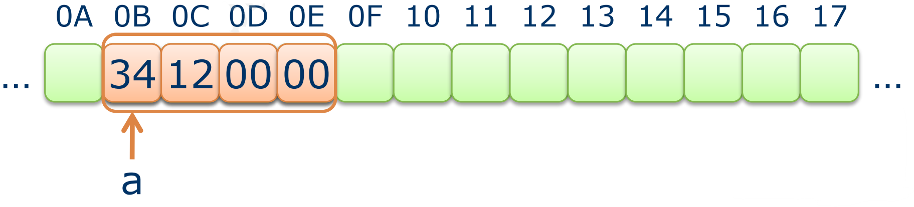

**+ Virtual memory & Physical memory**

Việc truy xuất dữ liệu trên bộ nhớ máy tính cần phải thông qua một số bước trung gian, người dùng không thể trực tiếp truy xuất vào các ô nhớ trên các thiết bị lưu trữ.

***Chúng ta chỉ có thể trỏ đến vùng nhớ ảo (virtual memory) trên máy tính***, còn việc truy xuất đến bộ nhớ vật lý (physical memory) từ bộ nhớ ảo phải được thực hiện bởi thiết bị phần cứng có tên là *Memory management unit (MMU)* và một chương trình định vị địa chỉ bộ nhớ gọi là *Virtual address space.*

Virtual memory làm che giấu sự phân mảnh của bộ nhớ vật lý, khiến chúng ta có cảm giác đang thao tác với các vùng nhớ liên tục.

*Trong hình dưới, từ phía Virtual memory cho đến Physical memory thuộc về phần quản lý của hệ điều hành, lập trình viên và người dùng chúng ta không thể can thiệp trực tiếp đến trong quá trình máy tính đang hoạt động.*

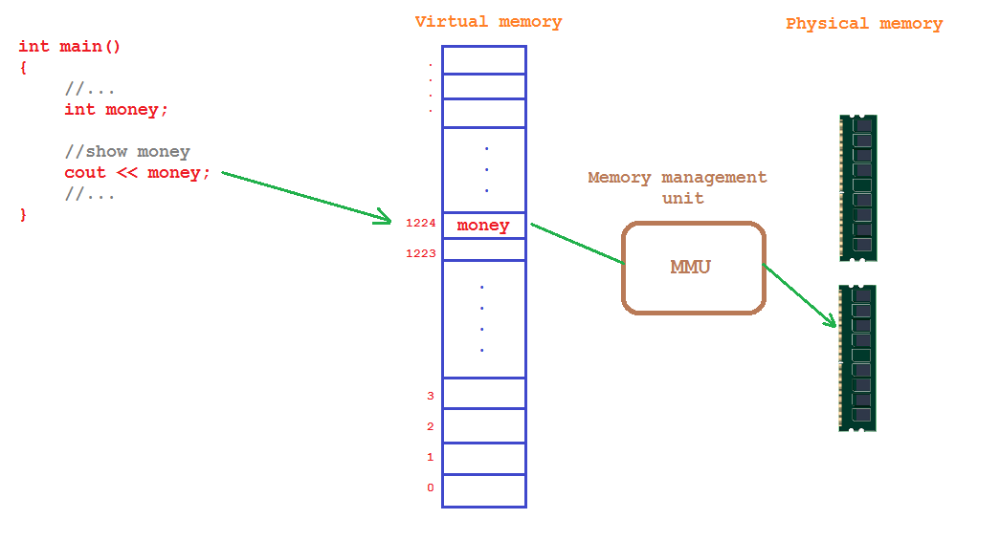

**+ Variable address & address-of operator**

Địa chỉ của biến mà chúng ta nhìn thấy thật ra chỉ là những giá trị đã được đánh số thứ tự đặt trên Virtual memory.

*Để lấy được địa chỉ ảo của biến trong chương trình, chúng ta sử dụng toán tử '&' đặt trước tên biến.*

```cpp
#include <iostream>

using namespace std;

int main()

{

int x = 5;

cout << x << '\n'; // print the value of variable x

cout << &x << '\n'; // print the memory address of variable x

return 0;

}
```

***Kết quả:***

5

00000026B3DDF854

*Dòng đầu tiên là kết quả của việc truy xuất giá trị của biến thông qua định danh (tên biến). Dòng thứ hai là kết quả của việc truy xuất đến địa chỉ ảo của biến.*

### 4.1.2. Tham chiếu (Reference)

\- Mục đích của tham chiếu trong C++ là tạo ra **một biến khác có *cùng kiểu dữ liệu* nhưng sử dụng *chung vùng nhớ với biến được tham chiếu đến*.**

\- Biến tham chiếu không được cấp phát bộ nhớ, không có địa chỉ riêng.

\- Nó dùng làm bí danh cho một biến (kiểu giá trị) nào đó và nó sử dụng vùng nhớ của biến này.

**Chú ý:** Trong ngữ cảnh này, **dấu &** không có nghĩa là "địa chỉ", nó có nghĩa là "tham chiếu đến".

#### 4.1.2.1. Tham chiếu dưới dạng bí danh

```cpp
#include <iostream>

using namespace std;

int main()

{

int i1 = 10;

int& i_ref = i1; //reference to i1, not means address of i1

cout << &i1 << endl; //get address of i1

cout << &i_ref << endl; //get address of i_ref

return 0;

}
```

*Kết quả chúng ta được:*

**0000009B964FF764**

**0000009B964FF764**

*Như vậy, mọi hành vi thay đổi giá trị của i_ref đều tác động trực tiếp đến i1.*

***Mọi thay đổi trên biến i_ref sẽ làm thay đổi biến i1 và ngược lại.***

***Lưu ý:** Biến tham chiếu sẽ có địa chỉ cố định sau khi khởi tạo. Chúng ta không thể tham chiếu lại lần nữa.*

#### 4.1.2.2. Tham chiếu dưới dạng tham số hàm (Chương 3)

#### 4.1.2.3. Tham chiếu và con trỏ

Tham chiếu tới một biến giống như một con trỏ được ngầm tham chiếu khi truy cập.

```cpp
#include <iostream>

using namespace std;

int main()

{

int value = 10;
```

int\* const ptr = &value; // hằng con trỏ

```cpp
int& ref = value;
```

\*ptr = 15;

```cpp
cout << *ptr << "\n";

cout << ref << "\n";

cout << value << "\n";

ref = 20;

cout << *ptr << "\n";

cout << ref << "\n";

cout << value << "\n";

system("pause");

return 0;

}
```

***Kết quả:***

15

15

15

20

20

20

\- Mặc dù tham chiếu và con trỏ có điểm tương đồng, tuy nhiên các tham chiếu nói chung an toàn hơn nhiều so với con trỏ khi thao tác (con trỏ có thể null hoặc ở trạng thái “lơ lửng”).

\-** **Nếu một vấn đề có thể được giải quyết bằng một tham chiếu hoặc một con trỏ, thì tham chiếu thường được ưu tiên. Con trỏ chỉ nên được sử dụng trong các tình huống mà tham chiếu không hỗ trợ (ví dụ như cấp phát bộ nhớ động).

**- Lưu ý:**

\+ Không giống như con trỏ, tham chiếu không **không thể giữ giá trị null**. Vì vậy, tham chiếu phải được khởi tạo khi khai báo.

\+ Tham chiếu đến các giá trị không phải hằng chỉ có thể được khởi tạo với các giá trị không phải là hằng.

**const** **int** y = 7;

```cpp
int &ref2 = y; // lỗi
```

> Để tham chiếu đến một đối tượng hằng, ta sử dụng** tham chiếu hằng **bằng cách thêm từ khóa **const**:

Sau khi được khởi tạo, tham chiếu không thể thay đổi để tham chiếu đến biến khác.

### 4.1.3. Toán tử trỏ đến (dereference operator)

\- Hay còn gọi là indirection operator (toán tử điều hành gián tiếp) được kí hiệu bằng dấu sao " \* " cho phép chúng ta lấy ra giá trị của vùng nhớ có địa chỉ cụ thể.

**<span class="mark">\*\*\* Dereferencing là một hoạt động mà ở đó chúng ta sử dụng biến con trỏ để lấy ra hoặc thay đổi giá trị mà con trỏ đó trỏ đến.</span>**

**<u>Ví dụ:</u>**

```cpp
#include <iostream>

using namespace std;

int main()

{

int n = 5;

cout << n << endl; //print the value of variable n

cout << &n << endl; //print the virtual memory address of variable n

cout << *(&n) << endl;

//print the value at the virtual memory address of variable n

return 0;

}
```

\+ Dòng lệnh cout đầu tiên thực hiện in ra giá trị của biến n bằng cách gọi định danh n, còn lại phần truy xuất đến địa chỉ ảo của biến n sẽ do chương trình đảm nhiệm.

\+ Dòng lệnh cout thứ hai không dùng để lấy ra giá trị bên trong vùng nhớ mà biến n đang nắm giữ, mà nó lấy ra địa chỉ ảo của biến n.

\+ Dòng lệnh cout thứ ba chúng ta sử dụng toán tử trỏ đến " \* " đặt trước toán tử address-of. Khi đó, (&n) sẽ lấy ra địa chỉ ảo của biến n, và toán tử \* sẽ truy xuất giá trị bên trong địa chỉ đó.

***Kết quả:***

5

00000016ED3DF7F4

5

\- Ngoài việc truy xuất giá trị trong vùng nhớ của một địa chỉ cụ thể, toán tử trỏ đến (dereference operator) còn có thể dùng để thay đổi giá trị bên trong vùng nhớ đó.

```cpp
#include <iostream>

using namespace std;

int main()

{

int n = 5;

cout << n << endl;
```

\*(&n) = 10;

```cpp
cout << n << endl;

return 0;

}
```

***Kết quả:***

**5**

**10**

Như vậy, dereference operator cho phép chúng ta thao tác trực tiếp trên Virtual memory mà không cần thông qua định danh (tên biến).

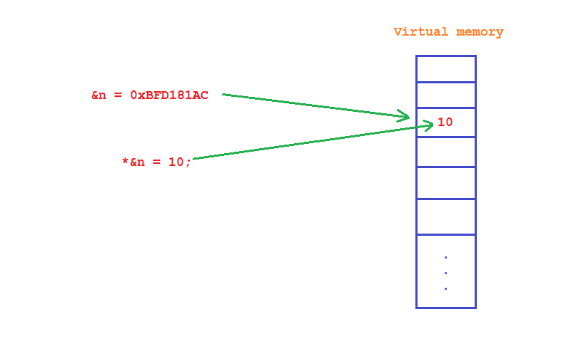

*- Mặc dù **dereference operator** có kí hiệu giống **multiplication operator**, nhưng các bạn có thể phân biệt được vì **dereference operator** là toán tử một ngôi, trong khi đó, **multiplication operator** là toán tử hai ngôi.*

*- Khác với tham chiếu (**reference**), toán tử trỏ đến (**dereference operator**) không tạo ra một tên biến khác, mà nó truy xuất trực tiếp đến vùng nhớ có địa chỉ cụ thể trên **Virtual memory**.*

## 4.2. Con trỏ

### 4.2.1. Định nghĩa

**- Kiểu con trỏ:** là một kiểu dữ liệu dùng để chứa **địa chỉ.** Ví dụ: int\*, float\*, char\*,…

**- Biến con trỏ:** là loại biến được dùng để chứa **địa chỉ** của biến khác khi nó trỏ đến.

\+ Nếu p là con trỏ chứa địa chỉ của biến x ta gọi **p trỏ tới x và x được trỏ bởi p.**

\+ Thông qua con trỏ ta có thể làm việc được với nội dung của những ô nhớ mà p trỏ đến.

\- Để con trỏ p trỏ tới x ta phải **gán địa chỉ của x cho p.**

\- Để làm việc với *địa chỉ* của các biến cần phải *thông qua các biến con trỏ trỏ đến biến đó.*

\- *Con trỏ là một biến có địa chỉ độc lập so với vùng nhớ mà nó trỏ đến, nhưng **giá trị bên trong vùng nhớ của con trỏ chính là địa chỉ của biến (hoặc địa chỉ ảo) mà nó trỏ tới.***

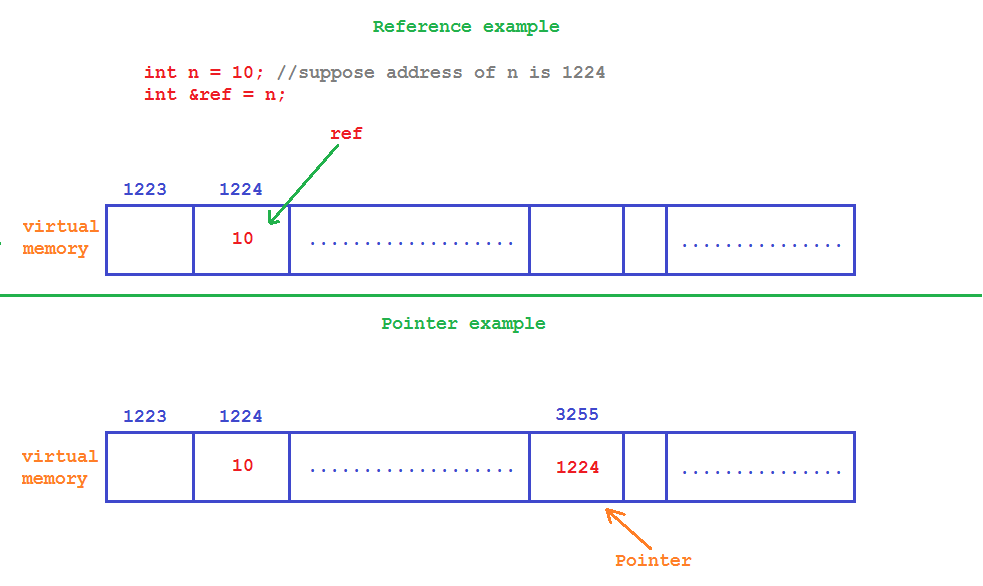

### 4.2.2. Khai báo biến con trỏ

**<span class="mark">\<Kiểu được trỏ\> \*\<Tên biến\>;</span>**

**C++** cho phép đặt dấu sao **cạnh kiểu dữ liệu, cạnh tên biến, hoặc ở giữa**. Tuy nhiên, khi khai báo nhiều biến con trỏ, dấu sao phải được đặt cạnh mỗi biến.

**\# Cách 1: int \* p1;**

```cpp
int *p ; // khai báo biến con trỏ p trỏ đến kiểu số nguyên.

float *p1, *p2 ; // khai báo hai con trỏ p1 và p2 trỏ đến kiểu số thực.
```

**\# Cách 2: int\* p1;**

*khai báo biến p1 thuộc kiểu con trỏ int(int\*), int\* là kiểu con trỏ để trỏ đến những biến thuộc kiểu int.*

**\# Cách 3: int \*p2;**

*khai báo con trỏ p2 thuộc kiểu int, để lưu trữ những giá trị số nguyên.*

***\*\*\* Các cách khai báo này sẽ gây ra hiểu lầm khác nhau khi mà ta khai báo nhiều biến cùng 1 lúc.***

**Chú ý: **

\- Khi khai báo một **biến con trỏ**, hãy đặt **dấu sao (\*) bên cạnh tên biến**.

\- Tuy nhiên, khi trả về một con trỏ từ một hàm, sẽ rõ ràng hơn nếu đặt dấu sao (\*) bên cạnh kiểu trả về:

**\**

```cpp
int* doSomething();
```

\- Khi khai báo một **hàm **trả về 1 con trỏ, hãy** đặt dấu sao (\*) bên cạnh kiểu dữ liệu trả về**.

Tương tự như các biến thông thường, **con trỏ không được khởi tạo khi khai báo**. Nếu con trỏ không được khởi tạo một giá trị, chúng sẽ chứa giá trị rác.

### 4.2.3. Sử dụng phép toán &

*- Dùng & gán địa chỉ của biến cho con trỏ.*

\- Khi mới khai báo, biến con trỏ được đặt ở địa chỉ nào đó (không biết trước) 🡪 chứa giá trị không xác định

```cpp
Tên_biến_con_trỏ = &tên_biến_được_trỏ;
```

**<u>Ví dụ:</u>**

```cpp
int *p, *p1, x=0, a[]={1,2,3};
```

p=&x //do x là biến thông thường

p1=a; //do a là biến mảng

p1=&a\[0\] //tương tự dòng lệnh trên

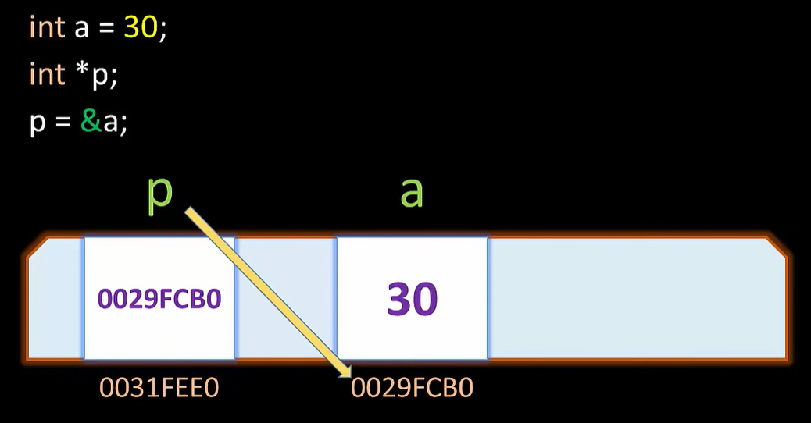 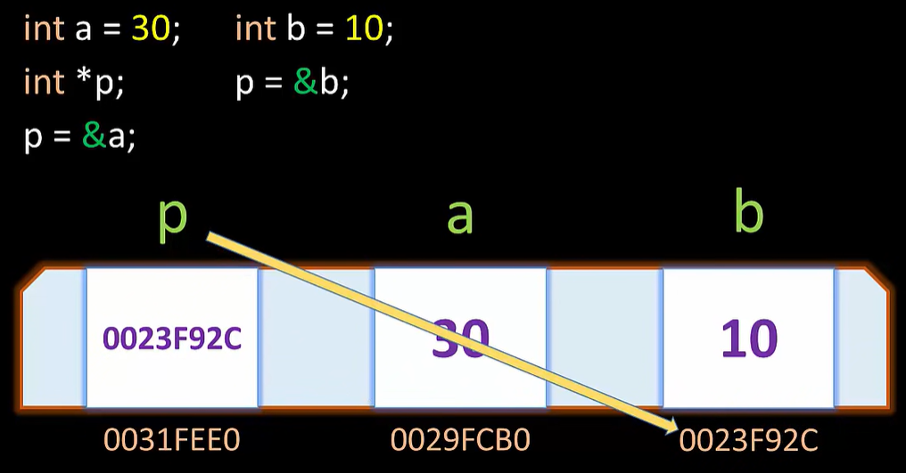

***Lưu ý:***

\* Thay đổi giá trị của 1 biến thực chất là gọi địa chỉ và thay đổi giá trị tại địa chỉ đó.

\* 1 con trỏ trỏ đến nhiều biến, 1 biến có thể được nhiều con trỏ trỏ đến.

***\*\*\* Chú ý về khai báo biến con trỏ và biến thường:***

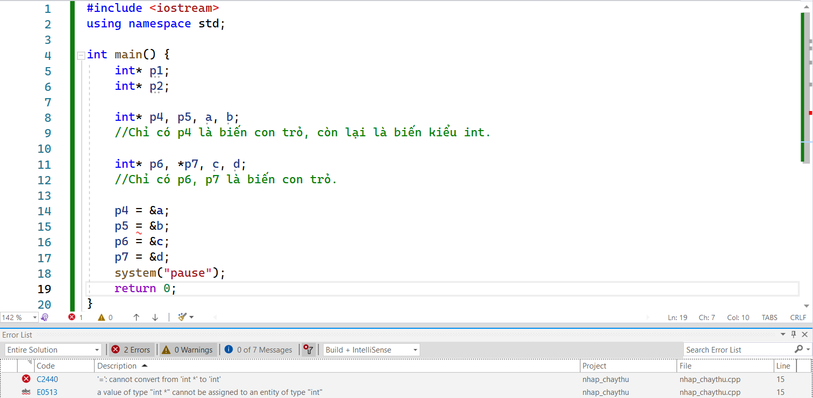

### 4.2.4. Sử dụng phép toán \*

\- Phép toán \* cho lấy nội dung nơi con trỏ trỏ đến.

**<u>Ví dụ 1:</u>**

```cpp
int *p;
```

p=&x //do x là biến thông thường

```cpp
cout << *p; //in ra 0 (nội dung biến x)
```

<span class="mark">- & và \* là 2 phép toán ngược nhau **(nếu p=&x thì x=\*p).**</span>

**<u>Ví dụ 2:</u>** Giả sử thing là một biến, đang chứa giá trị là 5, địa chỉ là 0x100, thing_ptr là con trỏ đang trỏ đến biến thing, other là một biến khác đang lấy giá trị mà nơi con trỏ thing_ptr trỏ đến. Hình bên dưới mô tả mối quan hệ này.

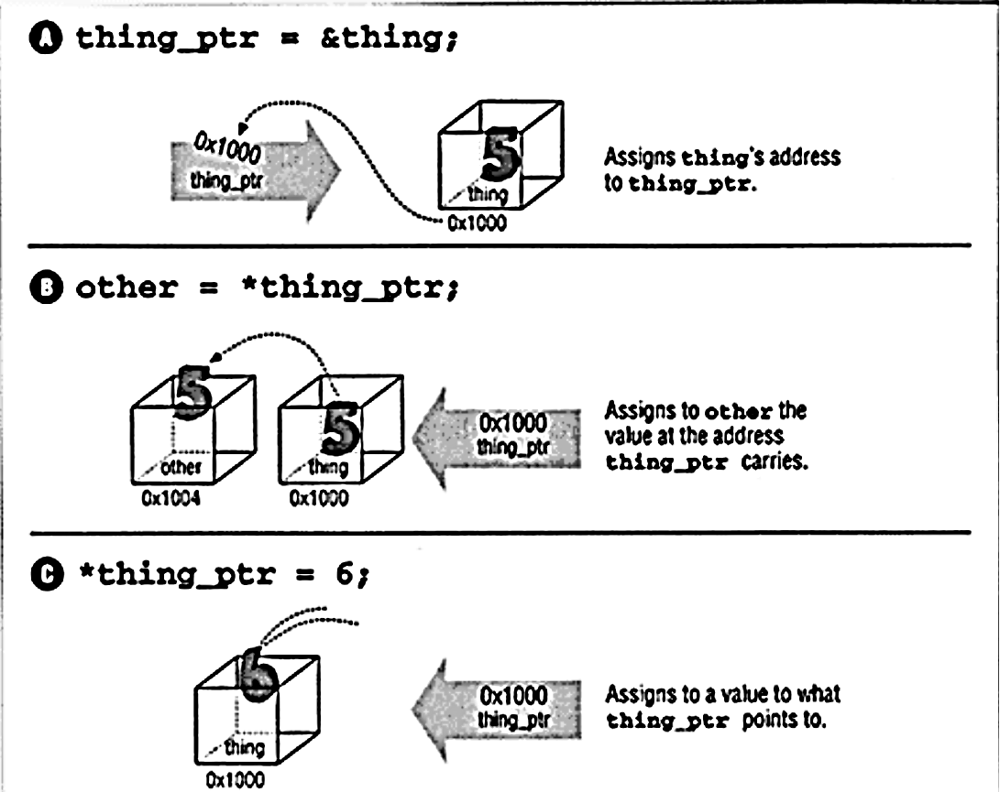

**<u>Ví dụ 3:</u>**

```cpp
#include <iostream>

using namespace std;

int main() {

// Toán tử địa chỉ : &

int a = 10;

cout << "Gia tri cua bien a : " << a << endl;

cout << "Dia chi cua bien a : " << &a << endl;

//Toán tử giá trị *

// Lấy giá trị tại địa chỉ

cout << "Gia tri tai dia chi &a : " << *&a << endl;

system("pause");

return 0;

}
```

***Kết quả:***

Gia tri cua bien a : 10

Dia chi cua bien a : 0000002D9E6FF524

Gia tri tai dia chi &a : 10

**Chú ý:**

**-** Sau khi được gán, giá trị con trỏ có thể được gán lại cho một giá trị khác:

**<u>Ví dụ 4:</u>**

```cpp
#include <iostream>

using namespace std;

int main()

{

int value1 = 5;

int value2 = 7;

int* ptr;
```

ptr = &value1; // ptr points to value1

```cpp
cout << *ptr << "\n"; // prints 5
```

ptr = &value2; // ptr now points to value2

```cpp
cout << *ptr << "\n"; // prints 7

return 0;

}
```

***Kết quả:*** 5

7

 

\- Khi địa chỉ của **biến value** được gán cho **con trỏ ptr**:

- **ptr** tương đương với **&value**

- **\*ptr **được xử lý giống như **value**

Vì** \*ptr** được xử lý giống như **value**, nên ta có thể gán giá trị cho **\*ptr** như 1 biến thông thường:

**<u>Ví dụ 5:</u>**

```cpp
#include <iostream>

using namespace std;

int main()

{

int value = 5;

int *ptr = &value; // ptr points to value

cout << "Value before: " << value << endl;
```

\*ptr = 7; // \*ptr tương đương với value

```cpp
cout << "Value after: " << value; // prints 7

return 0;

}
```

***Kết quả:***

Value before: 5

Value after: 7

**<u>Ví dụ 6:</u>**

```cpp
#include <iostream>

using namespace std;

int main() {

int i, j; // khai báo 2 biến nguyên i, j

int *pi, *pj; // khai báo 2 con trỏ nguyên pi, pj
```

pi = &i; // cho pi trỏ tới i

pj = &j; // cho pj trỏ tới j

```cpp
cout << &i << endl; // hỏi địa chỉ biến i

cout << pj << endl; // hỏi địa chỉ biến j (thông qua pj)
```

i = 2; // gán i bằng 2

\*pj = 5; // gán j bằng 5 (thông qua pj)

i++; cout \<\< i \<\< endl; // tăng i và xuất i (i = 3)

(\*pj)++; cout \<\< j \<\< endl; // tăng j (thông qua pj) và xuất j (j = 6)

(\*pi) = (\*pj) \* 2 + 1; // gán lại i (thông qua pi)

```cpp
cout << i << endl; // 13

return 0;

}
```

***Kết quả:***

000000EA6E5AF4E4

000000EA6E5AF504

3

6

13

*\*\*\* Mọi thao tác với i là tương đương với \*p, với j là tương đương với \*q và ngược lại **(Cũng không trực tiếp thay đổi biến).***

**<u>Ví dụ 7:</u>**

```cpp
#include <iostream>

using namespace std;

int main() {

int a = 30;

int* p = &a;

cout << "Gia tri cua bien a : " << a << endl;

cout << "Dia chi cua bien a : " << &a << endl;

cout << "Gia tri cua con tro p : " << p << endl;

cout << "Dia chi cua con tro p : " << &p << endl;

cout << "Gia tri tai dia chi con tro p tro toi : " << *p << endl;

cout << "Gia tri tai dia chi cua a : " << *&a << endl;

return 0;

}
```

***Kết quả:***

Gia tri cua bien a : 30

Dia chi cua bien a : 000000D6BBF3FA44

Gia tri cua con tro p : 000000D6BBF3FA44

Dia chi cua con tro p : 000000D6BBF3FA68

Gia tri tai dia chi con tro p tro toi : 30

Gia tri tai dia chi cua a : 30

***\*\*\* Do p bản chất là 1 biến nên biến con trỏ cũng có địa chỉ riêng của nó.***

**<u>Chú ý:</u>** Kiểu dữ liệu của con trỏ dùng để xác định kiểu dữ liệu của biến mà nó trỏ đến.

**<u>Ví dụ 8:</u>**

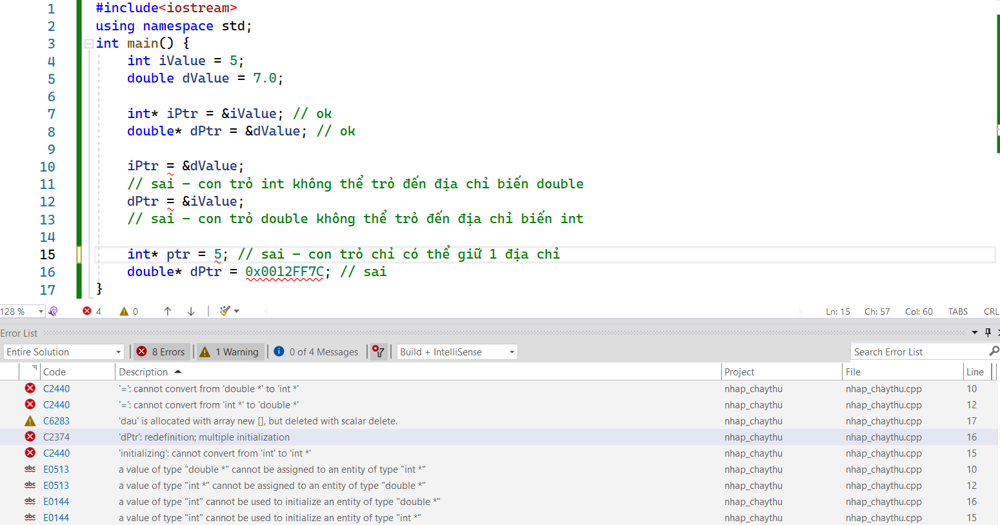

Trong ví dụ trên, ta có thể thấy **&iValue** là 1 địa chỉ của biến kiểu **int**, nên nó có thể gán cho con trỏ kiểu **int**. Để hiểu rõ hơn, ta có thể kiểm tra kiểu dữ liệu của **&iValue**:

```cpp
#include <iostream>

using namespace std;

int main()

{

int iValue = 5;

cout << typeid(&iValue).name() << "\n";

return 0;

}
```

***Kết quả:*** int \* \_\_ptr64

### 4.2.5. Con trỏ NULL

\- Tương tự như các biến thông thường, con trỏ không được khởi tạo khi khai báo. Nếu con trỏ không được khởi tạo một giá trị, chúng sẽ chứa giá trị rác.

\- Ngoài địa chỉ vùng nhớ, có một giá trị mà con trỏ có thể giữ được, đó là giá trị null. *Null là một giá trị đặc biệt, điều đó có nghĩa là con trỏ đó chưa trỏ đến địa chỉ nào cả.* Con trỏ đang giữ giá trị null được gọi là con trỏ null (null pointer).

***NULL là con trỏ không trỏ vào đâu cả.***

***NULL khác với con trỏ chưa khởi tạo.***

**<u>Ví dụ:</u>**

```cpp
int n;

int* p1 = &n;

int* p2; // unreferenced local variable

int* p3 = NULL;
```

\* Gán con trỏ NULL cho một biến con trỏ trong trường hợp bạn chưa có địa chỉ chính xác để gán.

***\* Có 3 cách để biểu thị một con trỏ NULL:***

**+ Số (0):**

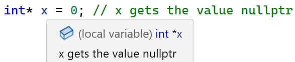

```cpp
float* ptr2; // ptr2 là con trỏ rác
```

ptr2 = 0; // ptr2 là 1 con trỏ null

Không có đối tượng nào được phân bổ với địa chỉ 0, và 0 (mẫu bit toàn số 0) là biểu diễn phổ biến nhất của con trỏ NULL. Số không (0) là số nguyên. Tuy nhiên, các chuyển đổi tiêu chuẩn cho phép sử dụng 0 làm hằng số của con trỏ.

Ta có thể sử dụng một điều kiện để kiểm tra xem một con trỏ có null hay không:

```cpp
#include <iostream>

using namespace std;

int main()

{

float* ptr2; // ptr2 là con trỏ rác
```

ptr2 = 0; // ptr2 là 1 con trỏ null

```cpp
if (ptr2)

cout << "con tro tro den dia chi.";

else

cout << "con tro null.";

return 0;

}
```

***Kết quả:*** con tro null.

Lưu ý rằng **giá trị của 0 không phải là một kiểu con trỏ**, do đó gán 0 cho một con trỏ để biểu thị rằng con trỏ là một con trỏ null là **không nhất quán**.

```cpp
#include <iostream>

using namespace std;

void doSomething(double* ptr)

{

/* ptr sẽ chuyển thành true nếu nó null, và false nếu nó không null*/

if (ptr)

std::cout << "You passed in " << *ptr << '\n';

else

std::cout << "You passed in a null pointer\n";

}

int main()

{

doSomething(0);

/* truyền 0 có thể gây nhầm lẫn rằng tham số hàm là số nguyên*/

return 0;

}
```

***Kết quả:*** You passed in a null pointer

**+ Macro NULL**

Ngôn ngữ C (không phải C++) định nghĩa một **macro tiền xử lý **đặc biệt được gọi là NULL, có giá trị 0.

\#define NULL 0

Mặc dù đây không phải là một phần kỹ thuật của C++, nhưng nó hoạt động phổ biến trong mọi trình biên dịch C++:

```cpp
double *ptr = NULL; // ptr là 1 con trỏ null
```

Tuy nhiên, có những khác biệt trong định nghĩa NULL trong các cách triển khai khác nhau.

Ví dụ: NULL có thể là 0 hoặc 0L. Trong C, NULL thường tương ứng là (void∗)0, điều này khiến nó sai trong C++ (đối với 1 số IDE):

```cpp
int* p = NULL;// error : can’t assign a void* to an int*
```

**🡪 *Về mặt kỹ thuật, macro NULL không phải là kỹ thuật trong C++, vì vậy cần tránh sử dụng nó trong C++.***

**+ nullptr:**

**nullptr **là một **hằng số rvalue**, giống như các từ khóa boolean **true **và **false**.

```cpp
int* ptr = nullptr; // ptr là 1 con trỏ null
```

doSomething(nullptr); // truyền con trỏ null vào hàm

Nullptr đại diện cho con trỏ null, nghĩa là một con trỏ không trỏ đến một đối tượng nào cả. Nó có thể được gán cho bất kỳ loại con trỏ nào, nhưng không được gán cho các kiểu dữ liệu khác:

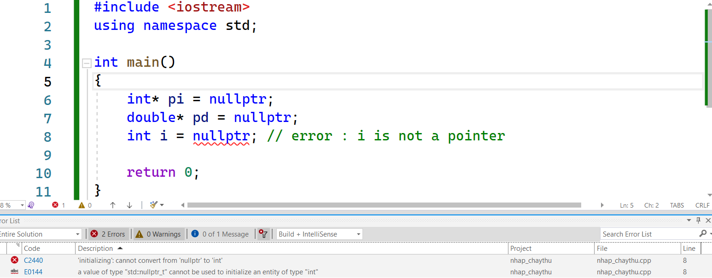

Ngoài ra, C++11 còn định nghĩa một kiểu dữ liệu **nullptr_t**, **nullptr_t chỉ có thể lưu trữ giá trị nullptr,** nhưng nó thường chỉ được sử dụng trong những trường hợp hiếm hoi.

**- Truy cập con trỏ null**

Việc truy cập một con trỏ rác sẽ dẫn đến kết quả không xác định. Nếu truy xuất giá trị của con trỏ null, chương trình có thể bị đóng bởi hệ điều hành.

### 4.2.6. Các phép toán với con trỏ

#### 4.2.6.1. Phép gán

\- Dùng & gán địa chỉ của biến cho con trỏ: **<span class="mark">Biến con trỏ = &biến;</span>**

\- Phép toán \* cho lấy nội dung nơi con trỏ trỏ đến

**<u>Ví dụ 1:</u>**

```cpp
#include <iostream>

using namespace std;

int main()

{

int* p, * p1, x = 0, a[] = { 1,2,3 };
```

p = &x; //do x là biến thông thường

p1 = a; //do a là biến mảng

p1 = &a\[0\]; //tương tự dòng lệnh trên

```cpp
cout << *p; //in ra 0 (nội dung biến x)

return 0;

}
```

***Chú ý: & và \* là 2 phép toán ngược nhau (nếu p = &x thì x = \*p)***

**<u>Ví dụ 2:</u>** sử dụng biến con trỏ.

```cpp
#include <iostream>

using namespace std;

int main()

{

int x = 2015, * p;

p = &x;

cout << "Dia chi cua bien x la: " << p << endl;

cout << "Gia tri cua bien x la: " << *p << endl;
```

\*p = 2020; //Thay doi gia tri cua x thong qua con tro p

```cpp
cout << "Gia tri moi cua bien x la: " << x;

}
```

Kết quả chạy chương trình:

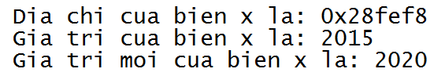

Gán con trỏ với con trỏ khác: p = q ; (sau phép toán gán này p, q chứa cùng một địa chỉ, cùng trỏ đến một nơi).

**<u>Ví dụ 3:</u>**

```cpp
#include <iostream>

using namespace std;

int main()

{

int i = 10; // khai báo và khởi tạo biến i = 10

int* p, * q, * r; // khai báo 3 con trỏ nguyên p, q, r
```

p = q = r = &i; // cùng trỏ tới i

\*p = (\*q) \* (\*q) + 2 \* (\*r) + 1; // i = 10\*10 + 2\*10 + 1

```cpp
cout << i; // xuất ra màn hình 121

return 0;

}
```

🡪 **Không tác động trực tiếp vào biến i mà vẫn thay đổi được biến i.**

#### 4.2.6.2. Phép toán tăng giảm địa chỉ

**\* p ± n**: Con trỏ trỏ đến *thành phần thứ n sau (trước) p.* (Một đơn vị tăng giảm của con trỏ bằng kích thước của biến được trỏ).

Ví dụ: *Giả sử p là con trỏ nguyên (2 byte) đang trỏ đến địa chỉ 200 thì p+1 là con trỏ trỏ đến địa chỉ 202. Tương tự, p + 5 là con trỏ trỏ đến địa chỉ 210. p - 3 chứa địa chỉ 194.*

|  **194**  | **195** | **196** | **197** | **198** | **199** | **200** | **201** |  **202**  |
|:---------:|:-------:|:-------:|:-------:|:-------:|:-------:|:-------:|:-------:|:---------:|
| **p - 3** |         |         |         |         |         |    p    |         | **p + 1** |

**p++, p--, ++p, --p**: tương tự p+1 và p-1, có chú ý đến tăng (giảm) trước, sau.

**<u>Ví dụ 1:</u>**

```cpp
#include <iostream>

using namespace std;

int main()

{

int a[] = { 1, 2, 3, 4, 5, 6, 7 }, * p, * q;
```

p = a; cout \<\< \*p \<\< endl; //trỏ p đến mảng a, \*p = a\[0\]= 1

```cpp
p += 5; cout << *p << endl; // *p = a[5] = 6 ;

q = p - 4; cout << *q << endl; // q = a[1] = 2 ;

return 0;

}
```

***<u>Chú ý:</u>***

**\*\*\* Phân biệt p+1 và p++ (hoặc ++p):**

*p+1 được xem như một con trỏ khác với p. p+1 trỏ đến phần tử sau p.*

*p++ là con trỏ p nhưng trỏ đến phần tử khác. p++ trỏ đến phần tử đứng sau phần tử p trỏ đến ban đầu. (địa chỉ tiếp theo sau p).*

**<u>Ví dụ 2:</u>**

```cpp
#include <iostream>

using namespace std;

int main()

{

int a[2] = { 3, 7 }, * p = a;

int value = 0;

int* ptr = &value;

cout << "Before increased: " << ptr << endl;
```

ptr++;

```cpp
cout << " After increased: " << ptr << endl;

return 0;

}
```

***Kết quả:***

**Before increased:** 0x00F9FEFC (heximal) tương đương 16383740 (decimal)

**After increased:** 0x00F9FF00 (heximal) tương đương 16383744 (decimal)

*Địa chỉ mới của ptr lúc này là 16383744, giá trị này lớn hơn giá trị cũ 4 đơn vị. Đúng bằng kích thước của kiểu dữ liệu int mà ta dùng để khai báo cho biến value.*

*Như vậy, increment operator (++) sẽ làm con trỏ trỏ đến địa chỉ tiếp theo trên bộ nhớ ảo. Khoảng cách của 2 địa chỉ này đúng bằng kích thước của kiểu dữ liệu được khai báo cho con trỏ.*

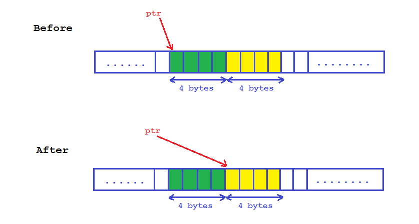

**\*\*\* Phân biệt \*(p++) và \*(++p):**

Các phép toán tự tăng giảm cũng là một ngôi, mức ưu tiên của chúng là cao hơn các phép toán hai ngôi khác và cao hơn phép lấy giá trị (\*). Cụ thể:

**\*p++ ≡ \*(p++)**

**\*++p ≡ \*(++p)**

**++\*p ≡ ++(\*p)**

Cũng giống các biến nguyên việc kết hợp các phép toán này với nhau rất dễ gây nhầm lẫn, do vậy cần sử dụng cặp dấu ngoặc để qui định trình tự tính toán.

**<u>Ví dụ 3:</u>**

```cpp
#include <iostream>

using namespace std;

int main()

{

int a[2] = { 3, 7 }, *p = a;
```

(\*p)++; cout \<\< a\[0\] \<\< " " \<\< a\[1\] \<\< endl;

// tăng (sau) giá trị nơi p trỏ ≡ tăng a\[0\] thành 4

++(\*p); cout \<\< a\[0\] \<\< " " \<\< a\[1\] \<\< endl;

// tăng (trước) giá trị nơi p trỏ ≡ tăng a\[0\] thành 5

\*(p++); cout \<\< a\[0\] \<\< " " \<\< a\[1\] \<\< endl;

// lấy giá trị nơi p trỏ (3) và tăng trỏ p (tăng sau), p → a\[1\]

\*(++p); cout \<\< a\[0\] \<\< " " \<\< a\[1\] \<\< endl;

// tăng trỏ p (tăng trước), p → a\[1\] và lấy giá trị nơi p trỏ (7)

```cpp
return 0;

}
```

***Kết quả:***

4 7

5 7

5 7

5 7

***\***

***\*\*\* Nhập, xuất mảng bằng a+i:***

```cpp
#include <iostream>

using namespace std;

int main()

{

int a[5], i;

for (i = 0; i < 5; i++)

{

cout << "a[" << i << "] = ";

cin >> *(a + i);

}

cout << "=======================\n";

for (i = 0; i < 5; i++)

{

cout << "a[" << i << "] = " << *(a + i) << endl;

}

return 0;

}
```

***Kết quả:***

a\[0\] = 1

a\[1\] = 2

a\[2\] = 3

a\[3\] = 4

a\[4\] = 5

=======================

a\[0\] = 1

a\[1\] = 2

a\[2\] = 3

a\[3\] = 4

a\[4\] = 5

#### 4.2.6.3. Hiệu của hai con trỏ

\- Phép toán này chỉ thực hiện được khi ***p và q là 2 con trỏ cùng trỏ đến các phần tử của một dãy dữ liệu*** nào đó trong bộ nhớ (ví dụ cùng trỏ đến 1 mảng dữ liệu).

\- Khi đó hiệu p - q là số thành phần giữa p và q (chú ý p - q không phải là hiệu của 2 địa chỉ mà ***là số thành phần giữa p và q***).

\- Ví dụ: Giả sử p và q là 2 con trỏ nguyên, p có địa chỉ 200 và q có địa chỉ 208. Khi đó p - q = - 4 và q - p = 4 (4 là số thành phần nguyên từ địa chỉ 200 đến 208).

**<u>Chú ý:</u> Không có phép cộng, nhân, chia 2 con trỏ**

***\*\*\* Về phép toán (--) (Decrement operator (--)):***

Ngược lại so với increment operator (++), decrement operator (--) sẽ giảm giá trị bên trong vùng nhớ của biến thông thường đi 1 đơn vị.

Đối với biến con trỏ, khi sử dụng decrement operator (--), nó sẽ làm thay đổi địa chỉ của con trỏ đang trỏ đến, giá trị địa chỉ mới sẽ bằng giá trị địa chỉ cũ trừ đi kích thước của kiểu dữ liệu mà con trỏ đang trỏ đến.

**<u>Ví dụ:</u>**

```cpp
#include <iostream>

using namespace std;

int main()

{

int value = 0;

int* ptr = &value;

cout << "Before decreased: " << ptr << endl;
```

ptr--;

```cpp
cout << " After decreased: " << ptr << endl;

return 0;

}
```

***Kết quả:***

Before decreased: 000000B83331F514

After decreased: 000000B83331F510

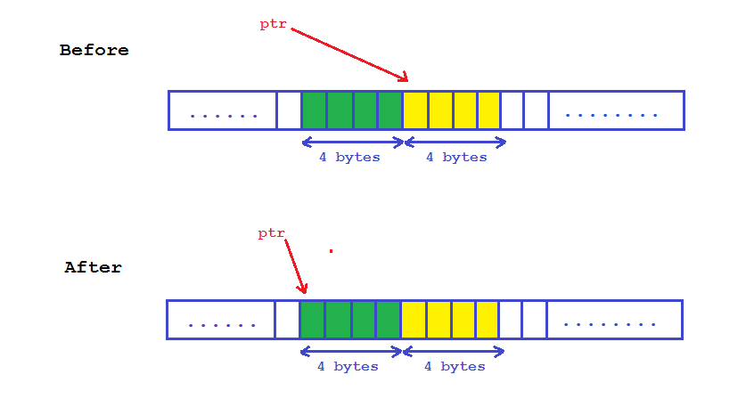

#### 4.2.6.4. Phép toán so sánh

\- Thông thường các phép so sánh chỉ áp dụng cho hai con trỏ trỏ đến phần tử của cùng một mảng dữ liệu nào đó.

\- Thực chất của phép so sánh này chính là ***so sánh chỉ số*** của 2 phần tử được trỏ bởi 2 con trỏ đó.

**<u>Ví dụ 1:</u>**

```cpp
#include <iostream>

using namespace std;

int main()

{

float a[100], * p, * q;
```

p = a; // p trỏ đến mảng a(tức p trỏ đến a\[0\])

q = &a\[3\]; // q trỏ đến phần tử thứ 3 (a\[3\]) của mảng

```cpp
cout << (p < q) << endl; // 1

cout << (p + 3 == q) << endl; // 1

cout << (p > q - 1) << endl; // 0

cout << (p >= q - 2) << endl; // 0

for (p = a; p < a + 100; p++)

cout << *p << "\t"; // in toàn bộ mảng a

return 0;

}
```

**<u>Ví dụ 2:</u>**

```cpp
#include <iostream>

using namespace std;

int main()

{

int A[5] = { 14,21,-3,24,5 }, * p, * t, i;
```

p = A; //Cho p tro den mang A

t = &A\[2\]; //Cho t tro den phan tu A\[2\]

```cpp
cout << "Mang A la:\n";

for (i = 0; i < 5; i++)

cout << A[i] << "\t";

cout << "\nKhoang cach giua A[0] va A[2] bang: " << t - p << endl;
```

\*t = 10;

```cpp
cout << "A[2] sau khi thay doi la: " << A[2] << endl;

cout << "Phan tu A[3] co gia tri bang: " << *(p + 3);

if (p < t)

cout << "\nA[0] dung truoc A[2]";

if (p == t)

cout << "\nA[0] va A[2] trung nhau";

if (p > t)

cout << "\nA[0] dung sau A[2]";

cout << "\nMang A sau khi thay doi gia tri cua A[2] la:\n";

for (i = 0; i < 5; i++)

cout << *(p++) << "\t";

}
```

***Kết quả:***

Mang A la:

14 21 -3 24 5

Khoang cach giua A\[0\] va A\[2\] bang: 2

A\[2\] sau khi thay doi la: 10

Phan tu A\[3\] co gia tri bang: 24

A\[0\] dung truoc A\[2\]

Mang A sau khi thay doi gia tri cua A\[2\] la:

14 21 10 24 5

**\*\*\* Một số lưu ý khi sử dụng các toán tử dùng cho con trỏ**

Vì các toán tử dùng cho con trỏ có ý nghĩa hoàn toàn khác so với việc áp dụng các toán tử lên giá trị hoặc biến thông thường. Chúng ta cần có cách sử dụng hợp lý để tránh gây nhầm lẫn hoặc gây rối mắt.

*Đây là một số cách sử dụng các toán tử toán học cho con trỏ gây khó hiểu cho người đọc.*

```cpp
int n = 5;

int* p = &n; //p point to n
```

\*p++;

Lệnh \*p++; sẽ thực hiện hai bước, đầu tiên là sử dụng toán tử **dereference** để truy xuất đến vùng nhớ tại địa chỉ mà con trỏ p đang nắm giữ, bước thứ hai là trỏ đến địa chỉ tiếp theo (đứng sau n).

p++;

Sau đó, chúng ta bắt gặp lệnh p++; có nghĩa là cho con trỏ p trỏ đến địa chỉ tiếp theo lớn hơn địa chỉ ban đầu **4 bytes** (kích thước của kiểu **int**).

```cpp
int n2 = *p * n;
```

Cuối cùng, chúng ta có phép gán giá trị của phép nhân \*p và n cho biến n2.

*🡪 Để chương trình rõ ràng hơn, chúng ta nên thêm các cặp dấu ngoặc vào chương trình:*

```cpp
int n = 5;

int* p = &n; //p point to n
```

(\*p)++;

p++;

```cpp
int n2 = (*p) * n;
```

*Những cặp dấu ngoặc sẽ giúp phân biệt lúc nào chúng ta sử dụng giá trị là địa chỉ lưu trong con trỏ, lúc nào chúng ta sử dụng giá trị trong vùng nhớ mà con trỏ đang trỏ đến.*

### 4.2.7. Con trỏ kiểu void

\- Một loại con trỏ có thể trỏ đến các biến có kiểu dữ liệu bất kỳ.

\- Một con trỏ **không chỉ định thông tin kiểu dữ liệu**. Nó cho bạn biết dữ liệu được lưu ở đâu, nhưng nó không cho bạn biết cách truy xuất dữ liệu đó.

\- Khai báo: **<span class="mark">void \*\<tên biến con trỏ\>;</span>**

**<u>Ví dụ:</u>**

```cpp
int a; float b; char c;

void* p;

p = &a; p = &b; p = &c;
```

\- Tuy nhiên, con trỏ void **không xác định được kiểu dữ liệu của vùng nhớ mà nó trỏ tới**, chúng ta **không thể truy xuất trực tiếp** nội dung thông qua toán tử **dereference (\*) **được. Vì vậy, con trỏ kiểu void cần phải được ép kiểu một cách rõ ràng sang con trỏ có kiểu dữ liệu khác trước khi sử dụng toán tử **dereference (\*)**.

```cpp
int value = 10;

void *voidPtr = &value;


// cout << *voidPtr << endl; // lỗi, không thể dereference con trỏ void


int *intPtr = static_cast(voidPtr); // ép kiểu thành con trỏ int

cout << *intPtr << endl; // ok
```

**voidPtr **và **intPtr **đều trỏ vào địa chỉ của biến **value**, nhưng chúng ta chỉ có thể sử dụng toán tử **dereference (\*)** lên con trỏ **intPtr **chứ không thể sử dụng cho con trỏ **voidPtr**, vì trình biên dịch không thể biết con trỏ **voidPtr **trỏ đến kiểu dữ liệu gì.

**- Ứng dụng con trỏ void**

Để sử dụng được con trỏ void, bạn phải lấy thông tin về kiểu con trỏ theo cách khác (sử dụng thêm **tham số** hoặc **biến **cho biết kiểu con trỏ), sau đó ép kiểu con trỏ đó đến một kiểu cụ thể (int, double, …) và sau đó sử dụng nó như bình thường.

**\*\*\* Chuyển kiểu con trỏ:**

Cú pháp: **<span class="mark">(\<Kiểu\>\*) \<Tên biến con trỏ\>;</span> hoặc <span class="mark">static_cast\<Kiểu\*\>(tên biến con trỏ)</span>**

**<u>Ví dụ 1:</u>**

**int *p;**

**(float\*)p;**

**<u>Ví dụ 2:</u>**

```cpp
#include <iostream>

using namespace std;

enum Type

{
```

INT,

DOUBLE

};

```cpp
void printValueOfPointer(void* ptr, Type type)

{

switch (type)

{

case INT:

cout (ptr)) << '\n'; // ép con trỏ void thành con trỏ int

break;

case DOUBLE:

cout (ptr)) << '\n'; // ep con tro void thanh con tro double

break;

}

}

int main()

{

int nValue = 10;

double dValue = 6.9;

printValueOfPointer(&nValue, INT);

printValueOfPointer(&dValue, DOUBLE);

system("pause");

return 0;

}
```

***Kết quả:***

10

6.9

Đoạn code trên hiển thị thông tin của con trỏ **nValue **và **dValue**. Thông thường, chúng ta sẽ phải viết **2 hàm** hiển thị cho 2 loại con trỏ này. Tuy nhiên, chúng ta có thể sử dụng tham số kiểu **void\***.

Khi vào hàm** printValueOfPointer()**, dựa vào biến **type **để ép từ kiểu** void\* **về kiểu dữ liệu tương ứng. Điều này làm **giảm thiểu việc viết nhiều function cùng chức năng** nhưng khác kiểu dữ liệu đầu vào.

**- Hạn chế sử dụng con trỏ void**

Thông thường, bạn nên **tránh sử dụng con trỏ void** trừ khi thật cần thiết. Vì chúng cho phép bạn tránh kiểm tra kiểu, điều này cho phép bạn vô tình làm những việc không có ý nghĩa, và trình biên dịch sẽ không thông báo lỗi.

Mặc dù hàm **printValueOfPointer() **là một cách ngắn gọn để xây dựng một hàm duy nhất xử lý nhiều kiểu dữ liệu. Tuy nhiên, C++ đã cung cấp một cách tốt hơn để làm điều tương tự thông qua **nạp chồng hàm (function overloading)**, hoặc **khuôn mẫu hàm (dunction template)**.

### 4.2.8. Con trỏ kép (con trỏ cấp 2) (Con trỏ trỏ đến con trỏ)

\- Là một loại con trỏ được dùng để chứa địa chỉ của một con trỏ khác.

\- Khai báo: **<span class="mark">\<Kiểu\> \*\*\<tên biến con trỏ\>;</span>**

\- Nếu chúng ta muốn **Pointer to pointer** trỏ đến được một **pointer** khác, trước hết chúng ta cần xem kiểu dữ liệu khi sử dụng toán tử **address-of** cho con trỏ sẽ trả về giá trị kiểu gì.

```cpp
#include <iostream>

using namespace std;

int main()

{

int* ptr = NULL;

cout << typeid(&ptr).name() << endl;

return 0;

}
```

Kết quả: int \* \_\_ptr64 \* \_\_ptr64

Như chúng ta thấy, chúng ta cần khai báo biến có kiểu dữ liệu (int \*\*) để có thể gán địa chỉ của con trỏ kiểu (int \*) cho nó.

**- Con trỏ trỏ đến con trỏ **hoạt động như một con trỏ thông thường. Chúng ta có thể sử dụng toán tử **dereference (\*)** để truy cập giá trị của con trỏ.

```cpp
#include <iostream>

using namespace std;

int main()

{

int value = 10;

int* ptr = &value;

cout << *ptr << "\n"; // in giá trị tại địa chỉ ptr trỏ đến (biến value)

int** ptr_ptr = &ptr; // con trỏ "ptr_ptr" trỏ đến con trỏ "ptr" trỏ đến biến "value"

cout << *ptr_ptr << "\n"; // in giá trị tại địa chỉ ptr_ptr trỏ đến (địa chỉ ptr (&ptr))

cout << **ptr_ptr << "\n";

// dereference 2 lần để in giá trị tại địa chỉ ptr trỏ đến (biến value)

}
```

Kết quả:

10

000000899F53F644

10

\- Khi sử dụng 1 toán tử **dereference (\*) **cho **ptr_ptr**, nghĩa là chúng ta đang truy xuất đến giá trị tại **địa chỉ **mà con trỏ **ptr_ptr **nắm giữ (địa chỉ con trỏ ptr).

\- Khi **dereference (\*) **2 lần con trỏ **ptr_ptr**, chúng ta được giá trị tại **địa chỉ con trỏ ptr trỏ đến** (biến value).

\+ Bản chất của **Pointer to pointer** vẫn là một **pointer**, nên khi truy xuất giá trị của ptr_ptr chúng ta lấy được địa chỉ mà nó trỏ đến (địa chỉ của biến ptr).

```cpp
cout << ptr_ptr; *//là &ptr*
```

\+ Khi chúng ta sử dụng 1 toán tử **dereference** cho 1 **pointer to pointer**, cũng đồng nghĩa chúng ta đang truy xuất đến giá trị tại địa chỉ mà con trỏ ptr nắm giữ (địa chỉ đang được lưu trữ trong biến ptr).

```cpp
cout << *ptr_ptr; *//là ptr*
```

\+ Và khi sử dụng 2 toán tử **dereference** cho 1 **pointer to pointer,** chúng ta được giá trị tại **địa chỉ con trỏ ptr trỏ đến** (biến value):

```cpp
cout << *(*ptr_ptr); *//là *ptr*
```

Chúng ta có thể thấy việc sử dụng **pointer to pointer** cũng tương tự như việc đi hỏi tìm một người bạn mà không biết nhà nó ở đâu, chỉ biết nhà của những người biết về nó. Vậy là chúng ta đi hỏi từng người một.

Ví dụ chúng ta là A, đang cần gặp C nhưng không biết nó ở đâu, chúng ta hỏi (sử dụng toán tử dereference) chú B thì chú B bảo đến địa chỉ mà C đang ở, chúng ta đến địa chỉ mà chú B nắm giữ và truy xuất vào đó là sẽ tìm được thằng C.

Tóm tắt lại ví dụ trên, chúng ta có thể viết:

*A giữ địa chỉ nhà chú B =\> A = &B;*

*Chú B biết địa chỉ nhà thằng C =\> B = &C;*

Như vậy:

(\*A) tương đương (\*(&B)) tương đương &C;

\*(\*A) tương đương \*(\*(&B)) tương đương C;

Chúng ta có thể viết:

ptr_ptr giữ địa chỉ của ptr =\> ptr_ptr = &ptr*;*

ptr giữ địa chỉ của value =\> ptr = &value*;*

Như vậy:

(\*ptr_ptr) tương đương ptr tương đương &value;

\*\*ptr_ptr tương đương \*ptr tương đương value;

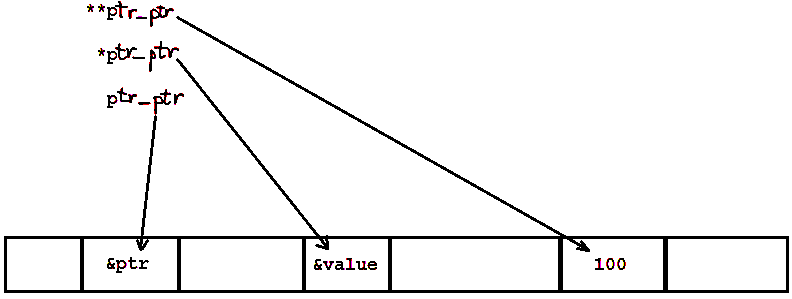

Tương tự như con trỏ thông thường, con trỏ trỏ đến con trỏ có thể gán bằng null:

```cpp
int ptrptr = nullptr;**
```

**Lưu ý: **rằng bạn **không thể** gán trực tiếp một con trỏ trỏ đến con trỏ bằng giá trị:

```cpp
int value = 10;

int **ptrptr = &&value; // lỗi
```

**<span class="mark">\*\*\* Con trỏ trỏ đến con trỏ trỏ đến con trỏ…</span>**

\- Chúng ta có thể khai báo những con trỏ như sau:

```cpp
int ***ptrx3;

int ****ptrx4;
```

\- Tuy nhiên, trong thực tế, những con trỏ như thế này không được sử dụng nhiều vì nó khá phức tạp.

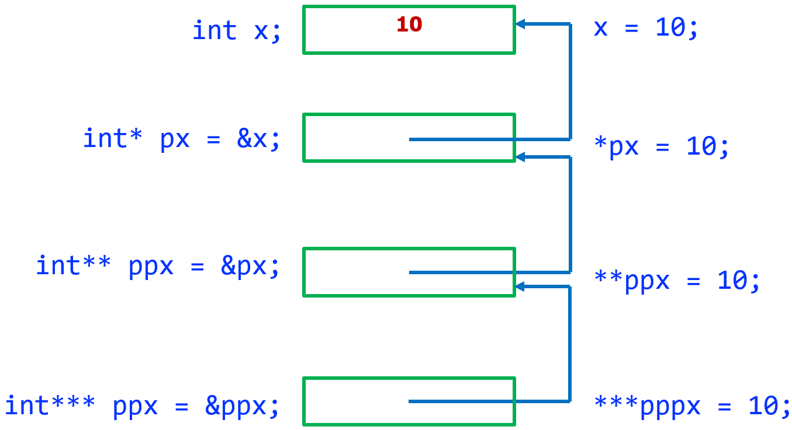

### 4.2.9. Con trỏ hằng (Pointer to constant)

**const** **int** value = 10;

```cpp
int *ptr = &value; // lỗi biên dịch: cannot convert from 'const int *' to 'int *’
```

\- Trong ví dụ trên, **value **lúc này là một **hằng**, nghĩa là giá trị của **hằng value **sẽ **không thể thay đổi** trong suốt vòng đời của chương trình. Vì vậy, việc gán một** biến con trỏ **cho một hằng sẽ gây ra lỗi biên dịch.

**- Chú ý:** Thông thường, khi nói một **biến con trỏ** (hoặc con trỏ), điều đó nghĩa là một **con trỏ trỏ đến một biến**.

\- Để dùng **con trỏ** trỏ đến một **hằng**, C++ cung cấp cho chúng ta khái niệm **con trỏ hằng (Pointer to const value)**.

***Con trỏ hằng (Pointer to const value)** là con trỏ trỏ đến **vùng dữ liệu hằng**. Ta **không thể thay đổi giá trị **mà nó đang trỏ đến. Nhưng có thể cho nó** trỏ đến một địa chỉ vùng nhớ khác (hoặc một biến).***

**-** Khai báo: **<span class="mark">const \<Tên kiểu\> \*\<tên con trỏ\>;</span>**

**<u>Ví dụ 1:</u>** const int\* p;

**- Có thể trỏ đến bất kỳ địa chỉ nào, nhưng không thay đổi được giá trị tại địa chỉ mà nó đang trỏ đến.**

***- Con trỏ hằng** xử lý **giá trị tại địa chỉ mà nó trỏ tới là hằng **khi được truy cập thông qua con trỏ, bất kể biến ban đầu được định nghĩa là hằng hay không.*

**<u>Ví dụ 2:</u>**

```cpp
int a, b = 5;
```

**const int \*p ;**

```cpp
p = &a;

p = &b;

b = 100;
```

**\*p = 15;** *//lỗi vì \*p là con trỏ hằng*

Vì **con trỏ hằng** là con trỏ trỏ đến** vùng dữ liệu hằng** (không phải **hằng con trỏ**), nên nó có thể trỏ đến một địa chỉ vùng nhớ khác.

Tuy nhiên:

**const** **int** value = 10;

**const** **int** \*ptr = &value; // ptr là con trỏ hằng

\*ptr = 20; // lỗi biên dịch: you cannot assign to a variable that is const

### 4.2.10. Hằng con trỏ (Constant pointer)

\- Là con trỏ **không thể thay đổi được địa chỉ vùng nhớ **mà nó lưu trữ, nhưng có thể **thay đổi được giá trị mà nó trỏ đến**.

**- Khi khai báo cần khởi tạo giá trị địa chỉ cho nó.**

**- Khi đó hằng con trỏ không thể trỏ đến bất kỳ địa chỉ nào khác**

**- Có thể thay đổi được giá trị tại địa chỉ khởi tạo ban đầu.**

\- Khai báo: **<span class="mark">\<Kiểu\> \* const \<tên con trỏ\>=\<địa chỉ khởi tạo\>;</span>**

**<u>Ví dụ 1:</u>**

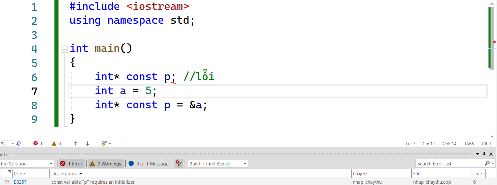

**<u>Ví dụ 2:</u>**

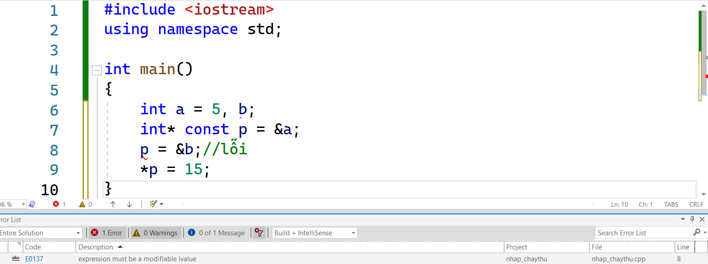

***Biến a** được p trỏ đến** không phải hằng**, nên **hằng con trỏ p **có thể thay đổi giá trị **biến a***

### 4.2.11. Hằng con trỏ hằng (Const pointer to a const value)

\- Khi kết hợp giữa **hằng con trỏ **và **con trỏ hằng **với nhau, ta có thể có một con trỏ **vừa không thay đổi được địa chỉ vùng nhớ** mà nó lưu trữ, vừa **không thay đổi được giá trị của vùng nhớ** đó.

Để sử dụng **hằng con trỏ hằng**, ta sử dụng **2 từ khóa const** như sau:

```cpp
int value = 10;
```

**const** **int** \***const** ptr = &value;

**- Chú ý:** Một hằng con trỏ hằng không thể trỏ đến một địa chỉ khác, cũng như giá trị mà nó trỏ đến sẽ không thể thay đổi thông qua con trỏ.

### 4.2.12. Phân biệt 2 dạng của con trỏ trỏ đến 2 dạng dữ liệu

*- Con trỏ thường trỏ đến dữ liệu thường:*

\+ Dữ liệu có thể được sửa đổi thông qua toán tử trỏ đến của con trỏ (\*).

\+ Con trỏ có thể được thay đổi để trỏ đến dữ liệu khác.

```cpp
int a = 5;

int b = 9;

int* ptr = &a;
```

\*ptr = 6; // OK

ptr = &b; // OK

*- Con trỏ thường trỏ đến hằng dữ liệu:*

\+ Dữ liệu KHÔNG thể được sửa đổi thông qua toán tử trỏ đến của con trỏ (\*).

\+ Con trỏ có thể được thay đổi để trỏ đến dữ liệu khác.

const int a = 5;

```cpp
int b = 9;
```

const int\* ptr = &a;

\*ptr = 6; // Error: expression must be a modifiable lvalue

ptr = &b; // OK

*- Hằng con trỏ trỏ đến dữ liệu thường:*

\+ Dữ liệu có thể được sửa đổi thông qua toán tử trỏ đến của con trỏ (\*).

\+ Con trỏ KHÔNG thể được thay đổi để trỏ đến dữ liệu khác.

```cpp
int a = 5;

int b = 9;
```

int\* const ptr = &a;

\*ptr = 6; // OK

ptr = &b; // Error: expression must be a modifiable lvalue

*- Con trỏ thường trỏ đến dữ liệu thường:*

\+ Dữ liệu KHÔNG thể được sửa đổi thông qua toán tử trỏ đến của con trỏ (\*)

\+ Con trỏ KHÔNG thể được thay đổi để trỏ đến dữ liệu khác.

const int a = 5;

const int b = 9;

<span class="mark">int\* const ptr = &a;</span>

//a value of type "const int \*" cannot be used to initialize an entity of type "int \*const"

\*ptr = 6;

ptr = &b; // Error: expression must be a modifiable lvalue

## 4.3. Cấp phát và thu hồi bộ nhớ động

**Ngôn ngữ C++ hỗ trợ ba loại cấp phát bộ nhớ cơ bản:**

***- Cấp phát bộ nhớ tĩnh (Static memory allocation):***

• Xảy ra trên các biến tĩnh và biến toàn cục.

• Vùng nhớ của các loại biến này được cấp phát một lần khi chương trình bắt đầu chạy và vẫn tồn tại trong suốt thời gian tồn tại của chương trình.

• Kích thước của biến/mảng phải được biết tại thời điểm biên dịch chương trình.

***- Cấp phát bộ nhớ tự động (Automatic memory allocation):***

• Xảy ra trên các tham số hàm và biến cục bộ.

• Vùng nhớ của các loại biến này được cấp phát khi chương trình đi vào khối lệnh và được giải phóng khi khối lệnh bị thoát.

• Kích thước của biến/mảng phải được biết tại thời điểm biên dịch chương trình.

***- Cấp phát bộ nhớ động (Dynamic memory allocation)***

### 4.3.1. Cấp phát tĩnh và cấp phát tự động

\- Xảy ra trên các biến tĩnh và biến toàn cục.

\- Vùng nhớ của các loại biến này được **cấp phát một lần** khi chương trình bắt đầu chạy và vẫn **tồn tại trong suốt thời gian tồn tại của chương trình.**

\- Đối với **cấp phát bộ nhớ tĩnh **và **tự động**, kích thước của biến/mảng phải được **biết tại thời điểm biên dịch chương trình**.

\- Gây **lãng phí nếu không sử dụng hết** vùng nhớ đã khai báo.

*Giả sử mảng đang khai báo 500 phần tử. Nếu chỉ sử dụng giả sử 100 vùng nhớ, thì còn lại 400 vùng nhớ của mảng không được sử dụng.*

\- Hầu hết các biến thông thường (bao gồm mảng tĩnh) được cấp phát trong một phần bộ nhớ gọi là ngăn xếp (stack). Kích thước bộ nhớ stack cho một chương trình khá nhỏ, nếu **yêu cầu cấp phát vùng nhớ vượt quá con số này, chương trình sẽ báo lỗi tràn bộ nhớ stack (stack overflow).**

```cpp
char byte[1000000 * 2]; // khoảng 2Mb bộ nhớ => lỗi stack overflow
```

\- Khi cần khai báo 1000 phần tử, mà mảng chỉ có 500 phần tử, dẫn đến **chương trình sẽ bị giới hạn bởi kích thước được khai báo ban đầu.**

**<u>Ví dụ:</u>**

```cpp
#include <iostream>

using namespace std;

int main() {

int a[10000000];

for (int i = 0; i < 5; i++) {

cin >> a[i];

}

return 0;

}
```

***Kết quả:***

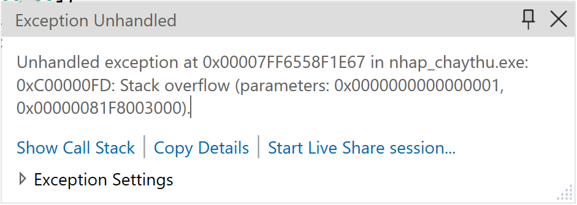

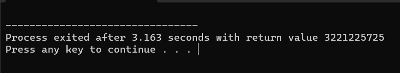

**\* Hàm main return 0 nhưng kết quả cho return là số khác 0 – Tràn bộ nhớ.**

**🡪 Sức mạnh thực sự của con trỏ nằm ở chỗ nó được sử dụng để quản lý biến động.**

\- Bộ nhớ cấp phát cho các biến, mảng đều cố định, không thể thay đổi trong lúc chương trình chạy.

\- Cần một lượng bộ nhớ mà **kích cỡ của nó chỉ có thể được xác định khi chương trình chạy,** ví dụ như trong trường hợp chúng ta nhận thông tin từ người dùng để xác định lượng bộ nhớ cần thiết

- **Giải pháp là dùng *bộ nhớ động.***

### 4.3.2. Cấp phát bộ nhớ động

*- Là cách để yêu cầu bộ nhớ từ hệ điều hành **khi cần thiết** (thời điểm chương trình đang chạy). *

*- Sử dụng vùng nhớ được quản lý bởi hệ điều hành được gọi là **heap**. Ngày nay, bộ nhớ **heap **có thể có kích thước **gigabyte**.*

#### 4.3.2.1. Cấp phát bộ nhớ động với toán tử new (Ngôn ngữ C++)

*- Khi gặp toán tử new, chương trình sẽ tìm trong bộ nhớ một lượng ô nhớ còn rỗi và liên tục với số lượng đủ theo yêu cầu và cho p trỏ đến địa chỉ (byte đầu tiên) của vùng nhớ này. Nếu không có vùng nhớ với số lượng như vậy thì việc cấp phát là thất bại và p = NULL.*

*- Toán tử **new **tạo đối tượng sử dụng vùng nhớ đó và sau đó trả về **<u>một con trỏ chứa địa chỉ của vùng nhớ đã được cấp phát.</u>** Vì địa chỉ vùng nhớ chưa có tên, để truy cập vào vùng nhớ được cấp phát, chúng ta dùng **con trỏ** để **lưu giữ địa chỉ **được trả về bởi toán tử** new**.*

*- Hàm này trả về một con trỏ trỏ tới **<u>đầu của khối nhớ</u>** vừa được cấp phát.*

**\# Cấp phát động cho các biến đơn (1 phần tử):**

\- Cú pháp:

```cpp
int *p;
```

p = new \<kiểu dữ liệu\> ;     // cấp phát 1 phần tử

**<u>Ví dụ:</u>**

//Cấp phát vùng nhớ chứa 1 số nguyên

```cpp
int *p1;

p1 = new int;

/*gán 10 cho vùng nhớ vừa được cấp phát*/

int *p2 = new int;
```

\*p2 = 10;

/\*Khi cấp phát động cho một biến, có thể cùng lúc khởi tạo giá trị cho nó:\*/

```cpp
int *ptr1 = new int(10);

int *ptr2 = new int{ 20 };
```

**\# Cấp phát động cho mảng (Mảng động):**

\- Sử dụng mảng thông thường, bạn sẽ không thể thay đổi kích thước của mảng (thêm khi cần và xóa khi không cần), mảng động sẽ giải quyết việc này.

\- Để cấp phát một mảng động, ta sử dụng toán tử new và sau kiểu dữ liệu **phải cung cấp số lượng phần tử \[size\].**

\- Cấp phát động một mảng cho phép chúng ta xác định kích thước mảng trong thời gian chạy chương trình.

```cpp
int *p;

p = new [size];
```

**<u>Ví dụ:</u>**

```cpp
float *p1;
```

p1 = new float \[1000\]; /\*Cấp phát vùng nhớ chứa 1000 số thực\*/

```cpp
int *ptr1 = new int [10];
```

**Cách khác để khởi tạo mảng động (đối với C++ 11 trở lên):**

```cpp
int* array = new int[4] { 5, 7, 4, 8 };
```

**® Lưu ý: Mảng động phải được khai báo độ dài rõ ràng khi khởi tạo:**

int fixedArray\[\]{ 1, 2, 3 }; //không báo lỗi, do là mảng tĩnh​

```cpp
int* dynamicArray1 = new int[] {1, 2, 3}; // lỗi​: too many initializer values

int* dynamicArray2 = new int[3] {1, 2, 3}; // không lỗi​
```

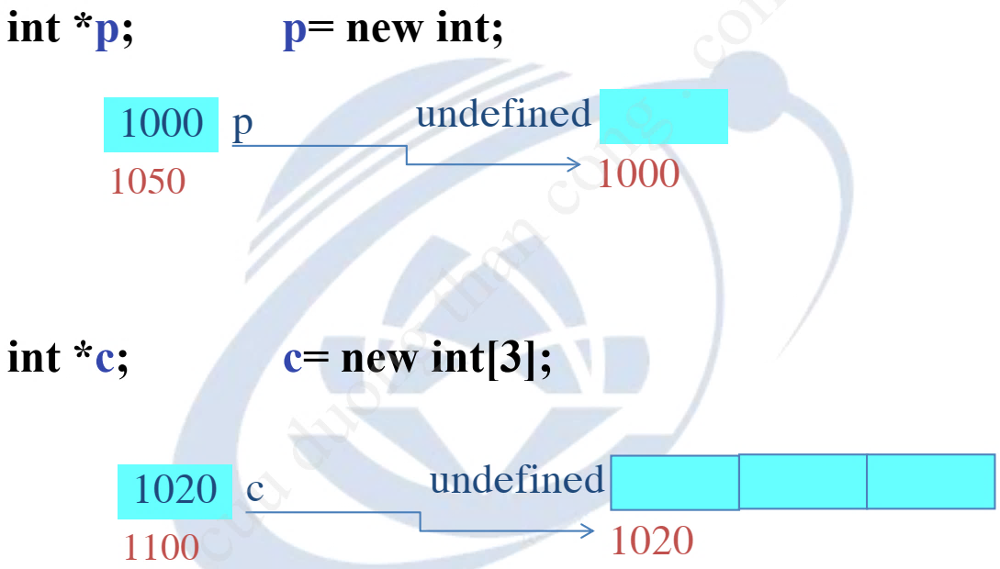 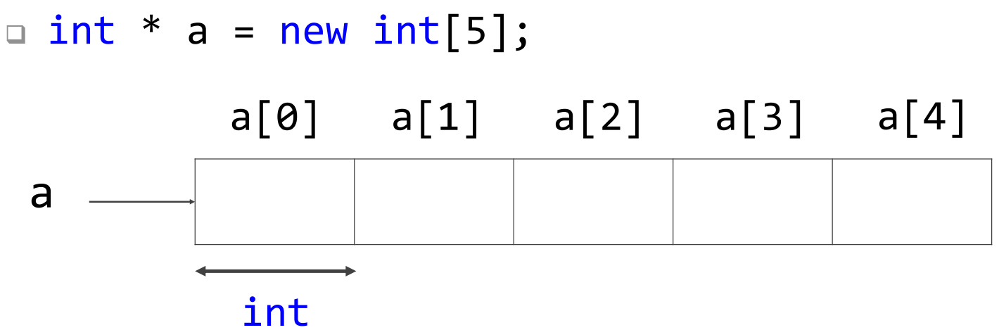

**\**

**\* Thay đổi kích thước mảng động:**

C++ không cung cấp sẵn tính năng thay đổi kích thước một mảng đã được cấp phát. Do đó ta cần 

- Cấp phát động một mảng mới.

-  Sao chép các phần tử từ mảng cũ sang vùng nhớ mới.

-  Xóa mảng cũ.

**<u>Ví dụ:</u>**

```cpp
#include <iostream>

using namespace std;

int main()

{

// Mảng ban đầu

int size = 3;

int* arr = new int[size] {1, 2, 3};

// Tạo mảng mới

int newSize = 5;

int* newArr = new int[newSize];

// Copy phần tử từ mảng cũ sang mảng mới

for (int i = 0; i < size; i++)

newArr[i] = arr[i];

// Xóa mảng cũ đi
```

delete\[\] arr;

```cpp
arr = nullptr;

return 0;

}
```

**\* Chú ý:**

*+ Một con trỏ sau khi giải phóng bộ nhớ, có thể cấp phát mới*

```cpp
int* pa = new int(12); //*pa = 12
```

delete pa; // Giải phóng vùng nhớ vừa cấp cho pa.

```cpp
int A[5] = { 5, 10, 15, 20, 25 };
```

pa = A; // Cho pa trỏ đến địa chỉ của mảng A

*+ Nhiều con trỏ cùng trỏ một địa chỉ, chỉ cần giải phóng bộ nhớ 1 con trỏ:*

```cpp
int* pa = new int(12); // *pa = 12

int* pb = pa; // pb trỏ đến cùng địa chỉ pa.
```

\*pb += 5; // \*pa = \*pb = 17

delete pa; // Giải phóng cả pa lẫn pb

\+ Một con trỏ sau khi cấp phát bộ nhớ động bằng new, *cần phải phóng bộ nhớ trước khi trỏ đến một địa chỉ mới hoặc cấp phát bộ nhớ mới:*

```cpp
int *pa = new int(12); // pa được cấp bộ nhớ

// và *pa = 12
```

pa = new int(15); // pa trỏ đến địa chỉ khác

// và \*pa = 15.

// địa chỉ cũ của pa vẫn bị coi là bận

\+ Phân biệt “()” với “\[\]”.

// Cấp phát bộ nhớ và khởi tạo cho một con trỏ int

```cpp
int* A = new int(5);

// Cấp phát bộ nhớ cho một mảng 5 phần tử kiểu int

int* A = new int[5];
```

#### 4.3.2.2. Cấp phát bộ nhớ động với các hàm trong \<stdlib.h\> (Ngôn ngữ C)

**+ p = (kiểu_dữ_liệu\*) malloc(S);**

\- Cấp phát ***vùng nhớ có kích thước S bytes và trả về địa chỉ của vùng nhớ*** đó. Nếu không đủ bộ nhớ hàm trả về giá trị NULL.

\- Hàm này trả về một con trỏ kiểu void\*.

**- Nguyên mẫu:**

**void * malloc (size_t** *nbytes* );

Trong đó: *nbytes* là số byte chúng ta muốn gán cho con trỏ

\- Hàm này cấp phát vùng nhớ có kích thước *nbytes* bytes và trả về địa chỉ của vùng nhớ đó.

\- Nếu không đủ bộ nhớ hàm trả về giá trị NULL.

**- Sử dụng:** vì hàm này trả về một con trỏ kiểu void\*, nên ta phải chuyển đổi kiểu sang kiểu của con trỏ đích.

\* Khi chúng ta muốn cấp phát một khối dữ liệu có kiểu khác char (lớn hơn 1 byte) chúng ta phải nhân số phần tử mong muốn với kích thước của chúng. Chúng ta có thể sử dụng toán tử sizeof, toán tử này trả về kích thước của một kiểu dữ liệu cụ thể.

**<u>Ví dụ 1:</u>**

```cpp
p1 = (int*)malloc(num * sizeof(int));
```

num: số con số int cần xin

sizeof(int): kích thước của mỗi số nguyên.

🡺 num\*sizeof(int): số bytes cần thiết để xin

Cần ép kiểu của p1: kiểu int\*.

**<u>Ví dụ 2:</u>**

```cpp
ptr = (int*) malloc(100 * sizeof(int));
```

Thực hiện cấp phát cho việc lưu trữ 100 số nguyên. Giả sử sizeof int là 4, khi đó lệnh dưới đây thực hiện cấp phát 400 bytes. Khi đó, con trỏ ptr sẽ có giá trị là địa chỉ của byte dữ liệu đầu tiên trong khối bộ nhớ vừa cấp phát.

\- Hàm malloc trả về NULL nếu không xin được. Lúc đó, không thể dùng bộ nhớ được! **Do đó, LUÔN LUÔN kiểm tra xem malloc có trả về NULL hay không.**

```cpp
int *p1 = (int*)malloc(num*sizeof(int));

if(p1 == NULL){ ...} else { ...}
```

**+ p = (kiểu_dữ_liệu\*) calloc(N, S);** Cấp phát mảng động có N phần tử, mỗi phần tử có kích thước S bytes và trả về địa chỉ của vùng nhớ đó.

***- calloc** đại diện cho cụm từ contiguous allocation (dịch: cấp phát liên tục).*

\- calloc hoạt động rất giống với malloc, sự khác nhau chủ yếu là khai báo mẫu của nó:

**void * calloc (size_t** *nelements* , size_t *size* );

Trong đó: *nelements*: số phần tử; *size*: kích thước của mỗi phần tử.

\- Hàm này cấp phát bộ nhớ có kích thước bằng *nelements\* size,* mỗi phần tử có kích thước *size* bytes và trả về địa chỉ của vùng nhớ đó. ***Hai tham số này được nhân với nhau để có được kích thước tổng cộng của khối nhớ cần cấp phát.***

\- Hàm này trả về một con trỏ kiểu void\*.

**- Sử dụng:** giống hàm malloc, tuy nhiên một điểm khác nhau giữa malloc và calloc là **calloc khởi tạo tất cả các phần tử của nó về 0.**

**<u>Ví dụ 1:</u>**

```cpp
char * ronny; ronny = (char *) calloc (1, sizeof(char));

char * tom; tom= (char *) calloc (5, sizeof(char));
```

**<u>Ví dụ 2:</u>**

```cpp
ptr = (int*) calloc(100, sizeof(int));
```

Thực hiện cấp phát 100 ô nhớ liên tiếp và mỗi ô nhớ có kích thước là số byte của kiểu int. Hàm này cũng trả về con trỏ chứa giá trị là địa chỉ của byte đầu tiên trong khối bộ nhớ vừa cấp phát.

**<u>\
</u>+ p = (kiểu_dữ_liệu\*) realloc(void \*ptr, S);** Cấp lại vùng nhớ với kích thước S bytes cho biến con trỏ ptr, đồng thời chép dữ liệu vào vùng nhớ mới.

**- Công dụng:** thay đổi kích thước của khối nhớ đã được cấp phát cho một con trỏ.

**- Nguyên mẫu:**

**void * realloc (void *** *pointer* , size_t *newsize* );

Trong đó:

*pointer:* con trỏ đã được cấp phát bộ nhớ (với các hàm new, malloc, calloc, realloc trước đó) hay một con trỏ NULL. Nếu giá trị là NULL, thì một khối mới được cấp phát và một con trỏ tới nó được trả về bởi hàm này.

*newsize:* kích thước của khối nhớ mới. Nếu giá trị là 0 và con trỏ ptr trỏ tới một khối nhớ đang tồn tại, khối nhớ được trỏ tới bởi ptr được giải phóng và một con trỏ NULL được trả về.

*- Hàm này trả về một con trỏ tới bộ nhớ được cấp phát mới, hoặc trả về NULL nếu yêu cầu thất bại.*

\- Nếu kích thước khối nhớ mới *newsize* **nhỏ hơn** kích thước cũ: *pointer* vẫn giữ nguyên địa chỉ, giá trị các phần tử dư thừa bị xóa đi. Hàm trả về địa chỉ của *pointer.*

\- Nếu kích thước khối nhớ mới *newsize* **bằng** kích thước cũ: *pointer* vẫn giữ nguyên địa chỉ và giá trị các phần tử. Hàm trả về địa chỉ của *pointer.*

\- Nếu kích thước khối nhớ mới *newsize* **lớn hơn** kích thước cũ: cấp phát 1 *khối nhớ mới* và các phần tử có giá trị bằng giá trị các phần tử trong *pointer; pointer* vẫn giữ nguyên địa chỉ và giá trị tất cả phần tử bị xóa đi. Hàm trả về địa chỉ của *khối nhớ mới.*

\- Nếu **không thể thay đổi kích thước** của *pointer* thì hàm sẽ trả về một con trỏ NULL **(yêu cầu thất bại)**, *pointer* và nội dung của nó sẽ không bị thay đổi

**- Sử dụng:**

```cpp
int *q = (int*)realloc(p, 10*sizeof(int));
```

### 4.3.3. Thu hồi bộ nhớ động

\- Khi cấp phát động, thì vùng nhớ không có tên, để quản lý và sử dụng vùng nhớ này thì bắt buộc phải dùng con trỏ. Thông qua con trỏ để làm việc với vùng nhớ này.

\- Để tránh ảnh hưởng đến bộ nhớ, sau khi sử dụng vùng nhớ này cần phải thu hồi. Vì vùng nhớ này do người lập trình quản lý chứ không tự động thu hồi.

\- Việc không giải phóng sau khi sử dụng sẽ khiến rò rỉ bộ nhớ. Ta cần trao quyền quản lý vùng nhớ đó lại cho hệ điều hành.

\- Sau khi xóa đi, vùng nhớ đó đã được xóa dữ liệu và trả lại cho hệ điều hành quản lý, tuy nhiên, con trỏ mà đang trỏ đến vùng nhớ đó vẫn đang chứa địa chỉ đó.

\- Việc sử dụng con trỏ này sẽ gây ra hậu quả không mong muốn do biến động nó trỏ tới không còn tồn tại. Do vậy, muốn xóa sạch, ta có thể gán con trỏ = null: **p = nullptr;**

***\* Với bộ nhớ được cấp phát bởi new, ta thu hồi bằng toán tử delete:***

**delete p ;** // p là con trỏ được sử dụng trong new

**delete\[\] p ;** // p là con trỏ trỏ đến mảng

***\* Với bộ nhớ được cấp phát bởi malloc, calloc hoặc realloc, ta thu hồi bằng hàm free():***

**void free (void * pointer);**

Hoặc: **free (p);** //p là con trỏ được sử dụng

***\* Khi delete biến động, ta nên gán lại con trỏ NULL.​***

**int *ptr = new int[1];​**

**delete ptr; ​**

```cpp
ptr = nullptr;
```

**<u>Ví dụ 1:</u>** minh họa cách dùng new và delete

```cpp
#include <iostream>

using namespace std;

int main()

{

int* p;
```

p = new int; //Cap phat bo nho dong cho con tro p du chua 1 so nguyen

```cpp
cout << "Nhap vao gia tri cho p: ";

cin >> *p;

cout << "Gia tri cua p la: ";

cout << *p;
```

delete p;

```cpp
return 0;

}
```

***Kết quả:***

Nhap vao gia tri cho p: 15

Gia tri cua p la: 15

**<u>Ví dụ 2:</u>** minh họa cách dùng các hàm cấp phát và thu hồi.

```cpp
#include <iostream>

#include <iostream>

using namespace std;

int main()

{

int* p;
```

p = (int\*)malloc(sizeof(int)); //Ham sizeof tra ve kich thuoc

```cpp
cout << "Nhap vao gia tri cho p: ";

cin >> *p;

cout << "Gia tri cua p la: ";

cout << *p;

free(p);

}
```

***Kết quả:***

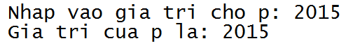

**<u>Ví dụ 3:</u>** Ví dụ về nhập dãy số không dùng mảng & sắp xếp dãy số

```cpp
#include <iostream>

using namespace std;

int main()

{

int* dau, * p, * q, n, tam;//dau sẽ là số đầu tiên của dãy

cout << "Cho biet so luong phan tu cua day: ";

cin >> n;
```

dau = new int\[n\];// Cấp cho dau n phần tử số nguyên

```cpp
for (p = dau; p < dau + n; p++) {// nhập dãy

cout << "So thu " << p - dau + 1 << ": ";

cin >> *p;

}

/* p = dau: con trỏ p trỏ đến con trỏ dau, con trỏ dau trỏ đến phần tử đầu tiên của dãy n phần tử (không cần quan tâm địa chỉ của nó);
```

\* dau + n: n ô int;

\* p++: cộng địa chỉ; biến địa chỉ thành chỉ số \*/

/\*vòng đầu tiên: p-dau=0 (khoảng cách giữa 2 con trỏ = 0); \*p: nhập giá trị đầu tiên cho dãy mà p trỏ đến\*/

// Sắp xếp dãy

// So sánh từ đầu đến vị trí kế cuối; Xem như đang làm việc với mảng (cho dễ hình dung)

```cpp
for (p = dau; p < dau + n - 1; p++)

for (q = p + 1; q < dau + n; q++)//Lấy phần tử thứ 2 đến phần tử cuối cùng.

if (*q < *p) {//Hoán vị, Cùng tác động đến dãy

tam = *p;
```

\*p = \*q;

\*q = tam;

}

```cpp
for (p = dau; p < dau + n; p++)

cout << *p << "\t";// Xuất dãy: p < dau+n: p nhỏ hơn số lượng phần tử.
```

delete\[\] dau; // Thu hồi bộ nhớ

}

***Kết quả:***

Cho biet so luong phan tu cua day: 3

So thu 1: 1

So thu 2: 2

So thu 3: 3

1 2 3

*- Rò rỉ bộ nhớ trong C++ (Memory leaks):*

**<u>Ví dụ 1:</u>**

```cpp
void doSomething()

{

int *ptr = new int;

}
```

***+ Khi** không sử dụng toán tử **delete **để giải phóng vùng nhớ đã cấp phát, con trỏ **tuân theo tất cả các quy tắc** giống như các biến thông thường, khi hàm kết thúc, **ptr** sẽ bị hủy. Mặt khác, **ptr** là biến duy nhất giữ địa chỉ của số nguyên được cấp phát động. Nghĩa là chương trình đã "**mất**" địa chỉ của bộ nhớ được cấp phát động trong hàm **doSomething()**. Kết quả là chương trình **không thể giải phóng vùng nhớ **được cấp phát động.*

🡪 **Rò rỉ bộ nhớ **xảy ra khi chương **mất địa chỉ **của một số vùng nhớ được cấp phát động trước khi giải phóng nó cho hệ điều hành. Khi rò rỉ bộ nhớ, chương trình của bạn** không thể xóa **bộ nhớ được cấp phát động, bởi vì chương trình **không còn nắm giữ địa chỉ **vùng nhớ đó. **Hệ điều hành **cũng** không thể sử dụng** vùng nhớ này, vì vùng nhớ đó vẫn nằm trong quyền sử dụng của chương trình.

**<u>Ví dụ 2:</u>** Con trỏ giữ địa chỉ của bộ nhớ được cấp phát động được gán một giá trị khác gây rò rỉ bộ nhớ.

```cpp
int value = 10;

int *ptr = new int; // cấp phát vùng nhớ
```

ptr = &value; // địa chỉ vùng nhớ cấp phát trước đó bị mất, rò rỉ bộ nhớ

**<u>Ví dụ 3:</u>** Cấp phát vùng nhớ liên tục nhiều lần

```cpp
int *ptr = new int;
```

ptr = **new** **int**; // địa chỉ vùng nhớ cấp phát trước đó bị mất, rò rỉ bộ nhớ

*Để khắc phục vấn đề **rò rỉ bộ nhớ (memory leaks)** trong C++, chúng ta cần giải phóng vùng nhớ khi **ra khỏi phạm vi **con trỏ (ví dụ 1), hoặc **trước khi gán** (ví dụ 2), **cấp phát** một con trỏ (ví dụ 3).*

## 4.4. Con trỏ và các vấn đề liên quan

### 4.4.1. Con trỏ và mảng, chuỗi

#### 4.4.1.1. Con trỏ và mảng 1 chiều

**- Con trỏ trỏ đến phần tử mảng:**

*+ Việc cho con trỏ trỏ đến mảng cũng tương tự trỏ đến các biến khác, tức gán địa chỉ của mảng (chính là tên mảng) cho con trỏ.*

\+ Nếu ta có câu lệnh **p = a**; thì:

**p trỏ đến a\[0\]**

**p+1 trỏ đến a\[1\]**

**.........**

**p+i trỏ đến a\[i\]**

Khi đó p trỏ vào phần tử thứ nhất của mảng và pa +1 se trỏ vào phần tử thứ 2 của mảng…

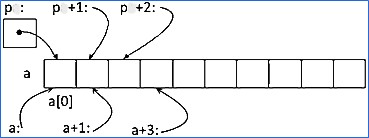

**<u>Ví dụ 1:</u> *In toàn bộ mảng thông qua con trỏ.***

Cho: int a\[5\] = {1, 2, 3, 4, 5}, \*p, i;

**Cách 1:**

p = a; //p đang trỏ đến a\[0\]

=\> a và p có giữ cùng địa chỉ: địa chỉ của ô đầu tiên trên mảng

```cpp
for (i=0; i<5; i++) cout << *(p+i) <<"\t";

// p không thay đổi (Không tác động gì đến p)
```

**Cách 2:**

```cpp
for (p=a; p<a+5; p++) cout << *p <<"\t";

// thay đổi p (Tác động đến p)
```

**<u>Ví dụ 2:</u>**

```cpp
#include <iostream>

using namespace std;

int main() {

int a[10], n = 10, * p;

p = a; // hoặc p = &a[0];

for (int i = 0; i < n; i++)

cin >> a[i];

// cin >> p[i];

// cin >> *(a + i);

// cin >> *(p + i);

// cin >> *(a++); //Lỗi vì a là hằng con trỏ

// cin >> *(p++);

}
```

**⇨&a\[i\] ⬄ (a + i) ⬄ (p + i) ⬄ &p\[i\]**

**Lưu ý:**

\- Xét khai báo : int a\[5\], \*p = a; khi đó con trỏ p giữ địa chỉ của phần tử đầu tiên của mảng a. Lúc này:

pa+i tương đương với &a\[i\].

\*(pa+i) tương đương với a\[i\].

**<u>Ví dụ 3:</u>**

```cpp
#include <iostream>

using namespace std;

int main()

{

int array[4] = { 5, 8, 2, 7 };

// toán tử trỏ (*) trả về giá trị phần tử đầu tiên: array[0]

cout << *array << '\n'; // 5

// khai báo con trỏ ptr trỏ vào mảng array

int* ptr = array;

cout << *(ptr) << '\n'; // 5

char name[] = "Kteam"; // C-style string (mảng char)

cout << *name << '\n'; // K

system("pause");

return 0;

}
```

***Kết quả:***

5

5

K

**- Tên mảng dùng như con trỏ:**

<span class="mark">+ C/C++ xem tên mảng 1 chiều (VD: a) chính là một **hằng con trỏ**</span>, ***địa chỉ của mảng chính là địa chỉ của phần tử đầu tiên.***

\+ Giả sử a là tên mảng.

\+ Địa chỉ của mảng cũng là địa chỉ của thành phần thứ 0 nên a+i sẽ là địa chỉ thành phần thứ i của mảng a.

**a tương đương với &a\[0\]**

**a+i tương đương với &a\[i\]**

**\*(a+i) tương đương với a\[i\]**

**<u>Ví dụ 1:</u>**

```cpp
#include <iostream>

using namespace std;

int main()

{

int array[4] = { 5, 8, 2, 7 };

// in giá trị của biến array

cout << "The array has value: " << array << '\n';

// in địa chỉ của biến array

cout << "The array has address: " << &array << '\n';

// in địa chỉ của phần tử array[0]

cout << "Element 0 has address: " << &array[0] << '\n';

system("pause");

return 0;

}
```

***Kết quả:***

The array has value: 000000B7A978F9B8

The array has address: 000000B7A978F9B8

Element 0 has address: 000000B7A978F9B8

\+ Chú ý khi viết **\*(p+1) = \*(a+1)** ta thấy vai trò của p và a trong biểu thức này là như nhau, cùng truy cập đến giá trị của phần tử a\[1\].

\+ Tuy nhiên **khi viết \*(p++) thì lại khác với \*(a++),** cụ thể viết p++ là hợp lệ còn a++ là không được phép. Lý do là **tuy p và a cùng thể hiện địa chỉ của mảng a nhưng p thực sự là một biến, nó có thể thay đổi được giá trị còn a là một hằng, giá trị không được phép thay đổi.**

(**a\[0\] = 2, a\[5\] = 7 🡪 ok; nhưng a++, a-- 🡪 lỗi**)

***Ví dụ:*** viết x = 3 và sau đó có thể tăng x bởi x++ nhưng không thể viết x = 3++.

p = b + 7 🡪 **<u>Thành phần</u>** thứ 7 (tương ứng với chỉ số) = b\[7\] 🡪 8 phần tử (chỉ số 0 🡪 7).

**<u>Ví dụ 2:</u>**

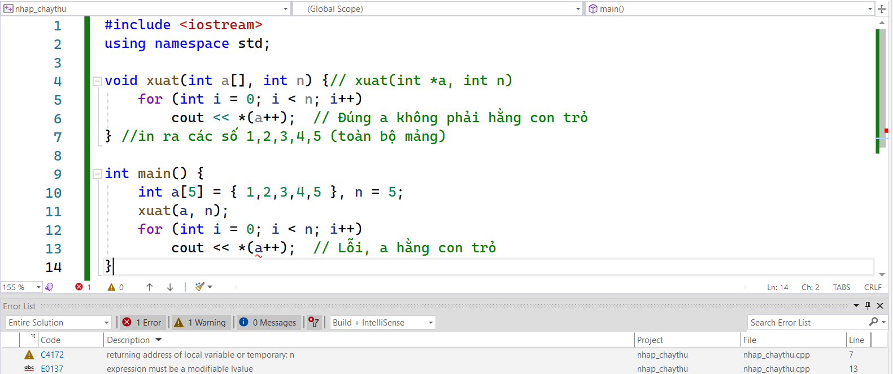

**⇨ Đối số mảng truyền cho hàm không phải hằng con trỏ.**

**- Nhập xuất mảng 1 chiều:**

***+ Bằng mảng:***

```cpp
#include <iostream>

using namespace std;
```

\#define MAX 100

```cpp
int main()

{

int a[MAX], n, i;

cout << "So phan tu cua mang: ";

cin >> n;

for (i = 0; i < n; i++)

{

cout << "Nhap phan tu a[" << i << "]: ";

cin >> a[i];

}

for (i = 0; i < n; i++)

cout << a[i] << '\t';

return 0;

}
```

***+ Bằng con trỏ:***

```cpp
#include <iostream>

using namespace std;
```

\#define MAX 100

```cpp
int main()

{

int a[MAX], n, i;

cout << "So phan tu cua mang: ";

cin >> n;

for (i = 0; i < n; i++)

{

cout << "Nhap phan tu a[" << i << "]: ";

cin >> *(a + i);

}

for (i = 0; i < n; i++)

cout << *(a + i) << '\t';

return 0;

}
```

***Kết quả:***

So phan tu cua mang: 5

Nhap phan tu a\[0\]: 1

Nhap phan tu a\[1\]: 2

Nhap phan tu a\[2\]: 3

Nhap phan tu a\[3\]: 4

Nhap phan tu a\[4\]: 5

1 2 3 4 5

**- So sánh mảng & con trỏ:**

**+ Giống nhau:**

\# Con trỏ & mảng: giữ địa chỉ của ô nhớ

. Con trỏ: giữ địa chỉ của ô nhớ nào đó (của biến khác, của bộ nhớ động)

. Mảng: giữ địa chỉ của phần tử đầu tiên

=\> Có thể gán mảng vào con trỏ. Tuy nhiên, gán con trỏ vào mảng là không được

\# Có cùng cách truy cập các ô nhớ: Mảng dùng toán tử \[ \], Con trỏ dùng toán tử \* và +

**+ Khác nhau:**

*\# Mảng:*

. Được **cấp phát sẵn** 1 địa chỉ.

. Là một tập cùng kiểu, được bộ nhớ cấp phát cho 1 vùng cố định, liên tiếp nhau.

. Mặc định Con trỏ của mảng sẽ đi từ vị trí đầu tiên - vị trí 0.

. Các phần tử của mảng nằm trên STACK của chương trình

*\# Con trỏ:*

. Là 1 biến **phải gán** địa chỉ của 1 biến đã được cấp phát trước đó.

***. Mặc định con trỏ*** chưa trỏ đến vị trí nào.

. Các phần tử mảng con trỏ chỉ đến có thể trên STACK hay HEAP

\# Một sai lầm phổ biến trong C++ là tin rằng mảng và con trỏ đến mảng là giống hệt nhau. Mặc dù chúng đều trỏ đến phần tử đầu tiên của mảng, nhưng chúng là 2 kiểu khác nhau.

```cpp
#include <iostream>

using namespace std;

int main()

{

int array[4] = { 5, 8, 2, 7 };

cout << typeid(array).name() << '\n';

cout << sizeof(array) << '\n';

int* ptr = array;

cout << typeid(ptr).name() << '\n';

cout << sizeof(ptr) << '\n';

system("pause");

return 0;

}
```

***Kết quả:***

int \[4\]

16

int \* \_\_ptr64

8

Trong trường hợp trên, mảng là kiểu “**int \[4\]**” kích thước 16 byte, trong khi một con trỏ tới mảng sẽ thuộc kiểu “**int \***” kích thước 8 byte.

Vì vậy, sử dụng mảng một chiều có thể biết được chính xác số lượng phần tử của mảng, trong khi con trỏ không làm được điều này.

#### 4.4.1.2. Con trỏ và mảng 2 chiều

**- Tên mảng dùng như con trỏ**

***+ Một mảng 2 chiều có thể hiểu như là mảng 1 chiều của mảng, tức là mỗi phần tử của mảng lại là mảng 1 chiều.***

**<u>Ví dụ 1:</u>** **int a\[2\]\[3\];**

Thì mảng 2 chiều a được xem gồm 2 phần tử, mỗi phần tử là một mảng gồm 3 số nguyên int.

| *Phần tử* | **a\[0\]\[0\]** | **a\[0\]\[1\]** | **a\[0\]\[2\]** | **a\[1\]\[0\]** | **a\[1\]\[1\]** | **a\[1\]\[2\]** |
|:--:|:--:|:--:|:--:|:--:|:--:|:--:|
| *Địa chỉ* | 1 | 2 | 3 | 4 | 5 | 6 |

a có phần tử thứ 0 là a\[0\], a\[0\] là mảng 1 chiều gồm các phần tử: a\[0\]\[0\], a\[0\]\[1\], a\[0\]\[2\].

a có phần tử thứ 1 là a\[1\], a\[1\] là mảng 1 chiều gồm các phần tử: a\[1\]\[0\], a\[1\]\[1\], a\[1\]\[2\].

\+ Ta có quy tắc sau:

**a\[i\]** tương đương với **&a\[i\]\[0\]**

**a\[i\]+j** tương đương với **&a\[i\]\[j\]**

**<u>Ví dụ 2:</u>** Xét khai báo: int a\[2\]\[3\], \*pa;

```cpp
pa = (int*)a;
```

Khi đó:

pa tương đương với &a\[0\]\[0\].

pa+1 tương đương với &a\[0\]\[1\].

pa+2 tương đương với &a\[0\]\[2\].

pa+3 tương đương với &a\[1\]\[0\].

pa+4 tương đương với &a\[1\]\[1\].

pa+5 tương đương với &a\[1\]\[2\].

***Chú ý:** vì a là địa chỉ kiểu int\[3\], pa là con trỏ kiểu int. Nên phải ép kiểu như sau: pa = (int\*)a*

**\*(a\[i\]+j)** tương đương với **a\[i\]\[j\]**

Hoặc

**\*(a+i)+j** tương đương với **&a\[i\]\[j\]**

**\*(\*(a+i)+j)** tương đương với **a\[i\]\[j\]**

**<u>Ví dụ 3:</u>** Xét khai báo: int a\[2\]\[3\], \*pa;

```cpp
pa = (int*)a;
```

Khi đó:

\*pa tương đương với a\[0\]\[0\].

\*(pa+1) tương đương với a\[0\]\[1\].

\*(pa+2) tương đương với a\[0\]\[2\].

\*(pa+3) tương đương với a\[1\]\[0\].

\*(pa+4) tương đương với a\[1\]\[1\].

\*(pa+5) tương đương với a\[1\]\[2\].

🡪 Tổng quát, đối với mảng m x n phần tử: **<span class="mark">p + i\*n + j trỏ tới a\[i\]\[j\] hoặc a\[i\]\[j\] = \*(p + i\*n + j)</span>**

**<u>Ví dụ 4:</u>**

```cpp
#include <iostream>

using namespace std;

int main()

{
```

int a\[2\]\[3\] = {1,2,3,4,5,6}, n, i;

```cpp
for (int i = 0; i < 2; i++)

{

for (int j = 0; j < 3; j++)

cout << *(*(a + i) + j) << " ";

cout << endl;

}

return 0;

}
```

Kết quả:

1 2 3

4 5 6

**- Con trỏ chỉ đến phần tử mảng**

\+ Xét khai báo

int a\[2\]\[3\];

int (\*p)\[3\];// p là con trỏ kiểu int\[3\]

Nếu p = a;

**\*(p+i)+j** tương đương với **&a\[i\]\[j\]**

**\*(\*(p+i)+j)** tương đương với **a\[i\]\[j\]**

**<u>Ví dụ 1:</u>** cho phép nhập và in một mảng 2 chiều m\*n (m dòng, n cột) thông qua con trỏ p. Nhập liên tiếp m\*n số vào mảng và in thành ma trận m dòng, n cột.

```cpp
#include <iostream>

using namespace std;

int main()

{
```

float a\[2\]\[3\], \* p;

```cpp
int i, j;
```

p = (float\*)a; //p=&a\[0\]\[0\]

```cpp
for (i = 0; i < 2 * 3; i++)

cin >> *(p + i);

for (i = 0; i < 2; i++) {

for (j = 0; j < 3; j++)

cout << a[i][j] << '\t';

cout << endl;

}

return 0;

}
```

***Kết quả:***

1 2 3 4 5 6

1 2 3

4 5 6

**<u>Ví dụ 2:</u>** cho kết quả khác

```cpp
#include <iostream>

using namespace std;

int main()

{
```

float a\[2\]\[5\], \* p;

```cpp
int n = 2, m = 3, i, j;
```

p = (float\*)a; //p=&a\[0\]\[0\]

```cpp
for (i = 0; i < n * m; i++)

cin >> *(p + i);

for (i = 0; i < 2; i++) {

for (j = 0; j < 3; j++)

cout << a[i][j] << '\t';

cout << endl;

}

return 0;

}
```

***Kết quả:***

1 2 3 4 5 6

1 2 3

6 -1.07374e+08 -1.07374e+08

**<span class="mark">🡪 Vì mảng 2 chiều a có 5 cột, thực tế ta nhập số cột m=3. Cẩn thận!</span>**

Để khắc phục xem ví dụ sau:

**<u>Ví dụ 3:</u>**

```cpp
#include <iostream>

using namespace std;

int main()

{
```

float a\[2\]\[5\], \* p = (float\*)a;

```cpp
int n = 2, m = 3, i, j;

for (i = 0; i < n; i++)

for (j = 0; j < m; j++) {

cout << "a[" << i << "][" << j << "]=";

cin >> *(p + i * 5 + j);//do có 5 cột

}

for (i = 0; i < n; i++) {

cout << endl; // xuong dong

for (j = 0; j < m; j++)

cout << a[i][j] << '\t'; //cout << *(p + i *5 + j) << '\t';

}

return 0;

}
```

***Kết quả:***

a\[0\]\[0\]=1

a\[0\]\[1\]=2

a\[0\]\[2\]=3

a\[1\]\[0\]=4

a\[1\]\[1\]=5

a\[1\]\[2\]=6

1 2 3

4 5 6

**- Cấp phát động mảng 2 chiều (2D dynamically allocated arrays):**

Cấp phát động và giải phóng mảng hai chiều rất phức tạp, nên lập trình viên thường sử dụng **mảng 1 chiều kích thước x\*y **thay thế cho mảng 2 chiều x dòng, y cột:

```cpp
#include <iostream>

using namespace std;

// xây dựng hàm chuyển đổi

int getSingleIndex(int row, int col, int numberOfColumnsInArray)

{

return (row * numberOfColumnsInArray) + col;

}

int main()

{

// giả sử cần mảng 2 chiều 5 dòng, 10 cột

// cấp phát mảng 1 chiều

int row = 5;

int col = 10;

int n = row * col; // 5 * 10 = 50 phần tử

int* arr = new int[n];

// gán arr[1,2] = 3 sử dụng mảng 1 chiều arr
```

arr\[getSingleIndex(1, 2, col)\] = 3;

// xuất giá trị arr\[1,2\]

```cpp
cout << arr[getSingleIndex(1, 2, col)] << "\n";

system("pause");
```

delete\[\] arr;

```cpp
return 0;

}
```

***Kết quả:*** 3

#### 4.4.1.3. Con trỏ và chuỗi

\- Bản chất chuỗi ký tự chính là 1 mảng 1 chiều các ký tự:

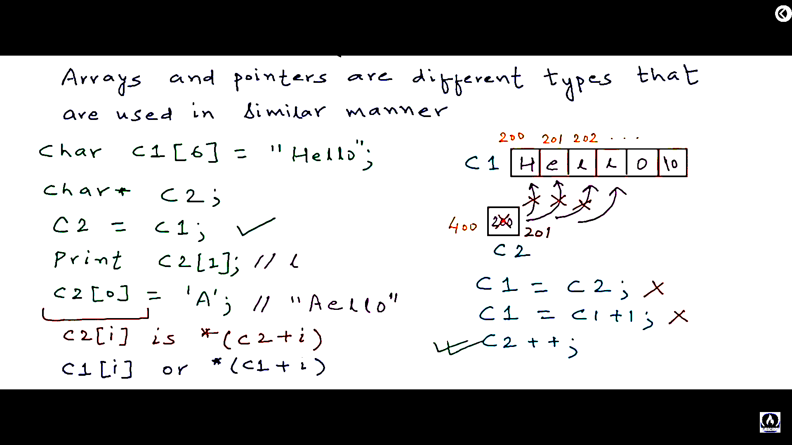

\- Một con trỏ kí tự có thể xem như một biến xâu kí tự, **trong đó xâu chính là tất cả các kí tự kể từ byte con trỏ trỏ đến cho đến byte '\0' gặp đầu tiên.**

\- Các hàm trên xâu vẫn được sử dụng như khi ta khai báo nó dưới dạng mảng kí tự.

\- Ngoài ra khác với mảng kí tự, ta được phép sử dụng phép gán cho 2 xâu dưới dạng con trỏ.

```cpp
char* s, * t = "Tin học"; s = t; // thay cho hàm strcpy(s, t);
```

Thực chất phép gán trên chỉ là gán 2 con trỏ với nhau, nó cho phép s bây giờ cũng được trỏ đến nơi mà t trỏ (tức dãy kí tự "Tin học" đã bố trí sẵn trong bộ nhớ)

\- Khi khai báo xâu dạng con trỏ nó vẫn chưa có bộ nhớ cụ thể, vì vậy thông thường kèm theo khai báo ta cần phải xin cấp phát bộ nhớ cho xâu với độ dài cần thiết

```cpp
char* s = new char[30], * t;

strcpy(s, "Hello");

t = s;
```

*🡪 trong trường hợp này không cần cấp phát bộ nhớ cho t vì t và s cùng sử dụng chung vùng nhớ*

nhưng:

```cpp
char* s = new char[30], * t;

strcpy(s, "Hello");

t = new char[30];

strcpy(t, s);
```

*🡪 trong trường hợp này phải cấp bộ nhớ cho t vì có chỗ để strcpy sao chép sang nội dung của s.*

\*\*\* Tuy nhiên, khi ta lưu chuỗi theo cách này, chuỗi sẽ được lưu dưới dạng ***hằng chuỗi,*** nghĩa là ta không thể thay đổi các ký tự trong chuỗi. Do đó 1 số IDE sẽ báo lỗi nếu ta không thêm từ khóa const khi khai báo con trỏ:

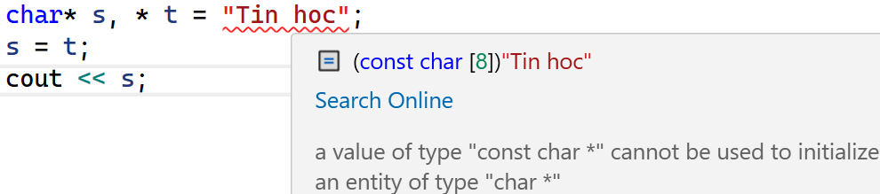

**🡪 Sửa lỗi:**

```cpp
#include <iostream>

using namespace std;

int main()

{
```

const char\* s, \* t = "Tin hoc";

```cpp
s = t;

cout << s;

return 0;

}
```

***Kết quả:*** Tin hoc

\*\*\* Dù vậy, khi khai báo con trỏ ký tự mà chưa gán chuỗi ký tự nào, chương trình vẫn hoạt động bình thường.

**<u>Ví dụ 1:</u>**

```cpp
#include <iostream>

using namespace std;

int main()

{
```

const char \* p = "Nam 2015", \* q;

```cpp
q = p;

char* s, * t;

cout << "Chuoi q la: " << q << endl;

s = new char[33];

t = s;

cout << "Nhap vao chuoi S:\n";

cin.getline(s, 33);

cout << "Chuoi t la: " << t;

}
```

***Kết quả:***

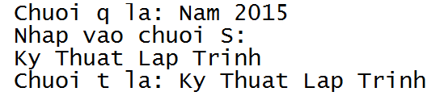

**<u>Ví dụ 2:</u>** dùng con trỏ để sao chép chuỗi

```cpp
#include <iostream>

#include <cstring>

using namespace std;

int main()

{
```

const char\* s = "Ky Thuat Lap Trinh";

```cpp
char *t = new char[33]; //Cấp phát bộ nhớ động cho t

//strncpy(t, s, 8); //Copy nội dung 8 kí tự đầu của s sang t

for (int i = 0; i < 8; i++)
```

\*(t + i) = \*(s + i);

<span class="mark">\*(t + 8) = '\0';</span>

```cpp
cout << t;

}
```

***Kết quả:*** Ky Thuat

### 4.4.2. Mảng con trỏ

\- Là mảng trong đó các phần tử của nó là một con trỏ trỏ đến một mảng nào đó. Nói cách khác một mảng con trỏ cho phép *quản lý nhiều mảng dữ liệu **cùng kiểu.***

\- Cách khai báo:

**<span class="mark">Kiểu \*a\[size\];</span>**

**<u>Ví dụ 1:</u>**

```cpp
int* a[10];

/* khai báo một mảng chứa 10 con trỏ. Mỗi con trỏ a[i] chứa địa chỉ của một mảng nguyên nào đó. */
```

**<u>Ví dụ 2:</u>**

```cpp
#include <iostream>

using namespace std;

int main() {

int a[4] = { 1,2,3,4 }, b[4] = { 4,5,6 }, c[4] = { 9,8,7,3 }, i, j;

int* p[3] = { a, b, c }; // mảng p là các con trỏ trỏ đến a, b, c

for (i = 0; i < 3; i++) {

for (j = 0; j < 4; p[i]++, j++)

cout << *p[i] << " ";

cout << endl;

}

return 0;

}
```

***Kết quả:***

1 2 3 4

4 5 6 0

9 8 7 3

*Do mảng b khai báo 4 phần tử, nhưng chỉ khởi tạo giá trị cho 3 phần tử đầu, nên phần tử cuối mặc định là 0. (Xem lại phần mảng).*

**<u>Ví dụ 3:</u>**

```cpp
#include <iostream>

using namespace std;
```

const int MAX = 3;

```cpp
int main() {

int var[MAX] = { 10, 100, 200 };

int* ptr[MAX];

for (int i = 0; i < MAX; i++) {
```

ptr\[i\] = &var\[i\]; // assign the address of integer.

}

```cpp
for (int i = 0; i < MAX; i++) {

cout << "Value of var[" << i << "] = ";

cout << *ptr[i] << endl;

}

return 0;

}
```

***Kết quả:***

Value of var\[0\] = 10

Value of var\[1\] = 100

Value of var\[2\] = 200

\- Ta cũng có thể sử dụng một mảng con trỏ tới ký tự để lưu trữ danh sách các chuỗi như sau:

**<u>Ví dụ 4:</u>**

```cpp
#include <iostream>

using namespace std;
```

const int MAX = 4;

```cpp
int main() {
```

const char\* names\[MAX\] = { "Zara Ali", "Hina Ali", "Nuha Ali", "Sara Ali" };

```cpp
for (int i = 0; i < MAX; i++) {

cout << "Address of names[" << i << "] = ";

cout << (names + i) << endl;

}

cout << "==============================================\n";

for (int i = 0; i < MAX; i++) {

cout << "Value of names[" << i << "] = ";

cout << *(names + i) << endl;

}

return 0;

}
```

***Kết quả:***

Address of names\[0\] = 00000064AE4FF908

Address of names\[1\] = 00000064AE4FF910

Address of names\[2\] = 00000064AE4FF918

Address of names\[3\] = 00000064AE4FF920

==============================================

Value of names\[0\] = Zara Ali

Value of names\[1\] = Hina Ali

Value of names\[2\] = Nuha Ali

Value of names\[3\] = Sara Ali

### 4.4.3. Hàm và con trỏ

\- Ngoài 2 kiểu tham số của hàm:

- Hàm có tham số nhận giá trị: giá trị truyền vào hàm có thể là giá trị của biến, một hằng số hoặc một biểu thức toán học...

- Hàm có tham số kiểu tham chiếu: giá trị truyền vào cho hàm là tên biến, và tham số của hàm sẽ tham chiếu trực tiếp đến vùng nhớ của biến đó.

\- Chúng ta còn có thêm một kiểu truyền dữ liệu vào cho hàm nữa, đó là truyền địa chỉ vào hàm (**Pass arguments by address**). Do đó, kiểu tham số của hàm có thể nhận giá trị là địa chỉ phải là con trỏ.

**<u>Ví dụ 1:</u>**

```cpp
#include <iostream>

using namespace std;

void foo(int* iPtr)

{

cout << "Int value at " << iPtr << " is " << *iPtr << endl;

}

int main()

{

int iValue = 10;

foo(&iValue);

system("pause");

return 0;

}
```

Trong đoạn chương trình trên, sau khi truyền địa chỉ của biến iValue vào hàm foo, tham số iPtr bây giờ sẽ giữ địa chỉ của biến iValue, và chúng ta có thể sử dụng toán tử dereference cho con trỏ iPtr.

***Kết quả:***

**Int value at 000000994553F854 is 10**

\- Nếu vùng nhớ tại địa chỉ được sử dụng làm đối số cho hàm không phải là hằng, chúng ta có thể thay đổi giá trị của vùng nhớ đó ngay bên trong hàm thông qua toán tử **dereference**:

**<u>Ví dụ 2:</u>**

```cpp
#include <iostream>

using namespace std;

void changeValue(int* iPtr)

{
```

\*iPtr = 10;

}

```cpp
int main()

{

int iValue = 5;

cout << "Value = " << iValue << endl;

changeValue(&iValue);

cout << "Value = " << iValue << endl;

system("pause");

return 0;

}
```

***Kết quả:***

Value = 5

Value = 10

\- Như vậy, chúng ta có thể hoán vị giá trị của 2 số nguyên thông qua hàm như sau:

**<u>Ví dụ 3:</u>** Hàm hoán vị

```cpp
#include <iostream>

using namespace std;

void swapIntValue(int* x, int* y)

{

int temp = *x;
```

\*x = \*y;

\*y = temp;

}

```cpp
int main()

{

int a = 5;

int b = 6;

cout << "Before swap: " << a << " " << b << endl;

swapIntValue(&a, &b);

cout << "After swap : " << a << " " << b << endl;

system("pause");

return 0;

}
```

***Kết quả:***

**Before swap: 5 6**

**After swap : 6 5**

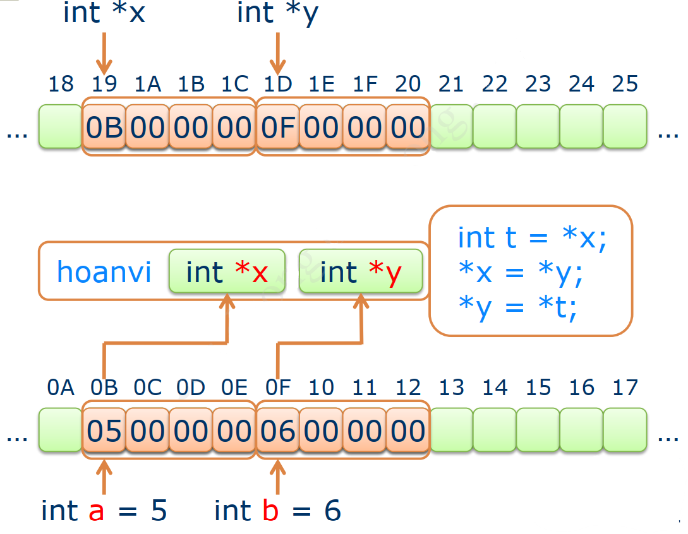

🡪 *Con trỏ khi làm tham số cho hàm cũng có khả năng thay đổi giá trị của vùng nhớ không phải hằng như* *con trỏ thông thường thông qua toán tử **dereference**.*

\- Chúng ta còn có thể truyền địa chỉ của mảng một chiều vào cho tham số kiểu con trỏ của hàm.

**<u>Ví dụ 4:</u>**

```cpp
#include <iostream>

using namespace std;

void printArray(int* arr, int length)

{

for (int i = 0; i < length; i++)

{

cout << arr[i] << " ";

}

cout << endl;

}

int main()

{

int iArr[] = { 3, 2, 5, 1, 7, 10, 32 };

printArray(iArr, sizeof(iArr) / sizeof(int));

system("pause");

return 0;

}
```

***Kết quả:*** 3 2 5 1 7 10 32

\- Lưu ý, chúng ta không thể biết chính xác kích thước của mảng một chiều thông qua con trỏ, do đó, chúng ta cần tính toán trước kích thước của mảng trước khi truyền vào cho hàm.

**<u>Ví dụ 5:</u>**

```cpp
#include <iostream>

using namespace std;

void printSize(int* array)

{

// tham số array là con trỏ int*

cout << sizeof(array) << '\n';

// kích thước con trỏ int*, không phải kích thước mảng

}

int main()

{

int array[] = { 5, 8, 2, 7 };

cout << sizeof(array) << '\n'; // kích thước mảng: sizeof(int) * array length
```

printSize(array); // đối số array được chuyển thành con trỏ int\* tại đây

```cpp
system("pause");

return 0;

}
```

***Kết quả:***

16

8

***Chú ý: **Để tránh nhầm lẫn về việc đang thao tác với mảng hay con trỏ, ưu tiên sử dụng cú pháp con trỏ (\*) cho tham số hàm là mảng.*

Lưu ý rằng điều này xảy ra ngay cả khi tham số được khai báo là một mảng cố định:

```cpp
void printSize(int a[100]);

void printSize(int a[]);
```

\- *Mảng được chuyển đổi ngầm định thành con trỏ khi được chuyển đến một hàm. Đó là lý do tại sao thay đổi mảng trong hàm sẽ thay đổi mảng thực tế được truyền vào.*

**<u>Ví dụ 6:</u>**

```cpp
#include <iostream>

using namespace std;

// tham số ptr đang chứa địa chỉ mảng array

void changeArray(int* ptr)

{

// thay đổi mảng bên trong hàm đồng nghĩa mảng bên ngoài cũng thay đổi
```

\*ptr = 1;

```cpp
ptr[1] = 3;

}

int main()

{

int array[] = { 5, 8, 2, 7 };

cout << "Before" << '\n';

cout << "array[0]: " << array[0] << '\n';

cout << "array[1]: " << array[1] << '\n';

cout << "array[2]: " << array[2] << '\n';

cout << "array[3]: " << array[3] << '\n';

cout << "==================================\n";

changeArray(array);

cout << "After" << '\n';

cout << "array[0]: " << array[0] << '\n';

cout << "array[1]: " << array[1] << '\n';

cout << "array[2]: " << array[2] << '\n';

cout << "array[3]: " << array[3] << '\n';

system("pause");

return 0;

}
```

***Kết quả:***

Before

array\[0\]: 5

array\[1\]: 8

array\[2\]: 2

array\[3\]: 7

==================================

After

array\[0\]: 1

array\[1\]: 3

array\[2\]: 2

array\[3\]: 7

Khi hàm **changeArray() **được gọi, mảng chuyển đổi ngầm thành một con trỏ, và **giá trị của con trỏ đó (địa chỉ phần tử đầu tiên của mảng) **được sao chép vào tham số **ptr** của hàm **changeArray()**.

Mặc dù giá trị trong **ptr** là một bản sao địa chỉ của mảng, nhưng **ptr** vẫn trỏ vào mảng thực tế (không phải là bản sao). Do đó, mọi thao tác thay đổi trên vùng nhớ mà con trỏ trỏ đến, sẽ làm thay đổi mảng bên ngoài.

**- Sử dụng Pointer to const để làm tham số cho hàm**

\+ **Pointer to const** là loại con trỏ chỉ có chức năng để đọc (read-only). Do đó, sử dụng **Pointer to const** làm tham số cho hàm sẽ đảm bảo rằng giá trị tại vùng nhớ được truyền vào cho hàm sẽ không bị thay đổi.

**<u>Ví dụ 7:</u>**

```cpp
#include <iostream>

using namespace std;

void printArray(const int* arr, int length)

{

for (int i = 0; i < length; i++)

{

cout << arr[i] << " ";

}

cout << endl;

}

int main()

{

int arr[] = {1,2,3,4,5};

int length = sizeof(arr) / sizeof(int);

printArray(arr, length);

system("pause");

return 0;

}
```

***Kết quả:*** 1 2 3 4 5

Lúc này, chúng ta có thể đảm bảo rằng giá trị của các phần tử trong mảng arr sẽ không bị thay đổi bởi hàm printArray.

**- Tham số của hàm là tham chiếu vào con trỏ**

\+ Khi chúng ta truyền đối số cho hàm là một địa chỉ, địa chỉ này cũng chỉ là bản copy của địa chỉ ban đầu. Về bản chất, truyền địa chỉ vào hàm là truyền đối số là giá trị (**pass by value**). Địa chỉ của đối số sẽ được copy và gán lại cho tham số con trỏ của hàm. Nếu bên trong hàm có câu lệnh thay đổi địa chỉ được truyền vào, chúng chỉ thay đổi bản sao của địa chỉ gốc.

**<u>Ví dụ 8:</u>**

```cpp
#include <iostream>

using namespace std;

void setToNull(int* ptr)

{
```

ptr = nullptr; // (4)

} // (5)

```cpp
int main()

{

int value = 5;

int* pValue = &value; // (1)

cout << "pValue point to " << pValue << endl; // (2)

setToNull(pValue); // (3)

cout << "pValue point to " << pValue << endl; // (6)

system("pause");

return 0;

}
```

***Kết quả:***

pValue point to 00000034815AFA64

pValue point to 00000034815AFA64

\+ Có 6 bước để nói về đoạn chương trình trên:

\(1\) Gán địa chỉ của biến value cho con trỏ pValue.

\(2\) In ra địa chỉ mà con trỏ pValue đang nắm giữ.

\(3\) Truyền giá trị của con trỏ đang nắm giữ cho hàm setToNull

\(4\) Sau khi con trỏ ptr trong hàm setToNull nhận được giá trị đầu vào, con trỏ ptr này được gán lại giá trị NULL.

\(5\) Ra khỏi phạm vi của hàm setToNull, con trỏ ptr bị hủy.

\(6\) In ra lại giá trị của con trỏ pValue. Lúc này, chúng ta có thể thấy giá trị của pValue không hề thay đổi, nó vẫn còn trỏ đến địa chỉ của biến value.

\+ Như vậy, giá trị địa chỉ được truyền vào hàm được nắm giữ bởi tham số con trỏ của hàm, từ đó chúng ta có thể sử dụng toán tử **dereference** để thao tác với vùng nhớ tại địa chỉ đó. Chúng ta cũng có thể cho tham số của hàm trỏ đến địa chỉ khác, nhưng không ảnh hưởng gì đến con trỏ gốc.

[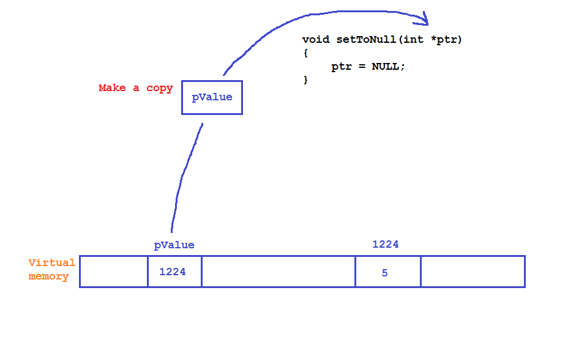](https://github.com/nguyenchiemminhvu/CPP-Tutorial/blob/master/8-con-tro/8-8-con-tro-va-ham/0.png?raw=true)

\+ Trong một số trường hợp cụ thể, chúng ta muốn thay đổi địa chỉ của con trỏ đối số đang trỏ đến, chúng ta có thể sử dụng tham chiếu cho con trỏ đối số. Xét đoạn chương trình bên dưới:

**<u>Ví dụ 9:</u>**

```cpp
#include <iostream>

using namespace std;

void setToNull(int*& ptr)

{

ptr = nullptr;

}

int main()

{

int value = 5;

int* pValue = &value;

cout << "pValue point to " << pValue << endl;

setToNull(pValue);

if (pValue == nullptr)

cout << "pValue point to NULL" << endl;

else

cout << "pValue point to " << pValue << endl;

return 0;

}
```

***Kết quả:***

pValue point to 000000909ECFF7C4

pValue point to NULL

Kết quả của đoạn chương trình này cho thấy con trỏ pValue sau khi truyền vào hàm setToNull đã được gán giá trị NULL. Do tham số con trỏ của hàm setToNull là một tham chiếu kiểu (int \*), nó sẽ tham chiếu đến đối số được truyền vào, trong trường hợp này, tham số tham chiếu con trỏ ptr có cùng địa chỉ với pValue, việc thay đổi giá trị mà ptr nắm giữ cũng làm thay đổi giá trị của pValue.

**- Con trỏ và kiểu trả về của hàm:** kiểu giá trị trả về của hàm là địa chỉ (**return by address**).

\+ Khi nói về việc trả về địa chỉ từ hàm, chúng ta hiểu rằng đó là địa chỉ của những biến hoạt động bên trong hàm. Địa chỉ này sẽ được trả về cho lời gọi hàm, và địa chỉ này thường được tiếp tục sử dụng bằng cách gán nó lại cho 1 con trỏ. Do đó, *kiểu trả về của hàm cũng phải là kiểu con trỏ.*

**<u>Ví dụ 10:</u>**

```cpp
#include <iostream>

using namespace std;

int* createAnInteger(int value = 0)

{

int myInt = value;

return &myInt;

}

int main()

{

int* pInt = createAnInteger(10);

cout << *pInt << endl;

return 0;

}
```

\+ Sau khi nhìn vào kết quả, chúng ta thấy có vẻ chương trình đã cho ra kết quả như mong muốn:

> 10

\+ Nhưng thực chất, đoạn chương trình trên đã gây ra lỗi nghiêm trọng. Lý do là biến myInt được khai báo bên trong hàm là biến cục bộ, được cấp phát bằng kỹ thuật **Automatic memory allocation**, và vùng nhớ được cấp phát cho biến myInt được lưu trữ trên phân vùng **Stack** của bộ nhớ ảo.

\+ Do đó, ngay sau khi ra khỏi hàm, vùng nhớ của biến myInt đã bị hệ điều hành thu hồi, nhưng địa chỉ của biến myInt trước đó đã được trả về cho lời gọi hàm, nên con trỏ pInt trong hàm main được gán một địa chỉ của một vùng nhớ không thuộc quyền quản lý của chương trình hiện hành nữa.

\+ Nếu không may, một chương trình khác yêu cầu cấp phát vùng nhớ ngay tại địa chỉ của biến myInt lúc chưa bị hủy, nội dung bên trong vùng nhớ này sẽ bị các chương trình khác thay đổi, dẫn đến việc sử dụng toán tử **dereference** đến vùng nhớ đó không cho ra kết quả như ban đầu nữa.

**<u>Ví dụ 11:</u>**

```cpp
int * createAnInteger(int value = 0)

{

int myInt = value;

return &myInt;

}

int main()

{

int *pInt = createAnInteger(10);

cout << "Print value immediately: " << *pInt << endl;

_sleep(1000);

cout << "After a fews seconds: " << *pInt << endl;

system("pause");

return 0;

}
```

***Kết quả:***

[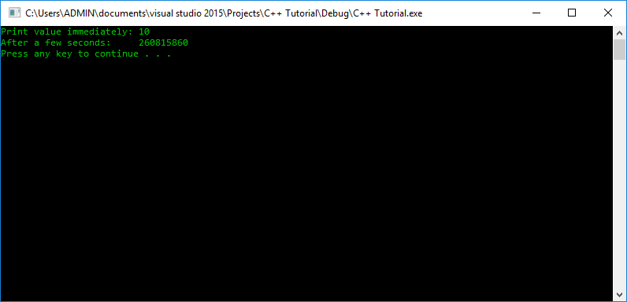](https://github.com/nguyenchiemminhvu/CPP-Tutorial/blob/master/8-con-tro/8-8-con-tro-va-ham/1.png?raw=true "1.png?raw=true")

\+ Chỉ sau thời điểm vùng nhớ của biến myInt bị hủy mới có 1 giây mà đã có chương trình khác sử dụng vùng nhớ đó, làm cho giá trị in ra màn hình console không còn như ban đầu nữa. Và nếu không may hơn nữa, nếu chương trình khác sử dụng cơ chế đồng bộ của kỹ thuật multithreading lên vùng nhớ này, việc dereference vào vùng nhớ đó cũng có thể gây crash chương trình.

\+ Nguyên nhân của những hệ quả đều là do vùng nhớ được cấp phát trên Stack thông qua kỹ thuật **Automatic memory allocation** sẽ bị thu hồi tự động bởi hệ điều hành. Để giải quyết vấn đề này, chúng ta cần sử dụng phân vùng Heap để có thể tự quản lý thời điểm giải phóng vùng nhớ để trả lại cho hệ điều hành quản lý.

```cpp
int * createAnInteger(int value = 0)

{

return new int(value);

}

int main()

{

int *pInt = createAnInteger(10);

cout << "Print immediately: " << *pInt << endl;

_sleep(5000);

cout << "After a few seconds: " << *pInt << endl;

system("pause");

return 0;

}
```

Kết quả lúc này đã được đảm bảo do chúng ta biết rằng vùng nhớ cấp phát trên Heap chỉ bị hệ điều hành thu hồi khi toàn bộ chương trình kết thúc.

### 4.4.4. Hàm con trỏ

\- Hàm **main** (hay bất kỳ hàm nào khác trong chương trình) có một địa chỉ xác định trên bộ nhớ ảo. Do đó, chúng ta có thể sử dụng con trỏ để trỏ đến địa chỉ của hàm **main**.

\- Tuy nhiên, chúng ta cần lưu ý đến kiểu dữ liệu khai báo cho con trỏ phải tương thích với kiểu dữ liệu của vùng nhớ. Ví dụ, con trỏ kiểu **int** dùng để trỏ đến vùng nhớ kiểu **int**, con trỏ trỏ đến hằng (**Pointer to const**) dùng để trỏ đến vùng nhớ hằng...

\- Và để trỏ đến địa chỉ của một hàm, chúng ta cần sử dụng con trỏ hàm (**Function pointer** hoặc có thể gọi là **Pointer to function**).

```cpp
int foo() *// code of foo start at memory address 0x01001492*

{

return 0;

}

int main()

{

int n = foo();

return 0;

}
```

\- Khi nhìn vào một hàm, chúng ta có thể nói hàm này có định danh là **foo**, kiểu trả về là int, hàm foo không nhận đối số. Đó là những gì chúng ta thấy được trong quá trình biên soạn mã nguồn chương trình. Thuộc tính địa chỉ của hàm chỉ được sinh ra khi chương trình đã được chạy.

\- Khi trong hàm **main** chạy đến dòng lệnh gọi hàm **foo**, hệ điều hành sẽ tìm đến địa chỉ của hàm **foo** trên bộ nhớ ảo và chuyển mã lệnh của hàm **foo** cho CPU tiếp tục xử lý. Để in ra địa chỉ của hàm **foo**, chúng ta có thể làm như sau:

```cpp
#include <iostream>

using namespace std;

int foo()

{

return 0;

}

int main()

{

cout << foo << endl;

return 0;

}
```

***Kết quả:***

00007FF65A4913ED

\- Khi muốn thực thi một hàm, chúng ta cần thêm cặp dấu ngoặc để truyền đối số vào cho hàm (nếu hàm không có tham số thì để trống). Nếu chúng ta không sử dụng cặp dấu ngoặc, sử dụng tên hàm trả về địa chỉ của hàm trên bộ nhớ ảo. Và địa chỉ này có thể được gán con một con trỏ có kiểu dữ liệu tương ứng (**function pointer**).

\- **Cú pháp** của một con trỏ hàm có nhiều điểm khác biệt so với cách khai báo con trỏ thông thường.

**\<return_type\> (\*\<name_of_pointer\>)( \<data_type_of_parameters\> );**

\+ Ví dụ, để trỏ đến hàm foo trong ví dụ trên, chúng ta cần khai báo con trỏ hàm như sau:

int (\*pFoo) ()*;*

Trong đó, **int** là kiểu trả về của hàm **foo**, **pFoo** là tên của con trỏ, và hàm **foo** không có tham số nên phần trong ngoặc bỏ trống.

\+ Một ví dụ khác:

```cpp
void swapValue(int &value1, int &value2)

{

int temp = value1;

value1 = value2;

value2 = temp;

}
```

Hàm **swapValue** có không có kiểu trả về, và nó nhận vào 2 tham số đều có kiểu tham chiếu **int**. Như vậy, có thể khai báo một con trỏ hàm dùng để trỏ đến hàm **swapValue** như sau:

void(\*pSwap) (int &, int &)*;*

**- Gán địa chỉ của hàm cho Function pointers**

\+ Sau khi đã có được con trỏ hàm được khai báo tương ứng với hàm, chúng ta có thể gán địa chỉ của hàm cho chúng:

```cpp
void swapValue(int &value1, int &value2)

{

int temp = value1;

value1 = value2;

value2 = temp;

}

int main()

{
```

**void**(\*pSwap) (**int** &, **int** &) = swapValue;

```cpp
cout << pSwap << endl;

cout << swapValue << endl;

return 0;

}
```

**Lưu ý, khi cần lấy địa chỉ của hàm, chúng ta chỉ sử dụng duy nhất tên hàm, không đặt thêm cặp dấu ngoặc vào.**

\+ Chỉ có con trỏ được khai báo có kiểu dữ liệu trả về và danh sách tham số phù hợp mới trỏ đến hàm được.

*// function prototypes*

```cpp
int foo();

double goo();

int hoo(int x);
```

*// function pointer assignments*

**int** (\*funcPtr1)() = foo; *// okay*

**int** (\*funcPtr2)() = goo; *// wrong -- return types don't match!*

**double** (\*funcPtr4)() = goo; *// okay*

funcPtr1 = hoo; *// wrong -- fcnPtr1 has no parameters, but hoo() does*

**int** (\*funcPtr3)(**int**) = hoo; *// okay*

**- Sử dụng Function pointers**

\+ Sau khi đã nắm giữ được địa chỉ của hàm, con trỏ hàm có thể được sử dụng như hàm thông qua toán tử **dereference**.

**<u>Ví dụ:</u>**

```cpp
#include <iostream>

using namespace std;

void swapValue(int& value1, int& value2)

{

int temp = value1;

value1 = value2;

value2 = temp;

}

int main()

{
```

void(\*pSwap) (int&, int&) = swapValue;

```cpp
int a = 1, b = 5;

cout << "Before: " << a << " " << b << endl;
```

(\*pSwap)(a, b);

```cpp
cout << "After: " << a << " " << b << endl;

return 0;

}
```

***Kết quả:***

Before: 1 5

After: 5 1

Lưu ý, tham số mặc định của hàm không áp dụng được cho con trỏ hàm, vì tham số mặc định được **compiler** xác định tại thời điểm **compile** chương trình, còn con trỏ hàm được sử dụng tại thời điểm chương trình đang chạy.

**- Sử dụng con trỏ hàm làm tham số**

\+ Một con trỏ hàm cũng là một biến con trỏ, do đó chúng ta có thể sử dụng con trỏ hàm là tham số của một hàm nào đó. Khi tham số của hàm là con trỏ hàm, chúng ta sẽ truyền đối số là địa chỉ của một hàm. Hàm được sử dụng làm đối số của hàm có thể gọi là **callback function**.

\+ Ví dụ về hàm **selectionSort** dùng để sắp xếp dữ liệu trong ***mảng số nguyên theo thứ tự tăng dần:***

```cpp
#include <iostream>

#include \ // use for std::swap

using namespace std;

void selectionSort(int* arr, int length)

{

for (int i_start = 0; i_start < length; i_start++)

{

int minIndex = i_start;

for (int i_current = i_start + 1; i_current < length; i_current++)

{

if (arr[minIndex] > arr[i_current])

{

minIndex = i_current;

}

}

swap(arr[i_start], arr[minIndex]); // std::swap

}

}

void printArray(const int* arr, int length) // Sử dụng lại hàm của phần trên

{

for (int i = 0; i < length; i++)

{

cout << arr[i] << " ";

}

cout << endl;

}

int main()

{

int arr[] = { 1, 4, 2, 3, 6, 5, 8, 9, 7 };

int length = sizeof(arr) / sizeof(int);

cout << "Before sorted: ";

printArray(arr, length);

selectionSort(arr, length);

cout << "After sorted: ";

printArray(arr, length);

return 0;

}
```

***Kết quả:***

Before sorted: 1 4 2 3 6 5 8 9 7

After sorted: 1 2 3 4 5 6 7 8 9

\+ Bây giờ đặt ra trường hợp chúng ta muốn có sắp xếp mảng một chiều sử dụng thuật toán **selectionSort** nhưng sắp xếp theo thứ tự giảm dần. Như vậy, chúng ta cần đến 2 hàm **selectionSort** để đáp ứng cho 2 trường hợp trên. Trong khi cả 2 hàm **selectionSort** này chỉ khác nhau về toán tử so sánh tại phép so sánh ở mệnh đề if trong vòng lặp.

\+ Để giải quyết vấn đề này, đầu tiên cần có 2 hàm thực hiện công việc so sánh như sau:

```cpp
bool ascending(int left, int right)

{

return left > right;

}

bool descending(int left, int right)

{

return left < right;

}
```

Hai hàm này chỉ có tác dụng thay thế phép so sánh trong mệnh đề if. Nếu chúng ta cần sắp xếp giá trị trong mảng theo thứ tự tăng dần, chúng ta sẽ thay thế hàm **ascending** vào mệnh đề if trong hàm **selectionSort** như sau:

```cpp
void selectionSort(int *arr, int length)

{

for (int i_start = 0; i_start < length; i_start++)

{

int minIndex = i_start;

for (int i_current = i_start + 1; i_current < length; i_current++)

{

if (ascending(arr[minIndex], arr[i_current])) *// replace comparison expression by ascending function*

{

minIndex = i_current;

}

}

swap(arr[i_start], arr[minIndex]); *// std::swap*

}

}
```

\+ Lúc này, chúng ta vẫn còn cần thêm một hàm **selectionSort** khác và thay thế biểu thức so sánh trong mệnh đề if bằng hàm **descending** để có thể sắp xếp mảng theo chiều giảm dần.

\+ Chúng ta cần thiết kế lại hàm **selectionSort** này sao cho người dùng có thể tùy chọn việc sắp xếp theo thứ tự tăng dần hay giảm dần theo từng thời điểm khác nhau.

\+ Chúng ta sẽ thêm vào tham số thứ 3 cho hàm **selectionSort** là một con trỏ hàm dùng để trỏ đến hàm **ascending** hoặc **descending** tùy vào lời gọi hàm **selectionSort**. Do hàm **ascending** và **descending** có cấu trúc kiểu trả về và tham số hoàn toàn giống nhau, nên chúng ta có thể sử dụng chung một kiểu con trỏ hàm.

\+ Định nghĩa con trỏ hàm dùng làm tham số thứ 3 của hàm **selectionSort** như sau:

bool (\*comparisonFunc)(int, int)*;*

\+ Bây giờ, chúng ta sẽ sửa lại hàm **selectionSort** thành phiên bản sử dụng con trỏ hàm:

```cpp
bool ascending(int left, int right)

{

return left > right;

}

bool descending(int left, int right)

{

return left < right;

}
```

**\**

```cpp
void selectionSort(int *arr, int length, bool (*comparisonFunc)(int, int))

{

for (int i_start = 0; i_start < length; i_start++)

{

int minIndex = i_start;

for (int i_current = i_start + 1; i_current < length; i_current++)

{

if (comparisonFunc(arr[minIndex], arr[i_current])) *// use function pointer as ascending or descending function*

{

minIndex = i_current;

}

}

swap(arr[i_start], arr[minIndex]); *// std::swap*

}

}
```

\+ Lúc này, giả sử muốn sắp xếp mảng theo thứ tự giảm dần, ta sẽ sử dụng lời gọi hàm như sau:

```cpp
int main()

{

int arr[] = { 1, 4, 2, 3, 6, 5, 8, 9, 7 };

int length = sizeof(arr) / sizeof(int);

cout << "Before sorted: ";

printArray(arr, length);

selectionSort(arr, length, descending);

cout << "After sorted: ";

printArray(arr, length);

return 0;

}
```

\+ Sử dụng địa chỉ của hàm **descending** làm đối số cho tham số thứ 3 của hàm **selectionSort**. Như vậy, hàm **descending** sẽ được sử dụng bên trong hàm **selectionSort** và mảng của chúng ta sẽ sắp xếp theo thứ tự giảm dần.

Before sorted: 1 4 2 3 6 5 8 9 7

After sorted: 9 8 7 6 5 4 3 2 1

\+ Nếu muốn đổi ngược lại thứ tự của mảng khi sắp xếp, chúng ta chỉ cần thay đối số thứ 3 của hàm **selectionSort** là địa chỉ của hàm **ascending**:

```cpp
int main()

{

int arr[] = { 1, 4, 2, 3, 6, 5, 8, 9, 7 };

int length = sizeof(arr) / sizeof(int);

cout << "Before sorted: ";

printArray(arr, length);

selectionSort(arr, length, ascending);

cout << "After sorted: ";

printArray(arr, length);

return 0;

}
```

Với việc đặt thêm tham số thứ 3 của hàm **selectionSort** là 1 con trỏ hàm, chúng ta có thể thiết kế thêm nhiều tùy chọn cho điều kiện sắp xếp mảng một chiều khác nhau và vẫn có thể sử dụng cho hàm **selectionSort**.

\+ Ví dụ muốn thêm một kiểu sắp xếp có điều kiện khác là mọi số chẵn trong mảng sẽ đứng trước, các số lẻ trong mảng sẽ đứng sau, và phần chẵn hay phần lẻ đều được sắp xếp tăng dần, ta sẽ làm như sau:

```cpp
bool evensFirst(int left, int right)

{

//if left is even and right is odd, not need to swap

if ((left % 2 == 0) && (right % 2 != 0))

return false;

//if left is odd and right is even, swap this couple

if ((left % 2 != 0) && (right % 2 == 0))

return true;

return ascending(left, right);

}
```

Và chỉ cần sử dụng địa chỉ của hàm này làm đối số:

```cpp
int main()

{

int arr[] = { 1, 4, 2, 3, 6, 5, 8, 9, 7 };

int length = sizeof(arr) / sizeof(int);

cout << "Before sorted: ";

printArray(arr, length);

selectionSort(arr, length, evensFirst);

cout << "After sorted: ";

printArray(arr, length);

return 0;

}
```

***Kết quả:***

Before sorted: 1 4 2 3 6 5 8 9 7

After sorted: 2 4 6 8 1 3 5 7 9

🡪 Sử dụng con trỏ hàm trong trường hợp này mang lại cho chúng ta một cách sử dụng hàm sắp xếp hiệu quả hơn.

**- Tham số mặc định của tham số con trỏ hàm**

\+ Chúng ta có thể cung cấp cho tham số con trỏ hàm một địa chỉ hàm cụ thể, và hàm đó sẽ được gọi mặc định nếu chúng ta không cung cấp đối số cho tham số con trỏ hàm. Ví dụ:

```cpp
void selectionSort(int *arr, int length, bool (*comparisonFunc)(int, int) = ascending)

{

for (int i_start = 0; i_start < length; i_start++)

{

int minIndex = i_start;

for (int i_current = i_start + 1; i_current < length; i_current++)

{

if (comparisonFunc(arr[minIndex], arr[i_current])) *// use function pointer as ascending or descending function*

{

minIndex = i_current;

}

}

swap(arr[i_start], arr[minIndex]); *// std::swap*

}

}
```

Như vậy, lời gọi hàm **selectionSort** với 2 đối số sẽ được mặc định là sắp xếp mảng tăng dần.

**- std::function in C++11**

\+ Chuẩn C++11 cung cấp cho chúng ta một cách thay thế cho việc sử dụng con trỏ hàm bằng cách sử dụng kiểu dữ liệu **function** thuộc thư viện **functional**. Thư viện này cũng được định nghĩa trong namespace **std** nên chúng ta cần có dòng lệnh using namespace std; hoặc có thể khai báo là std::function.

\+ Cú pháp khai báo biến kiểu std::function như sau:

```cpp
std::function([list of parameters]) > varName;
```

**<u>Ví dụ 1:</u>**

```cpp
std::function< bool(int, int) > comparisonFunc;
```

**<u>Ví dụ 2:</u>**

```cpp
#include <iostream>

#include <iostream>

using namespace std;

void addOne(int &value)

{
```

value++;

}

```cpp
int main()

{
```

function\<**void**(**int** &)\> func = addOne;

```cpp
int number = 5;

func(number);

cout << "New value: " << number << endl;

return 0;

}
```

Sử dụng kiểu dữ liệu std::function cũng tương tự như sử dụng con trỏ hàm, chỉ khác nhau về cách khai báo.

## 4.5. Các vấn đề thường gặp khi sử dụng con trỏ

***- Con trỏ trỏ đến vùng nhớ nằm ngoài phạm vi chương trình đang quản lý.***

```cpp
#include <iostream>

using namespace std;

int main()

{

//allocate memory on Heap

int* p = new int;

//p point to somewhere

p -= 10000;

//dereference to the area of other program
```

\*p = 1;

```cpp
system("pause");

return 0;

}
```

\+ Đầu tiên, chương trình cấp phát một vùng nhớ có kích thước **4 bytes** trên phân vùng **Heap** và cho con trỏ nắm giữ địa chỉ trả về của toán tử **new**.

\+ Sau đó cho con trỏ p trỏ lung tung trên bộ nhớ ảo và cố tình thay đổi nội dung bên trong vùng nhớ mới trỏ đến. Khi để ở chế độ **Debug**, Visual Studio sẽ chặn chương trình của chúng ta lại và đưa ra cảnh báo.

\+ Nhưng nếu chúng ta chuyển sang chế độ **Release** và **build** ra sản phẩm thành một phần mềm, chạy phần mềm này sẽ gây **crash** và phần mềm phải kết thúc ngay lập tức.

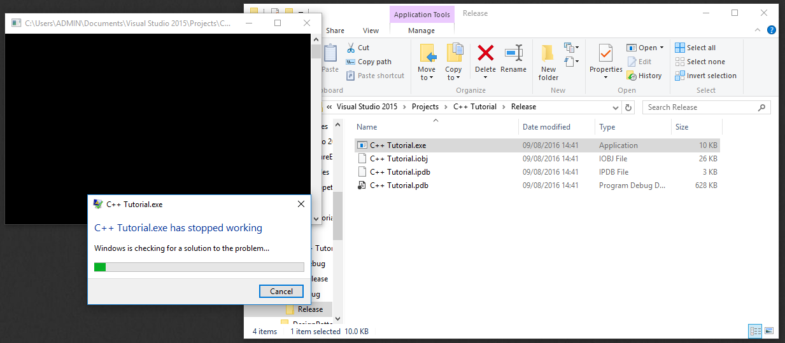

\+ Khi chương trình chúng ta viết bị **crash** khi chạy, có thể lỗi này đến từ việc gán địa chỉ không hợp lý.

*\*\*\* Trong thực tế, lỗi này sẽ xuất hiện dưới một hình thức khác. Ví dụ:*

```cpp
#include <iostream>

#include <iostream>

using namespace std;

int main()

{

int* p = new int[10];

cout << p << endl;
```

<span class="mark">delete\[\] p;</span>

```cpp
cout << p << endl;

Sleep(10000);

for (int i = 0; i < 10; i++)

cin >> p[i];

return 0;

}
```

\+ Chương trình này yêu cầu cấp phát 1 dãy địa chỉ có kích thước **40 bytes trên Heap**. Sau đó in ra địa chỉ của vùng nhớ vừa được cấp phát thành công.

\+ Tiếp theo, ta không muốn sử dụng vùng nhớ này nữa nên trả lại cho hệ điều hành thông qua toán tử **delete**.

\+ Trên thực tế, có thể ta sẽ không giải phóng vùng nhớ ngay lập tức mà sử dụng xong rồi mới giải phóng nó đi.

\+ Sau khi giải phóng vùng nhớ đó, in ra lại địa chỉ mà con trỏ p đang nắm giữ thì thấy p vẫn đang trỏ đến địa chỉ đã giải phóng. Vậy chúng ta đã gặp phải lỗi: con trỏ trỏ đến một vùng nhớ không chịu sử quản lý của chương trình.

\+ Lúc này, ta chưa **dereference** đến vùng nhớ đó ngay lập tức mà vẫn cho chương trình tiếp tục thực thi. Cuối cùng, do ta không nhớ rằng vùng nhớ ban đầu đã được giải phóng ở đâu đó nên vẫn tiếp tục sử dụng bằng cách nhập dữ liệu vào đó thông qua con trỏ p.

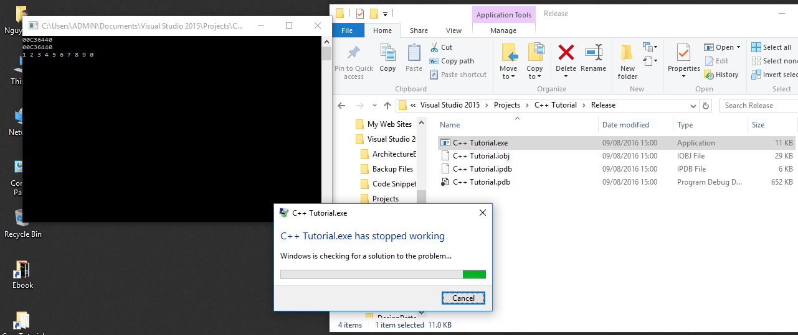

\+ Kết quả là phần mềm đang chạy thì bị **crash** vì có thể hệ điều hành đã cấp phát vùng nhớ đã được giải phóng cho phần mềm khác sử dụng.

\+ Khi chạy chương trình dưới chế độ Debug trong Visual Studio, lỗi này có thể không phát hiện được do nó vẫn chạy bình thường mà không có thông báo mà cũng không bị crash. Điều này làm chúng ta tưởng rằng chương trình hoạt động tốt, và **build** nó ra thành phần mềm lỗi.

*🡪 Để khắc phục trường hợp này, chúng ta nên cho con trỏ quản lý vùng nhớ được cấp phát trỏ về **NULL** ngay sau khi giải phóng vùng nhớ đó:*

```cpp
#include <iostream>

#include <iostream>

using namespace std;

int main()

{

int* p = NULL;

p = new int[10];

cout << p << endl;
```

delete\[\] p;

```cpp
p = NULL;

cout << p << endl;

Sleep(10000);

if (p != NULL) {

for (int i = 0; i < 10; i++)

cin >> p[i];

}

return 0;

}
```

\+ Bất cứ khi nào sử dụng vùng nhớ thông qua con trỏ, chúng ta cũng nên kiểm tra xem con trỏ có khác NULL hay không. Nếu con trỏ khác NULL thì chúng ta hiểu rằng vùng nhớ đó vẫn chưa được giải phóng.

*\*\*\* Nhưng lỗi này còn có thể xuất hiện dưới một hình thức khác nữa. Đó là sử dụng 2 con trỏ cùng trỏ đến một vùng nhớ trong chương trình.*

```cpp
#include <iostream>

#include <iostream>

#include <iostream>

using namespace std;

char* getName(char* fullname) {

if (fullname == NULL)

return NULL;

char* pTemp = strrchr(fullname, ' ');

if (pTemp == NULL)

return fullname;

else

return pTemp + 1;

}

int main() {

char* fullName = new char[50];

cout << "Enter your full name: ";

cin.getline(fullName, 50);

cout << "Your last name is: ";

char* name = getName(fullName);
```

delete\[\] fullName;

```cpp
Sleep(5000);

cout << name << endl;

return 0;

}
```

. Đoạn chương trình này thực hiện công việc yêu cầu người dùng nhập vào đầy đủ họ và tên, sau đó in ra tên mà người dùng vừa nhập vào (bỏ qua họ và tên đệm). Nhưng trước đó, cần yêu cầu cấp phát một vùng nhớ trên **Heap** đủ để người dùng nhập vào họ tên.

. Cách hoạt động của hàm getName như sau:

\(1\) Nhận vào đối số là địa chỉ của một địa chỉ của một chuỗi kí tự, trong trường hợp này là full name của người dùng.

\(2\) Sử dụng hàm **strrchr** trong thư viện **cstring** để trả về địa chỉ xuất hiện kí tự khoảng trắng cuối cùng trong chuỗi kí tự.

\(3\) Nếu không có kí tự khoảng trắng thì trả về địa chỉ đầu tiên của chuỗi kí tự (cho rằng người dùng chỉ nhập tên chứ không nhập họ và tên đệm), nếu có xuất hiện khoảng trắng thì trả về địa chỉ của phần tử đứng sau khoảng trắng.

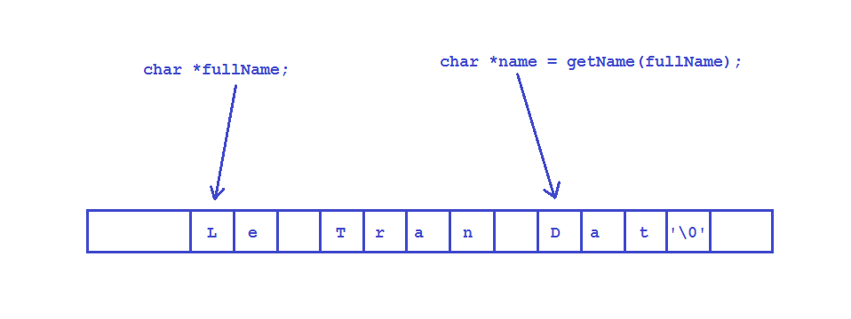

Như chúng ta thấy, địa chỉ của tên người dùng được trả về từ hàm **getName** cũng thuộc phạm vi vùng nhớ được cấp phát và đang được quản lý thông qua con trỏ **fullName**. Tuy nhiên, trong đoạn chương trình trên, lập trình viên này đã nghĩ rằng sau khi sử dụng xong hàm getName thì không cần sử dụng đến con trỏ **fullName** nữa, vậy là **delete** luôn vùng nhớ mà con trỏ **fullName** đang nắm giữ, dẫn đến việc con trỏ **name** đã trỏ tới một vùng nhớ không còn thuộc quyền quản lý của chương trình nữa. Và kết quả cho ra không đúng với mong đợi:

Enter your full name: Tran Van Hoang

Your last name is: ▌▌▌▌▌▌▌▌▌▌▌▌▌▌▌▌▌▌▌▌▌▌▌▌▌▌▌▌▌▌▌▌▌▌▌▌▌▌▌▌▌▌▌▌▌

Để khắc phục trường hợp này, chúng ta cần xác định rằng khi nào thực sự không còn sử dụng đến vùng nhớ nào đó thì mới giải phóng. Sửa lại đoạn chương trình trên như sau:

```cpp
#include <iostream>

#include <iostream>

#include <iostream>

using namespace std;

char* getName(char* fullname) {

if (fullname == NULL)

return NULL;

char* pTemp = strrchr(fullname, ' ');

if (pTemp == NULL)

return fullname;

else

return pTemp + 1;

}

int main() {

char* fullName = new char[50];

cout << "Enter your full name: ";

cin.getline(fullName, 50);

cout << "Your last name is: ";

char* name = getName(fullName);

cout << name << endl;
```

delete\[\] fullName;

```cpp
fullName = NULL;

return 0;

}
```

Hoặc chúng ta vẫn muốn sử dụng tiếp vùng nhớ quản lý bởi con trỏ **fullName** mà không muốn sử dụng đến con trỏ **name** nữa, chúng ta nên sửa lại như sau:

```cpp
#include <iostream>

#include <iostream>

#include <iostream>

using namespace std;

char* getName(char* fullname) {

if (fullname == NULL)

return NULL;

char* pTemp = strrchr(fullname, ' ');

if (pTemp == NULL)

return fullname;

else

return pTemp + 1;

}

int main() {

char* fullName = new char[50];

cout << "Enter your full name: ";

cin.getline(fullName, 50);

cout << "Your last name is: ";

char* name = getName(fullName);

cout << name << endl;

name = NULL;

//keep using fullName

//and then deallocate it
```

delete\[\] fullName;

```cpp
return 0;

}
```

Con trỏ **name** chỉ trỏ đến địa chỉ bên trong vùng nhớ được cấp phát cho con trỏ **fullName**, nên chúng ta không nên sử dụng toán tử **delete** cho con trỏ **name**.

*\*

*\*\*\*Trường hợp con trỏ trỏ đến vùng nhớ không chịu sự quản lý của chương trình cũng thường xuất hiện khi trả về địa chỉ của biến cục bộ trong hàm.*

```cpp
#include <iostream>

using namespace std;;

int* newIntValue(int value = 0)

{

int n = value;

return &n;

}

int main() {

int* pInt = newIntValue(0);

return 0;

}
```

Biến cục bộ sẽ bị đưa ra khỏi **Stack** khi ra khỏi phạm vi khối lệnh. Dó đó, địa chỉ của biến n trong hàm **newIntValue** vẫn được trả về trước khi bị hủy. Chúng ta nên thay bằng **Dynamic memory allocation:**

```cpp
#include <iostream>

using namespace std;;

int* newIntValue(int value = 0)

{

return new int(value);

}

int main()

{

int* p = newIntValue(0);
```

delete p;

```cpp
return 0;

}
```

*- **Memory leak***

**+** Là trường hợp cấp phát vùng nhớ cho chương trình (thường là cấp phát trên **Heap**) nhưng vùng nhớ không được sử dụng hoặc không được giải phóng. Điều này làm giảm dung lượng bộ nhớ có thể sử dụng được cho những chương trình khác, khiến các chương trình hoạt động chậm hơn hoặc có thể làm crash chương trình.

\+ Đây là một ví dụ thường gặp ở những lập trình viên mới học về kỹ thuật **Dynamic memory allocation:**

```cpp
int* ptr = new int[10];

//................

ptr = NULL;
```

\+ Trong đoạn chương trình này, lập trình viên tự ý cho con trỏ ptr trỏ đi nơi khác. Điều này dẫn đến việc vùng nhớ được cấp phát trước đó không thể quản lý được nữa. Muốn quản lý một vùng nhớ được cấp phát trên Heap, chúng ta cần sử dụng ít nhất một con trỏ. Nhưng trong trường hợp này, không còn con trỏ nào được dùng để quản lý vùng nhớ đã được cấp phát. Do đó, vùng nhớ được cấp phát chỉ có thể được giải phóng khi toàn bộ chương trình kết thúc.

**+** Để khắc phục trường hợp này, chúng ta cần có một con trỏ khác thay thế vị trí của con trỏ **ptr** trước khi cho con trỏ **ptr** trỏ đi nơi khác:

```cpp
int* ptr = new int[10];

//.................

int* pTemp = ptr;

ptr = NULL;
```

\+ Việc **resize** kích thước của vùng nhớ cũng có thể gây ra lỗi **memory leak** nếu sơ ý:

```cpp
void resizeArray(int*& p, int oldLength, int newLength)

{

int* pTemp = p;

p = allocateArray(newLength);

//copy data

if (oldLength < newLength)

{

for (int i = 0; i < oldLength; i++)

{

p[i] = pTemp[i];

}

}

else

{

for (int i = 0; i < newLength; i++)

{

p[i] = pTemp[i];

}

}

}

int main() {

int length = 10;

int* p = new int[length];

int newLength = 20;

resizeArray(p, length, newLength);

return 0;

}
```

\+ Khi cấp phát lại vùng nhớ, con trỏ p được gán vào địa chỉ mới, vùng nhớ ban đầu được con trỏ **pTemp** quản lý, nhưng khi ra khỏi hàm thì con trỏ pTemp bị hủy (vì **pTemp** cũng là biến cục bộ, được cấp phát trên **Stack**). Như vậy, vùng nhớ cũ không còn được quản lý nữa.

\+ Chúng ta nên sửa lại đoạn chương trình trên như sau:

```cpp
void resizeArray(int*& p, int oldLength, int newLength)

{

int* pTemp = p;

p = allocateArray(newLength);

//copy data

if (oldLength < newLength)

{

for (int i = 0; i < oldLength; i++)

{

p[i] = pTemp[i];

}

}

else

{

for (int i = 0; i < newLength; i++)

{

p[i] = pTemp[i];

}

}
```

delete\[\] pTemp;

}

```cpp
int main() {

int length = 10;

int* p = new int[length];

int newLength = 20;

resizeArray(p, length, newLength);
```

delete\[\] p;

```cpp
return 0;

}
```

\+ Còn một trường hợp thường thấy nữa, đó là việc sử dụng sai toán tử delete cho con trỏ:

```cpp
int main() {

int* p = new int[10];
```

delete p;

```cpp
return 0;

}
```

Chúng ta yêu cầu cấp phát một dãy vùng nhớ cho 10 phần tử kiểu **int**, nhưng khi giải phóng thì sử dụng toán tử **delete** để giải phóng một biến đơn. Visual Studio không báo lỗi cho trường hợp này, do đó lỗi này thường cũng khó nhận ra. Chúng ta nên sửa lại như sau:

```cpp
int main() {

int* p = new int[10];
```

delete\[\] p;

```cpp
return 0;

}
```

## 4.6. Phân loại các vùng nhớ (stack & heap ...)

\- Dưới đây là hình ảnh minh họa cho thứ tự các phân vùng trên bộ nhớ ảo:

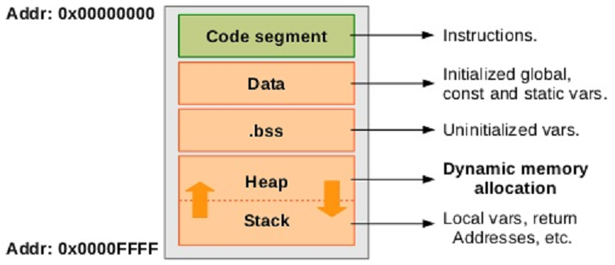

**+ Code segment (text segment)** là nơi mà lưu trữ các mã lệnh đã được biên dịch của các chương trình máy tính. Những mã lệnh trong phân vùng này sẽ được chuyển đến CPU xử lý khi cần thiết. Code segment chỉ chịu sự chi phối của hệ điều hành, các tác nhân khác không thể can thiệp trực tiếp đến phân vùng này. Việc đưa các mã lệnh đã được biên dịch của chương trình lên phân vùng code segment là công việc đầu tiên mà hệ điều hành cần làm khi chúng ta chạy chương trình.

**+ Data segment (initialized data segment)** là phân vùng mà hệ điều hành sử dụng để khởi tạo giá trị cho các biến kiểu static, biến toàn cục (global variable) của các chương trình.

**+ BSS segment (uninitialized data segment)** cũng được dùng để lưu trữ các biến kiểu static, biến toàn cục (global variable) nhưng chưa được khởi tạo giá trị cụ thể.

**+ Heap segment (free srote segment)** được sử dụng để cấp phát bộ nhớ thông qua kỹ thuật Dynamic memory allocation.

Để sử dụng kỹ thuật cấp phát bộ nhớ động, ngôn ngữ C++ đã hổ trợ sẵn cho chúng ta toán tử new. Ví dụ:

**new** **int**; *//allocate 4 bytes on Heap segment*

**new** **int**\[10\]; *//allocate (4 \* 10) bytes on Heap segment*

Toán tử new sau khi thực thi thành công sẽ trả về địa chỉ của vùng nhớ được cấp phát trên heap, chúng ta có thể sử dụng con trỏ có kiểu dữ liệu phù hợp để lưu trữ địa chỉ trả về này, và con trỏ cũng là công cụ duy nhất giúp chúng ta có thể xác định được vị trí vùng nhớ được cấp phát là ở đâu, và cũng thông qua con trỏ để chúng ta có thể giải phóng vùng nhớ đã được cấp phát.

```cpp
int *pInt = new int;

int *pArr = new int[10];
```

Chúng ta không cần biết rõ cơ chế quản lý bộ nhớ Heap như thế nào, mà chỉ cần biết rằng bộ nhớ được cấp phát trên Heap sẽ không tự giải phóng cho đến khi nào toàn bộ chương trình đang chạy kết thúc. Do đó, nếu chương trình có thời gian chạy quá lâu mà không được giải phóng các vùng nhớ một cách hợp lý, điều này sẽ làm ảnh hưởng đến việc cấp phát bộ nhớ động cho các chương trình khác.

***Một số ưu điểm và nhược điểm đáng chú ý khi sử dụng phân vùng Heap như sau:***

- Việc cấp phát bộ nhớ trên Heap chậm hơn các phân vùng khác.

- Vùng nhớ đã được cấp phát sẽ vẫn thuộc quyền kiểm soát của chương trình đang chạy cho đến khi chúng được giải phóng, hoặc nhận được tín hiệu kết thúc chương trình.

- Vùng nhớ được cấp phát phải được quản lý bởi ít nhất 1 con trỏ.

- Toán tử dereference truy xuất đến vùng nhớ chậm hơn các biến thông thường.

- Phân vùng Heap có dung lượng lớn nhất, nên chúng ta có thể sử dụng một cách thoải mái hơn các phân vùng khác.

**+ Stack segment:** Call Stack (thường được gọi là Stack) được dùng để cấp phát bộ nhớ cho tham số của các hàm (function parameters) và biến cục bộ (local variables). Call Stack được thực hiện theo cấu trúc dữ liệu stack, do đó, trước khi nói về phân vùng Stack trên bộ nhớ ảo, ta bàn về cấu trúc dữ liệu stack trước.

\* **Stack data structure:** Stack là một cơ chế tổ chức dữ liệu. Các bạn cũng từng làm việc với một kiểu tổ chức dữ liệu khá phổ biến là mảng một chiều. Mỗi cấu trúc dữ liệu sẽ tổ chức dữ liệu dưới một cơ chế khác nhau để sử dụng hiệu quả trong từng công việc cụ thể. Bây giờ chúng ta xem xét cấu trúc dữ liệu stack.

Việc tổ chức dữ liệu theo cơ chế stack gặp nhiều hạn chế hơn so với tổ chức dữ liệu theo mảng một chiều.

Khi sử dụng mảng một chiều, chúng ta có thể truy cập vào bất kì phần tử nào bên trong mảng bằng cách đưa ra chỉ số của phần tử. Nhưng đối với stack thì không được. Chúng ta chỉ có thể thao tác với phần tử nằm trên cùng (ngoài cùng). Chúng ta thường nói stack hoạt động theo cơ chế "Last-in, first-out". Có nghĩa là phần tử nào được thêm vào mảng sau cùng thì sẽ được lấy ra đầu tiên.

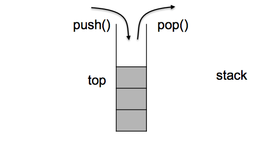

**\**

> **<u>Ví dụ:</u>**
>
> Stack ban đầu của chúng ta là
>
> --------------------------------
>
> \| 4 7 2 5
>
> --------------------------------
>
> Thêm vào phần tử có giá trị là 3
>
> --------------------------------
>
> \| 4 7 2 5 3
>
> --------------------------------
>
> Thêm vào phần tử có giá trị 9
>
> --------------------------------
>
> \| 4 7 2 5 3 9
>
> --------------------------------
>
> Lấy một phần tử ra khỏi stack
>
> --------------------------------
>
> \| 4 7 2 5 3
>
> --------------------------------

**\* Call Stack segment:** Call stack segment cũng hoạt động dựa trên cơ chế tổ chức dữ liệu như stack. Khi bắt gặp một dòng lệnh khai báo biến, nếu biến đó là biến cục bộ hoặc tham số hàm, nó sẽ được cấp phát tại địa chỉ lớn nhất hiện tại trên Stack. Khi một biến cục bộ hoặc tham số của hàm ra khỏi phạm vi khối lệnh, nó sẽ được đưa ra khỏi Stack.

Để kiểm chứng điều này, các bạn có thể chạy thử đoạn chương trình sau:

```cpp
int main()

{

int n1, n2, n3, n4, n5;

cout << "Address of " << &n1 << endl;

cout << "Address of " << &n2 << endl;

cout << "Address of " << &n3 << endl;

cout << "Address of " << &n4 << endl;

cout << "Address of " << &n5 << endl;

return 0;

}
```

Đoạn chương trình này khai báo lần lượt 5 biến cục bộ liên tiếp nhau. Nếu trong trường hợp tại thời điểm khai báo, chỉ có chương trình này được CPU xử lý, chúng ta sẽ thấy địa chỉ của 5 biến cục bộ này có địa chỉ liên tiếp nhau.

***Kết quả:***

Address of 0000003E370FFC04

Address of 0000003E370FFC24

Address of 0000003E370FFC44

Address of 0000003E370FFC64

Address of 0000003E370FFC84

Địa chỉ sau cách địa chỉ trước đó đúng bằng kích thước của kiểu dữ liệu **int**.

Như vậy, lần lượt biến n1 n2 n3 n4 và n5 được cấp phát tại những địa chỉ tiếp theo (từ thấp đến cao) trên phân vùng Stack, và khi ra khỏi hàm main, lần lượt biến n5 n4 n3 n2 và n1 sẽ bị đưa ra khỏi Stack.

**\**

**\* Stack overflow:** Phân vùng Stack có kích thước khá hạn chế. Tùy hệ điều hành Windows mà mình đang sử dụng, Call Stack có thể chỉ có kích thước khoảng 1MB. Nếu chúng ta cố gắng cho chương trình cấp phát vùng nhớ trên Stack vượt quá kích thước của Stack, chúng ta gọi đó là hiện tượng tràn bộ nhớ phân vùng Stack (Stack overflow).

***Một số ưu và nhược điểm có thể nhận thấy khi sử dụng phân vùng Stack***

- Việc cấp phát bộ nhớ trên Call Stack khá nhanh.

- Nhìn vào mã nguồn chương trình, chúng ta có thể biết được thời điểm cấp phát và hủy vùng nhớ của biến trên Stack.

- Kích thước vùng nhớ cấp phát trên phân vùng Stack phải được khai báo rõ ràng trước khi biên dịch.

- Vùng nhớ trên phân vùng Stack có thể được truy cập trực tiếp thông qua định danh.

- Kích thước của phân vùng Stack khá hạn chế.
