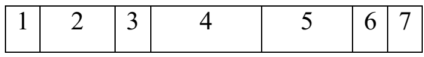
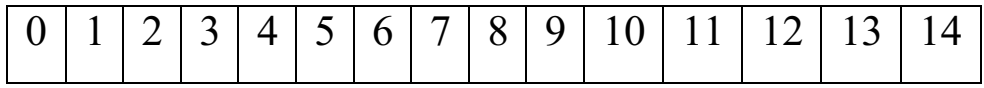
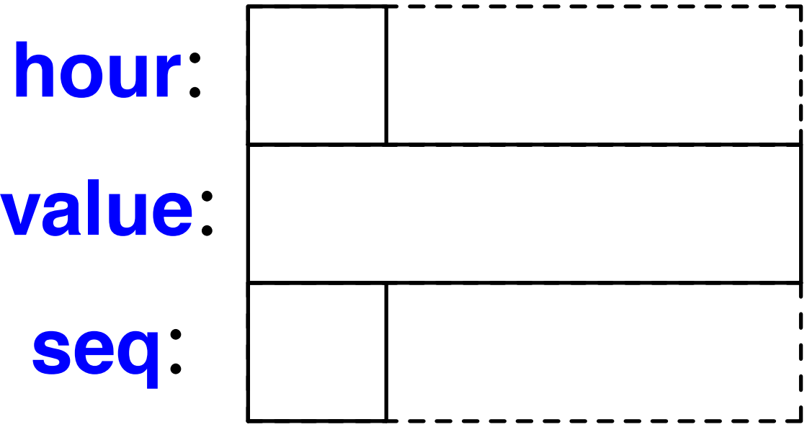
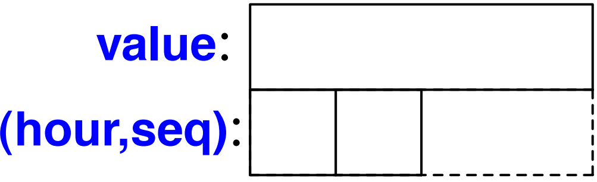
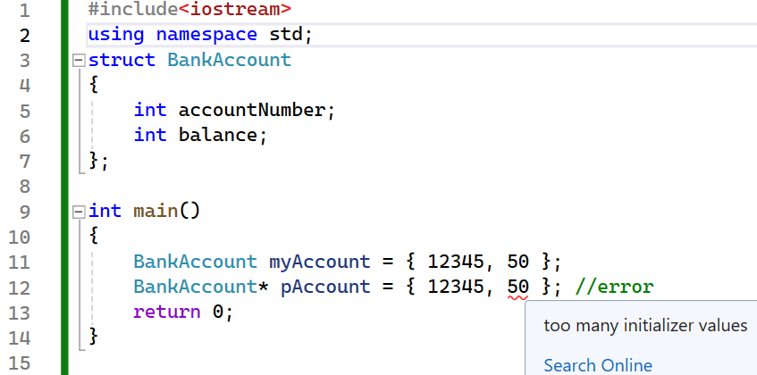
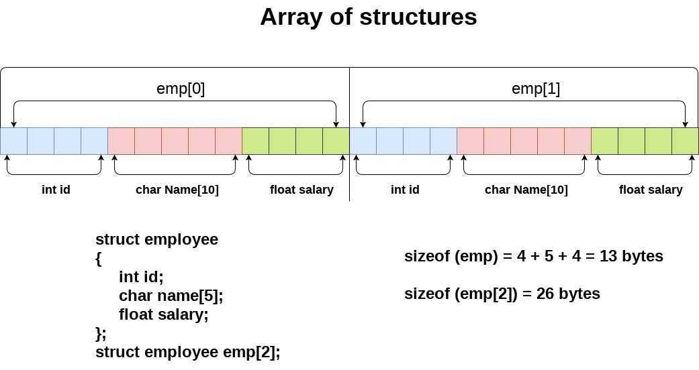

# Chương 5. KIỂU DỮ LIỆU CẤU TRÚC

## 5.1. Đặt vấn đề

*- Để lưu trữ các giá trị gồm nhiều thành phần dữ liệu giống nhau ta có kiểu biến mảng. Thực tế rất nhiều dữ liệu là tập các kiểu dữ liệu khác nhau tập hợp lại, để quản lý dữ liệu kiểu này C++ đưa ra kiểu dữ liệu cấu trúc. Một ví dụ của dữ liệu kiểu cấu trúc là một bảng lý lịch trong đó mỗi nhân sự được lưu trong một bảng gồm nhiều kiểu dữ liệu khác nhau như họ tên, tuổi, giới tính, mức lương …*

<table>
<colgroup>
<col style="width: 50%" />
<col style="width: 49%" />
</colgroup>
<thead>
<tr>
<th><p><strong>Thông tin của một sinh viên gồm có:</strong></p>
<ul>
<li><p>MSSV: kiểu chuỗi</p></li>
<li><p>Tên SV: kiểu chuỗi</p></li>
<li><p>NTNS: kiểu chuỗi</p></li>
<li><p>Phái: kiểu ký tự</p></li>
<li><p>Điểm Toán, Lý, Hóa: kiểu số thực</p></li>
</ul>
<p><strong>Yêu cầu</strong></p>
<ul>
<li><p>Lưu thông tin n sinh viên?</p></li>
<li><p>Truyền thông tin n sinh viên vào hàm?</p></li>
</ul></th>
<th><ul>
<li><p><strong>Khai báo các biến để lưu trữ 1 sinh viên</strong></p></li>
</ul>
<p><code>char mssv[8]; // “0012078”</code></p>
<p><code>char hoten[30]; // “Nguyen Van A”</code></p>
<p><code>char ntns[9]; // “29/12/82”</code></p>
<p><code>char phai; // ‘n’</code></p>
<p><code>float toan, ly, hoa; // 8.5 9.0 10.0</code></p>
<ul>
<li><p><strong>Truyền thông tin 1 sinh viên cho hàm</strong></p></li>
</ul>
<p><code>void xuat(char *mssv, char *hoten,char *ntns, char phai, float toan, float ly, float hoa);</code></p></th>
</tr>
</thead>
<tbody>
</tbody>
</table>

**- Nhận xét**

\+ Đặt tên biến khó khăn và khó quản lý, người lập trình cần khai báo NHIỀU biến đơn lẻ... =\> Quá bất tiện: dài dòng, khó hiểu, v.v

\+ Truyền tham số cho hàm quá nhiều

\+ Tìm kiếm, sắp xếp, sao chép,… khó khăn

\+ Tốn nhiều bộ nhớ

\+ …

**- Ý tưởng**

\+ Gom những thông tin của cùng 1 sinh viên thành một kiểu dữ liệu mới đó là Kiểu cấu trúc (struct).

**🡪 Như vậy, cấu trúc là một kiểu dữ liệu do người dùng tự định nghĩa.**

## 5.2. Struct là gì?

### 5.2.1. Khái niệm

\+ Một struct (viết tắt của structure) cho phép chúng ta ***nhóm nhiều biến của nhiều kiểu dữ liệu khác nhau*** để lưu trữ một tập hợp các dữ liệu cần thiết cho việc mô tả một đơn vị nào đó.

\+ Là một kiểu dữ liệu mô tả một tổ hợp của các kiểu dữ liệu thành phần khác. Các kiểu dữ liệu thành phần có thể có cùng kiểu hay khác kiểu, thậm chí là một kiểu cấu trúc khác.

\+ Mỗi biến trong cấu trúc được gọi là một **thành viên (trường) (field)** của cấu trúc.

\+ Không giống như một mảng, một cấu trúc có thể chứa nhiều kiểu dữ liệu khác nhau (int, string, bool, v.v.).

\+ Struct cũng có thể chứa cả hàm.

\+ Một mở rộng của kiểu này (struct) là kiểu lớp (class) trong các ngôn ngữ lập trình hướng đối tượng.

\* ***Sự khác biệt duy nhất giữa các cấu trúc và lớp trong C++*** là các thành viên cấu trúc mặc định có quyền truy cập công khai (public) và các thành viên lớp (class) mặc định có quyền truy cập riêng tư (private) khi không sử dụng bộ chỉ định truy cập nào (access specifier) và cấu trúc đó mặc định có tính kế thừa công khai, trong khi các lớp mặc định có tính kế thừa riêng tư.

**- Tầm quan trọng của Struct:**

\+ Struct cung cấp khả năng tổ chức và quản lý dữ liệu cho chương trình, giúp giảm sự trùng lặp mã lệnh, tăng tính module hóa cho chương trình, tăng tính dễ bảo trì và sửa lỗi.

\+ Struct là công cụ quan trọng trong việc lưu trữ và quản lí các đối tượng phức tạp với nhiều thành phần biến.

\- Sự khác biệt giữa kiểu cấu trúc và kiểu mảng là: **các phần tử của mảng là cùng kiểu** còn **các phần tử của kiểu cấu trúc có thể có kiểu khác nhau.** Hình ảnh sau là của kiểu cấu trúc với 7 trường:



còn kiểu mảng có dạng:



### 5.2.2. Khai báo & khởi tạo

<table>
<colgroup>
<col style="width: 46%" />
<col style="width: 53%" />
</colgroup>
<thead>
<tr>
<th style="text-align: left;"><p><code><strong>struct Tên_Cấu_trúc {</strong></code></p>
<p><strong>&lt;kiểu dữ liệu&gt; &lt;tên thành phần 1&gt;;</strong></p>
<p><strong>…</strong></p>
<p><strong>&lt;kiểu dữ liệu&gt; &lt;tên thành phần n&gt;;</strong></p>
<p><strong>} [Danh sách biến]<u>;</u></strong></p></th>
<th><p><em><strong>- Tên cấu trúc:</strong> được đặt theo quy tắc định danh, sau khi khai báo xong một struct, chúng ta có thể dùng tên cấu trúc để khai báo biến như những kiểu dữ liệu thông thường.</em></p>
<p><em>- Mỗi thành phần giống như một biến thông thường.</em></p>
<p><em>- Phần tên cấu trúc và danh sách biến có thể có hoặc không.</em></p>
<p><em>- Các kiểu cấu trúc được phép khai báo lồng nhau.</em></p>
<p><em>- Một biến có kiểu cấu trúc sẽ được phân bố bộ nhớ sao cho các thực hiện của nó được sắp liên tục theo thứ tự xuất hiện trong khai báo.</em></p></th>
</tr>
</thead>
<tbody>
</tbody>
</table>

**<u>Ví dụ 1:</u>**

<table>
<colgroup>
<col style="width: 27%" />
<col style="width: 27%" />
<col style="width: 45%" />
</colgroup>
<thead>
<tr>
<th style="text-align: left;"><p><code>struct DIEM</code></p>
<p><code>{</code></p>
<p><code>int hoanh_do;</code></p>
<p><code>int tung_do;</code></p>
<p><code>};</code></p>
<p>DIEM diem1, diem2;</p></th>
<th style="text-align: left;"><p><code>struct DIEM</code></p>
<p><code>{</code></p>
<p><code>int hoanh_do;</code></p>
<p><code>int tung_do;</code></p>
<p>} diem1, diem2;</p></th>
<th style="text-align: center;"><p><em>DIEM là kiểu dữ liệu, diem1, diem2 là các biến.</em></p></th>
</tr>
</thead>
<tbody>
</tbody>
</table>

**<u>Ví dụ 2:</u>** **<u>Ví dụ 3:</u>**

<table>
<colgroup>
<col style="width: 50%" />
<col style="width: 49%" />
</colgroup>
<thead>
<tr>
<th style="text-align: left;"><p><code>struct Cat {</code></p>
<p><code>string type; string name;</code></p>
<p><code>int age; int weight;</code></p>
<p><code>string color; string gender;</code></p>
<p><code>};</code></p></th>
<th style="text-align: left;"><p><code>struct Fraction {</code></p>
<p><code>int numerator; // tử số</code></p>
<p><code>int denominator; //mẫu số</code></p>
<p><code>};</code></p>
<p>Hoặc:</p>
<p><code>struct Phanso { int numerator, denominator; };</code></p></th>
</tr>
</thead>
<tbody>
</tbody>
</table>

**<u>Ví dụ 4:</u>**

```cpp
struct Readout {

char hour; // [0:23]

int value;

char seq; // sequence mark ['a':'z']

};
```

\+ Các trường của struct Readout (Thiết bị đọc) được minh họa trong bộ nhớ như sau:

<table style="width:40%;">
<colgroup>
<col style="width: 7%" />
<col style="width: 20%" />
<col style="width: 12%" />
</colgroup>
<thead>
<tr>
<th colspan="3"><strong>hour</strong>: <strong>value</strong>: <strong>seq</strong>:</th>
</tr>
</thead>
<tbody>
<tr>
<td></td>
<td></td>
<td></td>
</tr>
</tbody>
</table>

\+ Tuy nhiên, kích thước của một đối tượng trong cấu trúc không nhất thiết phải là tổng kích thước của các trường trong cấu trúc đó. Điều này là do nhiều máy yêu cầu các đối tượng thuộc một số kiểu nhất định được phân bổ trên các “ranh giới” phụ thuộc vào kiến trúc hoặc để xử lý các đối tượng đó hiệu quả hơn nhiều nếu có.

\+ Điều này dẫn tới những “lỗ hổng” trong cấu trúc. Bố cục Readout thực tế hơn trên máy có kiểu int 4 byte sẽ là:



\+ Trong trường hợp này, như trên nhiều máy, sizeof(Readout) = 12 chứ không phải 6 như người ta mong đợi rằng nó chỉ đơn giản bằng cách cộng kích thước của từng trường.

\+ Có thể giảm thiểu không gian lãng phí bằng cách sắp xếp các trường theo kích thước (từ trường lớn nhất trước).

```cpp
struct Readout {

int value;

char hour; // [0:23]

char seq; // sequence mark ['a':'z']

};
```

Điều này sẽ giúp ta lấp đi những “lỗ hổng”:



\+ Lưu ý rằng điều này vẫn để lại một ''lỗ'' 2 byte (không gian chưa sử dụng) trong Readout và sizeof(Readout)==8. Lý do là chúng ta cần duy trì sự “căn chỉnh” khi đặt hai đối tượng cạnh nhau, chẳng hạn như trong một mảng Readouts. Kích thước của một mảng gồm 10 đối tượng Readout là 10∗sizeof(Readout).

\+ Thông thường, tốt nhất là sắp xếp các thành viên để dễ đọc và chỉ sắp xếp chúng theo kích thước nếu có nhu cầu tối ưu hóa được chứng minh.

\- Khai báo biến kiểu cấu trúc cũng giống như khai báo các biến kiểu cơ sở dưới dạng:

**struct \<Tên cấu trúc\> \<Biến 1\> \[, \<Biến 2\>…\];**

Hoặc:

**\<Tên cấu trúc\> \<Biến 1\> \[, \<Biến 2\>…\];**

\- Các biến được khai báo cũng có thể đi kèm khởi tạo:

**Tên cấu trúc Biến = { giá trị khởi tạo } ;**

**<u>Ví dụ 5:</u>**

```cpp
#include <iostream>

using namespace std;

//Định nghĩa cấu trúc sStudent

struct sStudent {

char id[5];

char name[50];

float gpa;

};

int main() {

//Khai báo các biến s1, s2, s3 có kiểu sStudent

struct sStudent s1; //s1: Không được khởi động

struct sStudent s2 = { "001", "Nguyen Van An" }; //s2: được khởi động không đầy đủ

struct sStudent s3 = { "001", "Nguyen Van An", 9.5f }; //s3: được khởi động đầy đủ

//......

return 0;

}
```

**<u>Ví dụ 6:</u>** Khai báo kiểu cấu trúc Diem, sau đó khai báo 2 biến a, b kiểu Diem

```cpp
struct Point {

int x; int y;

};
```

Point a, b; //Khai báo biến

**<u>Ví dụ 7:</u>** Khai báo cấu trúc, biến và khởi tạo cấu trúc mô tả đối tượng ngày

```cpp
struct Date {

int day;

int month;

int year;
```

} holiday = { 1,5,2017 };

Một biến holiday cũng được khai báo kèm cùng kiểu này và được khởi tạo bởi bộ số 1. 5. 2017. Các giá trị khởi tạo này lần lượt gán cho các thành phần theo đúng thứ tự trong khai báo, tức **ng = 1, th = 5 và nam = 2017.**

\- Có thể khai báo cấu trúc xong, khi khai báo biến ta khởi tạo.

**<u>Ví dụ 8:</u>**

```cpp
struct Employee {

char name[20]; // Tên nhân viên

int age; // Tuổi nhân viên

char role[20]; // Chức vụ của nhân viên

float salary; // Lương của nhân viên

};

Employee myEmployee1 = { "Nguyen Van A", 27, "Nhan vien", 300 };
```

\- Khai báo và khởi tạo biến có cấu trúc lồng nhau.

**<u>Ví dụ 9:</u>**

```cpp
struct Date {

int day;

int month;

int year;

};

struct Employee {

char name[20];   // Tên nhân viên

Date birthDay;   // Ngày sinh của nhân viên

char role[20];   // Chức vụ của nhân viên

float salary;      // Lương của nhân viên

};

Employee myEmployee1 = {
```

        "Nguyen Van A", <span class="mark">{15, 05, 1980}</span>, // Khởi tạo cấu trúc con

        "Nhan vien",  300

};

**<u>Ví dụ 10:</u>** Kiểu Lop dùng chứa thông tin về một lớp học gồm tên lớp và sĩ số sinh viên. *Các biến kiểu Lop được khai báo là daihoc và caodang,* trong đó daihoc được khởi tạo bởi bộ giá trị {“CN14A", 60} với ý nghĩa tên lớp đại học là CN14A và sĩ số là 60 sinh viên.

```cpp
struct Lop {

char tenlop[10];

int soluong;

};

struct Lop daihoc = {" CN14A ", 60}, caodang ; //C++ có thể bỏ struct

//C++: Lop daihoc = {" CN14A ", 60}, caodang ;
```

***Chú ý:*** Không gán bộ giá trị cụ thể cho biến cấu trúc. **Cách gán này chỉ thực hiện được khi khởi tạo.**

**<u>Ví dụ 11:</u>**

```cpp
Employee x = { "NVA", {1,1,1980}, "Nhan vien",  300 }, y; // được
```

y = { "NVA", {1,1,1980}, "Nhan vien",  300 }; // không được

y = x; // được

### 5.2.3. Truy cập các thành phần

\- Không thể truy xuất trực tiếp.

***- Đối với biến thường:* <span class="mark">Tên biến. Tên thành phần</span>**

**<u>Ví dụ 1:</u>**

```cpp
#include <iostream>

#include <cstring>

using namespace std;

struct Lop {

char tenlop[10];

int siso;

};

int main() {
```

Lop daihoc, caodang;

// Khởi tạo daihoc.tenlop

```cpp
strcpy_s(daihoc.tenlop, "K41T");

// Sao chép daihoc.tenlop vào caodang.tenlop

strcpy_s(caodang.tenlop, daihoc.tenlop);

// Khởi tạo caodang.siso trước khi tăng

caodang.siso = 50;

// Tăng giá trị siso trong caodang
```

caodang.siso++;

```cpp
cout << "Cao dang: " << caodang.tenlop << "; " << caodang.siso;

return 0;

}
```

Kết quả: Cao dang: K41T; 51

**\* Lưu ý:**

\- Muốn nhập dữ liệu chuỗi ký tự char\[\] cho các thuộc tính trong struct, ta không thể gán trực tiếp:

```cpp
Lop daihoc = "K41T", caodang; //!Lỗi
```

caodang.tenlop = daihoc.tenlop; //!Lỗi

Mà cần sử dụng hàm thay thế, cụ thể ở ví dụ trên là hàm strcpy().

\- Mặt khác muốn sử dụng cách trên thì thay đổi thuộc tính tenlop từ kiểu char\[\] sang kiểu string.

```cpp
#include <iostream>

#include <string>

using namespace std;

struct Lop {

string tenlop;

int siso;

};

int main() {
```

Lop daihoc, caodang;

// Khởi tạo daihoc.tenlop

```cpp
daihoc.tenlop = "K41T";

// Sao chép daihoc.tenlop vào caodang.tenlop

caodang.tenlop = daihoc.tenlop;

// Khởi tạo caodang.siso trước khi tăng

caodang.siso = 50;

// Tăng giá trị siso trong caodang
```

caodang.siso++;

```cpp
cout << "Cao dang: " << caodang.tenlop << "; " << caodang.siso;

return 0;

}
```

***Kết quả vẫn như ví dụ trên.***

**<u>Ví dụ 2:</u>**

```cpp
#include <iostream>

#include <string>

#include <iostream>

using namespace std;

struct Cat {

string type;

string name;

int age;

int weight;

string color;

string gender;

};

int main() {

Cat a;

//in

cout << "Enter type: "; getline(cin, a.type);

cout << "Enter name: "; getline(cin, a.name);

cout << "Enter age: "; cin >> a.age;

cout << "Enter weight: "; cin >> a.weight;

cin.ignore();

cout << "Enter color: "; getline(cin, a.color);

cout << "Enter gender: "; getline(cin, a.gender);

cout << "===========================================\n";

//out

cout << "Type: " << a.type << endl;

cout << "Name: " << a.name << endl;

cout << "Age: " << a.age << endl;

cout << "Weight: " << a.weight << endl;

cout << "Color: " << a.color << endl;

cout << "Gender: " << a.gender << endl;

return 0;

}
```

***Kết quả:***

Enter type: Short hair

Enter name: July

Enter age: 2

Enter weight: 30

Enter color: Yellow

Enter gender: Female

===========================================

Type: Short hair

Name: July

Age: 2

Weight: 30

Color: Yellow

Gender: Female

***- Đối với biến con trỏ:*** **<span class="mark">Tên_biến -\> Tên_thành_phần</span>**

**<u>Ví dụ 3:</u>**

```cpp
#include <iostream>

#include <iostream>

using namespace std;

struct Ngaythang {

int day;

int month;

int year;

};

struct Sinhvien {

char hoten[25], queQuan[25];

Ngaythang ns;

int gt;

float diem;
```

}x, y, \* p, K41T\[60\];

```cpp
int main() {

Sinhvien y = { "Nguyen Van A", "Hai Duong", {1,1,1980}, 1};
```

y.diem = 5.5; // gán điểm thi cho sinh viên y

p = new Sinhvien; // cấp bộ nhớ chứa 1 sinh viên

strcpy_s(p-\>hoten, y.hoten); // gán họ tên của y cho sv trỏ bởi p

```cpp
cout << "Ho ten SV cua bien con tro: " << p->hoten << "\n"
```

\<\< "Ho ten SV cua bien cau truc: " \<\< y.hoten; // in hoten của y và con trỏ p

```cpp
return 0;

}
```

***Kết quả:***

Ho ten SV cua bien con tro: Nguyen Van A

Ho ten SV cua bien cau truc: Nguyen Van A

***<u>Lưu ý:</u>*** *Nếu* strcpy_s(p-\>hoten, y.queQuan); *copy được, với điều kiện cùng kiểu dữ liệu, nhưng bản chất thì sai thành phần cấu trúc*

***- Đối với biến mảng:*** *Truy nhập thành phần mảng rồi đến thành phần cấu trúc.*

**<span class="mark">Tên mảng\[chỉ số\].Tên thành phần</span>**

**<u>Ví dụ 3.1:</u>**

strcpy_s(K41T\[1\].hoten, p-\>hoten); // gán họ tên cho sv đầu tiên của lớp

K41T\[1\].diem = 7.0; // gán điểm cho sv đầu tiên

***Kết quả:*** Ho ten sv1: Nguyen Van A; Diem: 7

***- Đối với cấu trúc lồng nhau:** Truy nhập thành phần ngoài rồi đến thành phần của cấu trúc bên trong*, sử dụng các phép toán **.** hoặc **-\>** (các phép toán lấy thành phần) một cách thích hợp.

**<u>Ví dụ 3.2:</u>**

x.ns.day = y.ns.day; // gán ngày,

x.ns.month = y.ns.month; // tháng,

x.ns.year = y.ns.year; // năm sinh của y cho x

**<u>Ví dụ 4:</u>** minh họa về nhập xuất dữ liệu cho các dạng biến cấu trúc.

```cpp
#include <iostream>

using namespace std;

struct Date {

int ng, th, n;

};

struct Sinhvien {

char ten[33];

Date ns;

};

int main()

{
```

Sinhvien sv1, \* sv2, sv3 = { "Le Hoang Nam", 25, 7, 1996 };

**<span class="mark">//Sinh vien thu nhat</span>**

```cpp
cout << "Nhap du lieu cho sinh vien thu nhat:\n";

cout << "Ho va ten: ";

cin.getline(sv1.ten, 33);

cout << "Ngay thang nam sinh: ";

cin >> sv1.ns.ng >> sv1.ns.th >> sv1.ns.n;

//Sinh vien thu hai
```

sv2 = new Sinhvien\[1\];//Cap phat bo nho dong cho sv2

```cpp
cout << "Nhap du lieu cho sinh vien thu hai:\n";

cout << "Ho va ten: ";

cin.ignore(1); cin.getline(sv2->ten, 33);

cout << "Ngay thang nam sinh: ";

cin >> sv2->ns.ng >> sv2->ns.th >> sv2->ns.n;

//Xuat thong tin cac sinh vien

cout << "Thong tin cac sinh vien\n=============\n";

cout << "STT\tHo va ten\tNgay sinh\n";

cout << "01\t" << sv1.ten << "\t" << sv1.ns.ng << "/";

cout << sv1.ns.th << "/" << sv1.ns.n << endl;

cout << "02\t" << sv2->ten << "\t" << sv2->ns.ng << "/";

cout << sv2->ns.th << "/" << sv2->ns.n;

cout << "\n03\t" << sv3.ten << "\t" << sv3.ns.ng << "/";

cout << sv3.ns.th << "/" << sv3.ns.n;
```

delete\[\]sv2;

```cpp
return 0;

}
```

***Kết quả chạy chương trình:***

Nhap du lieu cho sinh vien thu nhat:

Ho va ten: Tran Duc Khai

Ngay thang nam sinh: 21 5 1995

Nhap du lieu cho sinh vien thu hai:

Ho va ten: Hoang Anh Dung

Ngay thang nam sinh: 11 8 1996

Thong tin cac sinh vien

=============

STT Ho va ten Ngay sinh

01 Tran Duc Khai 21/5/1995

02 Hoang Anh Dung 11/8/1996

03 Le Hoang Nam 25/7/1996

**<u>Ví dụ 5:</u>** minh họa về mảng cấu trúc. Bài toán sắp xếp danh sách sinh viên

```cpp
#include <iostream>

using namespace std;

struct sinhvien {

char hoten[33];

int mssv;

};

int main()

{

int n, i, j;

cout << "Nhap vao so luong sinh vien: "; cin >> n;
```

sinhvien \*A = new sinhvien\[n\], t;

```cpp
for (i = 0; i < n; i++) {

cout << "Nhap thong tin cho sinh vien thu " << i + 1 << " :\n";

cout << "Ho va ten: ";

cin.ignore(1);

cin.getline(A[i].hoten, 33);

cout << "Ma so sinh vien: ";

cin >> A[i].mssv;

}

cout << "Thong tin cac sinh vien vua nhap:\n";

cout << "=======================================\n";

cout << "STT\tMSSV\tHo va ten\n";

for (i = 0; i < n; i++)

cout << i + 1 << "\t" << A[i].mssv << "\t" << A[i].hoten << endl;

//Sap sep mang theo mssv tang dan

for (i = 0; i < n - 1; i++)

for (j = i + 1; j < n; j++)

if (A[i].mssv > A[j].mssv) {

t = A[i]; A[i] = A[j]; A[j] = t;

}

cout << "\nThong tin cac sinh vien sap xep theo ma so sinh vien:\n";

cout << "=======================================\n";

cout << "STT\tMSSV\tHo va ten\n";

for (i = 0; i < n; i++)

cout << i + 1 << "\t" << A[i].mssv << "\t" << A[i].hoten << endl;
```

delete\[\]A;

```cpp
return 0;

}
```

***Kết quả chạy chương trình:***

Nhap vao so luong sinh vien: 4

Nhap thong tin cho sinh vien thu 1 :

Ho va ten: Tran Hai Nam

Ma so sinh vien: 3456

Nhap thong tin cho sinh vien thu 2 :

Ho va ten: Le Quang Dai

Ma so sinh vien: 4316

Nhap thong tin cho sinh vien thu 3 :

Ho va ten: Tran Thi Kieu An

Ma so sinh vien: 9810

Nhap thong tin cho sinh vien thu 4 :

Ho va ten: Hach Thieu Van

Ma so sinh vien: 1123

Thong tin cac sinh vien vua nhap:

=======================================

STT MSSV Ho va ten

1 3456 Tran Hai Nam

2 4316 Le Quang Dai

3 9810 Tran Thi Kieu An

4 1123 Hach Thieu Van

Thong tin cac sinh vien sap xep theo ma so sinh vien:

=======================================

STT MSSV Ho va ten

1 1123 Hach Thieu Van

2 3456 Tran Hai Nam

3 4316 Le Quang Dai

4 9810 Tran Thi Kieu An

**<u>Ví dụ 6:</u>** Chương trình minh họa việc tạo lập và sử dụng biến cấu trúc

```cpp
#include <iostream>

using namespace std;

struct Employee {

char name[20]; // Tên nhân viên

int age; // Tuổi nhân viên

char role[20]; // Chức vụ của nhân viên

float salary; // Lương của nhân viên

};

// Khai báo khuôn mẫu hàm

void Display(Employee myEmployee);

int main() {

// Hiển thị giá trị mặc định

Employee myEmployee = { "Nguyen Van A", 27, "Nhan vien", 300 };

cout << "Thong tin mac dinh : " << endl;

Display(myEmployee);

// Thay đổi giá trị cho các thuộc tính

cout << "==========================\nThay doi cac thuoc tinh:\n";

cout << "Name: ";

cin.getline(myEmployee.name, 19);

cout << "Age: ";

cin >> myEmployee.age;

cout << "Role: ";

cin.ignore(1);

cin.getline(myEmployee.role, 19);

cout << "Salary: ";

cin >> myEmployee.salary;

cout << "==========================\n";

cout << "Thong tin sau khi thay doi : " << endl;

Display(myEmployee);

return 0;

}

// định nghĩa hàm

void Display(Employee myEmployee) {

cout << "Name:\t" << myEmployee.name << endl;

cout << "Age:\t" << myEmployee.age << endl;

cout << "Role:\t" << myEmployee.role << endl;

cout << "Salary:\t" << myEmployee.salary << endl;

}
```

***Kết quả:***

Thong tin mac dinh :

Name: Nguyen Van A

Age: 27

Role: Nhan vien

Salary: 300

==========================

Thay doi cac thuoc tinh:

Name: Nguyen Van Hoang

Age: 30

Role: Truong Phong

Salary: 500

==========================

Thong tin sau khi thay doi :

Name: Nguyen Van Hoang

Age: 30

Role: Truong Phong

Salary: 500

**<u>Ví dụ 7:</u>** Minh họa việc tạo lập và sử dụng biến cấu trúc lồng nhau

```cpp
#include <iostream>

using namespace std;

struct Date {

int day;

int month;

int year;

};

struct Employee {

char name[20]; // Tên nhân viên

Date birthDay; // Ngày sinh của nhân viên

char role[20]; // Chức vụ của nhân viên

float salary; // Lương của nhân viên

};

// Khai báo khuôn mẫu hàm

void Display(Employee myEmployee);

int main() {

// Hiển thị giá trị mặc định

Employee myEmployee = { "Nguyen Van A", {15, 5, 1980}, "Nhan vien", 300 };

cout << "Thong tin mac dinh : " << endl;

Display(myEmployee);

// Thay đổi giá trị cho các thuộc tính

cout << "===================================\n";

cout << "Thay doi thuoc tinh: \n";

cout << "Name: ";

cin.getline(myEmployee.name, 19);

cout << "Day of birth : ";

cin >> myEmployee.birthDay.day;

cout << "Month of birth : ";

cin >> myEmployee.birthDay.month;

cout << "Year of birth : ";

cin >> myEmployee.birthDay.year;

cout << "Role: ";

cin.ignore(1);

cin.getline(myEmployee.role, 19);

cout << "Salary: ";

cin >> myEmployee.salary;

cout << "===================================\n";

cout << "Thong tin sau khi thay doi : " << endl;

Display(myEmployee);

return 0;

}

// Định nghĩa hàm

void Display(Employee myEmployee) {

cout << "Name:\t\t" << myEmployee.name << endl;

cout << "Birth day:\t" << myEmployee.birthDay.day << " / " <<
```

myEmployee.birthDay.month \<\< " / "

\<\< myEmployee.birthDay.year \<\< endl;

```cpp
cout << "Role:\t\t" << myEmployee.role << endl;

cout << "Salary:\t\t" << myEmployee.salary << endl;

}
```

***Kết quả:***

Thong tin mac dinh :

Name: Nguyen Van A

Birth day: 15 / 5 / 1980

Role: Nhan vien

Salary: 300

===================================

Thay doi thuoc tinh:

Name: Nguyen Van An

Day of birth : 12

Month of birth : 8

Year of birth : 1998

Role: Nhan vien

Salary: 500

===================================

Thong tin sau khi thay doi :

Name: Nguyen Van An

Birth day: 12 / 8 / 1998

Role: Nhan vien

Salary: 500

***Lưu ý:*** Khác với biến mảng, **đối với cấu trúc chúng ta có thể gán giá trị của 2 biến cho nhau**. Phép gán này cũng tương đương với việc gán từng thành phần của cấu trúc.

**<u>Ví dụ 8:</u>**

```cpp
#include <iostream>

using namespace std;

struct Ngaythang {

int ng;

int th;

int nam;

};

struct Sinhvien {

char hoten[25];

Ngaythang ns;

int gt;

float diem;
```

} x, y;

```cpp
int main() {

cout << "Nhap du lieu cho sinh vien x:" << endl;

cout << "Nhap ho ten: ";

cin.getline(x.hoten, 25);

cout << "Nhap ngay, thang, nam sinh: ";

cin.ignore(1);

cin >> x.ns.ng >> x.ns.th >> x.ns.nam;

cout << "Nhap gioi tinh (1 Nam; 0 Nu): ";

cin >> x.gt;

cout << "Nhap diem: ";

cin >> x.diem;
```

y = x; // Đối với biến mảng, phép gán này là không thực hiện được

```cpp
cout << "======================================\n";

cout << "Thong tin ve sinh vien y la:" << endl;

cout << "Ho va ten:\t" << y.hoten << endl;

cout << "Sinh ngay:\t" << y.ns.ng << "/" << y.ns.th << "/" << y.ns.nam;

cout << "\nGioi tinh:\t";
```

(y.gt = 1) ? cout \<\< "Nam \n" : cout \<\< "Nữ \n";

```cpp
cout << "Diem:\t\t" << y.diem;

return 0;

}
```

***Kết quả:***

Nhap du lieu cho sinh vien x:

Nhap ho ten: Nguyen Van A

Nhap ngay, thang, nam sinh: 10 5 1998

Nhap gioi tinh (1 Nam; 0 Nu): 1

Nhap diem: 8.6

======================================

Thong tin ve sinh vien y la:

Ho va ten: Nguyen Van A

Sinh ngay: 0/5/1998

Gioi tinh: Nam

Diem: 8.6

### 5.2.4. Con trỏ với cấu trúc

\- Giả sử định nghĩa một kiểu dữ liệu có tên là Letter:

```cpp
struct Letter
```

{...};

\- Lúc này Letter là một kiểu dữ liệu rỗng, nhưng ngôn ngữ C++ vẫn đặt kích thước của kiểu Letter này là 1 bytes. Mục đích là để đảm bảo địa chỉ của 2 biến được tạo ra sẽ có địa chỉ khác nhau. Tuy nhiên, định nghĩa ra một struct rỗng không có tác dụng gì trong chương trình, chúng ta thêm vào một số trường dữ liệu cho Letter như sau:

```cpp
struct Letter

{

char from[50];

char to[50];

};
```

\- Bây giờ chúng ta tạo ra một đơn vị từ kiểu dữ liệu trên:

```cpp
int main()

{

Letter myLetter;

return 0;

}
```

\- Với mỗi biến kiểu Letter được tạo ra, chương trình sẽ yêu cầu cấp phát 100 bytes (50 bytes cho trường dữ liệu from và 50 bytes cho trường dữ liệu to), và biến đó sẽ có một địa chỉ xác định được thông qua toán tử address-of.

```cpp
#include <iostream>

using namespace std;

struct Letter

{

char from[50];

char to[50];

};

int main()

{

Letter myLetter;

cout << "Address of myLetter: " << &myLetter << std::endl;

cout << "Address of from field: " << &myLetter.from << std::endl;

return 0;

}
```

Address of myLetter: 0000007F47D5F880

Address of from field: 0000007F47D5F880

\- Khi in ra địa chỉ của biến myLetter & địa chỉ của trường dữ liệu from của biến myLetter, ta thấy 2 địa chỉ được in ra có giá trị hoàn toàn giống nhau.

Điều này có nghĩa địa chỉ của trường dữ liệu đầu tiên trong một biến struct cũng là địa chỉ của biến struct đó. Một biến struct sẽ bao gồm tập hợp các trường dữ liệu mà địa chỉ của biến struct sẽ là địa chỉ của trường dữ liệu được khai báo đầu tiên trong struct.

\- Để cho con trỏ trỏ đến một địa chỉ của biến kiểu struct, chúng ta cần có một con trỏ cùng kiểu struct với biến được trỏ đến.

```cpp
Letter myLetter;
```

Letter* pLetter = &myLetter;

Dù kích thước của kiểu dữ liệu struct có lớn bao nhiêu, biến con trỏ cũng chỉ có kích thước 4 bytes trên hệ điều hành 32 bits và kích thước 8 bytes trên hệ điều hành 64 bits (đủ để trỏ đến toàn bộ địa chỉ trên bộ nhớ ảo).

*- Một con trỏ cấu trúc cũng giống như con trỏ trỏ đến các kiểu dữ liệu khác, có nghĩa nó chứa địa chỉ của một biến cấu trúc hoặc một vùng nhớ có kiểu cấu trúc nào đó.*

*- Các thành phần của một cấu trúc cũng giống như các biến, do vậy cách lấy địa chỉ của các thành phần này cũng tương tự như đối với biến bình thường.*

**- Khai báo con trỏ cấu trúc**

**<span class="mark">Tên kiểu cấu trúc \*Tên biến;</span>**

**<u>Ví dụ 1:</u>**

```cpp
struct Date {

int ng, th, n;

};

struct Employee {

char name[20]; // Tên nhân viên

Date birthDay; // Ngày sinh (kiểu Date đã khai báo ở vd trước)

char role[20]; // Chức vụ của nhân viên

float salary; // Lương của nhân viên

};
```

Employee* ptrEmployee; // con trỏ trỏ đến kiểu cấu trúc Employee

**- Gán địa chỉ cho con trỏ cấu trúc**

**<span class="mark">Tên biến con trỏ = &Tên biến cấu trúc;</span>**

**<u>Ví dụ 2:</u>**

Employee\* ptrEmployee, myEmployee;

```cpp
ptrEmployee = &myEmployee;

/* con trỏ ptrEmployee trỏ đến địa chỉ của biến cấu trúc myEmployee.*/
```

**- Cấp phát bộ nhớ động cho con trỏ cấu trúc**

**<span class="mark">Tên biến con trỏ = new Kiểu cấu trúc;</span>**

**<u>Ví dụ 3:</u>**

//Khai báo và cấp phát bộ nhớ

Employee* ptrEmployee;

```cpp
ptrEmployee = new Employee;

// Cấp phát ngay khi khai báo:

Employee *ptrEmployee = new Employee;
```

**- Giải phóng vùng nhớ đã cấp phát cho con trỏ:**

**<span class="mark">delete Tên biến con trỏ;</span>**

**<u>Ví dụ 4:</u>** delete ptrEmployee;

***Chú ý:** Thao tác delete chỉ được thực hiện đối với con trỏ đã được cấp phát bộ nhớ động thông qua thao tác new:*

**<u>Ví dụ 5:</u>** Không thể delete với con trỏ chỉ trỏ đến địa chỉ của một biến cấu trúc khác:

Employee\* ptrEmployee, myEmployee;

```cpp
ptrEmployee = &myEmployee;
```

delete ptrEmployee; //lỗi vì chưa cấp phát với toán tử new

**- Truy nhập thuộc tính của con trỏ cấu trúc**

***Cách 1:***

**Tên biến con trỏ -\> Tên thuộc tính;**

***Cách 2:***

**(\*Tên biến con trỏ). Tên thuộc tính;**

**<u>Ví dụ 6:</u>**

Employee* ptrEmployee = new Employee;

```cpp
cin >> ptrEmployee->name;
```

hoặc:

```cpp
cin >> (*ptrEmployee).name;
```

**<u>Ví dụ 7:</u>** Khởi tạo và hiển thị nội dung của một con trỏ cấu trúc.

```cpp
#include <iostream>

using namespace std;

struct Date {

int day;

int month;

int year;

};

struct Employee {

char name[20]; // Tên nhân viên

Date birthDay; // Ngày sinh của nhân viên

char role[20]; // Chức vụ của nhân viên

float salary; // Lương của nhân viên

};

// Khai báo khuôn mẫu hàm

void InitStruct(Employee* myEmployee);

void Display(Employee* myEmployee);

int main() {
```

Employee* myEmployee = new Employee;

```cpp
InitStruct(myEmployee);

cout << "=====================\nXuat thong tin:\n";

Display(myEmployee);
```

delete myEmployee;

```cpp
return 0;

}

//Định nghĩa hàm

void InitStruct(Employee* myEmployee) {

cout << "Name: ";

cin.getline(myEmployee->name, 19);

cout << "Day of birth : ";

cin >> myEmployee->birthDay.day;

cout << "Month of birth : ";

cin >> myEmployee->birthDay.month;

cout << "Year of birth : ";

cin >> myEmployee->birthDay.year;

cout << "Role: ";

cin.ignore(1);

cin.getline(myEmployee->role, 19);

cout << "Salary: ";

cin >> myEmployee->salary;

}

void Display(Employee* myEmployee) {

cout << "Name:\t\t" << myEmployee->name << endl;

cout << "Birth day:\t" << myEmployee->birthDay.day << " / "
```

\<\< myEmployee-\>birthDay.month \<\< " / "

\<\< myEmployee-\>birthDay.year \<\< endl;

```cpp
cout << "Role:\t\t" << myEmployee->role << endl;

cout << "Salary:\t\t" << myEmployee->salary << endl;

}
```

***Kết quả:***

Name: Nguyen Van A

Day of birth : 15

Month of birth : 12

Year of birth : 2000

Role: Nhan Vien

Salary: 500

=====================

Xuat thong tin:

Name: Nguyen Van A

Birth day: 15 / 12 / 2000

Role: Nhan Vien

Salary: 500

**<u>Ví dụ 8:</u>** Con trỏ và địa chỉ cấu trúc

```cpp
#include <iostream>

using namespace std;

int main()

{

struct sinhvien

{

char ten[33];

int tuoi;

char que_quan[33];
```

}\*p, \* q, a\[20\], b = { "Ly Minh Tai", 22, "Nam Dinh" };

p = &b; //Cho p trỏ vào b

a\[4\] = b; // a\[4\] gán bằng b

```cpp
cout << p->ten << endl; // Xuất ra Ly Minh Tai
```

q = &a\[4\]; //Cho q trỏ vào a\[4\]

```cpp
cout << q->que_quan; // Xuất ra Nam Dinh

return 0;

}
```

***Kết quả:***

Ly Minh Tai

Nam Dinh

**<u>Ví dụ 9:</u>** Địa chỉ các thành phần của cấu trúc

```cpp
#include <iostream>

using namespace std;

int main()

{

struct sinhvien

{

char ten[33];

int tuoi;

char que_quan[33];
```

}b = { "Tran Viet Hoang",19,"Ca Mau" };

```cpp
int* t; char* ht;
```

t = &(b.tuoi); // t trỏ vào thành phần tuoi của b

<span class="mark">ht = b.ten;</span> // ht trỏ vào thành phần ten của b (không cần dấu &)

```cpp
cout << ht << " " << *t << " tuoi"; //Tran Viet Hoang 19 tuoi

return 0;

}
```

***Kết quả:*** Tran Viet Hoang 19 tuoi

*Khi viết ht = b.ten; ta đã gán con trỏ ht trực tiếp vào địa chỉ bắt đầu của mảng kí tự ten trong cấu trúc sinhvien. Mảng kí tự ten là một mảng có địa chỉ của phần tử đầu tiên được coi là địa chỉ của mảng đó. Do đó, không cần sử dụng toán tử & để lấy địa chỉ của ten.*

*Khi viết cout \<\< \*ht; chỉ có một kí tự đầu tiên của chuỗi kí tự được in ra. Điều này là do con trỏ ht chỉ trỏ đến phần tử đầu tiên của mảng kí tự ten. Toán tử \* khi áp dụng cho con trỏ sẽ trả về giá trị của phần tử mà con trỏ đang trỏ đến, và trong trường hợp này, đó là kí tự đầu tiên của chuỗi "Tran Viet Hoang", nên chỉ in ra "T". Để in ra toàn bộ chuỗi, bạn cần sử dụng cout \<\< ht; mà không có toán tử \*.*

**- Một số nhầm lần khi sử dụng struct và Pointer to struct**

\+ Ta có thể bị nhầm lẫn giữa cách khởi tạo hoặc gán giá trị cho biến struct thông thường và biến con trỏ struct.



\+ Đoạn chương trình trên báo lỗi vì biến con trỏ chỉ nhận giá trị là địa chỉ. Dưới đây là cách gán giá trị đúng:

```cpp
#include <iostream>

using namespace std;

struct BankAccount

{

int accountNumber;

int balance;

};

int main()

{

BankAccount myAccount = { 0, 0 };
```

BankAccount* pAccount = &myAccount;

\*pAccount = { 12345, 50 };

```cpp
cout << pAccount->accountNumber << " " << pAccount->balance << endl;

return 0;

}
```

***Kết quả:*** 12345 50

Hoặc một cách khác là chúng ta cấp phát vùng nhớ cho biến con trỏ struct, và dereference đến đó để gán giá trị cho nó:

```cpp
BankAccount *pAccount = new BankAccount;
```

\*pAccount = { 12345, 50 }*;*

\+ Lưu ý khi sử dụng biến kiểu con trỏ struct thì chúng ta sử dụng toán tử member selection này (-\>), phân biệt giữa biến con trỏ struct và trường dữ liệu kiểu con trỏ. Ví dụ:

```cpp
struct BankAccount

{

char *name;
```

\_\_int64 accountNumber;

\_\_int64 **balance;**

};

Thêm vào struct một trường dữ liệu kiểu con trỏ char nhưng việc truy xuất đến trường dữ liệu này không có gì thay đổi khi sử dụng biến struct thông thường.

```cpp
BankAccount myAccount = { "Le Tran Dat", 12345, 50 };

std::cout << myAccount.name << std::endl;

std::cout << myAccount.accountNumber << std::endl;

std::cout << myAccount.balance << std::endl;
```

\+ Sẽ phức tạp hơn một chút khi sử dụng các nested struct. Ví dụ:

```cpp
#include <iostream>

using namespace std;

struct Date {

int day;

int month;

int year;

};

struct BankAccount

{

Date registrationDate;

int accountNumber;

int balance;

};

int main()

{
```

BankAccount* pAccount = new BankAccount;

\*pAccount = { {2, 5, 2016}, 12345, 50 };

```cpp
cout << pAccount->registrationDate.year << endl;

return 0;

}
```

***Kết quả:*** 2016

Từ biến con trỏ pAccount truy xuất vào các trường dữ liệu bên trong thì dùng toán tử (-\>), nhưng trường dữ liệu Date trong struct BankAccount là biến thông thường, nên phải dùng dấu chấm để truy xuất dữ liệu ngày đăng kí.

### 5.2.5. Mảng cấu trúc

\* Cấu trúc (Structure) giống như khuôn làm bánh

\* Biến cấu trúc: Nơi chứa những cái bánh (được làm từ khuôn bánh)

\* Mảng cấu trúc: Tủ chứa bánh (Có thể chứa nhiều hay ít tùy khai báo)

***- Tương tự như mảng với kiểu dữ liệu cơ sở (char, int, float, …).***



**- Khai báo mảng tĩnh các cấu trúc**

**<span class="mark">Tên kiểu cấu trúc Tên biến mảng\[Số phần tử\];</span>**

**<u>Ví dụ 1.1:</u>** Employee employees\[10\];

**- Khai báo mảng động các cấu trúc**

**<span class="mark">Tên kiểu cấu trúc \*Tên biến;</span>**

**- Cấp phát bộ nhớ**

**<span class="mark">Tên biến mảng = new Kiểu cấu trúc\[Số lượng phần tử\];</span>**

**<u>Ví dụ 1.2:</u>** Employee\* employees = new Employee\[10\];

**- Truy nhập đến phần tử của mảng cấu trúc:** Việc truy nhập đến các phần tử của mảng cấu trúc được thực hiện như truy cập đến phần tử của mảng thông thường.

**<u>Ví dụ 1.3:</u>**

Employee* employees = new Employee[10];

```cpp
for (int i = 0; i < 10; i++)

cin >> employees[i].name;
```

**<u>Ví dụ 2:</u>**

```cpp
#include <iostream>

using namespace std;

int main()

{

struct Customer

{

int uid;

string name;

};

Customer customerRecords[2];

customerRecords[0] = { 25, "Bob Jones" };

customerRecords[1] = { 26, "Jim Smith" };

cout << customerRecords[0].uid << " " << customerRecords[0].name << endl;

cout << customerRecords[1].uid << " " << customerRecords[1].name << endl;

return 0;

}
```

***Kết quả***

25 Bob Jones

26 Jim Smith

**<u>Ví dụ 3:</u>** Cài đặt việc khởi tạo một mảng các nhân viên của một phòng trong một công ty. Tìm và in ra thông tin về nhân viên có lương cao nhất và nhân viên có lương thấp nhất trong phòng.

```cpp
#include <iostream>

using namespace std;

struct Date {

int day; int month; int year;

};

struct Employee {

char name[20]; // Tên nhân viên

Date birthDay; // Ngày sinh của nhân viên

char role[20]; // Chức vụcủa nhân viên

float salary; // Lương của nhân viên

};

/* Khai báo khuôn mẫu hàm */

void InitArray(Employee* myEmployee, int length);

Employee searchSalaryMax(Employee* myEmployee, int length);

Employee searchSalaryMin(Employee* myEmployee, int length);

void Display(Employee myEmployee);

int main() {
```

Employee\* myEmployee, tmpEmployee;

```cpp
int length = 0;

cout << "So luong nhan vien: ";

cin >> length;

myEmployee = new Employee[length];

// Khởi tạo danh sách nhân viên

InitArray(myEmployee, length);

// NV có lương cao nhất

cout << "==============================\nNhan vien co luong cao nhat: \n";

tmpEmployee = searchSalaryMax(myEmployee, length);

Display(tmpEmployee);

// NV có lương thấp nhất

cout << "==============================\nNhan vien co luong thap nhat: \n";

tmpEmployee = searchSalaryMin(myEmployee, length);

Display(tmpEmployee);

// Giải phóng vùng nhớ
```

delete\[\] myEmployee;

```cpp
return 0;

}

// Định nghĩa hàm

void InitArray(Employee* myEmployee, int length) {

for (int i = 0; i < length; i++) {

cout << "==============================\n";

cout << "Nhan vien thu " << i+1 << endl;

cout << "Name: ";

cin.ignore(1);

cin.getline(myEmployee[i].name, 19);

cout << "Day of birth : ";

cin >> myEmployee[i].birthDay.day;

cout << "Month of birth : ";

cin >> myEmployee[i].birthDay.month;

cout << "Year of birth : ";

cin >> myEmployee[i].birthDay.year;

cout << "Role: ";

cin.ignore(1);

cin.getline(myEmployee[i].role, 19);

cout << "Salary: ";

cin >> myEmployee[i].salary;

}

}

Employee searchSalaryMax(Employee* myEmployee, int length) {

int index = 0;

int maxSalary = myEmployee[0].salary;

for (int i = 1; i < length; i++)

if (myEmployee[i].salary > maxSalary) {

maxSalary = myEmployee[i].salary;

index = i;

}

return myEmployee[index];

}

Employee searchSalaryMin(Employee* myEmployee, int length) {

int index = 0;

int minSalary = myEmployee[0].salary;

for (int i = 1; i < length; i++)

if (myEmployee[i].salary < minSalary) {

minSalary = myEmployee[i].salary;

index = i;

}

return myEmployee[index];

}

void Display(Employee myEmployee) {

cout << "Name:\t\t" << myEmployee.name << endl;

cout << "Birth day:\t" << myEmployee.birthDay.day << " / "
```

\<\< myEmployee.birthDay.month \<\< " / "

\<\< myEmployee.birthDay.year \<\< endl;

```cpp
cout << "Role:\t\t" << myEmployee.role << endl;

cout << "Salary:\t\t" << myEmployee.salary << endl;

}
```

***Kết quả:***

So luong nhan vien: 4

==============================

Nhan vien thu 1

Name: Nguyen Van A

Day of birth : 1

Month of birth : 1

Year of birth : 1999

Role: Nhan vien

Salary: 350

==============================

Nhan vien thu 2

Name: Nguyen Van C

Day of birth : 5

Month of birth : 6

Year of birth : 1999

Role: Nhan vien

Salary: 250

==============================

Nhan vien thu 3

Name: Tran Thi B

Day of birth : 1

Month of birth : 6

Year of birth : 1998

Role: Nhan vien

Salary: 450

==============================

Nhan vien thu 4

Name: Vo Thi V

Day of birth : 4

Month of birth : 12

Year of birth : 2000

Role: Nhan vien

Salary: 300

==============================

Nhan vien co luong cao nhat:

Name: Tran Thi B

Birth day: 1 / 6 / 1998

Role: Nhan vien

Salary: 450

==============================

Nhan vien co luong thap nhat:

Name: Nguyen Van C

Birth day: 5 / 6 / 1999

Role: Nhan vien

Salary: 250

### 5.2.6. Hàm với cấu trúc

#### 5.2.6.1. Đối của hàm là cấu trúc

\- Một cấu trúc có thể được sử dụng để làm đối của hàm dưới các dạng sau đây:

*+ Là một **biến** cấu trúc, khi đó tham đối thực sự là một **cấu trúc**.*

*+ Là một **con trỏ** cấu trúc, tham đối thực sự là **địa chỉ** của một cấu trúc.*

*+ Là một **tham chiếu** cấu trúc, tham đối thực sự là một **cấu trúc**.*

*+ Là một **mảng** cấu trúc hình thức hoặc **con trỏ mảng**, tham đối thực sự là **tên mảng** cấu trúc.*

**<u>Ví dụ:</u>**

```cpp
#include <iostream>

using namespace std;

//Khai báo cấu trúc so_thuc

struct so_thuc {

int phan_nguyen;
```

unsigned thap_phan;

};

```cpp
void hien(so_thuc a);

int main() {
```

so_thuc x = { -222,178 }; // x là cấu trúc so_thuc

hien(x); // Đối số x là một cấu trúc

```cpp
return 0;

}

// Hàm hiện số thực

void hien(so_thuc a)

{

cout << a.phan_nguyen << "." << a.thap_phan;

}
```

***Kết quả:*** -222.178

#### 5.2.6.2. Giá trị trả về của hàm là cấu trúc

\- Cũng tương tự như các kiểu dữ liệu cơ bản, giá trị trả lại của một hàm cũng có thể là các cấu trúc dưới các dạng sau:

*+ Là một biến cấu trúc.*

*+ Là một con trỏ cấu trúc.*

*+ Là một tham chiếu cấu trúc.*

**<u>Ví dụ 1:</u>** Sử dụng hàm với tham số là 1 cấu trúc

```cpp
#include <iostream>

using namespace std;

struct sinhvien {

char ten[33];

int nam_sinh;

};

//Khai báo nguyên mẫu hàm
```

sinhvien nhap_cach_1(sinhvien x);

```cpp
void nhap_cach_2(sinhvien& x);

void xuat(sinhvien x);

int main()

{
```

sinhvien a = { }, b = { };

```cpp
cout << "Nhap du lieu cho sinh vien a:\n";

a = nhap_cach_1(a);

cout << "Nhap du lieu cho sinh vien b:\n";

cin.ignore(1);

nhap_cach_2(b);

cout << "Thong tin ve 2 sinh vien vua nhap:\n";

cout << "=====================================\n";

cout << "Ho va ten\tNam sinh\n"; xuat(a); xuat(b);

}

//Khai triển thân hàm
```

sinhvien nhap_cach_1(sinhvien x) //Giá trị trả về là 1 cấu trúc

{

```cpp
cout << "Nhap vao ten: "; cin.getline(x.ten, 33);

cout << "Nhap nam sinh: "; cin >> x.nam_sinh;

return x;

}

void nhap_cach_2(sinhvien& x) //Truyền theo tham chiếu để thay đổi giá trị cho x

{

cout << "Nhap vao ten: "; cin.getline(x.ten, 33);

cout << "Nhap nam sinh: "; cin >> x.nam_sinh;

}

void xuat(sinhvien x)

{

cout << x.ten << "\t" << x.nam_sinh << endl;

}
```

***Kết quả:***

Nhap du lieu cho sinh vien a:

Nhap vao ten: Nguyen Van A

Nhap nam sinh: 2000

Nhap du lieu cho sinh vien b:

Nhap vao ten: Nguyen Thi B

Nhap nam sinh: 2000

Thong tin ve 2 sinh vien vua nhap:

=====================================

Ho va ten Nam sinh

Nguyen Van A 2000

Nguyen Thi B 2000

**<u>Ví dụ 2:</u>**

```cpp
#include <iostream>

using namespace std;

struct so_phuc {

float thuc;

float ao;

};
```

so_phuc tong(so_phuc a, so_phuc b);

```cpp
int main() {
```

so_phuc x = { 1,23 }, y = { 2,22 }, z;

```cpp
z = tong(x, y);

cout << z.thuc << "+" << z.ao << "*i";

}
```

so_phuc tong(so_phuc a, so_phuc b) {

so_phuc kq;

```cpp
kq.thuc = a.thuc + b.thuc;

kq.ao = a.ao + b.ao;

return kq;

}
```

***Kết quả:*** 3+45\*i

### 5.2.7. Câu lệnh typedef (Type definition)

\- Typedef được sử dụng để tạo tên mới cho một kiểu dữ liệu nào đó từ một kiểu dữ liệu có sẵn nhằm thuận tiện cho việc code.

**<span class="mark">typedef Kiểu Tên_kiểu_mới ;</span>**

**<u>Ví dụ 1:</u>**

typedef string STRING;

```cpp
STRING abc = "Hello World";
```

**<u>Ví dụ 2:</u>**

```cpp
#include <iostream>

using namespace std;

int main() {
```

typedef int ng;

ng i = 10;

```cpp
cout << typeid(i).name();

return 0;

}
```

***Kết quả:*** int

\*\*\* Để xuất kiểu dữ liệu của 1 biến ra màn hình, sử dụng: <span class="mark">cout \<\< typeid(tên_biến).name();</span>. Tuy nhiên, giá trị trả về có thể khác nhau giữa các trình biên dịch và không luôn là một chuỗi đọc được dễ hiểu.

**- Sử dụng typedef cho struct:** Sử dụng khi lập trình với C, còn đối với C++ thì không cần thiết.

\+ Cú pháp:

<table style="width:99%;">
<colgroup>
<col style="width: 44%" />
<col style="width: 9%" />
<col style="width: 46%" />
</colgroup>
<thead>
<tr>
<th style="text-align: left;"><p>typedef struct</p>
<p><code>{</code></p>
<p>&lt;kiểu dữ liệu&gt; &lt;tên thành phần 1&gt;;</p>
<p>…</p>
<p>&lt;kiểu dữ liệu&gt; &lt;tên thành phần n&gt;;</p>
<p>} <strong><mark>&lt;tên kiểu cấu trúc&gt;;</mark></strong></p>
<p>&lt;tên kiểu cấu trúc&gt; &lt;tên biến&gt;;</p></th>
<th style="text-align: center;"><p>Hoặc</p></th>
<th style="text-align: left;"><p>typedef struct <strong><mark>&lt;tên kiểu cấu trúc&gt;</mark></strong></p>
<p><code>{</code></p>
<p>&lt;kiểu dữ liệu&gt; &lt;tên thành phần 1&gt;;</p>
<p>…</p>
<p>&lt;kiểu dữ liệu&gt; &lt;tên thành phần n&gt;;</p>
<p><code>};</code></p>
<p>&lt;tên kiểu cấu trúc&gt; &lt;tên biến&gt;;</p></th>
</tr>
</thead>
<tbody>
</tbody>
</table>

**<u>Ví dụ 3:</u>**

<table>
<colgroup>
<col style="width: 49%" />
<col style="width: 50%" />
</colgroup>
<thead>
<tr>
<th style="text-align: left;"><p>typedef struct</p>
<p><code>{</code></p>
<p><code>int x;</code></p>
<p><code>int y;</code></p>
<p>} DIEM;</p>
<p>DIEM diem1, diem2;</p></th>
<th style="text-align: left;"><p>typedef struct Date {</p>
<p><code>int ng;</code></p>
<p><code>int th;</code></p>
<p><code>int nam;</code></p>
<p><code>};</code></p>
<p>Date n1, n2;</p></th>
</tr>
</thead>
<tbody>
</tbody>
</table>

### 5.2.8. Hàm chứa trong struct

\- Một trường trong struct cũng có thể là một hàm, ngoài việc nó là 1 biến.

```cpp
#include <iostream>

#include <string>

using namespace std;

struct sinhVien {

string msv;

string ten;

double gpa;

string dc;

void in() {

cout << "============================\nThong tin sinh vien: \n";

cout << "MSSV:\t" << msv << endl;

cout << "Ten:\t" << ten << endl;

cout << "Diem:\t" << gpa << endl;

cout << "D.chi:\t" << dc << endl;

}

void nhap() {

cout << "=============================\n";

cout << "Nhap thong tin sinh vien: \n";

cout << "MSSV: "; getline(cin, msv);

cout << "Ho va ten: "; getline(cin, ten);

cout << "Diem: ";cin >> gpa;

cin.ignore();

cout << "Dia chi: "; getline(cin, dc);

}

};

int main() {
```

sinhVien x;

```cpp
x.nhap();

x.in();

return 0;

}
```

***Kết quả:***

=============================

Nhap thong tin sinh vien:

MSSV: K50H12893

Ho va ten: Nguyen Van A

Diem: 9

Dia chi: Tay Nguyen

============================

Thong tin sinh vien:

MSSV: K50H12893

Ten: Nguyen Van A

Diem: 9

D.chi: Tay Nguyen

## 5.3. Ví dụ tổng hợp 

\- Cho cấu trúc trúc thông tin của một sinh viên gồm:

\+ Mã sinh viên: tối đa 10 ký tự (các mã không được trùng nhau).

\+ Họ tên sinh viên: tối đa 50 ký tự.

\+ Ngày tháng năm sinh: tối đa 15 ký tự.

\+ Điểm môn 1, môn 2, môn 3, tổng : số thực có 2 chữ số thập phân.

\+ Điểm tổng = điểm môn 1 + điểm môn 2 + điểm môn 3.

\- Viết chương trình thực hiện các yêu cầu sau:

\+ Nhập xuất danh sách sinh viên.

\+ Tìm kiếm thông tin 1 sinh viên theo mã.

\+ Tìm kiếm thông tin 1 sinh viên theo tên.

\+ Xóa 1 sinh viên theo mã

\+ Thêm 1 sinh viên theo mã.

\+ Sắp xếp danh sách sinh viên tăng dần theo điểm tổng.

\+ Sửa thông tin 1 sinh viên theo mã.

```cpp
#include <iostream>

#include <cstring>

using namespace std;

struct SV {

char ma[10]; //Mã sinh viên (Không được trùng nhau)

char hoten[50]; //Họ tên sinh viên

char ns[15]; //Ngày tháng năm sinh

float m1, m2, m3, tong; //Điểm môn 1,2,3, điểm tổng = điểm môn 1+2+3

};

int timKiem(SV a[], int n, char mat[]);

void nhap1SV(SV& s);

void nhap(SV a[], int n, SV& s);

void nhapdanhsach(SV a[], int n);

void xuat1sv(SV s);

void tieude();

void xuatdanhsach(SV a[], int n);

void xoa(SV a[], int& n);

void them(SV a[], int& n);

void themmoi(SV a[], int& n);

void hoanvi(SV& x, SV& y);

void sapxep(SV a[], int n);

void sua(SV a[], int n);

int blank_end(char* fullname);

char* get_name(char* fullname);

void tim_ten(SV a[], int n, char name[]);

//Tìm kiếm thông tin một sinh viên theo mã sv

int timKiem(SV a[], int n, char mat[]) { //3 tham số: mảng sv, sl, mã sv

for (int i = 0; i < n; i++)

if (strcmp(mat, a[i].ma) == 0) return i; //trả về chỉ số

return -1; //Không tìm thấy sinh viên có mã mat trong ds

}

//Hàm nhập 1 sinh viên

void nhap1SV(SV& s) {

cout << "Nhap ho ten: "; cin.getline(s.hoten, 50);

cout << "Nhap nam sinh: "; cin.getline(s.ns, 15);

cout << "Nhap diem mon 1: "; cin >> s.m1;

cout << "Nhap diem mon 2: "; cin >> s.m2;

cout << "Nhap diem mon 3: "; cin >> s.m3;

s.tong = s.m1 + s.m2 + s.m3;

cin.ignore();

}

//Thêm sinh viên vào danh sách

void nhap(SV a[], int n, SV& s) {

char mat[10]; //So sánh mã sinh viên mới với các mã hiện có

int k;

do {

cout << "Nhap ma so sinh vien: "; cin.getline(mat, 10); //Kiểm tra xem mã sv đã có trong ds hay chưa

k = timKiem(a, n, mat);

if (k != -1)

cout << "Ma trung. Xin moi nhap lai!" << endl; //Nếu trùng thì sv đã có trong ds

} while (k != -1);
```

strcpy_s(s.ma, mat); //chép mã sv mới vào mã sv của biến s.

```cpp
nhap1SV(s);

}

//Nhập danh sách các sinh viên

void nhapdanhsach(SV a[], int n) {

for (int i = 0; i < n; i++) {

cout << "===========================================\n";

cout << "Nhap sinh vien thu " << i + 1 << ":\n";

nhap(a, n, a[i]);

}

}

//Xuất thông tin cụ thể của một sinh viên

void xuat1sv(SV s) {

cout << fixed << setprecision(1);

cout << setw(10) << left << s.ma
```

\<\< setw(30) \<\< left \<\< s.hoten

\<\< setw(12) \<\< left \<\< s.ns

\<\< setw(6) \<\< right \<\< s.m1

\<\< setw(6) \<\< right \<\< s.m2

\<\< setw(6) \<\< right \<\< s.m3

\<\< setw(6) \<\< right \<\< s.tong \<\< endl;

}

//Dòng tiêu đề khi xuất thông tin sinh viên

```cpp
void tieude() {

cout << "\n===========================================\n";

cout << setw(10) << left << "Ma"
```

\<\< setw(30) \<\< left \<\< "Ho ten"

\<\< setw(12) \<\< left \<\< "Ngay sinh"

\<\< setw(6) \<\< right \<\< "M1"

\<\< setw(6) \<\< right \<\< "M2"

\<\< setw(6) \<\< right \<\< "M3"

\<\< setw(6) \<\< right \<\< "Tong" \<\< endl;

}

//Xuất thông tin của mảng các sinh viên

```cpp
void xuatdanhsach(SV a[], int n) {

tieude();

for (int i = 0; i < n; i++)

xuat1sv(a[i]);

}

//Xóa 1 sinh viên theo mã sv

void xoa(SV a[], int& n) {

char mat[10];

cout << "Nhap ma so can xoa: "; cin.getline(mat, 10);

int k = timKiem(a, n, mat);

if (k == -1)

cout << "Ma can xoa khong co!!!" << endl;

else { //Tương tự như xóa 1 phần tử trong mảng

for (int i = k; i < n - 1; i++)

a[i] = a[i + 1];
```

n--;

}

}

//Thêm 1 sinh viên từ vị trí chỉ định trong mảng

```cpp
void them(SV a[], int& n) {

SV s;

char mat[10];

int k, vt;

do

{

cout << "Nhap ma can them: "; cin.getline(mat, 10);

k = timKiem(a, n, mat);

if (k != -1)

cout << "Ma trung. Xin moi nhap lai!!!" << endl;

} while (k != -1);

strcpy_s(s.ma, mat);

nhap1SV(s);

cout << "Nhap vi tri can them: "; cin >> vt;

for (int i = n; i > vt; i--)

a[i] = a[i - 1];

a[vt] = s;
```

n++;

}

//Thêm 1 sinh viên từ cuối mảng

```cpp
void themmoi(SV a[], int& n)

{

SV s;

char mat[10];

int k;

do {

cout << "Nhap ma can them: "; cin.getline(mat, 10);

k = timKiem(a, n, mat);

if (k != -1)

cout << "Ma trung. Xin moi nhap lai!!!" << endl;

} while (k != -1);

strcpy_s(s.ma, mat);

nhap1SV(s);

a[n] = s;
```

n++;

}

//Hoán vị 2 sinh viên

```cpp
void hoanvi(SV& x, SV& y) {

SV t = x; x = y; y = t;

}

//Sắp xếp ds sv tăng dần theo điểm tổng

void sapxep(SV a[], int n) {

for (int i = 0; i < n - 1; i++)

for (int j = i + 1; j < n; j++)

if (a[i].tong > a[j].tong)

hoanvi(a[i], a[j]);

}

//Sửa thông tin 1 sinh viên theo mã

void sua(SV a[], int n) {

char ch;

int chon;

char mat[10];

cout << "Nhap ma cua sv co thong tin can sua: "; cin.getline(mat, 10);

int k = timKiem(a, n, mat);

if (k == -1)

cout << "Khong co ma sv nay!";

else

{

tieude();
```

xuat1sv(a\[k\]); //Xuất thông tin sinh viên cần sửa đổi

```cpp
cout << endl;

do

{

cout << "0.Thoat 1. Ma 2. Hoten 3. Ngay sinh 4.Diem M1 5. Diem M2 6. Diem M3" << endl;

cout << "Moi lua chon truong can sua: "; cin >> chon;

switch (chon)

{

case 0: break;

case 1: //Sửa mã SV

cin.ignore();

char mamoi[10];

do

{

cout << "Nhap ma moi: "; cin.getline(mamoi, 10);

if (timKiem(a, n, mamoi) != -1)

cout << "Ma trung. Moi nhap lai!!!" << endl;

} while (timKiem(a, n, mamoi) != -1);

strcpy_s(a[k].ma, mamoi);

break;

case 2: //Sửa tên SV

cin.ignore();

char hotenmoi[50];

cout << "Nhap ho ten moi: "; cin.getline(hotenmoi, 50);

strcpy_s(a[k].hoten, hotenmoi);

break;

case 3: //Sửa ngày sinh

cin.ignore();

char ngaysinhmoi[15];

cout << "Nhap ngay sinh moi: "; cin.getline(ngaysinhmoi, 15);

strcpy_s(a[k].ns, ngaysinhmoi);

break;

case 4: //Sửa điểm môn 1, đồng thời sửa điểm tổng

float M1moi;

cout << "Nhap diem mon 1 moi: "; cin >> M1moi;

a[k].m1 = M1moi;

a[k].tong = a[k].m1 + a[k].m2 + a[k].m3;

break;

case 5: //Sửa điểm môn 2, đồng thời sửa điểm tổng

float M2moi;

cout << "Nhap diem mon 2 moi: "; cin >> M2moi;

a[k].m2 = M2moi;

a[k].tong = a[k].m1 + a[k].m2 + a[k].m3;

break;

case 6: //Sửa điểm môn 3, đồng thời sửa điểm tổng

float M3moi;

cout << "Nhap diem mon 3 moi: "; cin >> M3moi;

a[k].m3 = M3moi;

a[k].tong = a[k].m1 + a[k].m2 + a[k].m3;

break;

default: //Nhập ngoài [0, 6]

cout << "Khong co truong ban can sua!" << endl;;

break;

}

cout << "Ban co tiep tuc khong [y/n]?: ";

cin.ignore();

cin >> ch;

} while (ch == 'y');

cout << "Thong tin moi da duoc sua!" << endl;

xuat1sv(a[k]);

}

}

//Tìm khoảng trắng kết thúc chuỗi cần tìm

int blank_end(char* fullname) {

int l = strlen(fullname);

for (int i = l - 1; i >= 0; i--)

if (fullname[i] == ' ')

return i;

return -1;

}

//Tìm tên thông qua biến temp

char* get_name(char* fullname) {

int i = blank_end(fullname);

char* temp = new char[strlen(fullname) - i];

if (i != -1)

strcpy_s(temp, strlen(fullname), fullname + i + 1);

return temp;

}

//Tìm tên lấy kq từ hàm get_name

void tim_ten(SV a[], int n, char name[]) {

bool flag = false;

for (int i = 0; i < n; i++) {

char* temp_name = new char[20];

strcpy_s(temp_name, 20, get_name(a[i].hoten));

if (strcmp(temp_name, name) == 0) {

tieude();

xuat1sv(a[i]);

flag = true;

}

else

flag = false;

}

if (flag == false)

cout << "\nKhong co ten can tim!";

}

int main()

{

cout << "====================CHUONG TRINH QUAN LY SINH VIEN====================\n";

SV a[10];

int n = 3; //Mặc định 3 sinh viên

int c;

char tt;

char name[20];

do {

cout << "++++++++++++++++++++++++++++++++++++++++++++++++++++++++++++++++++++\n";

cout << "0. Thoat 1.Nhap DS 2.Xuat DS 3.Sap xep diem 4.Xoa 5. Them moi 6. Them bat ky 7. Sua 8. Tim ten " << endl;

cout << "Moi chon: "; cin >> c;

cin.ignore(1, '\n');

switch (c) {

case 0: break;

case 1: //Nhập danh sách sinh viên

nhapdanhsach(a, n);

break;

case 2: //Xuất danh sách

cout << "Danh sach sinh vien sau khi thuc hien tac vu:" << endl;

xuatdanhsach(a, n);

break;

case 3: //Sắp xếp danh sách theo điểm tổng tăng dần

sapxep(a, n);

break;

case 4: //Xóa 1 sinh viên theo mã

xoa(a, n);

break;

case 5: //Thêm sinh viên từ cuối danh sách

themmoi(a, n);

break;

case 6: //Thêm sinh viên tại vị trí bất kỳ

them(a, n);

break;

case 7: //Sửa thông tin sinh viên

sua(a, n);

break;

case 8: //Tìm tên sinh viên

cout << "Nhap ten can tim: ";

cin.getline(name, 20);

tim_ten(a, n, name);

cin.ignore();

default:

cout << "Khong co lua chon nay!!!" << endl;

break;

}

cout << "Ban co tiep tuc khong [y/n]?: ";

cin >> tt;

cin.ignore();

} while (tt == 'y');

cout << endl;

return 0;

}
```

Kết quả: (Demo 1 vài chức năng)

====================CHUONG TRINH QUAN LY SINH VIEN====================

++++++++++++++++++++++++++++++++++++++++++++++++++++++++++++++++++++

0\. Thoat 1.Nhap DS 2.Xuat DS 3.Sap xep diem 4.Xoa 5. Them moi 6. Them bat ky 7. Sua 8. Tim ten

Moi chon: 1

===========================================

Nhap sinh vien thu 1:

Nhap ma so sinh vien: NH123

Nhap ho ten: Nguyen Van Hung

Nhap nam sinh: 2000

Nhap diem mon 1: 10

Nhap diem mon 2: 8

Nhap diem mon 3: 4

===========================================

Nhap sinh vien thu 2:

Nhap ma so sinh vien: NH123

Ma trung. Xin moi nhap lai!

Nhap ma so sinh vien: NH234

Nhap ho ten: Nguyen Thu Tam

Nhap nam sinh: 2000

Nhap diem mon 1: 7

Nhap diem mon 2: 7.6

Nhap diem mon 3: 9

===========================================

Nhap sinh vien thu 3:

Nhap ma so sinh vien: HD817

Nhap ho ten: Tran Van Hoang

Nhap nam sinh: 2000

Nhap diem mon 1: 9

Nhap diem mon 2: 8

Nhap diem mon 3: 5.5

Ban co tiep tuc khong \[y/n\]?: y

++++++++++++++++++++++++++++++++++++++++++++++++++++++++++++++++++++

0\. Thoat 1.Nhap DS 2.Xuat DS 3.Sap xep diem 4.Xoa 5. Them moi 6. Them bat ky 7. Sua 8. Tim ten

Moi chon: 2

Danh sach sinh vien sau khi thuc hien tac vu:

===========================================

Ma Ho ten Ngay sinh M1 M2 M3 Tong

NH123 Nguyen Van Hung 2000 10.0 8.0 4.0 22.0

NH234 Nguyen Thu Tam 2000 7.0 7.6 9.0 23.6

HD817 Tran Van Hoang 2000 9.0 8.0 5.5 22.5

Ban co tiep tuc khong \[y/n\]?: y

++++++++++++++++++++++++++++++++++++++++++++++++++++++++++++++++++++

0\. Thoat 1.Nhap DS 2.Xuat DS 3.Sap xep diem 4.Xoa 5. Them moi 6. Them bat ky 7. Sua 8. Tim ten

Moi chon: 3

Ban co tiep tuc khong \[y/n\]?: y

++++++++++++++++++++++++++++++++++++++++++++++++++++++++++++++++++++

0\. Thoat 1.Nhap DS 2.Xuat DS 3.Sap xep diem 4.Xoa 5. Them moi 6. Them bat ky 7. Sua 8. Tim ten

Moi chon: 2

Danh sach sinh vien sau khi thuc hien tac vu:

===========================================

Ma Ho ten Ngay sinh M1 M2 M3 Tong

NH123 Nguyen Van Hung 2000 10.0 8.0 4.0 22.0

HD817 Tran Van Hoang 2000 9.0 8.0 5.5 22.5

NH234 Nguyen Thu Tam 2000 7.0 7.6 9.0 23.6

Ban co tiep tuc khong \[y/n\]?: y

++++++++++++++++++++++++++++++++++++++++++++++++++++++++++++++++++++

0\. Thoat 1.Nhap DS 2.Xuat DS 3.Sap xep diem 4.Xoa 5. Them moi 6. Them bat ky 7. Sua 8. Tim ten

Moi chon: 5

Nhap ma can them: HH192

Nhap ho ten: Nguyen Van Tam

Nhap nam sinh: 2000

Nhap diem mon 1: 8

Nhap diem mon 2: 5.5

Nhap diem mon 3: 10

Ban co tiep tuc khong \[y/n\]?: y

++++++++++++++++++++++++++++++++++++++++++++++++++++++++++++++++++++

0\. Thoat 1.Nhap DS 2.Xuat DS 3.Sap xep diem 4.Xoa 5. Them moi 6. Them bat ky 7. Sua 8. Tim ten

Moi chon: 2

Danh sach sinh vien sau khi thuc hien tac vu:

===========================================

Ma Ho ten Ngay sinh M1 M2 M3 Tong

NH123 Nguyen Van Hung 2000 10.0 8.0 4.0 22.0

HD817 Tran Van Hoang 2000 9.0 8.0 5.5 22.5

NH234 Nguyen Thu Tam 2000 7.0 7.6 9.0 23.6

HH192 Nguyen Van Tam 2000 8.0 5.5 10.0 23.5

Ban co tiep tuc khong \[y/n\]?: n

## 5.4. Cấu trúc tự trỏ

\- Thông thường khi thiết kế chương trình chúng ta chưa biết được số lượng dữ liệu cần dùng là bao nhiêu để khai báo số biến cho phù hợp. Đặc biệt là biến dữ liệu kiểu mảng.

\- Số lượng các thành phần của biến mảng cần phải khai báo trước và chương trình dịch sẽ bố trí vùng nhớ cố định cho các biến này. Do buộc phải khai báo trước số lượng thành phần nên kiểu mảng thường dẫn đến hoặc là lãng phí bộ nhớ (khi chương trình không dùng hết) hoặc là không đủ để chứa dữ liệu (khi chương trình cần chứa dữ liệu với số lượng thành phần lớn hơn).

\- Để khắc phục tình trạng này C++ cho phép cấp phát bộ nhớ động, nghĩa là số lượng các thành phần không cần phải khai báo trước. Bằng toán tử new chúng ta có thể xin cấp phát vùng nhớ theo nhu cầu mỗi khi chạy chương trình. Tuy nhiên, cách làm này dẫn đến việc dữ liệu của một danh sách sẽ không còn nằm liên tục trong bộ nhớ như đối với biến mảng. Mỗi lần xin cấp phát bởi toán tử new, chương trình sẽ tìm một vùng nhớ đang rỗi bất kỳ để cấp phát cho biến và như vậy dữ liệu sẽ nằm rải rác trong bộ nhớ.

\- Từ đó, để dễ dàng quản lý trật tự của một danh sách các dữ liệu, mỗi thành phần của danh sách cần phải chứa địa chỉ của thành phần tiếp theo hoặc trước nó (điều này là không cần thiết đối với biến mảng vì các thành phần của chúng sắp xếp liên tục, kề nhau).

\- Từ đó, mỗi thành phần của danh sách sẽ là một cấu trúc, ngoài các thành phần chứa thông tin của bản thân, chúng còn phải có thêm một hoặc nhiều con trỏ để trỏ đến các thành phần tiếp theo hay đứng trước. Các cấu trúc như vậy được gọi là cấu trúc tự trỏ vì các thành phần con trỏ trong cấu trúc này sẽ trỏ đến các vùng dữ liệu có kiểu chính là kiểu của chúng.

**<u>Ví dụ:</u>**

```cpp
struct sinhvien {

char Hoten[33];

int MSSV;
```

sinhvien\* tiep;

};
