# Chương 6. TỆP TIN (FILE)

## 6.1. Dẫn nhập

**❖ Nhu cầu sử dụng:**

\- Chúng ta đều biết những phần mềm như Notepad, MS Word hay MS Excel còn có khả năng đọc cũng như là thay đổi nội dung của các tệp. Kể cả trong thế giới trò chơi cũng vậy: chắc hẳn tồn tại các tệp có nhiệm vụ lưu trữ thông tin về mức độ hoàn thành trò chơi của người chơi (mà bạn sử dụng khi có các điểm nhớ) cũng như là các tệp hình ảnh, âm thanh được sử dụng. Tóm lại, nếu một chương trình mà không thể giao tiếp với các tệp thì sẽ rất dễ dẫn đến nhiều tính năng bị hạn chế.

\- Dữ liệu trong chương trình được lưu trữ ở RAM máy tính, vì thế khi kết thúc chương trình, tắt máy dữ liệu sẽ bị giải phóng 🡪 Mất thời gian, không giải quyết được bài toán với số dữ liệu lớn.

🡪 Cần một thiết bị lưu trữ sao cho dữ liệu vẫn còn khi kết thúc chương trình, có thể sử dụng nhiều lần và kích thước không hạn chế.

\- Để xử lý dữ liệu cần phải lưu trữ trên bộ nhớ ngoài (đĩa cứng, USB, …) dưới dạng file. File là tập hợp các byte liên tục được lưu trữ và được gán tên gọi. Khi xử lý file chương trình có thể xem xét chuỗi byte với cách nhìn khác nhau, có những ứng xử khác nhau với dữ liệu.

**❖ Khái niệm tập tin (File):**

▪ Tập hợp thông tin (dữ liệu) được tổ chức theo một dạng nào đó với một tên xác định.

▪ Một dãy byte liên tục (ở góc độ lưu trữ).

▪ Được lưu trữ trong các thiết bị lưu trữ ngoài như đĩa mềm, đĩa cứng, USB…

• Vẫn tồn tại khi chương trình kết thúc.

• Kích thước không hạn chế (tùy vào thiết bị lưu trữ)

▪ Cho phép đọc dữ liệu (thiết bị nhập) và ghi dữ liệu (thiết bị xuất).

▪ Kết thúc bằng ký hiệu đặc biệt EOF

\+ EOF (End Of File): là giá trị đặc biệt, không trùng với bất cứ giá trị của byte dữ liệu nào.

\+ EOF: Ký hiệu mà các hàm đọc dữ liệu trả về để cho biết kết thúc tập tin (Nhiều hệ thống EOF = -1).

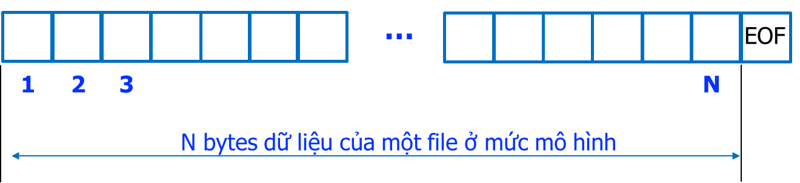

**❖ Có 2 loại:**

**+ *File văn bản (text file):*** chỉ lưu trữ thuần túy văn bản, trong đó các kí tự được biểu diễn bằng mã ASCII của nó, người dùng có thể đọc được.

. Điểm đặc biệt là dữ liệu của tập tin được lưu trữ thành các dòng, mỗi dòng được kết thúc bằng ký tự xuống dòng (new line), ký hiệu ‘\n’ *(Dòng không phải là một chuỗi vì không được kết thúc bởi ký tự ‘\0’)*; ký tự này là sự kết hợp của 2 ký tự CR (Carriage Return - Về đầu dòng, mã Ascii là 13) và LF (Line Feed - Xuống dòng, mã Ascii là 10).

. Mỗi tập tin được kết thúc bởi ký tự EOF (End Of File) có mã Ascii là 26 (xác định bởi tổ hợp phím Ctrl + Z).

**. Tính chất:** *Truy xuất tập tin theo kiểu văn bản chỉ có thể truy xuất theo kiểu tuần tự; Dễ truy xuất và xử lý; Độ bảo mật kém; Tốc độ truy xuất kém; Kích thước lớn.*

. Một số định dạng file văn bản có thể đọc dữ liệu trực tiếp như là file .txt.

**+ *File nhị phân:*** là file chứa dữ liệu mà có ít nhất một vài chuỗi bit không thể biểu diễn ở dạng văn bản trơn. Do đó file này chỉ có máy đọc được, còn người không đọc được.

**. Biến tập tin:** là một biến thuộc kiểu dữ liệu tập tin dùng để đại diện cho một tập tin. Dữ liệu chứa trong một tập tin được truy xuất qua các thao tác với thông số là biến tập tin đại diện cho tập tin đó.

**. Con trỏ tập tin:** Khi một tập tin được mở ra để làm việc, tại mỗi thời điểm, sẽ có một vị trí của tập tin mà tại đó việc đọc/ghi thông tin sẽ xảy ra. Người ta hình dung có một con trỏ đang chỉ đến vị trí đó và đặt tên nó là con trỏ tập tin.

. Sau khi đọc/ghi xong dữ liệu, con trỏ sẽ chuyển dịch thêm một phần tử về phía cuối tập tin. Sau phần tử dữ liệu cuối cùng của tập tin là dấu kết thúc tập tin EOF (End Of File).

**. Tính chất:** *Dữ liệu được đọc và ghi một cách chính xác, không có sự chuyển đổi nào cả; Truy xuất và xử lý phức tạp; Tốc độ truy xuất nhanh; Tính bảo mật cao hơn.*

. Các file nhị phân hay gặp nhất là dạng execute file (ví dụ định dạng .exe trên Windows, …). File nhị phân có thể lưu trữ được nhiều dạng dữ liệu như file text, file nhạc, file ảnh, …

\- Để có thể làm việc với file trong C/C++ ta cần thực hiện theo các bước:

**<span class="mark">Tạo đối tượng gắn với file → Mở file → Thao tác với file → Đóng file.</span>**

***<span class="mark">\*\*\* Từ phần này trở xuống, tài liệu sử dụng “DataFile” tượng trưng cho tên đối tượng file mà người dùng sẽ đặt.</span>***

## 6.2. Tạo đối tượng gắn với file

### 6.2.1. Stream (dòng)

❖ Khái niệm

▪ Là môi trường trung gian để giao tiếp (nhận/ gửi thông tin) giữa chương trình và thiết bị.

🡺 Muốn nhận/gửi thông tin cho một thiết bị ta sẽ gửi thông tin cho stream nối với thiết bị đó (độc lập thiết bị).

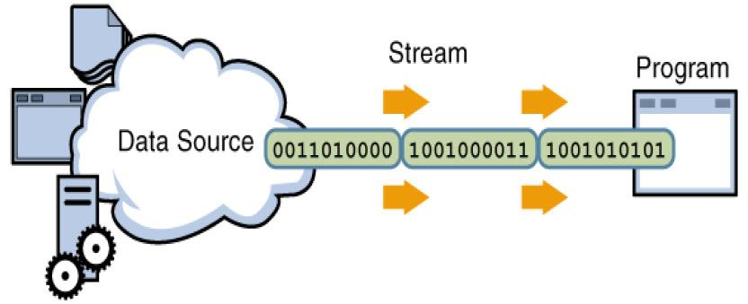

▪ Stream là dãy byte dữ liệu

• “Chảy” vào chương trình gọi là stream nhập (Input stream).

Input stream dùng để lưu giữ dữ liệu đầu vào từ data producer, như là bàn phím, file, hoặc một network. Ví dụ, một người dùng ấn một phím khi chương trình hiện tại không yêu cầu bất kỳ dữ liệu đầu vào nào, nó sẽ được lưu tạm thời trong Input stream.

• “Chảy” ra chương trình gọi là stream xuất.

Output stream dùng để lưu giữ dữ liệu đầu ra cho một data consumer nào đó, như là màn hình, file hoặc printer. Khi chúng ta muốn ghi dữ liệu lên một output device, có thể lúc này device chưa chấp nhận dữ liệu ngay, dữ liệu sẽ được lưu tạm thời trong Output stream.

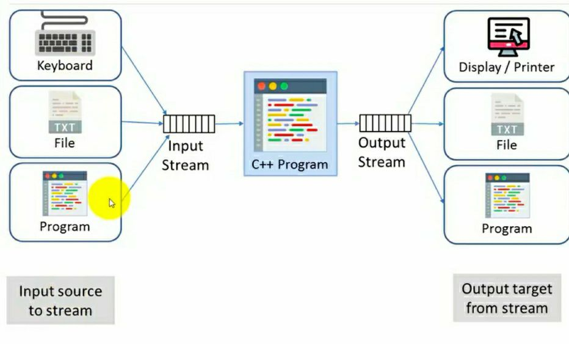

❖ Phân loại

▪ Stream văn bản (text)

• Chỉ chứa các ký tự.

• Tổ chức thành từng dòng, mỗi dòng tối đa 255 ký tự, kết thúc bởi ký tự sang dòng mới ‘\n’.

▪ Stream nhị phân (binary)

• Chứa các byte.

• Được đọc và ghi chính xác từng byte.

• Xử lý dữ liệu bất kỳ, kể cả dữ liệu văn bản.

• Được sử dụng chủ yếu với các tập tin trên đĩa.

❖ Các stream chuẩn định nghĩa sẵn

|       Tên       |   Stream   |  Thiết bị tương ứng  |
|:---------------:|:----------:|:--------------------:|
|      stdin      | Nhập chuẩn |       Bàn phím       |
|     stdout      | Xuất chuẩn |       Màn hình       |
|     stderr      | Lỗi chuẩn  |       Màn hình       |
| stdprn (MS-DOS) |  In chuẩn  |    Máy in (LPT1:)    |
| stdaux (MS-DOS) | Phụ chuẩn  | Cổng nối tiếp COM 1: |

❖ Ví dụ (hàm fprintf xuất ra stream xác định)

▪ Xuất ra màn hình: fprintf(stdout, “Hello”);

▪ Xuất ra máy in: fprintf(stdprn, “Hello”);

▪ Xuất ra thiết bị báo lỗi: fprintf(stderr, “Hello”);

▪ Xuất ra tập tin (stream fp): fprintf(fp, “Hello”);

### 6.2.2. Tạo đối tượng file

\- Trong C++, để làm việc với các hàm xử lý file cần khai báo đầu chương trình:

```cpp
#include <fstream>

#include <iostream>
```

\- Trong thư viện fstream thì ta có 3 loại File stream cơ bản sau:

**+ ifstream:** Dùng cho stream ***<u>đầu vào.</u>*** Loại này chỉ có thể được dùng để ***<span class="mark">đọc dữ liệu từ file</span>*** vào bộ nhớ mà thôi.

**+ ofstream:** Dùng cho stream ***<u>đầu ra.</u>*** Loại này thì có thể dùng để <span class="mark">***tạo ra files và chép dữ liệu vào files***.</span>

**+ fstream:** Đây là kênh file. (File stream). Loại này thì có thể ***vừa tạo file, vừa ghi dữ liệu vào file và đọc dữ liệu từ file*** vào.

\- Để định nghĩa một đối tượng file ta chọn các cách sau:

***fstream DataFile;***

***ifstream DataFile;***

***ofstream DataFile;***

\- Nếu sử dụng thư viện stdio.h trong C thì để định nghĩa một đối tượng file ta sử dụng biến con trỏ như sau:

***FILE \*DataFile;***

*Trong đó DataFile là tên do người dùng đặt theo quy tắc định danh.*

\- Quy tắc đặt tên tập tin: **<span class="mark">Tên. Phần_mở_rộng (Name. Extention)</span>**

***+ Phần tên:***

• Bắt buộc phải có.

• Hệ điều hành MS-DOS: dài tối đa 8 ký tự.

• Hệ điều hành Windows: dài tối đa 128 ký tự.

• Gồm các ký tự A đến Z, số 0 đến 9, ký tự khác như \#, \$, %, ~, ^, @, (, ), !, \_, khoảng trắng.

***+ Phần mở rộng:***

• Không bắt buộc.

• Thường có 3 ký tự.

• Thường do chương trình ứng dụng tạo tập tin tự đặt

## 6.3. Mở file

\- Sau khi đã tạo đối tượng file, ta mở file như sau:

\+ Mở ở dạng ifstream, ofstream: <span class="mark">*DataFile***.open**(“***Đường_dẫn_đến_file”***);</span>

\+ Mở ở dạng fstream: <span class="mark">*DataFile**.*****open*(“Đường_dẫn_đến_file”***, ***Chế độ mở***);</span>

\+ Vừa khai báo vừa mở file: <span class="mark">**fstream/ofstream/ifstream** *DataFile*(***“Đường_dẫn_đến_file”***, ***Chế độ mở***);</span>

*Trong đó:*

**❖ Đường dẫn**

▪ Chỉ đến một tập tin không nằm trong thư mục hiện hành. Ví dụ: c:\data\list.txt chỉ tập tin list.txt nằm trong thư mục data của ổ đĩa C.

▪ Trong chương trình, đường dẫn này được ghi trong chuỗi như sau: <span class="mark">“c:\\\data\\\list.txt”</span>

▪ Dấu ‘\\’ biểu thị ký tự điều khiển nên để thể hiện nó ta phải thêm một dấu ‘\\’ ở trước. Nhưng nếu chương trình yêu cầu nhập đường dẫn từ bàn phím thì chỉ nhập một dấu ‘\\’.

**❖ Các chế độ mở bao gồm:**

\+ **ios::out** - Mở file ở chế độ xuất ra, chế độ này cho phép *ghi dữ liệu vào file*.

\+ **ios::in** - Mở file ở chế độ nhập vào, tức là cho phép *dữ liệu được đọc từ file.*

\+ **ios::app** - Chế độ *nối vào.* Nếu file đã được tạo thì nội dung của nó sẽ được *thêm vào cuối của file.* Nếu file chưa được tạo nó sẽ tạo ra 1 file mới. (thường dùng kèm với ios::out).

\+ **ios::ate** - Nếu file đã được tạo, thì chương trình sẽ *chuyển con trỏ về cuối file.*

\+ **ios::binary** - Chế độ nhị phân. Khi mà file được mở ra ở chế độ này thì dữ liệu sẽ được đọc hay ghi từ 1 định dạng nguyên thủy nhị phân. *Khi đó các thao tác đọc, ghi trên biến file được thực hiện theo đơn vị byte theo kích thước các bản ghi (cấu trúc) được ghi trong file*

\+ **ios::trunc** - Nếu file đã được tạo thì *nội dung của nó sẽ bị xóa đi.*

\+ **ios::nocreate** - Không làm gì nếu file chưa có *(Mở tệp chỉ khi file đã tồn tại)*.

\+ **ios::noreplace** - Chỉ mở file khi file *chưa tồn tại (Nếu tệp đã tồn tại, việc mở tệp sẽ thất bại).*

\+ **ios::text** - Mở một file ở chế độ văn bản. *Khi đó các thao tác đọc, ghi trên biến file được thực hiện theo đơn vị là các từ, được phân cách bởi dấu trống (space bar) hoặc dấu xuống dòng (enter).*

***\*\*\* Để kết hợp các chế độ ta dùng toán tử \| .***

***\*\*\*** Nếu sử dụng* **fstream** *để định nghĩa đối tượng file thì khi dùng lệnh mở 1 file (**.open**) thì nhất thiết phải thêm tham số thứ 2 để biểu thị chế độ mà ta mở file.*

*- Mặc định:*

***ofstream ios::out***

***ifstream ios::in***

***fstream ios::in \| ios::out***

**<u>Ví dụ 1:</u>** khai báo và mở một tệp tin văn bản.

```cpp
fstream fi, fo;//khai báo
```

fi.open("vidu.txt", ios::in); // mở 1 tệp tin văn bản để đọc dữ liệu vào file.

fo.open("vidu.txt", ios::out); // mở 1 tệp tin văn bản để ghi dữ liệu ra file.

*Hoặc vừa khai báo vừa mở:*

```cpp
fstream fi("vidu.txt", ios::in);

fstream fo("vidu.txt", ios::out);
```

*Không dùng chế độ:*

```cpp
ofstream file;

file.open("vidu.txt");

ifstream file;

//...
```

**<u>Ví dụ 2:</u>** khai báo và mở một tệp tin nhị phân.

```cpp
fstream fi, fo;//khai báo
```

fi.open("vidu.bin", ios::in \| ios::binary); // mở 1 tệp tin nhị phân để đọc dữ liệu vào file.

fo.open("vidu.bin", ios::out \| ios::binary);// mở 1 tệp tin nhị phân để ghi dữ liệu ra file.

Hoặc vừa khai báo vừa mở:

```cpp
fstream fi("vidu.bin", ios::in | ios::binary);

fstream fo("vidu.bin", ios::out | ios::binary);
```

***Chú ý:*** *Khi dùng riêng lẻ thì **ios::out** sẽ xóa nội dung của file nếu file đã được tạo sẵn.* *Tuy nhiên nếu dùng chung với **ios::in**, thì nội dung file cũ sẽ được giữ lại.*

## 6.4. Đóng file

\- Để đóng file ta thực hiện như sau: ***<span class="mark">DataFile.close();</span>***

## 6.5. Xuất dữ liệu ra tệp tin (ghi file)

\- Ghi dữ liệu ra file nghĩa là ta *đưa dữ liệu từ bộ nhớ trong (RAM) ra lưu trữ trên bộ nhớ ngoài.*

\- Để ghi dữ liệu ra file ta sử dụng toán tử \<\< như sau:

***<span class="mark">DataFile \<\< chuỗi_hoặc_biểu_thức_cần_ghi;</span>***

Trong đó ***DataFile*** là tên đối tượng gắn với file mà ta cần ghi dữ liệu vào.

**<u>Ví dụ 1:</u>** Tạo và ghi dữ liệu vào file teptin.txt cùng thư mục với file .cpp trong project.

```cpp
#include <fstream>

#include <iostream>

using namespace std;

int main()

{

int x = 2015;

ofstream FILE; //Tạo đối tượng FILE để ghi dữ liệu vào file
```

FILE.open("teptin.txt"); //Gán file teptin.txt vao đối tượng file FILE

```cpp
FILE << "Ky thuat lap trinh " << x;
```

FILE.close(); /\*Đóng file hay giải phóng file teptin.txt khỏi đối tượng file FILE\*/

}

Sau khi chạy chương trình để xem kết quả ta tìm và mở file ***teptin.txt*** vừa được tạo ở trong cùng thư mục với file chứa ***code .cpp*** của chúng ta.

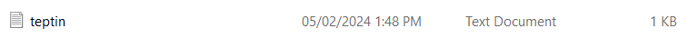

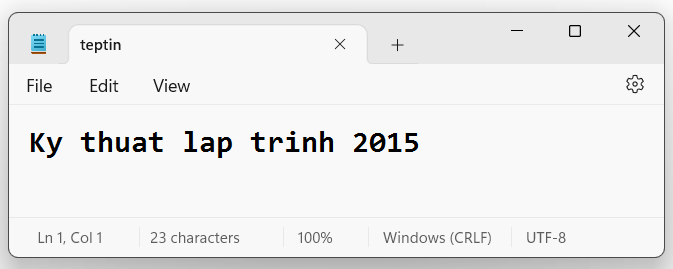

**<u>Ví dụ 2:</u>** Tạo và ghi dữ liệu vào file sochan.dat trong ổ đĩa D.

```cpp
#include <iostream>

#include <fstream>

using namespace std;

int main()

{

int i, x = 15;

ofstream File;

File.open("D://sochan.dat");

File << "Cac so chan nho hon " << x << " la:\n";

for (i = 0; i < x; i += 2)

File << i << "\t";

cout << "Ghi file thanh cong: Mo file sochan.dat trong o D de xem ket qua.";

File.close();

return 0;

}
```

***Kết quả:*** Ghi file thanh cong: Mo file sochan.dat trong o D de xem ket qua.

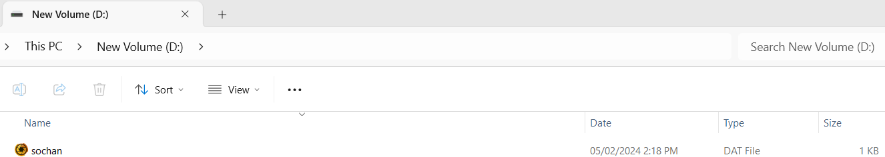

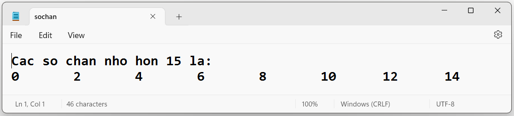

**<u>Ví dụ 3:</u>** Ghi thêm dữ liệu vào sau file sochan.dat vừa tạo ở trên

```cpp
#include <iostream>

#include <fstream>

using namespace std;

int main()

{

int i, x = 15;

fstream File; //Tao doi tuong File de ghi va doc noi dung tu file

//Mo file o che do them vao

File.open("D://sochan.dat", ios::out | ios::app);

File << "\nCac so le nho hon " << x << " la:\n";

for (i = 1; i < x; i += 2)

File << i << "\t";

cout << "Them du lieu thanh cong: Mo file sochan.dat trong o D de xem ket qua";

File.close();

return 0;

}
```

***Kết quả:*** Them du lieu thanh cong: Mo file sochan.dat trong o D de xem ket qua

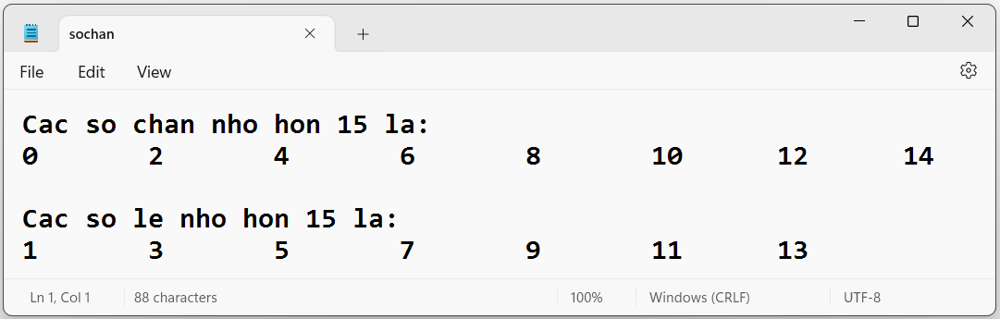

**<u>Ví dụ 4:</u>** *Minh họa việc ghi dữ liệu vào file*

*+ Tên file được người dùng tự nhập vào từ bàn phím.*

*+ Chương trình sẽ ghi vào file các **kí tự** do người dùng gõ vào từ bàn phím, mỗi **kí tự** được phân cách nhau bởi dấu trống (space bar).*

*+ Chương trình **dừng lại khi người dùng nhập kí tự ‘.’**. Và file được kết thúc bằng một dấu xuống dòng “endl”.*

```cpp
#include <iostream>

#include <fstream>
```

const int length = 25; // Độ dài tối đa tên file

```cpp
using namespace std;

int main() {

char fileName[length], input;

cout << "Ten tap tin : ";

cin.get(fileName, length); // Nhập tên file

// Mở file

ofstream fileOut(fileName); // Khai báo và mở file

if (!fileOut) {

cout << "Khong the tao duoc tap tin " << fileName << endl;

exit(1);

}

// Ghi dữ liệu vào file

do {
```

input = cin.get(); // Đọc kí tự từ bàn phím

fileOut \<\< input \<\< ' '; // Ghi kí tự vào file

```cpp
} while (input != '.'); //Kết thúc khi nhập vào dấu .
```

fileOut \<\< endl; // Xuống dòng cuối file

// Ghi dữ liệu vào file sử dụng put

/\*do {

input = cin.get(); // Đọc kí tự từ bàn phím

fileOut.put(input); ; // Ghi kí tự vào file

```cpp
fileOut.put(' ');

} while (input != '.'); //Kết thúc khi nhập vào dấu .
```

fileOut.put('\n'); // Xuống dòng cuối file \*/

// Đóng file

```cpp
fileOut.close();

return 0;

}
```

***Kết quả:***

Ten tap tin : demo.txt

A B C D E . F G H I J K

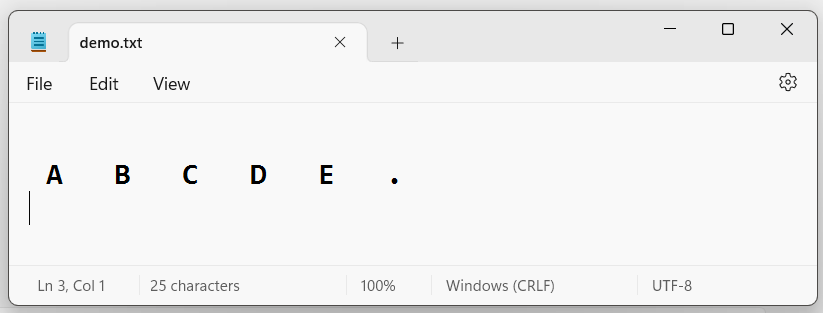

## 6.6. Đọc dữ liệu từ tệp tin (đọc file)

\- Đọc file nghĩa là ta đưa dữ liệu từ bộ nhớ ngoài (file) vào bộ nhớ trong (RAM).

\- Dùng toán tử ≫ để đọc file theo cú pháp: **<span class="mark">*DataFile* ≫ *biến;*</span>**

Toán từ này sẽ đọc nội dung file ***từ vị trí con trỏ hiện tại đến khoảng trống đầu tiên.***

**<u>Ví dụ 1:</u>** Giả sử ta có file **1.ini** nằm cùng thư mục với file soạn thảo .cpp và nội dung của nó như sau:

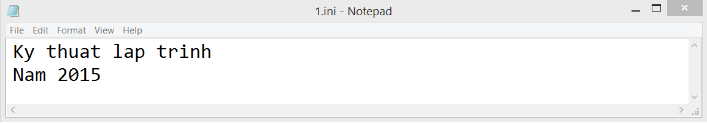

Đọc dữ liệu từ file 1.ini

```cpp
#include <iostream>

#include <fstream>

using namespace std;

int main()

{

char data[55];//Dung de luu du lieu tu file

ifstream teptin;

teptin.open("1.ini");

teptin >> data;

cout << "Tu dau tien cua file: " << data;

teptin.close();

teptin.open("1.ini");

cout << "\nNoi dung cua file: ";

while (teptin >> data) /*đọc một từ (một chuỗi ký tự không có dấu cách) từ file được mở (1.ini) và lưu nó vào biến data*/

cout << data << " ";

/*Nếu có thêm từ để đọc, nó lại tiếp tục vòng lặp. Nếu không còn từ nào để đọc hoặc có lỗi, điều kiện sẽ trở thành false và vòng lặp sẽ kết thúc.*/

teptin.close();

}
```

***Kết quả:***

Tu dau tien cua file: Ky

Noi dung cua file: Ky thuat lap trinh Nam 2015

\- Có thể dùng hàm **getline()** của **<span class="mark"><u>thư viện string</u></span>** để đọc dữ liệu từ file, hàm này đọc ***từng dòng dữ liệu đến kí tự xuống dòng hoặc đến kí tự delimiter ta truyền vào cho hàm.***

\- Cú pháp: ***<span class="mark">getline(DataFile, str, delimiter);</span>***

Trong đó:

. DataFile là luồng chứa file được tạo ra khi mở file bằng ifstream

. str là chuỗi để lưu kết quả đọc file

. delimiter là ký tự phân cách, và chúng ta có thể lược bỏ đối số này khi muốn sử dụng ký tự phân cách *mặc định là ký tự xuống dòng \n.*

Lưu ý, hàm getline chỉ có thể **đọc từng dòng file trong C++**, do đó chúng ta cần sử dụng hàm này kết hợp với một vòng lặp để có thể đọc toàn bộ các dòng trong file.

\- Ngoài ra còn có một dạng hàm getline thuộc thành viên của lớp ifstream khác:

```cpp
DataFile.getline(char* s, streamsize n, [char delim]);
```

Trong đó:

. s là một mảng ký tự sẽ chứa dữ liệu được đọc từ file.

. n là số lượng ký tự tối đa có thể đọc (bao gồm cả ký tự null cuối cùng).

. delimiter là ký tự phân cách, và chúng ta có thể lược bỏ đối số này khi muốn sử dụng ký tự phân cách *mặc định là ký tự xuống dòng \n.*

\+ Hàm **getline** sẽ đọc các ký tự từ file cho đến khi gặp ký tự xuống dòng hoặc đã đọc đủ n-1 ký tự. Nếu không đọc được ký tự xuống dòng trong n-1 ký tự đầu tiên, hàm sẽ đặt cờ lỗi **ios::failbit. **Khi cờ lỗi này được đặt, hàm sẽ ngừng đọc thêm ký tự. Nếu muốn đọc tiếp sau khi gặp lỗi, cần gọi hàm **clear()** để xóa các cờ lỗi.

\+ Hàm này cũng sẽ ngừng trích xuất các ký tự nếu đạt đến cuối tệp (end-of-file).

**<u>Ví dụ 2:</u>** Dùng hàm getline() để đọc file 1.ini

```cpp
#include <iostream>

#include <fstream>

//#include <string>

using namespace std;

int main()

{

char data[55];

//string data;

ifstream teptin("1.ini");

cout << "Noi dung file la:\n";

while (teptin.getline(data, 55))

//while (getline(teptin, data))

cout << data << endl;

teptin.close();

}
```

***Kết quả:***

Noi dung file la:

Ky thuat lap trinh

Nam 2015

**<u>Ví dụ 3:</u>** Minh họa về đăng nhập vào tài khoản của người dùng: (giả sử rằng thông tin đăng nhập gồm ID và Pass được lưu trong file info.txt).

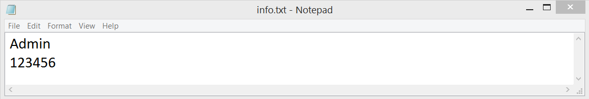

```cpp
#include <iostream>

#include <fstream>

#include <cstring>

using namespace std;

int main() {

// Khai báo phần liên quan đến file

char id[22], pass[22];

fstream File;
```

Dang_nhap: //Nhãn

```cpp
File.open("info.txt", ios::in);
```

    File.getline(id, 22); File.getline(pass, 22);

```cpp
File.close();

//Phần đăng nhập của user

char user[22], password[22];

int change;


cout << "============== DANG NHAP ==============\n";

cout << "User Name: "; cin.getline(user, 22);

cout << "Password: ";  cin.getline(password, 22);


if (strcmp(id, user) == 0 && strcmp(pass, password) == 0) {

cout << "Dang nhap thanh cong!\n";

cout << endl << "Ban co muon doi mat khau hay khong 1/0: ";

cin >> change;

if (change == 1) {

cout << "Nhap mat khau moi: ";

cin.ignore(1); cin.getline(pass, 22);

File.open("info.txt", ios::out);

File << id << endl << pass;

File.close();

cout << "Doi mat khau thanh cong!\nDang nhap lai:\n";
```

            goto Dang_nhap;

        }

    }

```cpp
else {

cout << "Thong tin dang nhap sai!\nDang nhap lai:\n";
```

        goto Dang_nhap;

    }

```cpp
return 0;

}
```

***Kết quả:***

============== DANG NHAP ==============

User Name: Admin

Password: 123456

Dang nhap thanh cong!

Ban co muon doi mat khau hay khong 1/0: 1

Nhap mat khau moi: 111111

Doi mat khau thanh cong!

Dang nhap lai:

============== DANG NHAP ==============

User Name: Admin

Password: 123456

Thong tin dang nhap sai!

Dang nhap lai:

============== DANG NHAP ==============

User Name: Admin

Password: 111111

Dang nhap thanh cong!

Ban co muon doi mat khau hay khong 1/0: 0

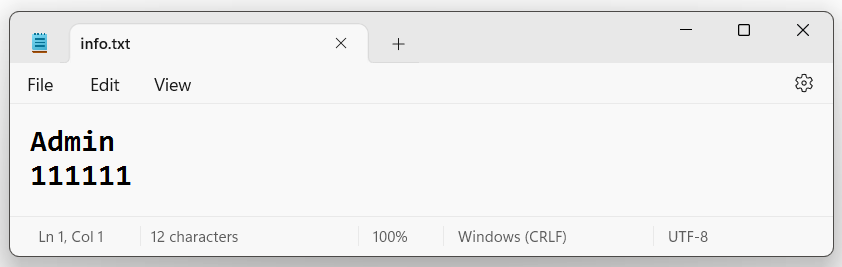

**<u>Ví dụ 4:</u>** *Minh hoạ việc đọc dữ liệu từ tập tin vừa sử dụng trong ví dụ 4 (phần 5) ra màn hình:*

*+ Tên tập tin được người dùng tự nhập vào từ bàn phím.*

*+ Chương trình sẽ đọc các kí tự trong file và hiển thị ra màn hình, mỗi kí tự được phân cách nhau bởi dấu trống (space bar).*

*+ Chương trình dừng lại khi kết thúc tập tin.*

```cpp
#include <iostream>

#include <fstream>
```

const int length = 25; // Độ dài tối đa tên file

```cpp
using namespace std;

int main() {

char fileName[length], input;

cout << "Ten tap tin : ";

cin.get(fileName, length); // Nhập tên file

// Mở file

ifstream fileIn(fileName); // Khai báo và mở file

if (!fileIn) {

cout << "Khong the mo duoc tap tin " << fileName << endl;

exit(1);

}

/* Đọc dữ liệu từ file ra màn hình */

while (fileIn) {
```

fileIn \>\> input; // Đọc kí tự từ file

```cpp
cout << input; // Ghi kí tự ra màn hình

}

cout << endl; // Xuống dòng trên màn hình

// Đọc dữ liệu từ file sử dụng get

//while (fileIn.get(input)) {

// cout << input; // Ghi kí tự ra màn hình

//}

//cout << endl; // Xuống dòng trên màn hình

/* Đóng file */
```

fileIn.close(); // Đóng file

```cpp
return 0;

}
```

***Kết quả:***

Ten tap tin : demo.txt

ABCDE..

***<u>Lưu ý:</u>***

\*\*\* Khi bạn sử dụng fileIn \>\> input; ***để đọc dữ liệu, nó sẽ bỏ qua các ký tự trắng (như dấu cách, tab, xuống dòng).*** Do đó, nó chỉ đọc các ký tự không phải ký tự trắng từ file.

***\*\*\* Có 2 dấu chấm ở cuối chuỗi khi xuất nội dung ra màn hình:***

fileIn chỉ trở thành false (điều này có nghĩa là biểu thức while (fileIn) sẽ dừng lại) sau khi thực sự cố gắng đọc từ file sau khi đã đến cuối file. Nếu đọc từ file và sau đó kiểm tra fileIn ngay lập tức, nó vẫn sẽ là true, ngay cả khi đã đọc đến cuối file. Đây là lý do vòng lặp while (fileIn) chạy một lần nữa sau khi đã đọc hết file. Trong lần lặp cuối cùng này, fileIn \>\> input không đọc được thêm ký tự nào từ file, vì vậy nó không thay đổi giá trị của input. Khi in input ra màn hình, ta thấy lại ký tự cuối cùng đã đọc từ file.

Để tránh vấn đề này, ta nên kiểm tra xem đã đọc đến cuối file ngay sau khi cố gắng đọc từ file. Ta có thể làm điều này bằng cách sử dụng biểu thức while (fileIn \>\> input) thay vì while (fileIn). Với biểu thức này, nếu fileIn \>\> input không thể đọc thêm ký tự nào từ file (vì đã đến cuối file), nó sẽ trả về false và vòng lặp sẽ dừng lại ngay lập tức.

```cpp
while (fileIn >> input) {

cout << input; // Ghi kí tự ra màn hình

}

cout << endl; // Xuống dòng trên màn hình
```

Với đoạn mã này, fileIn \>\> input sẽ trả về false khi nó cố gắng đọc sau khi đã đến cuối file, ngăn chặn vòng lặp chạy thêm một lần nữa. Kết quả là, sẽ chỉ thấy một dấu chấm ở cuối.

**<u>Ví dụ 5:</u>** *Minh hoạ việc copy toàn bộ nội dung của một tập tin sang một tập tin mới:*

*+ Tên tập tin nguồn và tập tin đích được nhập từ bàn phím bởi người dùng.*

*+ Tập tin nguồn được mở ở chế độ đọc.*

*+ Tập tin đích được mở ở chế độ ghi.*

*+ Đọc từng kí tự từ tập tin nguồn và ghi ngay vào tập tin đích.*

*+ Đóng các tập tin khi kết thúc*

```cpp
#include <iostream>

#include <fstream>
```

const int length = 25; // Độ dài tối đa tên file

```cpp
using namespace std;

int main() {

char sourceFile[length], targetFile[length], data;

cout << "Ten tap tin nguon : ";

cin.get(sourceFile, length);

cout << "Ten tap tin dich : ";

cin.ignore(1);

cin.get(targetFile, length);

/* Mở file nguồn */

ifstream fileIn(sourceFile);// Khai báo và mở file nguồn

if (!fileIn) { // Không mở được file nguồn

cout << "Khong the mo duoc tap tin nguon " << sourceFile << endl;

exit(1);

}

/* Mở file đích */

ofstream fileOut(targetFile);// Khai báo và mở file đích

if (!fileOut) { // Không mở được file đích

cout << "Khong the tao duoc tap tin dich " << targetFile << endl;

exit(1);

}

/* Đọc dữ liệu từ file nguồn ghi ra và vào file đích */

while (fileIn >> data) {// Đọc kí tự từ file nguồn
```

fileOut \<\< data; // Ghi kí tự ra file đích

}

/\* Sử dụng get và put

```cpp
while (fileIn.get(data))

fileOut.put(data);
```

\*/

/\* Đóng các file \*/

fileIn.close(); // Đóng file nguồn

fileOut.close(); // Đóng file đích

```cpp
return 0;

}
```

***Kết quả:***

Ten tap tin nguon : teptin.txt

Ten tap tin dich : saochep.txt

🡪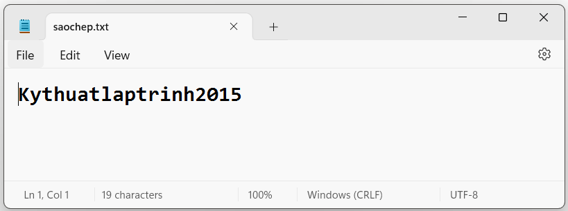

\- Chú ý:

\+ Phải sử dụng chế độ đọc/ghi file ***nhị phân*** khi muốn đọc, ghi các dữ liệu có ***kiểu cấu trúc (struct)*** vào file.

\+ Khi đọc/ghi dữ liệu kiểu cấu trúc, để toán tử sizeof() thực hiện chính xác thì các

**<u>Ví dụ 6:</u>** Minh hoạ việc ghi dữ liệu vào tập tin nhị phân, dữ liệu là kiểu cấu trúc:

\+ Tên file và số lượng mẫu tin được người dùng tự nhập vào từ bàn phím.

\+ Chương trình sẽ ghi vào file các mẫu tin có cấu trúc do người dùng gõ vào từ bàn phím.

```cpp
#include <iostream>

#include <fstream>
```

const int length = 25; // Độ dài tối đa tên file

```cpp
using namespace std;

struct Date {

int day; // Ngày

int month; // Tháng

int year; // Năm

};

struct Employee {

char name[20]; // Tên nhân viên

Date birthDay; // Ngày sinh của nhân viên

char role[20]; // Chức vụ của nhân viên

float salary; // Lương của nhân viên

};

int main() {

char fileName[length];

cout << "Ten tap tin : "; cin.get(fileName, length); // Nhập tên file

int recordNumber; // Số lượng record

cout << "So luong mau tin : "; cin >> recordNumber;

// Khai báo và mở file

fstream fileOut(fileName, ios::out | ios::binary);

if (!fileOut) { // Không mở được file

cout << "Khong the tao duoc tap tin " << fileName << endl;

exit(1);

}

/* Ghi dữ liệu vào file */

Employee myEmployee;

for (int i = 0; i < recordNumber; i++) {

cout << "Mau tin thu " << i + 1 << endl;

cout << "Name: ";

cin >> myEmployee.name; // Nhập tên nhân viên

cout << "Day of birth : ";

cin >> myEmployee.birthDay.day;// Nhập ngày sinh

cout << "Month of birth : ";

cin >> myEmployee.birthDay.month;// Nhập tháng sinh

cout << "Year of birth : ";

cin >> myEmployee.birthDay.year;// Nhập năm sinh

cout << "Role: ";

cin >> myEmployee.role; // Nhập chức vụ

cout << "Salary: ";

cin >> myEmployee.salary; // Nhập tiền lương

// Ghi dữ liệu vào file

fileOut.write(reinterpret_cast (&myEmployee), sizeof(Employee));

}

/* Đóng file */
```

fileOut.close(); // Đóng file

```cpp
return 0;

}
```

*\*\*\* Hàm write dùng cho file nhị phân sẽ đề cập ở phần 6.7.*

***Kết quả:***

Ten tap tin : nhanvien.dat

So luong mau tin : 2

=================================

Mau tin thu 1

Name: Nguyen Van Huy

Day of birth : 12

Month of birth : 1

Year of birth : 2000

Role: Nhan vien

Salary: 100

=================================

Mau tin thu 2

Name: Nguyen Thi Tam

Day of birth : 12

Month of birth : 3

Year of birth : 1999

Role: Nhan vien

Salary: 200

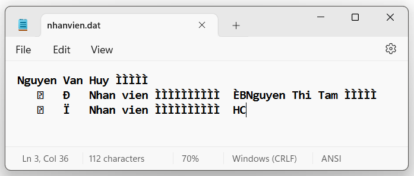

**<u>Ví dụ 7:</u>** *Minh hoạ việc đọc dữ liệu từ tập tin vào biến có cấu trúc:*

*+ Tên tập tin được người dùng tự nhập vào từ bàn phím.*

*+ Chương trình sẽ đọc các cấu trúc nhân viên trong tập tin và hiển thị ra màn hình.*

*+ Chương trình dừng lại khi kết thúc tập tin.*

```cpp
#include <iostream>

#include <fstream>
```

const int length = 25; // Độ dài tối đa tên file

```cpp
using namespace std;

struct Date {

int day; // Ngày

int month; // Tháng

int year; // Năm

};

struct Employee {

char name[20]; // Tên nhân viên

Date birthDay; // Ngày sinh của nhân viên

char role[20]; // Chức vụ của nhân viên

float salary; // Lương của nhân viên

};

int main() {

char fileName[length];

cout << "Ten tap tin : "; cin.get(fileName, length); // Nhập tên file

// Khai báo và mở file

fstream fileIn(fileName, ios::in | ios::binary);

if (!fileIn) { // Không mở được file

cout << "Khong the tao duoc tap tin " << fileName << endl;

exit(1);

}

/* Đọc dữ liệu từ file ra màn hình */

Employee myEmployee;

while (fileIn.read(reinterpret_cast(&myEmployee), sizeof(Employee))) {

// Đọc kí tự từ file

cout << myEmployee.name << " "
```

\<\< myEmployee.birthDay.day \<\< " / " \<\< myEmployee.birthDay.month \<\< " / "

\<\< myEmployee.birthDay.year

\<\< " " \<\< myEmployee.role \<\< " "

\<\< myEmployee.salary \<\< endl; // Ghi ra màn hình

}

/\* Đóng file \*/

fileIn.close(); // Đóng file

```cpp
return 0;

}
```

*\*\*\* Hàm read dùng cho file nhị phân sẽ đề cập ở phần 6.7.*

***\***

***Kết quả:***

Ten tap tin : nhanvien.dat

Nguyen Van Huy 12 / 1 / 2000 Nhan vien 100

Nguyen Thi Tam 12 / 3 / 1999 Nhan vien 200

## 6.7. Một số hàm tệp tin

### 6.7.1. Hàm xóa và đổi tên file

\- Để xóa tệp tin ta dùng hàm remove như sau:

```cpp
remove (“đường dẫn tập tin”);
```

\- Để đổi tên tệp tin ta dùng hàm rename như sau:

```cpp
rename (“tên tập tin cũ “, “tên tập tin mới “);
```

**<u>Ví dụ 1:</u>** đổi tên file info.txt ở ví dụ trên, sau đó xóa file khỏi ổ đĩa.

```cpp
#include <iostream>

#include <iostream>

using namespace std;

int main() {

char name[20]; int flag;

cout << "Ten file moi ban muon doi la: "; cin.getline(name, 20);

rename("info.txt", name);

cout << "Doi ten file thanh cong" << endl;

cout << "Ban co muon xoa file " << name << " khoi o dia khong ? 0/1: ";

cin >> flag;

if (flag == 1) {

remove(name);

cout << "Xoa file thanh cong";

}

return 0;

}
```

***Kết quả:***

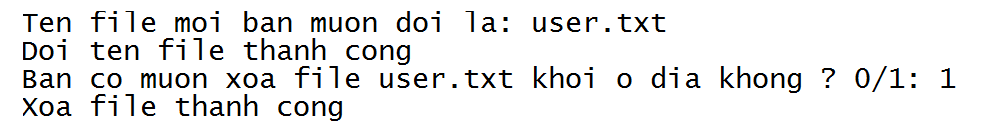

### 6.7.2. Hàm đọc và ghi kí tự

\- Hàm put() để ghi một kí tự vào file:

```cpp
DataFile.put(kí_tự);
```

**<u>Ví dụ 2:</u>** Ghi nội dung 1 câu văn vào file Vidu.txt

```cpp
#include <iostream>

#include <fstream>

using namespace std;

int main()

{

char ch;

fstream dataFile("Vidu.txt", ios::out);

cout << "Nhap noi dung muon ghi va ket thuc bang dau cham :\n";

cin.get(ch);

while (ch != '.')

{
```

dataFile.put(ch); cin.get(ch);

}

dataFile.put(ch); //Ghi dấu chấm cuối câu.

```cpp
dataFile.close();

return 0;

}
```

***Kết quả:***

Nhap noi dung muon ghi va ket thuc bang dau cham :

Ky Thuat Lap Trinh 2024.

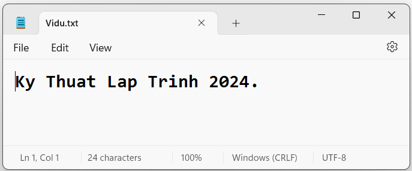

\- Hàm get() đọc một kí tự từ file. Nó sẽ đọc tất cả các ký tự, bao gồm cả dấu cách và ký tự xuống dòng:

```cpp
DataFile.get(kí_tự);
```

**<u>Ví dụ 3:</u>** Xuất ra màn hình nội dung của tệp Demo1.txt *(giả sử tệp có nội dung: Ky Thuat Lap Trinh)*

```cpp
#include <iostream>

#include <fstream>

using namespace std;

int main()

{

ifstream dataFile;

char data;

dataFile.open("Demo1.txt");

while (dataFile.get(data))

cout << data;

dataFile.close();

return 0;

}
```

***Kết quả:*** Ky Thuat Lap Trinh

**<u>Ví dụ 4:</u>** Ghi nội dung vào file vidu.doc và đọc nội dung của nó

```cpp
#include <iostream>

#include <fstream>

using namespace std;

int main() {

char kt;

fstream File;

File.open("vidu.doc", ios::out);

cout << "Nhap noi dung can ghi vao file va de ket thuc an dau ^\n";

cin.get(kt);

while (kt != '^') {
```

File.put(kt); cin.get(kt);

}

```cpp
File.close();

cout << "Du lieu duoc ghi thanh cong vao file vidu.doc\n";

cout << "Noi dung cua file vidu.doc la:\n";

File.open("vidu.doc", ios::in);

while (File.get(kt))

cout << kt;

File.close();

return 0;

}
```

***Kết quả:***

Nhap noi dung can ghi vao file va de ket thuc an dau ^

Ky Thuat Lap Trinh 2024^

Du lieu duoc ghi thanh cong vao file vidu.doc

Noi dung cua file vidu.doc la:

Ky Thuat Lap Trinh 2024


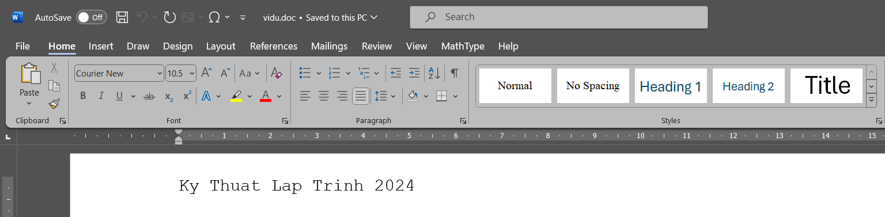

### 6.7.3. Hàm đọc và ghi file ở dạng nhị phân

\- Đối với file văn bản mỗi byte được xem là một kí tự. Kí tự có mã 26 được xem là kí tự kết thúc file.

\- Đối với file nhị phân, thông tin lưu trong file được xem như dãy byte bình thường. Mã kết thúc file được chọn là -1, được định nghĩa là EOF trong stdio.h. Các thao tác trên file nhị phân thường đọc ghi từng byte một, không quan tâm ý nghĩa của byte.

\- Một file luôn ngầm định dưới dạng văn bản, do vậy để chỉ định file là nhị phân ta cần sử dụng cờ ios::binary.

**+ Hàm write() ghi file ở dạng nhị phân:**

*\* Cú pháp:* **<span class="mark">DataFile.write(address, size);</span>**

Trong đó:

. DataFile - Đối tượng file.

. address – Địa chỉ đầu tiên của 1 vùng nhớ được ghi vào file.

. size – Số lượng byte của vùng nhớ mà nó sẽ được ghi

**<u>Ví dụ 5:</u>**

```cpp
char kitu = 'A';

file.write(&kitu, sizeof(kitu));
```

**<u>Ví dụ 6:</u>**

```cpp
char Data[] = {'A', 'B', 'C', 'D'};

file.write(Data, sizeof(Data));
```

**\**

**+ Hàm read() đọc file ở dạng nhị phân:**

*\* Cú pháp:* **<span class="mark">DataFile.read(address, size);</span>**

Trong đó:

. DataFile - Đối tượng file.

. address – Là địa chỉ đầu tiên của vùng nhớ mà dữ liệu được đọc vào & được lưu.

. size – Số lượng byte trong bộ nhớ được đọc vào từ file.

**<u>Ví dụ 7:</u>**

```cpp
char kitu = 'A';

file.read(&kitu, sizeof(kitu));
```

**<u>Ví dụ 8:</u>**

```cpp
char Data[5];

file.read(Data, sizeof(Data));
```

**\*\*\* Lưu ý:**

\+ Tham số thứ nhất buộc là con trỏ kiểu char trỏ đến vùng dữ liệu cần ghi vào file, nên khi muốn ghi dữ liệu có kiểu khác vào file, ta dùng hàm chuyển kiểu:

```cpp
reinterpret_cast (Dữ liệu);
```

\+ Tham số thứ hai là kích cỡ dữ liệu được ghi vào file. Kích cỡ này được tính theo byte, nên thông thường ta dùng toán tử:

```cpp
sizeof(Kiểu dữ liệu);
```

**<u>Ví dụ 9:</u>** Minh họa về ghi và đọc file ở dạng nhị phân

```cpp
#include <iostream>

#include <fstream>

using namespace std;

int main() {

char data[] = "Ky thuat lap trinh", data2[88], name[22];

fstream file;

cout << "Nhap vao ten file: ";

cin.getline(name, 22);

file.open(name, ios::out | ios::binary);
```

file.write(data, sizeof(data)); //Ham sizeof tra ve kich thuoc cua chuoi data

```cpp
file.close();

file.open(name, ios::in | ios::binary);

file.read(data2, sizeof(data2));

cout << "Noi dung da ghi vao file " << name << " la:\n" << data2;

file.close();

return 0;

}
```

***Kết quả:***

Nhap vao ten file: vidu9.txt

Noi dung da ghi vao file vidu9.txt la:

Ky thuat lap trinh

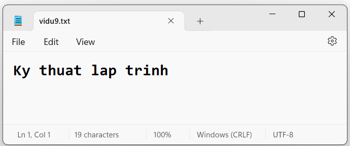

### 6.7.4. Các hàm di chuyển con trỏ file

\- Các phương thức sau cho phép làm việc trên đối tượng của **dòng xuất <span class="mark">(ofstream) (Di chuyển con trỏ ghi dữ liệu – put pointer).</span>**

\+ **DataFile.seekp(n);** Di chuyển con trỏ đến byte thứ n (các byte được *tính từ 0*)

\+ **DataFile.seekp(n, *vị trí xuất phát*);** Di chuyển đi n byte *(có thể âm – dịch về bên trái hoặc dương – dịch về bên phải)* từ vị trí xuất phát. Vị trí xuất phát gồm:

. ios::*beg : từ đầu file*

. ios::*end : từ cuối file*

. ios::*cur : từ vị trí hiện tại của con trỏ.*

\+ **DataFile.tellp(n);** Cho biết vị trí hiện tại của con trỏ, trả về vị trí tính theo byte mà con trỏ file đang ở.

\- Để làm việc với **<span class="mark">dòng nhập (ifstream) (Di chuyển con trỏ đọc)</span>** thì tên các phương thức trên được thay tương ứng bởi các tên: **seekg và tellg** (Nội dung sử dụng vẫn như trên)

\- Đối với các ***dòng nhập lẫn xuất*** có thể sử dụng được cả 6 phương thức trên.

**<u>Ví dụ 10:</u>** Minh họa việc sử dụng hàm seekg. Giả sử file.txt có nội dung như sau:

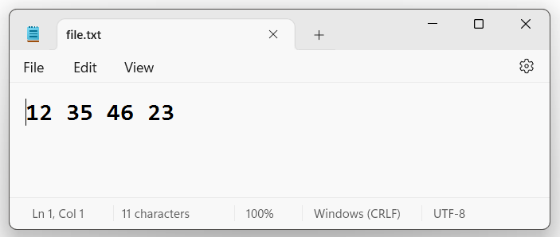

```cpp
#include <iostream>

#include <fstream>

using namespace std;

int main() {

fstream file;

file.open("file.txt", ios::in);

if (file.is_open())

cout << "Mo file thanh cong" << endl;

else

cout << "Mo file that bai" << endl;

//dịch chuyển qua phải 3 byte bắt đầu từ đầu file

file.seekg(3, ios::beg);

int x;

file >> x;

cout << x << endl;

//dịch chuyển qua phải 3 byte bắt đầu từ vị trí hiện tại

file.seekg(3, ios::cur);

file >> x;

cout << x << endl;

//dịch chuyển qua trái 1 byte bắt đầu từ cuối file

file.seekg(-1, ios::end);

file >> x;

cout << x << endl;

file.close();

return 0;

}
```

***Kết quả:***

Mo file thanh cong

35

23

3

**<u>Ví dụ 11:</u>** Minh họa việc sử dụng hàm tellg. Giả sử file.txt có nội dung như ví dụ 10:

```cpp
#include <iostream>

#include <fstream>

using namespace std;

int main() {

ifstream file;

file.open("file.txt");

if (file.is_open())

cout << "Mo file thanh cong" << endl;

else

cout << "Mo file that bai" << endl;

cout << "Vi tri con tro ban dau: " << file.tellg() << endl;

file.seekg(3, ios::beg);

cout << "Vi tri con tro hien tai: " << file.tellg();

file.close();

}
```

Mo file thanh cong

Vi tri con tro ban dau: 0

Vi tri con tro hien tai: 3

**<u>Ví dụ 12:</u>** Đếm số kí tự trong 1 file

```cpp
#include <iostream>

#include <fstream>

using namespace std;

int main() {

ofstream f;

f.open("demkitu.txt");

f << "Ky thuat lap trinh\nSu dung ngon ngu C++";

f.seekp(0, ios::end);

cout << "So ki tu co trong file la: " << f.tellp();

f.close();

return 0;

}
```

***Kết quả:*** So ki tu co trong file la: 40

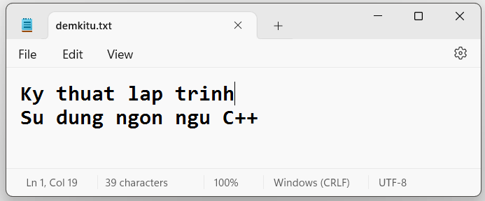

*Tuy nhiên file chỉ hiển thị số ký tự trong file là 39, kể cả ‘\n’. Nguyên nhân là do ký tự xuống dòng này có thể được biểu diễn bằng hai byte, tùy thuộc vào hệ điều hành. Ví dụ, trên hệ điều hành Windows, ký tự xuống dòng thường được biểu diễn bằng hai byte (\r\n). Do đó, khi ghi chuỗi vào file, ký tự xuống dòng sẽ chiếm hai byte, dẫn đến việc tellp() trả về số byte (và không phải số ký tự) là 40. Đây là lý do chương trình xuất ra số 40 thay vì số 39.*

**<u>Ví dụ 13:</u>** Thay thế nội dung của file

```cpp
#include <fstream>

#include <iostream>

using namespace std;

int main() {

ofstream f("thaythe.txt");

f << "Noi dung 1\nNoi dung 2\n";

f.seekp(0, ios::beg);

f << "Noi dung 3";

f.close();

return 0;

}
```

***Kết quả:***

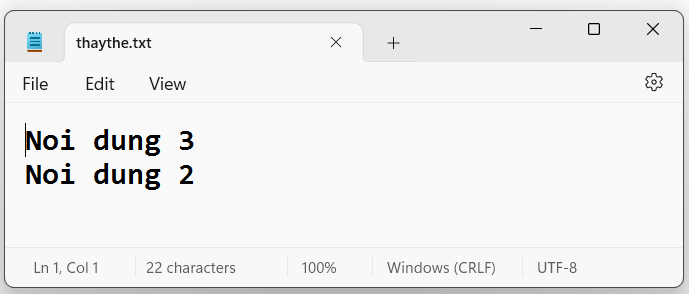

### 6.7.5. Kiểm tra xem file đã được mở hay chưa

\- Trong ngôn ngữ C++, để *kiểm tra xem file đã được mở hay chưa* ta sẽ dùng hàm **is_open()**, hàm trả về **true **nếu file đã được mở thành công và ngược lại, trả về **false **nếu mở file thất bại.

**<u>Ví dụ 12:</u>**

```cpp
#include <iostream>

#include <fstream>

using namespace std;

int main() {

fstream file;

file.open("file.txt", ios::out);

if (file.is_open())

cout << "Mo file thanh cong";

else

cout << "Mo file that bai";

return 0;

}
```

***Kết quả:*** Mo file thanh cong

\- Vẫn có một cách khác để kiểm tra file đã mở hay chưa, đó là sử dụng toán tử NOT (!).

**<u>Ví dụ 13:</u>**

```cpp
fstream file("demkitu.txt", ios::out);

if (!file) {

cout << "Unable to open file";

return 1;

}
```

Khi áp dụng cho một đối tượng fstream, toán tử ! sẽ trả về true nếu có lỗi xảy ra khi mở file (tức là file không mở được) và false nếu file mở thành công.

### 6.7.6. Kiểm tra xem đã liên kết thành công đến file cần mở hay chưa

\- Để kiểm tra xem đã liên kết thành công đến file cần mở hay chưa, ta sẽ dùng phương thức **fail(),** phương thức fail sẽ trả về **true** nếu đọc hoặc viết lên file bị lỗi hoặc khi ta đọc 1 số nguyên từ file nhưng dữ liệu được đọc là một string; trả về **false** khi không có lỗi phát sinh khi đọc viết file.

\- Hàm **fail()** kiểm tra trạng thái tổng quát của luồng file, bao gồm việc kiểm tra cả hàm is_open()

**<u>Ví dụ 14:</u>**

```cpp
#include <iostream>

#include <fstream>

using namespace std;

int main() {

fstream file;

file.open("file.txt", ios::out);

if (!file.fail())

cout << "Lien ket den file thanh cong";

else

cout << "lien ket den file that bai";

return 0;

}
```

***Kết quả:*** Lien ket den file thanh cong

### 6.7.7. Kiểm tra con trỏ file đã đến cuối file hay chưa

\- Để kiếm tra xem con trỏ đã trỏ đến cuỗi file hay chưa, ta sẽ dùng phương thức **eof()**, trả về **true **khi con trỏ đã trỏ tới cuối file và với **false **thì ngược lại.

**<u>Ví dụ 15:</u>**

```cpp
#include <iostream>

#include <fstream>

#include <string>

using namespace std;

int main() {

fstream file;

file.open("Demo1.txt", ios::in);

if (file.is_open())

cout << "Mo file thanh cong" << endl;

else

cout << "Mo file that bai" << endl;

cout << "Noi dung cua file la: " << endl;

string str;

while (!file.eof()) //khi chưa tới cuối file thì tiếp tục đọc

{

getline(file, str);

cout << str << endl;

}

file.close();

return 0;

}
```

***Kết quả:***

Mo file thanh cong

Noi dung cua file la:

Ky Thuat Lap Trinh

### 6.7.8. Kiểm tra trạng thái của file có tốt để đọc/ghi không

**- Hàm good()** là hàm kiểm tra hoàn thiện việc ghi và đọc tập tin. Hàm trả về true (tương đương với giá trị khác 0) khi tất cả các hàm *eof(), fail() và bad() đều trả về giá trị 0* *(không có lỗi nào xảy ra trong quá trình đọc, ghi hoặc mở file)*, ngược lại chỉ cần 1 trong các hàm eof(), fail() và bad() trả về 1 thì kết quả của hàm good sẽ trả về false (tương đương với giá trị là 0) *(file không tồn tại, không thể mở file, lỗi đọc/ghi file, hoặc đã đọc tới cuối file).*

**<u>Ví dụ 16:</u>**

```cpp
#include <iostream>

#include <fstream>

using namespace std;

int main() {

fstream file;

file.open("example.txt", ios::in);

if (file.good()) {

cout << "File opened successfully and ready for operations." << endl;

}

else {

cout << "Error occurred while opening the file." << endl;

}

file.close();

return 0;

}
```

### 6.7.9. Kiểm tra lỗi nghiêm trọng trong quá trình thao tác với file

Sử dụng hàm **bad()**. Nếu phát hiện ra lỗi ***trong quá trình*** ghi tập tin thì hàm trả về true (tương đương với giá trị khác 0), ngược lại nếu không thì kết quả sẽ trả về false (tương đương với giá trị là 0).

Chẳng hạn trong chương trình, chúng ta ghi nội dung vào tập tin đã đóng thì sẽ xuất hiện lỗi và hàm này sẽ cho giá trị true.

**<u>Ví dụ 17:</u>**

```cpp
#include <iostream>

#include <fstream>

using namespace std;

int main() {

fstream file;

file.open("example.txt", ios::in);

if (!file.bad()) {

cout << "No serious errors occurred while opening or reading the file." << endl;

}

else {

cout << "A serious error occurred while opening or reading the file." << endl;

}

file.close();

return 0;

}
```

### 6.7.10. Hàm đếm số kí tự

\- Để đếm số ký tự của một chuỗi, ta sử dụng hàm **.gcount();**

**<u>Ví dụ 18:</u>**

```cpp
#include <iostream>

using namespace std;

int main() {

char str[20];

cout << "Please, enter a word: ";

cin.getline(str, 20);

cout << cin.gcount() << " characters read: " << str << '\n';

return 0;

}
```

***Kết quả:***

Please, enter a word: Simplify

9 characters read: Simplify

**<u>Ví dụ 19:</u>** Đọc số ký tự trong file demkitu.txt ở ví dụ 12


```cpp
#include <iostream>

#include <fstream>

using namespace std;

int main() {

char buffer[100];

ifstream file("demkitu.txt");

if (!file) {

cout << "Unable to open file";

return 1;

}

file.read(buffer, sizeof(buffer));

// Số ký tự đã được đọc

int count = file.gcount();

cout << "Number of characters read: " << count << endl;

file.close();

return 0;

}
```

***Kết quả:*** Number of characters read: 39

## 6.8. Ghép nội dung trên file

\- Giả sử đã có 2 file khác nhau có tên lần lượt là file1, file2. Cần *ghép nội dung 2 file đó vào một file mới thứ 3 có tên file3.*

\- Cách làm như sau:

*+ Nhập tên file1 và tên file2, có biến f1 và biến f2 tương ứng.*

*+ Mở 2 tệp f1, f2 ở chế độ đọc.*

*+ Nhập tên file3, tương ứng là biến f3.*

*+ Mở tệp f3 ở chế độ ghi.*

*+ Lần lượt đưa nội dung của file f1 và file f2 vào file f3.*

*+ Đóng cả 3 file trên.*

**<u>Ví dụ:</u>** giả sử đã có 2 file baitap1.txt, baitap2.txt, sao chép nội dung 2 file đó vào file thứ 3 có tên baitap3.txt

Nội dung file baitap1.txt & baitap2.txt:

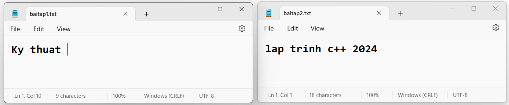

```cpp
#include <iostream>

#include <fstream>

using namespace std;

int main() {

char file1[30], file2[30], file3[30], ch;

fstream f1, f2, f3;

//Nhập tên file 1, file 2

cout << "Nhap ten file thu nhat: "; cin.getline(file1, 30);

cout << "Nhap ten file thu hai: "; cin.getline(file2, 30);

//Mở file 1, file 2
```

f1.open(file1, ios::in); f2.open(file2, ios::in);

```cpp
if ((!f1) || (!f2)) {

cout << "\nLoi file nguon!";

return 0;

}

else {

//Làm việc với file 3

cout << "\nNhap ten file thu ba: "; cin.getline(file3, 30);

//Mở file 3

f3.open(file3, ios::out);

if (!f3)

cout << "\nloi file 3!";

else {

while (f1 >> noskipws >> ch)

f3 << ch;

f3 << "\n";

while (f2 >> noskipws >> ch)

f3 << ch;

cout << "\nNoi dung duoc ghep noi thanh cong!";

}

}
```

f1.close(); f2.close(); f3.close();

```cpp
return 0;

}
```

***Kết quả:*** Noi dung duoc ghep noi thanh cong!

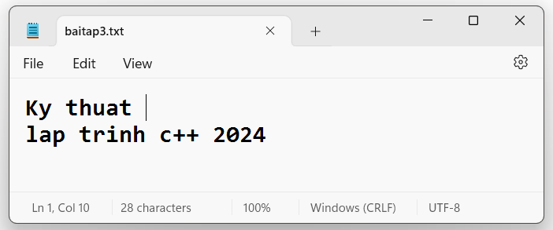

***\* Về std::skipws (skip white space – bỏ qua khoảng trắng) và std::noskipws.***

Cờ skipws trong C++ là một cờ định dạng được sử dụng để kiểm soát việc bỏ qua các ký tự khoảng trắng khi đọc từ luồng đầu vào. *Khi cờ skipws được thiết lập (điều này xảy ra theo mặc định), các thao tác đọc từ luồng sẽ tự động bỏ qua các ký tự khoảng trắng (như dấu cách, ký tự tab, và ký tự xuống dòng) cho đến khi gặp ký tự không phải khoảng trắng đầu tiên.*

Ví dụ, một luồng đầu vào chứa chuỗi " Hello, World!" và đọc từ luồng này vào một biến chuỗi, thì nếu cờ skipws được thiết lập, chuỗi nhận được sẽ là "Hello, World!" thay vì " Hello, World!".

*Hàm noskipws được sử dụng để xóa cờ skipws, điều này có nghĩa là khi đọc từ luồng, các ký tự khoảng trắng ban đầu sẽ không bị bỏ qua.*

## 6.9. Viết và đọc dữ liệu khi sử dụng C

\- Sử dụng **<span class="mark">\#include\<stdio.h\></span>**

**- Khai báo biến file:**

**FILE danh sách các biến con trỏ;**

**<u>Ví dụ 1:</u>** FILE\* f;

**- Mở file:**

**Tên biến file = fopen(“path”, “chế độ mở”);**

*Chế độ mở:*

<table>
<colgroup>
<col style="width: 6%" />
<col style="width: 46%" />
<col style="width: 46%" />
</colgroup>
<thead>
<tr>
<th style="text-align: center;"><p><strong>r</strong></p></th>
<th style="text-align: center;"><p>Mở file có sẵn, chỉ cho phép đọc</p></th>
<th style="text-align: center;"><p>Nếu file không tồn tại, fopen() trả về NULL.</p></th>
</tr>
</thead>
<tbody>
<tr>
<td style="text-align: center;"><p><strong>rb</strong></p></td>
<td style="text-align: center;"><p>Mở file chỉ cho phép đọc dưới dạng nhị phân.</p></td>
<td style="text-align: center;"><p>Nếu file không tồn tại, fopen() trả về NULL.</p></td>
</tr>
<tr>
<td style="text-align: center;"><p><strong>w</strong></p></td>
<td style="text-align: center;"><p>Mở file chỉ cho phép ghi.</p></td>
<td style="text-align: center;"><p><em>Nếu file đã tồn tại, nội dung sẽ bị ghi đè.</em></p>
<p>Nếu file không tồn tại, nó sẽ được tạo tự động.</p></td>
</tr>
<tr>
<td style="text-align: center;"><p><strong>wb</strong></p></td>
<td style="text-align: center;"><p>Mở file cho phép ghi dưới dạng nhị phân.</p></td>
<td style="text-align: center;"><p>Nếu file đã tồn tại, nội dung sẽ bị ghi đè.</p>
<p>Nếu file không tồn tại, nó sẽ được tạo tự động.</p></td>
</tr>
<tr>
<td style="text-align: center;"><p><strong>a</strong></p></td>
<td style="text-align: center;"><p>Mở file ở chế độ ghi “append”. Tức là sẽ ghi vào <em>cuối</em> của nội dung đã có.</p></td>
<td style="text-align: center;"><p>Nếu file không tồn tại, nó sẽ được tạo tự động.</p></td>
</tr>
<tr>
<td style="text-align: center;"><p><strong>ab</strong></p></td>
<td style="text-align: center;"><p>Mở file ở chế độ ghi nhị phân “append”. Tức là sẽ ghi vào cuối của nội dung đã có.</p></td>
<td style="text-align: center;"><p>Nếu file không tồn tại, nó sẽ được tạo tự động.</p></td>
</tr>
<tr>
<td style="text-align: center;"><p><strong>r+</strong></p></td>
<td style="text-align: center;"><p>Mở file có sẵn, cho phép cả đọc và ghi.</p></td>
<td style="text-align: center;"><p>Nếu file không tồn tại, fopen() trả về NULL.</p></td>
</tr>
<tr>
<td style="text-align: center;"><p><strong>rb+</strong></p></td>
<td style="text-align: center;"><p>Mở file cho phép cả đọc và ghi ở dạng nhị phân.</p></td>
<td style="text-align: center;"><p>Nếu file không tồn tại, fopen() trả về NULL.</p></td>
</tr>
<tr>
<td style="text-align: center;"><p><strong>w+</strong></p></td>
<td style="text-align: center;"><p>Mở file cho phép cả đọc và ghi.</p></td>
<td style="text-align: center;"><p>Nếu file đã tồn tại, nội dung sẽ bị ghi đè.</p>
<p>Nếu file không tồn tại, nó sẽ được tạo tự động.</p></td>
</tr>
<tr>
<td style="text-align: center;"><p><strong>wb+</strong></p></td>
<td style="text-align: center;"><p>Mở file cho phép cả đọc và ghi ở dạng nhị phân.</p></td>
<td style="text-align: center;"><p><em>Nếu file đã tồn tại, nội dung sẽ bị ghi đè.</em></p>
<p>Nếu file không tồn tại, nó sẽ được tạo tự động.</p></td>
</tr>
<tr>
<td style="text-align: center;"><p><strong>a+</strong></p></td>
<td style="text-align: center;"><p>Mở file cho phép đọc và ghi “append”. <em>Có thể đọc từ đầu file, nhưng khi ghi thì ghi từ vị trí cuối cùng của file.</em></p></td>
<td style="text-align: center;"><p>Nếu file không tồn tại, nó sẽ được tạo tự động.</p></td>
</tr>
<tr>
<td style="text-align: center;"><p><strong>ab+</strong></p></td>
<td style="text-align: center;"><p>Mở file cho phép đọc và ghi “append” ở dạng nhị phân.</p></td>
<td style="text-align: center;"><p>Nếu file không tồn tại, nó sẽ được tạo tự động.</p></td>
</tr>
</tbody>
</table>

**<u>Ví dụ 2:</u>** f = fopen("vdc.txt", "w");

**- Đọc dữ liệu từ file:**

**<u>Ví dụ 3:</u>**

fscanf(f, "%d", &x); /\*Đọc dữ liệu dạng số nguyên từ file cho vào biến x \*/

```cpp
char s[80]; fgets(s, 80, f); /*Đưa vào chuỗi s tối đa 80 kí tự lấy từ file */

char c = getc(f); //Đọc 1 kí tự từ file lưu vào biến c
```

**- Ghi dữ liệu vào file:**

**<u>Ví dụ 4:</u>**

fprintf(f, "%d", x); // Xuất giá trị nguyên x ra file

fputs("Ky Thuat Lap Trinh", f); //Xuất chuỗi ra file

putc('c', f); // Xuất ký tự ‘c’ ra file

**- Đóng file:** **fclose (tên biến file);**

**<u>Ví dụ 5:</u>** fclose(f);

**<u>Ví dụ 6:</u>** Mở và ghi dữ liệu lên file.

```cpp
#include <iostream>

int main()

{

FILE* data; // khai báo con trỏ data dạng FILE
```

data = fopen("vdc.txt", "w"); //w là chế độ xử lý file

//Mở file vdc.txt để ghi dữ liệu lên đó ( w – ý nghĩa là mở để ghi)

```cpp
fprintf(data, "Day la vi du ve ghi du lieu len file");

//Hàm fprintf dùng để ghi dữ liệu vào file

fclose(data);// Đóng file

return 0;

}
```

***Kết quả:***

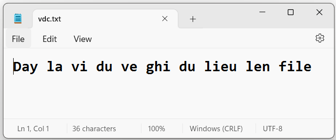

**<u>Ví dụ 7:</u>** Mở và đọc dữ liệu từ file.

```cpp
#include <iostream>

int main()

{

FILE* data;

char dulieu[1000];// dùng để chứa nội dung file
```

data = fopen("vdc.txt", "r"); //mở file vdc.txt ở chế độ để đọc

```cpp
while (fscanf(data, "%s", dulieu) != EOF)

/*Sử dụng hàm fscanf để đọc dữ liệu từ file, EOF (end of file) – Nghĩa là đọc đến cuối file.*/

printf("%s ", dulieu);/* Hiển thị nội dung file đã lưu trong chuỗi
```

dulieu \*/

```cpp
fclose(data); // Đóng file

}
```

***Kết quả:*** Day la vi du ve ghi du lieu len file

<table>
<colgroup>
<col style="width: 16%" />
<col style="width: 0%" />
<col style="width: 31%" />
<col style="width: 0%" />
<col style="width: 11%" />
<col style="width: 0%" />
<col style="width: 38%" />
</colgroup>
<thead>
<tr>
<th colspan="3" style="text-align: center;"><strong>Một số hàm xử lý chung</strong></th>
<th colspan="4" style="text-align: center;"><strong>Một số hàm xử lý tập tin văn bản</strong></th>
</tr>
</thead>
<tbody>
<tr>
<td colspan="2" style="text-align: center;"><em><strong>Tên hàm</strong></em></td>
<td style="text-align: center;"><em><strong>Chức năng</strong></em></td>
<td colspan="3" style="text-align: center;"><em><strong>Tên hàm</strong></em></td>
<td style="text-align: center;"><em><strong>Chức năng</strong></em></td>
</tr>
<tr>
<td colspan="2" style="text-align: center;"><strong>fopen</strong></td>
<td style="text-align: center;">Mở tập tin</td>
<td colspan="3" style="text-align: center;"><strong>fprintf</strong></td>
<td style="text-align: center;">Ghi giá trị dạng text lên tập tin</td>
</tr>
<tr>
<td colspan="2" style="text-align: center;"><strong>fclose</strong></td>
<td style="text-align: center;">Đóng file</td>
<td colspan="3" style="text-align: center;"><strong>fscanf</strong></td>
<td style="text-align: center;">Đọc giá trị dạng text từ tập tin</td>
</tr>
<tr>
<td colspan="2" style="text-align: center;"><strong>fcloseall</strong></td>
<td style="text-align: center;">Đóng tất cả file đang mở</td>
<td colspan="3" style="text-align: center;"><strong>putc/fputc</strong></td>
<td style="text-align: center;">Ghi lên tập tin một kí tự (sử dụng tập tin văn bản hoặc nhị phân có khác biệt )</td>
</tr>
<tr>
<td colspan="2" style="text-align: center;"><strong>fflush</strong></td>
<td style="text-align: center;">Làm sạch vùng đệm của một tập tin đang mở</td>
<td colspan="3" style="text-align: center;"><strong>getc/fgetc</strong></td>
<td style="text-align: center;">Đọc từ tập tin một kí tự (sử dụng tập tin văn bản hoặc nhị phân có khác biệt)</td>
</tr>
<tr>
<td colspan="2" style="text-align: center;"><strong>fflushall</strong></td>
<td style="text-align: center;">Làm sạch vùng đệm của tất cả</td>
<td colspan="3" style="text-align: center;"><strong>fputs</strong></td>
<td style="text-align: center;">Ghi một chuỗi vào tập tin</td>
</tr>
<tr>
<td colspan="2" style="text-align: center;"><strong>remove/unlink</strong></td>
<td style="text-align: center;">Xóa file</td>
<td colspan="3" style="text-align: center;"><strong>fgets</strong></td>
<td style="text-align: center;">Đọc một chuỗi từ tập tin</td>
</tr>
<tr>
<td colspan="2" style="text-align: center;"><strong>feof</strong></td>
<td style="text-align: center;">Kiểm tra đã đến cuối file chưa</td>
<td colspan="3" style="text-align: center;"></td>
<td style="text-align: center;"></td>
</tr>
<tr>
<td colspan="7" style="text-align: center;"><strong>Một số hàm xử lý tập tin nhị phân</strong></td>
</tr>
<tr>
<td style="text-align: center;"><em><strong>Tên hàm</strong></em></td>
<td colspan="3" style="text-align: center;"><em><strong>Chức năng</strong></em></td>
<td style="text-align: center;"><em><strong>Tên hàm</strong></em></td>
<td colspan="2" style="text-align: center;"><em><strong>Chức năng</strong></em></td>
</tr>
<tr>
<td style="text-align: center;"><strong>putw</strong></td>
<td colspan="3" style="text-align: center;">Ghi một số nguyên lên tập tin</td>
<td style="text-align: center;"><strong>fread</strong></td>
<td colspan="2" style="text-align: center;">Đọc các mẫu tin (có cấu trúc định trước) từ tập tin</td>
</tr>
<tr>
<td style="text-align: center;"><strong>getw</strong></td>
<td colspan="3" style="text-align: center;">Đọc một số nguyên từ tập tin</td>
<td style="text-align: center;"><strong>fseek</strong></td>
<td colspan="2" style="text-align: center;">Di chuyển con trỏ đến vị trí mong muốn</td>
</tr>
<tr>
<td style="text-align: center;"><strong>fwrite</strong></td>
<td colspan="3" style="text-align: center;">Ghi các mẫu tin (có cấu trúc định trước) lên tập tin</td>
<td style="text-align: center;"><strong>ftell</strong></td>
<td colspan="2" style="text-align: center;">Cho biết vị trí hiện tại của con trỏ</td>
</tr>
</tbody>
</table>

*Do tài liệu này tập trung phần ngôn ngữ C++ nên các hàm trên được mô tả một cách vắn tắt.*

## 6.10. Streams for string C++

\- Chúng ta thường nhập và xuất dữ liệu sử dụng các đối tượng std::cout, std::cin hay các file streams. Những đối tượng này đóng vai trò là cấu nối trung gian giữa chương trình và các thiết bị, hoặc file.

\- Bên cạnh đó, ngôn ngữ C++ còn định nghĩa thêm một số stream sử dụng cho các đối tượng std::string cho phép chúng ta sử dụng các toán tử (\<\>) để làm việc với std::string. Cũng giống như istream và ostream, string stream cung cấp một buffer để chứa dữ liệu. Tuy nhiên, string stream không kết nối đến các Input/Output channel (như keyboard, monitor, file,...).

### 6.10.1. Stream for string

\- Một số stream dùng cho std::string mà ngôn ngữ C++ cung cấp sẵn: **istringstream (thừa kế từ istream), ostringstream (thừa kế từ ostream) và stringstream (thừa kế từ iostream).**

\- Để sử dụng stringstream, chúng ta cần include thư viện sstream:

```cpp
#include <iostream>
```

\- Có 2 cách để đưa dữ liệu vào buffer của một đối tượng stringstream:

***+ Sử dụng insertion operator (\<\<):***

```cpp
std::stringstream ss;

ss << "I'm learning" << " " << "C++ programming language" << std::endl;
```

***+ Set value bằng phương thức str:***

```cpp
std::stringstream ss;

ss.str("I'm learning C++ programming language\n");
```

\- Phương thức str còn được dùng để truy xuất dữ liệu trong một đối tượng stringstream (trả về kiểu std::string):

```cpp
std::stringstream ss;

ss << "I'm learning" << " " << "C++ programming language" << std::endl;

std::cout << ss.str();
```

\- Để lấy dữ liệu từ buffer của đối tượng stringstream đưa vào std::string, chúng ta sử dụng insertion operator (\>\>):

```cpp
std::stringstream os;
```

os \<\< "12345 67.89"; *// insert a string of numbers into the stream*

```cpp
std::string strValue;

os >> strValue;

std::string strValue2;

os >> strValue2;
```

*// print the numbers separated by a dash*

```cpp
std::cout << strValue << " - " << strValue2 << std::endl;
```

Kết quả: 12345 – 67.89

Cũng tương tự như khi sử dụng insertion operator (\>\>) của đối tượng std::cin cho kiểu dữ liệu std::string, *kí tự khoảng cách không được đọc vào std::string.* Chúng ta có thể sử dụng đặc điểm này để thực hiện split string như sau:

```cpp
#include <iostream>

#include <sstream>

#include <vector>

#include <string>

using namespace std;

int main() {

string data = "Ky Thuat Lap Trinh";
```

stringstream spliter;

```cpp
spliter << data;

vector<string> result;

while (!spliter.eof())

{

string str;

spliter >> str;

result.push_back(str);

}

for (int i = 0; i < result.size(); i++)

{

cout << result.at(i) << endl;

}

return 0;

}
```

***Kết quả:***

Ky

Thuat

Lap

Trinh

Đầu tiên chúng ta đẩy tất cả các kí tự đang được lưu trong string data vào đối tượng stringstream, với mỗi lần trích xuất dữ liệu bằng extraction operator (\>\>) vào một string khác, chúng ta thêm string đó vào vector kết quả.

### 6.10.2. Chuyển đổi giữa chuỗi và số

\- Vì insertion và extraction operator có thể làm việc với các kiểu dữ liệu cơ bản, chúng ta có thể sử dụng chúng để chuyển đổi strings sang number (và ngược lại).

```cpp
#include <iostream>

#include <sstream>

#include <string>

#include <iostream>

using namespace std;

int main() {

//chuyển số sang chuỗi:
```

stringstream ss;

```cpp
int nValue = 12345;

double dValue = 67.89;

ss << nValue << " " << dValue;

string strValue1, strValue2;

ss >> strValue1 >> strValue2;

cout << strValue1 << " " << strValue2 << endl;

//Và đoạn chương trình sau chuyển strings về lại numbers :
```

stringstream ss1;

```cpp
ss1 << "12345 67.89";

int nValue1;

double dValue1;

ss1 >> nValue1 >> dValue1;

cout << nValue1 << " " << dValue1 << endl;

return 0;

}
```

### 6.10.3. Stringstream và ứng dụng

> <https://blog.28tech.com.vn/c-stringstream-trong-c-va-ung-dung>

**Stringstream **trong C++ là một công cụ hữu ích với các bài toán xử lý xâu ký tự, đặc biệt với các bài toán tách từ trong xâu. Bài học này mình sẽ hướng dẫn các bạn cách sử dụng stringstream để tách từ

#### 6.10.3.1. Stringstream và bài toán tách từ

Thông thường khi chuẩn hóa hay xử lý xâu ký tự thì bạn cần tách riêng lẻ các từ trong xâu theo dấu cách hoặc một ký tự khác ví dụ như dấu . , ! ... 

**stringstream **nằm trong thư viện **sstream**, nó có chức năng biến xâu string của bạn thành luồng (tương tự như luồng vào từ bàn phím là cin). Từ đó bạn có thể đọc từng từ trong luồng stringstream ra và xử lý.

Ví dụ sau mình sẽ tách từng từ trong xâu ra, sau khi tách xong bạn có thể chuẩn hóa, đếm từ ... với từ bạn tách được.

**Mã nguồn 1:** 

```cpp
#include <iostream>

#include <sstream>

#include <string>

using namespace std;

int main(){

string s = "28tech hoc lap trinh";

//Khai báo stringstream ss và gán cho nó nội dung của s
```

stringstream ss(s);

```cpp
string word;

int dem = 0;

while(ss >> word){
```

++dem;

```cpp
cout << "Tu thu " << dem << " tach duoc : " << word << endl;

}

return 0;

}
```

***Output : ***

Tu thu 1 tach duoc : 28tech

Tu thu 2 tach duoc : hoc

Tu thu 3 tach duoc : lap

Tu thu 4 tach duoc : trinh

**Giải thích mã nguồn : **

- Ban đầu bạn khai báo 1 biến stringstream và khởi tạo giá trị cho nó bằng nội dung xâu bạn muốn tách từ

- Dùng toán tử \>\> để nhập 1 từ trong luồng stringstream cho biến word, vòng lặp kia sẽ lặp cho tới khi luồng stringstream của bạn không còn từ nào nữa thì nó sẽ dừng lặp.

- Giữa các từ có nhiều dấu cách sẽ được bỏ qua hết, tương tự như bạn nhập cin từ bàn phím thì số lượng dấu cách giữa các từ không có ý nghĩa.

Trong trường hợp bạn muốn tách theo 1 ký tự khác, ví dụ như là dấu - thay vì dấu cách như mặc định bạn có thể sử dụng hàm **getline()**, hoặc bạn có thể thay cách dấu - thành dấu cách và xử lý như tách từ bằng dấu cách.

**Mã nguồn 2: **

```cpp
#include <iostream>

#include <sstream>

#include <string>

using namespace std;

int main(){

string s = "28tech-hoc-lap-trinh";

//Khai báo stringstream ss và gán cho nó nội dung của s
```

stringstream ss(s);

```cpp
string word;

int dem = 0;

while(getline(ss, word, '-')){
```

++dem;

```cpp
cout << "Tu thu " << dem << " tach duoc : " << word << endl;

}

return 0;

}
```

***Output : ***

Tu thu 1 tach duoc : 28tech

Tu thu 2 tach duoc : hoc

Tu thu 3 tach duoc : lap

Tu thu 4 tach duoc : trinh

#### 6.10.3.2. Tách từ theo nhiều ký tự khác nhau

Giả sử bạn cần tách các xâu theo 1 loạt ký tự khác nhau (delimiter) thì bạn nên chuyển hết các ký tự này thành dấu cách rồi tách xâu bằng stringstream.

Ví dụ muốn tách xâu theo các ký tự : dấu chấm '.', dấu phẩy ',', dấu cách ' ', dấu hỏi chấm '?', và dấu chấm than '!' ta triển khai như sau

**Mã nguồn : **

```cpp
#include <iostream>

#include <sstream>

#include <string>

using namespace std;

int main(){

string s = "28tech,hoc.lap!!trinh???C++ dsa";

//Thay hết delimiter bằng dấu cách

for(int i = 0; i < s.size(); i++){

if(s[i] == '?' || s[i] == '!' || s[i] == '.' || s[i] == ','){

s[i] = ' ';

}

}

//Khai báo stringstream ss và gán cho nó nội dung của s
```

stringstream ss(s);

```cpp
string word;

int dem = 0;

while(ss >> word){
```

++dem;

```cpp
cout << "Tu thu " << dem << " tach duoc : " << word << endl;

}

return 0;

}
```

***Output : ***

Tu thu 1 tach duoc : 28tech

Tu thu 2 tach duoc : hoc

Tu thu 3 tach duoc : lap

Tu thu 4 tach duoc : trinh

Tu thu 5 tach duoc : C++

Tu thu 6 tach duoc : dsa

#### 6.10.3.3. Bài tập áp dụng stringstream

**Bài tập 1**: Đếm số lượng từ trong xâu ký tự, giữa các từ có thể có nhiều dấu cách

Đối với bài toán này bạn có thể xử lý xâu bằng cách gặp ký tự khác dấu cách thì đếm 1 từ và xử lý nốt các ký tự còn lại của từ đó hoặc dùng stringtream

```cpp
#include <iostream>

#include <sstream>

#include <string>

using namespace std;

int main(){

string s = "28tech 28tech com vn blog AI python";
```

stringstream ss(s);

```cpp
int cnt = 0;

string word;

while(ss >> word){
```

++cnt;

}

```cpp
cout << "So luong tu trong xau : " << cnt << endl;

}
```

Output : 

So luong tu trong xau : 7

Nếu bạn không muốn sử dụng stringstream thì có thể cài đặt như sau : 

```cpp
#include <iostream>

#include <sstream>

#include <string>

using namespace std;

int main(){

string s = "28tech 28tech com vn blog AI python";

int cnt = 0;

for(int i = 0; i < s.size(); i++){

if(s[i] != ' '){
```

++cnt;

//duyet not cac ki tu cua tu bat dau tu chi so i

```cpp
while(i < s.size() && s[i] != ' '){
```

++i;

}

--i;

}

}

```cpp
cout << "So luong tu trong xau : " << cnt << endl;

}
```

**Bài tập 2 **: Chuẩn hóa từ và loại bỏ dấu cách thừa giữa các từ trong xâu, ví dụ "  ngUYEN   VaN   tech28" thì chuẩn hóa thành "Nguyen Van Tech28"

Cách làm là bạn hãy tách các từ ra, chuẩn hóa từng từ rồi nối chung lại với nhau để tạo thành xâu chuẩn hóa. 

Thay vì bạn cứ loay hoay xét từ và xóa dấu cách thừa thì việc tách ra, chuẩn hóa và gộp lại sẽ dễ và nhanh hơn nhiều.

```cpp
#include <iostream>

#include <sstream>

#include <string>

#include <iostream>

using namespace std;

int main(){

string s = " NgUYeN vAN tECH28 ";

string res = "";
```

stringstream ss(s);

```cpp
string word;

while(ss >> word){

//Ki tu dau tien cua tung tu thi viet hoa

res += toupper(word[0]);

//Cac ki tu con lai thi viet thuong

for(int j = 1; j < word.size(); j++){

res += tolower(word[j]);

}

//Them dau cach giua cac tu

res += " ";

}

//Loai bo ki tu dau cach thua sau tu cuoi cung

res.pop_back();

cout << "Xau chuan hoa : " << res << endl;

}
```

Output : 

Xau chuan hoa : Nguyen Van Tech28

#### 6.10.3.4. Tái sử dụng stringstream

Chúng ta có thể dùng một đối tượng stringstream cho nhiều string khác nhau bằng cách xóa dữ liệu bên trong buffer của nó đi. Sau đây là một số cách để xóa dữ liệu trong stringstream buffer:

```cpp
std::stringstream ss;
```

ss.str(""); *//erase the buffer*

ss.clear(); *//erase and reset error flags*
