Chương 7. SƠ LƯỢC VỀ THƯ VIỆN STL &\
CÁC KIỂU DỮ LIỆU LIÊN QUAN
====================================

## 7.1. Tổng quan về thư viện STL

### 7.1.1 Thư viện STL

**- Standard Template Library** là một tập hợp các lớp (**classes**) cung cấp cho lập trình viên những khuôn mẫu về tổ chức dữ liệu, thuật toán, bộ lặp. Nó cung cấp rất nhiều thuật toán cơ bản và cấu trúc dữ liệu cơ bản trong ngành khoa học máy tính.

**- Standard Template Library** cũng chỉ là một phần của **C++ Standard Library**, nó có thêm từ **Template** vì hầu hết các class trong tập thư viện này đều được định nghĩa dạng tổng quát (generic) với từ khóa **template**.

\- Có thể chia STL thành 3 phần:

[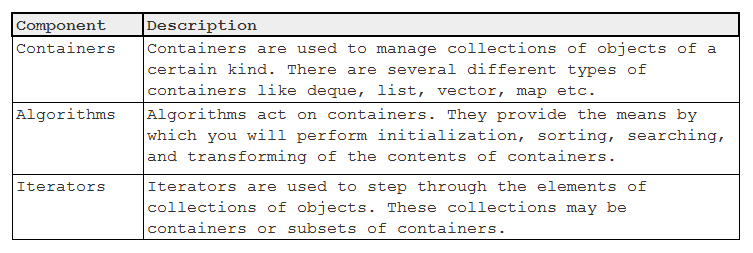](https://github.com/nguyenchiemminhvu/CPP-Tutorial/blob/master/11-STL/11-0-gioi-thieu-STL/0.png?raw=true "0.png?raw=true")

\- Một đặc điểm chung của các thành phần này là chúng đều được xây dựng sẵn, chúng ta không cần định nghĩa lại mà chỉ cần sử dụng trong chương trình.

### 7.1.2. STL containers

\- Có 3 loại container khác nhau:

***+ Sequence container:*** tập hợp các container class nó duy trì trật tự của các phần tử bên trong container. Một đặc tính của Sequence container là các bạn có thể chọn ví trí muốn chèn thêm phần tử vào container. Một ví dụ điển hình là khi thêm một phần tử vào mảng một chiều, các phần tử còn lại vẫn giữ nguyên thứ tự của chúng như trước khi chèn.

Ngôn ngữ C++11 cung cấp 6 sequence containers: **std::vector, std::deque, std::array, std::list, std::forward_list, std::basic_string**.

***+ Associative container:*** các container được thiết kế kèm theo cơ chế tự động sắp xếp dữ liệu đầu vào khi chúng được đưa vào container. Cơ chế tổ chức dữ liệu của các container này sẽ quyết định vị trí của các phần tử trong container. Thông thường, associative container thực hiện phép so sánh sử dụng toán tử \<.

Một số associative container được sử dụng phổ biến là: **std::set, std::map...**

**+ Container adapter:** các container được sử dụng cho các cấu trúc lưu trữ đặc biệt. Ví dụ: **std::stack, std::queue, ...**

#### 7.1.2.1. Sequence container

**\* std::vector (Chi tiết ở phần dưới)**

**\* std::list**

\- std::list containers mô phỏng lại cấu trúc dữ liệu doubly-linked lists; Doubly-linked list có thể lưu trữ các phần tử không liên tiếp nhau trên vùng nhớ nhưng vẫn đảm bảo được thứ tự của các phần tử khi truy xuất. Trật tự của các phần tử được giữ bởi những sự kết nối giữa các cặp phần tử.

\- Cấu trúc dữ liệu doubly-linked list cho phép người dùng thêm và xóa phần tử tại vị trí bất kỳ trong container, nhưng không hổ trợ truy cập ngẫu nhiên.

\- Khai báo một std::list

\+ Để sử dụng std::list, chúng ta cần include thư viện list vào file chương trình. Dưới đây là cú pháp khai báo một đối tượng của lớp std::list:

```cpp
std::list< <data_type> > list_name;
```

**<u>Ví dụ:</u>** std::list dùng để lưu trữ các phần tử số nguyên:

```cpp
#include <iostream>

std::list<__int32> my_list;
```

\- Khởi tạo đối tượng của lớp std::list

```cpp
std::list<__int32> list1(); *//gọi default constructor*

std::list<__int32> list2(5);
```

*//gọi phương thức khởi tạo list(size_t \_Count), khởi tạo danh sách có \_Count phần tử*

```cpp
std::list<__int32> list3(list2);
```

*//gọi phương thức khởi tạo list(const list_type &other), khởi tạo danh sách có container giống //với other*

\- Sử dụng các phương thức của lớp std::list

*+ Capacity (Tương tự std::vector)*

*+ Element access*

. Đối với cấu trúc dữ liệu doubly-linked list, chúng ta chỉ có thể truy xuất giá trị ở vị trí đầu tiên và cuối cùng trong container, std::list hỗ trợ cho chúng ta 2 phương thức truy xuất.

**@ std::list::front():** Phương thức trả về giá trị của phần tử đầu tiên trong list container.

```cpp
std::list<__int32> my_list(5);

std::cout << my_list.front() << std::endl;
```

**@ std::list::back():** Ngược lại với phương thức ở trên, phương thức back trả về giá trị của phần tử cuối cùng trong list container.

```cpp
std::list<__int32> my_list(5);

std::cout << my_list.back() << std::endl;
```

*+ Modifiers*

**@ std::list::push_back(const list_type &value):** Phương thức này cho phép thêm một phần tử vào sau phần tử có vị trí cuối cùng trong container, phần tử mới được thêm vào sẽ trở thành phần tử có chỉ số cao nhất trong container.

**<u>Ví dụ:</u>**

```cpp
#include <iostream>

#include <list>

using namespace std;

int main()

{

list<int> mylist;

int myint;

cout << "Please enter some integers (enter 0 to end):" << endl;

do

{

cin >> myint;

mylist.push_back(myint);

} while (myint);

cout << "mylist stores " << mylist.size() << " numbers." << endl;

}
```

***Kết quả:***

Please enter some integers (enter 0 to end):

1

5

10

0

mylist stores 4 numbers.

**@ std::list::pop_back():** Xóa một phần tử cuối cùng trong list container.

**<u>Ví dụ:</u>**

```cpp
#include <iostream>

#include <list>

using namespace std;

int main()

{

list<int> mylist;

int sum(0);

mylist.push_back(100);

mylist.push_back(200);

mylist.push_back(300);

while (!mylist.empty())

{

sum += mylist.back();

mylist.pop_back();

}

cout << "The elements of mylist summed " << sum << endl;

}
```

***Kết quả:*** The elements of mylist summed 600

**@ std::list::empty():** dùng để kiểm tra container của list có rỗng hay không, nếu số phần tử của list khác 0 thì trả về false, ngược lại trả về true. ***(Các class containers của STL đều có phương thức này).***

**@ std::list::push_front(const list_type &value):** Ngược lại với phương thức std::list::push_back, phương thức này dùng để thêm một phần tử có cùng kiểu với list vào vị trí đầu tiên trong container.

```cpp
std::list<int> mylist;

mylist.push_front (200);

mylist.push_front (300);
```

*//container = { 300, 200 }*

**@ std::list::pop_front():** Xóa một phần tử trong list container tại vị trí đầu tiên.

```cpp
#include <iostream>

#include <list>

using namespace std;

int main()

{

list<int> mylist;

mylist.push_back(100);

mylist.push_back(200);

mylist.push_back(300);

cout << "Popping out the elements in mylist: ";

while (!mylist.empty())

{

cout << ' ' << mylist.front();

mylist.pop_front();

}

cout << endl;

cout << "Final size of mylist is " << mylist.size() << endl;

}
```

***Kết quả:***

Popping out the elements in mylist: 100 200 300

Final size of mylist is 0

*+ Operations*

**@ std::list::sort():** Phương thức này sẽ sắp xếp lại dữ liệu bên trong container theo thứ tự tăng dần (mặc định).

```cpp
std::list<__int32> my_list;

std::list<__int32>::iterator iter;

my_list.push_back(4);

my_list.push_back(6);

my_list.push_back(-2);

my_list.push_back(-1);

my_list.push_back(7);

//container = { 4, 6, -2, -1, 7 }

my_list.sort();

//container = { -2, -1, 4, 6, 7 }
```

Có thể thay đổi điều kiện so sánh của phương thức sort bằng cách tự tạo một hàm so sánh 2 phần tử cùng kiểu dữ liệu với list.

**<u>Ví dụ:</u>**

```cpp
bool my_comparison(__int32 n1, __int32 n2)

{

return n2 < n1;

}

int main()

{

std::list<__int32> my_list;

std::list<__int32>::iterator iter;

my_list.push_back(4);

my_list.push_back(6);

my_list.push_back(-2);

my_list.push_back(-1);

my_list.push_back(7);
```

*//container = { 4, 6, -2, -1, 7 }*

```cpp
my_list.sort(my_comparison);
```

*//container = { 7, 6, 4, -1, -2 }*

```cpp
return 0;

}
```

Một số phương thức khác của std::list: [**<u>http://www.cplusplus.com/reference/list/list/</u>**](http://www.cplusplus.com/reference/list/list/)

#### 7.1.2.2. Associative container

**\* std::set**

\- std::set là class định nghĩa của một dạng container chỉ cho phép lưu trữ các phần tử có giá trị là duy nhất, phần tử có giá trị trùng lặp là không được cho phép. Những phần tử được thêm vào container sẽ được tự động sắp xếp dựa trên giá trị của chúng.

<http://www.cplusplus.com/reference/set/set/>

\- Dưới đây là một đoạn chương trình mẫu sử dụng std::set

```cpp
#include <iostream>

#include <set>

using namespace std;

int main()

{

set<int> myset;

set<int>::iterator it;

// set some initial values:

for (int i = 1; i <= 5; i++)
```

myset.insert(i \* 10); // set: 10 20 30 40 50

```cpp
it = myset.find(20);

myset.erase(it);

myset.erase(myset.find(40));

cout << "myset contains:";

for (it = myset.begin(); it != myset.end(); ++it)

cout << ' ' << *it;

cout << endl;

return 0;

}
```

***Kết quả:*** myset contains: 10 30 50

**\* std::map**

\- std::map là class định nghĩa một loại container dùng để lưu trữ các phần tử theo cấu trúc kết hợp (key_value, mapped_value). Dữ liệu trong container được sắp xếp dựa trên key_value, do đó key_value không được trùng lặp. Với mỗi key_value sẽ ánh xạ đến một mapped_value duy nhất.

> [**http://www.cplusplus.com/reference/map/map/**](http://www.cplusplus.com/reference/map/map/)

\- Lưu ý khi sử dụng std::map, mỗi khi thêm phần tử vào container thì phải thêm đủ một cặp giá trị. Ngôn ngữ C++ cung cấp cho chúng ta class std::pair giúp chúng ta nhóm 2 đối tượng có cùng (hoặc khác) kiểu dữ liệu thành một cặp tương ứng với cặp của std::map.

<span class="mark">std::pair\< data_type, data_type \> pair_name*;*</span>

\- Một ví dụ về sử dung std::map để quản lý thông tin nhân viên:

```cpp
#include <iostream>

#include <map>

#include <string>

using namespace std;

struct Employee

{

string name;
```

\_\_int32 year_of_experience;

};

```cpp
int main()

{

map<__int32, Employee> listEmployee;

listEmployee.insert(pair(1, { "Le Tran Dat", 5 }));

listEmployee.insert(pair(2, { "Someone", 0 }));

listEmployee[4] = { "new employee", 1 }; //operator[] = \

map<__int32, Employee>::iterator iter = listEmployee.find(3);

if (iter != listEmployee.end())

{

cout << "Employee ID: " << iter->first << endl;

cout << "Employee name: " << (iter->second).name << endl;

cout << "Year of experience: " << (iter->second).year_of_experience << endl;

}

else

{

cout << "ID 3 is not exist" << endl;

}

return 0;

}
```

***Kết quả:*** ID 3 is not exist

#### 7.1.2.3. Container adapter

**\* std::stack**

\- Stack (hay còn gọi là ngăn xếp) là một dạng container có cơ chế tổ chức lưu trữ dữ liệu đặc biệt: LIFO (Last In First Out): Phần tử được thêm vào sau cùng sẽ được lấy ra đầu tiên.

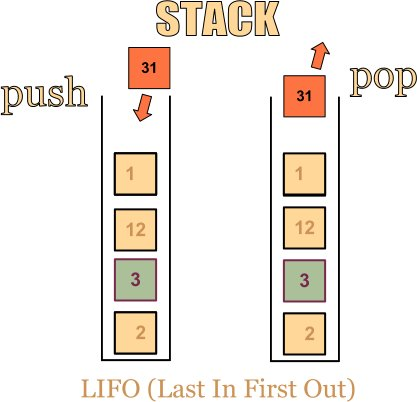

> [**http://www.cplusplus.com/reference/stack/stack/**](http://www.cplusplus.com/reference/stack/stack/)

\- Dưới đây là một ví dụ ứng dụng cách tổ chức lưu trữ của cấu trúc dữ liệu Stack để chuyển đổi một số từ hệ thập phân sang hệ nhị phân:

```cpp
#include <iostream>

#include <stack>

using namespace std;

int main()

{

//input
```

\_\_int32 decNumber;

```cpp
cin >> decNumber;

//converting

stack<bool> binary;

while (decNumber)

{

binary.push((decNumber % 2 == 1));

decNumber /= 2;

}

//output

while (!binary.empty())

{

cout << binary.top();
```

binary.pop(); //remove an element of stack

}

```cpp
cout << endl;

return 0;

}
```

***Kết quả:*** 2

10

Cấu trúc dữ liệu Stack còn có nhiều ứng dụng thực tiễn, ví dụ tạo ra chuỗi trạng thái cho phép người dùng trở lại trạng thái trước đó (undo).

**\* std::queue**

\- Queue (hay còn gọi là hàng đợi) là một cấu trúc dữ liệu hoạt động ngược lại so với cấu trúc dữ liệu Stack: FIFO (First In First Out). Chúng ta gặp cấu trúc dữ liệu này khá nhiều trong thực tế, ví dụ xếp hàng chờ mua hàng, người nào đến trước sẽ được mua hàng trước và ra khỏi hàng chờ sớm nhất.

[**http://www.cplusplus.com/reference/queue/queue/**](http://www.cplusplus.com/reference/queue/queue/)

\- Dưới đây là một ví dụ sử dụng std::queue:

```cpp
#include <iostream>

#include <queue>

using namespace std;

int main()

{

queue<int> myqueue;

int myint;

cout << "Please enter some integers (enter 0 to end):" << endl;

do {

cin >> myint;

myqueue.push(myint);

} while (myint);

cout << "myqueue contains: ";

while (!myqueue.empty())

{

cout << ' ' << myqueue.front();

myqueue.pop();

}

cout << endl;

return 0;

}
```

***Kết quả:***

Please enter some integers (enter 0 to end):

5

10

20

0

myqueue contains: 5 10 20 0

### 7.1.3. STL iterators

\- Một Iterator là một đối tượng có thể đi qua (iterate over) một container class mà không cần biết trật tự các phần tử bên trong mảng. Iterator còn là một cách để truy cập dữ liệu bên trong các container.

\- Các bạn có thể hình dùng Iterator giống như một con trỏ trỏ đến một phần tử nào đó bên trong container với một số toán tử đã được định nghĩa:

***+ Operator\* cereference*** và trả về giá trị bên trong container tại vị trí mà iterator được đặt.

***+ Operator++*** di chuyển iterator đến phần tử tiếp theo trong container.

***+ Operator--*** ngược lại so với ***operator++.***

***+ Operator== và operator!=*** dùng để so sánh vị trí tương đối của 2 phần tử đang được trỏ đến bởi 2 iterator.

***+ Operator=*** dùng để gán vị trí mà iterator trỏ đến.

#### 7.1.3.1. Khai báo một Iterator

\- Với mỗi container class chúng ta sẽ có một kiểu iterator tương ứng.

\- Lấy ví dụ về iterator của class std::vector như sau:

```cpp
#include <vector>

#include <list>

using namespace std;

int main()

{

vector<int> vec;

vector<int>::iterator iter;

return 0;

}
```

Như vậy, chúng ta có iter là một đối tượng của class **std::vector\<int\>::iterator.** Với cách khai báo này, chúng ta có thể là có một class tên là iterator được định nghĩa bên trong khối lệnh của class **std::vector\<generic_type\>.**

***- Lưu ý: kiểu dữ liệu của các phần tử trong container class sẽ là kiểu dữ liệu được dùng cho generic_type của iterator.***

Ví dụ khi chúng ta muốn có một Iterator dùng cho một std::list\<Employee\> thì Iterator sẽ được khai báo như sau:

```cpp
std::list<Employee>::iterator iter;
```

#### 7.1.3.2. Các phương thức trả về kiểu Iterator của các container class

\- Một giá trị muốn được gán cho một biến (hoặc một đối tượng nào đó) thì giá trị và biến đó phải cùng kiểu dữ liệu với nhau. Như vậy, muốn gán địa chỉ (vị trí) của một phần tử trong container cho một iterator thì chúng ta cũng cần có những phương thức trả về giá trị kiểu iterator tương ứng.

\- Mỗi container class trong STL (ngoại trừ các container đặc biệt như std::stack và std::queue) đều chứa định nghĩa của một iterator bên trong.

[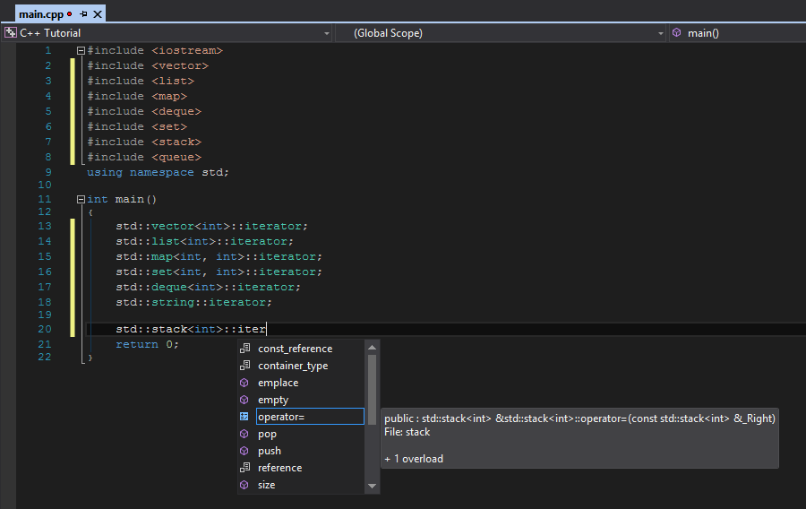](https://github.com/nguyenchiemminhvu/CPP-Tutorial/blob/master/11-STL/11-2-STL-iterators/0.png?raw=true "0.png?raw=true")

Và những container có chứa định nghĩa class iterator sẽ có những phương thức trả về giá trị kiểu iterator tương ứng:

**+ begin()** trả về một iterator đại diện cho vị trí của phần tử đầu tiên trong container.

**+ end()** trả về một iterator đại diện cho vị trí đứng ngay sau phần tử cuối cùng trong container.

**+ cbegin()** trả về một hằng (read-only) iterator đại diện cho vị trí của phần tử đầu tiên trong container.

**rbegin() **: Iterator ngược trỏ tới phần tử cuối cùng trong vector

**+ cend()** trả về một hằng (read-only) iterator đại diện cho vị trí đứng ngay sau phần tử cuối cùng trong container.

> **rend()** : Iterator ngược trỏ tới phần tử trước phần tử đầu tiên trong vector

**<u>Ví dụ:</u>**

```cpp
#include <iostream>

#include <vector>

using namespace std;

int main()

{

vector<__int32> vec;

for (int i = 0; i < 10; i++)

vec.push_back(i);

vector<__int32>::iterator the_beginning = vec.begin();

vector<__int32>::iterator the_end = vec.end();

cout << *(the_beginning._Ptr) << endl;

cout << *(the_end._Ptr) << endl; //print a garbage value
```

the_end--;

```cpp
cout << *(the_end._Ptr) << endl;

return 0;

}
```

***Kết quả:***

0

-842150451

9

*Lần in giá trị thứ 2 trong đoạn chương trình trên sẽ in ra một giá trị rác, vì iterator the_end lúc này đang* *trỏ đến vị trí nằm ngoài giới hạn vùng nhớ tương ứng với vec\[vec.size()\], trong khi chỉ số của phần tử cuối cùng trong container là (vec.size() - 1).*

\- Tại sao end() lại trả về vị trí đứng sau phần tử cuối cùng trong container? Đó là vì chúng ta sẽ sử dụng iterator này để kiểm tra xem thử chúng ta đã duyệt hết phần tử trong mảng hay chưa.

**<u>Ví dụ:</u>**

```cpp
#include <iostream>

#include <vector>

using namespace std;

int main()

{

vector<__int32> vec;

for (int i = 0; i < 10; i++)

vec.push_back(i);

vector<__int32>::iterator iter = vec.begin();

while (iter != vec.end())

{

cout << *iter << endl;
```

iter++;

}

```cpp
return 0;

}
```

***Kết quả:***

0

1

2

3

4

5

6

7

8

9

Khi vòng lặp while kiểm tra đc iter đã lặp đến vị trí end(), nó sẽ hiểu rằng iter đã trỏ ra ngoài giới hạn của container và kết thúc vòng lặp.

\- Một ví dụ khác sử dụng iterator để duyệt qua tất cả phần tử bên trong một std::map:

```cpp
#include <iostream>

#include <map>

#include <string>

using namespace std;

int main()

{

map<int, string> mymap;

mymap.insert(make_pair(4, "apple"));

mymap.insert(make_pair(2, "orange"));

mymap.insert(make_pair(1, "banana"));

mymap.insert(make_pair(3, "grapes"));

mymap.insert(make_pair(6, "mango"));

mymap.insert(make_pair(5, "peach"));

map<int, string>::const_iterator it; // declare an iterator
```

it = mymap.begin(); // assign it to the start of the vector

```cpp
while (it != mymap.end()) // while it hasn't reach the end

{

cout << it->first << "=" << it->second << " ";

// print the value of the element it points to
```

++it; // and iterate to the next element

}

```cpp
cout << endl;

}
```

***Kết quả:*** 1=banana 2=orange 3=grapes 4=apple 5=peach 6=mango

#### **7.1.3.3. Các toán tử với Iterator **

Iterator hỗ trợ các toán tử ++, -- hoặc toán tử toán học để bạn có thể di chuyển iterator qua lại các phần tử trong vector.

**Ví dụ 1: **

<table>
<colgroup>
<col style="width: 61%" />
<col style="width: 38%" />
</colgroup>
<thead>
<tr>
<th><p><code>#include &lt;iostream&gt;</code></p>
<p><code>#include &lt;vector&gt;</code></p>
<p><code>using namespace std;</code></p>
<p><code>int main(){</code></p>
<p><code>vector&lt;int&gt; v = {100, 200, 300, 400, 500};</code></p>
<p>vector&lt;int&gt;::iterator it = v.begin();</p>
<p><code>cout &lt;&lt; "v[0] = " &lt;&lt; *it &lt;&lt; endl;</code></p>
<p>++it; // it1 =&gt; v[1]</p>
<p><code>cout &lt;&lt; "v[1] = " &lt;&lt; *it &lt;&lt; endl;</code></p>
<p>it += 2; // it1 =&gt; v[3]</p>
<p><code>cout &lt;&lt; "v[3] = " &lt;&lt; *it &lt;&lt; endl;</code></p>
<p>--it; // it1 =&gt; v[2]</p>
<p><code>cout &lt;&lt; "v[2] = " &lt;&lt; *it &lt;&lt; endl;</code></p>
<p><code>}</code></p></th>
<th><p><em><strong>Output : </strong></em></p>
<p>v[0] = 100</p>
<p>v[1] = 200</p>
<p>v[3] = 400</p>
<p>v[2] = 300</p></th>
</tr>
</thead>
<tbody>
</tbody>
</table>

Bạn cũng có thể tính khoảng cách giữa 2 iterator hoặc tìm ra chỉ số của phần tử mà iterator đang trỏ tới bằng cách sử dụng toán tử hoặc dùng hàm **distance()**

**Ví dụ 2: **

```cpp
#include <iostream>

#include <vector>

using namespace std;

int main(){

vector<int> v = {100, 200, 300, 400, 500};

vector<int>::iterator it = v.begin();

it += 3;

cout << "Chi so cua phan tu ma it dang tro toi : " << it - v.begin() << endl;

cout << "Chi so cua phan tu ma it dang tro toi : " << distance(v.begin(), it) << endl;

}
```

***Output : ***

Chi so cua phan tu ma it dang tro toi : 3

Chi so cua phan tu ma it dang tro toi : 3

### 7.1.4. STL algorithm

**-** STL Algorithm cung cấp cho chúng ta một số thuật toán cơ bản để thao tác với các container class. Những thuật toán thường được sử dụng như search, sort, insert, reoder, remove, copy... tất cả đều được sử dụng để thao tác trên các container.

**Lưu ý:** Các thuật toán này được cài đặt như những hàm có phạm vi global sử dụng các Iterator. Điều này có nghĩa các thuật toán này chỉ cần cài đặt một lần và nó được sử dụng cho các container chứa một tập hợp các iterator.

\- Khi chúng ta sử dụng các thuật toán này, có thể chúng sẽ giúp chương trình của chúng ta hoạt động nhanh hơn, nhưng cũng có thể có trường hợp làm cho chương trình không hoạt động, lặp vô hạn hoặc có hiệu suất thấp.

\- Để sử dụng STL algorithm, chỉ cần include thư viện algorithm vào file chương trình.

#### 7.1.4.1. Search

**@ std::min_element and std::max_element**

\- min_element và max_element được sử dụng để tìm ra phần tử có giá trị nhỏ nhất hoặc lớn nhất trong một STL container.

**<u>Ví dụ:</u>**

```cpp
#include <iostream>

#include <algorithm>

#include <vector>

using namespace std;

int main()

{

vector<__int32> container;

for (int i = 0; i < 10; i++)

container.push_back(i + 1);

vector<__int32>::iterator iterMax = max_element(container.begin(), container.end());

vector<__int32>::iterator iterMin = min_element(container.begin(), container.end());

cout << "Max = " << *iterMax << endl;

cout << "Min = " << *iterMin << endl;

return 0;

}
```

***Kết quả:***

Max = 10

Min = 1

Hai hàm này đều nhận vào 2 đối số là 2 Iterator đại diện cho đoạn container mà bạn muốn tìm kiếm và trả về một Iterator trỏ đến vị trí có phần tử lớn nhất hoặc nhỏ nhất.

Ví dụ chỉ search một nửa sau của container:

```cpp
std::vector<__int32>::iterator iterMax = std::max_element(container.begin() + container.size() / 2, container.end());
```

**@ std::find**

\- Hàm này được sử dụng để tìm kiếm một giá trị đưa ra có tồn tại trong container hay không, nếu có thì trả về một Iterator trỏ đến vị trí xuất hiện phần tử đó, ngược lại thì trả về Iterator trỏ đến end() của container.

**<u>Ví dụ:</u>**

```cpp
#include <iostream>

#include <vector>

#include <iostream>

using namespace std;

int main()

{

vector<__int32> container;

for (int i = 0; i < 10; i++)

container.push_back(i + 1);

vector<__int32>::iterator iter = find(container.begin(), container.end(), 11);

if (iter == container.end())

{

cout << "Can not find your given value!" << endl;

}

else

{

cout << "Found at index: " << iter - container.begin() << endl;

}

return 0;

}
```

***Kết quả:*** Can not find your given value!

**@ std::find_if**

\- Hàm này được định nghĩa như sau:

```cpp
template <class InputIterator, class UnaryPredicate>

InputIterator find_if (InputIterator first, InputIterator last, UnaryPredicate pred);
```

\- Hàm này nhận vào 2 đối số đầu tiên là 2 Iterator chỉ vị trí đầu và cuối (giới hạn đoạn container) mà ta muốn tìm kiếm.

\- Khác với hàm std::find, hàm này không tìm kiếm sự xuất hiện của một giá trị cụ thể, mà cần cung cấp cho hàm một điều kiện nào đó, điều kiện này được biểu diễn thông qua một hàm có dạng:

```cpp
bool isSatisfyYourCondition(container_type value);
```

\- Tham số thứ 3 của hàm std::find_if là một con trỏ hàm có dạng:

<span class="mark">bool (\*ptr)(container_type)*;*</span>

Do đó, chúng ta có thể truyền đối số thứ 3 cho hàm std::find_if là tên của hàm isSatisfyYourCondition đã khai báo ở trên (chỉ là ví dụ minh họa).

\- Với mỗi lần duyệt qua một phần tử trong đoạn container từ first đến last, mỗi phần tử sẽ được kiểm tra bên trong hàm được gán cho tham số thứ 3 của std::find_if. Nếu phần tử được kiểm tra thỏa mãn điều kiện đặt ra (hàm isSatisfyYourCondition trả về true), một Iterator trỏ đến phần tử vừa kiểm tra sẽ được trả về. Iterator last mà bạn truyền vào sẽ được trả về nếu không có phần tử nào thõa mãn điều kiện.

**<u>Ví dụ:</u>**

```cpp
#include <iostream>

#include <algorithm>

#include <vector>

bool isFive(__int32 value)

{

return value == 5;

}

int main()

{

std::vector<__int32> container;

for (int i = 0; i < 10; i++)

container.push_back(i + 1);

std::vector<__int32>::iterator iter = std::find_if(container.begin(), container.end(), isFive);

if (iter != container.end())

{

std::cout << "Found at index: " << iter - container.begin() << std::endl;

}

else

{

std::cout << "Can not found this value!" << std::endl;

}

return 0;

}
```

***Kết quả:*** Found at index: 4

Hàm isFive sẽ chịu trách nhiệm kiểm tra giá trị của một phần tử trong container có bằng 5 hay không. Do kiểm tra từ đầu đến cuối container, nên chắc chắn sẽ hàm std::find_if sẽ tìm được phần tử phù hợp.

\- Thay đổi lại một chút như sau:

```cpp
#include <iostream>

#include <algorithm>

#include <vector>

using namespace std;

bool isFive(__int32 value)

{

return value == 5;

}

int main()

{

vector<__int32> container;

for (int i = 0; i < 10; i++)

container.push_back(i + 1);

vector<__int32>::iterator iter = find_if(container.begin(), container.end() - 8, isFive);

if (iter != container.end())

{

cout << "Found at index: " << iter - container.begin() << endl;

}

else

{

cout << "Can not found this value!" << endl;

}

return 0;

}
```

***Kết quả:*** Found at index: 2

#### 7.1.4.2. Sort

\- Sắp xếp cũng là một trong những thuật toán thường xuyên được áp dụng trong thực tế.

**@ std::sort**

\- Có 2 định nghĩa được overload cho hàm std::sort, một phiên bản được sử dụng để sắp xếp đoạn container từ Iterator first đến Iterator last theo thứ tự giá trị tăng dần từ bé đến lớn.

**<u>Ví dụ:</u>**

```cpp
#include <iostream>

#include <algorithm>

#include <vector>

#include <ctime>

#include <iostream>

using namespace std;

int main()

{

vector<__int32> container;

srand(time(NULL));

for (int i = 0; i < 10; i++)

container.push_back(rand() % 100);

for (int i = 0; i < container.size(); i++)

cout << container.at(i) << " ";

cout << endl;

sort(container.begin(), container.end());

for (int i = 0; i < container.size(); i++)

cout << container.at(i) << " ";

cout << endl;

return 0;

}
```

***Kết quả:***

99 62 26 35 72 51 25 24 19 88

19 24 25 26 35 51 62 72 88 99

\- Một phiên bản khác của std::sort là hàm có 3 tham số, trong đó, tham số thứ 3 là một con trỏ hàm có dạng:

**bool (*ptr)(container_type, container_type);**

Hàm được trỏ đến bởi tham số này sẽ định nghĩa mối quan hệ giữa 2 phần tử được đem ra so sánh (để sắp xếp). <http://www.cplusplus.com/reference/algorithm/sort/>

\****\*\* Chi tiết về các algorithm khác của STL: ***

[**http://www.cplusplus.com/reference/algorithm/**](http://www.cplusplus.com/reference/algorithm/)

## 7.2. Vector trong C++

**- Vector **là một container có tính chất tương tự như 1 mảng động, nó tự thay đổi kích thước khi bạn thêm hay xóa các phần tử trong mảng.

\- C++ cung cấp lớp** std::vector** hỗ trợ việc thao tác với mảng động an toàn và dễ dàng hơn.

\- Các phần tử vector C++ được đặt trong một bộ nhớ liền kề (contiguous storage), cho phép truy cập và duyệt thông qua một trình vòng lặp (iterator).

*- Vector có thể chứa các kiểu dữ liệu cơ sở (int, float, double, char...) và kiểu dữ liệu do người lập trình định nghĩa - struct..., hoặc thậm chí là một vector khác. Khi sử dụng vector bạn cần thêm thư viện "vector" vào chương trình của mình.*

\- Khác với array – dùng để lưu trữ dữ liệu tuần tự và có bản chất tính, các vector có độ linh hoạt cao hơn nhiều.

\- Ngoài ra nó hỗ trợ truy cập các phần tử trong mảng thông qua chỉ số như mảng 1 chiều.

\- Với vector trong C++, các developer không còn phải thực hiện nhiều thao tác thừa thãi, lặp đi lặp lại khi phải làm việc với mảng ở trong C++. Dưới đây là một số ưu điểm của kiểu vector trong C++ so với mảng truyền thống:

*+ C**ó thể tạo các mảng động **mà **không cần phải cấp phát và thu hồi vùng nhớ **bằng cách sử dụng toán tử **new **và **delete (Tự động đi giải phóng vùng nhớ khi chương trình kết thúc)**.*

*+ Không cần phải khai báo kích thước của mảng vì vector có khả năng tự resize (khi có phần tử được chèn hay xoá khỏi array, trong khi đó array thường có kích thước cố định); Tự động điều chỉnh kích thước để chèn phần tử nếu vector đã đầy.*

*+ Cho biết số lượng các phần tử đang được lưu trữ.*

*+ Cho phép sử dụng chỉ số âm (chẳng hạn như A\[-6\], A\[-5\],…).*

\- Tuy nhiên, nó có 1 hạn chế là tốn bộ nhớ hơn mảng tĩnh và mảng động (do cơ chế container buộc phải tạo ra thêm các vùng nhớ riêng để quản lí chặt chẽ hơn).

\- String, Vector, List, Stack, Queue ...: thuộc thư viện chuẩn của C++ là STL (Standard Template Library).

### 7.2.1. Sử dụng vector

\- Để sử dụng lớp **std::vector,** bạn cần khai báo thư viện và namespace std:

```cpp
#include <vector>

using namespace std;
```

\- Khởi tạo vector: vector\<kiểu_dữ_liệu\> tên_vector;

**<u>Ví dụ:</u>**

```cpp
#include <vector>

using namespace std;

// không cần cung cấp độ dài mảng tại thời điểm biên dịch

vector<int> array;

vector<int> array2 = { 9, 7, 5, 3, 1 };
```

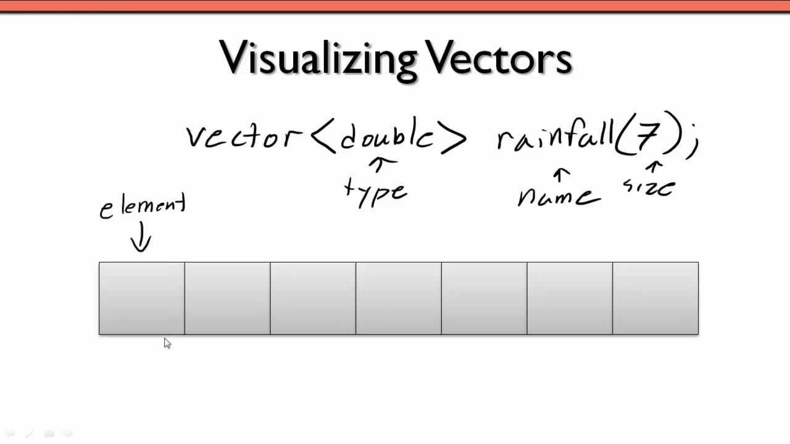

\- Cũng có thể tạo một vector rồi gán giá trị của một vector khác cho nó bằng cách:

```cpp
vector<int> array2 = { 9, 7, 5, 3, 1 };

vector<int> array3 = array2;
```

\- Khởi tạo một lượng các phần tử mang giá trị giống nhau:

```cpp
vector<int> foo(3, 100); // three ints with a value of 100

vector<int> bar(5, 200); // five ints with a value of 200
```

\- Giống như** std::array**, việc truy cập các phần tử mảng có thể được thực hiện thông qua toán tử** \[\]** (không kiểm tra phạm vi mảng) hoặc hàm **at()** (có kiểm tra phạm vi mảng):

```cpp
vector<int> array;

int firstElement = array[0];// Truy cập phần tử đầu tiên (index bắt đầu từ 0)
```

array\[1\] = 5; // không kiểm tra phạm vi mảng

array.at(1) = 5; /\*có kiểm tra phạm vi mảng;

Truy cập phần tử thứ hai, sử dụng at() để có kiểm tra chỉ số an toàn\*/

### 7.2.2. Cơ chế ngăn chặn rò rỉ bộ nhớ của std::vector

\- Khi một biến vector **ra khỏi phạm vi** được định nghĩa, nó sẽ **tự động giải phóng vùng nhớ **mà nó nắm giữ. Điều này không chỉ tiện dụng (vì bạn không phải tự làm điều đó), nó còn giúp ngăn ngừa rò rỉ bộ nhớ.

\- Xét hàm dưới đây:

```cpp
void doSomething(bool earlyExit)

{

int *array = new int[3]{ 1, 3, 2 };

if (earlyExit) // thoát khỏi hàm

return;
```

**delete**\[\] **array**; // trường hợp hàm thoát sớm, array sẽ không bị xóa

}

Nếu biến earlyExit được gán là true, mảng array sẽ không bao giờ được giải phóng, và bộ nhớ sẽ bị rò rỉ. Tuy nhiên, nếu biến array là kiểu vector, bộ nhớ sẽ được giải phóng ngay khi thoát khỏi hàm. Điều này làm cho **std::vector** ngăn chặn được việc rò rỉ bộ nhớ.

```cpp
#include <iostream>

#include <vector>

using namespace std;

class Widget {
```

public:

Widget() { cout << "Widget constructed\n"; }

~Widget() { cout \<\< "Widget destroyed\n"; }

};

```cpp
int main() {

{

vector<Widget> widgetList;

widgetList.push_back(Widget());

widgetList.push_back(Widget());

cout << "Inside the block\n";

// Khi ra khỏi block này, widgetList sẽ bị phá hủy
```

} // widgetList destructor is called here automatically

```cpp
cout << "Outside the block\n";

return 0;

}
```

***Kết quả:***

Widget constructed

Widget destroyed

Widget constructed

Widget destroyed

Widget destroyed

Inside the block

Widget destroyed

Widget destroyed

Outside the block

### 7.2.3. Một số thao tác với mảng kiểu std::vector

#### 7.2.3.1. Modifider (sửa đổi)

##### 7.2.3.1.1. a/ push_back()

Hàm đẩy một phần tử vào vị trí cuối của vector. Nếu kiểu của đối tượng được truyền dưới dạng tham số trong push_back() không giống với kiểu của vector thì sẽ bị lỗi.

```cpp
Tên_vector.push_back(giá_trị_phần_tử);

#include <iostream>

#include <vector>

using namespace std;

int main()

{

vector<int> myvector;

int myint;

cout << "Please enter some integers (enter 0 to end):\n";

do {

cin >> myint;

myvector.push_back(myint);

} while (myint);

cout << "myvector has: ";

for (int i = 0; i < myvector.size(); i++)

cout << myvector[i] << " ";

cout << "\nmyvector stores " << int(myvector.size()) << " numbers.\n";

return 0;

}
```

***Kết quả:***

Please enter some integers (enter 0 to end):

1

3

8

10

12

0

myvector has: 1 3 8 10 12 0

myvector stores 6 numbers.

<table>
<colgroup>
<col style="width: 43%" />
<col style="width: 56%" />
</colgroup>
<thead>
<tr>
<th style="text-align: center;"><p>C++ Vector push_back() function - javatpoint</p></th>
<th style="text-align: left;"><p><code>#include &lt;iostream&gt;</code></p>
<p><code>#include &lt;vector&gt;</code></p>
<p><code>using namespace std;</code></p>
<p><code>int main()</code></p>
<p><code>{</code></p>
<p>vector&lt;int&gt;v;</p>
<p><code>v.push_back(1);</code></p>
<p><code>v.push_back(2);</code></p>
<p><code>v.push_back(3);</code></p>
<p><code>}</code></p></th>
</tr>
</thead>
<tbody>
</tbody>
</table>

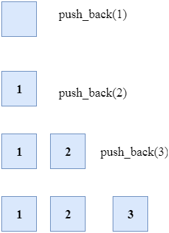

##### 7.2.3.1.2. b/ assign()

Gán một giá trị mới cho các phần tử vector bằng cách thay thế các giá trị cũ.

*\* Có 3 dạng hàm:*

**+ Gán giá trị số:**

```cpp
Tên_vector.assign(int size, int value);
```

**. size:** Số lượng giá trị cần gán.

**. value:** Giá trị muốn gán cho vector.

```cpp
#include <iostream>

#include <vector>

using namespace std;

int main() {

vector<int> v;
```

v.assign(7, 100); // Gán 7 phần tử có giá trị 100

```cpp
cout << "Kich thuoc cua vector: " << v.size() << '\n';

cout << "Cac phan tu: ";

for (int i = 0; i < v.size(); ++i) {

cout << v[i] << " ";

}

return 0;

}
```

***Kết quả:***

Kich thuoc cua vector: 7

Cac phan tu: 100 100 100 100 100 100 100

**+ Gán giá trị từ mảng hoặc danh sách:**

```cpp
Tên_vector.assign(arr, arr + size);
```

**. arr:** Mảng hoặc danh sách muốn gán cho vector.

**. size:** Số lượng phần tử từ đầu mảng/danh sách cần gán.

```cpp
#include <iostream>

#include <vector>

using namespace std;

int main() {

vector<int> v1;

int a[] = { 1, 2, 3 };
```

v1.assign(a, a + 2); // Gán 2 phần tử từ mảng a

```cpp
cout << "Cac phan tu cua vector1: ";

for (int i = 0; i < v1.size(); ++i) {

cout << v1[i] << " ";

}

vector<int> v2;
```

v2.assign(a, a + 3); // Gán 3 phần tử từ mảng a

```cpp
cout << "\nCac phan tu cua vector2: ";

for (int i = 0; i < v2.size(); ++i) {

cout << v2[i] << " ";

}

return 0;

}
```

***Kết quả:***

Cac phan tu cua vector1: 1 2

Cac phan tu cua vector2: 1 2 3

**+ Sửa đổi giá trị của vector**:

```cpp
Tên_vector.assign(InputIterator first, InputIterator last);
```

**. first:** Iterator trỏ đến vị trí bắt đầu của khoảng cần gán.

**. last:** Iterator trỏ đến vị trí cuối của khoảng cần gán.

```cpp
#include <iostream>

#include <vector>

using namespace std;

int main() {

vector<int> v;
```

v.assign(7, 100); // Gán 7 phần tử có giá trị 100

```cpp
cout << "Kich thuoc cua vector: " << v.size() << '\n';

cout << "Cac phan tu: ";

for (int i = 0; i < v.size(); ++i) {

cout << v[i] << " ";

}
```

v.assign(v.begin(), v.begin() + 3); // Gán 3 phần tử từ vị trí đầu

```cpp
cout << "\nCac phan tu sau khi sua doi: ";

for (int i = 0; i < v.size(); ++i) {

cout << v[i] << " ";

}

return 0;

}
```

***Kết quả:***

Kich thuoc cua vector: 7

Cac phan tu: 100 100 100 100 100 100 100

Cac phan tu sau khi sua doi: 100 100 100

##### 7.2.3.1.3. c/ pop_back()

Được sử dụng để xóa đi phần tử cuối cùng một vector.

```cpp
Tên_vector.pop_back();

#include <iostream>

#include <vector>

using namespace std;

int main()

{

vector<int> myvector;

myvector.push_back(100);

myvector.push_back(200);

myvector.push_back(300);

for (int i = 0; i < myvector.size(); i++)

cout << myvector[i] << " ";

cout << "\nmyvector stores " << int(myvector.size()) << " numbers.\n";

while (!myvector.empty())

{

myvector.pop_back();

}

cout << "After pop_back, myvector stores " << int(myvector.size()) << " numbers.\n";

return 0;

}
```

***Kết quả:***

100 200 300

myvector stores 3 numbers.

After pop_back, myvector stores 0 numbers.

##### 7.2.3.1.4. d/ insert()

*Hàm này có 4 dạng:*

**+ <u>Dạng 1:</u> <span class="mark">insert (position, \<giá trị cần chèn\>): </span>**Chèn giá trị vào vị trí x trong mảng.

// C++ program to illustrate the function of vector_name.insert(position,val)

```cpp
#include <iostream>

#include <vector>

using namespace std;

int main()

{

// Initialising the vector
```

vector\<int\> vector_name{ 1, 2, 3, 4, 5 };

// Printing out the original vector

```cpp
cout << "Original vector :\n";

for (auto x : vector_name)

cout << x << " ";

cout << "\n";

// Inserting the value 100 at position 3 (0-based indexing) in the vector

vector_name.insert(vector_name.begin() + 3, 100);

// Printing the modified vector

cout << "Vector after inserting 100 at position 3 :\n";

for (auto x : vector_name)

cout << x << " ";

cout << "\n";

// Inserting the value 500 at position 1(0-based indexing) in the vector

vector_name.insert(vector_name.begin() + 1, 500);

// Printing the modified vector

cout << "Vector after inserting 500 at position 1 :\n";

for (auto x : vector_name)

cout << x << " ";

return 0;

}
```

***Kết quả:***

Original vector :

1 2 3 4 5

Vector after inserting 100 at position 3 :

1 2 3 100 4 5

Vector after inserting 500 at position 1 :

1 500 2 3 100 4 5

**+ <u>Dạng 2:</u> <span class="mark">insert(position, \<số lần chèn y\>, \<giá trị cần chèn\>):</span>** <span class="mark"></span>Chèn y lần giá trị vào vị trí x trong mảng.

// C++ program to illustrate the function of vector_name.insert(position,size,val)

```cpp
#include <iostream>

#include <vector>

using namespace std;

int main()

{

// Initialising the vector
```

vector\<int\> vector_name{ 1, 2, 3, 4, 5 };

// Printing out the original vector

```cpp
cout << "Original vector :\n";

for (auto x : vector_name)

cout << x << " ";

cout << endl;

// Inserting the value 100, 4 times starting at position 3

vector_name.insert(vector_name.begin() + 3, 4, 100);

// Printing the modified vector

cout << "Vector after inserting 100, 4 times, starting at position 3 :\n";

for (auto x : vector_name)

cout << x << " ";

return 0;

}
```

***Kết quả:***

Original vector :

1 2 3 4 5

Vector after inserting 100, 4 times, starting at position 3 :

1 2 3 100 100 100 100 4 5

*\*\*\* Thông thường:* **position = \<Tên vector\>.begin() + \<số nguyên\>**

**+ Dạng 3: <span class="mark">insert(\<Tên vector\>.begin() + \<số nguyên x\>, \<Tên vector a\>.begin() + \<số nguyên y\>, \<Tên vector a\>. begin() + \<số nguyên z\>):</span>** <span class="mark"></span>

Lấy các phần tử từ vector a bắt đầu lấy từ vị trí y cho đến vị trí **z - 1** và chèn vào vị trí x của vector hiện tại.

// C++ program to illustrate the function of vector_name.insert(position,itr1,itr2)

```cpp
#include <iostream>

#include <vector>

using namespace std;

int main()

{

// Initialising the vector
```

vector\<int\> original{ 1, 2, 3, 4, 5 };

vector\<int\> temp{ 2, 5, 9, 0, 3, 10 };

// Printing out the original vector

```cpp
cout << "Original vector :\n";

for (auto x : original)

cout << x << " ";

cout << endl;

/*Inserting the portion of temp vector in original vector temp.begin()+3 is starting iterator of vector to be copied temp.begin()+5 is ending iterator of vector to be copied*/

original.insert(original.begin() + 3, temp.begin() + 2, temp.begin() + 5);

// Printing the modified vector

cout << "Vector after Inserting the portion of temp vector in original vector :\n";

for (auto x : original)

cout << x << " ";

return 0;

}
```

***Kết quả:***

Original vector :

1 2 3 4 5

Vector after Inserting the portion of temp vector in original vector :

1 2 3 9 0 3 4 5

**+ Dạng 4: <span class="mark">insert(\<Tên vector\>.begin() + \<số nguyên x\>, \<Tên mảng a\> + \<số nguyên y\>, \<Tên mảng a\> + \<số nguyên z\>):</span>** <span class="mark"></span>Lấy các phần tử lấy từ mảng a bắt đầu lấy từ vị trí y đến vị trí **z - 1** và chèn vào vị trí x của vector hiện tại.

```cpp
#include <iostream>

#include <vector>

using namespace std;

int main() {

// Khởi tạo vector và mảng

vector<int> vec = { 1, 2, 3, 4, 5 };

int arr[] = { 6, 7, 8, 9, 10 };

// Chèn các phần tử từ mảng vào vector

vec.insert(vec.begin() + 2, arr + 1, arr + 4);

// In ra các phần tử của vector

for (int i : vec) {

cout << i << " ";

}

return 0;

}
```

***Kết quả:*** 1 2 7 8 9 3 4 5

##### 7.2.3.1.5. e/ erase()

Được sử dụng để xóa các phần tử tùy theo vị trí vùng chứa: xóa một phần tử (*position*) hoặc xóa một lượng các phần tử (*\[start-position, end-position)* 🡪 *bao gồm phần tử được trỏ bởi start-position nhưng không bao gồm phần tử được trỏ bởi end-position*)

```cpp
Tên_vector.erase(position);

Tên_vector.erase(start-position, end-position);

#include <iostream>

#include <vector>

using namespace std;

int main()

{

vector<int> myvector;

// set some values (from 1 to 10)

for (int i = 1; i <= 10; i++) {

myvector.push_back(i);

}

cout << "myvector before erasure: ";

for (unsigned i = 0; i < myvector.size(); ++i)

cout << ' ' << myvector[i];

cout << endl;

// erase the 6th element = erase number 6

myvector.erase(myvector.begin() + 5);

// erase the first 3 elements: erase 1,2,3

myvector.erase(myvector.begin(), myvector.begin() + 3);

cout << "myvector after erasure contains:";

for (unsigned i = 0; i < myvector.size(); ++i)

cout << ' ' << myvector[i];

cout << '\n';

return 0;

}
```

***Kết quả:***

myvector before erasure: 1 2 3 4 5 6 7 8 9 10

myvector after erasure contains: 4 5 7 8 9 10

##### 7.2.3.1.6. f/ emplace()

Mở rộng vùng chứa bằng cách chèn phần tử mới vào vị trí mà ta muốn (position).

```cpp
Tên_vector.emplace(position, giá_trị_phần_tử_mới);

#include <iostream>

#include <vector>

using namespace std;

int main()

{

vector<int> myvector = { 10,20,30 };

myvector.emplace(myvector.begin() + 1, 100);

myvector.emplace(myvector.end(), 300);

cout << "myvector contains:";

for (int i = 0; i < myvector.size(); i++)

cout << ' ' << myvector[i];

cout << '\n';

return 0;

}
```

***Kết quả:*** myvector contains: 10 100 20 30 300

##### 7.2.3.1.7. g/ emplace_back()

Được sử dụng để chèn một phần tử mới vào vùng chứa vector, phần tử mới sẽ được thêm vào cuối vector

```cpp
Tên_vector.emplace_back(value);

#include <iostream>

#include <vector>

using namespace std;

int main()

{

vector<int> myvector = { 10,20,30 };

myvector.emplace_back(100);

myvector.emplace_back(200);

cout << "myvector contains:";

for (int i = 0; i < myvector.size(); i++)

cout << ' ' << myvector[i];

cout << '\n';

return 0;

}
```

***Kết quả:*** myvector contains: 10 20 30 100 200

***\*\*\* So sánh giữa hàm push_back() & hàm emplace_back() khi cả 2 hàm đều đưa một phần tử mới vào cuối vector:***

<table>
<colgroup>
<col style="width: 49%" />
<col style="width: 50%" />
</colgroup>
<thead>
<tr>
<th style="text-align: center;"><strong>Push_back</strong></th>
<th style="text-align: center;"><strong>emplace_back</strong></th>
</tr>
</thead>
<tbody>
<tr>
<td colspan="2" style="text-align: center;">Nó được sử dụng để chèn phần tử vào một vectơ hoặc một chuỗi.</td>
</tr>
<tr>
<td style="text-align: center;"><em>Chậm hơn</em></td>
<td style="text-align: center;"><em>Nhanh hơn</em></td>
</tr>
<tr>
<td style="text-align: center;">Tạo một vectơ mới sao chép giá trị mới từ tham số và tất cả các giá trị trong vectơ cũ.</td>
<td style="text-align: center;">Thêm trực tiếp vào vector mà không cần phải tạo một bản sao của giá trị mới (không cần gọi hàm khởi tạo sao chép)</td>
</tr>
<tr>
<td style="text-align: center;">push_back chỉ chấp nhận đối tượng của kiểu dữ liệu nếu hàm tạo (constructor) chấp nhận nhiều hơn một đối số.</td>
<td style="text-align: center;">emplace_back chấp nhận các đối số của hàm tạo của kiểu dữ liệu.</td>
</tr>
</tbody>
</table>

**<u>Ví dụ:</u>**

<table>
<colgroup>
<col style="width: 50%" />
<col style="width: 49%" />
</colgroup>
<thead>
<tr>
<th style="text-align: left;"><p><code>#include &lt;iostream&gt;</code></p>
<p><code>#include &lt;vector&gt;</code></p>
<p><code>using namespace std;</code></p>
<p>// Class</p>
<p><code>class GFG {</code></p>
<p>public:</p>
<p><code>float x, y;</code></p>
<p>// Parameterized Constructor</p>
<p>GFG(float x, float y)</p>
<p>: x(x), y(y)</p>
<p><code>{</code></p>
<p><code>}</code></p>
<p>// Copy Constructor</p>
<p>GFG(const GFG&amp; GFG)</p>
<p>: x(GFG.x), y(GFG.y)</p>
<p><code>{</code></p>
<p><code>cout &lt;&lt; "Copied" &lt;&lt; endl;</code></p>
<p><code>}</code></p>
<p><code>};</code></p>
<p>// Driver Code</p>
<p><code>int main()</code></p>
<p><code>{</code></p>
<p>// Create object of vector in</p>
<p>// the main() method</p>
<p><code>vector&lt;GFG&gt; vertices;</code></p>
<p>// Reserve three elements using</p>
<p>// reserve()</p>
<p><code>vertices.reserve(3);</code></p>
<p>// Add elements to the vector</p>
<p>// object</p>
<p><code>vertices.push_back(GFG(1, 2));</code></p>
<p><code>cout &lt;&lt; endl;</code></p>
<p><code>vertices.push_back(GFG(4, 5));</code></p>
<p><code>cout &lt;&lt; endl;</code></p>
<p><code>vertices.push_back(GFG(7, 8));</code></p>
<p><code>cout &lt;&lt; endl;</code></p>
<p><code>return 0;</code></p>
<p><code>}</code></p></th>
<th style="text-align: left;"><p><code>#include &lt;iostream&gt;</code></p>
<p><code>#include &lt;vector&gt;</code></p>
<p><code>using namespace std;</code></p>
<p>// Class</p>
<p><code>class GFG {</code></p>
<p>public:</p>
<p><code>float x, y;</code></p>
<p>// Parameterized Constructor</p>
<p>GFG(float x, float y)</p>
<p>: x(x), y(y)</p>
<p><code>{</code></p>
<p><code>}</code></p>
<p>// Copy Constructor</p>
<p>GFG(const GFG&amp; GFG)</p>
<p>: x(GFG.x), y(GFG.y)</p>
<p><code>{</code></p>
<p><code>cout &lt;&lt; "Copied" &lt;&lt; endl;</code></p>
<p><code>}</code></p>
<p><code>};</code></p>
<p>// Driver Code</p>
<p><code>int main()</code></p>
<p><code>{</code></p>
<p>// Create an object of vector</p>
<p>// class object</p>
<p><code>vector&lt;GFG&gt; vertices;</code></p>
<p>// Reserve the elements in the</p>
<p>// vector using reserve() method</p>
<p><code>vertices.reserve(3);</code></p>
<p>// Add element to vector object</p>
<p>// using emplace_back() method</p>
<p><code>vertices.emplace_back(1, 2);</code></p>
<p><code>cout &lt;&lt; endl;</code></p>
<p><code>vertices.emplace_back(4, 5);</code></p>
<p><code>cout &lt;&lt; endl;</code></p>
<p><code>vertices.emplace_back(7, 8);</code></p>
<p><code>cout &lt;&lt; endl;</code></p>
<p><code>return 0;</code></p>
<p><code>}</code></p></th>
</tr>
</thead>
<tbody>
<tr>
<td style="text-align: left;"><p>Copied</p>
<p>Copied</p>
<p>Copied</p></td>
<td style="text-align: left;"><p><em>Xuất ra màn hình 3 lần xuống dòng.</em></p></td>
</tr>
</tbody>
</table>

##### 7.2.3.1.8. h/ swap()

Được sử dụng để hoán đổi nội dung của một vector này với một vector khác cùng kiểu. Kích thước có thể khác nhau.

```cpp
Tên_vector_1.swap(Tên_vector_2);

#include <iostream>

#include <vector>

using namespace std;

int main()

{

vector<int> foo(3, 100); // three ints with a value of 100

vector<int> bar(5, 200); // five ints with a value of 200

foo.swap(bar);

cout << "foo contains:";

for (unsigned i = 0; i < foo.size(); i++)

cout << ' ' << foo[i];

cout << '\n';

cout << "bar contains:";

for (unsigned i = 0; i < bar.size(); i++)

cout << ' ' << bar[i];

cout << '\n';

return 0;

}
```

***Kết quả:***

foo contains: 200 200 200 200 200

bar contains: 100 100 100

##### 7.2.3.1.9. i/ clear()

Được sử dụng để loại bỏ tất cả các phần tử của vùng chứa vector.

```cpp
Tên_vector.clear();

#include <iostream>

#include <vector>

using namespace std;

int main()

{

vector<int> myvector;

myvector.push_back(100);

myvector.push_back(200);

myvector.push_back(300);

cout << "myvector contains:";

for (unsigned i = 0; i < myvector.size(); i++)

cout << ' ' << myvector[i];

cout << '\n';

myvector.clear();

myvector.push_back(1101);

myvector.push_back(2202);

cout << "myvector contains:";

for (unsigned i = 0; i < myvector.size(); i++)

cout << ' ' << myvector[i];

cout << '\n';

return 0;

}
```

***Kết quả:***

myvector contains: 100 200 300

myvector contains: 1101 2202

#### 7.2.3.2. Iterator (~ trỏ đến)

##### 7.2.3.2.1. a/ begin()

Đặt iterator đến phần tử đầu tiên trong vector

```cpp
Tên_vector.begin();
```

##### 7.2.3.2.2. b/ end()

Đặt iterator đến **<u>sau</u>** phần tử cuối cùng ***(past-the-end/ past-the-last element)*** trong vector

```cpp
Tên_vector.end();
```

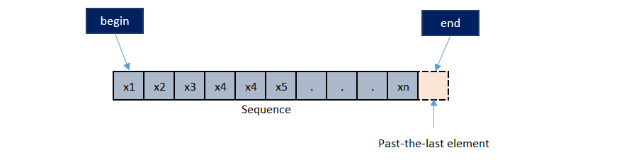

**<u>Ví dụ:</u>**

```cpp
#include <iostream>

#include <vector>

#include <string>

using namespace std;

int main()

{

// declaration of vector container
```

vector\<string\> myvector{ "This", "is", "Geeksforgeeks" };

// using begin() to print vector

```cpp
for (auto it = myvector.begin(); it != myvector.end(); ++it)

cout << ' ' << *it;

return 0;

}
```

***Kết quả:*** This is Geeksforgeeks

##### 7.2.3.2.3. c/ rbegin()

Đặt reverse iterator (trình lặp đảo) đến phần tử cuối cùng trong vector (reverse begin). Nó di chuyển *từ phần tử cuối cùng đến phần tử đầu tiên*

```cpp
Tên_vector.rbegin();
```

##### 7.2.3.2.4. d/ rend()

Đặt reverse iterator (trình lặp đảo) đến **<u>trước</u>** phần tử đầu tiên trong vector (reverse end). Nó di chuyển *từ phần tử **<u>trước</u>** phần tử đầu tiên đến phần tử cuối cùng (returns a reverse iterator pointing to the theoretical element preceding the first element in the vector)*

```cpp
Tên_vector.rend();
```

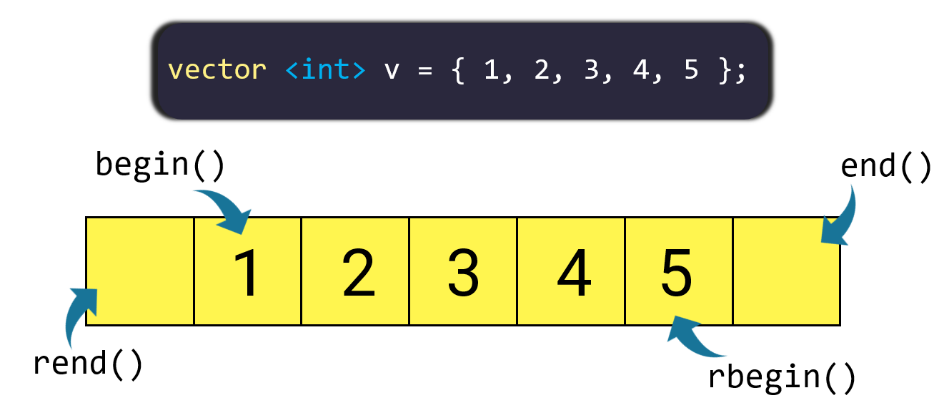

**<u>Ví dụ:</u>**

```cpp
#include <iostream>

#include <vector>

using namespace std;

int main()

{

vector<int> v;

v.push_back(11);

v.push_back(12);

v.push_back(13);

v.push_back(14);

v.push_back(15);

// prints all the elements

cout << "The vector elements in reverse order are: ";

for (auto it = v.rbegin(); it != v.rend(); it++)

cout << *it << " ";

return 0;

}
```

***Kết quả:*** The vector elements in reverse order are: 15 14 13 12 11

##### 7.2.3.2.5. e/ cbegin()

Đặt constant iterator (trình vòng lặp) đến phần tử đầu tiên trong vector *(Iterator không thể sửa đổi nội dung của vector)*

```cpp
Tên_vector.cbegin();
```

##### 7.2.3.2.6. f/ cend()

Đặt constant iterator (trình vòng lặp) đến **<u>sau</u>** phần tử cuối cùng trong vector *(past-the-end element of the vector)* *(Iterator không thể sửa đổi nội dung của vector).*

*Nếu container trống, hàm này trả về giống như vector::cbegin.*

```cpp
Tên_vector.cend();
```

**<u>Ví dụ:</u>**

```cpp
#include <iostream>

#include <vector>

#include <string>

using namespace std;

int main()

{

vector<string> vec;

// 5 string are inserted

vec.push_back("first");

vec.push_back("second");

vec.push_back("third");

vec.push_back("fourth");

vec.push_back("fifth");

// displaying the contents

cout << "Contents of the vector:" << endl;

for (auto itr = vec.cbegin(); itr != vec.end(); ++itr)

cout << *itr << endl;

return 0;

}
```

***Kết quả:***

Contents of the vector:

first

second

third

fourth

fifth

##### 7.2.3.2.7. g/ crbegin()

Đặt constant reverse iterator (trình lặp đảo liên tục) đến phần tử cuối cùng trong vector (reverse begin). *Nó di chuyển từ phần tử cuối cùng đến phần tử đầu tiên*

```cpp
Tên_vector.cbregin();

#include <iostream>

#include <vector>

using namespace std;

int main()

{
```

vector\<string\> v{ "akash","ajay","aniket","avi" };

```cpp
vector<string>::const_reverse_iterator itr = v.crbegin();

cout << *itr;

return 0;

}
```

***Kết quả:*** avi

##### 7.2.3.2.8. h/ crend()

Đặt constant reverse iterator (trình lặp đảo liên tục) đến **<u>trước</u>** phần tử đầu tiên trong vector (reverse end). *Nó di chuyển từ **<u>trước</u>** phần tử đầu tiên đến phần tử cuối cùng.*

```cpp
Tên_vector.crend();
```

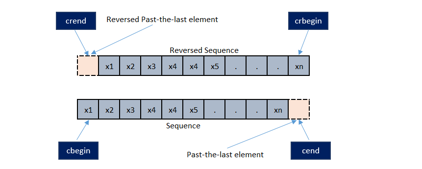

```cpp
#include <iostream>

#include <vector>

using namespace std;

int main()

{
```

vector\<string\>str{ "avi","aniket","akash","ajay" };

```cpp
vector<string>::const_reverse_iterator itr = str.crend() - 1;

std::cout << *itr;

return 0;

}
```

***Kết quả:*** avi

// CPP program to illustrate working of crbegin(), crend()

```cpp
#include <iostream>

#include <vector>

using namespace std;

int main()

{

// initializing vector with values

vector<int> vect = { 10, 20, 30, 40, 50 };

// for loop with crbegin and crend

for (auto i = vect.crbegin(); i != vect.crend(); i++)

cout << ' ' << *i; //printing results

cout << '\n';

return 0;

}
```

***Kết quả:*** 50 40 30 20 10

#### 7.2.3.3. Capacity (dung lượng)

##### 7.2.3.3.1. a/ Xem kích thước của mảng kiểu std::vector (size)

\- Không giống như mảng động được tích hợp sẵn của C++, cái mà không biết được độ dài của mảng mà nó đang trỏ tới là bao nhiêu, **std::vectors** tự theo dõi độ dài của chính nó.

\- Để xem kích thước mảng gồm bao nhiêu phần tử, sử dụng hàm** size()**.

\- Cú pháp: **<span class="mark">Tên_vector. size();</span>**

**<u>Ví dụ:</u>**

```cpp
#include <iostream>

#include <vector>

using namespace std;

int main() {

vector<int> arr = { 2, 5, 8, 3, 1 };

cout << arr.size() << endl;

return 0;

}
```

***Kết quả:*** 5

\- Vector sẽ tự động cập nhật kích thước khi có sự biến động về số lượng phần tử.

<table>
<colgroup>
<col style="width: 52%" />
<col style="width: 47%" />
</colgroup>
<thead>
<tr>
<th style="text-align: left;"><p><code>#include &lt;iostream&gt;</code></p>
<p><code>#include &lt;vector&gt;</code></p>
<p><code>using namespace std;</code></p>
<p><code>int main()</code></p>
<p><code>{</code></p>
<p>vector&lt;int&gt;v;</p>
<p><code>v.push_back(1);</code></p>
<p><code>v.push_back(2);</code></p>
<p><code>v.push_back(3);</code></p>
<p><code>cout &lt;&lt; v.size() &lt;&lt; endl;</code></p>
<p><code>v.push_back(4);</code></p>
<p><code>cout &lt;&lt; v.size();</code></p>
<p><code>}</code></p></th>
<th><p><em><strong>Kết quả:</strong></em></p>
<p>3</p>
<p>4</p></th>
</tr>
</thead>
<tbody>
</tbody>
</table>

##### 7.2.3.3.2. b/ Thay đổi kích thước mảng kiểu std::vector (resize)

Thay đổi kích thước một mảng được cấp phát động rất phức tạp. Tuy nhiên, điều này rất đơn giản đối với** std::vector **thông qua hàm **resize()**.

\- Hàm này có 2 dạng:

**\* <span class="mark">Tên_mảng. resize(\<số lượng\>)</span>;** Cấp phát mảng với số lượng phần tử cụ thể cho trước.

\+ Mặc định khi cấp phát với resize thì ***các phần tử đều mang giá trị mặc định ban đầu là 0.***

\+ Nếu mảng chưa được tạo thì sẽ tạo mảng với số lượng cụ thể đó.

\+ Nếu mảng *đã được tạo* mà tiếp tục resize thì *kích thước của mảng sẽ co lại hay dãn ra so với mảng ban đầu, các giá trị phần tử hiện có được giữ nguyên.*

\+ *Nếu là co lại thì 1 số phần tử trong mảng ban đầu sẽ bị mất,* nếu là dãn ra thì các phần tử lúc đầu vẫn tiếp tục tồn tại.

**<u>Ví dụ 1:</u>**

```cpp
#include <iostream>

#include <vector>

using namespace std;

int main()

{
```

vector\<int\> array{ 2, 5, 8, 3, 1 }; // mảng 5 phần tử

array.resize(10); // thay đổi độ dài mảng thành 10 phần tử

```cpp
cout << "Do dai mang: " << array.size() << '\n';

for (int i = 0; i < array.size(); i++)

cout << array[i] << ' ';

system("pause");

return 0;

}
```

***Kết quả:***

Do dai mang: 10

2 5 8 3 1 0 0 0 0 0

**<u>Ví dụ 2:</u>**

```cpp
#include <iostream>

#include <vector>

using namespace std;

int main()

{
```

vector\<int\> array{ 2, 5, 8, 3, 1 }; // mảng 5 phần tử

array.resize(3); // 2 5 8, phần tử thứ 4 trở đi sẽ bị cắt bỏ

```cpp
cout << "Do dai mang: " << array.size() << '\n';

for (int i = 0; i < array.size(); i++)

cout << array[i] << ' ';

system("pause");

return 0;

}
```

***Kết quả:***

Do dai mang: 3

2 5 8

**\* <span class="mark">Tên mảng. resize(\<số lượng\>, \<giá trị mặc định\>);</span>**

\+ Cấp phát mảng với số lượng phần tử cụ thể cho trước - với giá trị của các phần tử là giá trị mặc định mà ta đưa vào.

\+ Mảng được tạo mới nếu chưa có, nếu đã có rồi mảng sẽ co lại hoặc dãn ra so với mảng ban đầu, tuy nhiên nếu trước đó các phần tử trong mảng đã được gán giá trị (như ví dụ trên: 2 5 8 3 1), thì hàm resize này sẽ không còn tác dụng thay đổi các giá trị này nữa.

**<u>Ví dụ 3:</u>**

```cpp
#include <iostream>

#include <vector>

using namespace std;

int main()

{

vector<int> array;

array.resize(5,10);

array.resize(10);

cout << "Do dai mang: " << array.size() << '\n';

for (int i = 0; i < array.size(); i++)

cout << array[i] << '\t';

system("pause");

return 0;

}
```

***Kết quả:***

Do dai mang: 10

10 10 10 10 10 0 0 0 0 0

**<u>Ví dụ 4:</u>**

```cpp
#include <iostream>

#include <vector>

using namespace std;

int main()

{
```

vector\<int\> array{ 2, 5, 8, 3, 1 }; // mảng 5 phần tử

```cpp
array.resize(5,10);

array.resize(10);

cout << "Do dai mang: " << array.size() << '\n';

for (int i = 0; i < array.size(); i++)

cout << array[i] << '\t';

system("pause");

return 0;

}
```

***Kết quả:***

Do dai mang: 10

2 5 8 3 1 0 0 0 0 0

##### 7.2.3.3.3. c/ Dung lượng và kích thước của std::vector

\- Không giống như mảng thông thường hoặc mảng dựng sẵn **std::array **(chỉ chứa kích thước mảng),** std::vector chứa hai thuộc tính riêng biệt: kích thước (size) và dung lượng (capacity)**.

- **Kích thước (size) **trả về số lượng phần tử *đang được sử dụng* trong mảng.

- **Dung lượng (capacity)** trả về số lượng phần tử *được cấp phát* cho vector trong bộ nhớ *(kích thước thực sự của vector).*

**<u>Ví dụ 1:</u>**

```cpp
#include <iostream>

#include <vector>

using namespace std;

int main()

{

vector<int> array;
```

array = { 0, 1, 2, 3, 4 }; // length = 5, cap = 5

```cpp
cout << "length: " << array.size() << " capacity: " << array.capacity() << '\n';
```

array = { 9, 8, 7 }; // length = 3, cap = 5

```cpp
cout << "length: " << array.size() << " capacity: " << array.capacity() << '\n';

system("pause");

return 0;

}
```

***Kết quả:***

length: 5 capacity: 5

length: 3 capacity: 5

\- Thay đổi kích thước một mảng rất tốn kém về mặt tính toán, vì vậy **dung lượng (capacity)** sinh ra *để giảm thiểu việc cấp phát lại vùng nhớ khi thay đổi kích thước mảng.*

\+ Dung lượng này không nhất thiết phải bằng kích thước vectơ. Nó có thể bằng hoặc lớn hơn, với không gian bổ sung cho phép đáp ứng sự phát triển mà không cần phải phân bổ lại cho mỗi lần chèn.

\+ Dung lượng này không có giới hạn về kích thước của vectơ. Khi dung lượng này cạn kiệt và cần nhiều hơn, nó sẽ tự động được mở rộng bởi vùng chứa (phân bổ lại không gian lưu trữ). Giới hạn về kích thước của vectơ được đưa ra bởi thành viên max_size.

🡪 *Dẫn đến vector sẽ tiêu tốn bộ nhớ hơn mảng.*

\- Chúng ta có thể cấp phát một **dung lượng (capacity)** ban đầu cho **std::vector** bằng hàm **reserve()**.

**<u>Ví dụ 2:</u>**

```cpp
#include <iostream>

#include <vector>

using namespace std;

int main()

{

vector<int> array;

array = { 9, 8, 7 };
```

array.reserve(7); // đặt dung lượng vector là 7

```cpp
cout << "length: " << array.size() << " capacity: " << array.capacity() << '\n';

return 0;

}
```

***Kết quả:*** length: 3 capacity: 7

##### 7.2.3.3.4. d/ max_size()

Hàm trả về số phần tử tối đa mà vector có thể chứa

```cpp
Tên_vector.max_size();

#include <iostream>

#include <vector>

using namespace std;

int main()

{

vector <int> a = { 1,2,3,4,5 };

cout << "Max size of vector: " << a.max_size();

return 0;

}
```

***Kết quả:*** Max size of vector: 4 611 686 018 427 387 903

##### 7.2.3.3.5. e/ empty()

Trả về liệu vùng chứa có trống hay không, nếu trống thì trả về True, nếu có phần tử thì trả về False

```cpp
Tên_vector.empty();

#include <iostream>

#include <vector>

using namespace std;

int main()

{

vector<int> myvector;

int sum(0);

for (int i = 1; i <= 10; i++) myvector.push_back(i);

while (!myvector.empty())

{

sum += myvector.back();

myvector.pop_back();

}

cout << "total: " << sum << '\n';

return 0;

}
```

***Kết quả:*** total: 55

##### 7.2.3.3.6. f/ shrink_to_fit()

Giảm *dung lượng* của vùng chứa để phù hợp với kích thước của nó và hủy tất cả các phần tử vượt quá dung lượng.

Điều này có thể gây ra sự phân bổ lại vùng nhớ, nhưng *không ảnh hưởng đến kích thước vectơ và không thể thay đổi các phần tử của nó.*

```cpp
Tên_vector.shrink_to_fit();

// C++ program to illustrate the vector::shrink_to_fit()

#include <iostream>

#include <vector>

using namespace std;

int main()

{

// Initialized vector

vector<int> v(10);

for (int i = 0; i < 10; i++)

v[i] = i;

// Initial vector

cout << "Vector size initially: " << v.size();

cout << "\nVector elements are: ";

for (int i = 0; i < 10; i++)

cout << v[i] << " ";

// changes the size of the Vector but does not destroys the elements

v.resize(5);

cout << "\n\nVector size after resize(5): " << v.size();

cout << "\nVector elements after resize(5) are: ";

for (int i = 0; i < 10; i++)

cout << v[i] << " ";

// Shrinks to the size till which elements are destroys the elements after 5

v.shrink_to_fit();

cout << "\n\nVector size after shrink_to_fit(): "<< v.size();

cout << "\nVector elements after shrink_to_fit() are: ";

for (int i = 0; i < 10; i++)

cout << v[i] << " ";

return 0;

}
```

***Kết quả:***

Vector size initially: 10

Vector elements are: 0 1 2 3 4 5 6 7 8 9

Vector size after resize(5): 5

Vector elements after resize(5) are: 0 1 2 3 4 5 6 7 8 9

Vector size after shrink_to_fit(): 5

Vector elements after shrink_to_fit() are: 0 1 2 3 4 0 127889 0 0 0

##### 7.2.3.3.7. g/ reserve(n)

Hàm cấp cho vector số *dung lượng* vừa đủ để chứa n phần tử.

Nếu n lớn hơn dung lượng vectơ hiện tại, hàm sẽ khiến vùng chứa phân bổ lại bộ nhớ để tăng dung lượng lên n (hoặc lớn hơn).

Các trường hợp khác, không gây ra sự phân bổ lại và dung lượng vectơ không bị ảnh hưởng.

*Hàm này không ảnh hưởng đến kích thước vectơ và không thể thay đổi các phần tử của nó.*

```cpp
Tên_vector.reserve(n);

#include <iostream>

#include <vector>

using namespace std;

int main()

{

vector<int>::size_type sz;

vector<int> foo;

sz = foo.capacity();

cout << "making foo grow:\n";

for (int i = 0; i < 100; ++i) {

foo.push_back(i);

if (sz != foo.capacity()) {

sz = foo.capacity();

cout << "capacity changed: " << sz << '\n';

}

}

vector<int> bar;

sz = bar.capacity();
```

bar.reserve(100); // this is the only difference with foo above

```cpp
cout << "making bar grow:\n";

for (int i = 0; i < 100; ++i) {

bar.push_back(i);

if (sz != bar.capacity()) {

sz = bar.capacity();

cout << "capacity changed: " << sz << '\n';

}

}

return 0;

}
```

***Kết quả:***

making foo grow:

capacity changed: 1

capacity changed: 2

capacity changed: 3

capacity changed: 4

capacity changed: 6

capacity changed: 9

capacity changed: 13

capacity changed: 19

capacity changed: 28

capacity changed: 42

capacity changed: 63

capacity changed: 94

capacity changed: 141

making bar grow:

capacity changed: 100

#### 7.2.3.4. Element access (truy cập phần tử)

##### 7.2.3.4.1. a/ Duyệt qua các phần tử của vector

**Có 3 cách:**

```cpp
for (int i = 0; i < array.size(); i++)

cout << array[i] << endl;

// Hoặc sử dụng iterator

for (auto it = array.begin(); it != array.end(); ++it) {

cout << *it << endl;

}

// Hoặc sử dụng range-based for loop (C++11 trở lên)

for (int val : array) {

cout << val << endl;

}
```

##### 7.2.3.4.2. b/ at()

Trả về một tham chiếu đến phần tử có chỉ số là *index* trong vector

```cpp
Tên_vector.at(index);

#include <iostream>

#include <vector>

using namespace std;

int main()

{

vector <int> a = { 1,2,3,4,5 };

cout << a.at(2);

cout << endl << a[2]; //Dùng cách nào cũng được

return 0;

}
```

***Kết quả:*** 3

3

##### 7.2.3.4.3. c/ data()

Trả về một *con trỏ* trực tiếp đến (memory array) mảng bộ nhớ được sử dụng bên trong vector để lưu trữ các phần tử thuộc sở hữu của nó

```cpp
Tên_vector.data();

#include <iostream>

#include <vector>

using namespace std;

int main() {

vector<int> myvector(5);

int* p = myvector.data();
```

\*p = 10;

++p;

\*p = 20;

```cpp
p[2] = 100;

cout << "myvector contains:";

for (unsigned i = 0; i < myvector.size(); ++i)

cout << ' ' << myvector[i];

cout << '\n';

return 0;

}
```

***Kết quả:*** myvector contains: 10 20 0 100 0

##### 7.2.3.4.4. d/ front()

Hàm dùng để lấy ra phần tử đầu tiên của vector

```cpp
Tên_vector.front();
```

##### 7.2.3.4.5. e/ back()

Hàm dùng để lấy ra phần tử cuối cùng của vector

```cpp
Tên_vector.back();

#include <iostream>

#include <vector>

using namespace std;

int main()

{

vector <int> a = { 11,3,12,6,5 };

cout << "First element of vector: " << a.front() << endl;

cout << "Last element of vector: " << a.back() << endl;

return 0;

}
```

***Kết quả:***

First element of vector: 11

Last element of vector: 5

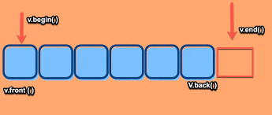

### 7.2.4. Khai báo vector với kích thước cố định

\- Mặc dù vector có thể tự xác định số lượng phần tử mà không cần khai báo trước, tuy nhiên nếu muốn ta có thể tạo vector có số lượng phần tử cố định (như mảng).

```cpp
#include <iostream>

#include <vector>

using namespace std;

int main()

{

int n; //số lượng phần tử của vector

cin >> n;

vector<int>v(n); //Tương đương int v[n]

for (int i = 0; i < n; i++) {

cin >> v[i];

}

return 0;

}
```

\- Nếu không khai báo số lượng phần tử trong vector mà dùng vòng for như trên để nhập dữ liệu của từng phần tử thì chương trình sẽ báo lỗi.

<table>
<colgroup>
<col style="width: 42%" />
<col style="width: 57%" />
</colgroup>
<thead>
<tr>
<th style="text-align: left;"><p><code>#include &lt;iostream&gt;</code></p>
<p><code>#include &lt;vector&gt;</code></p>
<p><code>using namespace std;</code></p>
<p><code>int main()</code></p>
<p><code>{</code></p>
<p><code>int n; //số lượng phần tử của vector</code></p>
<p><code>cin &gt;&gt; n;</code></p>
<p><mark>vector&lt;int&gt;v;</mark></p>
<p><code>for (int i = 0; i &lt; n; i++) {</code></p>
<p><code>cin &gt;&gt; v[i];</code></p>
<p><code>}</code></p>
<p><code>return 0;</code></p>
<p><code>}</code></p></th>
<th><p>A screenshot of a computer program Description automatically generated</p></th>
</tr>
</thead>
<tbody>
</tbody>
</table>

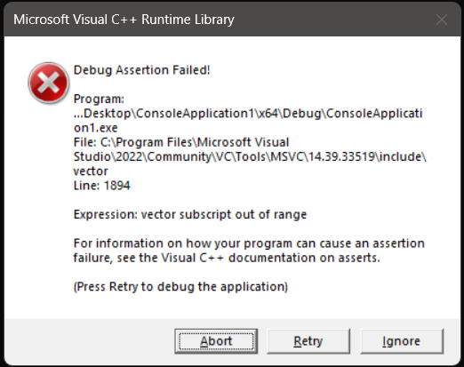

\- Cách giải quyết là ta sử dụng một biến tạm.

```cpp
#include <iostream>

#include <vector>

using namespace std;

int main()

{

int n; //số lượng phần tử của vector

cin >> n;

vector<int>v;

for (int i = 0; i < n; i++) {

int x; cin >> x;

v.push_back(x);

}

return 0;

}
```

\- Khai báo vector với số lượng phần tử cố định & các giá trị của các phần tử đều giống nhau.

<table>
<colgroup>
<col style="width: 53%" />
<col style="width: 46%" />
</colgroup>
<thead>
<tr>
<th style="text-align: left;"><p><code>#include &lt;iostream&gt;</code></p>
<p><code>#include &lt;vector&gt;</code></p>
<p><code>using namespace std;</code></p>
<p><code>int main()</code></p>
<p><code>{</code></p>
<p><code>int n; //số lượng phần tử của vector</code></p>
<p><code>cin &gt;&gt; n;</code></p>
<p>vector&lt;int&gt;v(n,100); //Tương đương int v[n]</p>
<p><code>for (int i = 0; i &lt; n; i++) {</code></p>
<p><code>cout &lt;&lt; v[i] &lt;&lt; endl;</code></p>
<p><code>}</code></p>
<p><code>return 0;</code></p>
<p><code>}</code></p></th>
<th><p><em><strong>Kết quả:</strong></em></p>
<p>8</p>
<p>100</p>
<p>100</p>
<p>100</p>
<p>100</p>
<p>100</p>
<p>100</p>
<p>100</p>
<p>100</p></th>
</tr>
</thead>
<tbody>
</tbody>
</table>

### 7.2.5. Lưu các kiểu dữ liệu khác

***Ví dụ 1:***

<table>
<colgroup>
<col style="width: 53%" />
<col style="width: 46%" />
</colgroup>
<thead>
<tr>
<th style="text-align: left;"><p><code>#include &lt;iostream&gt;</code></p>
<p><code>#include &lt;vector&gt;</code></p>
<p><code>using namespace std;</code></p>
<p><code>int main()</code></p>
<p><code>{</code></p>
<p><code>vector &lt;string&gt; v;</code></p>
<p><code>v.push_back("KTLT");</code></p>
<p><code>v.push_back("DSA");</code></p>
<p><code>for (int i = 0; i &lt; v.size(); i++) {</code></p>
<p><code>cout &lt;&lt; v[i] &lt;&lt; endl;</code></p>
<p><code>}</code></p>
<p><code>return 0;</code></p>
<p><code>}</code></p></th>
<th><p><em><strong>Kết quả:</strong></em></p>
<p>KTLT</p>
<p>DSA</p></th>
</tr>
</thead>
<tbody>
</tbody>
</table>

***Ví dụ 2:*** Tách từng từ trong một chuỗi

<table>
<colgroup>
<col style="width: 52%" />
<col style="width: 47%" />
</colgroup>
<thead>
<tr>
<th style="text-align: left;"><p><code>#include &lt;iostream&gt;</code></p>
<p><code>#include &lt;vector&gt;</code></p>
<p><code>#include &lt;string&gt;</code></p>
<p><code>#include &lt;sstream&gt;</code></p>
<p><code>using namespace std;</code></p>
<p><code>int main()</code></p>
<p><code>{</code></p>
<p><code>string s = "ngon ngu lap trinh java";</code></p>
<p>stringstream ss(s);</p>
<p><code>string tmp;</code></p>
<p>vector&lt;string&gt;v;</p>
<p><code>while (ss &gt;&gt; tmp) {</code></p>
<p><code>v.push_back(tmp);</code></p>
<p><code>}</code></p>
<p><code>for (string x : v) {</code></p>
<p><code>cout &lt;&lt; x &lt;&lt; endl;</code></p>
<p><code>}</code></p>
<p><code>return 0;</code></p>
<p><code>}</code></p></th>
<th><p><em><strong>Kết quả:</strong></em></p>
<p>ngon</p>
<p>ngu</p>
<p>lap</p>
<p>trinh</p>
<p>java</p></th>
</tr>
</thead>
<tbody>
</tbody>
</table>

### **7.2.6. Vector và Mảng 2 chiều**

Mỗi vector có thể sử dụng như mảng 1 chiều, nếu muốn sử dụng vector như mảng 2 chiều bạn cần sử dụng vector các vector. 

**- Cách 1: **Nhập từng dòng của mảng 2 chiều như 1 vector và thêm vào vector chính.

```cpp
#include <iostream>

#include <vector>

using namespace std;

int main(){

int n, m;

cout << "Nhap hang, cot : ";

cin >> n >> m;

vector<vector<int>> v;

for(int i = 0; i < n; i++){

vector<int> row;

for(int j = 0; j < m; j++){

cout << "Nhap phan tu hang " << i + 1 << ", cot " << j + 1 << " : ";

int tmp; cin >> tmp;

row.push_back(tmp);

}

v.push_back(row);

}

cout << "\nMang 2 chieu vua nhap : \n";

for(int i = 0; i < n; i++){

for(int j = 0; j < m; j++){

cout << v[i][j] << " ";

}

cout << endl;

}

return 0;

}
```

**- Cách 2 : **Khai báo sẵn vector có kích thước với hàng, cột được nhập từ bàn phím

***\* Sử dụng cú pháp sau:***

> using namespace std;\
> vector\<<u>vector\<type\></u>\> data {v1, v2, v3, ...};

***Trong đó:***

- data là tên biến vector 2 chiều

- <u>vector\<type\></u> là kiểu dữ liệu của vector bên ngoài (kiểu dữ liệu của vector bên ngoài lại là kiểu vector.

- vi là các vector 1 chiều được sử dụng như phần tử của vector 2 chiều, i = 1,2,3…

```cpp
#include <iostream>

#include <vector>

using namespace std;

int main(){

int n, m;

cout << "Nhap hang, cot : ";

cin >> n >> m;

vector<vector<int>> v(n, vector<int>(m));

for(int i = 0; i < n; i++){

for(int j = 0; j < m; j++){

cout << "Nhap phan tu hang " << i + 1 << ", cot " << j + 1 << " : ";

cin >> v[i][j];

}

}

cout << "\nMang 2 chieu vua nhap : \n";

for(int i = 0; i < n; i++){

for(int j = 0; j < m; j++){

cout << v[i][j] << " ";

}

cout << endl;

}

return 0;

}
```

## 7.3. Pair & Tuple

### **7.3.1. Kiểu Pair**

\- Kiểu dữ liệu Pair trong C++ sẽ rất hữu ích khi chúng ta cần lưu các cặp dữ liệu, chẳng hạn như lưu *giá trị tọa độ Oxy, tọa độ nơi bắt đầu và kết thúc của một đường thẳng trong hệ tọa độ, thời gian bắt đầu và thời gian kết thúc của một tác vụ nào đó…* 

\- pair nằm trong thư viện "utility" được sử dụng để kết hợp 2 kiểu dữ liệu với nhau, nó cung cấp cách *lưu trữ 2 giá trị đi kèm nhau nhưng chỉ sử dụng 1 biến.*

\- Nhìn chung pair giúp lưu trữ dữ liệu theo cặp và có những đặc điểm sau : 

- Phần tử thứ nhất của pair được gọi là first, phần tử thứ 2 của pair được gọi là second

- Bạn có thể so sánh, gán, copy pair như kiểu dữ liệu bạn thường gặp

- Để truy cập vào phần tử thứ nhất và thứ 2 trong pair ta sử dụng toán tử dấu chấm

#### 7.3.1.1. Khai báo & khởi tạo

//Cách 1 : Giá trị của first và second là mặc định

```cpp
pair<first_data_type, second_data_type> pair_name;

//Cách 2 : Giá trị của first là value1, second là value2

pair<first_data_type, second_data_type> pair_name = make_pair(value1, value2)

//Cách 3 : Giá trị của first là value1, second là value2

pair<first_data_type, second_data_type> pair_name(value1, value2)

//Cách 4 : Giá trị của first là value1, second là value2

pair<first_data_type, second_data_type> pair_name = {value1, value2}
```

Thành phần first và second của pair có thể là các kiểu dữ liệu thường gặp như int, float, double, long long, char... hay cũng có thể chính là một pair khác. Ngoài ra nó còn có thể là các kiểu phức tạp hơn như string, vector\<\>, set, object...

***Ví dụ:***

<table>
<colgroup>
<col style="width: 65%" />
<col style="width: 34%" />
</colgroup>
<thead>
<tr>
<th style="text-align: left;"><p><code>#include &lt;iostream&gt;</code></p>
<p><code>#include &lt;utility&gt;</code></p>
<p><code>using namespace std;</code></p>
<p><code>int main()</code></p>
<p><code>{</code></p>
<p>pair&lt;int, int&gt;v;</p>
<p><code>pair&lt;string, int&gt; v1;</code></p>
<p><code>cout &lt;&lt; v.first &lt;&lt; endl;</code></p>
<p><code>cout &lt;&lt; v.second &lt;&lt; endl;</code></p>
<p><code>return 0;</code></p>
<p><code>}</code></p></th>
<th><p><em><strong>Kết quả:</strong></em></p>
<p>0</p>
<p>0</p></th>
</tr>
</thead>
<tbody>
<tr>
<td style="text-align: left;"><p><code>#include &lt;iostream&gt;</code></p>
<p><code>#include &lt;utility&gt;</code></p>
<p><code>using namespace std;</code></p>
<p><code>int main()</code></p>
<p><code>{</code></p>
<p>pair&lt;int, int&gt;v = make_pair(100,200);</p>
<p>//pair&lt;int, int&gt;v = { 100,200 };</p>
<p><code>cout &lt;&lt; v.first &lt;&lt; endl;</code></p>
<p><code>cout &lt;&lt; v.second &lt;&lt; endl;</code></p>
<p><code>return 0;</code></p>
<p><code>}</code></p></td>
<td><p><em><strong>Kết quả:</strong></em></p>
<p>100</p>
<p>200</p></td>
</tr>
</tbody>
</table>

<table>
<colgroup>
<col style="width: 63%" />
<col style="width: 36%" />
</colgroup>
<thead>
<tr>
<th><p><code>#include &lt;iostream&gt;</code></p>
<p><code>#include &lt;utility&gt;</code></p>
<p><code>using namespace std;</code></p>
<p><code>int main(){</code></p>
<p><code>pair&lt;int, int&gt; a = make_pair(28, 100);</code></p>
<p><code>cout &lt;&lt; a.first &lt;&lt; ' ' &lt;&lt; a.second &lt;&lt; endl;</code></p>
<p><code>pair&lt;char, int&gt; b = {'@', 28};</code></p>
<p><code>cout &lt;&lt; b.first &lt;&lt; ' ' &lt;&lt; b.second &lt;&lt; endl;</code></p>
<p><code>pair&lt;char, char&gt; c('#', '$');</code></p>
<p><code>cout &lt;&lt; c.first &lt;&lt; ' ' &lt;&lt; c.second &lt;&lt; endl;</code></p>
<p><code>return 0;</code></p>
<p><code>}</code></p></th>
<th><p><em><strong>Output : </strong></em></p>
<p>28 100</p>
<p>@ 28</p>
<p># $</p></th>
</tr>
</thead>
<tbody>
</tbody>
</table>

***- Khai báo pair lồng nhau:*** Chẳng hạn như khi cần khai báo 3 giá trị đi chung với nhau mô tả một cạnh của đồ thị có trọng số (đỉnh 1, đỉnh 2, trọng số).

```cpp
#include <iostream>

#include <iostream>

using namespace std;

int main(){

pair<int, pair<char, int> > p1 = make_pair(28, make_pair('@', 100));

cout << p1.first << endl;

cout << p1.second.first << ' ' << p1.second.second << endl;

pair<pair<int, int>, pair<int, int>> p2 = {{10, 20}, {30, 40}};

cout << p2.first.first << ' ' << p2.first.second << endl;

cout << p2.second.first << ' ' << p2.second.second << endl;

return 0;

}
```

***Output : ***

28

@ 100

10 20

30 40

\* Phần đầu tiên là một pair, phần thứ hai là một giá trị kiểu int. Trong thành phần đầu tiên là một pair gồm có 2 thành phần nữa.

#### **7.3.1.2. Toán Tử Với Pair**

\- Có thể sử dụng các toán tử so sánh, gán với kiểu pair này.

***Ví dụ 1*.** *Toán tử gán sẽ gán giá trị của first và second của 2 pair cho nhau.* Trong ví dụ này mình demo với kiểu string - chuỗi ký tự trong C++

<table>
<colgroup>
<col style="width: 65%" />
<col style="width: 34%" />
</colgroup>
<thead>
<tr>
<th><p><code>#include &lt;iostream&gt;</code></p>
<p><code>#include &lt;utility&gt;</code></p>
<p><code>using namespace std;</code></p>
<p><code>int main(){</code></p>
<p><code>pair&lt;string, int&gt; p = make_pair("28tech", 28);</code></p>
<p><code>pair&lt;string, int&gt; p1 = p;</code></p>
<p><code>cout &lt;&lt; p1.first &lt;&lt; ' ' &lt;&lt; p1.second &lt;&lt; endl;</code></p>
<p><code>return 0;</code></p>
<p><code>}</code></p></th>
<th><p><em><strong>Output: </strong></em></p>
<p>28tech 28</p></th>
</tr>
</thead>
<tbody>
</tbody>
</table>

***Ví dụ 2:*** So sánh 2 pair sẽ so sánh giá trị first sau đó so sánh giá trị second

<table>
<colgroup>
<col style="width: 59%" />
<col style="width: 40%" />
</colgroup>
<thead>
<tr>
<th><p><code>#include &lt;iostream&gt;</code></p>
<p><code>#include &lt;utility&gt;</code></p>
<p><code>using namespace std;</code></p>
<p><code>int main(){</code></p>
<p><code>pair&lt;int, int&gt; p1 = {10, 20};</code></p>
<p><code>pair&lt;int, int&gt; p2 = {10, 21};</code></p>
<p><code>pair&lt;int, int&gt; p3 = {5, 35};</code></p>
<p><code>cout &lt;&lt; boolalpha &lt;&lt; (p1 == p2) &lt;&lt; endl;</code></p>
<p><code>cout &lt;&lt; boolalpha &lt;&lt; (p1 != p2) &lt;&lt; endl;</code></p>
<p><code>cout &lt;&lt; boolalpha &lt;&lt; (p1 &lt; p2) &lt;&lt; endl;</code></p>
<p><code>cout &lt;&lt; boolalpha &lt;&lt; (p1 &gt; p3) &lt;&lt; endl;</code></p>
<p><code>return 0;</code></p>
<p><code>}</code></p></th>
<th><p><em><strong>Output: </strong></em></p>
<p>false</p>
<p>true</p>
<p>true</p>
<p>true</p></th>
</tr>
</thead>
<tbody>
</tbody>
</table>

#### 7.3.1.3. Một số hàm được sử dụng với pair

##### 7.3.1.3.1. a/ swap

This function swaps the contents of one pair object with the contents of another pair object. The pairs must be of the same type. 

***Ví dụ:*** swap 2 pair với nhau bằng *hàm swap*

```cpp
#include <iostream>

#include <iostream>

using namespace std;

int main(){

pair<int, int> p1 = {10, 20};

pair<int, int> p2 = {30, 40};

cout << "Ban dau : \n";

cout << "p1 = {" << p1.first << ", " << p1.second << "}\n";

cout << "p2 = {" << p2.first << ", " << p2.second << "}\n";

p1.swap(p2);

cout << "Sau khi swap : \n";

cout << "p1 = {" << p1.first << ", " << p1.second << "}\n";

cout << "p2 = {" << p2.first << ", " << p2.second << "}\n";

return 0;

}
```

***Output: ***

Ban dau :

p1 = {10, 20}

p2 = {30, 40}

Sau khi swap :

p1 = {30, 40}

p2 = {10, 20}

**\**

##### 7.3.1.3.2. b/ tie()

Hàm này hoạt động tương tự như trong [<u>tuples</u>](https://www.geeksforgeeks.org/tuples-in-c/). Nó tạo ra một bộ tham chiếu giá trị lvalue cho các đối số của nó, tức là để “giải nén” các giá trị bộ (hoặc cặp ở đây) thành các biến riêng biệt.

Từ khóa “ignore” bỏ qua một phần tử bộ cụ thể khỏi việc “giải nén”.

**Syntax: **

tie(int &, int &) = pair1;

 

<table style="width:99%;">
<colgroup>
<col style="width: 99%" />
</colgroup>
<thead>
<tr>
<th><p>// CPP code to illustrate tie() in Pair</p>
<p><code>#include &lt;bits/stdc++.h&gt;</code></p>
<p><code><strong>using</strong> <strong>namespace</strong> std;</code></p>
<p> </p>
<p>// Driver Code</p>
<p><code><strong>int</strong> main()</code></p>
<p><code>{</code></p>
<p><code>    pair&lt;<strong>int</strong>, <strong>int</strong>&gt; pair1 = { 1, 2 };</code></p>
<p><code>    <strong>int</strong> a, b;</code></p>
<p>    tie(a, b) = pair1;</p>
<p><code>    cout &lt;&lt; a &lt;&lt; " " &lt;&lt; b &lt;&lt; "\n";</code></p>
<p> </p>
<p><code>    pair&lt;<strong>int</strong>, <strong>int</strong>&gt; pair2 = { 3, 4 };</code></p>
<p>    tie(a, ignore) = pair2;</p>
<p> </p>
<p>    // prints old value of b</p>
<p><code>    cout &lt;&lt; a &lt;&lt; " " &lt;&lt; b &lt;&lt; "\n";</code></p>
<p> </p>
<p>    // Illustrating pair of pairs</p>
<p><code>    pair&lt;<strong>int</strong>, pair&lt;<strong>int</strong>, <strong>char</strong>&gt; &gt; pair3 = { 3, { 4, 'a' } };</code></p>
<p><code>    <strong>int</strong> x, y;</code></p>
<p><code>    <strong>char</strong> z;</code></p>
<p> </p>
<p>    // tie(x,y,z) = pair3; Gives compilation error</p>
<p>    // tie(x, tie(y,z)) = pair3; Gives compilation error</p>
<p>    // Each pair needs to be explicitly handled</p>
<p>    tie(x,ignore) = pair3;</p>
<p>    tie(y, z) = pair3.second;</p>
<p><code>    cout &lt;&lt; x &lt;&lt; " " &lt;&lt; y &lt;&lt; " " &lt;&lt; z &lt;&lt; "\n";</code></p>
<p><code>}</code></p>
<p> </p>
<p>// contributed by sarthak_eddy.</p></th>
</tr>
</thead>
<tbody>
</tbody>
</table>

**Output**

1 2

3 2

3 4 a

**Code to illustrate Functions in Pair:**

<table style="width:99%;">
<colgroup>
<col style="width: 99%" />
</colgroup>
<thead>
<tr>
<th><p><code>#include &lt;iostream&gt;</code></p>
<p><code>#include &lt;string&gt;</code></p>
<p><code>#include &lt;utility&gt;</code></p>
<p><code><strong>using</strong> <strong>namespace</strong> std;</code></p>
<p><code><strong>int</strong> main()</code></p>
<p><code>{</code></p>
<p><code>    pair&lt;string, <strong>int</strong>&gt; g1;</code></p>
<p><code>    pair&lt;string, <strong>int</strong>&gt; g2("Quiz", 3);</code></p>
<p><code>    pair&lt;string, <strong>int</strong>&gt; g3(g2);</code></p>
<p><code>    pair&lt;<strong>int</strong>, <strong>int</strong>&gt; g4(5, 10);</code></p>
<p> </p>
<p><code>    g1 = make_pair(string("Geeks"), 1);</code></p>
<p>    g2.first = ".com";</p>
<p>    g2.second = 2;</p>
<p> </p>
<p><code>    cout &lt;&lt; "This is pair g" &lt;&lt; g1.second &lt;&lt; " with "</code></p>
<p>         &lt;&lt; "value " &lt;&lt; g1.first &lt;&lt; "." &lt;&lt; endl</p>
<p>         &lt;&lt; endl;</p>
<p> </p>
<p><code>    cout &lt;&lt; "This is pair g" &lt;&lt; g3.second &lt;&lt; " with value "</code></p>
<p>         &lt;&lt; g3.first</p>
<p>         &lt;&lt; "This pair was initialized as a copy of "</p>
<p>         &lt;&lt; "pair g2" &lt;&lt; endl</p>
<p>         &lt;&lt; endl;</p>
<p> </p>
<p><code>    cout &lt;&lt; "This is pair g" &lt;&lt; g2.second &lt;&lt; " with value "</code></p>
<p>         &lt;&lt; g2.first &lt;&lt; "\nThe values of this pair were"</p>
<p>         &lt;&lt; " changed after initialization." &lt;&lt; endl</p>
<p>         &lt;&lt; endl;</p>
<p> </p>
<p><code>    cout &lt;&lt; "This is pair g4 with values " &lt;&lt; g4.first</code></p>
<p>         &lt;&lt; " and " &lt;&lt; g4.second</p>
<p>         &lt;&lt; " made for showing addition. \nThe "</p>
<p>         &lt;&lt; "sum of the values in this pair is "</p>
<p>         &lt;&lt; g4.first + g4.second &lt;&lt; "." &lt;&lt; endl</p>
<p>         &lt;&lt; endl;</p>
<p> </p>
<p><code>    cout &lt;&lt; "We can concatenate the values of"</code></p>
<p>         &lt;&lt; " the pairs g1, g2 and g3 : "</p>
<p>         &lt;&lt; g1.first + g3.first + g2.first &lt;&lt; endl</p>
<p>         &lt;&lt; endl;</p>
<p> </p>
<p><code>    cout &lt;&lt; "We can also swap pairs "</code></p>
<p>         &lt;&lt; "(but type of pairs should be same) : " &lt;&lt; endl;</p>
<p><code>    cout &lt;&lt; "Before swapping, "</code></p>
<p>         &lt;&lt; "g1 has " &lt;&lt; g1.first &lt;&lt; " and g2 has "</p>
<p>         &lt;&lt; g2.first &lt;&lt; endl;</p>
<p><code>    swap(g1, g2);</code></p>
<p><code>    cout &lt;&lt; "After swapping, "</code></p>
<p>         &lt;&lt; "g1 has " &lt;&lt; g1.first &lt;&lt; " and g2 has "</p>
<p>         &lt;&lt; g2.first;</p>
<p><code>    <strong>return</strong> 0;</code></p>
<p><code>}</code></p></th>
</tr>
</thead>
<tbody>
</tbody>
</table>

**Output**

This is pair g1 with value Geeks.

This is pair g3 with value QuizThis pair was initialized as a copy of pair g2

This is pair g2 with value .com

The values of this pair were changed after initialization.

This is pair g4 with values 5 and 10 made for showing addition.

The sum of the values in this pair is 15.

We can concatenate the values of the pairs g1, g2 and g3 : GeeksQuiz.com

We can also swap pairs (but type of pairs should be same) :

Before swapping, g1 has Geeks and g2 has .com

After swapping, g1 has .com and g2 has Geeks

**Time complexity:** O(1).

**Auxiliary space:** O(1).

### 7.3.2. Kiểu tuple

**-** A tuple is an object that can hold a number of elements. The elements can be of different data types. The elements of tuples are initialized as arguments in order in which they will be accessed. 

#### 7.3.2.1. Khởi tạo & khai báo

```cpp
#include <iostream>

tuple<kiểu_1, kiểu_2, ..., kiểu_N> Tên_tuple;
```

\- Để khởi tạo giá trị, ta dùng một trong các cách sau:

**+ Cách 1:**

// Declaring tuple

```cpp
tuple <char, int, float> geek;

// Assigning values to tuple using make_tuple()

geek = make_tuple('a', 10, 15.5);
```

**+ Cách 2:**

// Initializing tuple

```cpp
tuple <char, int, float> geek(20, 'g', 17.5);
```

**+ Cách 3:**

tuple \<int, int, int\> t{ 20, 10, 12 };

\- Có thể tạo tuple với nhiều kiểu dữ liệu khác nhau (như pair).

#### **7.3.2.2. Operations on tuple**

**1. get\<index\>(tên_tuple)** : get() is used to access the tuple values and modify them, it accepts the index and tuple name as arguments to access a particular tuple element.

**2. make_tuple(danh_sách_các_giá_trị) **: make_tuple() is used to assign tuple with values. The values passed should be in order with the values declared in tuple. 

// C++ code to demonstrate tuple, get() and make_pair()

```cpp
#include <iostream>

#include\ // for tuple

using namespace std;

int main()

{

// Declaring tuple

tuple <char, int, float> geek;

// Assigning values to tuple using make_tuple()

geek = make_tuple('a', 10, 15.5);

// Printing initial tuple values using get()

cout << "The initial values of tuple are : ";

cout (geek) (geek);

cout (geek) << endl;

// Use of get() to change values of tuple
```

get\<0\>(geek) = 'b';

get\<2\>(geek) = 20.5;

// Printing modified tuple values

```cpp
cout << "The modified values of tuple are : ";

cout (geek) (geek);

cout (geek) \

return 0;

}
```

The initial values of tuple are : a 10 15.5

The modified values of tuple are : b 10 20.5

**3. tuple_size**- It returns the number of elements present in the tuple. 

//C++ code to demonstrate tuple_size

```cpp
#include <iostream>

#include\ // for tuple_size and tuple

using namespace std;

int main()

{

// Initializing tuple

tuple <char, int, float> geek(20, 'g', 17.5);

// Use of size to find tuple_size of tuple

cout << "The size of tuple is : ";

cout << tuple_size<decltype(geek)>::value << endl;

return 0;

}
```

The size of tuple is : 3

• **decltype(geek)**:

- decltype là một từ khóa trong C++ được sử dụng để truy vấn kiểu của một biểu thức. Trong trường hợp này, decltype(geek) sẽ lấy kiểu của biến geek. Vì geek là một tuple có kiểu tuple\<char, int, float\>, nên decltype(geek) sẽ tương đương với tuple\<char, int, float\>.

• **tuple_size\<decltype(geek)\>**:

- tuple_size là một template class trong thư viện \<tuple\> của C++ dùng để lấy số lượng phần tử trong một tuple. tuple_size\<decltype(geek)\> sẽ trả về một đối tượng của tuple_size mà kiểu của nó là tuple\<char, int, float\>.

• **tuple_size\<decltype(geek)\>::value**:

- ::value là một hằng số tĩnh (static constant) được định nghĩa trong tuple_size để giữ giá trị số lượng phần tử của tuple. Trong trường hợp này, vì geek là một tuple chứa 3 phần tử (char, int, float), nên tuple_size\<tuple\<char, int, float\>\>::value sẽ bằng 3.

***\* Từ khóa decltype (decltype keyword)***

\- Cũng tương tự với từ khóa **auto**, từ khóa **decltype** giúp chương trình tự động xác định kiểu dữ liệu cho biến. Nhưng cách sử dụng từ khóa **decltype** có một chút khác biệt so với cách sử dụng từ khóa **auto**.

\- Để phân biệt:

- Từ khóa **auto** xác định kiểu dữ liệu *dựa trên phần khởi tạo của biến.*

- Từ khóa **decltype** xác định kiểu dữ liệu *từ 1 biến hoặc 1 **biểu thức** khác.*

Vì thế, khi sử dụng từ khóa **decltype**, chúng ta phải sử dụng kèm với 1 đối tượng cụ thể (1 biến, 1 biểu thức hoặc 1 đối tượng của class nào đó...).

\- Cách sử dụng từ khóa **decltype**:

decltype(\<object or expression\>) \<variable_name\> \[= \<initial_value\>\];

\- Giá trị khởi tạo (phần đặt trong ngoặc vuông) là không bắt buộc vì từ khóa **decltype** đã xác định được kiểu dữ liệu bằng cách lấy kiểu dữ liệu của đối tượng (object) hoặc biểu thức (expression).

int32_t i\_**value**;

decltype(i\_**value**) what\_**is**\_**this**;

```cpp
cout << typeid(what_is_this).name() << endl; *//int*
```

\- Trong đoạn chương trình trên, mình khai báo 1 biến có tên là **i_value** với kiểu dữ liệu **int32_t**. Sau đó, mình dùng từ khóa **decltype** để lấy ra kiểu dữ liệu của biến **i_value** và dùng nó cho biến mà mình muốn sử dụng.

\- Thử so sánh kiểu dữ liệu của 2 biến:

**int32_t** i_value;

**decltype**(i_value) what_is_this;

```cpp
if (typeid(i_value) == typeid(what_is_this))

cout << "i_value and what_is_this have the same data type" << endl;

else

cout << "Are you kidding me?" << endl;
```

Bởi vì từ khóa **decltype** lấy kiểu dữ liệu của đối tượng trước đó để khai báo cho đối tượng sau, *nên hai đối tượng này luôn có cùng kiểu dữ liệu.*

**\**

**4. swap()** :- The swap(), swaps the elements of the two different tuples. 

//C++ code to demonstrate swap()

```cpp
#include <iostream>

#include\ // for swap() and tuple

using namespace std;

int main()

{

// Initializing 1st tuple

tuple <int, char, float> tup1(20, 'g', 17.5);

// Initializing 2nd tuple

tuple <int, char, float> tup2(10, 'f', 15.5);

// Printing 1st and 2nd tuple before swapping

cout << "The first tuple elements before swapping are : ";

cout (tup1) (tup1) << " "
```

\<\< get\<2\>(tup1) \<\< endl;

```cpp
cout << "The second tuple elements before swapping are : ";

cout (tup2) (tup2) << " "
```

\<\< get\<2\>(tup2) \<\< endl;

// Swapping tup1 values with tup2

```cpp
tup1.swap(tup2);

// Printing 1st and 2nd tuple after swapping

cout << "The first tuple elements after swapping are : ";

cout (tup1) (tup1) << " "
```

\<\< get\<2\>(tup1) \<\< endl;

```cpp
cout << "The second tuple elements after swapping are : ";

cout (tup2) (tup2) << " "
```

\<\< get\<2\>(tup2) \<\< endl;

```cpp
return 0;

}
```

The first tuple elements before swapping are : 20 g 17.5

The second tuple elements before swapping are : 10 f 15.5

The first tuple elements after swapping are : 10 f 15.5

The second tuple elements after swapping are : 20 g 17.5

**5. tie()** : The work of tie() is to unpack the tuple values into separate variables. There are two variants of tie(), with and without “ignore” , the “ignore” ignores a particular tuple element and stops it from getting unpacked. 

// C++ code to demonstrate working of tie()

```cpp
#include <iostream>

#include\ // for tie() and tuple

using namespace std;

int main()

{

// Initializing variables for unpacking

int i_val;

char ch_val;

float f_val;

// Initializing tuple

tuple <int, char, float> tup1(20, 'g', 17.5);

// Use of tie() without ignore
```

<span class="mark">tie(i_val, ch_val, f_val) = tup1;</span>

// Displaying unpacked tuple elements without ignore

```cpp
cout << "The unpacked tuple values (without ignore) are : ";

cout << i_val << " " << ch_val << " " << f_val;

cout << endl;

// Use of tie() with ignore

// ignores char value
```

tie(i_val, ignore, f_val) = tup1;

// Displaying unpacked tuple elements with ignore

```cpp
cout << "The unpacked tuple values (with ignore) are : ";

cout << i_val << " " << f_val;

cout << endl;

return 0;

}
```

The unpacked tuple values (without ignore) are : 20 g 17.5

The unpacked tuple values (with ignore) are : 20 17.5

**6. tuple_cat()** :- This function concatenates two tuples and returns a new tuple. 

// C++ code to demonstrate working of tuple_cat()

```cpp
#include <iostream>

#include\ // for tuple_cat() and tuple

using namespace std;

int main()

{

// Initializing 1st tuple

tuple <int, char, float> tup1(20, 'g', 17.5);

// Initializing 2nd tuple

tuple <int, char, float> tup2(30, 'f', 10.5);

// Concatenating 2 tuples to return a new tuple

auto tup3 = tuple_cat(tup1, tup2);

// Displaying new tuple elements

cout << "The new tuple elements in order are : ";

cout (tup3) (tup3) << " ";

cout (tup3) (tup3) << " ";

cout (tup3) (tup3) << endl;

return 0;

}
```

The new tuple elements in order are : 20 g 17.5 30 f 10.5

## 7.4. Set

**Set** trong C++ là một container cực kỳ mạnh mẽ và hiệu quả, đây là là một kiến thức cơ bản trong C++ mà người học cần nắm vững. Khi nắm được set trong C++ rồi thì việc học set trong Java, PHP, JS hay Python cũng rất dễ dàng và nhanh chóng.

### **7.4.1. Tính chất của set trong C++**

**- Set **là một container được xây dựng sẵn, bạn cũng có thể gọi nó là cấu trúc dữ liệu hay thư viện cũng được. 

\- The **std::set** class is the part of C++ Standard Template Library (STL) and it is defined inside the **\<set\>** header file.

\- Đây là một cấu trúc dữ liệu đã được xây dựng sẵn, để sử dụng bạn cần thêm thư viện set vào chương trình của mình.

\- Set được cài đặt bởi **cấu trúc dữ liệu cây nhị phân tìm kiếm (binary search tree).**

\- Sau đây là những tính chất quan trọng của set mà bạn cần ghi nhớ : 

1.  Các phần tử trong set có giá trị khác nhau, **không có 2 phần tử có cùng giá trị**

2.  Các phần tử trong set được **tự động sắp xếp theo thứ tự tăng dần**

3.  Tìm kiếm phần tử trong set chỉ mất độ phức tạp **O(logN)**

4.  <span class="mark">Set **không thể truy cập phần tử thông qua chỉ số** như mảng hay vector, string.</span>

\- Set đặc biệt phù hợp với những bài toán liên quan tới việc **loại bỏ giá trị trùng nhau hoặc tìm kiếm nhanh.**

\- Cú pháp khai báo set trong C++ : 

> \#include \<set\>
>
> set\<data_type\> set_name;

### 7.4.2. Một số hàm cơ bản của set

#### 7.4.2.1. insert() & size()

*- Để thêm 1 phần tử vào trong set* bạn sử dụng hàm** insert()**, hàm này có độ phức tạp là O(logN) và lưu ý rằng **nếu trong set của bạn đã tồn tại giá trị nào đó thì bạn không thể thêm nó vào nữa** vì set không thể lưu giá trị trùng nhau.

\- Hàm size() trả về số lượng phần tử trong set.

**Ví dụ 1: **

```cpp
#include <iostream>

#include <set>

#include <string>

using namespace std;

int main(){

set<int> se; // {}
```

se.insert(3); // {3}

se.insert(1); // {1, 3}

se.insert(1); // {1, 3}

se.insert(2); // {1, 2, 3}

se.insert(3); // {1, 2, 3}

se.insert(2); // {1, 2, 3}

se.insert(4); // {1, 2, 3, 4}

```cpp
cout << "So luong phan tu trong set : \n";

cout << se.size() << endl;

}
```

***Output : ***

So luong phan tu trong set :

4

**Nhận xét** : Các phần tử trong set không trùng nhau và được sắp xếp theo thứ tự tăng dần

**Ví dụ 2 :** 

```cpp
#include <iostream>

#include <set>

#include <string>

using namespace std;

int main(){

set<string> se; // {}
```

se.insert("tech28"); // {tech28}

se.insert("c++"); // {c++, tech28}

se.insert("c++"); // {c++, tech28}

se.insert("tech28"); // {c++, tech28}

se.insert("stl"); // {c++, stl, tech28}

se.insert("stl"); // {c++, stl, tech28}

se.insert("stl"); // {c++, stl, tech28}

```cpp
cout << "So luong phan tu trong set : \n";

cout << se.size() << endl;

}
```

***Output : ***

So luong phan tu trong set :

3

#### 7.4.2.2. Duyệt set

\- Để duyệt set bạn có thể dụng range-based for loop hoặc duyệt thông qua iterator, tương tự như vector hay các container khác trong thư viện STL thì set cũng có [<u>iterator</u>](https://blog.28tech.com.vn/stl-iterator-trong-c "iterator")

**Ví dụ 1: Duyệt set **

```cpp
#include <iostream>

#include <set>

#include <iostream>

using namespace std;

int main(){

set<int> se; // {}
```

se.insert(3); // {3}

se.insert(1); // {1, 3}

se.insert(1); // {1, 3}

se.insert(2); // {1, 2, 3}

se.insert(3); // {1, 2, 3}

se.insert(2); // {1, 2, 3}

se.insert(4); // {1, 2, 3, 4}

```cpp
cout << "Duyet set bang range-based for loop : \n";

for(int x : se){

cout << x << ' ';

}

cout << "\nDuyet set bang iterator : \n";

for(set::iterator it = se.begin(); it != se.end(); ++it){

cout << *it << " ";

}

}
```

***Output : ***

Duyet set bang range-based for loop :

1 2 3 4

Duyet set bang iterator :

1 2 3 4

\- Truy cập vào các giá trị đặc biệt (nhỏ nhất, lớn nhất) trong set thông qua iterator : 

- begin() : Iterator trỏ tới phần tử đầu tiên trong set

- rbegin() : Iterator ngược trỏ tới phần tử cuối cùng trong set 

**Ví dụ 2 : **

```cpp
#include <iostream>

#include <set>

#include <string>

using namespace std;

int main(){

set<int> se; // {}
```

se.insert(3); // {3}

se.insert(1); // {1, 3}

se.insert(1); // {1, 3}

se.insert(2); // {1, 2, 3}

se.insert(3); // {1, 2, 3}

se.insert(2); // {1, 2, 3}

se.insert(4); // {1, 2, 3, 4}

```cpp
cout << "Phan tu nho nhat : " << *se.begin() << endl;

cout << "Phan tu lon nhat : " << *se.rbegin() << endl;

}
```

***Output : ***

Phan tu nho nhat : 1

Phan tu lon nhat : 4

**- Chú ý **: Iterator trong set **chỉ hỗ trợ toán tử ++ hoặc --**  chứ không hỗ trợ toán tử += và -= như iterator của vector

**Ví dụ 3: **

<table>
<colgroup>
<col style="width: 52%" />
<col style="width: 47%" />
</colgroup>
<thead>
<tr>
<th style="text-align: left;"><p><code>#include &lt;set&gt;</code></p>
<p><code>#include &lt;iostream&gt;</code></p>
<p><code>#include &lt;string&gt;</code></p>
<p><code>using namespace std;</code></p>
<p><code>int main() {</code></p>
<p><code>int n; cin &gt;&gt; n;</code></p>
<p>set&lt;string&gt;s;</p>
<p><code>cin.ignore();</code></p>
<p><code>for (int i = 0; i &lt; n; i++) {</code></p>
<p><code>string str;</code></p>
<p><code>getline(cin, str);</code></p>
<p><code>s.insert(str);</code></p>
<p><code>}</code></p>
<p><code>cout &lt;&lt; s.size();</code></p>
<p><code>return 0;</code></p>
<p><code>}</code></p></th>
<th style="text-align: left;"><p><em><strong>Kết quả:<br />
</strong></em>5</p>
<p>python</p>
<p>laptrinh</p>
<p>java</p>
<p>python</p>
<p>laptrinh</p>
<p>3</p></th>
</tr>
</thead>
<tbody>
</tbody>
</table>

#### 7.4.2.3. Hàm find()

\- Hàm **find()** có chức năng tìm kiếm một phần tử trong set, hàm này rất hiệu quả và dễ dùng.

\- Hàm này sẽ trả về <span class="mark">iterator tới phần tử nếu tìm thấy</span>, ngược lại sẽ <span class="mark">trả về iterator **end()** của set</span>

\- Độ phức tạp: O(logN)

\- Khi gặp bài toán cần tìm kiếm nhanh bạn có thể nghĩ tới set như một giải pháp tối ưu.

**\**

**Mã nguồn : **

```cpp
#include <iostream>

#include <set>

#include <iostream>

using namespace std;

int main(){

set<int> se = {3, 1, 2, 4, 5, 6}; // {1, 2, 3, 4, 5, 6}

if(se.find(3) != se.end()){

cout << "3 xuat hien trong set\n";

}

else{

cout << "3 khong xuat hien trong set\n";

}

if(se.find(28) != se.end()){

cout << "28 xuat hien trong set\n";

}

else{

cout << "28 khong xuat hien trong set\n";

}

}
```

***Output : ***

3 xuat hien trong set

28 khong xuat hien trong set

#### 7.4.2.4. Hàm count()

\- Hàm **count()** trả về ***số lần xuất hiện của phần tử trong set, do đó hàm này sẽ có giá trị trả về là 0 hoặc 1*** tùy theo giá trị đếm có xuất hiện trong set hay không.

\- Bạn có thể sử dụng hàm count() thay cho hàm find() vì độ phức tạp của chúng là như nhau.

\- Độ phức tạp : O(logN)

**Mã nguồn : **

```cpp
#include <iostream>

#include <set>

#include <iostream>

using namespace std;

int main(){

set<int> se = {3, 1, 2, 4, 5, 6}; // {1, 2, 3, 4, 5, 6}

if(se.count(3) != 0){

cout << "3 xuat hien trong set\n";}

else{

cout << "3 khong xuat hien trong set\n";}

if(se.count(28) != 0){

cout << "28 xuat hien trong set\n";}

else{

cout << "28 khong xuat hien trong set\n";}

}
```

***Output : ***

3 xuat hien trong set

28 khong xuat hien trong set

#### 7.4.2.5. Hàm erase()

\- Hàm **erase()** giúp bạn có thể xóa một giá trị ra khỏi set, ngoài ra bạn cũng có thể *xóa thông qua iterator* trỏ tới giá trị đó trong set.

\- Lưu ý nếu bạn ***cố xóa 1 phần tử không nằm trong set sẽ gây lỗi***, nên trước khi xóa hãy đảm bảo giá trị bạn xóa có mặt trong set.

\- Độ phức tạp : O(logN)

**Mã nguồn : **

```cpp
#include <iostream>

#include <set>

#include <iostream>

using namespace std;

int main(){

set<int> se = {3, 1, 2, 4, 5, 6}; // {1, 2, 3, 4, 5, 6}

//xoa thong qua gia tri

se.erase(3);

cout << "Set sau khi xoa 3 :\n";

for(int x : se){

cout << x << " ";

}

//xoa thong qua iterator

set<int>::iterator it = se.find(5);

if(it != se.end()){

se.erase(it);

}

cout << "\nSet sau khi xoa 5 : \n";

for(int x : se){

cout << x << " ";

}

}
```

***Output : ***

Set sau khi xoa 3 :

1 2 4 5 6

Set sau khi xoa 5 :

1 2 4 6

#### 7.4.2.6. Hàm lower_bound()

\- Hàm **lower_bound()** trả về iterator tới phần tử có *giá trị nhỏ nhất* **lớn hơn hoặc bằng giá trị cần tìm kiếm**.

\- Trong trường hợp tất cả các phần tử trong set *không có phần tử nào* lớn hơn hoặc bằng giá trị mà bạn tìm kiếm thì hàm này **trả về iterator end()** của set.

\- Độ phức tạp : O(logN)

**Mã nguồn : **

```cpp
#include <iostream>

#include <set>

#include <iostream>

using namespace std;

int main(){

set<int> se = {1, 2, 3, 5, 7, 9, 10};

set<int>::iterator it1 = se.lower_bound(6);

if(it1 == se.end()){

cout << "Tat ca phan tu trong set < 6\n";

}

else{

cout << *it1 << " la gia tri nho nhat >= 6\n";

}

set<int>::iterator it2 = se.lower_bound(28);

if(it2 == se.end()){

cout << "Tat ca phan tu trong set < 28\n";

}

else{

cout << *it2 << " la gia tri nho nhat >= 28\n";

}

}
```

***Output : ***

7 la gia tri nho nhat \>= 6

Tat ca phan tu trong set \< 28

#### 7.4.2.7. Hàm upper_bound()

\- Tương tự như lower_bound(), hàm **upper_bound()** trả về iterator tới phần tử có giá trị nhỏ nhất ***lớn hơn giá trị cần tìm kiếm.***

\- Trong trường hợp tất cả các phần tử trong set không có phần tử nào lớn hơn giá trị mà bạn tìm kiếm thì hàm này trả về **iterator end()** của set.

\- Độ phức tạp : O(logN)

**Mã nguồn : **

```cpp
#include <iostream>

#include <set>

#include <iostream>

using namespace std;

int main(){

set<int> se = {1, 2, 3, 5, 7, 9, 10};

set<int>::iterator it1 = se.upper_bound(5);

if(it1 == se.end()){

cout << "Tat ca phan tu trong set <= 5\n";

}

else{

cout << *it1 << " la gia tri nho nhat > 5\n";

}

set<int>::iterator it2 = se.upper_bound(10);

if(it2 == se.end()){

cout << "Tat ca phan tu trong set <= 10\n";

}

else{

cout << *it2 << " la gia tri nho nhat > 10\n";

}

}
```

***Output : ***

7 la gia tri nho nhat \> 5

Tat ca phan tu trong set \<= 10

### 7.4.3. Function of Set in C++ STL

| **Function** | **Description** |
|:--:|:--:|
| [<u>begin()</u>](https://www.geeksforgeeks.org/setbegin-setend-c-stl/) | Returns an iterator to the first element in the set. |
| [<u>end()</u>](https://www.geeksforgeeks.org/setbegin-setend-c-stl/) | Returns an iterator to the theoretical element that follows the last element in the set. |
| [<u>rbegin()</u>](https://www.geeksforgeeks.org/setrbegin-and-setrend-in-c-stl/) | Returns a reverse iterator pointing to the last element in the container. |
| [<u>rend()</u>](https://www.geeksforgeeks.org/setrbegin-and-setrend-in-c-stl/) | Returns a reverse iterator pointing to the theoretical element right before the first element in the set container. |
| [<u>crbegin()</u>](https://www.geeksforgeeks.org/set-crbegin-and-crend-function-in-c-stl/) | Returns a constant iterator pointing to the last element in the container. |
| [<u>crend()</u>](https://www.geeksforgeeks.org/set-crbegin-and-crend-function-in-c-stl/) | Returns a constant iterator pointing to the position just before the first element in the container. |
| [<u>cbegin()</u>](https://www.geeksforgeeks.org/set-cbegin-and-cend-function-in-c-stl/) | Returns a constant iterator pointing to the first element in the container. |
| [<u>cend()</u>](https://www.geeksforgeeks.org/set-cbegin-and-cend-function-in-c-stl/) | Returns a constant iterator pointing to the position past the last element in the container. |
| [<u>size()</u>](https://www.geeksforgeeks.org/setsize-c-stl/) | Returns the number of elements in the set. |
| [<u>max_size()</u>](https://www.geeksforgeeks.org/set-max_size-function-in-c-stl/) | Returns the maximum number of elements that the set can hold. |
| [<u>empty()</u>](https://www.geeksforgeeks.org/setempty-c-stl/) | Returns whether the set is empty. |
| [<u>insert(const g) </u>](https://www.geeksforgeeks.org/set-insert-function-in-c-stl/) | Adds a new element ‘g’ to the set. |
| [<u>iterator insert (iterator position, const g)</u>](https://www.geeksforgeeks.org/set-insert-function-in-c-stl/) | Adds a new element ‘g’ at the position pointed by the iterator. |
| [<u>erase(iterator position) </u>](https://www.geeksforgeeks.org/seterase-c-stl/) | Removes the element at the position pointed by the iterator. |
| [<u>erase(const g)</u>](https://www.geeksforgeeks.org/seterase-c-stl/) | Removes the value ‘g’ from the set. |
| [<u>clear() </u>](https://www.geeksforgeeks.org/setclear-c-stl/) | Removes all the elements from the set. |
| [<u>key_comp()</u>](https://www.geeksforgeeks.org/setkey_comp-in-c-stl/) /[<u> value_comp()</u>](https://www.geeksforgeeks.org/set-value_comp-function-in-c-stl/) | Returns the object that determines how the elements in the set are ordered (‘\<‘ by default). |
| [<u>find(const g)</u>](https://www.geeksforgeeks.org/set-find-function-in-c-stl/) | Returns an iterator to the element ‘g’ in the set if found, else returns the iterator to the end. |
| [<u>count(const g)</u>](https://www.geeksforgeeks.org/set-count-function-in-c-stl/) | Returns 1 or 0 based on whether the element ‘g’ is present in the set or not. |
| [<u>lower_bound(const g)</u>](https://www.geeksforgeeks.org/set-lower_bound-function-in-c-stl/) | Returns an iterator to the first element that is equivalent to ‘g’ or definitely will not go before the element ‘g’ in the set. |
| [<u>upper_bound(const g)</u>](https://www.geeksforgeeks.org/set-upper_bound-function-in-c-stl/) | Returns an iterator to the first element that will go after the element ‘g’ in the set. |
| [<u>equal_range()</u>](https://www.geeksforgeeks.org/set-equal_range-function-in-c-stl/) | The function returns an iterator of pairs. (key_comp). The pair refers to the range that includes all the elements in the container which have a key equivalent to k. |
| [<u>emplace()</u>](https://www.geeksforgeeks.org/setemplace-c-stl/) | This function is used to insert a new element into the set container, only if the element to be inserted is unique and does not already exist in the set. |
| [<u>emplace_hint()</u>](https://www.geeksforgeeks.org/set-emplace_hint-function-in-c-stl/) | Returns an iterator pointing to the position where the insertion is done. If the element passed in the parameter already exists, then it returns an iterator pointing to the position where the existing element is. |
| [<u>swap()</u>](https://www.geeksforgeeks.org/setswap-c-stl/) | This function is used to exchange the contents of two sets but the sets must be of the same type, although sizes may differ. |
| [<u>operator=</u>](https://www.geeksforgeeks.org/set-operator-in-c-stl/) | The ‘=’ is an operator in C++ STL that copies (or moves) a set to another set and set::operator= is the corresponding operator function. |
| [<u>get_allocator()</u>](https://www.geeksforgeeks.org/set-get_allocator-in-c-stl/) | Returns the copy of the allocator object associated with the set. |

### 7.4.4. Multiset trong C++

**- Multiset **trong C++ cũng được cài đặt bằng cấu trúc dữ liệu cây nhị phân tìm kiếm (binary search tree) tương tự như set, đặc điểm khác biệt nhất so với set đó là nó có thể lưu trữ các giá trị trùng nhau.

\- Các tính chất của multiset : 

- Các phần tử trong multiset có thứ tự mặc định **theo thứ tự tăng dần**

- Các phần tử trong multiset **có thể trùng nhau**

- Các phần tử trong multiset **không thể thay đổi, chỉ có thể xóa hoặc thêm vào**

- Multiset **không hỗ trợ truy cập phần tử thông qua chỉ số **

**Ví dụ : **

```cpp
#include <iostream>

#include <set>

#include <iostream>

using namespace std;

int main(){
```

<span class="mark">multiset\<int\> ms;</span>

```cpp
ms.insert(3);

ms.insert(1);

ms.insert(3);

ms.insert(2);

ms.insert(2);

ms.insert(3);

ms.insert(4);

cout << "So phan tu trong multiset : " << ms.size() << endl;

cout << "Cac phan tu trong multiset :\n";

for(int x : ms){

cout << x << ' ';

}

}
```

***Output : ***

So phan tu trong multiset : 7

Cac phan tu trong multiset :

1 2 2 3 3 3 4

\- Các hàm của multiset tương tự như set tuy nhiên có sự khác nhau về 3 hàm là** find()**, **count()** và **erase()**. 

#### 7.4.4.1. Hàm find()

\- Hàm này sẽ trả về ***iterator tới vị trí đầu tiên của phần tử*** trong multiset nếu giá trị tìm kiếm xuất hiện, ngược lại sẽ trả về iterator end()

\- Ví dụ trong mã nguồn dưới đây bạn sẽ thấy hàm find() trả về vị trí đầu tiên của số 3 trong multiset.

**Ví dụ 1 : **

```cpp
#include <iostream>

#include <set>

#include <iostream>

using namespace std;

int main(){
```

multiset\<int\> ms = {1, 1, 1, 2, 2, 3, 3, 3, 3, 3, 4};

multiset\<int\>::iterator it = ms.find(3);

```cpp
if(it != ms.end()){

cout << "3 xuat hien trong multiset\n";

cout << "Vi tri dau tien cua 3 trong multiset : " << distance(ms.begin(), it) << endl;

}

else{

cout << "3 khong xuat hien trong multiset\n";

}

}
```

***Output : ***

3 xuat hien trong multiset

Vi tri dau tien cua 3 trong multiset : 5

#### 7.4.4.2. Hàm count()

\- Hàm count() trong set chỉ trả về giá trị là 0 hoặc 1 nhưng do multiset có thể lưu giá trị trùng nhau nên hàm count() trong multiset có thể ***trả về 0 hoặc một số khác 0***, tương ứng số lần xuất hiện của giá trị đó trong multiset.

**Ví dụ 2: **

```cpp
#include <iostream>

#include <set>

#include <iostream>

using namespace std;

int main(){
```

multiset\<int\> ms = {1, 1, 1, 2, 2, 3, 3, 3, 3, 3, 4};

```cpp
cout << "So lan xuat hien cua 3 : " << ms.count(3) << endl;

cout << "So lan xuat hien cua 28 : " << ms.count(28) << endl;

cout << "So lan xuat hien cua 1 : " << ms.count(1) << endl;

}
```

***Output : ***

So lan xuat hien cua 3 : 5

So lan xuat hien cua 28 : 0

So lan xuat hien cua 1 : 3

#### 7.4.4.3. Hàm erase()

\- Khi sử dụng hàm erase() bạn cần lưu ý nếu bạn ***xóa thông qua giá trị thì nó sẽ xóa hết mọi phần tử có cùng giá trị đó***, ngược lại nếu bạn chỉ muốn ***xóa 1 phần tử có giá trị đó trong multiset thì bạn cần xóa thông qua iterator.***

\- Tương tự như trong set bạn cần đảm bảo rằng ***giá trị bạn xóa tồn tại trong multiset.***

**Ví dụ 3** : Xóa phần tử thông qua giá trị

```cpp
#include <iostream>

#include <set>

#include <iostream>

using namespace std;

int main(){
```

multiset\<int\> ms = {1, 1, 1, 2, 2, 3, 3, 3, 3, 3, 4};

```cpp
cout << "Multiset ban dau : \n";

for(int x : ms){

cout << x << " ";

}

ms.erase(3);

cout << "\nMultiset sau khi xoa 3 : \n";

for(int x : ms){

cout << x << " ";

}

}
```

***Output : ***

Multiset ban dau :

1 1 1 2 2 3 3 3 3 3 4

Multiset sau khi xoa 3 :

1 1 1 2 2 4

**Ví dụ 4** : Xóa thông qua iterator

```cpp
#include <iostream>

#include <set>

#include <iostream>

using namespace std;

int main(){
```

multiset\<int\> ms = {1, 1, 1, 2, 2, <span class="mark">3</span>, 3, 3, 3, 3, 4};

```cpp
cout << "Multiset ban dau : \n";

for(int x : ms)

cout << x << " ";
```

<span class="mark">multiset\<int\>::iterator it = ms.find(3);</span>

```cpp
ms.erase(it);

cout << "\nMultiset sau khi xoa 3 : \n";

for(int x : ms)

cout << x << " ";

}
```

***Output : ***

Multiset ban dau :

1 1 1 2 2 <span class="mark">3 3 3 3 3</span> 4

Multiset sau khi xoa 3 :

1 1 1 2 2 <span class="mark">3 3 3 3</span> 4

#### 7.4.4.4. Bài toán Sliding Window Maximum

You are given an array of integers nums, there is a *sliding window of size k* which is moving from the very left of the array to the very right. You can only see the k numbers in the window. Each time the sliding window moves right by one position.

Return *the max sliding window*. 

> ***Example 1:***
>
> **Input:** nums = \[1,3,-1,-3,5,3,6,7\], k = 3
>
> **Output:** \[3,3,5,5,6,7\]
>
> **Explanation:**
>
> Window position Max
>
> --------------- -----
>
> <span class="mark">\[1 3 -1\]</span> -3 5 3 6 7 **3**
>
> 1 <span class="mark">\[3 -1 -3\]</span> 5 3 6 7 **3**
>
> 1 3 <span class="mark">\[-1 -3 5\]</span> 3 6 7 **5**
>
> 1 3 -1 <span class="mark">\[-3 5 3\]</span> 6 7 **5**
>
> 1 3 -1 -3 <span class="mark">\[5 3 6\]</span> 7 **6**
>
> 1 3 -1 -3 5 <span class="mark">\[3 6 7\]</span> **7**
>
> ***Example 2:***
>
> **Input:** nums = \[1\], k = 1
>
> **Output:** \[1\]

```cpp
#include <iostream>

#include <set>

#include <iostream>

using namespace std;

int main() {

int n, k;

cin >> n >> k; // n = 8, k = 3

int* a = new int[n]; //mảng chứa đề bài

for (int i = 0; i < n; i++){

cin >> a[i];

}
```

multiset\<int\> ms;

```cpp
for (int i = 0; i < k; i++) {

ms.insert(a[i]);

}

for (int i = k; i < n; i++) {

cout << *ms.rbegin() << endl;

//do multiset đã sắp xếp thứ tự 3 số tăng dần, nên max = số cuối cùng trong ms.

ms.erase(ms.find(a[i-k]));

ms.insert(a[i]);

}

cout << *ms.rbegin() << endl; //in phần tử cuối cùng của ms
```

delete \[\]a;

```cpp
return 0;

}
```

***Kết quả:***

8 3

1 3 -1 -3 5 3 6 7

3

3

5

5

6

7

#### 7.4.4.5. List of Functions of Multiset

| **Function** | **Definition** |
|:--:|:--:|
| [<u>begin()</u>](https://www.geeksforgeeks.org/multiset-begin-and-end-function-in-c-stl/) | Returns an iterator to the first element in the multiset. |
| [<u>end()</u>](https://www.geeksforgeeks.org/multiset-begin-and-end-function-in-c-stl/) | Returns an iterator to the theoretical element that follows the last element in the multiset. |
| [<u>size()</u>](https://www.geeksforgeeks.org/multiset-size-in-c-stl-with-examples/) | Returns the number of elements in the multiset. |
| [<u>max_size()</u>](https://www.geeksforgeeks.org/multiset-max_size-in-c-stl/) | Returns the maximum number of elements that the multiset can hold. |
| [<u>empty()</u>](https://www.geeksforgeeks.org/multiset-empty-function-in-c-stl/) | Returns whether the multiset is empty. |
| [<u>pair insert(const g)</u>](https://www.geeksforgeeks.org/multiset-insert-function-in-c-stl/) | Adds a new element ‘g’ to the multiset. |
| [<u>iterator insert (iterator position, const g)</u>](https://www.geeksforgeeks.org/multiset-insert-function-in-c-stl/) | Adds a new element ‘g’ at the position pointed by the iterator. |
| [<u>erase(iterator position)</u>](https://www.geeksforgeeks.org/multiset-erase-in-c-stl/) | Removes the element at the position pointed by the iterator. |
| [<u>erase(const g)</u>](https://www.geeksforgeeks.org/multiset-erase-in-c-stl/) | Removes the value ‘g’ from the multiset. |
| [<u>clear()</u>](https://www.geeksforgeeks.org/multiset-clear-function-in-c-stl/) | Removes all the elements from the multiset. |
| key_comp()/ [<u>value_comp()</u>](https://www.geeksforgeeks.org/multiset-value_comp-method-in-c-stl/) | Returns the object that determines how the elements in the multiset are ordered (‘\<‘ by default). |
| [<u>find(const g)</u>](https://www.geeksforgeeks.org/multiset-find-function-in-c-stl/) | Returns an iterator to the element ‘g’ in the multiset if found, else returns the iterator to end. |
| [<u>count(const g)</u>](https://www.geeksforgeeks.org/multiset-count-function-in-c-stl/) | Returns the number of matches to element ‘g’ in the multiset. |
| [<u>lower_bound(const g)</u>](https://www.geeksforgeeks.org/multiset-lower_bound-in-cpp-stl-with-examples/) | Returns an iterator to the first element that is equivalent to ‘g’ or definitely will not go before the element ‘g’ in the multiset if found, else returns the iterator to end. |
| [<u>upper_bound(const g)</u>](https://www.geeksforgeeks.org/multiset-upper_bound-in-cpp-stl-with-examples/) | Returns an iterator to the first element that will go after the element ‘g’ in the multiset. |
| [<u>multiset::swap()</u>](https://www.geeksforgeeks.org/multisetswap-c-stl/) | This function is used to exchange the contents of two multisets but the sets must be of the same type, although sizes may differ. |
| [<u>multiset::operator=</u>](https://www.geeksforgeeks.org/multisetoperator-c-stl/) | This operator is used to assign new contents to the container by replacing the existing contents. |
| [<u>multiset::emplace()</u>](https://www.geeksforgeeks.org/multisetemplace-c-stl/) | This function is used to insert a new element into the multiset container. |
| [<u>multiset equal_range()</u>](https://www.geeksforgeeks.org/multiset-equal_range-function-in-c-stl/) | Returns an iterator of pairs. The pair refers to the range that includes all the elements in the container which have a key equivalent to k. |
| [<u>multiset::emplace_hint()</u>](https://www.geeksforgeeks.org/multiset-emplace_hint-function-in-c-stl/) | Inserts a new element in the multiset. |
| [<u>multiset::rbegin()</u>](https://www.geeksforgeeks.org/multiset-rbegin-and-rend-function-in-c-stl/) | Returns a reverse iterator pointing to the last element in the multiset container. |
| [<u>multiset::rend()</u>](https://www.geeksforgeeks.org/multiset-rbegin-and-rend-function-in-c-stl/) | Returns a reverse iterator pointing to the theoretical element right before the first element in the multiset container. |
| [<u>multiset::cbegin()</u>](https://www.geeksforgeeks.org/multiset-cbegin-and-cend-function-in-c-stl/) | Returns a constant iterator pointing to the first element in the container. |
| [<u>multiset::cend()</u>](https://www.geeksforgeeks.org/multiset-cbegin-and-cend-function-in-c-stl/) | Returns a constant iterator pointing to the position past the last element in the container. |
| [<u>multiset::crbegin()</u>](https://www.geeksforgeeks.org/multiset-crbegin-and-crend-function-in-c-stl/) | Returns a constant reverse iterator pointing to the last element in the container. |
| [<u>multiset::crend()</u>](https://www.geeksforgeeks.org/multiset-crbegin-and-crend-function-in-c-stl/) | Returns a constant reverse iterator pointing to the position just before the first element in the container. |
| [<u>multiset::get_allocator()</u>](https://www.geeksforgeeks.org/multiset-get_allocator-function-in-c-stl/) | Returns a copy of the allocator object associated with the multiset. |

### 7.4.5. Unordered_set trong C++ 

**- Unordered_set **là một container trong thư viện STL và có thể sử dụng trong các chuẩn C++ 11 tới các phiên bản mới hơn. 

\- **Thư viện chứa unordered_set là "unordered_set"**, bạn cần thêm vào chương trình để có thể sử dụng.

\- Unordered_set được cài đặt bởi cấu trúc dữ liệu ***bảng băm*** - hash table vì thế rất tối ưu trong việc tìm kiếm giá trị của phần tử.

\- Sự khác biệt lớn nhất giữa Unordered_set và set chính là thứ tự các phần tử trong container.

Các tính chất của unordered_set : 

- Các phần tử trong unordered_set đôi một ***khác nhau***

- unordered_set không ***duy trì bất kỳ thứ tự nào giữa các phần tử*** mà nó chứa

Ngoài sự khác biệt về thứ tự, unordered_set khác với set và multiset ở độ phức tạp của các hàm tìm kiếm, chén, xóa..

- Các hàm find(), erase(), insert() của set và multiset có độ phức tạp là *O(logN)*

- Các hàm find(), erase(), insert() của unordered_set có độ phức tạp trong *trường hợp trung bình là O(1) và trong trường hợp tệ nhất là O(N)*

**Mã nguồn : **

```cpp
#include <iostream>

#include <set>

using namespace std;

int main(){

unordered_set<int> se = {1, 3, 1, 1, 2, 3, 1, 4, 1};

cout << "So phan tu trong set : " << se.size() << endl;

cout << "Cac phan tu trong set :\n";

for(int x : se){

cout << x << " ";

}

cout << endl;

if(se.find(3) == se.end()){

cout << "NOT FOUND\n";

}

else{

cout << "FOUND\n";

}

}
```

***Output : ***

So phan tu trong set : 4

Cac phan tu trong set :

<span class="mark">4 2 3 1</span>

FOUND

**\**

#### 7.4.5.1. std::unordered_set Member Methods

| **Name** | **Description** |
|:--:|:--:|
| [<u>insert()</u>](https://www.geeksforgeeks.org/unordered_set-insert-function-in-c-stl/) | Insert a new {element} in the unordered_set container. |
| [<u>begin()</u>](https://www.geeksforgeeks.org/unordered_set-begin-function-in-c-stl/) | Return an iterator pointing to the first element in the unordered_set container. |
| [<u>end()</u>](https://www.geeksforgeeks.org/unordered_set-end-in-c-stl/) | Returns an iterator pointing to the past-the-end-element. |
| [<u>count()</u>](https://www.geeksforgeeks.org/unordered_set-count-function-in-c-stl/) | Count occurrences of a particular element in an unordered_set container. |
| [<u>find()</u>](https://www.geeksforgeeks.org/unordered_set-find-function-in-c-stl/) | Search for an element in the container. |
| [<u>clear()</u>](https://www.geeksforgeeks.org/unoredered_set-clear-function-in-c-stl/) | Removes all of the elements from an unordered_set and empties it. |
| [<u>cbegin()</u>](https://www.geeksforgeeks.org/unordered_set-cbegin-function-in-c-stl/) | Return a const_iterator pointing to the first element in the unordered_set container. |
| [<u>cend()</u>](https://www.geeksforgeeks.org/unordered_set-cend-function-in-c-stl/) | Return a const_iterator pointing to a past-the-end element in the unordered_set container or in one of its buckets. |
| [<u>bucket_size()</u>](https://www.geeksforgeeks.org/unordered_set-bucket_size-in-c-stl/) | Returns the total number of elements present in a specific bucket in an unordered_set container. |
| [<u>erase()</u>](https://www.geeksforgeeks.org/unordered_set-erase-function-in-c-stl/) | Remove either a single element or a range of elements ranging from start(inclusive) to end(exclusive). |
| [<u>size()</u>](https://www.geeksforgeeks.org/unordered_set-size-function-in-c-stl/) | Return the number of elements in the unordered_set container. |
| [<u>swap()</u>](https://www.geeksforgeeks.org/unordered_set-swap-function-in-c-stl/) | Exchange values of two unordered_set containers. |
| [<u>emplace()</u>](https://www.geeksforgeeks.org/unordered_set-emplace-function-in-c-stl/) | Insert an element in an unordered_set container. |
| [<u>max_size()</u>](https://www.geeksforgeeks.org/unordered_set-max_size-in-c-stl/) | Returns maximum number of elements that an unordered_set container can hold. |
| [<u>empty()</u>](https://www.geeksforgeeks.org/unordered_set-empty-function-in-c-stl/) | Check if an unordered_set container is empty or not. |
| [<u>equal_range</u>](https://www.geeksforgeeks.org/unordered_set-equal_range-in-c-stl/) | Returns range that includes all elements equal to a given value. |
| [<u>operator=</u>](https://www.geeksforgeeks.org/unordered_set-operator-in-c-stl/) | Copies (or moves) an unordered_set to another unordered_set and unordered_set::operator= is the corresponding operator function. |
| [<u>hash_function()</u>](https://www.geeksforgeeks.org/unordered_set-hash_function-in-c-stl/) | This hash function is a unary function that takes a single argument only and returns a unique value of type size_t based on it. |
| [<u>reserve()</u>](https://www.geeksforgeeks.org/unordered_set-reserve-function-in-c-stl/) | Used to request a capacity change of unordered_set. |
| [<u>bucket()</u>](https://www.geeksforgeeks.org/unordered_set-bucket-function-in-c-stl/) | Returns the bucket number of a specific element. |
| [<u>bucket_count()</u>](https://www.geeksforgeeks.org/unordered_set-bucket_count-function-in-c-stl/) | Returns the total number of buckets present in an unordered_set container. |
| [<u>load_factor()</u>](https://www.geeksforgeeks.org/unordered_set-load_factor-function-in-c-stl/) | Returns the current load factor in the unordered_set container. |
| [<u>rehash()</u>](https://www.geeksforgeeks.org/unordered_set-rehash-function-in-c-stl/) | Set the number of buckets in the container of unordered_set to a given size or more. |
| [<u>max_load_factor()</u>](https://www.geeksforgeeks.org/unordered_set-max_load_factor-in-c-stl/) | Returns(Or sets) the current maximum load factor of the unordered set container. |
| [<u>emplace_hint()</u>](https://www.geeksforgeeks.org/unordered_set-emplace_hint-function-in-c-stl/) | Inserts a new element in the unordered_set only if the value to be inserted is unique, with a given hint. |
| [<u>== operator </u>](https://www.geeksforgeeks.org/unordered_set-operator-in-c-stl-3/) | The ‘==’ is an operator in C++ STL that performs an equality comparison operation between two unordered sets and unordered_set::operator== is the corresponding operator function for the same. |
| [<u>key_eq()</u>](https://www.geeksforgeeks.org/unordered_set-key_eq-function-in-c-stl/) | Returns a boolean value according to the comparison. It returns the key equivalence comparison predicate used by the unordered_set. |
| [<u>operator!=</u>](https://www.geeksforgeeks.org/unordered_set-operator-in-c-stl-2/) | The != is a relational operator in C++ STL which compares the equality and inequality between unordered_set containers. |
| [<u>max_bucket_count() </u>](https://www.geeksforgeeks.org/unordered_set-max_bucket_count-function-in-c-stl/) | Find the maximum number of buckets that unordered_set can have. |

## 7.5. Map

### 7.5.1. Tính chất của map

**- Map **là một cấu trúc dữ liệu được xây dựng sẵn trong C++, nó lưu trữ dữ liệu theo *cặp khóa (key) và giá trị (value).* Mỗi phần tử trong map là *một ánh xạ từ key sang value.* Ví dụ đơn giản bạn có thể hình dung ***map có thể lưu trữ các sinh viên và mã sinh viên tương ứng của họ*** và giúp bạn truy vấn nhanh tên sinh viên thông qua mã sinh viên.

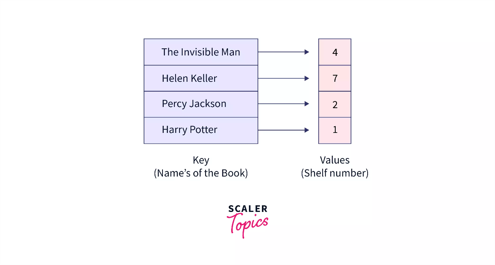 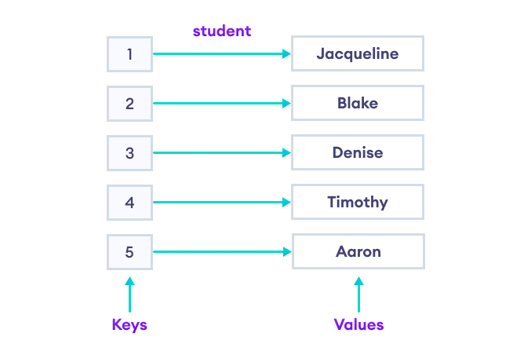

\- Để sử dụng được map bạn **cần thêm thư viện "map"** vào chương trình của mình. 

**- Các tính chất quan trọng của map : **

1.  Các key trong map là riêng biệt, **không có 2 key trùng nhau, nhưng giá trị thì có thể trùng nhau.**

2.  Map duy trì **thứ tự** các phần tử theo **giá trị key tăng dần**

3.  Map tìm kiếm giá trị key với độ phức tạp O(logN)

4.  Map **không hỗ trợ truy cập thông qua chỉ số** như mảng hay vector, string.

5.  **Mỗi phần tử trong map chính là 1 [<u>pair</u>](https://blog.28tech.com.vn/cpp-kieu-pair "pair")**

\- Set rất tối ưu trong các bài toán liên quan tới giá trị khác nhau trong mảng, tìm kiếm nhanh, các bài toán liên quan tới tần suất. 

\- Cú pháp khai báo : 

> \#include \<map\>
>
> map\<key_data_type, value_data_type\> map_name;

\- Map có ba phương pháp chính:

\+ Thêm một cặp khóa-giá trị được chỉ định.

\+ Truy xuất giá trị của một khóa nhất định.

\+ Xóa cặp khóa-giá trị khỏi map.

### 7.5.2. Khởi tạo

***- m\[key\]*,** trả về tham chiếu đến giá trị được liên kết với khóa *key (truy xuất giá tri của value thông qua key)*.

\- Nếu khóa không có trong map thì giá trị được liên kết với khóa sẽ được tạo bằng cách sử dụng hàm tạo mặc định của kiểu dữ liệu.

Ví dụ: nếu kiểu dữ liệu là int thì việc gọi m\[key\] cho một khóa không nằm trong map sẽ đặt giá trị được liên kết với khóa đó thành 0.

Một ví dụ khác, nếu kiểu dữ liệu là std::string thì gọi m \[key\] cho một khóa không có trong map sẽ đặt giá trị được liên kết với khóa đó thành chuỗi rỗng.

\- Ngoài ra, ***m.at(key) hoạt động giống như m\[key\].***

**- *m\[key\] = value*** sẽ gán giá trị giá trị cho khóa *key*. Nếu key đã xuất hiện trong map thì câu lệnh này sẽ thay đổi giá trị value của key đó.

***Ví dụ:***

```cpp
#include <map>

#include <iostream>

using namespace std;

int main() {

map<int, int> m;
```

m\[1\] = 5; // \[(1, 5)\]

m\[3\] = 14; // \[(1, 5); (3, 14)\]

m\[2\] = 7; // \[(1, 5); (2, 7); (3, 14)\]

m\[0\] = -1; // \[(0, -1); (1, 5); (2, 7); (3, 14)\]

```cpp
return 0;

}
```

### 7.5.3. Một số hàm cơ bản của map

#### 7.5.3.1. insert() & size() 

\- insert(): Thêm phần tử vào trong map (cách khác: ***m\[key\] = value***)

Lưu ý là khi thêm 1 phần tử vào trong map thì bạn cần thêm 1 cặp (pair) key - value vào map. Và nếu bạn thêm các cặp mà key đã tồn tại trong map thì map sẽ không thêm vào nữa để đảm bảo tính chất.

\- size(): Trả về số phần tử trong map

***Ví dụ:***

```cpp
#include <iostream>

#include <map>

using namespace std;

int main() {

map<int, int> mp;

mp[100] = 200;

mp[200] = 300;

mp.insert({ 300,400 });

mp.insert({ 500, 600 });

cout << mp.size() << endl;
```

mp\[100\] = 300; //(100, 200) thay thế bằng (100, 300)

```cpp
cout << mp.size() << endl; //số lượng phần tử vẫn là 4 do key = 100 đã tồn tại

return 0;

}
```

***Kết quả:***

4

4

```cpp
#include <iostream>

#include <map>

using namespace std;

int main() {

map<int, int> mp;
```

mp.insert(make_pair(1, 2)); // ok

mp.insert(make_pair(1, 5)); // not ok

mp.insert(make_pair(2, 4)); // ok

mp.insert(make_pair(2, 5)); // not ok

mp.insert(make_pair(2, 1)); // not ok

mp.insert(make_pair(3, 1)); // ok

```cpp
cout << mp.size() << endl; // 3
```

mp\[5\] = 10; // them moi

<span class="mark">mp\[1\] = 100; // thay doi value cua key 1 thanh 100</span>

```cpp
cout << mp.size() << endl;

cout << "Value tuong ung cua key 1 : " << mp[1] << endl; // 100

cout << "Value tuong ung cua key 5 : " << mp[5] << endl; // 10

}
```

***Output : ***

3

4

Value tuong ung cua key 1 : 100

Value tuong ung cua key 5 : 10

#### 7.5.3.2. clear()

clear() function is used to remove all the elements from the map container and thus leaving it’s size 0.

// CPP program to illustrate

// Implementation of clear() function

```cpp
#include <iostream>

#include <map>

using namespace std;

int main()

{

// Take any two maps

map<int, string> map1, map2;

// Inserting values

map1[1] = "India";

map1[2] = "Nepal";

map1[3] = "Sri Lanka";

map1[4] = "Myanmar";

// Print the size of map

cout << "Map size before running function: \n";

cout << "map1 size = " << map1.size() << endl;

cout << "map2 size = " << map2.size() << endl;;

// Deleting the map elements

map1.clear();

map2.clear();

// Print the size of map

cout << "Map size after running function: \n";

cout << "map1 size = " << map1.size() << endl;

cout << "map2 size = " << map2.size();

return 0;

}
```

Map size before running function:

map1 size = 4

map2 size = 0

Map size after running function:

map1 size = 0

map2 size = 0

**Time complexity:** Linear i.e. O(n)

#### 7.5.3.3. empty() 

Kiểm tra vector có rỗng hay không.

// Empty map example

// CPP program to illustrate

// Implementation of empty() function

```cpp
#include <iostream>

#include <map>

using namespace std;

int main()

{

map<char, int> mymap;

if (mymap.empty()) {

cout << "True";

}

else {

cout << "False";

}

return 0;

}
```

False

#### 7.5.3.4. find()

Được sử dụng để ***tìm giá trị key trong map***, độ phức tạp của hàm này là **O(logN)**. 

**Giá trị trả về của hàm find() là iterator**, nếu giá trị mà bạn tìm kiếm xuất hiện trong danh sách tập key của map thì hàm này **sẽ trả về iterator tới cặp phần tử** **có key tương ứng,** trường hợp key bạn tìm kiếm không xuất hiện trong map thì *hàm trả về iterator end() của map.*

Hàm này có độ phức tạp rất tốt nên bạn có thể sử dụng map trong các bài toán tìm kiếm nhanh.

**Mã nguồn : **

```cpp
#include <iostream>

#include <map>

using namespace std;

int main(){

map<int, int> mp;

mp.insert(make_pair(1, 2));

mp.insert(make_pair(2, 3));

mp.insert(make_pair(3, 5));

map<int, int>::iterator it1 = mp.find(2);

map<int, int>::iterator it2 = mp.find(5);

if(it1 != mp.end()){

cout << "FOUND\n";

}

else cout << "NOT FOUND\n";

if(it2 != mp.end()){

cout << "FOUND\n";

}

else cout << "NOT FOUND\n";

return 0;

}
```

***Output : ***

FOUND

NOT FOUND

#### 7.5.3.5. count()

Hàm trả về số lần khóa K xuất hiện trong vùng chứa của map. Và vì mỗi key trong map chỉ xuất hiện 1 lần nên hàm này trả về 1 nếu key bạn tìm kiếm xuất hiện trong map, ngược lại trả về 0.

Độ phức tạp là** O(logN) **và dễ dùng hơn hàm find() nên bạn có thể sử dụng hàm này để thay thế cho hàm find() trong việc tìm kiếm.

**Mã nguồn : **

```cpp
#include <iostream>

#include <map>

using namespace std;

int main(){

map<int, int> mp;

mp.insert(make_pair(1, 2));

mp.insert(make_pair(2, 3));

mp.insert(make_pair(3, 5));

if(mp.count(2) != 0){

cout << "FOUND\n";

}

else cout << "NOT FOUND\n";

if(mp.count(4) == 1){

cout << "FOUND\n";

}

else cout << "NOT FOUND\n";

return 0;

}
```

***Output : ***

FOUND

NOT FOUND

#### 7.5.3.6. erase()

***Xóa 1 cặp phần tử trong map thông qua key***, có 2 cách sử dụng hàm này là xóa thông qua giá trị hoặc xóa thông qua iterator.

Độ phức tạp của hàm này là **O(logN) **nhưng khi sử dụng bạn cần hết sức lưu ý nếu bạn ***xóa 1 key không xuất hiện trong map sẽ gây lỗi.***

**Mã nguồn 1 : Xóa thông qua giá trị**

```cpp
#include <iostream>

#include <map>

using namespace std;

int main(){

map<int, int> mp;

mp.insert(make_pair(1, 2));

mp.insert(make_pair(2, 3));

mp.insert(make_pair(3, 5));

if(mp.count(2))

mp.erase(2);

cout << "Map sau khi xoa key 2 : \n";

for (pair<int, int> it : mp)

cout << it.first << " " << it.second << endl;

return 0;

}
```

***Output :***

Map sau khi xoa key 2 :

1 2

3 5

**Mã nguồn 2 : Xóa thông qua iterator**

```cpp
#include <iostream>

#include <map>

using namespace std;

int main(){

map<int, int> mp;

mp.insert(make_pair(1, 2));

mp.insert(make_pair(2, 3));

mp.insert(make_pair(3, 5));

map<int, int>::iterator it = mp.find(2);

if(it != mp.end()){

mp.erase(it);

}

cout << "Map sau khi xoa key 2 : \n";

for (pair<int, int> it : mp){

cout << it.first << " " << it.second << endl;

}

return 0;

}
```

***Output : ***

Map sau khi xoa key 2 :

1 2

3 5

#### 7.5.3.7. lower_bound()

Hàm** lower_bound()** ngoài sử dụng với mảng hay vector đã được sắp xếp thì còn có thể áp dụng với set & map. Hàm này ***trả về iterator tới giá trị nhỏ nhất*** ***trong map có key lớn hơn hoặc bằng giá trị tìm kiếm. ***

Ví dụ map của bạn có tập key là {1, 3, 6, 8, 9, 12} và bạn tìm kiếm giá trị X = 7 thì hàm này sẽ trả về iterator tới phần tử có key là 8 trong map, tương tự nếu bạn tìm X = 3 thì sẽ trả về iterator tới phần tử có key là 3. 

Nếu trong trường hợp map của bạn không có key nào lớn hơn hoặc bằng giá trị key tìm kiếm thì hàm ***trả về iterator end() của map.***

Độ phức tạp là **O(logN) **

**Mã nguồn : **

```cpp
#include <iostream>

#include <map>

using namespace std;

int main(){

map<int, int> mp;

mp.insert(make_pair(1, 2));

mp.insert(make_pair(3, 3));

mp.insert(make_pair(5, 5));

mp.insert(make_pair(6, 8));

mp.insert(make_pair(10, 12));

map<int, int>::iterator it1 = mp.lower_bound(4);

if(it1 == mp.end()){

cout << "Khong tim thay key >= 4" << endl;

}

else{

cout << "Key nho nhat >= 4 la : " << (*it1).first << endl;

}

map<int, int>::iterator it2 = mp.lower_bound(14);

if(it2 == mp.end()){

cout << "Khong tim thay key >= 14" << endl;

}

else{

cout << "Key nho nhat >= 14 la : " << (*it2).first << endl;

}

return 0;

}
```

***Output : ***

Key nho nhat \>= 4 la : 5

Khong tim thay key \>= 14

#### 7.5.3.8. upper_bound()

Tương tự như hàm** lower_bound()** thì hàm **upper_bound() **được dùng để ***tìm giá trị nhỏ nhất lớn hơn giá trị key mà bạn tìm kiếm. ***

Ví dụ map của bạn có tập key là {1, 3, 6, 8, 9, 12} và bạn tìm kiếm giá trị X = 7 thì hàm này sẽ trả về iterator tới phần tử có key là 8 trong map, tương tự nếu bạn tìm X = 3 thì sẽ trả về iterator tới phần tử có key là 6. 

Nếu trong trường hợp map của bạn không có key nào lớn hơn giá trị key tìm kiếm thì hàm trả về iterator end() của map.

Độ phức tạp là **O(logN)**

**Mã nguồn : **

```cpp
#include <iostream>

#include <map>

using namespace std;

int main(){

map<int, int> mp;

mp.insert(make_pair(1, 2));

mp.insert(make_pair(3, 3));

mp.insert(make_pair(5, 5));

mp.insert(make_pair(6, 8));

mp.insert(make_pair(10, 12));

map<int, int>::iterator it1 = mp.upper_bound(5);

if(it1 == mp.end()){

cout << "Khong tim thay key > 5" << endl;

}

else{

cout << "Key nho nhat >= 5 la : " << (*it1).first << endl;

}

map<int, int>::iterator it2 = mp.upper_bound(14);

if(it2 == mp.end()){

cout << "Khong tim thay key > 14" << endl;

}

else{

cout << "Key nho nhat >= 14 la : " << (*it2).first << endl;

}

return 0;

}
```

***Output : ***

Key nho nhat \>= 5 la : 6

Khong tim thay key \> 14

### 7.5.4. List of all Functions of std::map

The following table contains all the functions defined inside std::map class.

| **Function** | **Definition** |
|:--:|:--:|
| [<u>map::insert()</u>](https://www.geeksforgeeks.org/map-insert-in-c-stl/) | Insert elements with a particular key in the map container –\> O(log n) |
| [<u>map:: count()</u>](https://www.geeksforgeeks.org/map-count-function-in-c-stl/) | Returns the number of matches to element with key-value ‘g’ in the map. –\> O(log n) |
| [<u>map equal_range()</u>](https://www.geeksforgeeks.org/map-equal_range-in-c-stl/) | Returns an iterator of pairs. The pair refers to the bounds of a range that includes all the elements in the container which have a key equivalent to k. |
| [<u>map erase()</u>](https://www.geeksforgeeks.org/map-erase-function-in-c-stl/) | Used to erase elements from the container –\> O(log n) |
| [<u>map rend()</u>](https://www.geeksforgeeks.org/map-rend-function-in-c-stl/) | Returns a reverse iterator pointing to the theoretical element right before the first key-value pair in the map(which is considered its reverse end). |
| [<u>map rbegin()</u>](https://www.geeksforgeeks.org/map-rbegin-function-in-c-stl-2/) | Returns a reverse iterator which points to the last element of the map. |
| [<u>map find()</u>](https://www.geeksforgeeks.org/map-find-function-in-c-stl/) | Returns an iterator to the element with key-value ‘g’ in the map if found, else returns the iterator to end. |
| [<u>map crbegin() and crend() </u>](https://www.geeksforgeeks.org/map-crbegin-and-crend-function-in-c-stl/) | crbegin() returns a constant reverse iterator referring to the last element in the map container. crend() returns a constant reverse iterator pointing to the theoretical element before the first element in the map. |
| [<u>map cbegin() and cend()</u>](https://www.geeksforgeeks.org/map-cbegin-and-cend-function-in-c-stl/) |  cbegin() returns a constant iterator referring to the first element in the map container. cend() returns a constant iterator pointing to the theoretical element that follows the last element in the multimap. |
| [<u>map emplace()</u>](https://www.geeksforgeeks.org/map-emplace-in-c-stl/) | Inserts the key and its element in the map container. |
| [<u>map max_size() </u>](https://www.geeksforgeeks.org/map-max_size-in-c-stl/) | Returns the maximum number of elements a map container can hold –\> O(1) |
| [<u>map upper_bound()</u>](https://www.geeksforgeeks.org/map-upper_bound-function-in-c-stl/) | Returns an iterator to the first element that is equivalent to mapped value with key-value ‘g’ or definitely will go after the element with key-value ‘g’ in the map |
| [<u>map operator=</u>](https://www.geeksforgeeks.org/map-operator-in-c-stl/) | Assigns contents of a container to a different container, replacing its current content. |
| [<u>map lower_bound()</u>](https://www.geeksforgeeks.org/map-lower_bound-function-in-c-stl/) | Returns an iterator to the first element that is equivalent to the mapped value with key-value ‘g’ or definitely will not go before the element with key-value ‘g’ in the map –\> O(log n) |
| [<u>map emplace_hint()</u>](https://www.geeksforgeeks.org/map-emplace_hint-function-in-c-stl/) | Inserts the key and its element in the map container with a given hint. |
| [<u>map value_comp() </u>](https://www.geeksforgeeks.org/map-value_comp-in-c-stl/) | Returns the object that determines how the elements in the map are ordered (‘\<‘ by default). |
| [<u>map key_comp() </u>](https://www.geeksforgeeks.org/map-key_comp-function-in-c-stl/) | Returns the object that determines how the elements in the map are ordered (‘\<‘ by default). |
| [<u>map::size()</u>](https://www.geeksforgeeks.org/mapsize-c-stl/) | Returns the number of elements in the map. |
| [<u>map::empty()</u>](https://www.geeksforgeeks.org/mapempty-c-stl/) | Returns whether the map is empty |
| [<u>map::begin() and end()</u>](https://www.geeksforgeeks.org/mapbegin-end-c-stl/) | begin() returns an iterator to the first element in the map. end() returns an iterator to the theoretical element that follows the last element in the map |
| [<u>map::operator\[\]</u>](https://www.geeksforgeeks.org/map-operator-cpp-stl/) | This operator is used to reference the element present at the position given inside the operator. |
| [<u>map::clear() </u>](https://www.geeksforgeeks.org/mapclear-c-stl/) | Removes all the elements from the map. |
| [<u>map::at() and map::swap()</u>](https://www.geeksforgeeks.org/mapat-mapswap-c-stl/) | at() function is used to return the reference to the element associated with the key k. swap() function is used to exchange the contents of two maps but the maps must be of the same type, although sizes may differ. |

### 7.5.5. Duyệt map

Bạn có thể sử dụng range based for loop để duyệt map hoặc duyệt map bằng iterator.

**Cách 1 : Duyệt map bằng range based for loop**

```cpp
#include <iostream>

#include <map>

#include <iostream>

using namespace std;

int main(){

map<int, int> mp;
```

mp.insert(make_pair(1, 2)); // ok

mp.insert(make_pair(2, 4)); // ok

mp.insert(make_pair(3, 5)); // ok

```cpp
for (pair<int, int> it : mp){

cout << "key = " << it.first << ", value = " << it.second << endl;

// first = key, second = value

}

}
```

***Output : ***

key = 1, value = 2

key = 2, value = 4

key = 3, value = 5

**Cách 2 : Duyệt map bằng iterator**

```cpp
#include <iostream>

#include <map>

#include <iostream>

using namespace std;

int main(){

map<int, int> mp;
```

mp.insert(make_pair(1, 2)); // ok

mp.insert(make_pair(2, 4)); // ok

mp.insert(make_pair(3, 5)); // ok

```cpp
map<int,int>::iterator it;

for(it = mp.begin(); it != mp.end(); it++){

cout << "key = " << (*it).first << ", value = " << (*it).second << endl;

}

}
```

***Output : ***

key = 1, value = 2

key = 2, value = 4

key = 3, value = 5

**Duyệt ngược map: **

Khi duyệt ngược từ cuối của map bạn có 2 cách đó là sử dụng reverse_iterator hoặc bạn có thể đưa các phần tử trong map lưu vào 1 vector rồi sau đó in ngược lại từ cuối của vector.

```cpp
#include <iostream>

#include <map>

#include <iostream>

using namespace std;

int main(){

map<int, int> mp;
```

mp.insert(make_pair(1, 2)); // ok

mp.insert(make_pair(2, 4)); // ok

mp.insert(make_pair(3, 5)); // ok

```cpp
map<int,int>::reverse_iterator it;

for(it = mp.rbegin(); it != mp.rend(); it++){

cout << "key = " << (*it).first << ", value = " << (*it).second << endl;

}

}
```

***Output : ***

key = 3, value = 5

key = 2, value = 4

key = 1, value = 2

Nếu bạn muốn truy cập vào phần tử đầu tiên trong map thì thông qua iterator begin(), còn nếu muốn truy cập vào phần tử cuối cùng trong map thì thông qua iterator rbegin()

```cpp
#include <iostream>

#include <map>

#include <iostream>

using namespace std;

int main(){

map<int, int> mp;
```

mp.insert(make_pair(1, 2)); // ok

mp.insert(make_pair(2, 4)); // ok

mp.insert(make_pair(3, 5)); // ok

```cpp
map<int, int>::iterator it1 = mp.begin(); // auto ?

cout (*it1).first (*it1).second << endl;

map<int, int>::reverse_iterator it2 = mp.rbegin(); // auto ?

cout << (*it2).first << " " << (*it2).second << endl;

}
```

***Output : ***

1 2

3 5

```cpp
#include <iostream>

#include <map>

#include <iostream>

using namespace std;

int main() {

map<int, int> mp;

mp[100] = 200;

mp[200] = 300;

mp.insert({ 300,400 });

mp.insert({ 500, 600 });

for (pair<int, int> x : mp) {

cout << x.first << " " << x.second << endl; //x = key, y = value

}

cout << "========================== \n";

for (auto it : mp) {

cout << it.first << " " << it.second << endl;

}

cout << "========================== \n";

for (map::iterator it = mp.begin(); it != mp.end(); it++) {

cout << (*it).first << " " << (*it).second << endl;

//cần * để truy xuất được giá trị của pair

}

return 0;

}
```

***Kết quả:***

100 200

200 300

300 400

500 600

==========================

100 200

200 300

300 400

500 600

==========================

100 200

200 300

300 400

500 600

### 7.5.6. Ứng dụng

\- Tính tần suất xuất hiện của các giá trị được nhập vào.

```cpp
#include <iostream>

#include <map>

#include <iostream>

using namespace std;

int main() {

map<int, int> mp;

int n; //số lượng số được nhập vào

cin >> n;

for (int i = 0; i < n; i++) {

int x; //giá trị nhập vào

cin >> x;
```

mp\[x\]++;

}

```cpp
for (auto x : mp) {

cout << x.first << " " << x.second << endl;

}

return 0;

}
```

***Kết quả:***

8

1 1 2 1 3 5 1 -4

-4 1

1 4

2 1

3 1

5 1

***\* In ra theo thứ tự mà người dùng nhập vào***

***Ví dụ:***

1 1 2 1 3 5 1 -4

***Kết quả:***

1 4

2 1

3 1

5 1

-4 1

```cpp
#include <iostream>

#include <map>

using namespace std;

int main() {

map<int, int> mp;

int n, a[100]; //số lượng số được nhập vào, mảng lưu các giá trị nhập vào

cin >> n;

for (int i = 0; i < n; i++) {

cin >> a[i];
```

mp\[a\[i\]\]++;

}

```cpp
for (int i = 0; i < n; i++) {

if (mp[a[i]] != 0) {

cout << a[i] << " " << mp[a[i]] << endl;
```

mp\[a\[i\]\] = 0; //để phần tử a\[i\] không in ra tần suất lần nữa.

}

}

```cpp
return 0;

}
```

\- Tính tần suất xuất hiện của các từ được nhập vào.

```cpp
#include <iostream>

#include <map>

#include <string>

using namespace std;

int main() {

map<string, int> mp;

int n; //số lượng từ nhập vào

cin >> n;

for (int i = 0; i < n; i++) {

string s;

cin >> s;
```

mp\[s\]++;

}

```cpp
cout << "======================\n";

for (auto i : mp) {

cout << i.first << " " << i.second << endl;

}

return 0;

}
```

***Kết quả:***

9

python

java

string

java

python

C++

sql

sql

java

======================

C++ 1

java 3

python 2

sql 2

string 1

**\* Sử dụng set khi muốn tìm kiếm/ đếm số lượng phần tử khác nhau trong mảng/ đếm số từ khác nhau trong chuỗi.**

**\* Sử dụng map khi muốn tìm tần suất xuất hiện các phần tử trong mảng/ các từ trong chuỗi.**

### 7.5.7 Multimap trong C++

\- Tương tự như map thì **multimap** cũng lưu các phần tử là cặp key - value, nó có các hàm tương tự như **map **nhưng có 1 vài điểm khác biệt khi sử dụng.

\- Multimap vẫn lưu các phần tử theo thứ tự key tăng dần nhưng **<u>các key có thể trùng nhau.</u>** Và vì các key có thể trùng nhau nên multimap **không hỗ trợ việc bạn truy cập value thông qua key bằng cú pháp map\[key\]** như map.

\- Các tính chất của multimap : 

- Các phần tử trong map có thể có **key trùng nhau**

- Multimap lưu các phần tử theo thứ tự **tăng dần về key**

- Multimap **không** hỗ trợ truy cập value thông qua key bằng cú pháp **map\[key\]**

- Multimap **không hỗ trợ chỉ số** như mảng hay vector mà chỉ số của multimap chính là key

**Mã nguồn : **

```cpp
#include <iostream>

#include <map>

using namespace std;

int main(){

multimap<int, int> mp;

mp.insert(make_pair(1, 2));

mp.insert(make_pair(1, 3));

mp.insert(make_pair(1, 4));

mp.insert(make_pair(2, 2));

mp.insert(make_pair(2, 3));

mp.insert(make_pair(2, 4));

mp.insert(make_pair(3, 1));

mp.insert(make_pair(3, 1));

cout << "Map size : " << mp.size() << endl;

for (pair<int, int> it : mp){

cout << it.first << " " << it.second << endl;

}

return 0;

}
```

***Output : ***

Map size : 8

1 2

1 3

1 4

2 2

2 3

2 4

3 1

3 1

**-** Về độ phức tạp của 3 hàm **find()**,** erase()** và **count() **trong multimap thì tương tự như map là O(logN). Tuy nhiên có một vài điểm khác biệt các bạn cần lưu ý.

**\* Hàm find() :**

\- Do **multimap **có thể lưu trữ nhiều cặp phần tử có cùng key nên khi bạn tìm kiếm key sử dụng hàm **find()** thì sẽ ***trả về iterator tới cặp phần tử <u>đầu tiên</u>*** ***có key tương ứng*** trong map.

\- Ví dụ multimap đang lưu các cặp phần tử {(1, 2), (1, 3), (2, 3), (2, 1), (2, 4), (5, 6)) và bạn tìm kiếm key là 2 thì hàm find() sẽ trả về iterator tới cặp phần tử (2, 3) là cặp phần tử có key 2 xuất hiện đầu tiên trong map.

**Mã nguồn : **

```cpp
#include <iostream>

#include <map>

using namespace std;

int main(){

multimap<int, int> mp;

mp.insert(make_pair(1, 2));

mp.insert(make_pair(1, 3));

mp.insert(make_pair(2, 3));

mp.insert(make_pair(2, 1));

mp.insert(make_pair(2, 4));

mp.insert(make_pair(5, 6));

multimap<int, int>::iterator it = mp.find(2);

cout << (*it).first << " " << (*it).second << endl;

return 0;

}
```

***Output : ***

2 3

**\* Hàm erase() : **

\- Hàm **erase()** nếu bạn xóa thông qua giá trị của key sẽ ***xóa toàn bộ cặp phần tử có key tương ứng*** trong multimap. Để ***xóa đi 1 cặp phần tử duy nhất thì bạn nên xóa thông qua iterator.***

**\**

**Mã nguồn : **

```cpp
#include <iostream>

#include <map>

using namespace std;

int main(){

multimap<int, int> mp;

mp.insert(make_pair(1, 2));

mp.insert(make_pair(1, 3));

mp.insert(make_pair(2, 3));

mp.insert(make_pair(2, 1));

mp.insert(make_pair(2, 4));

mp.insert(make_pair(5, 6));

mp.erase(2);

cout << "Map sau khi xoa : \n";

for (pair<int, int> it : mp)

cout << it.first << " " << it.second << endl;

return 0;

}
```

***Output : ***

Map sau khi xoa :

1 2

1 3

5 6

**\* Hàm count() : **

\- Hàm **count() **trong multimap khi bạn sử dụng để ***đếm số lần xuất hiện của key***, trả về giá trị tương ứng với số cặp phần tử có key tương ứng. ***Nếu key bạn đếm không xuất hiện thì hàm này trả về 0.***

**Mã nguồn : **

```cpp
#include <iostream>

#include <map>

using namespace std;

int main(){

multimap<int, int> mp;

mp.insert(make_pair(1, 2));

mp.insert(make_pair(1, 3));

mp.insert(make_pair(2, 3));

mp.insert(make_pair(2, 1));

mp.insert(make_pair(2, 4));

mp.insert(make_pair(5, 6));

cout << "Key 2 xuat hien : " << mp.count(2) << " lan\n";

cout << "key 28 xuat hien : " << mp.count(28) << " lan\n";

return 0;

}
```

***Output : ***

Key 2 xuat hien : 3 lan

key 28 xuat hien : 0 lan

### 7.5.8. List of Functions of Multimap

| **Function** | **Definition** |
|:--:|:--:|
| [<u>multimap::operator=</u>](https://www.geeksforgeeks.org/multimapoperator-c-stl/) | It is used to assign new contents to the container by replacing the existing contents. |
| [<u>multimap::crbegin() and multimap::crend()</u>](https://www.geeksforgeeks.org/multimapcrbegin-and-multimapcrend-in-c-stl/) | crbegin() returns a constant reverse iterator referring to the last element in the multimap container. crend() returns a constant reverse iterator pointing to the theoretical element before the first element in the multimap. |
| [<u>multimap::emplace_hint()</u>](https://www.geeksforgeeks.org/multimapemplace_hint-in-c-stl/) | Insert the key and its element in the multimap container with a given hint. |
| [<u>multimap clear()</u>](https://www.geeksforgeeks.org/multimap-clear-function-in-c-stl/) | Removes all the elements from the multimap. |
| [<u>multimap empty()</u>](https://www.geeksforgeeks.org/multimap-empty-function-in-c-stl/) | Returns whether the multimap is empty. |
| [<u>multimap maxsize()</u>](https://www.geeksforgeeks.org/multimap-maxsize-in-c-stl/) | Returns the maximum number of elements a multimap container can hold. |
| [<u>multimap value_comp() </u>](https://www.geeksforgeeks.org/multimap-value_comp-function-in-c-stl/) | Returns the object that determines how the elements in the multimap are ordered (‘\<‘ by default). |
| [<u>multimap rend</u>](https://www.geeksforgeeks.org/multimap-rend-in-c-stl/) | Returns a reverse iterator pointing to the theoretical element preceding to the first element of the multimap container. |
| [<u>multimap::cbegin() and multimap::cend()</u>](https://www.geeksforgeeks.org/multimapcbegin-and-multimapcend-in-c-stl/) | cbegin() returns a constant iterator referring to the first element in the multimap container. cend() returns a constant iterator pointing to the theoretical element that follows the last element in the multimap. |
| [<u>multimap::swap()</u>](https://www.geeksforgeeks.org/multimapswap-c-stl/) | Swap the contents of one multimap with another multimap of same type and size. |
| [<u>multimap rbegin</u>](https://www.geeksforgeeks.org/multimap-rbegin-in-c-stl/) | Returns an iterator pointing to the last element of the container. |
| [<u>multimap size()</u>](https://www.geeksforgeeks.org/multimap-size-function-in-c-stl/) | Returns the number of elements in the multimap container. |
| [<u>multimap::emplace() </u>](https://www.geeksforgeeks.org/multimapemplace-in-c-stl/) | Inserts the key and its element in the multimap container. |
| [<u>multimap::begin() and multimap::end()</u>](https://www.geeksforgeeks.org/multimapbegin-and-multimapend-in-c-stl/) | begin() returns an iterator referring to the first element in the multimap container. end() returns an iterator to the theoretical element that follows the last element in the multimap. |
| [<u>multimap upper_bound()</u>](https://www.geeksforgeeks.org/multimap-upper_bound-function-in-c-stl/) | Returns an iterator to the first element that is equivalent to multimapped value with key-value ‘g’ or definitely will go after the element with key-value ‘g’ in the multimap. |
| [<u>multimap::count()</u>](https://www.geeksforgeeks.org/multimapcount-in-c-stl/) | Returns the number of matches to element with key-value ‘g’ in the multimap. |
| [<u>multimap::erase() </u>](https://www.geeksforgeeks.org/multimaperase-in-c-stl/) | Removes the key value from the multimap. |
| [<u>multimap::find()</u>](https://www.geeksforgeeks.org/multimap-find-in-cpp-stl/) | Returns an iterator to the element with key-value ‘g’ in the multimap if found, else returns the iterator to end. |
| [<u>multimap equal_range()</u>](https://www.geeksforgeeks.org/multimap-equal_range-in-c-stl/) | Returns an iterator of pairs. The pair refers to the bounds of a range that includes all the elements in the container which have a key equivalent to k. |
| [<u>multimap insert()</u>](https://www.geeksforgeeks.org/multimap-insert-in-c-stl/) | Used to insert elements in the multimap container. |
| [<u>multimap lower_bound()</u>](https://www.geeksforgeeks.org/multimap-lower_bound-function-in-c-stl/) | Returns an iterator to the first element that is equivalent to multimapped value with key-value ‘g’ or definitely will not go before the element with key-value ‘g’ in the multimap. |
| [<u>multimap key_comp() </u>](https://www.geeksforgeeks.org/multimap-key_comp-in-c-stl/) | Returns the object that determines how the elements in the multimap are ordered (‘\<‘ by default). |

### 7.5.9. Unordered_map trong C++

\- Tương tự như map thì **unordered_map **được sử dụng để lưu trữ dữ liệu theo cặp key - value. Các hàm của map thì **unordered_map **đều có nhưng khác nhau về độ phức tạp.

**- unordered_map **được cài đặt bởi cấu trúc dữ liệu ***bảng băm - hash table***. Bạn cần thêm thư viện "unordered_map" vào để có thể sử dụng container này.

\- Các tính chất của unordered_map :

- unordered_map lưu trữ phần tử với các ***key là riêng biệt***

- Các phần tử trong unordered_map **<u>không có thứ tự</u>**

**Mã nguồn : **

```cpp
#include <iostream>

#include <map>

#include <string>

using namespace std;

int main(){

unordered_map<string, string> mp;
```

mp\["28tech"\] = "28tech.com.vn";

mp\["USA"\] = "Trump";

mp\["Russia"\] = "Putin";

```cpp
for (pair<string, string> it : mp){

cout << it.first << " " << it.second << endl;

}

return 0;

}
```

***Output : ***

Russia Putin

USA Trump

28tech 28tech.com.vn

**- Các hàm find(), count(), erase()**

\+ Cách dùng 3 hàm phổ biến này của unordered_map ***tương tự như map***, điều khác biệt duy nhất đó là vì unordered_map được cài đặt bởi bẳng băm thay vì cây đỏ đen Red-black tree như map nên sẽ có sự khác nhau về độ phức tạp. 

\+ Độ phức tạp trung bình của 3 hàm này là **O(1)**, tuy nhiên trong trường hợp tệ nhất (Worst case) thì nó có thể là** O(N)**. 

\+ Hàm insert trong unordered_map cũng tương tự như vậy về độ phức tạp. 

**\**

**Mã nguồn : **

```cpp
#include <iostream>

#include <map>

#include <string>

using namespace std;

int main(){

unordered_map<string, string> mp;
```

mp\["28tech"\] = "28tech.com.vn";

mp\["USA"\] = "Trump";

mp\["Russia"\] = "Putin";

```cpp
mp.erase("USA");

for (pair<string, string> it : mp){

cout << it.first << " " << it.second << endl;

}

return 0;

}
```

***Output : ***

Russia Putin

28tech 28tech.com.vn

#### 7.5.9.1. Methods on unordered_map

A lot of functions are available that work on unordered_map. The most useful of them are:

- **operator =**

- **operator \[\]**

- **empty**

- **size for capacity**

- **begin and end for the iterator.**

- **find and count for lookup.**

- **insert and erase for modification.**

The below table shows the complete list of the methods of an unordered_map:

| **Methods/Functions** | **Description** |
|:--:|:--:|
| [<u>at()</u>](https://www.geeksforgeeks.org/std-unordered_map-c/) | This function in C++ unordered_map returns the reference to the value with the element as key k |
| [<u>begin()</u>](https://www.geeksforgeeks.org/unordered_map-begin-in-c/) | Returns an iterator pointing to the first element in the container in the unordered_map container |
| [<u>end()</u>](https://www.geeksforgeeks.org/unordered_map-end-function-in-c-stl/) | Returns an iterator pointing to the position past the last element in the container in the unordered_map container |
| [<u>bucket()</u>](https://www.geeksforgeeks.org/unordered_map-bucket-in-c-stl/) | Returns the bucket number where the element with the key k is located in the map |
| [<u>bucket_count</u>](https://www.geeksforgeeks.org/stdbucket_count-stdbucket_size-unordered_map-cpp/) | Bucket_count is used to count the total no. of buckets in the unordered_map. No parameter is required to pass into this function |
| [<u>bucket_size</u>](https://www.geeksforgeeks.org/stdbucket_count-stdbucket_size-unordered_map-cpp/) | Returns the number of elements in each bucket of the unordered_map |
| [<u>count()</u>](https://www.geeksforgeeks.org/unordered_map-count-in-c/) | Count the number of elements present in an unordered_map with a given key |
| [<u>equal_range</u>](https://www.geeksforgeeks.org/unordered_map-equal_range-in-c/) | Return the bounds of a range that includes all the elements in the container with a key that compares equal to k |
| [<u>find()</u>](https://www.geeksforgeeks.org/unordered_map-find-in-c-stl/) | Returns iterator to the element |
| [<u>empty()</u>](https://www.geeksforgeeks.org/unordered_map-empty-in-c-stl/) | Checks whether the container is empty in the unordered_map container |
| [<u>erase()</u>](https://www.geeksforgeeks.org/unordered_map-erase-in-c-stl/) | Erase elements in the container in the unordered_map container |

The C++11 library also provides functions to see internally used bucket count, bucket size, and also used hash function and various hash policies but they are less useful in real applications. We can iterate over all elements of unordered_map using Iterator. 
