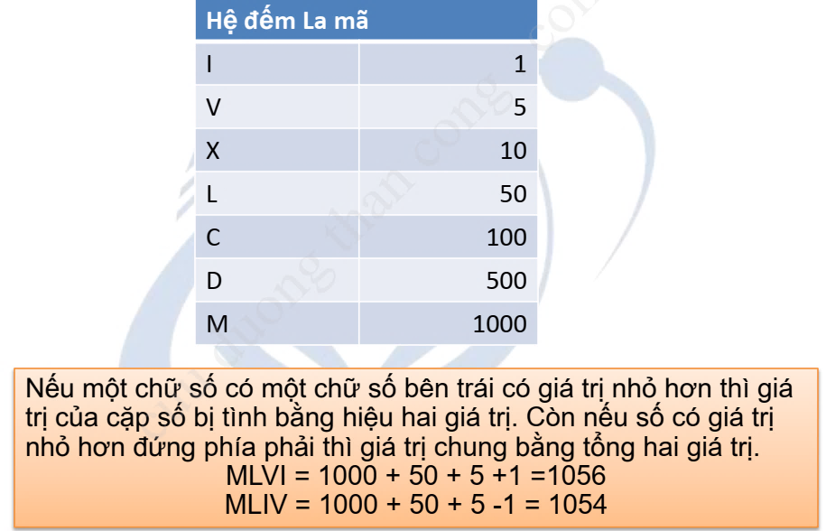
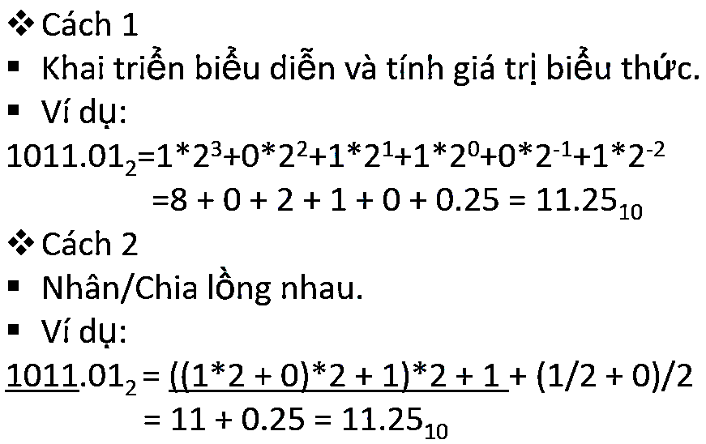
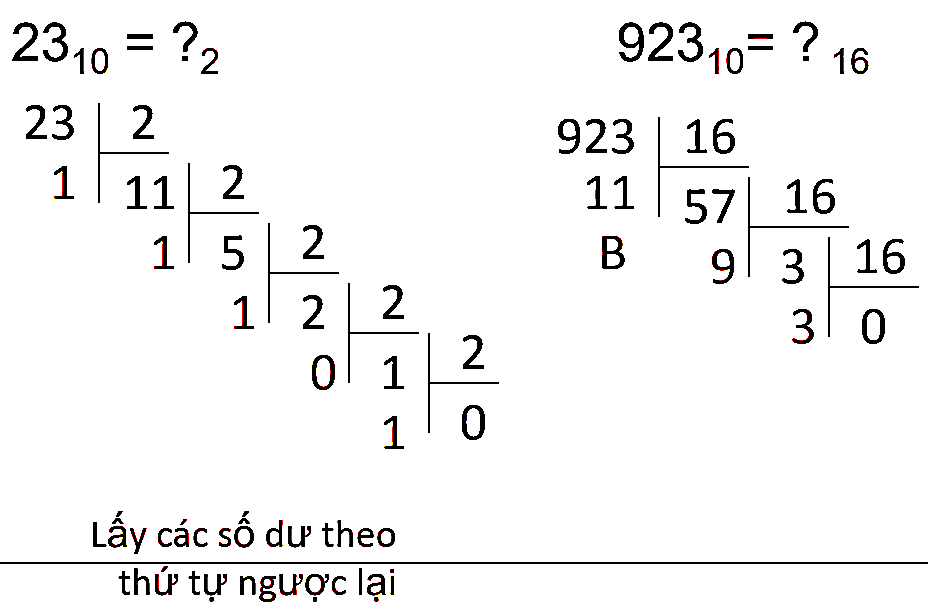
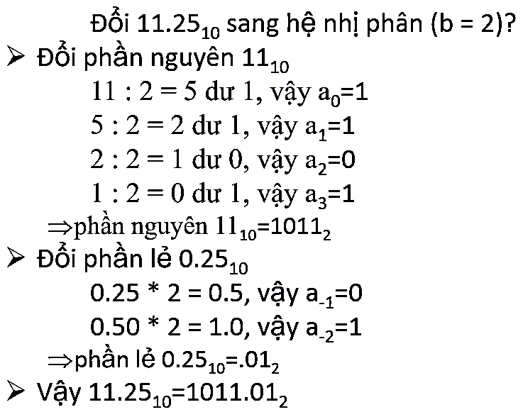
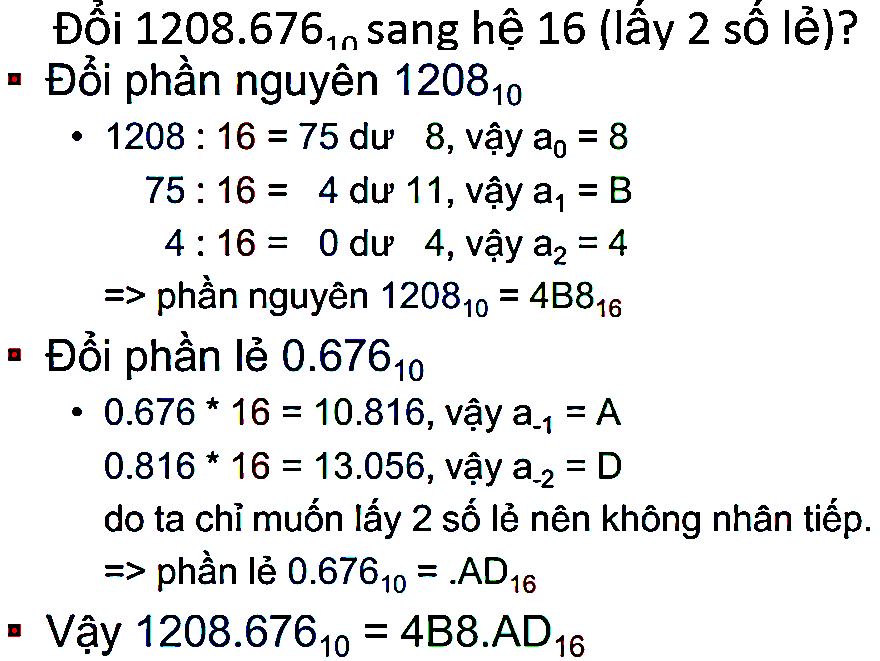
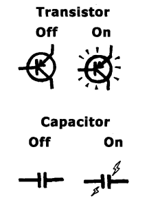
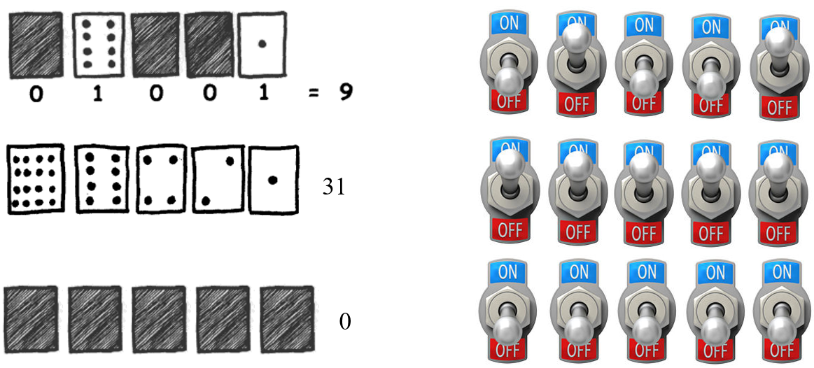
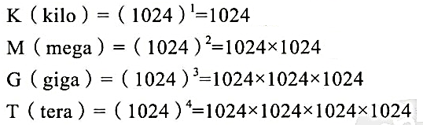
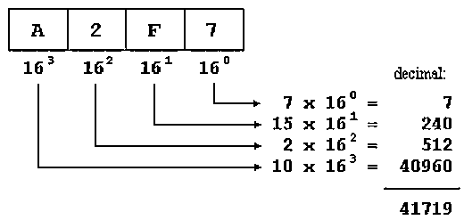
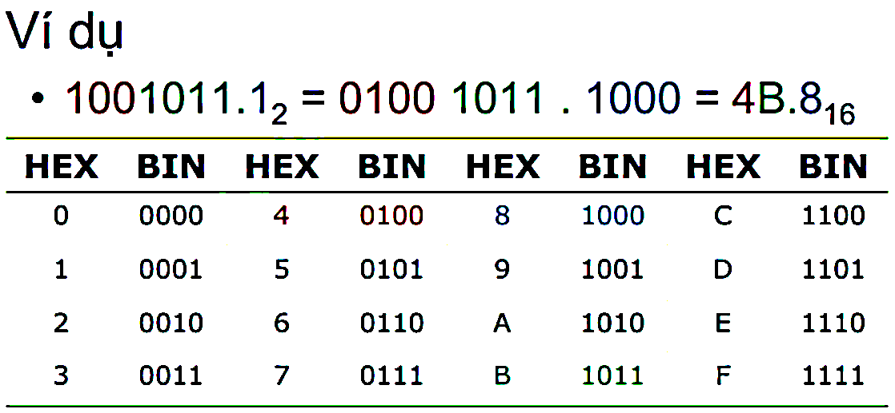

# PHỤ LỤC

## **1. Hệ đếm**

\- Là một tập các ký hiệu (bảng chữ số) để biểu diễn các số và xác định giá trị của các biểu diễn số.

### 1.1. Hệ đếm la mã

\+ Nếu một chữ số có một chữ số bên trái có giá trị nhỏ hơn thì giá trị của cặp số bị tình bằng hiệu hai giá trị. Còn nếu số có giá trị nhỏ hơn đứng phía phải thì giá trị chung bằng tổng hai giá trị.

MLVI = 1000 + 50 + 5 +1 = 1056

MLIV = 1000 + 50 + 5 -1 = 1054



### 1.2. Hệ đếm thập phân

\+ Mỗi chữ số x đứng ở hàng thứ i tính từ bên phải có giá trị là x.10<sup>i-1</sup>. Như vậy một đơn vị ở một hàng sẽ có giá trị gấp 10 lần một đơn vị ở hàng kế cận bên phải

\+ Giá trị của số là tổng giá trị của các chữ số có tính tới vị trí của nó. Giá trị của 3294,5 là

3.10<sup>3</sup> + 2.10<sup>2</sup> + 9.10<sup>1</sup> + 4.10<sup>0</sup> + 5.10<sup>-1</sup>

### 1.3. Hệ đếm theo cơ sở b

\+ Có thể chọn các hệ đếm với cơ số khác 10.

\+ Với một số tự nhiên b \> 1, với mỗi số tự nhiên n luôn tồn tại một cách phân tích duy nhất n dưới dạng một đa thức của b với các hệ số nằm từ 0 đến b-1.

n = a<sub>k</sub>.b<sup>k</sup> + a<sub>k-1</sub>.b<sup>k-1</sup> +…+ a<sub>1</sub>.b<sup>1</sup> + a<sub>0</sub> , 0 ≤ a<sub>i</sub> ≤ b-1

Khi đó biểu diễn của n trong cơ số b là a<sub>k</sub>a<sub>k-1</sub> …a<sub>1</sub>a<sub>0</sub>

```cpp
VD: 14 = 1.32 + 1.31 + 2.30 = 1.23 + 1.22+1.21 + 0.20
```

Do đó 14<sub>10</sub> = 112<sub>3</sub> = 1110<sub>2</sub>

**\**

**\* Chuyển từ hệ cơ sở b sang hệ thập phân:**

> 

**\* Chuyển từ hệ thập phân sang hệ cơ sở b:**

**+ *Đổi phần nguyên:***

. Chia phần nguyên của số đó cho b và tiếp tục lấy phần nguyên của kết quả chia cho b.

. Dãy các số dư ở mỗi lần chia là a<sub>0</sub>, a<sub>1</sub>, …, a<sub>n</sub>

. Phần nguyên của số hệ cở sở b là (a<sub>n</sub>, ... a<sub>1</sub>a<sub>0</sub>)

**+ *Đổi phần lẻ***

. Nhân phần lẻ của số đó cho b và tiếp tục lấy phần lẻ của kết quả nhân cho b.

. Dãy các số nguyên ở mỗi lần nhân là a<sub>-1</sub>, a<sub>-2</sub>, ..., a<sub>-m</sub> tạo thành phần lẻ ở hệ cơ sở b.





### 1.4. Hệ đếm nhị phân (Hệ cơ số 2)

\+ Biểu diễn hệ nhị phân

0, 1, 2, 3, 4, 5, 6, 7, 8, 9, 10, …, 19, 20, …, 99, 100, … (cơ số 10)

0, 1, 10, 11, 100, 101, 110, 111, 1000, … (cơ số 2)

\+ Tại sao sử dụng hệ cơ số 2 mà không dùng hệ cơ số 10

. Chế tạo linh kiện có 2 trạng thái dễ hơn linh kiện 10 trạng thái.

. Chỉ cần hai con số (0, 1) có thể biểu diễn tất cả các giá trị



**\* Cách chuyển từ hệ cơ số 2 sang hệ cơ số 10**

01101<sub>2</sub> = 8 + 4 + 1 = 16×0 + 8×1 + 4×1 + 2×0 + 1×1

= 2<sup>4</sup>×0 + 2<sup>3</sup>×1 + 2<sup>2</sup>×1 + 2<sup>1</sup>×0 + 2<sup>0</sup>×1

1100101<sub>2</sub> = 1x2<sup>6</sup> + 1x2<sup>5</sup> + 0x2<sup>4</sup> + 0x2<sup>3</sup> + 1x2<sup>2</sup> + 0x2<sup>1</sup> + 1x2<sup>0</sup>

= 64 + 32 + 4 + 1

= 101

\+ Hệ nhị phân dùng 2 chữ số là {0,1} và chữ số 1 ở một hàng có giá trị bằng 2 lần chữ số 1 ở hàng kế cận bên phải.

14,625 = 1.2<sup>3</sup>+1.2<sup>2</sup>+1.2<sup>1</sup> +0.2<sup>0</sup>+1.2<sup>-1</sup>+0.2<sup>-2</sup> +1.2<sup>-3</sup>

Do đó 14,625<sub>10</sub> = 1110,101<sub>2</sub>

**\* Cách chuyển từ hệ cơ số 10 thành hệ cơ số 2:** 118<sub>10</sub> = 1110110<sub>2</sub>

|                  |           |
|------------------|-----------|
|                  | **Số dư** |
| **118 ÷ 2 = 59** | **0**     |
| **59 ÷ 2 = 29**  | **1**↑    |
| **29 ÷ 2 = 14**  | **1**↑    |
| **14 ÷ 2 = 7**   | **0**↑    |
| **7 ÷ 2 = 3**    | **1**↑    |
| **3 ÷ 2 = 1**    | **1**↑    |
| **1 ÷ 2 = 0**    | **1**↑    |

\+ Lưu trữ chương trình và dữ liệu trong bộ nhớ: chương trình là tập hợp những câu lệnh, mỗi câu lệnh được mã hóa thành chuỗi bit chứa 0, 1 🡪 Bật tắt công tắc

\+ Đơn vị nhỏ nhất là 1 bit (1 công tắc)

\+ Bộ nhớ được đánh địa chỉ theo byte (8 bit = 1 byte)



### 1.5. Hệ cơ số 16

*+ Biểu diễn hệ cơ số 16*

0, 1, …, 9, A, B, C, D, E, F,

10, 11, .., 19, 1A, 1B, 1C, 1D, 1E, 1F,

20, 21, .., 2F, …

*+ Tại sao sử dụng hệ cơ số 16*

. Hệ cơ số càng lớn thì sử dụng ít chữ. Ví dụ giá trị 118 biểu diễn bằng hệ cơ số 10, chỉ sử dụng 3 chữ số; trong khi đó sử dụng hệ cơ số 2 phải cần 7 chữ số (1110110).

. Chuyển đổi qua lại giữa hệ cơ số 16 và hệ cơ số 2 rất thuận tiện

1010 0101 0011<sub>2</sub> = A53<sub>16</sub>

A5316 = A*(162) + 5*(161) + 3*(160)\
= (1\*2<sup>3</sup> + 0\*2<sup>2</sup> + 1\*2<sup>1</sup> + 0\*2<sup>0</sup>)\*(2<sup>4\*2</sup>) + (0\*2<sup>3</sup> + 1\*2<sup>2</sup> + 0\*2<sup>1</sup> + 1\*2<sup>0</sup>)\*(2<sup>4</sup>) +\
(0\*2<sup>3</sup> + 0\*2<sup>2</sup> + 1\*2<sup>1</sup> + 1\*2<sup>0</sup>)\*(2<sup>0</sup>)\
= (1\*2<sup>11</sup> + 0\*2<sup>10</sup> + 1\*2<sup>9</sup> + 0\*2<sup>8</sup>) + (0\*2<sup>7</sup> + 1\*2<sup>6</sup> + 0\*2<sup>5</sup> + 1\*2<sup>4</sup>) +\
(0\*2<sup>3</sup> + 0\*2<sup>2</sup> + 1\*2<sup>1</sup> + 1\*2<sup>0</sup><sub>­</sub>)<sup>\
</sup>= 1010 0101 0011<sub>2</sub>

***\* Cách chuyển đổi qua lại giữa hệ cơ số 16 và hệ cơ số 10:*** Tương tự như cách chuyển đổi qua lại giữa hệ cơ số 2 và hệ cơ số 10.



**4225 = (1081)<sub>16</sub>**

|                     |           |
|---------------------|-----------|
|                     | **Số dư** |
| **4225 ÷ 16 = 264** | **1**     |
| **264 ÷ 16 = 16**   | **8**     |
| **16 ÷ 16 = 1**     | **0**     |
| **1 ÷ 16 = 0**      | **1**     |

**\* Chuyển hệ nhị phân sang hệ thập lục phân (hệ cơ số 16):** Nhóm từng bộ 4 bit trong biểu diễn nhị phân rồi chuyển sang ký số tương ứng trong hệ thập lục phân (0000 ~\> 0,…, 1111 ~\> F).



***Ngoài ra còn có các hệ đếm khác như Hệ cơ số 8…***

**\* Bất kỳ hệ cơ số nào cũng phải có tính chất sau:**

\+ Có thể biểu diễn được bất kỳ giá trị nào

\+ Mỗi giá trị chỉ có 1 cách biểu diễn duy nhất

\+ Mỗi biểu diễn có 1 giá trị tương ứng duy nhất

**\* Máy tính:**

\+ Tổ chức dữ liệu và chương trình dưới dạng hệ nhị phân (**Binary System**, cơ số 2)

\+ Tín hiệu liên lạc giữa các thành phần cũng dưới dạng nhị phân

**\* Con người:**

\+ Dùng hệ thập phân (**Decimal System**, cơ số 10) là thuận tiện

\+ Khi tìm hiểu và ký hiệu một số dữ liệu hay tín hiệu của máy tính, họ dùng các hệ bát phân (**Octal System**, cơ số 8) hay Thập lục phân (**Hexadecimal System***, cơ* số 16) cho thuận tiện.

## 2. Ký hiệu khoa học (Scientific notation)

*- Ký hiệu khoa học là cách xử lý những số rất lớn hoặc rất nhỏ.*

24327 = 2.4327 x 10<sup>4</sup>

7354 = 7.354 x 10<sup>3</sup>

0,0078 = 7.8 x 10<sup>**–**3</sup>

0,00069 = 6.9 x 10<sup>**-**4</sup>

**Chú ý:** Số mũ sẽ là dương nếu dấu thập phân chuyển sang phải, là âm nếu dấu thập phân chuyển sang trái.

\- Trong C++, có thể sử dụng ký hiệu khoa học để gán giá trị cho biến số chấm động. **Dùng ký hiệu ‘e’ hoặc ‘E’ để thay cho 10^.**

// Initializations of floating point numbers

**double** dVarName1{69000.0};

**double** dVarName2{6.9e4};     // 6.9e4 is equal to 69000.0

**double** dVarName3{0.00069};

**double** dVarName4{6.9E-4};    // 6.9e-4 is equal to 0.00069

## 3. Một số hàm chuẩn C/C++

| **Tên hàm** | **Khai báo** | **Ý nghĩa** |
|:--:|:--:|----|
| rand() | stdlib.h | Cho 1 giá trị ngẫu nhiên từ 0 đến 32767 |
| random(x) | stdlib.h | Cho 1 giá trị ngẫu nhiên từ 0 đến x |
| pow(x,y) | math.h | Tính x mũ y |
| sqrt(x) | math.h | Tính căn bậc 2 của x |
| sin(x), cos(x), tan(x) | math.h | Tính sin, cosin, tang của góc x có số đo x radian |
| abs(a) | stdlid.h | Cho giá trị tuyệt đối của số nguyên a |
| labs(a) | stdlid.h | Cho giá trị tuyệt đối của số nguyên dài a |
| fabs(a) | stdlid.h | Cho giá trị tuyệt đối của số thực |
| exp(x) | math.h | Tính e mũ x |
| log(x) | math.h | Tính logarit cơ số e của x |
| log10(x) | math.h | Tính logarit cơ số 10 của x |
| ceil(x) | math.h | Phần nguyên nhỏ nhất không nhỏ hơn x |
| floor(x) | math.h | Phần nguyên lớn nhất không lớn hơn x |
| atof(str) | stdlib.h | Chuyển chuỗi str sang giá trị số thực |
| atoi(str) | stdlib.h | Chuyển chuỗi str sang số nguyên |
| itoa(x,str,y) | stdlib.h | Chuyển số nguyên x sang chuỗi str theo cơ số y |
| tolower(x) | ctype.h | Đổi chữ hoa sang chữ thường |
| toupper(x) | ctype.h | Đổi chữ thường sang chữ hoa |
| strcat(a,b) | string.h | Thêm chuỗi b vào sau chuỗi a |
| strcpy(a,b) | string.h | Sao chép chuỗi b vào a |
| strlwr(s) | string.h | Chuyển chuỗi s sang chữ thường |
| strupr(s) | string.h | Chuyễn chuỗi s sang chữ hoa |
| strlen(s) | string.h | Trả về độ dài chuỗi s |
| strcmp(s,t) | string.h | Trả về hiệu của 2 kí tự khác nhau đầu tiên trong chuỗi, nếu hàm trả về giá trị 0 thì s bằng t. |

## 4. Hiển thị tiếng Việt ra console

\- Sử dụng 2 thư viện sau:

```cpp
#include <iostream>

#include <fstream>
```

\- Sử dụng setmode trong hàm main():

```cpp
_setmode(_fileno(stdin), _O_U16TEXT);

_setmode(_fileno(stdout), _O_U16TEXT);
```

Chúng được sử dụng để đặt chế độ cho luồng đầu vào và đầu ra là Unicode wcout và wcin là phiên bản hỗ trợ Unicode của cout và cin, cho phép bạn nhập và xuất các chuỗi Unicode.

\- Có một số hàm và kiểu dữ liệu khác thường được sử dụng để làm việc với Unicode:

*+ wcerr và wclog:* hỗ trợ của cerr và clog, được sử dụng để xuất thông tin lỗi và log.

*+ wstring:* hỗ trợ của string, cho phép lưu trữ và thao tác với các chuỗi Unicode.

*+ wfstream, wifstream, wofstream:* hỗ trợ của fstream, ifstream, và ofstream, cho phép đọc và ghi các chuỗi Unicode từ và vào file.

*+ wstringstream, wistringstream, wostringstream:* hỗ trợ của stringstream, istringstream, và ostringstream, cho phép bạn thao tác với các chuỗi Unicode trong bộ nhớ.

*+ wbuffer_convert và wstring_convert:* các lớp template được sử dụng để chuyển đổi giữa các chuỗi Unicode và chuỗi byte.

*+ wctype và wctrans:* các hàm được sử dụng để xác định các thuộc tính của ký tự Unicode.

*+ wint_t và wctrans_t:* các kiểu dữ liệu được sử dụng để lưu trữ ký tự Unicode và thông tin về chuyển đổi ký tự.

*+ wprintf và wscanf:* hỗ trợ của printf và scanf, cho phép bạn định dạng và phân tích các chuỗi Unicode.

*+ wsetlocale:* hỗ trợ của setlocale, cho phép bạn thiết lập hoặc truy vấn cài đặt địa phương hiện tại cho chương trình của bạn.

\* Thay vì dùng cin, cout, ta sẽ thay đổi chúng thành wcin & wcout, bên cạnh đó thêm **<span class="mark">L</span>** vào sau toán tử nhập/ xuất.

```cpp
wcout << L"Xin chào các bạn.";
```

**<u>Ví dụ 1:</u>**

```cpp
#include <iostream>

#include <iostream>

#include <iostream>

using namespace std;

int main() {

_setmode(_fileno(stdin), _O_U16TEXT);

_setmode(_fileno(stdout), _O_U16TEXT);

double toan, van;

wcout << L"Nhập điểm môn Toán: "; wcin >> toan;

wcout << L"Nhập điểm môn Văn: "; wcin >> van;

wcout << L"Điểm trung bình 2 môn của bạn: " << (toan + van) / 2;

return 0;

}
```

***Kết quả:***

Nhập điểm môn Toán: 8.5

Nhập điểm môn Văn: 9.2

Điểm trung bình 2 môn của bạn: 8.85

**<u>Ví dụ 2:</u>**

```cpp
#include <iostream>

#include <iostream>

#include <iostream>

#include <iostream>

using namespace std;

int main() {

_setmode(_fileno(stdin), _O_U16TEXT);

_setmode(_fileno(stdout), _O_U16TEXT);

wcout << L"Tiếng Việt có dấu" << endl;
```

wstring test;

```cpp
wcout << L"Hãy nhập vào một chuỗi ký tự: ";

// wcin >>

getline(wcin, test);

wcout << L"Chuỗi ký tự mà bạn vừa mới nhập: ";

wcout << test;

return 0;

}
```

***Kết quả:***

Tiếng Việt có dấu

Hãy nhập vào một chuỗi ký tự: Lập trình hướng đối tượng OOP

Chuỗi ký tự mà bạn vừa mới nhập: Lập trình hướng đối tượng OOP

## 5. Một số quy ước viết code

Quy ước viết code (hay Code convention) có thể được hiểu đơn giản là tập hợp những nguyên tắc chung khi lập trình như đặt tên biến, hàm, file, class, comment, ... nhằm giúp cho code dễ đọc, dễ hiểu hơn vì vậy dễ bảo trì và sửa lỗi hơn.

### 5.1. Quy tắc đặt tên

\- Có ba quy tắc đặt tên phổ biến là camelCase, PascalCase và snake_case. Cụ thể:

***· Camel case:*** Từ đầu tiên trọng cụm từ được viết thường, những ký tự còn lại thì viết hoa, áp dụng cho tên hàm, tên biến và tên phương thức.

*<u>Ví dụ:</u>* firstName, lastName, getName(), findMember(), ...

***· Pascal case:*** Viết hoa ký tự đầu tiên của tất cả từ có trong cụm, thường áp dụng cho tên class hay tên biến.

*<u>Ví dụ:</u>* MickeyMouse, FirstName, ...

***· Snake case:*** Toàn bộ chữ cái đều viết thường, phân tách nhau bằng dấu “\_”, thường dùng cho tên hằng số hoặc tên của chương trình.

*<u>Ví dụ:</u>* program_final, get_max(), ...

### 5.2. Quy tắc về số lượng

Một số quy tắc về số lượng trong cuốn sách Clean Code A Handbook of Agile Software Craftsmanship của Robert C. Martin, quyển Refactoring in Large Software Projects: Performing Complex Restructurings Successfully của Martin Lippert hay bộ quy tắc của Oracle có ghi như sau:

· Một dòng Code không nên dài quá 80 ký tự.

· Một câu lệnh nên lồng tối đa 4 cấp.

· Một hàm không nên chứa quá 5 tham số.

· Một hàm không nên quá 30 dòng.

· Một class không nên vượt 500 dòng, ...

· Mỗi hàm chỉ nên làm duy nhất một việc, nếu thực hiện hai mục đích khác nhau thì tên hàm cần thể hiện rõ điều này.

***Ví dụ:*** increaseDonwnloadCounterAndSaveToDatabase.

### 5.3. Quy tắc xuống hàng

\- Theo bộ quy tắc của Oracle:

· Nếu một hàm có nhiều cấp lồng nhau, mỗi cấp nên xuống dòng.

· Các đoạn code bằng cấp nên ở cùng một cột với nhau, dòng xuống hàng nên bắt đầu cùng cấp với dòng phía trên.

· Xuống hàng trước các toán tử (ví dụ như +, -, \*, ?, ... ).

***- Ví dụ:***

someMethod(longExpression1, longExpression2, longExpression3,

```cpp
longExpression4, longExpression5);
```

var = someMethod1(longExpression1,

someMethod2(longExpression2,

longExpression3));

```cpp
longName1 = longName2 * (longName3 + longName4 - longName5)
```

\+ 4 \* longname6; // PREFER

```cpp
longName1 = longName2 * (longName3 + longName4
```

\- longName5) + 4 \* longname6;

## 6. Một số code tham khảo

### 6.1. Hoán đổi giá trị 2 biến không dùng biến tạm

\- Giả sử có 2 số a, b.

#### 6.1.1 Dùng tính chất phép cộng, trừ

**tổng = a + b =\> a = tổng – b; b = tổng – a**

*+ Bước 1:* **a = a + b** // Lúc này a mang giá trị tổng

*+ Bước 2:* **b = a – b** // b = tổng – b = a. Suy ra lúc này b mang giá trị của a

*+ Bước 3:* **a = a – b** // a = tổng – b. b lúc này lại mang giá trị của a. Suy ra lúc này a sẽ mang giá trị của b

```cpp
#include <iostream>

#include <iostream>

using namespace std;

int main() {

int a = 5, b = 3;

a = a + b;

b = a - b;

a = a - b;

cout << a << "; " << b;

return 0;

}
```

***Kết quả:*** 3; 5

#### 6.1.2. Dùng tính chất phép nhân, chia

\- Cách này gần giống với cách phép cộng trên. Tuy nhiên, nếu 1 trong 2 số bằng 0 (hoặc 1 trong 2 hoặc cả 2 số là số thập phân) thì không thể sử dụng cách này.

**tích = a \* b =\> a = tích / b; b = tích / a**

*+ Bước 1:* **a = a \* b** // Lúc này a mang giá trị tích

*+ Bước 2:* **b = a / b** // b = tích / b. Suy ra lúc này b mang giá trị của a

*+ Bước 3:* **a = a / b** // b lúc này mang giá trị của a =\> a / b = tích / a = b. Lúc này a sẽ mang giá trị của b

```cpp
#include <iostream>

#include <iostream>

using namespace std;

int main() {

int a = 5, b = 3;

a = a * b;

b = a / b;

a = a / b;

cout << a << "; " << b;

return 0;

}
```

#### 6.1.3. Dùng tính chất phép XOR

\- Dùng phép cộng và phép nhân có khả năng gây ra tràn số (số to quá, biến không lưu được).

\- Phép XOR (^) có tính chất: *giống nhau thành 0, khác nhau thành 1*

**=\> (a^b)^a = b; (a^b)^b = a**

*+ Bước 1:* **a = a^b** // Lúc này a lưu kết quả a^b

*+ Bước 2:* **b = a^b** // a đang là a^b =\> tương đương với (a^b)^b = a. Vậy lúc này b mang giá trị của a

*+ Bước 3:* **a = a^b** // a đang là a^b, b đang là a =\> tương đương với (a^b)^a = b =\> a mang giá trị của b

```cpp
#include <iostream>

#include <iostream>

using namespace std;

int main() {

int a = 5, b = 3;

a = a ^ b;

b = a ^ b;

a = a ^ b;

cout << a << "; " << b;

return 0;

}
```

#### 6.1.4. Hàm swap xây dựng sẵn trong thư viện C++

\- Trong thư viện iostream của C++, hàm swap đã được xây dựng sẵn với cấu trúc:

```cpp
void swap(object A, object B)
```

Với A, B là bất kì một kiểu dữ liệu nào từ int, float…tới một struct hay thậm chí là một đối tượng class.

```cpp
#include <iostream>

using namespace std;

int main()

{

int a, b;

cout << "Nhap 2 so a, b:\n";

cin >> a >> b;

cout << "\nBan da nhap:\n a = " << a << "\n b = " << b;

swap(a, b);

cout << "\n\nSau khi swap:\n a = " << a << "\n b = " << b;

return 0;

}
```

***Kết quả:***

Nhap 2 so a, b:

4 2

Ban da nhap:

a = 4

b = 2

Sau khi swap:

a = 2

b = 4

### 6.2. Vẽ hình bằng dấu \*

<table>
<colgroup>
<col style="width: 56%" />
<col style="width: 43%" />
</colgroup>
<thead>
<tr>
<th style="text-align: left;"><p><code>#include &lt;iostream&gt;</code></p>
<p><code>using namespace std;</code></p>
<p><code>int main()</code></p>
<p><code>{</code></p>
<p><code>int n; cout &lt;&lt; "n = "; cin &gt;&gt; n;</code></p>
<p><code>for (int i = 1; i &lt;= n; i++)</code></p>
<p><code>{</code></p>
<p><code>for (int j = 1; j &lt;= n; j++)</code></p>
<p><code>{</code></p>
<p><code>if (j &gt;= n - i + 1)</code></p>
<p><code>{</code></p>
<p><code>cout &lt;&lt; "*";</code></p>
<p><code>}</code></p>
<p><code>else cout &lt;&lt; " ";</code></p>
<p><code>}</code></p>
<p><code>cout &lt;&lt; endl;</code></p>
<p><code>}</code></p>
<p><code>}</code></p></th>
<th style="text-align: left;"><p>n = 5</p>
<p>*</p>
<p>**</p>
<p>***</p>
<p>****</p>
<p>*****</p></th>
</tr>
</thead>
<tbody>
<tr>
<td style="text-align: left;"><p><code>#include &lt;iostream&gt;</code></p>
<p><code>using namespace std;</code></p>
<p><code>int main()</code></p>
<p><code>{</code></p>
<p><code>int n; cout &lt;&lt; "n = "; cin &gt;&gt; n;</code></p>
<p><code>for (int i = 1; i &lt;= n; i++)</code></p>
<p><code>{</code></p>
<p><code>if (i == n) break;</code></p>
<p><code>for (int j = 1; j &lt;= (2 * n - 1); j++)</code></p>
<p><code>{</code></p>
<p><code>if (j &gt;= (n - i + 1) &amp;&amp; j &lt;= (n + i - 1))</code></p>
<p><code>{</code></p>
<p><code>cout &lt;&lt; "* ";</code></p>
<p><code>}</code></p>
<p><code>else cout &lt;&lt; " ";</code></p>
<p><code>}</code></p>
<p><code>cout &lt;&lt; endl;</code></p>
<p><code>}</code></p>
<p><code>for (int i = n; i &gt;= 1; i--)</code></p>
<p><code>{</code></p>
<p><code>for (int j = 1; j &lt;= (2 * n - 1); j++)</code></p>
<p><code>{</code></p>
<p><code>if (j &gt;= (n - i + 1) &amp;&amp; j &lt;= (n + i - 1))</code></p>
<p><code>{</code></p>
<p><code>cout &lt;&lt; "* ";</code></p>
<p><code>}</code></p>
<p><code>else cout &lt;&lt; " ";</code></p>
<p><code>}</code></p>
<p><code>cout &lt;&lt; endl;</code></p>
<p><code>}</code></p>
<p><code>}</code></p></td>
<td style="text-align: left;"><p>n = 5</p>
<p>*</p>
<p>* * *</p>
<p>* * * * *</p>
<p>* * * * * * *</p>
<p>* * * * * * * * *</p>
<p>* * * * * * *</p>
<p>* * * * *</p>
<p>* * *</p>
<p>*</p></td>
</tr>
</tbody>
</table>

<table>
<colgroup>
<col style="width: 56%" />
<col style="width: 43%" />
</colgroup>
<thead>
<tr>
<th style="text-align: left;"><p><code>#include &lt;iostream&gt;</code></p>
<p><code>using namespace std;</code></p>
<p><code>int main()</code></p>
<p><code>{</code></p>
<p><code>int n; cout &lt;&lt; "n = "; cin &gt;&gt; n;</code></p>
<p><code>for (int i = 0; i &lt; n; ++i)</code></p>
<p><code>{</code></p>
<p><code>for (int j = 0; j &lt; n - i - 1; ++j)</code></p>
<p><code>{</code></p>
<p><code>cout &lt;&lt; " ";</code></p>
<p><code>}</code></p>
<p><code>for (int k = 0; k &lt; 2 * i + 1; ++k)</code></p>
<p><code>{</code></p>
<p><code>cout &lt;&lt; "*";</code></p>
<p><code>}</code></p>
<p><code>cout &lt;&lt; endl;</code></p>
<p><code>}</code></p>
<p><code>for (int i = 0; i &lt; n - 1; ++i)</code></p>
<p><code>{</code></p>
<p><code>cout &lt;&lt; " ";</code></p>
<p><code>}</code></p>
<p><code>cout &lt;&lt; "|" &lt;&lt; endl;</code></p>
<p><code>return 0;</code></p>
<p><code>}</code></p></th>
<th style="text-align: left;"><p>n = 5</p>
<p>*</p>
<p>***</p>
<p>*****</p>
<p>*******</p>
<p>*********</p>
<p>|</p></th>
</tr>
</thead>
<tbody>
<tr>
<td style="text-align: left;"><p><code>#include &lt;iostream&gt;</code></p>
<p><code>using namespace std;</code></p>
<p><code>int main(){</code></p>
<p><code>int n; cin &gt;&gt; n;</code></p>
<p><code>for (int i = 1; i &lt;= n; i++)</code></p>
<p><code>{</code></p>
<p><code>for (int j = 1; j &lt;= (2 * n - 1); j++)</code></p>
<p><code>{</code></p>
<p><code>if (j &gt;= (n - i + 1) &amp;&amp; j &lt;= (n + i - 1))</code></p>
<p><code>{</code></p>
<p><code>cout &lt;&lt; "* ";</code></p>
<p><code>}</code></p>
<p><code>else cout &lt;&lt; " ";</code></p>
<p><code>}</code></p>
<p><code>cout &lt;&lt; endl;</code></p>
<p><code>}</code></p>
<p><code>}</code></p></td>
<td style="text-align: left;"><p>5</p>
<p>*</p>
<p>* * *</p>
<p>* * * * *</p>
<p>* * * * * * *</p>
<p>* * * * * * * * *</p></td>
</tr>
<tr>
<td style="text-align: left;"><p><code>#include &lt;iostream&gt;</code></p>
<p><code>using namespace std;</code></p>
<p><code>int main()</code></p>
<p><code>{</code></p>
<p><code>int n; cin &gt;&gt; n;</code></p>
<p><code>for (int i = 1; i &lt;= n; i++)</code></p>
<p><code>{</code></p>
<p><code>for (int j = 1; j &lt;= n; j++)</code></p>
<p><code>{</code></p>
<p><code>if (i == 1 || j == 1 || i == n || j == n)</code></p>
<p><code>{</code></p>
<p><code>cout &lt;&lt; "*" &lt;&lt; " ";</code></p>
<p><code>}</code></p>
<p><code>else cout &lt;&lt; " " &lt;&lt; " ";</code></p>
<p><code>}</code></p>
<p><code>cout &lt;&lt; endl;</code></p>
<p><code>}</code></p>
<p><code>}</code></p></td>
<td style="text-align: left;"><p>5</p>
<p>* * * * *</p>
<p>* *</p>
<p>* *</p>
<p>* *</p>
<p>* * * * *</p></td>
</tr>
</tbody>
</table>

<table>
<colgroup>
<col style="width: 56%" />
<col style="width: 43%" />
</colgroup>
<thead>
<tr>
<th style="text-align: left;"><p><code>#include &lt;iostream&gt;</code></p>
<p><code>using namespace std;</code></p>
<p><code>int main()</code></p>
<p><code>{</code></p>
<p><code>int n; cin &gt;&gt; n;</code></p>
<p><code>for (int i = n; i &gt;= 1; i--)</code></p>
<p><code>{</code></p>
<p><code>for (int j = 1; j &lt;= i; j++)</code></p>
<p><code>{</code></p>
<p><code>cout &lt;&lt; "*";</code></p>
<p><code>}</code></p>
<p><code>cout &lt;&lt; endl;</code></p>
<p><code>}</code></p>
<p><code>}</code></p></th>
<th style="text-align: left;"><p>5</p>
<p>*****</p>
<p>****</p>
<p>***</p>
<p>**</p>
<p>*</p></th>
</tr>
</thead>
<tbody>
</tbody>
</table>

### 6.3. Vẽ hình bằng số & chữ

<table>
<colgroup>
<col style="width: 56%" />
<col style="width: 43%" />
</colgroup>
<thead>
<tr>
<th style="text-align: left;"><p><code>#include &lt;iostream&gt;</code></p>
<p><code>using namespace std;</code></p>
<p><code>int main()</code></p>
<p><code>{</code></p>
<p><code>int n; cout &lt;&lt; "n = "; cin &gt;&gt; n;</code></p>
<p><code>for (int i = 1; i &lt;= n; i++) //In dòng</code></p>
<p><code>{</code></p>
<p><code>int ans = i, cnt = n - 1;</code></p>
<p><code>for (int j = 1; j &lt;= i; j++)</code></p>
<p>//STT dòng = số con số được in trên dòng đó</p>
<p><code>{</code></p>
<p><code>cout &lt;&lt; ans &lt;&lt; " ";</code></p>
<p><code><mark>ans += cnt; cnt--;</mark></code></p>
<p><code>}</code></p>
<p><code>cout &lt;&lt; endl;</code></p>
<p><code>}</code></p>
<p><code>}</code></p></th>
<th style="text-align: left;"><p><em><strong>Kết quả:</strong></em></p>
<p>n = 5</p>
<p>1</p>
<p>2 6</p>
<p>3 7 10</p>
<p>4 8 11 13</p>
<p>5 9 12 14 15</p></th>
</tr>
</thead>
<tbody>
<tr>
<td style="text-align: left;"><p><code>#include &lt;iostream&gt;</code></p>
<p><code>using namespace std;</code></p>
<p><code>int main()</code></p>
<p><code>{</code></p>
<p><code>int n; cout &lt;&lt; "n = "; cin &gt;&gt; n;</code></p>
<p><code>for (int i = 1; i &lt;= n; i++)</code></p>
<p><code>{</code></p>
<p><code>int cnt = i;</code></p>
<p><code>for (int j = 1; j &lt;= (2 * n - 1); j++)</code></p>
<p><code>{</code></p>
<p><code>if (j &lt;= (n + i - 1) &amp;&amp; j &gt;= (n - i + 1))</code></p>
<p><code>{</code></p>
<p><code>if (j == n) cout &lt;&lt; cnt--;</code></p>
<p><code>else if (j &lt; n) cout &lt;&lt; cnt++;</code></p>
<p><code>else cout &lt;&lt; cnt--;</code></p>
<p><code>cout &lt;&lt; " ";</code></p>
<p><code>}</code></p>
<p><code>else cout &lt;&lt; " "; //2 dấu cách</code></p>
<p><code>}</code></p>
<p><code>cout &lt;&lt; endl;</code></p>
<p><code>}</code></p>
<p><code>}</code></p></td>
<td style="text-align: left;"><p><em><strong>Kết quả:</strong></em></p>
<p>n = 5</p>
<p>1</p>
<p>2 3 2</p>
<p>3 4 5 4 3</p>
<p>4 5 6 7 6 5 4</p>
<p>5 6 7 8 9 8 7 6 5</p></td>
</tr>
</tbody>
</table>

<table>
<colgroup>
<col style="width: 56%" />
<col style="width: 43%" />
</colgroup>
<thead>
<tr>
<th style="text-align: left;"><p><code>#include &lt;iostream&gt;</code></p>
<p><code>using namespace std;</code></p>
<p><code>int main()</code></p>
<p><code>{</code></p>
<p><code>int n; cout &lt;&lt; "n = "; cin &gt;&gt; n;</code></p>
<p><code>for (int i = 1; i &lt;= n; i++)</code></p>
<p><code>{</code></p>
<p><code>for (int j = 1; j &lt;= n; j++)</code></p>
<p><code>{</code></p>
<p><code>if (j &gt;= n - i + 1)</code></p>
<p><code>{</code></p>
<p><code>cout &lt;&lt; i;</code></p>
<p><code>}</code></p>
<p><code>else cout &lt;&lt; "~";</code></p>
<p><code>}</code></p>
<p><code>cout &lt;&lt; endl;</code></p>
<p><code>}</code></p>
<p><code>}</code></p></th>
<th style="text-align: left;"><p><em><strong>Kết quả:</strong></em></p>
<p>n = 5</p>
<p>~~~~1</p>
<p>~~~22</p>
<p>~~333</p>
<p>~4444</p>
<p>55555</p></th>
</tr>
</thead>
<tbody>
<tr>
<td style="text-align: left;"><p><code>#include &lt;iostream&gt;</code></p>
<p><code>using namespace std;</code></p>
<p><code>int main()</code></p>
<p><code>{</code></p>
<p><code>int n; cout &lt;&lt; "n = "; cin &gt;&gt; n;</code></p>
<p><code>for (int i = 1; i &lt;= n; i++)</code></p>
<p><code>{</code></p>
<p><code>int ans = i;</code></p>
<p><code>for (int j = 1; j &lt;= n; j++)</code></p>
<p><code>{</code></p>
<p><code>cout &lt;&lt; ans++ &lt;&lt; " ";</code></p>
<p><code>}</code></p>
<p><code>cout &lt;&lt; endl;</code></p>
<p><code>}</code></p>
<p><code>}</code></p></td>
<td style="text-align: left;"><p><em><strong>Kết quả:</strong></em></p>
<p>n = 5</p>
<p>1 2 3 4 5</p>
<p>2 3 4 5 6</p>
<p>3 4 5 6 7</p>
<p>4 5 6 7 8</p>
<p>5 6 7 8 9</p></td>
</tr>
<tr>
<td style="text-align: left;"><p><code>#include &lt;iostream&gt;</code></p>
<p><code>using namespace std;</code></p>
<p><code>int main()</code></p>
<p><code>{</code></p>
<p><code>int n; cout &lt;&lt; "n = "; cin &gt;&gt; n;</code></p>
<p><code>for (int i = 'A'; i &lt;= 'A' + n - 1; i++)</code></p>
<p><code>{</code></p>
<p><code>for (int j = 'A'; j &lt;= i; j++) {</code></p>
<p><code>cout &lt;&lt; (char)i &lt;&lt; " ";</code></p>
<p><code>}</code></p>
<p><code>cout &lt;&lt; endl;</code></p>
<p><code>}</code></p>
<p><code>}</code></p></td>
<td style="text-align: left;"><p><em><strong>Kết quả:</strong></em></p>
<p>n = 5</p>
<p>A</p>
<p>B B</p>
<p>C C C</p>
<p>D D D D</p>
<p>E E E E E</p></td>
</tr>
</tbody>
</table>

### 6.4. Lý thuyết số

#### 6.4.1. Kiểm tra số nguyên tố

<table>
<colgroup>
<col style="width: 50%" />
<col style="width: 49%" />
</colgroup>
<thead>
<tr>
<th style="text-align: left;"><p><code>#include &lt;iostream&gt;</code></p>
<p><code>#include &lt;math.h&gt;</code></p>
<p><code>using namespace std;</code></p>
<p><code>bool isPrime(int n) {</code></p>
<p><code>if (n &lt; 2) {</code></p>
<p><code>return false;</code></p>
<p><code>}</code></p>
<p><code>for (int i = 2; i &lt;= sqrt(n); i++) {</code></p>
<p><code>if (n % i == 0) {</code></p>
<p><code>return false;</code></p>
<p><code>}</code></p>
<p><code>}</code></p>
<p><code>return true;</code></p>
<p><code>}</code></p>
<p><code>int main() {</code></p>
<p><code>cout &lt;&lt; isPrime(17) &lt;&lt; endl;</code></p>
<p><code>cout &lt;&lt; isPrime(28) &lt;&lt; endl;</code></p>
<p><code>return 0;</code></p>
<p><code>}</code></p></th>
<th><p><em><strong>Kết quả:</strong></em></p>
<p>1</p>
<p>0</p></th>
</tr>
</thead>
<tbody>
</tbody>
</table>

#### 6.4.2. Kiểm tra số chính phương

<table>
<colgroup>
<col style="width: 50%" />
<col style="width: 49%" />
</colgroup>
<thead>
<tr>
<th style="text-align: left;"><p><code>#include &lt;iostream&gt;</code></p>
<p><code>#include &lt;math.h&gt;</code></p>
<p><code>using namespace std;</code></p>
<p><code>bool squareNumber(int n) {</code></p>
<p><code>int can = sqrt(n);</code></p>
<p><code>if (can * can == n) {</code></p>
<p><code>return true;</code></p>
<p><code>}</code></p>
<p><code>else {</code></p>
<p><code>return false;</code></p>
<p><code>}</code></p>
<p><code>}</code></p>
<p><code>int main() {</code></p>
<p><code>cout &lt;&lt; squareNumber(16) &lt;&lt; endl;</code></p>
<p><code>cout &lt;&lt; squareNumber(28) &lt;&lt; endl;</code></p>
<p><code>return 0;</code></p>
<p><code>}</code></p></th>
<th><p><em><strong>Kết quả:</strong></em></p>
<p>1</p>
<p>0</p></th>
</tr>
</thead>
<tbody>
</tbody>
</table>

#### 6.4.3. Kiểm tra số thuận nghịch (Đối xứng)

<table>
<colgroup>
<col style="width: 49%" />
<col style="width: 50%" />
</colgroup>
<thead>
<tr>
<th style="text-align: left;"><p><code>#include &lt;iostream&gt;</code></p>
<p><code>using namespace std;</code></p>
<p><code>bool palindrome(int n) {</code></p>
<p><code>int rev = 0, tmp = n;</code></p>
<p><code>while (n != 0) {</code></p>
<p><code>rev = rev * 10 + n % 10;</code></p>
<p>n /= 10;</p>
<p><code>}</code></p>
<p><code>if (tmp == rev) {</code></p>
<p><code>return true;</code></p>
<p><code>}</code></p>
<p><code>else {</code></p>
<p><code>return false;</code></p>
<p><code>}</code></p>
<p><code>}</code></p></th>
<th style="text-align: left;"><p><code>int main() {</code></p>
<p><code>cout &lt;&lt; palindrome(165) &lt;&lt; endl;</code></p>
<p><code>cout &lt;&lt; palindrome(2882) &lt;&lt; endl;</code></p>
<p><code>return 0;</code></p>
<p><code>}</code></p>
<p><em><strong>Kết quả:</strong></em></p>
<p>0</p>
<p>1</p></th>
</tr>
</thead>
<tbody>
</tbody>
</table>

#### 6.4.4. Ước chung lớn nhất, bội chung nhỏ nhất

<table>
<colgroup>
<col style="width: 50%" />
<col style="width: 49%" />
</colgroup>
<thead>
<tr>
<th style="text-align: left;"><p><code>#include &lt;iostream&gt;</code></p>
<p><code>#include &lt;math.h&gt;</code></p>
<p><code>using namespace std;</code></p>
<p><code>int ucln1(int a, int b) {</code></p>
<p><code>while (b != 0) {</code></p>
<p><code>int tmp = a % b;</code></p>
<p><code>a = b;</code></p>
<p><code>b = tmp;</code></p>
<p><code>}</code></p>
<p><code>return a;</code></p>
<p><code>}</code></p>
<p><code>int ucln2(int a, int b) {</code></p>
<p><code>if (b == 0) {</code></p>
<p><code>return a;</code></p>
<p><code>}</code></p>
<p><code>return ucln2(b, a % b);</code></p>
<p><code>}</code></p>
<p><code>int bcnn(int a, int b) {</code></p>
<p><code>return a / ucln1(a, b) * b;</code></p>
<p><code>}</code></p>
<p><code>int main() {</code></p>
<p><code>cout &lt;&lt; ucln1(16, 30) &lt;&lt; endl;</code></p>
<p><code>cout &lt;&lt; bcnn(16, 30) &lt;&lt; endl;</code></p>
<p><code>return 0;</code></p>
<p><code>}</code></p></th>
<th><p><em><strong>Kết quả:</strong></em></p>
<p>2</p>
<p>240</p></th>
</tr>
</thead>
<tbody>
</tbody>
</table>

#### 6.4.5. Phân tích thừa số nguyên tố

<table>
<colgroup>
<col style="width: 50%" />
<col style="width: 49%" />
</colgroup>
<thead>
<tr>
<th style="text-align: left;"><p><code>#include &lt;iostream&gt;</code></p>
<p><code>#include &lt;math.h&gt;</code></p>
<p><code>using namespace std;</code></p>
<p><code>void factorize(int n) {</code></p>
<p><code>for (int i = 2; i &lt;= sqrt(n); i++) {</code></p>
<p><code>while (n % i == 0) {</code></p>
<p><code>cout &lt;&lt; i &lt;&lt; ' ';</code></p>
<p>n /= i;</p>
<p><code>}</code></p>
<p><code>}</code></p>
<p><code>if (n &gt; 1) {</code></p>
<p><code>cout &lt;&lt; n &lt;&lt; endl;</code></p>
<p><code>}</code></p>
<p><code>}</code></p>
<p><code>int main() {</code></p>
<p>factorize(60); // 2 2 3 5</p>
<p><code>return 0;</code></p>
<p><code>}</code></p></th>
<th><p><em><strong>Kết quả:</strong></em> 2 2 3 5</p></th>
</tr>
</thead>
<tbody>
</tbody>
</table>

#### 6.4.6. Đếm ước số nguyên

<table>
<colgroup>
<col style="width: 50%" />
<col style="width: 49%" />
</colgroup>
<thead>
<tr>
<th style="text-align: left;"><p><code>#include &lt;iostream&gt;</code></p>
<p><code>#include &lt;math.h&gt;</code></p>
<p><code>using namespace std;</code></p>
<p><code>int countDiv(int n) {</code></p>
<p><code>int cnt = 0;</code></p>
<p><code>for (int i = 1; i &lt;= sqrt(n); i++) {</code></p>
<p><code>if (n % i == 0) {</code></p>
<p>++cnt;</p>
<p><code>if (i != n / i) {</code></p>
<p>++cnt;</p>
<p><code>}</code></p>
<p><code>}</code></p>
<p><code>}</code></p>
<p><code>return cnt;</code></p>
<p><code>}</code></p>
<p><code>int main() {</code></p>
<p><code>cout &lt;&lt; countDiv(60) &lt;&lt; endl;</code></p>
<p><code>return 0;</code></p>
<p><code>}</code></p></th>
<th><p><em><strong>Kết quả:</strong></em> 12</p></th>
</tr>
</thead>
<tbody>
</tbody>
</table>

#### 6.4.7. Tính tổng ước số nguyên

<table>
<colgroup>
<col style="width: 50%" />
<col style="width: 49%" />
</colgroup>
<thead>
<tr>
<th style="text-align: left;"><p><code>#include &lt;iostream&gt;</code></p>
<p><code>#include &lt;math.h&gt;</code></p>
<p><code>using namespace std;</code></p>
<p><code>int sumDiv(int n) {</code></p>
<p><code>int sum = 0;</code></p>
<p><code>for (int i = 1; i &lt;= sqrt(n); i++) {</code></p>
<p><code>if (n % i == 0) {</code></p>
<p><code>sum += i;</code></p>
<p><code>if (i != n / i) {</code></p>
<p><code>sum += n / i;</code></p>
<p><code>}</code></p>
<p><code>}</code></p>
<p><code>}</code></p>
<p><code>return sum;</code></p>
<p><code>}</code></p>
<p><code>int main() {</code></p>
<p><code>cout &lt;&lt; sumDiv(60) &lt;&lt; endl; //</code></p>
<p><code>return 0;</code></p>
<p><code>}</code></p></th>
<th><p><em><strong>Kết quả:</strong></em> 168</p></th>
</tr>
</thead>
<tbody>
</tbody>
</table>

#### 6.4.8. Kiểm tra số hoàn hảo

<table>
<colgroup>
<col style="width: 50%" />
<col style="width: 49%" />
</colgroup>
<thead>
<tr>
<th style="text-align: left;"><p><code>#include &lt;iostream&gt;</code></p>
<p><code>#include &lt;math.h&gt;</code></p>
<p><code>using namespace std;</code></p>
<p><code>bool perfectNum(int n) {</code></p>
<p><code>int sum = 1;</code></p>
<p><code>for (int i = 2; i &lt;= sqrt(n); i++) {</code></p>
<p><code>if (n % i == 0) {</code></p>
<p><code>sum += i;</code></p>
<p><code>if (i != n / i) {</code></p>
<p><code>sum += n / i;</code></p>
<p><code>}</code></p>
<p><code>}</code></p>
<p><code>}</code></p>
<p><code>if (sum == n) return true;</code></p>
<p><code>else return false;</code></p>
<p><code>}</code></p>
<p><code>int main() {</code></p>
<p><code>cout &lt;&lt; perfectNum(28) &lt;&lt; endl; //</code></p>
<p><code>return 0;</code></p>
<p><code>}</code></p></th>
<th><p><em><strong>Kết quả:</strong></em> 1</p></th>
</tr>
</thead>
<tbody>
</tbody>
</table>

#### 6.4.9. Số strong

<table>
<colgroup>
<col style="width: 72%" />
<col style="width: 27%" />
</colgroup>
<thead>
<tr>
<th style="text-align: left;"><p>//Số strong là số có tổng giai thừa các chữ số của nó bằng chính nó</p>
<p><code>#include &lt;iostream&gt;</code></p>
<p><code>#include &lt;math.h&gt;</code></p>
<p><code>using namespace std;</code></p>
<p><code>int giaiThua(int n) {</code></p>
<p><code>int res = 1;</code></p>
<p><code>for (int i = 1; i &lt;= n; i++) {</code></p>
<p>res *= i;</p>
<p><code>}</code></p>
<p><code>return res;</code></p>
<p><code>}</code></p>
<p>//145 = 1! + 4! + 5!</p>
<p><code>bool strongNum(int n) {</code></p>
<p><code>int tong = 0, tmp = n;</code></p>
<p><code>while (n != 0) {</code></p>
<p><code>tong += giaiThua(n % 10);</code></p>
<p>n /= 10;</p>
<p><code>}</code></p>
<p><code>return tong == tmp;</code></p>
<p><code>}</code></p>
<p><code>int main() {</code></p>
<p><code>cout &lt;&lt; strongNum(145) &lt;&lt; endl;</code></p>
<p><code>return 0;</code></p>
<p><code>}</code></p></th>
<th><p><em><strong>Kết quả:</strong></em> 1</p></th>
</tr>
</thead>
<tbody>
</tbody>
</table>

#### 6.4.10. In 10 số Fibonacci đầu tiên

<table>
<colgroup>
<col style="width: 50%" />
<col style="width: 49%" />
</colgroup>
<thead>
<tr>
<th style="text-align: left;"><p><code>#include &lt;iostream&gt;</code></p>
<p><code>#include &lt;math.h&gt;</code></p>
<p><code>using namespace std;</code></p>
<p>using ll = long long;</p>
<p>ll Fibo[100];</p>
<p><code>void printFibo(int n) {</code></p>
<p><code>Fibo[0] = 0;</code></p>
<p><code>Fibo[1] = 1;</code></p>
<p><code>for (int i = 2; i &lt;= n; i++) {</code></p>
<p><code>Fibo[i] = Fibo[i - 1] + Fibo[i - 2];</code></p>
<p><code>}</code></p>
<p><code>for (int i = 0; i &lt; n; i++) {</code></p>
<p><code>cout &lt;&lt; Fibo[i] &lt;&lt; ' ';</code></p>
<p><code>}</code></p>
<p><code>}</code></p>
<p><code>int main() {</code></p>
<p>printFibo(8); // 0 1 1 2 3 5 8 13</p>
<p><code>return 0;</code></p>
<p><code>}</code></p></th>
<th><p><em><strong>Kết quả:</strong></em> 0 1 1 2 3 5 8 13</p></th>
</tr>
</thead>
<tbody>
</tbody>
</table>
