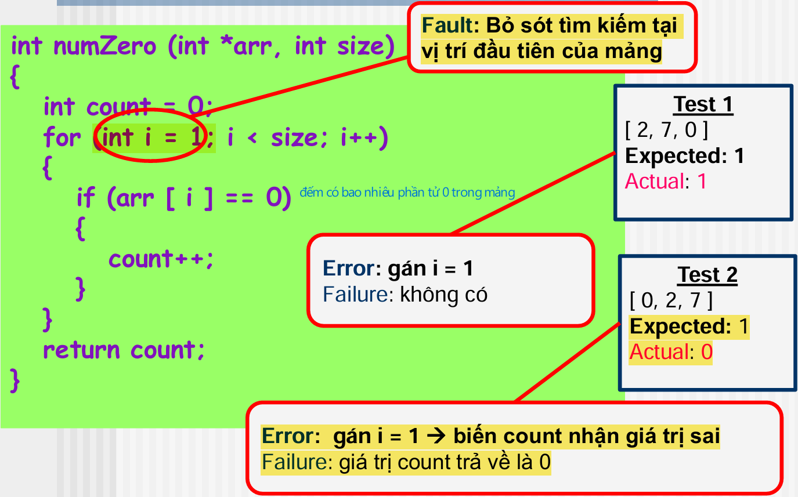
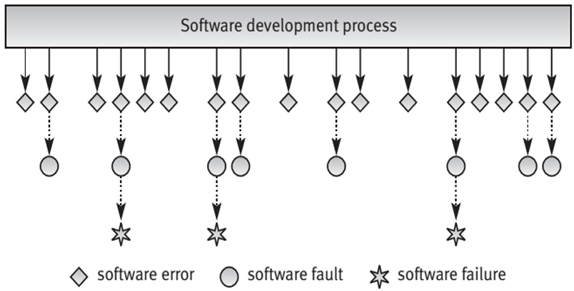
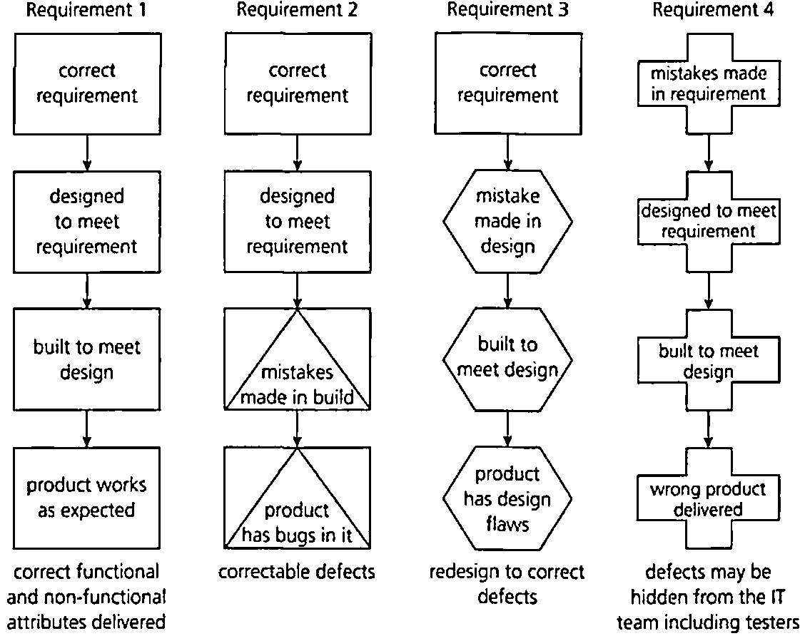
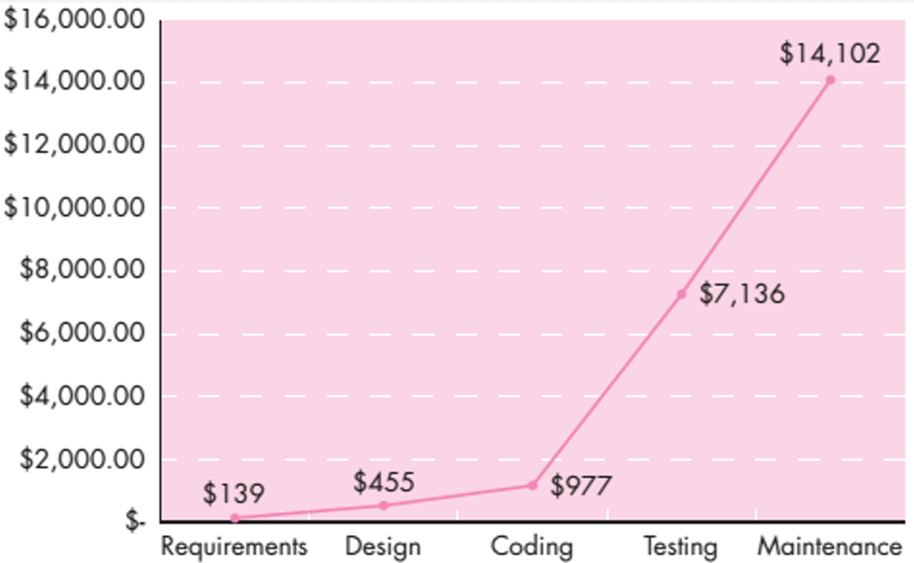
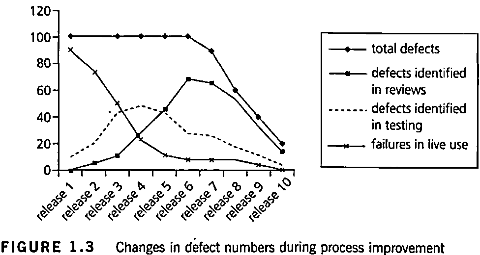

## 1.1. Tại sao kiểm thử lại cần thiết?

### 1.1.1. Ngữ cảnh hệ thống phần mềm

- Phần mềm xuất hiện trong hầu hết các lĩnh vực như ngân hàng, mua sắm, giáo dục, y tế, hàng không,…

- Hầu hết người dùng đều trải qua tình huống phần mềm **làm việc không như mong đợi** (vd: nghèo nàn về giao diện, chức năng không phù hợp…)

- Mỗi phần mềm có mức độ rủi ro và ảnh hưởng khác nhau

- Thị trường phần mềm ngày càng đa dạng, cạnh tranh lớn, lượng người dùng tăng cao

  → Kiểm thử có ý nghĩa quan trọng đối với **sự thành công** của các sản phẩm phần mềm

### 1.1.2. Software Error, Fault, và Failure

- **Error/Mistake:** **hành động của con người** gây ra kết quả không chính xác

  - Con người: dev, nhà phân tích, … 🡪 Những người tham gia phát triển PM.

  - Error thường xảy ra trong quá trình thiết kế, viết code, cấu hình hệ thống…

- **Fault/Bug/Defect:** **kết quả của error** trong PM

  - Lỗi của con người chuyển thành lỗi kỹ thuật trong hệ thống.

  - Được phát hiện được trước/sau khi triển khai.

- **Failure:** hệ thống thực hiện **không như mong đợi <u>(Thất bại của phần mềm)</u>**<u>.</u>

  - Không phải tất cả fault đều dẫn đến failure. Fault chỉ gây ra Failure khi điều kiện kích hoạt nó xảy ra.

  - **Thất bại phần mềm** có thể là: PM không chạy được, đang chạy thì đứng, treo; PM chạy được nhưng không đáp ứng nhu cầu của KH; **Là hệ quả của bug (tiềm ẩn).**

- **Ví dụ 1:**

  - Bệnh nhân đưa ra một loạt các **triệu chứng** cho bác sĩ **🡪 Failures**

  - Bác sĩ chẩn đoán **nguyên nhân** (bệnh tật) **🡪 Fault**

  - Bác sĩ tìm thấy **các tình trạng bất thường** bên trong (huyết áp cao, nhịp tim không đều, vi khuẩn trong máu,…) 🡪 Errors

- **Ví dụ 2:**

  - Chương trình nhập 2 số a, b. Tính a/b.

  - Khi người dùng nhập b = 0 🡪 Chương trình báo lỗi “divide by zero” 🡪 Runtime Error: lỗi logic trong quá trình chạy 🡪 Điều kiện kích hoạt gây ra **failure**.

  - Tìm thấy nguyên nhân: Thiếu đoạn code kiểm tra b = 0 🡪 **Fault.**

  - Dev không kiểm tra đầu vào/không xử lý ngoại lệ khi b = 0 🡪 **Error.**

- **Ví dụ 3:** Thiếu dấu chấm phẩy (;) cuối câu lệnh.

  - Trình thông dịch/biên dịch báo lỗi cú pháp (syntax error) & chương trình không chạy được 🡪 **Failure**.

  - Tìm thấy câu lệnh không được kết thúc đúng cách (int a = 5) 🡪 **Fault**.

  - Do lập trình viên quên viết dấu ; 🡪 **Error**.

- **Ví dụ 4:**

Hình 1. Ví dụ error, fault và failure

- **Mối quan hệ giữa error, fault và failure:**

  
  
Hình 2. Mối quan hệ giữa error, fault và failure

  **Error** $\overset{\text{Không được phát hiện}}{\rightarrow}$ **Fault** $\overset{\text{Khi gặp điều kiện kích hoạt}}{\rightarrow}$ **Failure**

  🡪 Không phải mọi Error đều dẫn đến Fault, và cũng không phải mọi fault đều dẫn đến Failure.

  **Testers nên cố gắng tìm ra khiếm khuyết trước khi các khiếm khuyết tìm đến người dùng.**

### 1.1.3. Nguyên nhân gây ra khiếm khuyết trong PM

- **Nguyên nhân chủ quan:**

  - Xác định sai yêu cầu (dư, thiếu yêu cầu cũng là sai).

  - Nhầm lẫn thông tin giữa dev và client.

  - Cố ý sai lệch so với yêu cầu PM (vd: tái sử dụng code mà không chỉnh sửa lại cho phù hợp với phần mềm đang xây dựng, lược bớt các chức năng của KH vì cận deadline, hết ngân sách…)

  - Sai trong logic thiết kế (vd: phân tích, thiết kế không đúng yêu cầu/ không tối ưu…)

  - Sai sót trong quá trình coding (sai cú pháp, thiếu xử lý ngoại lệ, thiếu điều kiện…)

  - Vi phạm chuẩn, mẫu chung (không tuân thủ quy ước đặt tên biến, code convention...)

  - Sai sót trong quá trình kiểm thử

  - Tài liệu viết không chính xác hoặc không đầy đủ 🡪 Gây hiểu sai/hiểu lầm khi phát triển PM/kiểm thử.

  - Dev thiếu kỹ năng, kinh nghiệm, chưa thành thạo công nghệ, nghiệp vụ…

- **Nguyên nhân khách quan:**

  - Lỗi khi sử dụng phần mềm (user không nắm quy trình sử dụng, thao tác hệ thống không đúng…)

  - Điều kiện môi trường, công nghệ thay đổi (thay đổi OS version 🡪 PM không còn tương thích…)

  - Tương tác nhiều hệ thống (vd: tương thích kém, lỗi khi kết nối với hệ thống bên ngoài…)

  - Cố ý gây thiệt hại (từ các cuộc tấn cvirus, malware,…)

- **Phát sinh các khiếm khuyết**

Hình 3. Phát sinh các khiếm khuyết

  🡪 TH4 là trường hợp nghiêm trọng nhất, dẫn đến sai dây chuyền. Phân tích, xác định yêu cầu là bước quan trọng nhất.

- **Chi phí tìm và sửa các khiếm khuyết**

  
  
Hình 4. Chi phí tìm và sửa các khiếm khuyết

  - Requirements 🡪 Phát hiện lỗi ở giai đoạn xác định yêu cầu là rẻ nhất.

  - Design 🡪 Lỗi trong thiết kế tốn kém hơn 1 chút để sửa.

  - Coding 🡪 Khi lỗi vào code, chi phí sửa chữa đã tăng đáng kể.

  - Testing 🡪 Sửa lỗi khi kiểm thử tốn chi phí gấp nhiều lần.

  - Maintainance 🡪 Sửa lỗi ở giai đoạn bảo trì là tốn kém nhất.

  **🡪 Việc kiểm thử phần mềm càng sớm càng tốt giúp giảm đáng kể chi phí sửa lỗi.**

  **🡪 Kiểm thử có thể nên bắt đầu từ giai đoạn phân tích, xác định yêu cầu.**

### 1.1.4. Kiểm thử và chất lượng

- Kiểm thử giúp **đo lường chất lượng** PM

- Kiểm thử có thể tìm ra lỗi, khi lỗi được fix thì chất lượng PM được cải thiện

- Kiểm thử sẽ thực hiện test: Chức năng của hệ thống & Yêu cầu phi chức năng

- Tại sao cần kiểm thử?

  - PM luôn tồn tại lỗi 🡪 Không ai cam đoan phần mềm của họ không bao giờ có lỗi.

  - Thất bại PM tốn chi phí rất cao để sửa chữa.

  - Kiểm thử giúp kiểm tra độ tin cậy của phần mềm, đồng thời đánh giá và quản lý rủi ro.

## 1.2. Khái niệm & Mục tiêu kiểm thử phần mềm

### 1.2.1. Khái niệm

- Kiểm thử là quá trình **vận hành chương trình để tìm ra lỗi** trước khi chuyển giao cho người dùng cuối. *(Glen Myers)*

### 1.2.2. Test Case (TC)

- **Là một trường hợp kiểm thử.**

- **3 thành phần chính:** Các bước thực hiện test, dữ liệu test (Input), kết quả mong đợi (khác với KQ thực tế - KQ khi chạy TC trên PM).

- **1 testcase tốt:** Làm lộ ra ít nhất 1 lỗi trong chương trình, Hiệu quả, Tổng quát, Dễ cập nhật, sữa chữa, hiệu quả về kinh tế.

### 1.2.3. Lợi ích của quá trình kiểm thử

- Cải tiến chất lượng phần mềm

- Giảm chi phí

- Duy trì sự hài lòng của khách hàng

- Giúp cải tiến quy trình phát triển thông qua việc rà soát các khiếm khuyết và thất bại

### 1.2.4. Kiểm thử triệt để (Exhaustive testing)

- **<u>Thực hiện tổ hợp tất cả các đầu vào có thể có</u>** (tất cả các trường hợp có thể xảy ra) và điều kiện tiên quyết.

- Đảm bảo rằng phần mềm luôn hoạt động chính xác ở mọi tình huống đầu vào.

- **Ví dụ:**

  - Username: 5 ký tự, cho phép các ký tự chữ cái (a-z)

  - Password: 5 ký tự, cho phép các ký tự chữ cái và số (a-z, 0-9)

  - Tổng số tổ hợp đầu vào: Username = 265, Password = 365 🡪 Số lượng TC = 265 x 365

- **Cần thực hiện một số lượng lớn các Test case** → Chiếm thời gian rất lớn, **không thực tế.**

### 1.2.5. Kiểm thử bao nhiêu là đủ?

- **Ví dụ:** Nhập 1 số nguyên 1-100 🡪 Cần 3 test cases:

  - 1 giá trị nguyên thuộc đoạn \[1-100\] 🡪 nếu đúng thì các số trong khoảng này đều đúng.

  - 1 giá trị \< 1, chẳng hạn -1.

  - 1 giá trị \> 100, chẳng hạn 101.

<!-- -->

- **Mức độ kiểm thử:**

  - Phụ thuộc vào kết quả test

  - Phụ thuộc vào các rủi ro: Bỏ lỡ các faults quan trọng, Phát sinh chi phí thất bại, Phát hành phần mềm chưa được test, Thực thi các test không hiệu quả, Mất uy tín, thị phần…

  - Sử dụng các rủi ro để quyết định: *Cái gì cần test trước, Cái gì cần nhấn mạnh, Cái gì chưa cần test trong thời điểm hiện tại, Phân bổ thời gian cho việc kiểm thử*

    **→ Thực hiện sắp xếp độ ưu tiên cho các TCs**

- TC nào có độ ưu tiên cao hơn sẽ được test trước 🡪 phát hiện các lỗi quan trọng trước.

- Độ ưu tiên cao gắn với các tính năng quan trọng 🡪 Bất kỳ tời điểm nào việc kiểm thử phải dừng lại (do thời gian, ngân sách…) thì ta đã test xong các trường hợp quan trọng, giúp an tâm hơn khi giao sản phẩm cho KH.

- **Vậy TC nào quan trọng?** Phụ thuộc vào chức năng mà khi lỗi xảy ra, nó ảnh hưởng nhiều hay ít với KH.

### 1.2.6. Sắp xếp độ ưu tiên cho các Test cases

- Test tại vùng có thể gây thất bại nghiêm trọng nhất, có khả năng xảy ra lỗi nhất

- Test các yêu cầu đặc biệt quan trọng đối với khách hàng

- Test vùng thường xảy ra thay đổi

- Chú trọng vùng phức tạp về mặt kỹ thuật

### 1.2.7. Mục tiêu kiểm thử phần mềm

- Phát hiện ra nhiều lỗi nhất có thể và sớm nhất có thể

- Có một PM đạt được chất lượng ở mức có thể chấp nhận

- Thực hiện các tests cần thiết và hiệu quả trong phạm vi ngân sách và lịch biểu đã đưa ra.

### 1.2.8. Gỡ lỗi để loại bỏ “Bug”

**Gỡ lỗi (Debugging):** Là quá trình lập trình viên **định vị bug** trong code, **fix code**, và **kiểm tra lại code** đã thực thi đúng chưa.

Hình 5. Gỡ lỗi

## 1.3. Các nguyên tắc kiểm thử cơ bản

1.  Kiểm thử có thể chỉ ra sự **<u>hiện diện</u>** của “bug”, nhưng không chứng minh được PM không có “bug”.

2.  Kiểm thử triệt để là không thể.

3.  Các hoạt động kiểm thử nên **bắt đầu sớm nhất có thể**

4.  Các “bug” có xu hướng **phân cụm** (thường tập trung ở những module phức tạp, thay đổi nhiều, ít kiểm thử kĩ…)

5.  Các test cases cần được rà soát, sửa đổi, và thực hiện ở các phần khác nhau của PM để tìm ra nhiều “bug” tiềm ẩn

6.  Kiểm thử phụ thuộc vào ngữ cảnh

    Cách tiếp cận & chiến lược kiểm thử thay đổi tùy thuộc vào dự án, mục tiêu, phạm vi, môi trường phát triển phần mềm. Ví dụ:

    - PM ngân hàng đồi hỏi kiểm thử bảo mật nghiêm ngặt.

    - PM giải trí ưu tiên kiểm thử UI, UX.

    - Hệ thống thời gian thực yêu cầu kiểm thử hiệu năng & sự ổn định.

    🡪 Tùy ngữ cảnh, ta chọn phương pháp kiểm thử phù hợp để đạt KQ cao nhất.

7.  Tìm và fix “bug” sẽ **không hữu ích** nếu PM **không sử dụng được**, không đáp ứng nhu cầu và mong đợi của người dùng.

## 1.4. Quy trình kiểm thử cơ bản

Bao gồm các bước sau:

**Bước 1: Vạch kế hoạch & kiểm soát quá trình test**

- Do leader thực hiện, có thể tester hỗ trợ.

- **Có thể thực hiện thủ công, hoặc tự động.**

- Thực hiện:

  - Thiết lập **chiến lược** test

  - Xác định **những người tham gia:** testers, QA, development, support,…

  - Xác định các **yêu cầu, đặc tả** về chức năng

  - Chuẩn bị **cơ sở hạ tầng** cho test

  - Lên lịch biểu cho các hoạt động test

  - Xác định **phạm vi và các rủi ro** kiểm thử

  - Xác định **tiêu chí hoàn thành** test…

- **Kiểm soát quá trình test:**

  - Đo lường và phân tích các kết quả rà soát, kiểm thử

  - Theo dõi và lập hồ sơ tiến độ, độ bao phủ và tiêu chí hoàn thành test

  - Thực hiện các hoạt động: thắt chặt tiêu chí hoàn thành/ thay đổi ưu tiên fix các “bug”

  - Đưa ra quyết định.

**Bước 2: Phân tích xác định các điều kiện, thiết kế test cases**

- Do tester thực hiện.

- Xem xét cơ cở test (gồm tài liệu yêu cầu, thiết kế hệ thống, đặc tả…)

- Xác định các **điều kiện test** và **độ ưu tiên** của nó sử dụng các kỹ thuật test

- Thiết kế các Test cases (viết các trường hợp kiểm thử với input, KQ mong đợi, ĐK thực hiện…)

- Triển khai các Test cases: Chuẩn bị kịch bản (thủ tục) và dữ liệu test, tạo test suites (các TCs được nhóm thành các bộ test)

- Cài đặt môi trường test (có thể gần giống với MT thực tế, phần cứng, phần mềm, công cụ…)

**Bước 3: Thực thi tests**

- Do tester thực hiện, họ sẽ chạy chương trình, nhập các TCs và quan sát kết quả.

- Thực thi test suites và các TCs riêng lẻ đã được thiết kế dựa theo script:

  - Thực hiện trước các TCs quan trọng nhất

  - Có thể thực thi bằng tay (manual) hoặc tự động (automatic)

  - **Không thực thi tất cả các TCs nếu:** Có quá nhiều lỗi ở các TCs trước, Áp lực thời gian.

**Bước 4: Đánh giá dựa trên tiêu chuẩn và báo cáo**

- Ghi lại các phiên bản của PM trong khi test

- Với mỗi TCs, ghi lại kết quả thực tế, độ bao phủ test

  - **Độ bao phủ test:** đo mức độ mà TCs đã được kiểm tra tại các phần của hệ thống (yêu cầu, mã nguồn, dữ liệu…) 🡪 Mục đích: Xác định phần nào chưa kiểm thử.

- So sánh kết quả thực tế với kết quả mong đợi

- Sau khi lỗi được fix thì cần phải test lại

- Viết báo cáo trạng thái kiểm thử (bug report).

- Sau khi viết báo cáo, bên kiểm thử sẽ gửi lại cho leader để KT lại đó có thực sự là lỗi hay không, tránh các quan điểm chủ quan của bên kiểm thử.

- Sau khi leader kiểm tra, họ sẽ đưa cho dev sửa chữa.

- Sau khi dev sữa chữa xong, sẽ báo lại cho bên kiểm thử, & testers sẽ tiến hành kiểm thử lại 1 lần nữa xem bug đó đã thực sự được sửa chưa.

**Bước 5: Kiểm tra hoàn thành tests**

- Quá trình kiểm thử đã kết thúc được chưa?

- Dựa vào các tiêu chuẩn kết thúc test đã được đưa vào test plan

- Nếu các tiêu chuẩn chưa được đáp ứng thì **thực hiện lại từ việc thiết kế thêm các TCs** (bước 2 🡪 3 🡪 4 🡪 5)

- Các tiêu chuẩn trên có thể bao gồm (có thể ứng dụng với tất cả các mức test): Độ bao phủ, Các lỗi được tìm thấy, Chi phí hoặc thời gian.
