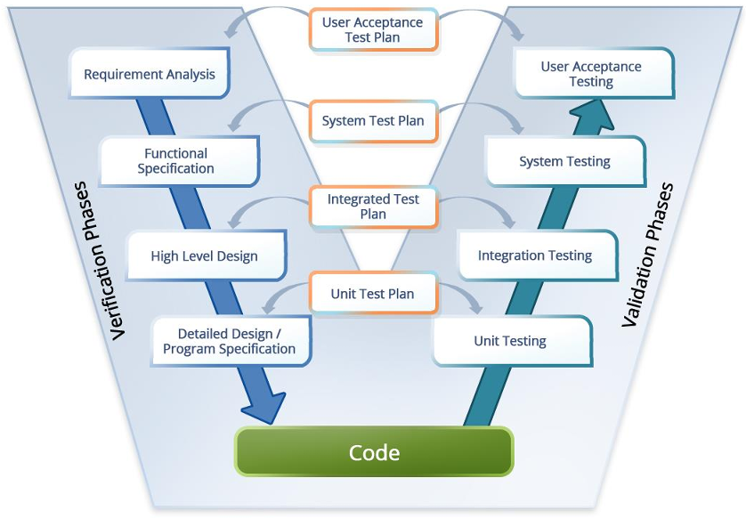
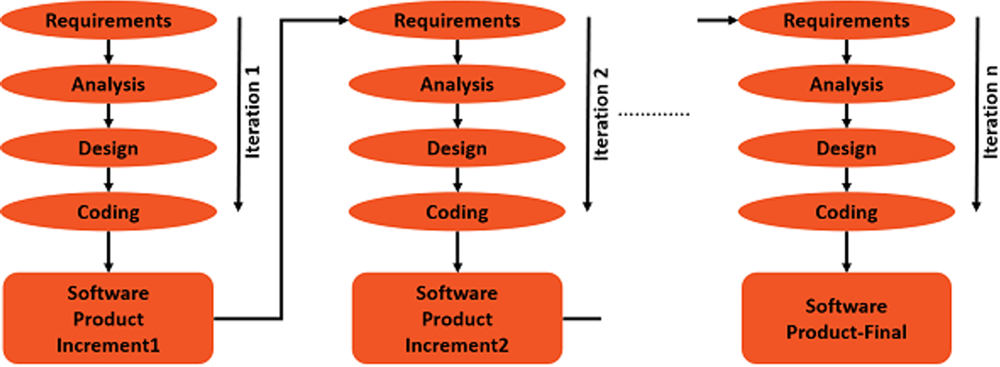
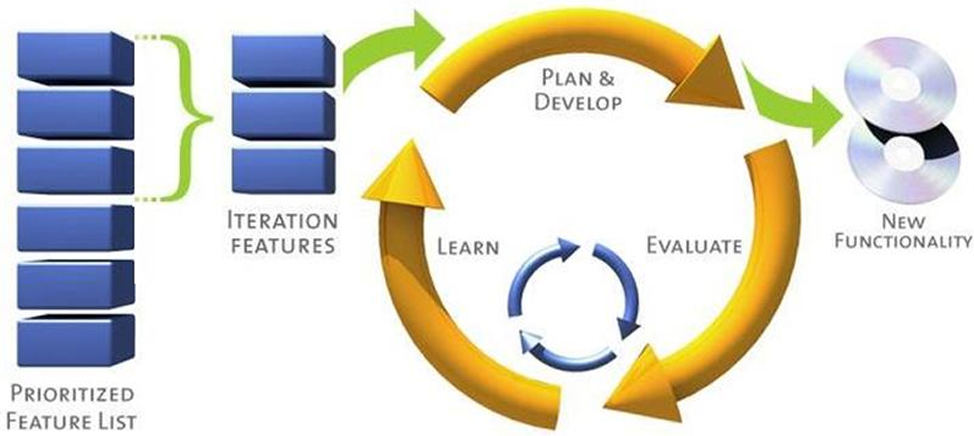
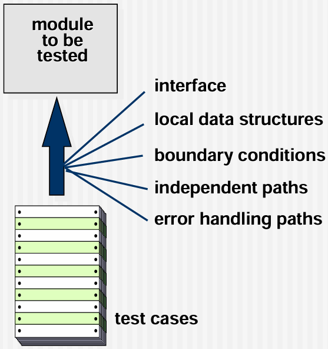
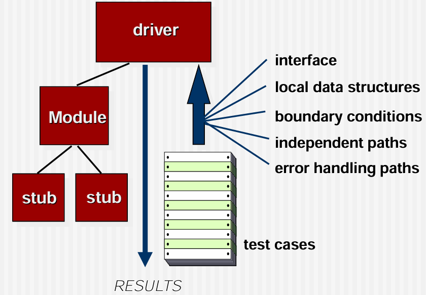
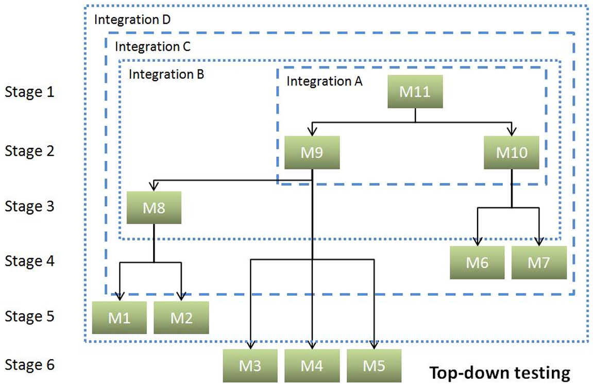
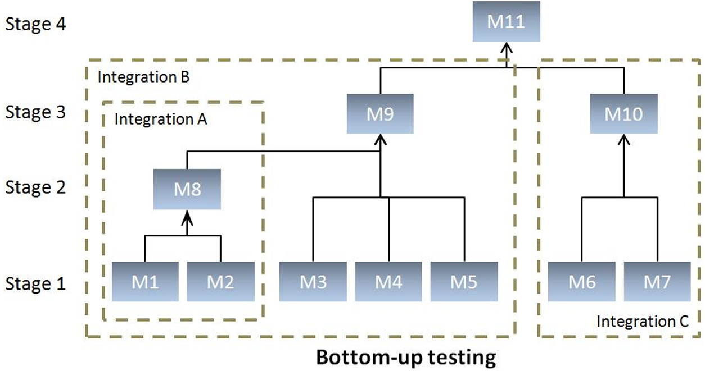
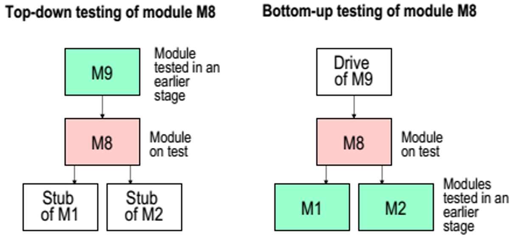
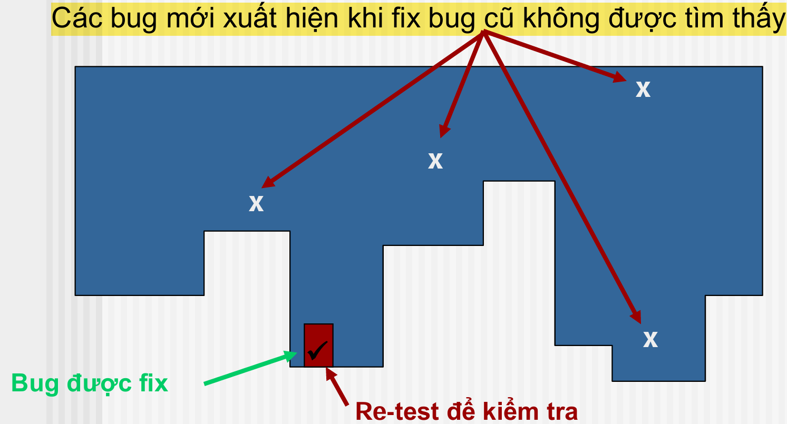
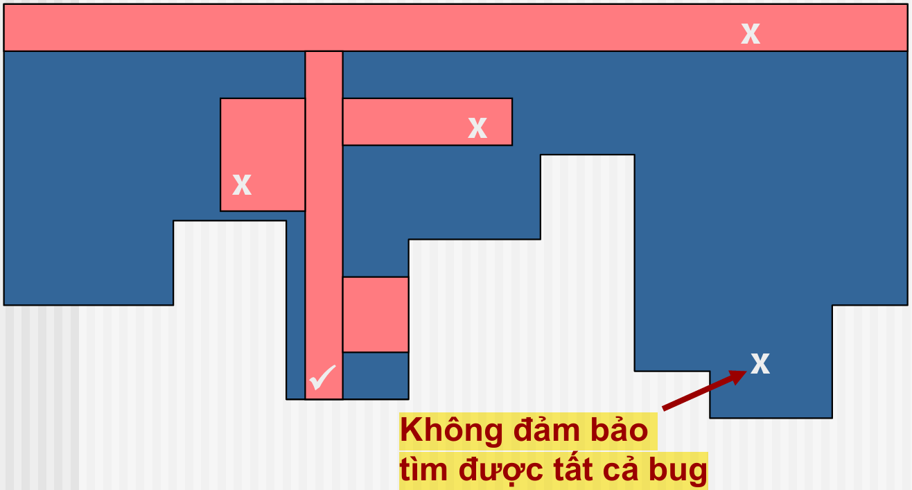

## 2.1. Các mô hình phát triển PM và Vị trí của kiểm thử

- **Mô hình phát triển phần mềm:**

  - Phân bố hoạt động kiểm thử khác nhau 🡪 Số lượng bug khác nhau.

  - Một phần kiểm thử tập trung vào hoạt động verification (xác minh) và phần khác tập trung vào validation (thẩm định).

- **Verification (xác minh):** là quá trình kiểm tra phần mềm có **đúng đặc tả** hay không.

- **Validation (thẩm định):** là quá trình kiểm tra phần mềm có **đáp ứng được yêu cầu người dùng** không.

- **Testing trong các mô hình phát triển phần mềm:**

  - ***Waterfall***

    - **Testing thực tế vốn có ở mỗi pha** 🡪 thực hiện liên tục, bắt đầu kể từ pha thiết kế, thực thi để thẩm định lại các pha trước đó.

    - Trong mô hình này, pha testing bắt đầu sau pha coding.

    - **Kiểm thử tĩnh:** cuối mỗi pha phải thực hiện kiểm thử, trừ pha coding.

    - **Kiểm thử động:** cần có source code.

  - ***V-Model***

    
    
Hình 6. V-Model

    - **Phân chia rõ các mức test:** Unit testing 🡪 Intergration Testing 🡪 System testing 🡪 User acceptance.

    - Các hoạt động kiểm thử được bắt đầu sớm và **thực hiện song song với các hoạt động phát triển.**

    - *Sản phẩm ở mỗi pha là cơ sở cho kiểm thử ở các mức khác nhau.*

  - ***Concurrent model***

    - Có thể hiểu là vừa suy nghĩ vừa code.

    - lập kế hoạch, thiết kế và phát triển PM xảy ra đồng thời cùng 1 lúc

    - Toàn bộ dự án không được vạch kế hoạch rõ ràng → rất khó test

    - Testing theo kiểu khám phá **(ad-hoc)** 🡪 Bugs có thể sẽ bị bỏ sót trong quá trình test

      - **Ad-hoc testing** là phương pháp kiểm thử không có tài liệu yêu cầu, kế hoạch, testcase, không tuân theo bất cứ loại kỹ thuật test nào.

      - Sự thành công của kiểm thử phụ thuộc khả năng của người kiểm thử. Việc tìm ra khiếm khuyết chỉ dựa trên trực giác của người kiểm thử.

      - Ứng dụng nhiều nhất trong kiểm thử ứng dụng, trò chơi 🡪 Kiểm thử ngẫu nhiên ngằm đoán được mức tối đa hành vi của users mà TCs không đoán trước/đoán hết được.

      - **Phân loại:**

        - Buddy Testing: Tester & Dev cùng kiểm thử 🡪 Giúp dev thay đổi thiết kế sớm trong trường hợp cần thiết, Tester sẽ hiểu cách thiết kế của module để không viết các kịch bản không hợp lệ.

        - Pair Testing: 2 Testers làm việc cùng nhau.

        - Monkey Testing: Kiểm thử được thực hiện ngẫu nhiên, không có bất kỳ TH kiểm thử nào làm phá vỡ hệ thống.

  - ***Mô hình lặp (lặp lại tăng thêm) (Iterative Model)***

    
    
Hình 7. Iterative Model

    - Tại mỗi bước lặp tiếp theo sẽ thực hiện:

      - Test chức năng mới, đồng thời thực hiện **regression testing** **(kiểm thử hồi quy)**

      - Kiểm thử tích hợp phần **chức năng mới và cũ**

    - PM được release sớm, tức là **validation được thực hiện sớm ở mỗi vòng lặp** → nhận được feedback sớm từ người dùng.

    - Mô hình này <u>tốn chi phí phát triển cao hơn waterfall</u> vì nếu thêm chức năng mới thì phải test lại tất cả những chức năng cũ, và những chức năng mới cũng có thể ảnh hưởng đến chức năng cũ.

    - Ví dụ: Prototyping; Rapid Application Development (RAD); Rational Unified Process (RUP); **Agile Model**…

  - **Agile Model:**

    
    
Hình 8. Agile Model

    - Phát triển phần mềm theo kiểu **tập trung**

    - Testing theo kiểu khám phá **(ad-hoc),** **nhưng tập trung**

    - Dự án được phát triển linh động, nhiều thay đổi, nhưng *tất cả các thay đổi đều được thảo luận và được ghi chú lại.*

## 2.2. Các mức kiểm thử

Có 4 mức kiểm thử như sau:

### 2.2.1. Kiểm thử đơn vị (Unit Testing)

- MỨC THẤP NHẤT

- Kiểm thử **các thành phần nhỏ nhất** **có thể kiểm thử được** như: function, class, module,…

- Các thành phần được test **<u>độc lập</u>**

- Do **developer** thực hiện 🡪 vì dev nắm rõ cấu trúc code của chương trình.

- **Chiến lược kiểm thử đơn vị:**

  - Xác định các kĩ thuật kiểm thử (white-box: kiểm thử hộp trắng)

  - Đưa ra các **tiêu chí để hoàn thành** test

  - Xác định **mức độ độc lập** khi thiết kế test

  - **Lập tài liệu** về qui trình test và các hoạt động test (inputs và outputs)
  
  - Những hoạt động lặp đi lặp lại sau mỗi lần fix lỗi hoặc thay đổi

- **Nội dung kiểm thử đơn vị:** Gồm các thành phần như hình.

  
    
Hình 9. Kiểm thử đơn vị

  - **Interface:** kiểm tra cách module giao tiếp với các thành phần khác thông qua I/O.

  - **Local data structures:** KT CTDL bên trong module để đảm bảo chúng được quản lý đúng cách.

  - **Boundary condition:** KT module với các giá trị biên (max, min, dữ liệu rỗng…)

  - **Independent paths:** KT các luồng xử lý độc lập bên trong module (vd: thực thi qua các nhánh điều kiện…).

  - **Error handling paths:** KT cách module xử lý ngoại lệ/ lỗi (vd: sai DL, kết nối thất bại…).

- **Môi trường kiểm thử đơn vị:** Gồm các thành phần như hình.

  
  
Hình 10. Môi trường kiểm thử đơn vị

  - **Driver:** Module giả lập thành phần cấp cao, gọi đến module cần kiểm thử.

  - **Stub:** Module giả lập các thành phần cấp thấp được module này gọi đến.

### 2.2.2. Kiểm thử tích hợp (Integration Testing)

- Tích hợp các thành phần phụ thuộc đã được test

- Tập trung tìm các lỗi:

  - Thiết kế và xây dựng *kiến trúc PM*

  - Các thành phần được *tích hợp ở mức sub-system*

  - *Giao tiếp* giữa các thành phần

- Do **developers/testers** thực hiện

- **Chiến lược kiểm thử tích hợp:** Có 2 hướng tiếp cận cơ bản:

  - **Big-bang:**

    - Có bao nhiêu đơn vị (unit) thì tích hợp hết và kiểm thử luôn một lần 🡪 Tiết kiệm thời gian.

    - *Thực tế:*

      - *Mất nhiều thời gian để tìm lỗi và sửa lỗi*

      - Test lại sau khi sửa lỗi sẽ *phức tạp hơn nhiều*

  - **Incremental (top-down, bottom-up)**

    - *Được chia thành các mức:*

      - *Mức 0: các thành phần đã được test*

      - *Mức 1: 2 thành phần*

      - *Mức 2: 3 thành phần,*

      - *….*

    - Mỗi mức có số lượng thành phần nhất định, tại mỗi mức tiếp theo ta tích hợp thêm các thành phần khác rồi kiểm thử.

    - *Giúp tìm ra các khiếm khuyết sớm → sửa lỗi sớm*

    - *Dễ dàng phục hồi sau lỗi*

#### 2.2.2.1. Tích hợp Top-down

Hình 11. Top-down testing

- Tích hợp các module cao hơn trước rồi hạ cấp dần.

- **Ví dụ:** Giả sử ta có hàm main() và hàm sort(). Tiến hành test hàm main() trước, tuy nhiên sort() chưa được test trước đó

  🡪 Xây dựng hàm thay thế cho hàm sort() để chạy được chương trình.

  🡪 Xây dựng **STUB:** module mô phỏng – thay thế tương đương hàm sort(), nhưng đơn giản cực kỳ, chạy đúng và không tồn tại lỗi.

- **Ưu điểm:**

  - Module lớn được nhận Input sớm hơn 🡪 Dễ test hơn.

  - Cấu trúc điều khiển quan trọng được test trước.

  - Mô phỏng chức năng chính của PM sớm → nổi bật vấn đề liên quan đến yêu cầu

- **Nhược điểm:**

  - Phụ thuộc vào nhiều stub

  - Khó khăn khi phân tích kết quả test

#### 2.2.2.2. Tích hợp Bottom-up

Hình 12. Bottom-up testing

- Tích hợp những module nhỏ trước, rồi các cấp cao hơn sau.

- **Ví dụ:** Test hàm sort() trước, rồi test hàm main(). Tuy nhiên hàm main() chưa được test/chưa được viết 🡪 Không thể chạy được chương trình.

  🡪 Xây dựng **DRIVER:** Module mô phỏng đơn giản, không lỗi, để gọi module ta cần test, và có thể cần truyền tham số (input).

- **Ưu điểm:**

  - Các mức thấp nhất được test đầu tiên

  - Điều kiện test được tạo dễ dàng

  - Dễ quan sát các kết quả test chi tiết

- **Nhược điểm:**

  - Phụ thuộc nhiều vào driver.

  - Chương trình tổng thể được quan sát trễ

  
  
Hình 13. Top-down &amp; Bottom-up

### 2.2.3. Kiểm thử hệ thống (System testing)

- Là bước **tích hợp** **cuối cùng**

- Kiểm thử các yêu cầu *chức năng* (Functional) & các yêu cầu *phi chức năng* (Non-Functional)

- Do các **tester** thực hiện

- **Functional System Testing:** Tìm các lỗi: Input/Output, Giao diện người dùng, Giao tiếp của hệ thống với các phần khác, Hành vi của hệ thống.

- **Non-functional System Testing:**

  - Phức tạp hơn so với kiểm thử chức năng.

  - Kiểm thử các thành phần: Usability, Security, Documentation, Storage, Volume, Configuration / installation, Reliability, Recovery, Performance, load, stress

  - **Usability Testing – Tính khả dụng**

    - Có thể hiểu đơn giản là **tính dễ sử dụng.**

    - Đặc điểm nối bật:

      - Đơn giản, hiệu quả khi sử dụng

      - Giao diện nhất quán và phù hợp

      - Message phù hợp và có ý nghĩa cho người sử dụng

      - Hỗ trợ thông tin phản hồi

      - Liên kết tắt…

    - Tính dễ sử dụng sẽ phụ thuộc vào mỗi người dùng 🡪 Cần đặt ra tiêu chuẩn để đo lường, đánh giá.

      - **Ví dụ:** Phần mềm sau khi hoàn tất sẽ được trainning cho người dùng trong 2 ngày. Sau thời gian này, tất cả người dùng được trainning sẽ sử dụng thành thục phần mềm.

        🡪 Nếu thỏa điều kiện này: PM đạt tính khả dụng.

        🡪 Nếu tồn tại một số người sử dụng PM khó khăn, chưa thành thục: PM không đạt tính khả dụng.

  - **Security Testing**

    - Kiểm tra cơ chế bảo mật của hệ thống có hiệu quả không? 🡪 Bất kỳ phần mềm/hệ thống nào cũng có thể bị hack, miễn là có đủ thời gian, nguồn lực, và chi phí. Không ai cam đoan rằng phần mềm của họ làm ra là luôn an toàn.

    - Tester sẽ đóng vai trò là hacker

    - **Bài toán thiết kế hệ thống an ninh/ Những tiêu chí để hệ thống được coi là an ninh tốt:**

      - Chi phí (đầu tư vào) công cụ bảo vệ **<u>nhỏ hơn</u>** lợi ích bảo vệ khỏi đột nhập (giá trị của thứ cần bảo vệ khỏi đột nhập)

        - **Ví dụ:** Bỏ 10tr để bảo vệ tài sản là 100tr thì hợp lý.

      - Chi phí đột nhập **<u>lớn hơn</u>** lợi ích thu được từ đột nhập

        - **Ví dụ:** Bỏ 50tr để lấy được tài sản trị giá 5tr

        - 🡪 Không xứng đáng với công sức mà hacker bỏ ra.

    - Một số kĩ thuật test lỗ hổng của ứng dụng **Web**:

      - **SQL Injection**

        - Ví dụ: Tester đưa vào 1 số câu lệnh SQL, nếu có lỗi thì trả về table chẳng hạn như liên quan đến thông tin cá nhân của người dùng…

      - **Cross-site Scripting (XSS):**

        - Ví dụ: Đưa đoạn script độc vào các input thuộc quyền sử dụng của người dùng, nếu sinh ra lỗi thì hệ thống có thể sập…

      - …

  - **Documentation Testing:** có thể gồm *Tài liệu yêu cầu, đặc tả, bảo trì, kiểm thử, hướng dẫn người dùng…* 🡪 Đều là sản phẩm của quá trình phát triển phần mềm.

    - **Rà soát** tài liệu: Kiểm tra định dạng, lỗi chính tả; Độ chính xác về nội dung (tài liệu chưa được cập nhật theo yêu cầu của KH…)

    - **Kiểm tra** tài liệu: Có làm việc không?, Tài liệu bảo trì, Hướng dẫn sử dụng.

  - **Performance Testing:**

    - Xác định tốc độ, khả\\ năng phân tải

    - Tìm điểm **“thắt cổ chai”** → cải tiến nâng cao khả năng hoạt động của PM

      - Ví dụ: một trang web có số lượng người truy cập ĐỒNG THỜI tối đa là 1000 🡪 1000 người là điểm thắt cổ chai.

    - **Timing Tests:** Thời gian phục vụ và đáp ứng & Thời gian phục hồi CSDL.

    - **Capacity & Volume Tests:** Khối lượng/kích thước dữ liệu lớn nhất mà hệ thống có khả năng xử lí được.

  - **Stress/Load Testing – Multi User**

    - Vận hành hệ thống khi sử dụng nguồn lực với **số lượng, tần suất lớn**

    - **Load Testing:** kiểm tra PM ở điều kiện liên tục **tăng mức độ chịu tải**, nhưng PM vẫn hoạt động được.

      - Ví dụ: Cho 10 users truy cập vào hệ thống trước 🡪 cứ 10s tăng thêm 10 users 🡪 Tăng đến mức tối đa là 1000 users không tăng nữa.

    - **Stress Testing:** Kiểm tra PM ở trạng thái vận hành trong **điều kiện bất thường**

      - **Ví dụ 1:** PM yêu cầu bộ nhớ tối thiểu là 800MB 🡪 Khi kiểm thử ta giảm bộ nhớ xuống một nửa (400MB) để xem hệ thống còn hoạt động bình thường không.

      - **Ví dụ 2:** PM nhập điểm cho GV dùng VPN 🡪 Khi kiểm thử ta ngắt VPN xem có còn truy cập/thoát ra khỏi hệ thống được nữa không.

  - **Configuration/Installation Testing**

    - **Configuration tests**

      - Môi trường phần cứng, phần mềm khác nhau

      - Nâng cấp 1 phần của hệ thống có thể dẫn đến xung đột với phần khác

    - **Installation Tests:**

      - PM có thể cài đặt qua nhiều hình thức: CD, networks,…

      - Thời gian cài đặt bao lâu.

      - Uninstall như thế nào.

  - **Reliability Testing**

    - **Reliability (độ tin cậy):** là xác suất thao tác **<u>không thất bại</u>** của hệ thống trong **khoảng thời gian xác định** dưới **điều kiện xác định.**

      **🡪** Trong mỗi khoảng thời gian khác nhau & điều kiện khác nhau, độ tin cậy cũng sẽ khác nhau.

    - Để đo độ tin cậy: **Mean Time Between Failures (MTBF)** – Thời gian trung bình giữa những lần thất bại liên tiếp.

    - Tạo ra một tập test đại diện, thu thập đủ thông tin để thống kê tỉ lệ thất bại

  - **Recovery Testing**

    - Ép phần mềm phải thất bại, rơi vào trạng thái lỗi 🡪 xem khả năng phục hồi đến đâu

    - Có 2 cách phục hồi

      - **Phục hồi tự động (back-up):** sau 1 thời gian hệ thống trở lại bình thường….

      - **Phục hồi dựa trên sự can thiệp của con người:** nhấn nút khởi động lại, nhấn F5 tải lại trang…

### 2.2.4. Kiểm thử chấp nhận người dùng - User acceptance testing

- Thẩm định xem các chức năng của PM có thỏa mãn sự mong đợi của khách hàng không?

- Do **<u>user/customer</u>** thực hiện

  - **customer có thể khác với user:**

    - **user:** những người sử dụng đầu cuối, sử dụng trực tiếp phần mềm

    - **customer:** những người đi đặt hàng phần mềm, có thể sử dụng PM hoặc không.

- **Tại sao người dùng nên tham gia test?**

  - Có thể đưa ra góp ý thực tế, chi tiết về giao diện, trải nghiệm người dùng.

  - Đưa ra những tình huống nghiệp vụ xảy ra trong thực tế (những dữ liệu mà người dùng có thể sẽ nhập vào mà dev/tester không nghĩ đến).

  - Phát hiện ra các ý kiến chủ quan của đội phát triển phần mềm.

  - Được trải nghiệm trước PM để sau này dễ sử dụng, hiểu rõ hệ thống mới,…

- **Kiểm thử Alpha và Beta**

  - Do **người sử dụng đầu cuối thực hiện (user)**, không phải người đặt hàng

  - Họ sẽ đưa ra các feedback về sản phẩm (phát hiện lỗi, đề nghị cải tiến,…)

  - **Kiểm thử Alpha:**

    - **Người dùng sẽ được bên phát triển PM mời về** và thực hiện kiểm thử trong môi trường được điều khiển & Dữ liệu được họ chuẩn bị trước (thường là mô phỏng).

  - **Kiểm thử Beta:**

    - Do **bên khách hàng** tiến hành

    - Được tiến hành trong môi trường thực, không có sự kiểm soát của Dev 🡪 Thực hiện trên máy của khách hàng, đã cài đặt các phần mềm trước đó của họ…

    - Khách hàng sẽ báo cáo tất cả các vấn đề trong quá trình test một cách **định kì**

## 2.3. Các kiểu kiểm thử

- Mỗi kiểu kiểm thử tập trung vào một mục tiêu kiểm thử cụ thể.

- Không có kiểu kiểm thử nào là tốt nhất, hiệu quả nhất 🡪 Chỉ có khi kết hợp các kiểu với nhau.

- Các kiểu kiểm thử:

  - **Kiểm thử chức năng (Functional Testing)**

    - Là loại kiểm thử dựa trên:

      - **Các chức năng** được mô tả trong đặc tả yêu cầu

      - **Quy trình nghiệp vụ** của PM

    - Các kỹ thuật được sử dụng:

      - Specification-based (~ kiểm thử hộp đen)

      - Experienced-based (kiểm thử dựa trên kinh nghiệm của tester)

    - Có thể thực hiện ở **tất cả các mức test**

  - **Kiểm thử phi chức năng (Non-Functional testing)**

    - Là loại kiểm thử **các đặc trưng chất lượng của PM** dựa trên các chuẩn: ISO/IEC 9126, McCall…

    - Bao gồm: *performance testing, load testing, stress testing, usability testing, maintainability testing, reliability testing,…*

      - ***Kiểm thử bảo trì - maintainability testing:*** kiểm thử phần mềm có bảo trì được không.

      - **Thế nào là bảo trì?** Là quá trình tìm lỗi, sửa lỗi, nâng cấp chức năng mới, mở rộng…

    - Có thể áp dụng ở **tất cả các mức test**

  - **Kiểm thử cấu trúc PM**

    - Hay còn được gọi là **white-box** hoặc **glass-box**, kiểm thử **dựa trên cấu trúc bên trong** của PM 🡪 Do dev thực hiện, vì họ hiểu hệ thống nhất.

    - Kiểu kiểm thử này **đo lường độ bao phủ các thành phần** trong cấu trúc PM

    - Chủ yếu được áp dụng ở mức **<u>kiểm thử đơn vị và tích hợp</u>**

  - **Kiểm thử liên quan đến thay đổi**

    - Mục đích chính là kiểm thử **sự thay đổi**

    - Gồm 2 loại:

      - **Re-testing (Confirmation testing) – Kiểm thử lại (Kiểm thử xác nhận)**

        - Chạy lại các test cases không thành công 🡪 Kiểm tra xem các bug ban đầu còn không.

        - TC làm lộ ra lỗi 🡪 Failed, ngược lại 🡪 Passed.

        - Phiên bản mới chỉ bao gồm các **khiếm khuyết cũ được fix**

        - Chạy lại **chính xác test**

      
      
Hình 14. Kiểm thử lại

      - **Regression testing – Kiểm thử hồi quy**

        - Chạy lại **tất cả các test cases** **<u>đã được thực thi</u>** trước đó.

          - Kể cả các TCs failed, passed.

          - Kiểm tra xem bug cũ được fixed chưa, có phát sinh bug mới không.

        - Phiên bản mới có thể bao gồm các **khiếm khuyết cũ được fix, và các khiếm khuyết mới**

          - 🡪 Không đảm bảo tìm được mọi bug.

          - 🡪 Mất thời gian, chi phí...

        - Có thể sử dụng các công cụ **test tự động**

      
      
Hình 15. Kiểm thử hồi quy

        - **Việc bảo trì bộ test hồi quy** cần được thực hiện

          - Khi **chức năng mới được thêm** vào PM → cần bổ sung thêm các test hồi quy

          - Khi **chức năng cũ bị thay đổi hoặc bỏ bớt** → cần thay đổi hoặc bỏ bớt các test hồi quy

> Trong 3 mô hình **waterfall, V-model, lặp**, mô hình nào tốn chi phí kiểm thử hồi quy nhiều nhất?
>
> **Mô hình lặp:** chia ra làm nhiều vòng, mỗi vòng bổ sung thêm chức năng mới 🡪 test lại mọi chức năng cũ và mới, để xem khi bổ sung chức năng mới có sinh ra bug nữa hay không 🡪 chi phí kiểm thử sẽ tăng lên.
