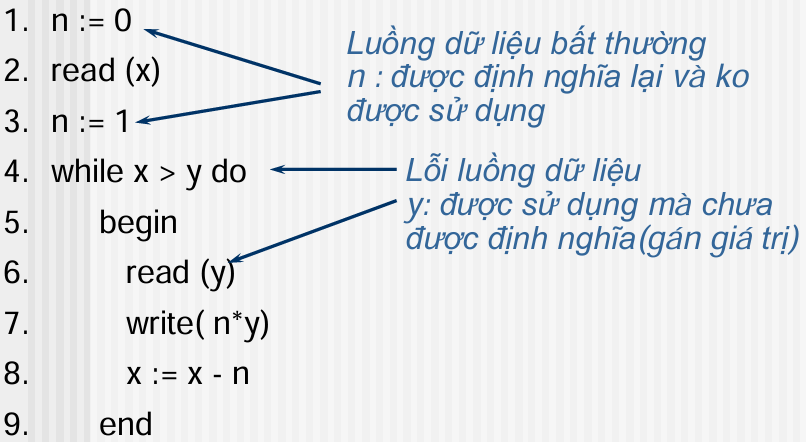
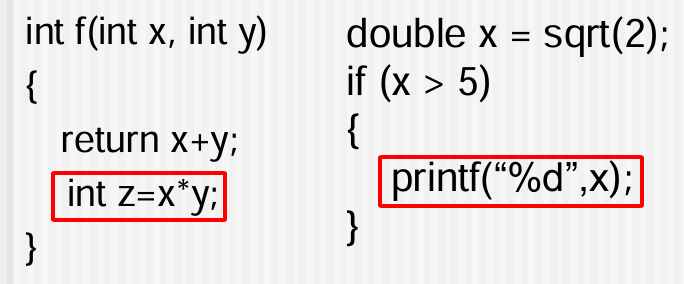

## 3.1. Khái niệm kiểm thử tĩnh

- **Có 2 phương pháp kiểm thử**

  - Kiểm thử tĩnh (static testing):

    - Thường thực hiện bằng tay/ công cụ

    - **KHÔNG THỰC THI CODE** (không cần run chương trình) 🡪 Có thể kiểm thử ở mọi pha (ngay từ bước phân tích xác định yêu cầu).

    - **Có thể kiểm thử trên mọi sản phẩm (tài liệu đặc tả, tài liệu yêu cầu, ...)**

  - Kiểm thử động (dynamic testing):

    - CHỈ KIỂM THỬ TRÊN SOURCE CODE – **PHẢI THỰC THI CODE**

    - Chỉ kiểm thử ngay sau khi hoàn thành pha coding.

- **Loại “bug” dễ tìm ra nhờ Kiểm thử tĩnh**

  - Sai lệch chuẩn

  - Sai/thiếu yêu cầu

  - Lỗi thiết kế

  - *Code không thể bảo trì*

    - **Bảo trì:** tìm lỗi, phân tích lỗi, sửa lỗi, mở rộng…

    - Không thể bảo trì, ví dụ:

      - Không sử dụng/ sử dụng comment không hiệu quả 🡪 Sau khoảng vài tháng, bản thân mình/ Người khác đọc code mình không hiểu 🡪 Không thể tác động vào code 🡪 Không bảo trì được code.

      - Cơ sở cho bảo trì có thể nói đến sự **đầy đủ** của tài liệu yêu cầu, tài liệu thiết kế…

  - Đặc tả giao diện không thống nhất

- **Kiểm thử tĩnh gồm 2 kiểu:**

  - People-based (manually): Review – Rà soát

  - Tool-based: Static Analysis – Phân tích tĩnh

## 3.2. Kỹ thuật rà soát – Review

- **Quá trình rà soát:** Là cuộc họp mà các *cá nhân phát triển dự án, quản lí dự án, và khách hàng* tham gia *xem xét, đánh giá,* **phê duyệt** sản phẩm được phát triển <u>ở mỗi giai đoạn.</u>

- **Mục tiêu rà soát:**

  - **Mục tiêu trực tiếp:**

    - Tìm ra khiếm khuyết/các mục cần sửa chữa, thay đổi, hoàn thiện

    - Xác định các rủi ro mới.

    - Tìm ra những sai lệch so với mẫu chuẩn

    - Phê duyệt sản phẩm **(MỤC TIÊU CHÍNH)** 🡪 Sau khi phê duyệt thành công thì mới được qua pha Thiết kế.

  - **Mục tiêu gián tiếp:**

    - Tạo ra cuộc họp trao đổi kiến thức về *phương pháp, công cụ và kĩ thuật* phát triển

- **Lợi ích của rà soát:**

  - Thực hiện **giai đoạn sớm** → Nhận **“feedback” sớm**

  - Cải tiến quá trình phát triển PM, **giảm thời gian phát triển**

  - **Giảm thời gian và chi phí** kiểm thử

    - *Chi phí test được giảm từ **50% 🡪 80%***

    - *Giảm chi phí bảo trì*

    - *Loại bỏ khoảng **80%-95%** các lỗi ở mỗi bước*

  - Tìm lỗi hiệu quả, giảm mức độ lỗi → tăng chất lượng sản phẩm

- **Cái gì có thể được rà soát?** **MỌI THỨ**

  - Chiến lược, kế hoạch phát triển, hợp đồng, nghiên cứu khả thi

  - Đặc tả yêu cầu, thiết kế

  - Code

  - Test plan, test cases, test results

  - Tài liệu người dùng, tài liệu training

  - Tiến độ dự án

  - …

- **Phương pháp rà soát**

  - ***Rà soát cá nhân (không chính thức/ rà soát chéo):*** A viết module A, B viết module B 🡪 A rà soát sản phẩm của B, và B rà soát sản phẩm của A.

  - ***Rà soát kỹ thuật chính thức (Formal Technical Review – FTR):*** Tổ chức cuộc họp, nhiều bên liên quan thực hiện, những người tham gia có những vai trò ở các cấp độ khác nhau.

    - Phương pháp rà soát **<u>duy nhất</u>** cần thiết **<u>để phê duyệt sản phẩm</u>** ở mỗi giai đoạn (2 loại còn lại không được sử dụng để phê duyệt sản phẩm) 🡪 Nếu không được phê duyệt thì không được chuyển qua pha tiếp theo.

    - FTRs phổ biến: *Rà soát kế hoạch phát triển; Rà soát đặc tả yêu cầu; Rà soát thiết kế sơ bộ, thiết kế chi tiết, thiết kế DB; Rà soát kế hoạch test, thủ tục test; Rà soát mô tả phiên bản; Rà soát hướng dẫn sử dụng, bảo trì PM; Rà soát kế hoạch cài đặt.*

    - Quy trình rà soát gồm 6 bước:

      - **<u>Bước 1: Vạch kế hoạch</u>**

        - Do leader/moderator thực hiện

        - Lên lịch biểu

        - **Thực hiện “entry check”**

          - Là bước kiểm tra nhanh, sơ bộ, thực hiện khi leader nhận sản phẩm: **tìm xem sản phẩm có nhiều lỗi không,** nếu thực hiện rà soát ở bước này nhưng có quá nhiều lỗi 🡪 KL sản phẩm quá tệ 🡪 Cho làm lại sản phẩm từ đầu.

            - **MỤC TIÊU:** TRÁNH LÃNG PHÍ, TRÁNH ĐỂ MỘT NHÓM NGƯỜI PHẢI NGỒI RÀ SOÁT MỘT SP QUÁ TỆ.

          - Tài liệu được đánh số dòng, tài liệu tham khảo có sẵn.

          - **Tác giả** (ví dụ người viết tài liệu…) sẵn sàng tham gia vào review team và tự tin về chất lượng của tài liệu

        - Xác định tiêu chí dừng

        - Chọn đội ngũ tham gia rà soát: **3 đến 5 người**

          - *Tại sao số lượng không quá đông nhưng cũng không được quá ít?*

            - **Quá ít:** Không tìm ra được nhiều loại lỗi, một người phải làm nhiều việc…

            - **Quá nhiều:** Lãng phí chi phí, thời gian, chủ quan, ỷ lại, các ý kiến không thống nhất với nhau gây mâu thuẫn 🡪 rà soát không hiệu quả.

      - **<u>Bước 2: Khởi đầu (Kick-off meeting)</u>**

        - Tác giả sẽ giới thiệu tài liệu cần rà soát và mục tiêu rà soát

        - Mối quan hệ giữa tài liệu cần rà soát và các tài liệu tham khảo được giải thích rõ ràng

        - Phân công vai trò, công việc cụ thể cho thành viên tham gia

        - Phân phối tài liệu rà soát và tài liệu liên quan

      - **<u>Bước 3: Chuẩn bị</u>**

        - Thành viên đội rà soát làm việc độc lập: rà soát tài liệu sử dụng checklist, viết ghi chú

      - **<u>Bước 4: Cuộc họp xét duyệt</u>**

        - Gồm 3 phiên:

          - Ghi nhật ký

          - Thảo luận đưa ra ý kiến về các lỗi mà mỗi bên tìm ra

          - Đưa ra quyết định:

            - **chấp nhận:** tài liệu rà soát hoàn tất 🡪 PHÊ DUYỆT

            - **chấp nhận một phần:** vẫn chứa một số lỗi, và yêu cầu điều chỉnh.

            - **không chấp nhận:** reject, buộc phải làm lại từ đầu.

      - **<u>Bước 5: Làm lại, chỉnh sửa</u>**

        - Dựa trên các bug được tìm thấy → tác giả thực hiện fix bug, thay đổi cần thiết

      - **<u>Bước 6: Theo dõi</u>**

        - Moderator theo dõi để quyết định từng mục đã thỏa mãn yêu cầu

        - Phân công người rà soát lại

        - Cho phép chuyển sang pha tiếp

    - **Phương châm FTR:**

      - Lập checklist cho từng sản phẩm cần rà soát

      - Đào tạo cho các thành viên rà soát

      - Phân tích rà soát **trước** để cải tiến phương pháp rà soát

        - khi rà soát tài liệu thiết kế thì trước đó ta đã rà soát tài liệu yêu cầu, lúc đó ta sẽ so sánh xem ta còn thiếu gì ở phiên rà soát trước đó

      - Lập lịch rà soát trong kế hoạch dự án và cấp phát nguồn lực cho rà soát

      - Giới hạn số người tham gia rà soát

      - Phiên rà soát không quá 2 giờ

      - Hạn chế tranh luận, bác bỏ

      - Trình bày rõ ràng vấn đề, không gượng ép giải quyết

      - Ghi chú lên bảng tường

  - ***Rà soát ngang hàng (Peer review):** Inspection, Walkthrough*: những người tham gia vào có vai trò NGANG NHAU.

## 3.3. Phân tích tĩnh – Static analysis

- Tìm khiếm khuyết trong code, tài liệu thiết kế, yêu cầu

- Có nhiều công cụ hỗ trợ phân tích tĩnh, và **đa số tập trung vào code**

- Là **1 dạng của kiểm thử tự động**

  - Kiểm tra vi phạm các chuẩn

  - Kiểm tra mọi thứ có thể gây ra lỗi

- **Cái gì có thể phân tích?**

  - **Coding standards – các chuẩn mã nguồn**

    - Tập hợp các quy tắc lập trình. Mỗi ngôn ngữ sẽ có chuẩn riêng.

      - *Sử dụng if thì luôn phải có else.*

      - *Switch-case thì phải có default để xử lý trường hợp mặc định*

      - *Luôn phải có {} để thể hiện là block lệnh, nếu sử dụng trong if, kể cả khi có 1 lệnh*

      - *Luôn kiểm tra biên của mảng khi thực hiện copy dữ liệu vào mảng đó*

      - *Quy ước đặt tên*

      - *Thụt lề…*

  - **Code Structure**

    - ***Luồng điều khiển - Control Flow Analysis***

    - ***Luồng dữ liệu - Data Flow Analysis***

      - Xem xét các biến trong chương trình

      - Khai báo biến (int a;)

      - **Định nghĩa** biến (*int a = 1; hoặc a = 1; (nếu đã khai báo int a; trước đó)*)

      - **Sử dụng** biến (*a++; hoặc cout \<\< a;*)

      - Biến phải được khai báo trước khi sử dụng

      - *Tham chiếu tới biến chưa được gán giá trị (defined)*

      - *Biến chưa bao giờ được sử dụng*

      - Phạm vi tồn tại của biến

      
      
Hình 16. Phân tích cấu trúc code

  - ***Cấu trúc dữ liệu - Data Structure***

    - Vòng lặp vô hạn, đệ quy vô hạn

    - **Mã “chết” (unreachable code/dead code):** đoạn mã không bao giờ được thực thi trong bất kỳ dữ liệu đầu vào nào, trong bất cứ điều kiện nào.

    
    
Hình 17. Phân tích cấu trúc dữ liệu

    - Nhảy đến nhãn không xác định *(chẳng hạn goto)*

    - Độ phức tạp của lưu đồ

  - **Code metrics (độ đo)**

    - Mức lồng nhau

    - Độ phức tạp Cyclomatic: *tính toán dựa trên đồ thị luồng điều khiển*

    - Lines of code (LOC)

    - Operands & operators (Halstead’s metrics)

- **Ưu điểm:**

  - Tìm ra khiếm khuyết khó thấy ở kiểm thử động

  - Đưa ra những đánh giá về chất lượng code và thiết kế → giúp cải tiến hơn

- **Khuyết điểm:**

  - **Không phân biệt được** *“fail-safe” code* với *lỗi thực khi lập trình* → nhiều fail message

    - **Fail-safe code** là mã được thiết kế để *hệ thống vẫn hoạt động an toàn ngay cả khi xảy ra lỗi hoặc điều kiện bất thường* **(throw-catch).** Khi phát hiện lỗi, chương trình sẽ xử lý một cách có kiểm soát thay vì sập hoàn toàn.

      - **Ví dụ:**

        - Một hệ thống ngân hàng phát hiện giao dịch bất thường và tự động từ chối thay vì tiếp tục xử lý sai.

        - Một ứng dụng web khi không thể truy cập cơ sở dữ liệu sẽ hiển thị thông báo "Dữ liệu đang cập nhật" thay vì gây lỗi toàn trang.

    - **Lỗi thực khi lập trình** xảy ra khi có vấn đề trong mã nguồn khiến chương trình không hoạt động như mong đợi. Những lỗi này có thể do bug, sai logic, hoặc cú pháp sai.

      - **Ví dụ:**

        - Chia một số cho 0 gây ra lỗi Division by zero.

        - Truy cập phần tử ngoài phạm vi của mảng gây lỗi IndexOutOfBoundsException.

        - Truy vấn một cơ sở dữ liệu không tồn tại gây lỗi Table not found.

  - Không thực thi code

## 3.4. Công cụ

- **Multi-language**

  - **Moose:** C/C++, Java, Smalltalk, .NET, …

  - **Copy/Paste Detector (CPD):** Java, JSP, C, C++ and PHP code.

  - **Checking:** Java, JSP, Javascript, HTML, XML, .NET, PL/SQL, embedded SQL, C/C++, Cobol,…

- **C/C++:** Cppcheck, Frama-C, …

- **Java:** Checkstyle, FindBugs, Jtest,…
