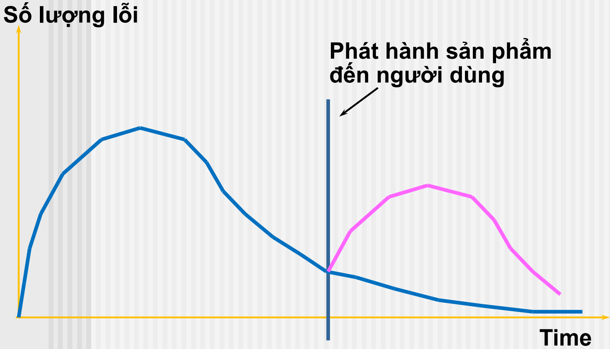
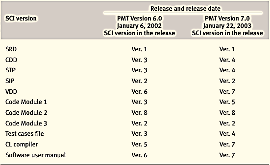
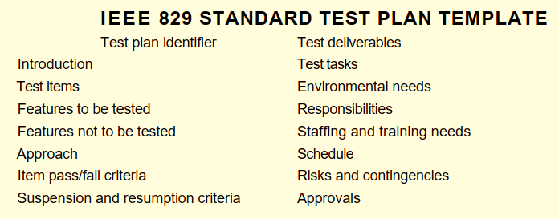

## 6.1. Tổ chức kiểm thử

### 6.1.1. Tầm quan trọng của tính độc lập trong kiểm thử

Hình 41. Tầm quan trọng của tính độc lập

- **Đường màu xanh - Số lượng lỗi mà ta mong đợi.** Ban đầu kiểm thử thì số lượng lỗi có xu hướng tăng lên, sau đó giảm dần.

- **Đường màu hồng – Số lượng lỗi thực tế tại thời điểm phát hành & sau phát hành sản phẩm:** Số lượng lỗi lại tăng lên đột ngột rồi mới giảm. *<u>Trong khi ta mong đợi là số lượng lỗi giảm và dần tiệm cận về 0.</u>*

- **Một số nguyên nhân**

  - Vì có những lỗi mà tester không nghĩ đến, đến khi người dùng sử dụng thì lại phát sinh ra.

  - Góc nhìn, quan điểm của users và testers sẽ khác nhau 🡪 Users nhập những giá trị, phần mềm theo quan điểm của họ.

  - Xung đột với các phần mềm trong máy người dùng.

  🡺 Cần tăng tính **độc lập** trong kiểm thử.

- **Tính độc lập trong kiểm thử phần mềm**: là nguyên tắc đảm bảo rằng quá trình kiểm thử được thực hiện bởi một nhóm hoặc cá nhân không phụ thuộc vào nhóm phát triển phần mềm. Điều này nhằm đảm bảo tính khách quan, **không thiên vị**, trung thực, không bị ảnh hưởng bởi xung đột lợi ích, & dễ phát hiện lỗi hơn

- **Vì sao cần tính độc lập?** Người kiểm thử độc lập sẽ **không bị ảnh hưởng bởi tư duy của lập trình viên**, từ đó xem xét hệ thống dưới góc nhìn khác (gần hơn với người dùng), phát hiện lỗi tiềm ẩn hoặc những hành vi không mong muốn.

- Tính độc lập không đồng nghĩa với tách biệt hoàn toàn. Nhóm kiểm thử vẫn cần giao tiếp và phối hợp với lập trình viên, nhưng nên giữ quan điểm riêng trong việc đánh giá chất lượng phần mềm.

### 6.1.2. Cấu trúc tổ chức kiểm thử/ Các mức độ độc lập trong kiểm thử

- **Mỗi developer thực hiện kiểm thử**, Ai viết gì tự test cái đó 🡪 Phù hợp Công ty nhỏ, nhân sự ít.

  - **Ưu điểm:**

    - Hiểu rõ sản phẩm & code nên dễ tìm ra *những vấn đề liên quan đến kĩ thuật*.

    - Tìm lỗi và sữa lỗi ít tốn ngân sách, tiết kiệm chi phí.

  - **Nhược điểm:**

    - Đánh giá chủ quan.

    - Khó có suy nghĩ sửa chữa/phá hủy sản phẩm mà họ làm ra

    - *Xu hướng thấy được kết quả mong đợi hơn là kết quả thực tế*

- **Cả nhóm phát triển thực hiện kiểm thử** - Giao trách nhiệm cho development team: 2 người sẽ trong team dev sẽ **test chéo lẫn nhau** (người A viết module A, người B viết module B, … rồi người A kiểm thử module B, người B kiểm thử module A…)

  - **Ưu điểm:**

    - Tăng tính độc lập.

    - Vì Hiểu rõ code nên vẫn tìm được các lỗi liên quan đến kỹ thuật mà tester có thể bỏ lỡ.

    - Dễ giao tiếp trao đổi với nhau khi có vấn đề.

    - Tìm lỗi và sữa lỗi ít tốn ngân sách

  - **Nhược điểm:**

    - Nếu không có kiến thức về test thì test không hiệu quả.

    - Nhiều việc dẫn đến quá tải & áp lực công việc.

    - Quan điểm kỹ thuật, không phải quan điểm nghiệp vụ

- **Tester nằm trong nhóm phát triển**

  - **Ưu điểm:**

    - Chỉ có trách nhiệm kiểm thử

    - Tính độc lập tăng lên

    - Vì thuộc team dev 🡪 dễ giao tiếp, có chung mục tiêu.

  - **Nhược điểm:** Ít được tôn trọng (bị áp đảo ý kiến), làm việc 1 mình, quan điểm đưa ra đơn lẻ.

- **Đội ngũ tester độc lập** - Giao cho 1 nhóm tester riêng (đối với công ty lớn)

  - **Ưu điểm:**

    - Gồm những tester có kinh nghiệm, chỉ làm nhiệm vụ kiểm thử

    - Mức độ độc lập tăng lên rõ rệt-không hề liên quan đến team dev

    - Kiểm thử khách quan hơn và nhất quán hơn

    - Có nhiều kinh nghiệm, kĩ năng, công cụ kiểm thử 🡪 Kiểm thử hiệu quả, chuyên nghiệp hơn.

    - Thường có ngân sách riêng để đầu tư cho đào tạo tester, công cụ/thiết bị kiểm thử

  - **Nhược điểm:**

    - Phụ thuộc vào đội ngũ tester → có thể sẽ test thiếu

    - Cô lập/đối đầu với nhóm phát triển, Khó giao tiếp giữa dev và tester, mâu thuẫn về ý kiến.

- **Chuyên gia tư vấn kiểm thử nội bộ** - Sử dụng cố vấn cho kiểm thử

  - **Ưu điểm:**

    - Gồm các chuyên gia trong lĩnh vực kiểm thử, có nhiều kinh nghiệm 🡪 hỗ trợ kế hoạch kiểm thử tốt hơn, cải tiến quá trình kiểm thử

    - Vạch kế hoạch, ước lượng, kiểm soát quá trình kiểm thử tốt hơn

  - **Nhược điểm:**

    - Chỉ đưa ra lời khuyên, hướng dẫn chỉ ảnh hưởng đến thủ tục test, chứ không quyết định hoàn toàn

    - Một số chuyên gia cũng phải thực thi test

- **Nhóm testers thuộc công ty thứ 3**

  - **Ưu điểm:**

    - Gồm các chuyên gia trong lĩnh vực kiểm thử 🡪 Tính chuyên nghiệp cao

    - Mức độ độc lập là hoàn toàn, Độc lập với các chính sách nội bộ.

  - **Nhược điểm:**

    - Chi phí cao (càng test nhiều version của sản phẩm thì họ càng có kinh nghiệm, test nhanh hơn, nhưng chi phí thì vẫn như version 1),...

    - Thiếu kiến thức về sản phẩm và công ty

    - Kinh nghiệm kiểm thử có được trong dự án thuộc về công ty thứ 3

- **Chọn lựa phù hợp?**

  - Phụ thuộc vào miền ứng dụng, mức độ rủi ro, kích cỡ, độ phức tạp của dự án

  - Tính độc lập trong các mức kiểm thử

    - **Component testing:** dev, hoặc dev team

    - **Integration testing:** ít ai thực hiện tốt

    - **System testing:** đội ngũ tester độc lập

    - **Acceptance testing:** user

### 6.1.3. Những kĩ năng cần thiết trong đội ngũ kiểm thử

- Chuyên gia kỹ thuật

- Chuyên gia về kiểm thử tự động

- Chuyên gia database

- Hiểu biết nghiệp vụ

- Chuyên gia về môi trường test

- Kỹ năng business

- Hiểu biết tốt về tính khả dụng

- Người quản lý test…

### 6.1.4. Vai trò của test leader

- Lập kế hoạch, giám sát và kiểm soát các hoạt động kiểm thử

- Lập các mục tiêu, tổ chức chính sách, chiến lược kiểm thử

- Uớc tính test cần thực hiện và đàm phán với quản lý để có được các nguồn lực cần thiết

- Nhận biết thời điểm cần test tự động, chọn lựa tools, tổ chức training

- Tham khảo ý kiến với nhóm khác

- Hướng dẫn, giám sát việc phân tích, thiết kế, thực thi các TCs, thủ tục kiểm thử, kịch bản kiểm thử

- Đảm bảo quản lý cấu hình testware (những sản phẩm tạo ra trong quá trình kiểm thử - test case, test script, input, output, KQ mong đợi…)

- Đảm bảo thực hiện môi trường test

- Lập lịch thực hiện kiểm thử

- Theo dõi, đo lường, kiểm soát và báo cáo về tiến độ kiểm thử, tình trạng chất lượng sản phẩm và kết quả kiểm thử

- Viết báo cáo tóm tắt về trạng thái test

### 6.1.5. Vai trò của tester

- Thực hiện thiết kế, thực thi TCs, viết báo cáo lỗi

- Rà soát và góp ý cho kế hoạch kiểm thử

- Phân tích, đánh giá các yêu cầu của người dùng, các đặc tả thiết kế.

- Xác định điều kiện test, thiết kế TCs, thủ tục test, hỗ trợ test tự động

- Cài đặt môi trường test

- Thực hiện kiểm thử trên tất cả các mức test

- Thực thi, ghi nhận, đánh giá kết quả test, lập tài liệu báo cáo lỗi

- Rà soát đặc tả test, các báo cáo lỗi, kết quả test.

- Theo dõi quá trình kiểm thử, môi trường test sử dụng các tools

## 6.2. Quản lý cấu hình

### 6.2.1. Khái niệm

- **Quản lý cấu hình trong kiểm thử** là quá trình **theo dõi, quản lý và kiểm soát các thay đổi** của các đối tượng kiểm thử như: *mã nguồn, tài liệu đặc tả, trường hợp kiểm thử (test cases), dữ liệu kiểm thử (test data), môi trường kiểm thử và các phiên bản phần mềm.*

- Là quá trình xác định các **khoản mục cấu hình** trong một hệ thống

  - **Khoản mục cấu hình (Configuration Item - CI)** là bất kỳ **thành phần riêng biệt nào** (phần mềm, phần cứng, tài liệu, công cụ, môi trường…) có thể được quản lý độc lập và chịu sự thay đổi trong quá trình phát triển và kiểm thử phần mềm.

- Kiểm soát việc phát hành và thay đổi của các khoản mục này cũng như các phiên bản của nó trong suốt vòng đời hệ thống

- Ghi nhận và báo cáo tình trạng các khoản mục cấu hình và yêu cầu thay đổi

- Kiểm tra tính đầy đủ và đúng đắn của các khoản mục cấu hình.

- Quản lý cấu hình giúp nhóm kiểm thử **biết mình đang kiểm thử cái gì, ở phiên bản nào, bằng cách nào và có thay đổi gì xảy ra**, từ đó **giảm lỗi, tăng tính nhất quán và kiểm soát tốt quá trình kiểm thử.**

### 6.2.2. Vấn đề do quản lý cấu hình kém

- Không tái tạo lỗi được báo cáo bởi KH

- Không quay lại hệ thống con trước đó

- Một thay đổi có thể ghi đè lên cái khác

- Lỗi đã được fix có thể xuất hiện trở lại

- Code thay đổi thuộc version nào?…

### 6.2.3. Khoản mục cấu hình PM (Software Configuration Item – SCI)

- Những sản phẩm trung gian tạo ra trong suốt quá trình phát triển phần mềm: Software Code, Documents, Data files, Tools 🡪 đều cần phải quản lý.

- **Các loại SCI phổ biến:**

  - **Documents**

    - Software development plan (SDP)

    - Software requirements document (SRD)

    - Interface design specifications

    - Preliminary design document (PDD)

    - Database description

    - Software test plan (STP)

    - Software test report (STR)

    - User manuals

    - Maintenance manuals

    - Software change requests (SCRs)

    - …

  - **Software Code**

    - Source code

    - Object code: mã nguồn sau khi được biên dịch

    - Prototype software

  - **Data files**

    - Test cases: test scripts, test data, expected results

    - Actual results

  - **Software development tools**

    - Compilers and debuggers

    - Application generators

    - CASE tools

- **Để quản lý SCI hiệu quả:** sử dụng các công cụ như GitHub, GitLab…

### 6.2.4. Cấu hình phần mềm

- Tập hợp các SCIs tạo thành phần mềm

- Sắp xếp theo tính chất, phiên bản, đặc trưng

- **Ví dụ:**

  
  
Hình 42. Cấu hình phần mềm

### 6.2.5. Quản lý cấu hình & Thủ tục quản lý cấu hình

- **Quản lý cấu hình:** Xác định các SCI và kiểm soát quá trình tạo ra, phát hành, thay đổi (lúc nào, như thế nào, ai thay đổi…).

- **Thủ tục quản lý cấu hình:**

  - **Định danh SCI:**

    - Tài liệu yêu cầu có nhiều version, mỗi version gắn 1 ID.

    - Mỗi khoản mục cần được định danh: mô tả tên, đánh số, hoặc đánh dấu đặc trưng

    - Xây dựng sơ đồ phân cấp định danh của khoản mục để thể hiện mối quan hệ giữa

    - chúng

  - **Kiểm soát thay đổi**

    - Khi KH yêu cầu/ đề xuất thay đổi, ta cần phải phân tích, đánh giá các thay đổi đó có ảnh hưởng những yếu tố nào, nếu phù hợp thì mới được thay đổi.

    - Thay đổi không được kiểm soát sẽ dẫn đến hỗn độn

    - → Cần tạo ra sự thay đổi cho phù hợp với hệ thống phần mềm

    - → Cần một tập các công cụ và thủ tục để kiểm soát thay đổi

  - **Kiểm soát phiên bản**

    - **Versions/variants/releases của hệ thống:**

      - **Version:** là một thể hiện của hệ thống.

        - Là **sự phát triển theo thời gian** của phần mềm, thể hiện các lần **cập nhật, sửa lỗi, thêm chức năng**.

        - Cải thiện, nâng cấp phần mềm.

        - Có thể có **thay đổi về chức năng, hiệu năng hoặc giao diện**.

        - Phân biệt các phiên bản của hệ thống dựa vào:

          - Chức năng khác nhau

          - Tính thực thi được nâng cao

          - Lỗi của phần mềm đã được khắc phục

      - **Variant (biến thể):** tương đương với version về chức năng, nhưng được thiết kế cho những thiết lập khác nhau

        - Là **các biến thể khác nhau** của cùng một hệ thống, có **chức năng giống nhau**, nhưng được thiết kế để **phù hợp với các môi trường hoặc nhu cầu khác nhau**.

        - Tùy biến để phù hợp với môi trường hoặc yêu cầu cụ thể.

        - **Không thay đổi chức năng chính**, chỉ thay đổi về cấu hình, ngôn ngữ, hệ điều hành...

      - **Release:** là một phiên bản được phân phối tới khách hàng

    - **Kiểm soát phiên bản:**

      - Kết hợp các thủ tục và công cụ để quản lí các phiên bản khác nhau của SCI

      - <u>Hệ thống kiểm soát phiên bản có 4 tính năng chính:</u>

        - Repository (project database)

        - Quản lí phiên bản

        - Tạo phiên bản mới của PM

        - Theo dõi vấn đề (lỗi) liên quan đến SCI

      - **Công cụ hỗ trợ cho việc kiểm soát phiên bản:** Visual Source Safe của Microsoft, ClearCase của Rational, CVS

  - **Kiểm toán cấu hình**

    - Đảm bảo tất cả các thay đổi thực sự được thực thi

    - Thực hiện rà soát và kiểm tra để đánh giá sản phẩm hoặc qui trình sai lệch với đặc tả, chuẩn, yêu cầu hợp đồng,…

    - Bộ phận QA hoặc customer sẽ thực hiện kiểm toán

  - **Báo cáo trạng thái:** Bao gồm:

    - Ghi nhận và báo cáo tình trạng của các khoản mục cấu hình

    - Tình trạng của các thay đổi được đề xuất, được kiểm duyệt

    - Ước tình tài nguyên để hoàn thành 1 tác vụ

    - Các khiểm khuyết đã được xác định bởi kiểm toán cấu hình

    - …

### 6.2.6. Quản lý cấu hình và kiểm thử

- **QLCH** cho phép tester quản lý các testware và kết quả test

  - **Testware** là những sản **phẩm được tạo ra trong quá trình kiểm thử**: test plan, test cases, test scripts,…

- **QLCH** cho phép định vị được cái gì đang được test, quản lý các lỗi được tìm thấy tương ứng với thành phần nào, thuộc phiên bản nào

## 6.3. Lập kế hoạch và ước lượng kiểm thử

- Đây là nhiệm vụ của **leader**.

- **Kế hoạch kiểm thử (Test plan)**

Hình 43. VD Kế hoạch kiểm thử theo chuẩn IEEE

- **Ước lượng kiểm thử:**

  - Thời gian kiểm thử (schedule), công sức kiểm thử (Nỗ lực kiểm thử (effort)) là bao nhiêu?

  <!-- -->

  - **Có 2 cách phổ biến**

    - Dựa trên **kinh nghiệm** của các dự án trước

    - Ước lượng công việc của từng cá nhân 🡪 **WBS (Work Breakdown Structures)** – sử dụng MS Project

<!-- -->

- **Work Breakdown Structures**

  - **Điểm giống nhau** của ước lượng kiểm thử với ước lượng các công việc khác:

    - Xác định các tác vụ cụ thể

    - Thời gian cho mỗi tác vụ

    - Ai sẽ thực hiện tác vụ

    - Thời gian bắt đầu và kết thúc 1 tác vụ

    - Tài nguyên, kỹ năng

    - Sự phụ thuộc của các tác vụ: Độ ưu tiên của tác vụ, Độ ưu tiên kỹ thuật

  - **Điểm khác biệt** trong ước lượng kiểm thử

    - Sự phụ thuộc:

      - Kiểm thử **không phải là một hoạt động độc lập**

      - Lịch trình kiểm thử có thể bị thay đổi

      - Phụ thuộc vào môi trường test

    - Vòng lặp kiểm thử

      - kiểm thử sẽ **tìm ra lỗi**

      - lỗi **cần phải được fix**

      - **fix xong phải test lại**

      - **→ Vòng lặp này thực hiện bao nhiêu lần?**

- **Ước lượng vòng lặp kiểm thử**

  - Dựa trên số vòng lặp của phiên bản release trước

  - Số lượng lỗi dự kiến

    - Có thể dự đoán từ hiệu quả kiểm thử trước đó và các lỗi được tìm thấy trước đó

    - % lỗi được tìm thấy trong mỗi lần lặp (lỗi lồng nhau)

  - Thời gian viết báo cáo lỗi

  - Thời gian đợi sửa lỗi

- **Các yếu tố ảnh hưởng đến nỗ lực kiểm thử.**

  - **Yếu tố về Sản phẩm**

    - Tài liệu đầy đủ → tester dễ dàng hơn

    - Các đặc trưng chất lượng phi chức năng: tính khả dụng, độ tin cậy,… → tiêu tốn nhiều thời gian

    - Độ phức tạp của sản phẩm

    - Kích thước của sản phẩm

  - **Yếu tố về quy trình**

    - Tính sẵn có của các công cụ test

    - Mô hình phát triển PM
