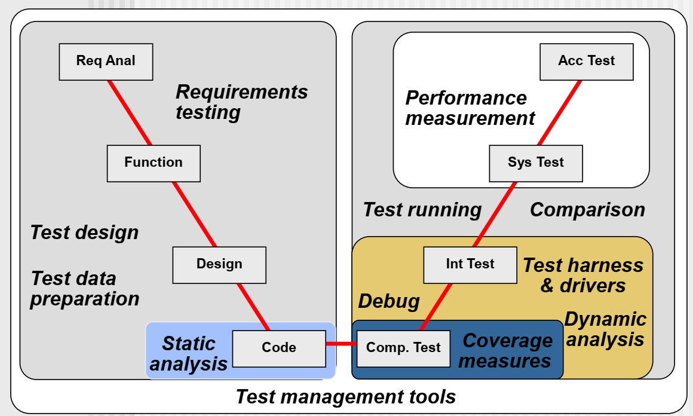

- Các công cụ có thể được phân loại dựa trên các hoạt động test hoặc lĩnh vực công cụ hỗ trợ

- Hỗ trợ của các công cụ sẽ hữu ích cho các tác vụ lặp đi lặp lại

- Các công cụ thực hiện nhanh, và chính xác giúp tăng độ tin cậy của PM.

- **Phân loại:**

  - **Requirements management tools – Công cụ quản lý yêu cầu:** Dùng để **quản lý, theo dõi, và truy xuất nguồn gốc** của các yêu cầu phần mềm trong suốt vòng đời phát triển.

    - Lưu trữ thông tin về các yêu cầu

    - Kiểm tra sự nhất quán của các yêu cầu

    - Sắp thứ tự ưu tiên cho các yêu cầu

    - Lần vết các yêu cầu

  - **Static analysis tools – Công cụ phân tích tĩnh:**

    - Phân tích **mã nguồn hoặc tài liệu** mà **không cần chạy chương trình.**

    - Kiểm tra việc tuân thủ các chuẩn mã nguồn

    - Hỗ trợ đo McCabe’s cyclomatic complexity, mức độ lồng nhau của các lệnh,…

    - Phát hiện lỗi cú pháp, style code, lỗi tiềm ẩn (null pointer, memory leak, ...).

  - **Test design tools – Công cụ thiết kế test**

    - Hỗ trợ việc **tạo test case** tự động hoặc bán tự động dựa trên yêu cầu, mô hình hoặc cấu trúc chương trình.

    - *Phát sinh dữ liệu đầu vào từ: Code; Đặc tả yêu cầu, điều kiện test*

    - Phát sinh **kết quả mong đợi**

    - Nhận dạng được các trường, các buttons, list box,… → thiết lập test cho chúng.

    - Thường được kết hợp với công cụ đo độ bao phủ

    - Có thể áp dụng các kỹ thuật như **phân vùng tương đương, bảng quyết định**, v.v.

  - **Test data preparation tools – Công cụ chuẩn bị dữ liệu kiểm thử**

    - Tạo hoặc giả lập **dữ liệu cần thiết** cho việc kiểm thử

    - **Thao tác dữ liệu**

      - Trích xuất dữ liệu từ CSDL đã có hoặc files

      - Tạo mới tuân theo một vài nguyên tắc

      - Hiệu chỉnh, sửa đổi từ nguồn khác

    - Giúp sinh lượng dữ liệu lớn khi cần dùng cho các loại test như volume, performance,…

  - **Test running tools – Công cụ thực thi tests**

    - Tự động hóa quá trình **chạy các test case** và thu thập kết quả kiểm thử.

      - Ghi lại các dữ liệu test khi các tests được thực hiện bằng tay

      - Chụp lại sự di chuyển của mouse, click buttons, dữ liệu nhập từ bàn phím

      - Chụp lại trạng thái các đối tượng, kí tự, hình ảnh,...

      - Thực thi test tự động từ các scripts và data files

      - Mô phỏng tương tác người dùng (icons, pointer, mouse)

    - Thường dùng trong **kiểm thử hồi quy, kiểm thử tự động giao diện** (UI/UX).

    - So sánh tự động các thành phần như màn hình, link, các đối tượng,.. khi test đang được thực thi

    - Ghi nhận kết quả test (pass/fail)

    - Đo lường thời gian test

    - Có thể ứng dụng cho các mức test khác nhau

  - **Comparison tools – Công cụ so sánh:**

    - So sánh **kết quả thực tế và kết quả mong đợi**.

    - So sánh các sự kiện xảy ra trong lúc thực thi test

    - So sánh các dữ liệu được lưu trữ trong file hoặc databases sau khi thực thi test

    - Các công cụ thực thi test thường bao gồm tính năng so sánh

  - **Test harnesses and drivers – Bộ khung kiểm thử và trình điều khiển**

    - Dùng để **mô phỏng các thành phần chưa hoàn thành hoặc chưa có thật** để kiểm thử một đơn vị phần mềm.

    - Cung cấp thiết bị mô phỏng thay thế cho các thiết bị phần cứng (tốn nhiều chi phí)

    - Cung cấp các stubs, drivers, objects trung gian cho phần hoạt động của hệ thống

      - **Driver**: mô phỏng các module **gọi hàm** (trong kiểm thử bottom-up).

      - **Stub**: mô phỏng các module **được gọi** (trong kiểm thử top-down).

  - **Performance test tools – Công cụ kiểm thử hiệu năng**

    - Được dùng trong kiểm thử phi chức năng.

    - Hỗ trợ thực hiện các loại kiểm thử gồm: Performance testing, stress testing, load testing, volume testing

    - **Một số tính năng**

      - Sinh ra load (tải) trên hệ thống đang được test

      - Đo thời gian của các transactions cụ thể khi load trên hệ thống thay đổi

      - Đo thời gian phản hồi (response) trung bình

      - Tạo biểu đồ về các phản hồi theo thời gian

  - **Dynamic analysis tools – Công cụ phân tích động**

    - Phân tích **hành vi của phần mềm trong khi đang chạy**.

    - Cung cấp các thông tin khi đang thực thi test trên phần mềm

      - Cấp phát, sử dụng và thu hồi bộ nhớ

      - Xác định các lỗi liên quan đến phép toán trên con trỏ ví dụ như con trỏ null hoặc con trỏ chưa được khởi tạo

      - Ngoài ra còn theo dõi việc sử dụng bộ nhớ, deadlock, race condition, performance bottleneck,...

  - **Debugging tools – Công cụ gỡ lỗi:**

    - Được sử dụng bởi các lập trình viên khi phân tích, sửa chữa và kiểm tra lỗi

    - Được sử dụng để **tái tạo lỗi** và kiểm tra việc thực thi chương trình ở mức chi tiết

      - Sử dụng breakpoints tại dòng lệnh bất kỳ

      - Kiểm tra giá trị của các biến

      - …

  - **Test management tools – Công cụ quản lý test:**

    - Quản lý toàn bộ **quy trình kiểm thử**, bao gồm kế hoạch test, thiết kế, thực thi, theo dõi tiến độ và báo cáo.

    - Quản lý kết quả, đặc tả, kế hoạch test

    - Quản lý lịch trình test, ước lượng test

    - Có thể tích hợp công cụ quản lý lỗi

    - Hỗ trợ lần vết các yêu cầu test, thiết kế test

    - Quản lý phiên bản hoặc giao tiếp với các công cụ quản lý cấu hình

  - **Coverage measurement – Công cụ đo độ bao phủ kiểm thử**

    - Đo lường những thành phần nào được thực thi và chưa thực thi bởi bộ test

    - Tính toán độ bao phủ của các thành phần trong phần mềm (lệnh, nhánh, điều kiện,…)

    - Giúp đánh giá chất lượng kiểm thử và bổ sung test case nếu cần.

    
    
Hình 44. Công cụ quản lý kiểm thử

    - Sơ đồ mô tả một **quy trình kiểm thử phần mềm** từ lúc phân tích yêu cầu đến kiểm thử chấp nhận, phân chia công cụ theo vai trò:

      - **Chuẩn bị và phân tích**: Requirements, test design, static analysis

        - **Requirements testing:** Các hoạt động kiểm thử dựa trên yêu cầu

          - **Req Anal**: Phân tích yêu cầu

          - **Function**: Kiểm thử chức năng dựa trên yêu cầu

        - **Test design & Test data preparation:** Thiết kế test case và chuẩn bị dữ liệu

          - **Design**: Thiết kế kiểm thử (Test Design Tools)

          - **Test data preparation tools**: Tạo dữ liệu phục vụ kiểm thử

        - **Static analysis:** Phân tích tĩnh mã nguồn – không cần chạy chương trình

      - **Thực thi kiểm thử**: Dynamic tools, test harness, comparison

        - **Test running:** Chạy các test case (tự động/manual)**,** Liên quan đến: **Sys Test** (System test), **Int Test** (Integration Test)

        - **Comparison:** So sánh output thực tế với mong đợi.

        - **Test harness & drivers:** Mô phỏng các module liên kết để kiểm thử tích hợp**,** Phục vụ cho **Integration Test,** Hỗ trợ bằng **Test harnesses and drivers**

        - **Dynamic analysis:** Phân tích hành vi runtime như memory leak, deadlock,... Chạy thực tế, đo lường các thông số hoạt động

      - **Hậu kiểm thử**: Coverage, performance, debug

        - **Performance measurement:** Đo lường hiệu suất hệ thống, Gồm **System Test** → **Acceptance Test**

        - **Debug:** Gỡ lỗi trong quá trình kiểm thử, Liên quan tới **Int Test** (Integration Test) và **Comp. Test (Component Test)**

        - **Coverage measures:** Đo lường mức độ mã được test (số dòng, nhánh,...), Sau hoặc trong **Component Test.**

        - **Component Test (Comp. Test):** Kiểm thử thành phần (unit/component) – thường dùng **debug và đo coverage.**

      - **Tất cả được quản lý bởi <u>công cụ quản lý test</u>**

- **Lợi ích và rủi ro khi sử dụng công cụ**

  - **Lợi ích:**

    - Giảm sự lặp đi lặp lại, tiết kiệm thời gian kiểm thử

    - Tăng tính nhất quán

    - Đánh giá khách quan hơn

    - Dễ dàng tiếp cận thông tin về các tests và kiểm thử

  - **Rủi ro:**

    - Kỳ vọng không thực tế đối với công cụ, vẫn có khả năng làm sai 🡪 Không nên lệ thuộc vào nó

    - Có những tool cần trả phí

    - Đánh giá thấp thời gian, chi phí, nỗ lực cần thiết để giới thiệu và sử dụng công cụ sao cho đạt được hiệu quả