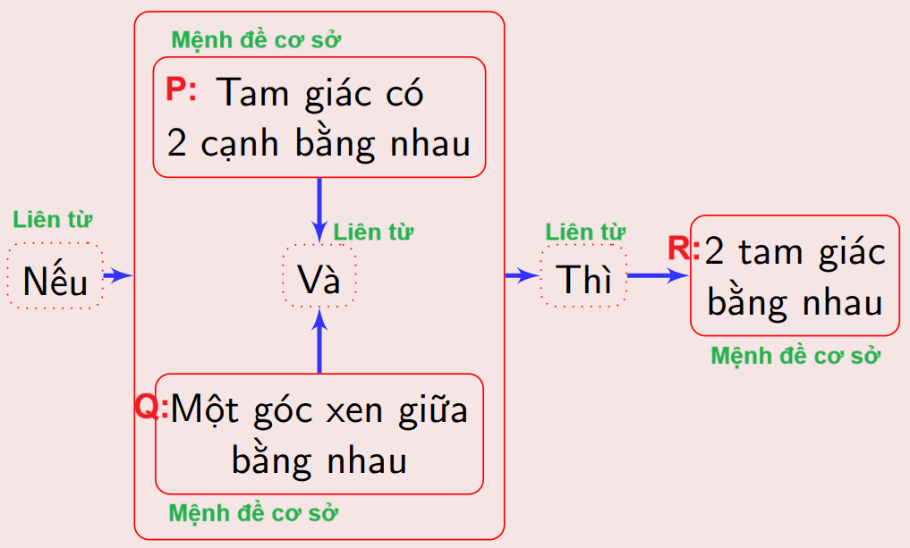

## 1. Mệnh đề (Propositions)

### 1.1. Định nghĩa

- ***Mệnh đề:*** Một phát biểu/khẳng định có giá trị chân lý xác định, **đúng hoặc sai,** **không thể vừa đúng, vừa sai**.

- Thường ký hiệu các mệnh đề bằng các **chữ cái in hoa**: ***P, Q, R, …***

- **Chân trị của mệnh đề:** Giá trị chân lí của mệnh đề đó.

  - Các mệnh đề đúng được nói là có chân trị đúng, các mệnh đề sai được nói là có chân trị sai.

  - Bảng các ký hiệu chân trị:

  | Kí hiệu tiếng Việt | Kí hiệu bằng số | Kí hiệu tiếng Anh | Viết tắt |
  | :--- | :---: | :--- | :---: |
  | Đúng | 1 | True / Yes | T / Y |
  | Sai | 0 | False / No | F / N |

- ***Ví dụ:***

  | Phát biểu | Là MĐ | Chân trị | Không là MĐ |
  | :--- | :---: | :---: | :---: |
  | Tổng các góc trong tam giác bằng $180^\circ$ | x | true | |
  | Trái đất là trung tâm vũ trụ | x | false | |
  | Đẹp vô cùng, Tổ quốc ta ơi! | | | x |

### 1.2. Phân loại mệnh đề

- **Mệnh đề phức hợp:** Mệnh đề được xây dựng từ một hay nhiều mệnh đề khác, nhờ liên kết bằng các liên từ (và, hay, khi và chỉ khi, ...) hoặc trạng từ “không".

- **Mệnh đề sơ cấp (cơ sở, nguyên thủy):** Là mệnh đề không thể xây dựng từ các mệnh đề khác thông qua liên từ hoặc trạng từ “không".

  - ***Ví dụ:***

  

  - Hình thức hóa: $ \rightarrow (P \land Q) \rightarrow R$

- Bảng một số **liên từ & trạng từ** tương đương:

  | Liên từ / trạng từ | Từ tương đương |
  | :--- | :--- |
  | Và | Vừa ... vừa .../ Tuy ... nhưng .../ Chẳng những ... mà còn .../ Tuy nhiên .../ Thế mà ... |
  | Hoặc | |
  | Nếu ... thì ... | Giả sử ... khi đó .../ Điều kiện đủ để ... là ... / Điều kiện cần ... là ... |
  | Không | |

## 2. Các phép toán mệnh đề

| Liên từ/ Trạng từ | Tiếng Anh | Kí hiệu phép toán | Cách đọc |
| :--- | :--- | :---: | :--- |
| Không | Not | $\neg$ hoặc $-$ | Phủ định |
| Và | And | $\wedge$ | Hội |
| Hoặc | Or | $\vee$ | Tuyển |
| Nếu ... thì ... | If ... then ... | $\rightarrow$ | Kéo theo |
| Khi và chỉ khi | If and only if | $\leftrightarrow$ | Tương đương |

### 2.1. Phép phủ định

- Phủ định của một mệnh đề là một mệnh đề **khác** có **chân trị ngược** với chân trị của mệnh đề đó.

- Phủ định của mệnh đề *P* được ký hiệu là **$\neg P$** hay **$\overline{P}$** *(đọc là “không” P hay “phủ định của” P)*.

- **Bảng chân trị:**

  | $p$ | $\overline{p}$ |
  | :---: | :---: |
  | 0 | 1 |
  | 1 | 0 |

  ***Ví dụ:*** 
  - $\overline{(3 > 4)}$ có chân trị = 1.
  - $P =$ "2 là số nguyên tố" $\Rightarrow$ $\neg P =$ "2 không là số nguyên tố"
  - $Q =$ "1 > 2" $\Rightarrow$ $\neg Q =$ "1 $\le$ 2"

### 2.2. Phép nối liền (hội, giao)

- Hội của các mệnh đề là một mệnh đề khác mà nó **đúng** khi và chỉ khi các **mệnh đề thành phần đều đúng.**

- Phép nối liền của hai mệnh đề *P* và *Q* được kí hiệu bởi $P \land Q$ (đọc là “P và Q”).

- **Chân trị của *P* ∧ *Q* là 1, nếu cả P lẫn Q đều có chân trị là 1.** Trong các trường hợp khác *P* ∧ *Q* có chân trị là 0.

- **Bảng chân trị:**

  | $p$ | $q$ | $p \wedge q$ |
  | :---: | :---: | :---: |
  | 0 | 0 | 0 |
  | 0 | 1 | 0 |
  | 1 | 0 | 0 |
  | 1 | 1 | 1 |

  ***Ví dụ:*** $\overline{(3 > 0) \land \left( 4|12 \right)}$ có chân trị = 0.

### 2.3. Phép nối rời (tuyển, hợp)

- Tuyển của các mệnh đề là một mệnh đề **khác** mà nó **sai** khi và chỉ khi các **mệnh đề thành phần đều sai.**

- Phép nối rời của hai mệnh đề *P* và *Q* được kí hiệu bởi $P \vee Q$ (đọc là “P hay Q”).

- **Chân trị của *P* ∨ *Q* là 0 nếu cả P lẫn Q đều có chân trị là 0.** Trong các trường hợp khác *P* ∨ *Q* có chân trị là 0.

- **Bảng chân trị:**

  | $p$ | $q$ | $p \vee q$ |
  | :---: | :---: | :---: |
  | 0 | 0 | 0 |
  | 0 | 1 | 1 |
  | 1 | 0 | 1 |
  | 1 | 1 | 1 |

  ***Ví dụ:*** $(3 < 0) \vee \left( 5|12 \right)$ có chân trị = 0.

### 2.4. Phép kéo theo

- **Giả thiết đúng, kết luận sai, mệnh đề sai.**

- Mệnh đề *P* kéo theo *Q* của hai mệnh đề *P* và *Q*, kí hiệu bởi *P → Q*, đọc là:

  - "*P* kéo theo *Q*" hay

  - "Nếu *P* thì *Q*” hay

  - "*P* là điều kiện đủ của *Q*” hay

  - "*Q* là điều kiện cần của *P*” hay

  - “Để có P thì điều kiện cần là *Q*” hay

  - “Để có *Q* thì điều kiện cần là *P*”.

- **Bảng chân trị:**

  | $p$ | $q$ | $p \rightarrow q$ |
  | :---: | :---: | :---: |
  | 0 | 0 | 1 |
  | 0 | 1 | 1 |
  | 1 | 0 | 0 |
  | 1 | 1 | 1 |

  ***Ví dụ:*** (4 = 0) → (4\|12) có chân trị = 1.

### 2.5. Phép kéo theo hai chiều (tương đương)

- Mệnh đề P kéo theo Q và ngược lại của hai mệnh đề P và Q, ký hiệu bởi P ↔ Q, đọc là

  - “P nếu và chỉ nếu Q” hay

  - "P khi và chỉ khi Q” hay

  - “P là điều kiện cần và đủ của/để có Q”.

- Mệnh đề tương đương đúng khi **các mệnh đề thành phần có cùng chân trị.**

- **Bảng chân trị:**

  | $p$ | $q$ | $p \leftrightarrow q$ |
  | :---: | :---: | :---: |
  | 0 | 0 | 1 |
  | 0 | 1 | 0 |
  | 1 | 0 | 0 |
  | 1 | 1 | 1 |

  ***Ví dụ:*** (8 = 0) ↔ (7\|12) có chân trị = 1.

- Lưu ý: **P ↔ Q ⇔ (P → Q) ∧ (Q → P).**
