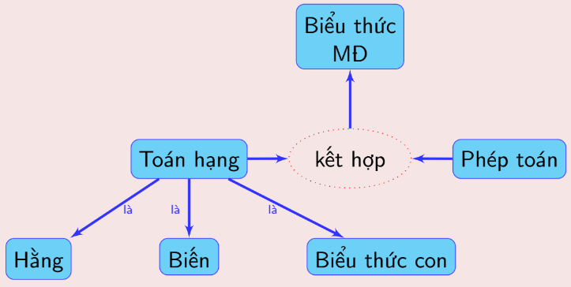

## 1. Dạng mệnh đề

### 1.1. Hằng & Biến mệnh đề

- Logic học chỉ quan tâm đến **giá trị chân lí** của mệnh đề , không quan tâm đến nội dung cụ thể của nó.

- Do vậy có thế sử dụng các kí hiệu hình thức để biểu diễn mệnh đề:

  | | Giải thích | Kí hiệu |
  | :--- | :--- | :--- |
  | Hằng MĐ | Là một mệnh đề cụ thể | Dùng chữ cái in hoa: ***A, B, C, P, Q, ...*** |
  | Biến MĐ | Có thể nhận giá trị là các mệnh đề khác nhau | Dùng chữ cái in thường: ***p, q, r, t, x, y, ...*** |

### 1.2. Định nghĩa

- Dạng mệnh đề là một **biểu thức** được cấu tạo từ:

  - Các mệnh đề (các hằng mệnh đề **0, 1**)

  - Các biến mệnh đề  *p, q, r, ...,* tức là các biến lấy giá trị là các mệnh đề nào đó.

  - Các phép toán ¬, ∧, ∨, →, ↔ và dấu đóng mở ngoặc ().

- Ta cũng có thể gọi Dạng mệnh đề là **biểu thức mệnh đề/ biểu thức logic.**

  ***Ví dụ:*** $E:(p \rightarrow 1) \land (q \rightarrow r) \rightarrow (p \rightarrow r)$ là một biểu thức mệnh đề.

> - Một mệnh đề cũng là một biểu thức mệnh đề.
> - Nếu P là một biểu thức mệnh đề thì ¬P cũng là biểu thức mệnh đề.
> - Chân trị của biểu thức mệnh đề là kết quả nhận được từ sự kết hợp giữa các phép toán và chân trị của các biến mệnh đề.

### 1.3. Bảng chân trị (truth table)

- Các phép toán logic được định nghĩa bằng bảng chân trị.

- Bảng chân trị **xác định chân trị** của **mệnh đề phức hợp** theo từng trường hợp của các *chân trị của các **mệnh đề sơ cấp** tạo thành mệnh đề phức hợp*, hoặc theo cấp độ đơn giản hơn:

> Bảng chân trị là bảng ***liệt kê giá trị đúng (Đ) hoặc sai (S)*** của một biểu thức logic tương ứng với ***từng trường hợp giá trị đúng hoặc sai của các biến mệnh đề*** trong biểu thức đó.

- Tác dụng:

  - Liệt kê ra sự *liên hệ chân trị giữa mệnh đề phức hợp với chân trị của các mệnh đề sơ cấp* cấu thành nó

  - Liệt kê sự liên hệ chân trị giữa các mệnh đề *với các mệnh đề đơn giản hơn cấu thành chúng.*

***Ví dụ 1:***

  | $P$ | $q$ | $p \rightarrow q$ | $\neg p$ | $\neg p \vee q$ |
  | :---: | :---: | :---: | :---: | :---: |
  | 0 | 0 | **1** | 1 | **1** |
  | 0 | 1 | **1** | 1 | **1** |
  | 1 | 0 | **0** | 0 | **0** |
  | 1 | 1 | **1** | 0 | **1** |

***Ví dụ 2:***

  | $p$ | $q$ | $r$ | $p \vee q$ | $(p \vee q) \rightarrow r$ |
  | :---: | :---: | :---: | :---: | :---: |
  | 0 | 0 | 0 | 0 | 1 |
  | 0 | 0 | 1 | 0 | 1 |
  | 0 | 1 | 0 | 1 | **0** |
  | 0 | 1 | 1 | 1 | 1 |
  | 1 | 0 | 0 | 1 | **0** |
  | 1 | 0 | 1 | 1 | 1 |
  | 1 | 1 | 0 | 1 | **0** |
  | 1 | 1 | 1 | 1 | 1 |

### 1.4. Các biểu thức mệnh đề đặc biệt

- **Hằng đúng (chân lí):**

  - ***E* = 1** với mọi giá trị của các biến ⇔ *E* là hằng đúng.

  - Ví dụ: $E:p \vee \overline{p} \Rightarrow E = 1,\forall p$

- **Hằng sai (mâu thuẫn):**

  - ***E* = 0** với mọi giá trị của các biến ⇔ *E* là hằng sai.

  - Ví dụ: $E:(p \rightarrow q) \land \overline{(p \rightarrow q)} \Rightarrow E = 0,\forall p,q$

### 1.5. Quan hệ giữa hai biểu thức mệnh đề

- **Tương đương (kí hiệu là ⇔ hoặc *≡*):**

  - *E* và *F* được gọi là tương đương (logic) với nhau khi và chỉ khi **chân trị của E và F trùng nhau** (với cùng giá trị tương ứng của các biến).
    
    - *F* được gọi là hệ quả (logic) của *E*, và *E* được gọi là hệ quả (logic) của *F*.

  - Ví dụ: $E:\overline{p} \vee q \Leftrightarrow p \rightarrow q$

  - ***Nhận xét**: Hai dạng mệnh đề E và F tương đương logic khi và chỉ khi* ***E ↔ F là một hằng đúng.***

- **Hệ quả (kí hiệu là ⇒):**

  - *F* được gọi là hệ quả (logic) của *E* khi và chỉ khi **E → F là một hằng đúng**. Tức là ***E* → *F* ⇔ 1.**

    - *E* có hệ quả logic là *F*.

  - Ví dụ: *0 ⇒ (p ∨ q)*

### 1.6. Độ ưu tiên các phép toán mệnh đề trong dạng mệnh đề

- **Mức 0:** Dấu ngoặc “()”

- **Mức 1:** ¬

- **Mức 2:** ∨, ∧

- **Mức 3:** ⇒, ⇔ (→, ↔)

> *Các phép toán trên **cùng mức** có cùng độ ưu tiên.*

***Ví dụ:***

  - $\neg p \vee q \rightarrow r \vee s$ có nghĩa là $[(\neg p) \vee q] \rightarrow (r \vee s)$.

  - $\neg p \wedge q \vee r$ là nhập nhằng. Ta cần phải dùng các dấu ngoặc để chỉ rõ nghĩa.
