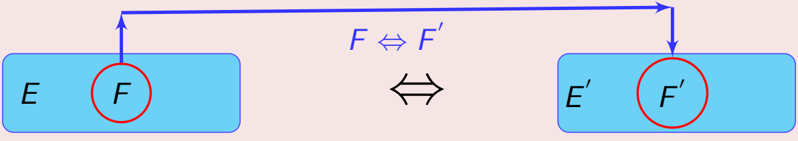
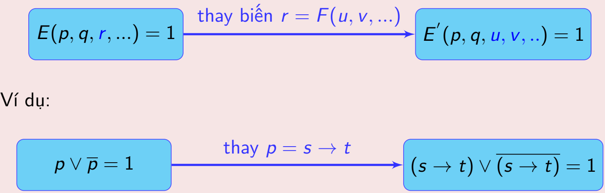

## 1. Các quy tắc thay thế

### 1.1. Các luật logic

| STT | Biểu thức | Tên luật |
| :---: | :--- | :--- |
| 1 | $p \vee 1 \Leftrightarrow 1$ $p \wedge 0 \Leftrightarrow 0$ | Thống trị (Domination) |
| 2 | $p \wedge 1 \Leftrightarrow p$ $p \vee 0 \Leftrightarrow p$ | Đồng nhất/ Trung hòa (Identity) |
| 3 | $p \wedge p \Leftrightarrow p$ $p \vee p \Leftrightarrow p$ | Lũy đẳng (Idempotent) |
| 4 | $\overline{p} \Leftrightarrow p$ | Phủ định kép (Double negation) (Phủ định của phủ định) |
| 5 | $p \wedge \overline{p} \Leftrightarrow 0$ $p \vee \overline{p} \Leftrightarrow 1$ | Loại trừ/ Phần tử bù (Cancellation) |
| 6 | $p \vee q \Leftrightarrow q \vee p$ $p \wedge q \Leftrightarrow q \wedge p$ | Giao hoán (Commucative) |
| 7 | $p \wedge (q \vee r) \Leftrightarrow (p \wedge q) \vee (p \wedge r)$ $p \vee (q \wedge r) \Leftrightarrow (p \vee q) \wedge (p \vee r)$ | Phân phối/ Phân bố (Distributive) |
| 8 | $p \vee (q \vee r) \Leftrightarrow (p \vee q) \vee r$ $p \wedge (q \wedge r) \Leftrightarrow (p \wedge q) \wedge r$ | Kết hợp (Associative) |
| 9 | $\overline{p \wedge q} \Leftrightarrow (\overline{p} \vee \overline{q})$ $\overline{p \vee q} \Leftrightarrow (\overline{p} \wedge \overline{q})$ | De Morgan |
| 10 | $p \rightarrow q \Leftrightarrow \overline{p} \vee q$ | Kéo theo (Implication) |
| 11 | $p \wedge (p \vee q) \Leftrightarrow p$ $p \vee (p \wedge q) \Leftrightarrow p$ | Hấp thụ (Absorption) |
| 12 | $p \rightarrow q \Leftrightarrow \overline{q} \rightarrow \overline{p}$ | Chứng minh phản chứng |

**Ví dụ 1.** Cho $p, q$ là các biến mệnh đề. Hãy dùng các luật logic chứng minh $[(p \rightarrow q) \wedge p] \rightarrow q$ là hằng đúng.

  **Giải.** Ta có
  $$
  \begin{align*}
  & [(p \rightarrow q) \wedge p] \rightarrow q \\
  \Leftrightarrow \ & \neg[(p \rightarrow q) \wedge p] \vee q \\
  \Leftrightarrow \ & [\neg(p \rightarrow q) \vee \neg p] \vee q \\
  \Leftrightarrow \ & \neg(p \rightarrow q) \vee (\neg p \vee q) \\
  \Leftrightarrow \ & \neg(p \rightarrow q) \vee (p \rightarrow q) \\
  \Leftrightarrow \ & 1
  \end{align*}
  $$

**Ví dụ 2.** Cho $p, q, r$ là các biến mệnh đề. Chứng minh rằng:
$$(\neg p \rightarrow r) \wedge (q \rightarrow r) \Leftrightarrow (p \rightarrow q) \rightarrow r$$

  **Giải.** Ta có
  $$
  \begin{align*}
  & (\neg p \rightarrow r) \wedge (q \rightarrow r) \\
  \Leftrightarrow \ & (p \vee r) \wedge (\neg q \vee r) \quad \text{(luật về phép kéo theo)} \\
  \Leftrightarrow \ & (p \wedge \neg q) \vee r \quad \text{(luật phân phối)} \\
  \Leftrightarrow \ & \neg(\neg p \vee q) \vee r \quad \text{(luật phủ định)} \\
  \Leftrightarrow \ & \neg(p \rightarrow q) \vee r \quad \text{(luật về phép kéo theo)} \\
  \Leftrightarrow \ & (p \rightarrow q) \rightarrow r \quad \text{(luật về phép kéo theo)}
  \end{align*}
  $$

### 1.2. Các quy tắc khác

- ***Quy tắc thay thế tương đương:*** Trong dạng mệnh đề *E*, nếu ta **thay thế biểu thức con *F* bởi một dạng mệnh đề tương đương logic (*F’*)** thì dạng mệnh đề thu được vẫn còn tương đương logic với *E.*

  Ví dụ:   $$[(p \rightarrow q) \vee r] \Leftrightarrow [(\overline{p} \vee q) \vee r]$$

- ***Quy tắc thay thế trong hằng đúng:*** Giả sử dạng mệnh đề *E* là hằng đúng, nếu ta **thay thế một biến *r* bằng một dạng mệnh đề nào đó \[*r = F(u, v…)*\]** thì mệnh đề có được vẫn là hằng đúng.

## 2. Bài toán liên quan đến biểu thức mệnh đề

### 2.1. Bài toán rút gọn biểu thức

- Sử dụng các luật & quy tắc trên để rút gọn biểu thức *E*, và biểu thức rút gọn *F* phải **tương đương & gọn hơn** so với biểu thức ban đầu (*E*).

- Nếu *E* là hằng đúng hoặc hằng sai thì ta không cần làm gì cả (vì nó đã gọn).

- ***Ví dụ:*** Rút gọn biểu thức $[p \wedge (p \rightarrow q)] \rightarrow q$

    **Giải:** *(chú ý các biểu thức được in đậm)*

    | $[p \wedge \boldsymbol{(p \rightarrow q)}] \rightarrow q$ | luật kéo theo |
    | :--- | :--- |
    | $\Leftrightarrow \boldsymbol{[p \wedge (\overline{p} \vee q)]} \rightarrow q$ | luật phân phối |
    | $\Leftrightarrow [\boldsymbol{(p \wedge \overline{p})} \vee (p \wedge q)] \rightarrow q$ | luật loại trừ |
    | $\Leftrightarrow \boldsymbol{[0 \vee (p \wedge q)]} \rightarrow q$ | luật đồng nhất |
    | $\Leftrightarrow (p \wedge q) \boldsymbol{\rightarrow} q$ | luật kéo theo |
    | $\Leftrightarrow \boldsymbol{\overline{p \wedge q}} \vee q$ | luật De Morgan |
    | $\Leftrightarrow \boldsymbol{(\overline{p} \vee \overline{q})} \vee q$ | luật kết hợp |
    | $\Leftrightarrow \overline{p} \vee \boldsymbol{(\overline{q} \vee q)}$ | luật loại trừ |
    | $\Leftrightarrow \overline{p} \vee 1$ | luật thống trị |
    | $\Leftrightarrow 1$ | |

### 2.2. Bài toán xác định chân trị của biểu thức E cho trước

**\* <u>Cách giải:</u>**

- ***Bước 1:*** **Rút gọn *E*.** Nếu *E* là hằng đúng hoặc hằng sai ⇒ kết thúc.

- ***Bước 2:*** Lập bảng chân trị của *E* (đã rút gọn).

> Chú ý: Nếu *E* gồm **n biến** thì bảng chân trị sẽ có **2n** dòng thế hiện những giá tri khác nhau của n biến đó.

***Ví dụ:*** xác định chân trị của biểu thức $E = ((p \rightarrow q) \rightarrow p) \wedge p$

  | $p$ | $q$ | $p \rightarrow q$ | $(p \rightarrow q) \rightarrow p$ | $E$ |
  | :---: | :---: | :---: | :---: | :---: |
  | 0 | 0 | 1 | 0 | 0 |
  | 0 | 1 | 1 | 0 | 0 |
  | 1 | 0 | 0 | 1 | 1 |
  | 1 | 1 | 1 | 1 | 1 |
