## 1.1. Mệnh đề (Propositions)

### 1.1.1. Định nghĩa

- ***Mệnh đề*** là một phát biểu/khẳng định có giá trị chân lý xác định, **đúng hoặc sai,** nhưng **<u>không thể vừa đúng, vừa sai</u>** *(Câu hỏi, câu cảm thán, mệnh lệnh không là mệnh đề)*.

- Ta thường ký hiệu các mệnh đề bằng các chữ cái in hoa: P, Q, R, …

- **Chân trị của mệnh đề:** Là giá trị chân lí của mệnh đề đó.

  - Các mệnh đề đúng được nói là có chân trị đúng, các mệnh đề sai được nói là có chân trị sai.

  - Dưới đây là bảng các ký hiệu chân trị:

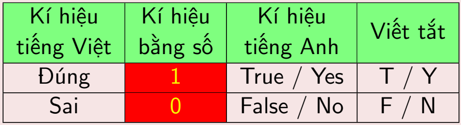

***Ví dụ:***

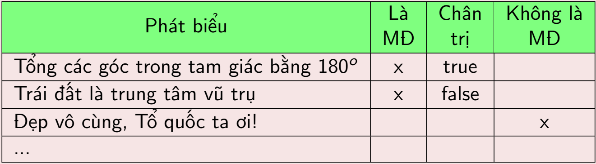

### 1.1.2. Phân loại mệnh đề

- **Mệnh đề phức hợp:** là mệnh đề được xây dựng từ một hay nhiều mệnh đề khác nhờ liên kết bằng các liên từ (và, hay, khi và chỉ khi, ...) hoặc trạng từ “không".

- **Mệnh đề sơ cấp (cơ sở, nguyên thủy):** Là mệnh đề không thể xây dựng từ các mệnh đề khác thông qua liên từ hoặc trạng từ “không".

***Ví dụ:***

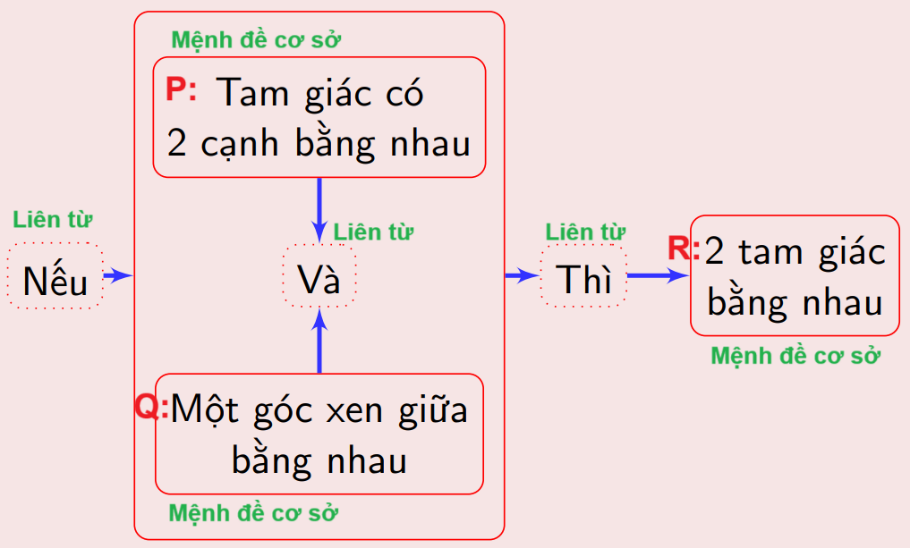

Hình thức hóa: $`(P \land Q) \rightarrow R`$

- Bảng một số **liên từ & trạng từ** tương đương:

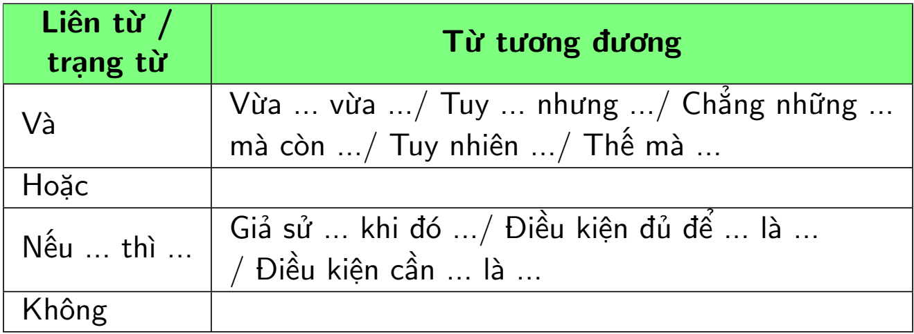

## 1.2. Các phép toán mệnh đề

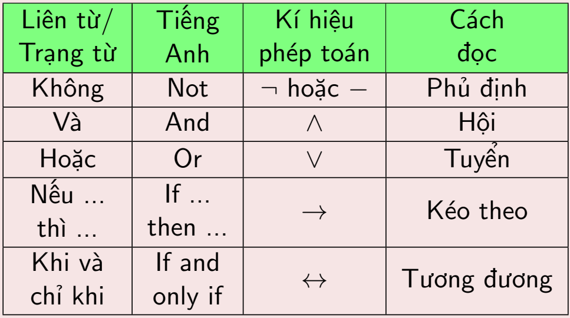

### 1.2.1. Phép phủ định

- Phủ định của mệnh đề P được ký hiệu là $`\neg P`$ hay $`\overline{P}`$ (đọc là “không” P hay “phủ định của” P).

- Phủ định của một mệnh đề là một mệnh đề **khác** có **chân trị ngược** với chân trị của mệnh đề đó.

- **Bảng chân trị:**

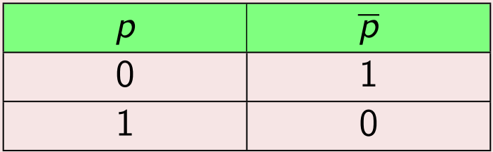

***Ví dụ:*** $`\overline{(3 > 4)}`$có chân trị = 1.

> 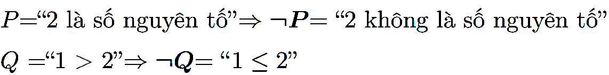

### 1.2.2. Phép nối liền (hội, giao)

- Phép nối liền của hai mệnh đề P và Q được kí hiệu bởi $`P \land Q`$ (đọc là “P và Q”).

- Chân trị của *P* ∧ *Q* là 1 nếu cả P lẫn Q đều có chân trị là 1, trong các trường hợp khác *P* ∧ *Q* có chân trị là 0.

- Hội của các mệnh đề là một mệnh đề khác mà nó **đúng** <u>khi và chỉ khi</u> các **mệnh đề thành phần đều đúng.**

- **Bảng chân trị:**

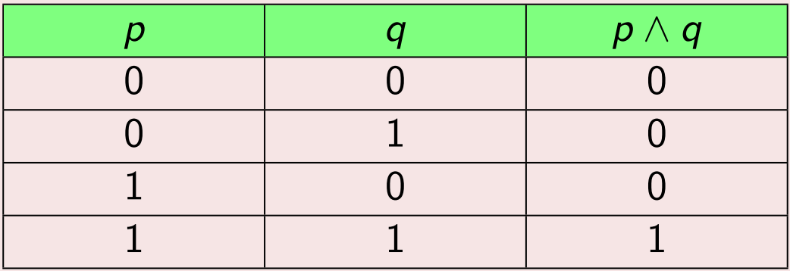

***Ví dụ:*** $`\overline{(3 > 0) \land \left( 4|12 \right)}`$có chân trị = 0.

### 1.2.3. Phép nối rời (tuyển, hợp)

- Phép nối rời của hai mệnh đề P và Q được kí hiệu bởi $`P \vee Q`$ (đọc là “P hay Q”).

- Chân trị của *P* ∨ *Q* là 0 nếu cả P lẫn Q đều có chân trị là 0, trong các trường hợp khác *P* ∨ *Q* có chân trị là 0.

- Tuyển của các mệnh đề là một mệnh đề **khác** mà nó **sai** <u>khi và chỉ khi</u> các **mệnh đề thành phần đều sai.**

- **Bảng chân trị:**

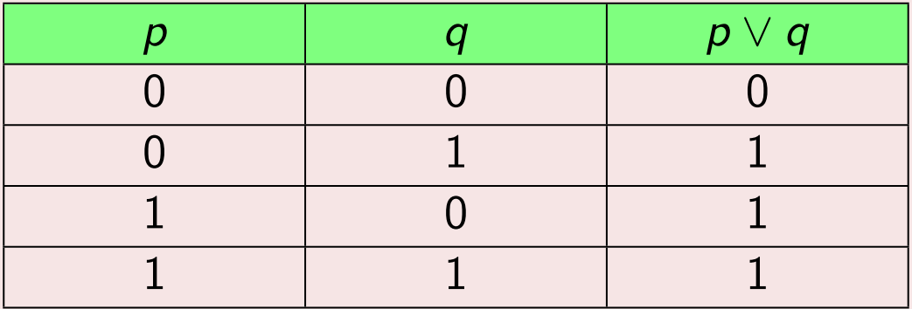

***Ví dụ:*** $`(3 < 0) \vee \left( 5|12 \right)`$có chân trị = 0.

### 1.2.4. Phép kéo theo

- Mệnh đề P kéo theo Q của hai mệnh đề P và Q, kí hiệu bởi P → Q (đọc là

  - "P kéo theo Q" hay

  - "Nếu P thì Q” hay

  - "P là điều kiện đủ của Q” hay

  - "Q là điều kiện cần của P” hay

  - “Để có P thì điều kiện cần là Q” hay

  - “Để có Q thì điều kiện cần là P”).

- **Nhớ:** **Giả thiết đúng, kết luận sai, mệnh đề sai.**

- **Bảng chân trị:**

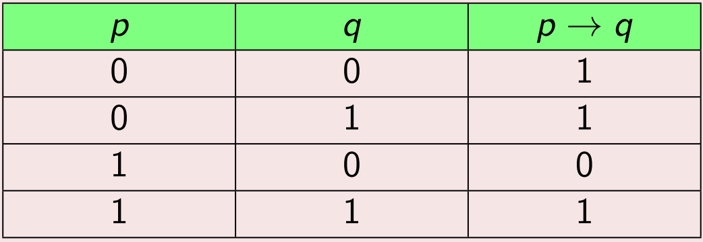

***Ví dụ:*** (4 = 0) → (4\|12) có chân trị = 1.

### 1.2.5. Phép kéo theo hai chiều (tương đương)

- Mệnh đề P kéo theo Q và ngược lại của hai mệnh đề P và Q, ký hiệu bởi P ↔ Q, đọc là

  - “P nếu và chỉ nếu Q” hay

  - "P khi và chỉ khi Q” hay

  - “P là điều kiện cần và đủ của/để có Q”.

- Mệnh đề tương đương đúng khi **các mệnh đề thành phần có cùng chân trị.**

- **P ↔ Q ⇔ (P → Q) ∧ (Q → P).**

- **Bảng chân trị:**

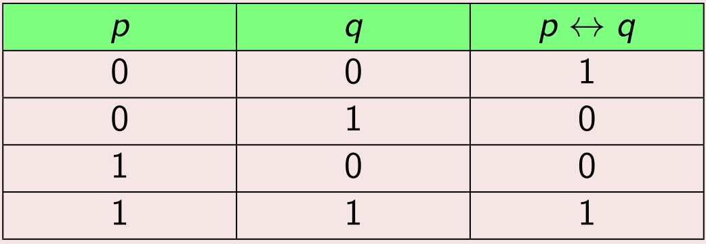

***Ví dụ:*** (8 = 0) ↔ (7\|12) có chân trị = 1.

## 1.3. Dạng mệnh đề

### 1.3.1. Hằng & Biến mệnh đề

- Logic học chỉ quan tâm đến **giá trị chân lí** của mệnh đề mà không quan tâm đến nội dung cụ thể của nó.

- Do vậy có thế sử dụng các kí hiệu hình thức để biểu diễn mệnh đề:

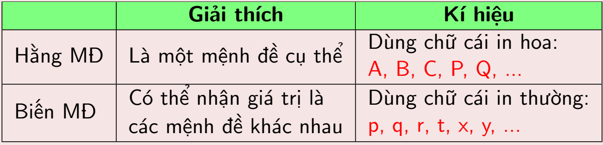

### 1.3.2. Định nghĩa

- 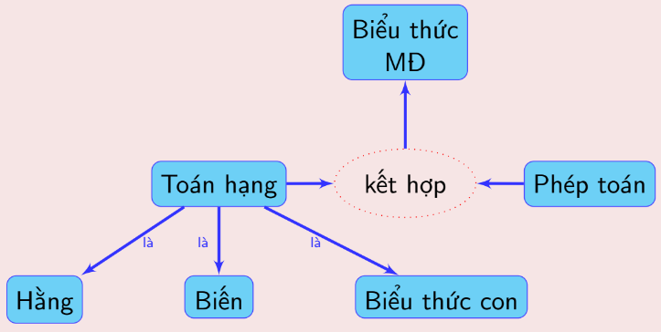Dạng mệnh đề là một **biểu thức** được cấu tạo từ:

  - Các mệnh đề (các hằng mệnh đề **0, 1**)

  - Các biến mệnh đề p, q, r, ..., tức là các biến lấy giá trị là các mệnh đề nào đó.

  - Các phép toán ¬, ∧, ∨, →, ↔ và dấu đóng mở ngoặc ().

- Ta cũng có thể gọi Dạng mệnh đề là **biểu thức mệnh đề/ biểu thức logic.**

***Ví dụ:*** $`E:(p \rightarrow 1) \land (q \rightarrow r) \rightarrow (p \rightarrow r)`$ là một biểu thức mệnh đề.

- Một mệnh đề cũng là một biểu thức mệnh đề.

- Nếu P là một biểu thức mệnh đề thì ¬P cũng là biểu thức mệnh đề.

- Chân trị của biểu thức mệnh đề là kết quả nhận được từ sự kết hợp giữa các phép toán và chân trị của các biến mệnh đề.

### 1.3.3. Bảng chân trị

- Các phép toán logic được định nghĩa bằng bảng chân trị (truth table).

- Bảng chân trị **xác định chân trị** của **mệnh đề phức hợp** theo từng trường hợp của các *chân trị của các **mệnh đề sơ cấp** tạo thành mệnh đề phức hợp*, hoặc theo cấp độ đơn giản hơn:

> Bảng chân trị là bảng liệt kê chân trị của biếu thức logic ***theo các trường hợp về chân trị*** của tất cả các biến mệnh đề trong biểu thức logic hay theo các bộ giá trị của bộ biến mệnh đề.

- Tác dụng của bảng chân trị:

  - Liệt kê ra sự *liên hệ chân trị giữa mệnh đề phức hợp với chân trị của các mệnh đề sơ cấp* cấu thành nó

  - Liệt kê sự liên hệ chân trị giữa các mệnh đề *với các mệnh đề đơn giản hơn cấu thành chúng.*

***Ví dụ 1:*** Bảng chân trị của các biểu thức logic p → q và ¬p ∨ q theo các biến mệnh đề p, q như sau:

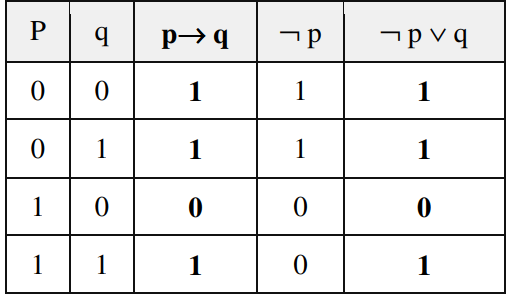

***Ví dụ 2:* Bảng chân trị** của **dạng mệnh đề E(p, q, r)** là bảng ghi tất cả các trường hợp chân trị có thể xảy ra đối với dạng mệnh đề E ***theo chân trị của các biến mệnh đề p, q, r.***

Với dạng mệnh đề sau: **E(p,q,r) = (p ∨ q) → r.** Bảng chân trị tương ứng là:

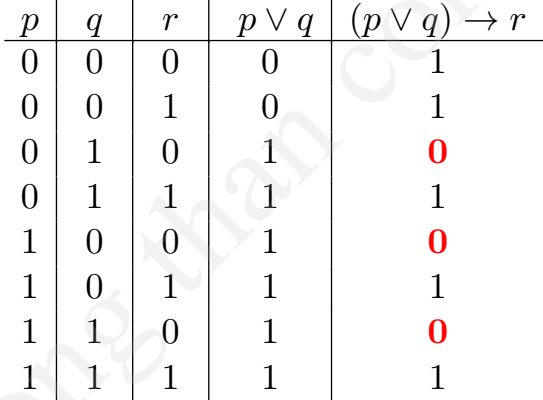

### 1.3.4. Các biểu thức mệnh đề đặc biệt

- **Hằng đúng (chân lí):**

  - **E = 1** với mọi giá trị của các biến ⇔ E là hằng đúng.

  - Ví dụ: $`E:p \vee \overline{p} \Rightarrow E = 1,\forall p`$

- **Hằng sai (mâu thuẫn):**

  - **E = 0** với mọi giá trị của các biến ⇔ E là hằng sai.

  - Ví dụ: $`E:(p \rightarrow q) \land \overline{(p \rightarrow q)} \Rightarrow E = 0,\forall p,q`$

### 1.3.5. Quan hệ giữa hai biểu thức mệnh đề

- **Tương đương (kí hiệu là ⇔ hoặc *≡*):**

  - E và F được gọi là tương đương (logic) với nhau *(F được gọi là hệ quả (logic) của E và E được gọi là hệ quả (logic) của F)* khi và chỉ khi **chân trị của E và F trùng nhau** (với cùng giá trị tương ứng của các biến).

  - ***Ví dụ:*** $`E:\overline{p} \vee q \Leftrightarrow p \rightarrow q`$

  - ***Nhận xét**: Hai dạng mệnh đề E và F tương đương logic khi và chỉ khi*

    ***E ↔ F là một hằng đúng.***

- **Hệ quả (kí hiệu là ⇒):**

  - F được gọi là hệ quả (logic) của E *(E có hệ quả logic là F)* khi và chỉ khi **E → F là một hằng đúng. Tức là E → F ⇔ 1.**

  - ***Ví dụ:*** *0 ⇒ (p ∨ q)*

### 1.3.6. Độ ưu tiên các phép toán mệnh đề trong dạng mệnh đề

- **Mức 0:** Dấu ngoặc “()”

- **Mức 1:** ¬

- **Mức 2:** ∨, ∧

- **Mức 3:** ⇒, ⇔ (→, ↔)

*Các phép toán trên **cùng mức** có cùng độ ưu tiên.*

***Ví dụ:***

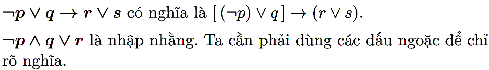

### 1.3.7. Các quy tắc thay thế

#### 1.3.7.1. Các luật logic

<table style="width:84%;">
<colgroup>
<col style="width: 8%" />
<col style="width: 34%" />
<col style="width: 41%" />
</colgroup>
<thead>
<tr>
<th style="text-align: center;"><p><strong>STT</strong></p></th>
<th style="text-align: center;"><p><strong>Biểu thức</strong></p></th>
<th style="text-align: center;"><p><strong>Tên luật</strong></p></th>
</tr>
</thead>
<tbody>
<tr>
<td style="text-align: center;"><p>1</p></td>
<td style="text-align: center;"><p><math display="block" xmlns="http://www.w3.org/1998/Math/MathML"><semantics><mrow><mrow><mi>p</mi><mo>∨</mo><mn>1</mn><mo>⇔</mo><mn>1</mn></mrow><mrow><mi>p</mi><mo>∧</mo><mn>0</mn><mo>⇔</mo><mn>0</mn></mrow></mrow><annotation encoding="application/x-tex">{p \vee 1 \Leftrightarrow 1
}{p \land 0 \Leftrightarrow 0}</annotation></semantics></math></p></td>
<td style="text-align: center;"><p>Thống trị (Domination)</p></td>
</tr>
<tr>
<td style="text-align: center;"><p>2</p></td>
<td style="text-align: center;"><p><math display="block" xmlns="http://www.w3.org/1998/Math/MathML"><semantics><mrow><mrow><mi>p</mi><mo>∧</mo><mn>1</mn><mo>⇔</mo><mi>p</mi></mrow><mrow><mi>p</mi><mo>∨</mo><mn>0</mn><mo>⇔</mo><mi>p</mi></mrow></mrow><annotation encoding="application/x-tex">{p \land 1 \Leftrightarrow p
}{p \vee 0 \Leftrightarrow p}</annotation></semantics></math></p></td>
<td style="text-align: center;"><p>Đồng nhất/ Trung hòa (Identity)</p></td>
</tr>
<tr>
<td style="text-align: center;"><p>3</p></td>
<td style="text-align: center;"><p><math display="block" xmlns="http://www.w3.org/1998/Math/MathML"><semantics><mrow><mrow><mi>p</mi><mo>∧</mo><mi>p</mi><mo>⇔</mo><mi>p</mi></mrow><mrow><mi>p</mi><mo>∨</mo><mi>p</mi><mo>⇔</mo><mi>p</mi></mrow></mrow><annotation encoding="application/x-tex">{p \land p \Leftrightarrow p
}{p \vee p \Leftrightarrow p}</annotation></semantics></math></p></td>
<td style="text-align: center;"><p>Lũy đẳng (Idempotent)</p></td>
</tr>
<tr>
<td style="text-align: center;"><p>4</p></td>
<td style="text-align: center;"><p><math display="block" xmlns="http://www.w3.org/1998/Math/MathML"><semantics><mrow><mover><mi>p</mi><mo accent="true">¯</mo></mover><mo>⇔</mo><mi>p</mi></mrow><annotation encoding="application/x-tex">\overline{p} \Leftrightarrow p</annotation></semantics></math></p></td>
<td style="text-align: center;"><p>Phủ định kép (Double negation)</p>
<p>(Phủ định của phủ định)</p></td>
</tr>
<tr>
<td style="text-align: center;"><p>5</p></td>
<td style="text-align: center;"><p><math display="block" xmlns="http://www.w3.org/1998/Math/MathML"><semantics><mrow><mrow><mi>p</mi><mo>∧</mo><mover><mi>p</mi><mo accent="true">¯</mo></mover><mo>⇔</mo><mn>0</mn></mrow><mrow><mi>p</mi><mo>∨</mo><mover><mi>p</mi><mo accent="true">¯</mo></mover><mo>⇔</mo><mn>1</mn></mrow></mrow><annotation encoding="application/x-tex">{p \land \overline{p} \Leftrightarrow 0
}{p \vee \overline{p} \Leftrightarrow 1}</annotation></semantics></math></p></td>
<td style="text-align: center;"><p>Loại trừ/ Phần tử bù (Cancellation)</p></td>
</tr>
<tr>
<td style="text-align: center;"><p>6</p></td>
<td style="text-align: center;"><p><math display="block" xmlns="http://www.w3.org/1998/Math/MathML"><semantics><mrow><mrow><mi>p</mi><mo>∨</mo><mi>q</mi><mo>⇔</mo><mi>q</mi><mo>∨</mo><mi>p</mi></mrow><mrow><mi>p</mi><mo>∧</mo><mi>q</mi><mo>⇔</mo><mi>q</mi><mo>∧</mo><mi>p</mi></mrow></mrow><annotation encoding="application/x-tex">{p \vee q \Leftrightarrow q \vee p
}{p \land q \Leftrightarrow q \land p}</annotation></semantics></math></p></td>
<td style="text-align: center;"><p>Giao hoán (Commucative)</p></td>
</tr>
<tr>
<td style="text-align: center;"><p>7</p></td>
<td style="text-align: center;"><p><math display="block" xmlns="http://www.w3.org/1998/Math/MathML"><semantics><mrow><mrow><mi>p</mi><mo>∧</mo><mo stretchy="false" form="prefix">(</mo><mi>q</mi><mo>∨</mo><mi>r</mi><mo stretchy="false" form="postfix">)</mo><mo>⇔</mo><mo stretchy="false" form="prefix">(</mo><mi>p</mi><mo>∧</mo><mi>q</mi><mo stretchy="false" form="postfix">)</mo><mo>∨</mo><mo stretchy="false" form="prefix">(</mo><mi>p</mi><mo>∧</mo><mi>r</mi><mo stretchy="false" form="postfix">)</mo></mrow><mrow><mi>p</mi><mo>∨</mo><mo stretchy="false" form="prefix">(</mo><mi>q</mi><mo>∧</mo><mi>r</mi><mo stretchy="false" form="postfix">)</mo><mo>⇔</mo><mo stretchy="false" form="prefix">(</mo><mi>p</mi><mo>∨</mo><mi>q</mi><mo stretchy="false" form="postfix">)</mo><mo>∧</mo><mo stretchy="false" form="prefix">(</mo><mi>p</mi><mo>∨</mo><mi>r</mi><mo stretchy="false" form="postfix">)</mo></mrow></mrow><annotation encoding="application/x-tex">{p \land (q \vee r) \Leftrightarrow (p \land q) \vee (p \land r)
}{p \vee (q \land r) \Leftrightarrow (p \vee q) \land (p \vee r)}</annotation></semantics></math></p></td>
<td style="text-align: center;"><p>Phân phối/ Phân bố (Distributive)</p></td>
</tr>
<tr>
<td style="text-align: center;"><p>8</p></td>
<td style="text-align: center;"><p><math display="block" xmlns="http://www.w3.org/1998/Math/MathML"><semantics><mrow><mrow><mi>p</mi><mo>∨</mo><mo stretchy="false" form="prefix">(</mo><mi>q</mi><mo>∨</mo><mi>r</mi><mo stretchy="false" form="postfix">)</mo><mo>⇔</mo><mo stretchy="false" form="prefix">(</mo><mi>p</mi><mo>∨</mo><mi>q</mi><mo stretchy="false" form="postfix">)</mo><mo>∨</mo><mi>r</mi></mrow><mrow><mi>p</mi><mo>∧</mo><mo stretchy="false" form="prefix">(</mo><mi>q</mi><mo>∧</mo><mi>r</mi><mo stretchy="false" form="postfix">)</mo><mo>⇔</mo><mo stretchy="false" form="prefix">(</mo><mi>p</mi><mo>∧</mo><mi>q</mi><mo stretchy="false" form="postfix">)</mo><mo>∧</mo><mi>r</mi></mrow></mrow><annotation encoding="application/x-tex">{p \vee (q \vee r) \Leftrightarrow (p \vee q) \vee r
}{p \land (q \land r) \Leftrightarrow (p \land q) \land r}</annotation></semantics></math></p></td>
<td style="text-align: center;"><p>Kết hợp (Associative)</p></td>
</tr>
<tr>
<td style="text-align: center;"><p>9</p></td>
<td style="text-align: center;"><p><math display="block" xmlns="http://www.w3.org/1998/Math/MathML"><semantics><mrow><mrow><mover><mrow><mi>p</mi><mo>∧</mo><mi>q</mi></mrow><mo accent="true">¯</mo></mover><mo>⇔</mo><mrow><mo stretchy="true" form="prefix">(</mo><mover><mi>p</mi><mo accent="true">¯</mo></mover><mo>∨</mo><mover><mi>q</mi><mo accent="true">¯</mo></mover><mo stretchy="true" form="postfix">)</mo></mrow></mrow><mrow><mover><mrow><mi>p</mi><mo>∨</mo><mi>q</mi></mrow><mo accent="true">¯</mo></mover><mo>⇔</mo><mrow><mo stretchy="true" form="prefix">(</mo><mover><mi>p</mi><mo accent="true">¯</mo></mover><mo>∧</mo><mover><mi>q</mi><mo accent="true">¯</mo></mover><mo stretchy="true" form="postfix">)</mo></mrow></mrow></mrow><annotation encoding="application/x-tex">{\overline{p \land q} \Leftrightarrow \left( \overline{p} \vee \overline{q} \right)
}{\overline{p \vee q} \Leftrightarrow \left( \overline{p} \land \overline{q} \right)}</annotation></semantics></math></p></td>
<td style="text-align: center;"><p>De Morgan</p></td>
</tr>
<tr>
<td style="text-align: center;"><p>10</p></td>
<td style="text-align: center;"><p><math display="block" xmlns="http://www.w3.org/1998/Math/MathML"><semantics><mrow><mi>p</mi><mo>→</mo><mi>q</mi><mo>⇔</mo><mover><mi>p</mi><mo accent="true">¯</mo></mover><mo>∨</mo><mi>q</mi></mrow><annotation encoding="application/x-tex">p \rightarrow q \Leftrightarrow \overline{p} \vee q</annotation></semantics></math></p></td>
<td style="text-align: center;"><p>Kéo theo (Implication)</p></td>
</tr>
<tr>
<td style="text-align: center;"><p>11</p></td>
<td style="text-align: center;"><p><math display="block" xmlns="http://www.w3.org/1998/Math/MathML"><semantics><mrow><mrow><mi>p</mi><mo>∧</mo><mo stretchy="false" form="prefix">(</mo><mi>p</mi><mo>∨</mo><mi>q</mi><mo stretchy="false" form="postfix">)</mo><mo>⇔</mo><mi>p</mi></mrow><mrow><mi>p</mi><mo>∨</mo><mo stretchy="false" form="prefix">(</mo><mi>p</mi><mo>∧</mo><mi>q</mi><mo stretchy="false" form="postfix">)</mo><mo>⇔</mo><mi>p</mi></mrow></mrow><annotation encoding="application/x-tex">{p \land (p \vee q) \Leftrightarrow p
}{p \vee (p \land q) \Leftrightarrow p}</annotation></semantics></math></p></td>
<td style="text-align: center;"><p>Hấp thụ (Absorption)</p></td>
</tr>
<tr>
<td style="text-align: center;"><p>12</p></td>
<td style="text-align: center;"><p><math display="block" xmlns="http://www.w3.org/1998/Math/MathML"><semantics><mrow><mi>p</mi><mo>→</mo><mi>q</mi><mo>⇔</mo><mover><mi>q</mi><mo accent="true">¯</mo></mover><mo>→</mo><mover><mi>p</mi><mo accent="true">¯</mo></mover></mrow><annotation encoding="application/x-tex">p \rightarrow q \Leftrightarrow \overline{q} \rightarrow \overline{p}</annotation></semantics></math></p></td>
<td style="text-align: center;"><p>Chứng minh phản chứng</p></td>
</tr>
</tbody>
</table>

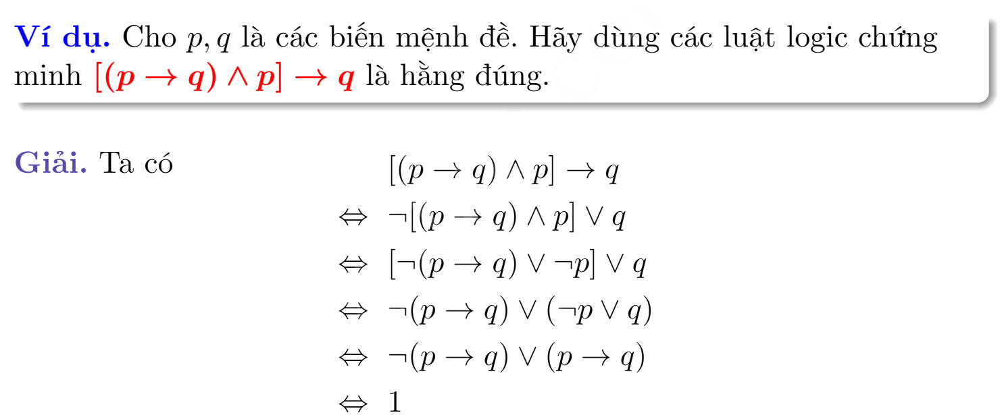

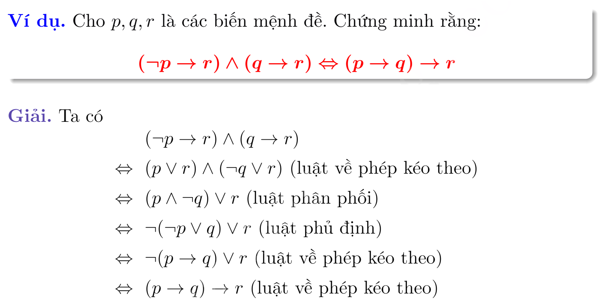

#### 1.3.7.2. Các quy tắc khác

- ***Quy tắc thay thế tương đương:*** Trong dạng mệnh đề *E*, nếu ta **thay thế biểu thức con *F* bởi một dạng mệnh đề tương đương logic (*F’*)** thì dạng mệnh đề thu được vẫn còn tương đương logic với *E.*

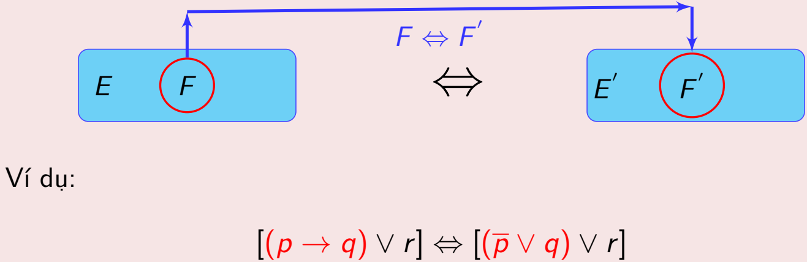

- ***Quy tắc thay thế trong hằng đúng:*** Giả sử dạng mệnh đề *E* là hằng đúng, nếu ta **thay thế một biến *r* bằng một dạng mệnh đề nào đó \[*r = F(u, v…)*\]** thì mệnh đề có được vẫn là hằng đúng.

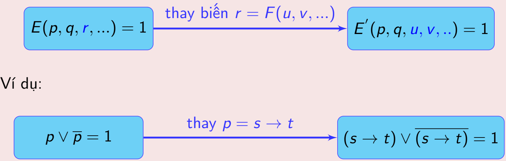

### 1.3.8. Bài toán liên quan đến biểu thức mệnh đề

#### 1.3.8.1. Bài toán rút gọn biểu thức

Sử dụng các luật & quy tắc trên để rút gọn biểu thức *E*, và biểu thức rút gọn *F* phải **tương đương & gọn hơn** so với biểu thức ban đầu (*E*).

Nếu E là hằng đúng hoặc hằng sai thì ta không cần làm gì cả (vì nó đã gọn).

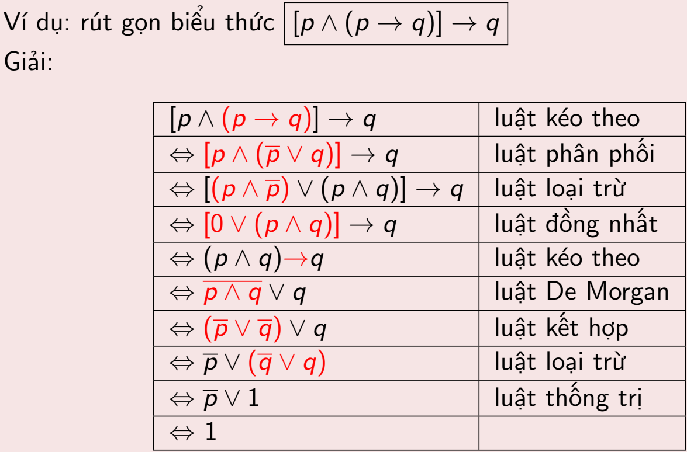

#### 1.3.8.2. Bài toán xác định chân trị của biểu thức E cho trước

**\* <u>Cách giải:</u>**

- ***Bước 1:*** **Rút gọn E.** Neu E la hằng đúng hoặc hằng sai ⇒ kết thúc.

- ***Bước 2:*** Lập bảng chân trị của E (đã rút gọn).

(Chú ý: nếu E gồm **n biến** thì bảng chân trị sẽ có **2<sup>n</sup>** dòng thế hiện những giá tri khác nhau của n biến đó).

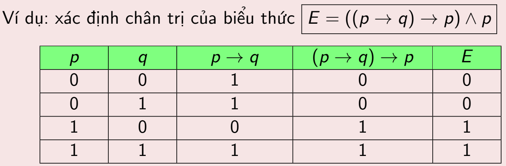

## 1.4. Vị từ & Lượng từ

- **Vị từ (predicate)** là một phát biểu mà:

  - Bản thân nó **không phải là mệnh đề**.

  - Nhưng nếu **<u>hạn chế hoặc gán giá trị</u> (định lượng) cho các biến** của nó thì ta thu được một mệnh đề.

  - Còn có thể gọi là mệnh đề chứa biến/ hàm mệnh đề.

> ***Ví dụ:*** $`p(x):x^{2} - 5x + 6 = 0`$
>
> $`r(x,y,z):x^{2} + y^{2} > z`$
>
> $`p(n):n + 1`$ là số nguyên tố

- **Các phép toán trên vị từ:** Tương ứng với các phép toán trên mệnh đề.

> ***Ví dụ:***
>
> 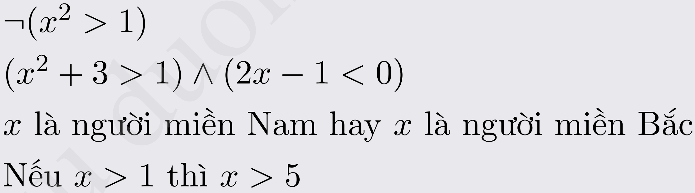

- **Các trường hợp của vị từ:** Với A là một tập hợp.

> 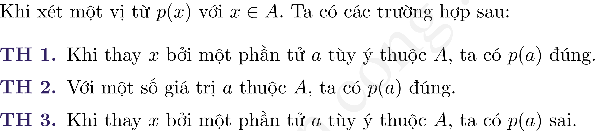

- **Lượng từ hóa vị từ:**

> 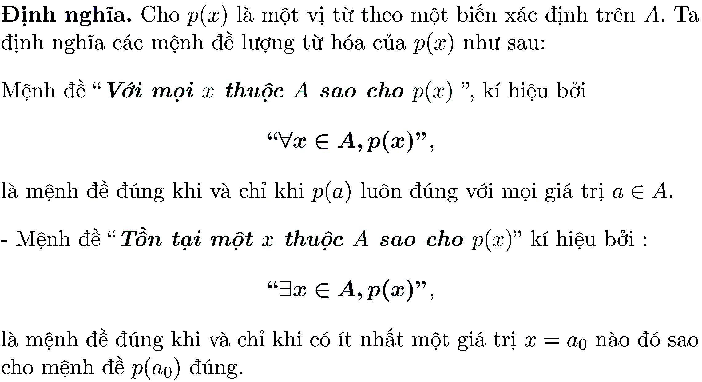

- *Từ "tồn tại" có thể được thay thế bởi "có" hay "có ít nhất".*

- ***Lượng từ kết hợp với vị từ** tạo thành **mệnh đề logic.** Do đó nó có chân trị xác định.*

**Ví dụ:**

- ***P(x): x<sup>2</sup> \> 4***

<!-- -->

- là một vị từ.

- Khi gán giá trị *x = 3*, ta có *P(3): 3<sup>2</sup> \> 4*, là mệnh đề đúng.

- Khi áp dụng lượng từ, $`\exists x\mathbb{\in R},x^{2} > 4`$, ta có một mệnh đề đúng vì tồn tại *x = 3*.

<!-- -->

- ***P(x): x \> 0***

  - Đây là vị từ.

  - Khi gán giá trị *x = -1*, ta có *P(-1): -1 \> 0,* là mệnh đề sai.

  - Khi áp dụng lượng từ, $`\forall x\mathbb{\in N}*,x > 0`$, ta có một mệnh đề đúng vì mọi số tự nhiên khác 0 đều lớn hơn 0.

<!-- -->

- Xét một vị từ *p(x, y)* theo hai biến *x ∈ A, y ∈ B*.

  - Khi ấy nếu thay *x* bằng một phần tử *cố định nhưng tùy ý* ***a* ∈ *A***, ta sẽ được một vị từ *p(a, y)* **theo biến *y***.

  - Khi đó ta có thể ***lượng từ hóa nó theo biến y*** và được hai mệnh đề sau:

    - “∀y∈*B, p(a, y)*”: Với **một giá trị cố định** a∈A, p(a,y) đúng với **mọi** y∈B, *và*

    - “∃y∈*B, p(a, y)*”: Với **một giá trị cố định** a∈A, p(a,y) đúng với **tồn tại ít nhất một** y∈B.

  - Do x được thay bằng một phần tử cố định nhưng tùy ý a của A, nên ta có hai vị từ sau đây là **hai vị từ theo biến *x* ∈ *A*:** **“∀*y*∈*B, p (x, y)*” và “ ∃*y*∈*B, p (x, y)*”**. Tiếp tục lượng từ hóa hai vị từ trên theo biến x, ta được 4 mệnh đề sau đây:

    - **(1)**$`\forall x \in A,\forall y \in B,p(x,y)`$: Đây là mệnh đề logic mạnh nhất vì yêu cầu mọi kết hợp của x và y đều phải đúng.

    - **(2)**$`\exists x \in A,\forall y \in B,p(x,y)`$: chỉ cần tìm **một giá trị x**, với giá trị đó, p(x, y) đúng với mọi y.

    - **(3)**$`\forall x \in A,\exists y \in B,p(x,y)`$: mỗi x phải có ít nhất một giá trị y làm p(x, y) đúng.

    - **(4)**$`\exists x \in A,\exists y \in B,p(x,y)`$: Đây là mệnh đề logic yếu nhất vì chỉ cần tìm một cặp (x, y) làm p(x, y) đúng.

  - Tương tự ta cũng có thể lượng từ hóa p(x,y) theo biến **y** trước rồi biến **x** sau để được 4 mệnh đề nữa:

    - **(5)**$`\forall y \in B,\forall x \in A,p(x,y)`$: tương đương với Mệnh đề 1, nhưng thứ tự lượng từ thay đổi (không ảnh hưởng đến ý nghĩa trong trường hợp cả hai đều là ∀).

    - **(6)**$`\exists y \in B,\forall x \in A,p(x,y)`$: Yêu cầu tìm một y duy nhất để p(x, y) đúng với mọi x.

    - **(7)**$`\forall y \in B,\exists x \in A,p(x,y)`$: Tương tự Mệnh đề 3, nhưng thứ tự lượng từ đảo ngược.

    - **(8)**$`\exists y \in B,\exists x \in A,p(x,y)`$: Tương tự Mệnh đề 4.

- Thứ tự lượng từ hóa **quan trọng** vì nó ảnh hưởng đến ý nghĩa của mệnh đề, cũng như thay đổi cách đọc và bản chất của bài toán.

> 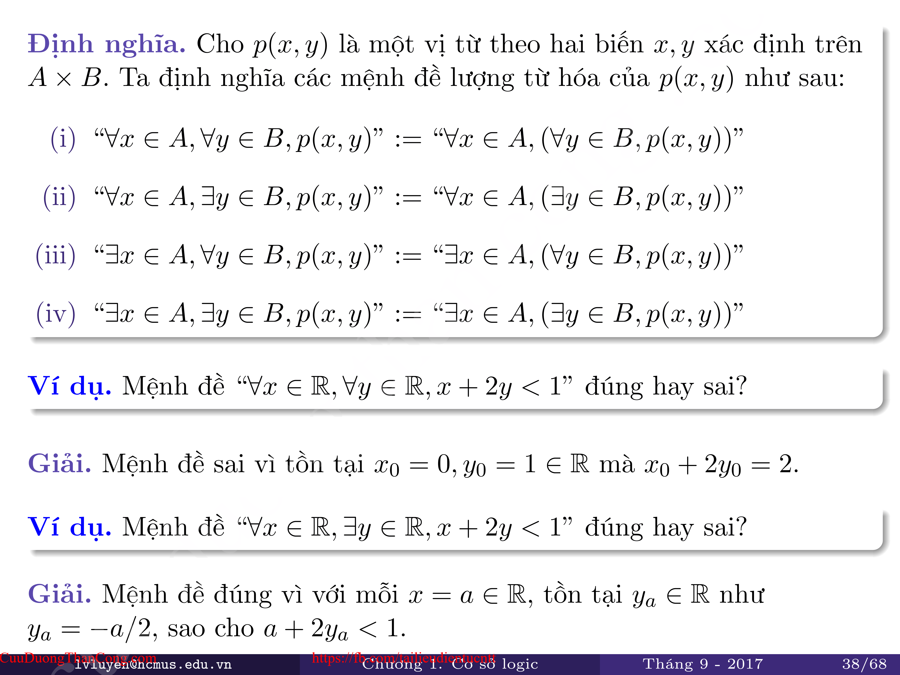

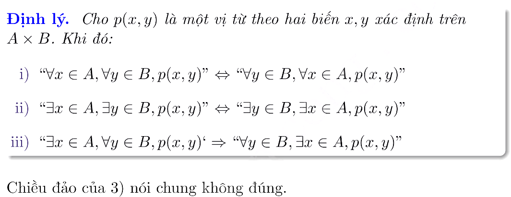

> ***Chứng minh 3):***

- Giả sử $`\exists x \in A,\forall y \in B,p(x,y)`$ đúng. Khi ấy sẽ **tồn tại *a∈ A*** sao cho mệnh đề $`\forall y \in B,p(x,y)`$đúng, nghĩa là nếu thay ***y = b ∈ B* tùy ý** thì *p(a, b)* đúng.

- Như vậy với mỗi *y = b*∈ *B* **tùy ý** ta có thể **chọn *x = a*** *(là phần tử cố định), và rõ ràng p(x, y) đúng.*

- Do đó, với mọi y ∈ B, ta luôn tìm được một x ∈ A sao cho p(x, y) đúng. Điều này tương đương với vế phải.

- Vì thế, 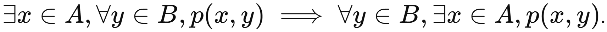 **(đpcm).**

> ***Chứng minh chiều đảo không đúng trong trường hợp tổng quát.***
>
> **Lấy ví dụ sau:**

- Gọi p(x, y) là vị từ theo 2 biến thực: **"x + y = 1"**

- Ta nhận xét rằng nếu thay **y = b** là một số thực tùy ý thì ta có thể chọn **x = 1 - b** để cho **x + b = 1**, nên mệnh đề "$`\exists x\mathbb{\in R},x + b = 1`$" là đúng.

  Điều này chứng tỏ mệnh đề "$`\forall y\mathbb{\in R},\exists x\mathbb{\in R},x + y = 1`$" đúng.

- Ngược lại nếu thay **z = a** tùy ý, ta có thể chọn **<span class="mark">y = -a</span>** để cho **a + y = 0 ≠ 1** nên mệnh đề "$`\forall y\mathbb{\in R},a + y = 1`$" là sai.

  Điều này chứng tỏ mệnh đề "$`\exists x\mathbb{\in R},\forall y\mathbb{\in R},x + y = 1`$" là sai.

- **Do đó ta được đpcm.**

<!-- -->

- **Quy tắc biến đổi lượng từ:** Phủ định của mệnh đề lượng từ hóa vị từ *p(x, y,…)* có được bằng các thay ∀ thành ∃, thay ∃ thành ∀ và vị từ p(x, y, .. ) thành ¬p(x, y, .. ).

> 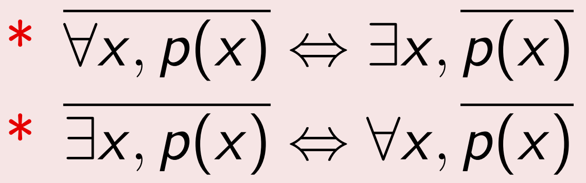

- *Không phải tất cả x đều thỏa p(x), nghĩa là tồn tại ít nhất một x không thỏa p(x).*

- *Không có x nào thỏa p(x), nghĩa là tất cả x đều không thỏa p(x).*

> ***Ví dụ:*** 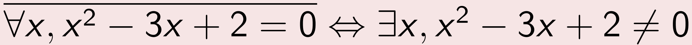

- **Các quy tắc phổ dụng:**

> 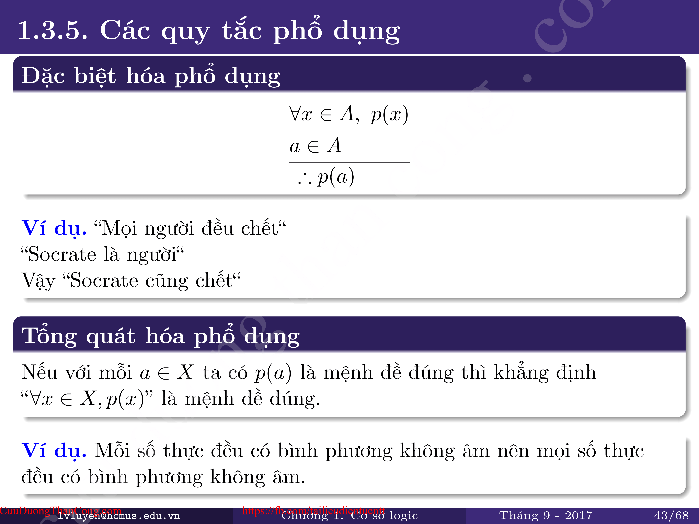
>

## 1.5. Các phương pháp suy diễn

*Kết luận*

*Hội các giả thiết*

*(Tiền đề)*

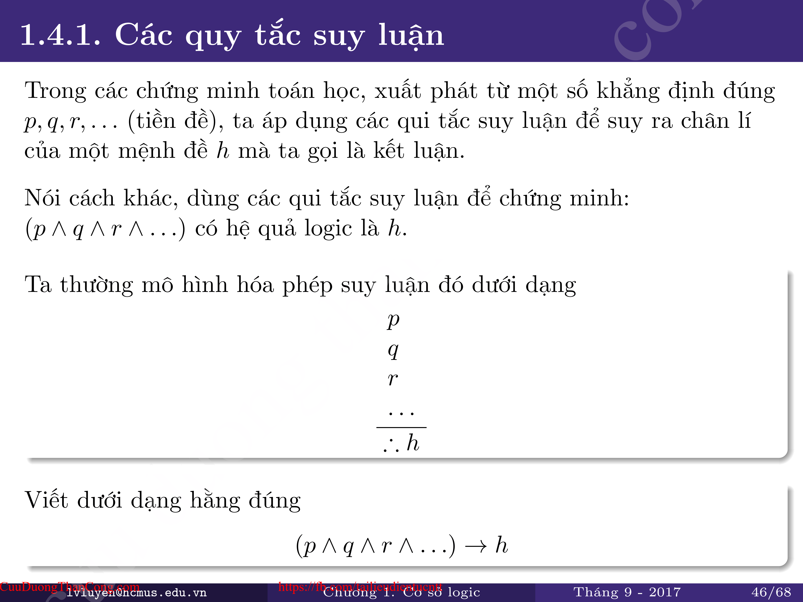

*(Suy luận là rút ra mệnh đề mới từ một hoặc nhiều mệnh đề đã có).*

### 1.5.1. Phương pháp khẳng định (Modus Ponens)

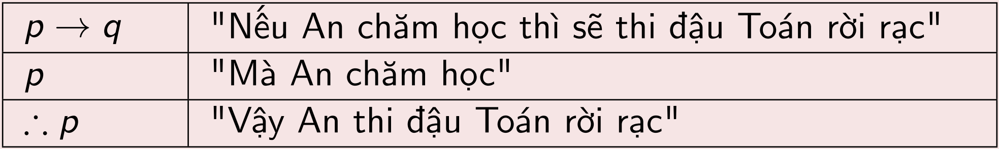

Thể hiện bằng hằng đúng: **\[(*p* → *q*) ∧ *p*\] → *q***

### 1.5.2. Phương pháp phủ định (Modus Tollens)

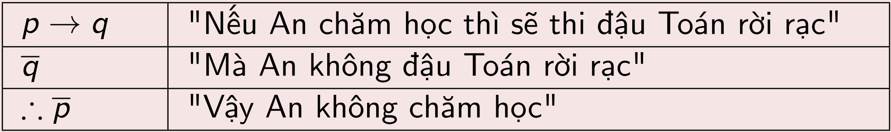

Thể hiện bằng hằng đúng: **\[(*p* → *q*) ∧ ¬*q*\] → ¬*p***

### 1.5.3. Phương pháp tam đoạn luận (Syllogism) (Bắc cầu)

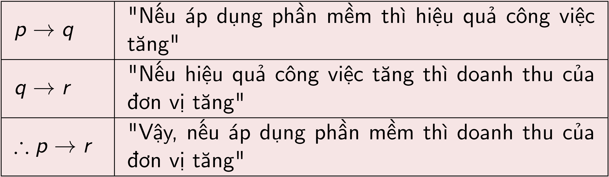

Thể hiện bằng hằng đúng: **\[(*p* → *q*) ∧ *(q* → *r)*\] → *(p* → *r)***

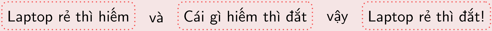

*Tam đoạn luận trên hoàn toàn hợp logic. Tuy nhiên kết luận mâu thuẫn là do dựa trên một tiền đề sai.*

### 1.5.4. Phương pháp tam đoạn luận rời

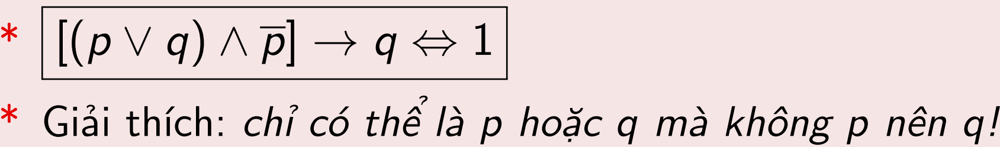

*Khi chỉ có đúng 2 trường hợp có thể xảy ra, mà một trong hai trường hợp đã được khẳng định là SAI thì trường hợp còn lại mặc nhiên ĐÚNG.*

***Ví dụ:*** An hoặc ở trong nhà hoặc ở ngoài sân. Mà An không ở trong nhà. Vậy An ở ngoài sân.

### 1.5.5. Các phương pháp suy luận đơn giản

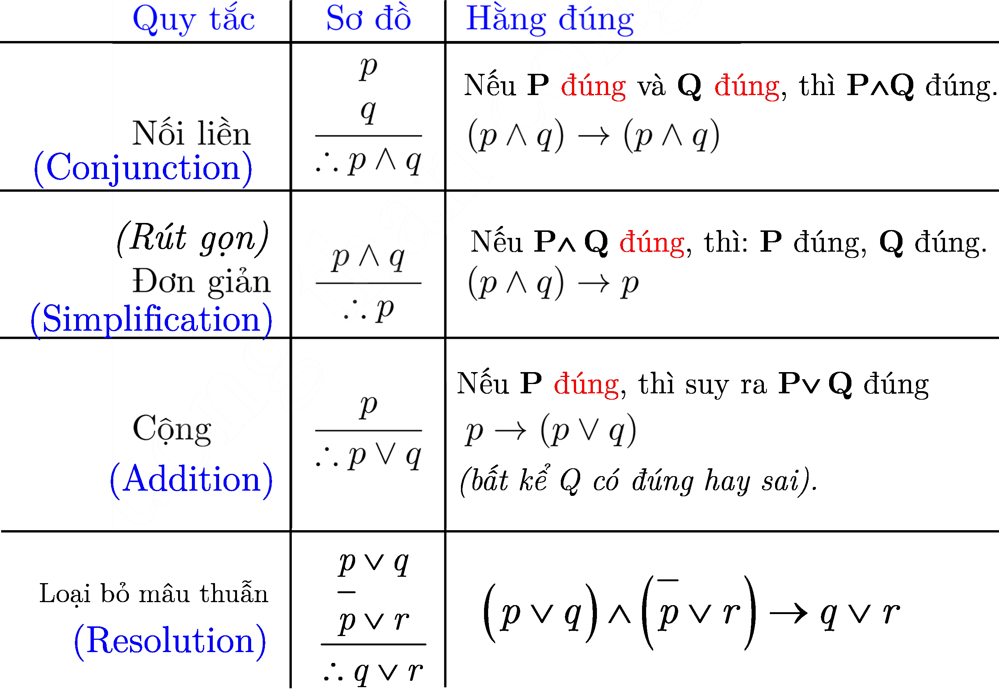

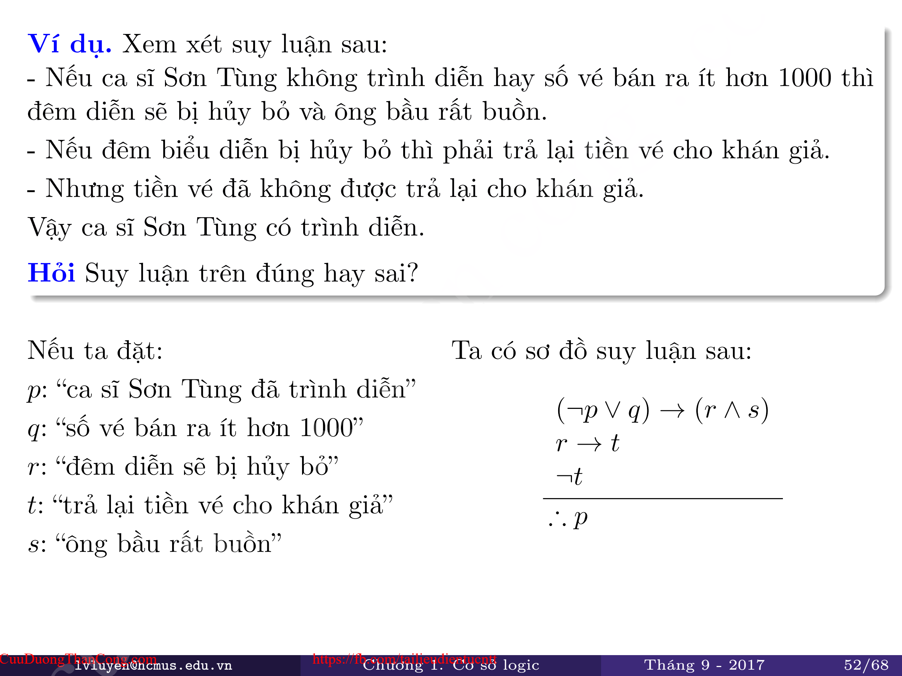

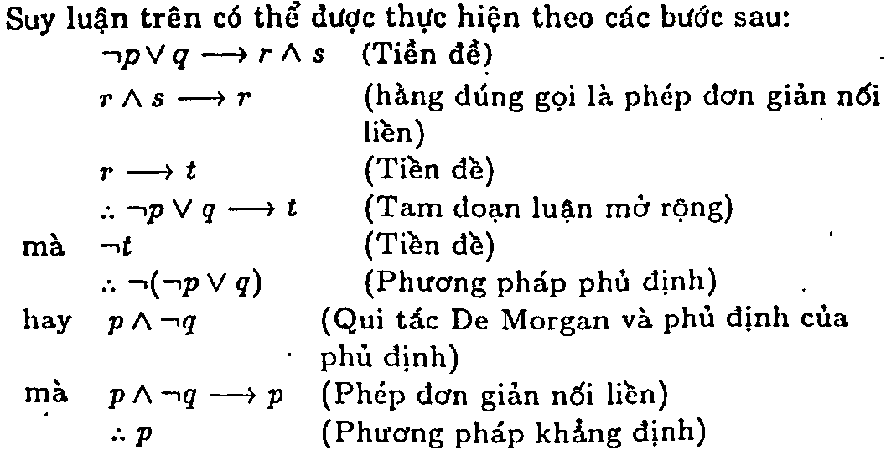

### 1.5.6. Phương pháp mâu thuẫn

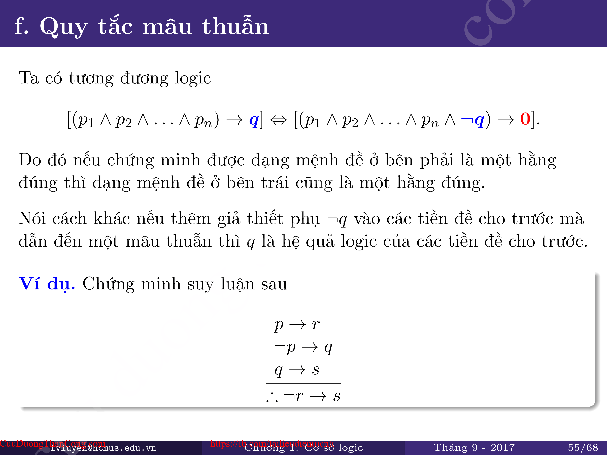

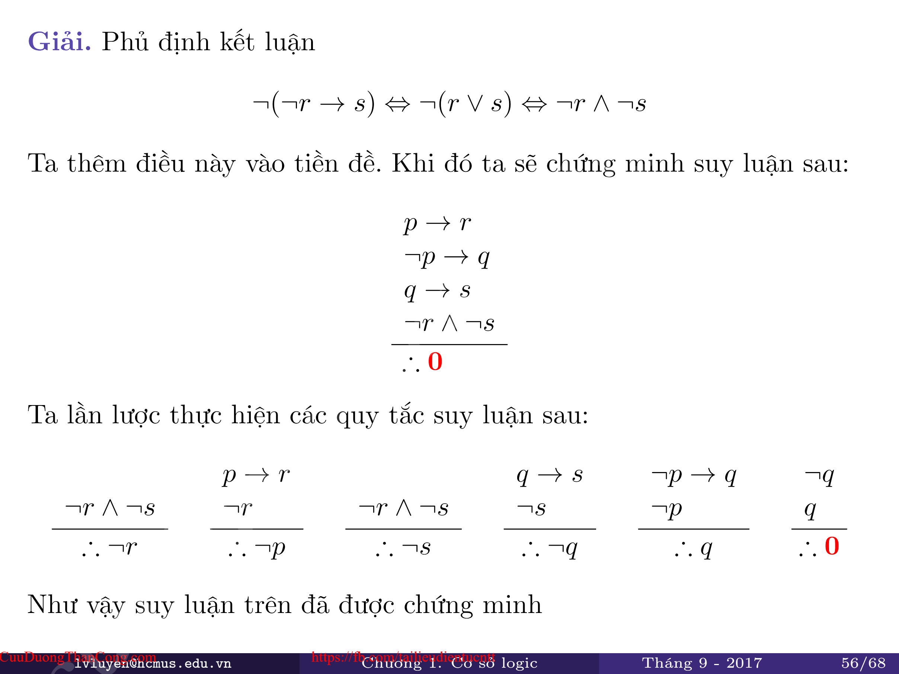

### 1.5.7. Phản ví dụ

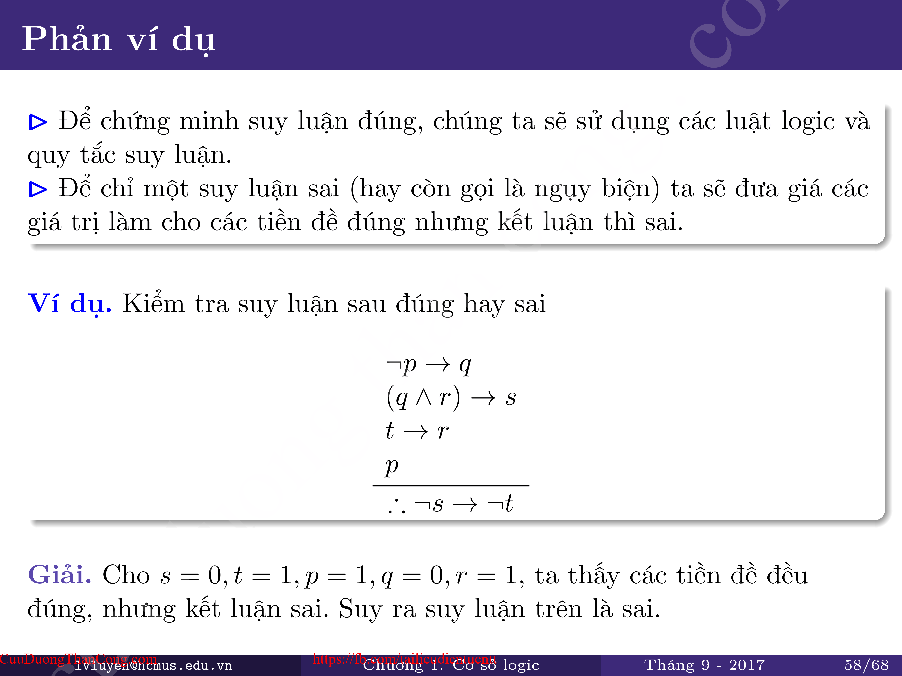

## 1.6. Các phương pháp chứng minh

Mỗi bài toán chứng minh gồm 2 phần chính: **giả thiết và kết luận.** Quá trình chứng minh bài toán là quá trình sử dụng các tiên đề, luật logic, các quy tắc suy luận, ... và áp dụng các phương pháp chứng minh để **từ giả thiết đã cho ta có được kết luận.**

**Một số thuật ngữ:**

- ***Định lý*** là một phát biểu nó có thể được chỉ ra là đúng.

- ***Tiên đề*** là phát biểu được giả thiết là đúng.

- ***Mệnh đề*** là định lý ít quan trọng thường có phạm vị áp dụng nhỏ hơn Định lý.

- ***Bổ đề*** là một định lý nó phạm vi sử dụng hẹp, thường được sử dụng để chứng minh các kết quả khác.

- ***Hệ quả*** là một định lý nó có thể được thiết lập trực tiếp từ một định lý đã được chứng minh.

- ***Phỏng đoán*** là một phát biểu nó đang được giả định là một phát biểu đúng.

### 1.6.1. Phương pháp chứng minh trực tiếp

Để chứng minh A suy ra B, chúng ta **giả sử A đúng**, sau đó áp dụng các quy tắc suy luận, các luật logic, các tiên đề, ... để chỉ ra B đúng.

> ***Ví dụ 1:*** CMR nếu n chia hết cho 3 thì n<sup>2</sup> chia hết cho 9.

- Giả sử $`n \vdots 3 \Rightarrow n = 3k\left( k\mathbb{\in Z} \right)`$.

- Ta có: $`n^{2} = (3k)^{2} = 9k^{2} \Rightarrow 9k^{2}:9 = k^{2}\left( k^{2}\mathbb{\in Z} \right) \Rightarrow n^{2} \vdots 9`$ (đpcm).

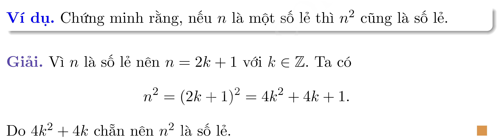


> ***Ví dụ 3:*** CMR nếu n là số nguyên tố \> 5 thì (n<sup>2</sup> – 1) chia hết cho 24.

1.  Giả sử: n là số nguyên tố \> 5 <span class="mark">⇒ (n-1) và (n+1) là 2 số chẵn liên tiếp</span>

    <span class="mark">⇒</span> $`(n - 1)(n + 1) \vdots 8`$<span class="mark">.</span>

2.  <span class="mark">Ta có (n-1), n và (n+1) là 3 số tự nhiên liên tiếp ⇒</span> $`(n - 1)(n + 1)n \vdots 3`$<span class="mark">.</span>

3.  n là số nguyên tố \> 5 ⇒$`n\overset{\not{}}{\vdots}3`$.

4.  Từ (2), (3) ⇒$`(n - 1)(n + 1) \vdots 3`$.

5.  Từ (1), (4), bên cạnh đó số 3 & 8 là 2 số nguyên tố ⇒$`(n - 1)(n + 1) \vdots 24`$

    ⇒$`\left( n^{2} - 1 \right) \vdots 24`$ (đpcm).

### 1.6.2. Phương pháp chứng minh phản chứng thứ nhất (chứng minh gián tiếp)

Để chứng minh P → Q đúng, ta chứng minh ¬Q → ¬P đúng, vì $`P \rightarrow Q \Leftrightarrow \overline{Q} \rightarrow \overline{P}`$.

**Ví dụ 1:** CMR 3n + 1 là số chẵn (P) thì n là số lẻ (Q) $`\left( n\mathbb{\in Z} \right)`$

> Giả sử n là số chẵn ⇒ n = 2k $`\left( k\mathbb{\in Z} \right)`$
>
> 3n + 1 = 3.2k + 1 = 6k + 1
>
> Mà 6k là số chẵn ⇒ 6k + 1 là số lẻ ⇒ 3n + 1 là số lẻ
>
> ⇒$`\overline{Q} \rightarrow \overline{P}`$đúng (Đpcm).

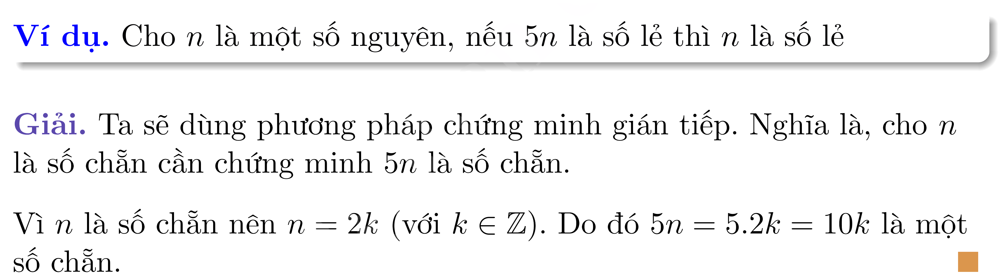


### 1.6.3. Phương pháp chứng minh phản chứng thứ hai

- ***Bước 1 (phủ định kết luận):*** Giả sử có điều trái với kết luận của bài toán.

- ***Bước 2 (đi đến mâu thuẫn):*** Từ điều giả sử trên và từ giả thiết của bài toán, ta suy ra điều mâu thuẫn với giả thiết hay với các định lý, khái niệm...

- ***Bước 3 (khẳng định kết luận):*** Vậy kết luận của bài toán là đúng. Đpcm.

> **Ví dụ 1:** CMR nếu n là số nguyên tố \> 5 thì (n<sup>2</sup> – 1) chia hết cho 24.

- Giả sử n là số nguyên tố \> 5 và $`\left( n^{2} - 1 \right)\cancel{\vdots}24`$.

- n là số nguyên tố \> 5 ⇒ (n-1) và (n+1) là 2 số chẵn liên tiếp

- ⇒ $`(n - 1)(n + 1) \vdots 8`$ ⇒ <span class="mark">(n – 1)(n + 1)</span> $`\vdots`$<span class="mark">4.</span>

- Vì $\left(n^2-1\right)\nmid 24$ nên $\left(n^2-1\right)\nmid 6$, tức là $\left((n^2-1)\nmid 3\right)\lor\left((n^2-1)\nmid 2\right)$.

- Ta có (n-1), n và (n+1) là 3 số tự nhiên liên tiếp ⇒ $`(n - 1)(n + 1)n \vdots 3`$.

- TH1: $`\left( n^{2} - 1 \right)\cancel{\vdots}3`$, mà $`\underbrace{(n - 1)(n + 1)}_{\cancel{\vdots}3}n \vdots 3`$⇒ $`n \vdots 3`$, mặt khác (n \> 5 & là số NT) ⇒ Vô lý!

- TH2: $`\left( n^{2} - 1 \right)\cancel{\vdots}2`$, vậy (n-1) và (n+1) là 2 số lẻ ⇒ Vô lý (vì mâu thuẫn với lập luận ở trên)! (đpcm).

**Ví dụ 2:**

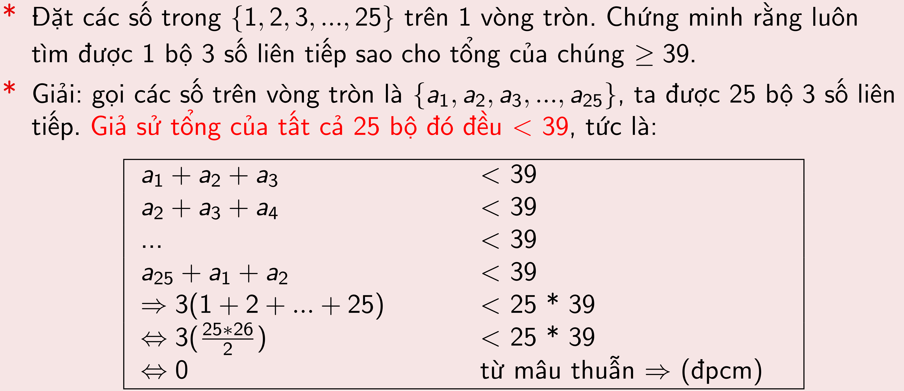

- Vì có 25 số trên vòng tròn, mỗi số sẽ được "bắt đầu" trong đúng một bộ ba khác nhau.

- Do đó, với 25 số, ta có tổng cộng **25 bộ ba liên tiếp**.

Cộng tất cả các bất đẳng thức trên lại:

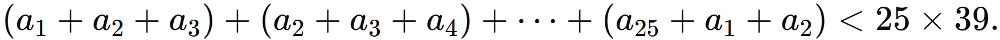

Khi cộng tất cả các bộ ba, mỗi a<sub>i</sub>​ (với i = 1, 2, …, 25) xuất hiện đúng **3 lần:**

> 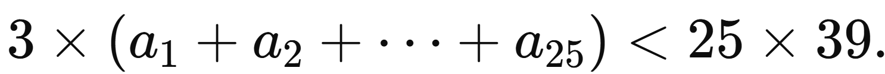⇔ 3 (1 + 2 + … + 25) \< 25 × 39
>
> $`\Leftrightarrow 3\left( \frac{25 \times 26}{2} \right) < 25 \times 39 \Leftrightarrow 975 < 975(!)`$. Vậy ta có đpcm.

**Ví dụ 3:** CMR $`\sqrt{2}`$là số vô tỉ.

- Giả sử $`\sqrt{2}`$​ **không** là số vô tỉ, nghĩa là $`\sqrt{2}`$​ là số hữu tỉ. Theo định nghĩa số hữu tỉ, $`\sqrt{2}`$​ có thể biểu diễn dưới dạng phân số:

> 
> ``` math
> \sqrt{2} = \frac{m}{n}\left( m,n\mathbb{\in Z},n \neq 0 \right)
> ```
>
> Và UCLN (m, n) = 1 để đảm bảo $`\frac{m}{n}`$là phân số tối giản.
>
> Nói cách khác, m, n là 2 số nguyên tố cùng nhau.
>
> **Số nguyên tố cùng nhau (coprime):** Hai số nguyên p và q được gọi là nguyên tố cùng nhau nếu ước chung lớn nhất của chúng bằng 1. Điều này không yêu cầu cả p và q phải là số nguyên tố. ***Ví dụ:***
>
> p = 8, q = 9, UCLN(8, 9) = 1 → 8 và 9 là nguyên tố cùng nhau.
>
> p= 3, q = 4, UCLN(3, 4) = 1 → 3 và 4 là nguyên tố cùng nhau.

- Bình phương 2 vế: $`2 = \frac{m^{2}}{n^{2}} \Leftrightarrow m^{2} = 2n^{2}`$ (\*)

> ⇒ m<sup>2</sup> là số chẵn ⇒ **<span class="mark">m cũng là số chẵn</span>** (vì bình phương của một số lẻ luôn là lẻ). Vì thế m = 2k$`\left( k\mathbb{\in Z} \right)`$.

- Thay m = 2k vào (\*) ta được: $`(2k)^{2} = 2n^{2} \Leftrightarrow 4k^{2} = 2n^{2} \Leftrightarrow n^{2} = 2k^{2}`$

⇒ n<sup>2</sup> là số chẵn ⇒ **<span class="mark">n cũng là số chẵn</span>.**

- Từ nhận xét trên, ta thấy cả m và n đều là số chẵn, nghĩa là cả m và m đều có ước chung là 2. Điều này mâu thuẫn với giả thiết ban đầu rằng m, n là 2 số nguyên tố cùng nhau (có UCLN = 1).

- Vậy từ mâu thuẫn, ta có **đpcm.**

### 1.6.4. Phương pháp chứng minh theo trường hợp

Được thể hiện bởi hằng đúng: 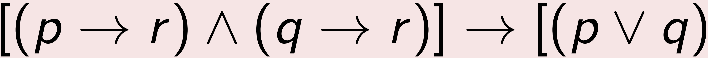

**1.**

Nếu một giả thiết có thể tách thành 2 trường hợp p đúng hay q đúng, và ta đã chứng minh được riêng rẻ cho từng trường hợp là kết luận r đúng, khi ấy r cũng đúng trong cả 2 trường hợp.

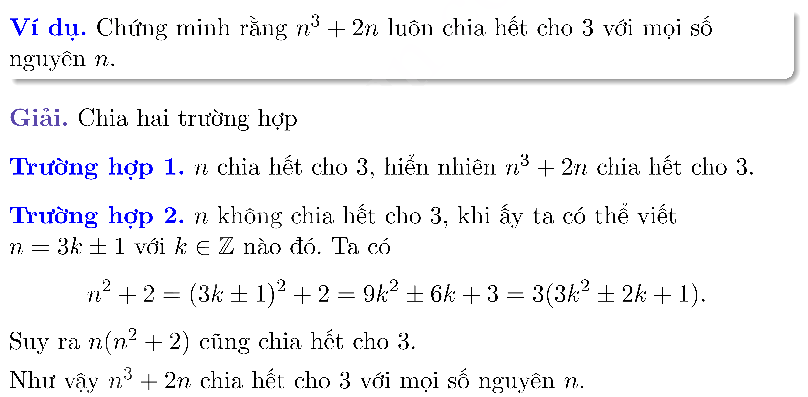


### 1.6.5. Phương pháp chứng minh quy nạp (yếu)


- **Bước 1 (cơ sở):** Chứng minh P(N<sub>0</sub>) đúng (thay n = N<sub>0</sub> vào P(n) nếu cần thiết).

- **Bước 2 (quy nạp):** Giả sử P(n) đúng.

- **Bước 3 (quy nạp):** Chứng minh P(n + 1) đúng. Kết luận P(n) đúng với mọi n ≥ N<sub>0</sub>.

***Ví dụ 1:*** CMR 1 + 3 + … + (2n – 1) = n<sup>2</sup> với mọi số nguyên dương n. (CMR tổng của n số lẻ nguyên dương đầu tiên bằng bình phương của n).

- Gọi p(n): 1 + 3 + … + (2n – 1) = n<sup>2</sup>.

- Bước cơ sở: Hiển nhiên p(1) đúng, vì 1 = 1<sup>2</sup>.

- Bước quy nạp: Với n \> 1, giả sử p(n) đúng, tức là

> 1 + 3 + … + (2n – 1) = n<sup>2</sup>.

- Ta cần chứng minh p(n + 1) cũng đúng. Ta có

  1 + 3 + … + (2(n + 1) – 1) = (n + 1)<sup>2</sup> ⇔ 1 + 3 + … + (2n + 1) = (n + 1)<sup>2</sup>

  ⇔ **1 + 3 + … + (2n – 1)** + (2n + 1) = (n + 1)<sup>2</sup>

  *(số đứng trước 2n + 1 là 2n – 1)*

  ⇔ **n<sup>2</sup>** + (2n + 1) = (n + 1)<sup>2</sup>.

- Vậy, p(n + 1) đúng. Vậy theo nguyên lý quy nạp, p(n) đúng $`\forall n \in \mathbb{Z}^{+}`$ (Đpcm).

***Ví dụ 2:*** CMR 1 + 2 + … + n = $`\frac{n(n + 1)}{2}`$với mọi số nguyên dương n.

- Gọi p(n): 1 + 2 + … + n = $`\frac{n(n + 1)}{2}`$.

- Bước cơ sở: p(1) đúng vì nó có dạng 1 = $`\frac{1(1 + 1)}{2}`$.

- Bước quy nạp: Với n \> 1, giả sử p(n) đúng, tức 1 + 2 + … + n =$`\frac{n(n + 1)}{2}`$.

- Ta cần chứng minh p(n + 1) cũng đúng. Ta có

> **1 + 2 + … + n** + (n + 1) = $`\frac{(n + 1)(n + 2)}{2}`$⇔ $`\frac{n(n + 1)}{2}`$+ (n + 1) = $`\frac{(n + 1)(n + 2)}{2}`$
>
> ⇔ $`\frac{n(n + 1) + 2(n + 1)}{2}`$= $`\frac{(n + 1)(n + 2)}{2}`$.

- Vậy, p(n + 1) đúng. Vậy theo nguyên lý quy nạp, p(n) đúng $`\forall n \in \mathbb{Z}^{+}`$ (Đpcm).
