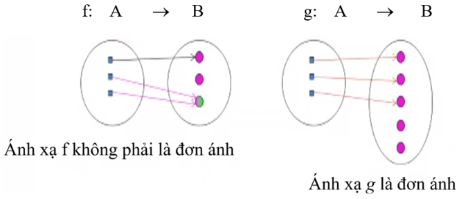
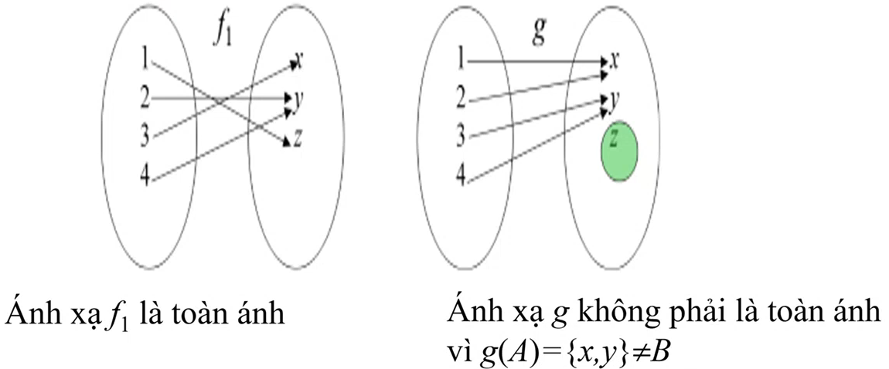
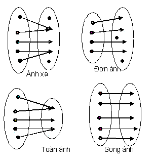

  <a className="button button--primary" href="/pdfs/toan-roi-rac/chapter2/bai10.pdf" download="bai10-toan-roi-rac.pdf" target="_blank" rel="noreferrer">
    Tải file PDF
  </a>

- Có 4 loại: **Đơn ánh, Toàn ánh, Song ánh, “còn lại”.**

- Giả sử $X$, $Y$ là các tập hợp.

## 10.1. Đơn ánh
- Ánh xạ $f$: $X$ → $Y$ được gọi là đơn ánh (injection hoặc one-to-one) nếu nó đặt tương ứng **hai phần tử khác nhau của $X$ *với hai phần tử khác nhau*** của $Y$.
  $\forall x_1, x_2 \in X, x_1 \neq x_2 \rightarrow f(x_1) \neq f(x_2)$
  
  Hoặc:

  $\forall x_1, x_2 \in X: f(x_1) = f(x_2) \Rightarrow x_1 = x_2$

  *(Mỗi sinh viên ($Y$) có không quá một viên phấn ($X$)).*

  

  ***Ví dụ:*** $f:\mathbb{R} \rightarrow \mathbb{R},f(x) = e^{x}$. Tính chất của hàm mũ $e^x$ cho thấy $e^x$ là **hàm đơn điệu tăng**, tức khi $x_{1} ≠ x_{2}$, thì $e^{x_{1}} \neq e^{x_{2}}$.

- **Mệnh đề.** Cho ánh xạ $f: X \rightarrow Y$. Khi đó:
i) $f$ đơn ánh $\Leftrightarrow$ "$\forall x_1, x_2 \in X, f(x_1) = f(x_2) \rightarrow x_1 = x_2$".
ii) $f$ *không* đơn ánh $\Leftrightarrow$ "$\exists x_1, x_2 \in X, x_1 \neq x_2 \wedge f(x_1) = f(x_2)$".

  ***Ví dụ 1.*** Cho ánh xạ $f: \mathbb{R} \rightarrow \mathbb{R}$ xác định bởi $f(x) = x + 3$. Xét tính đơn ánh của $f$.

  **Giải.** Với mọi $x_1, x_2 \in \mathbb{R}$, nếu $x_1 \neq x_2$ thì $x_1 + 3 \neq x_2 + 3$ nên $f(x_1) \neq f(x_2)$. Do đó $f$ là đơn ánh.

  ***Ví dụ 2.*** Cho ánh xạ $f: \mathbb{R} \rightarrow \mathbb{R}$ xác định bởi $f(x) = x^3 + x$. Xét tính đơn ánh của $f$.

  **Giải.** Với mọi $x_1, x_2 \in \mathbb{R}$,
  $$
  \begin{align*}
  f(x_1) = f(x_2) & \Leftrightarrow x_1^3 + x_1 = x_2^3 + x_2 \\
  & \Leftrightarrow x_1^3 - x_2^3 + x_1 - x_2 = 0 \\
  & \Leftrightarrow (x_1 - x_2)(x_1^2 + x_1 x_2 + x_2^2 + 1) = 0 \\
  & \Leftrightarrow x_1 - x_2 = 0 \quad (\text{vì } x_1^2 + x_1 x_2 + x_2^2 + 1 \ge 1) \\
  & \Leftrightarrow x_1 = x_2
  \end{align*}
  $$
  Do đó $f$ là đơn ánh.

## 10.2. **Toàn ánh:**
- Ánh xạ $f$ từ $X$ vào $Y$ được gọi là toàn ánh (surjection hoặc onto) nếu ***mỗi** phần tử của $Y$* đều là **ảnh** của **<u>ít nhất một</u>** ***phần tử nào đó của $X$*** qua ánh xạ $f$ (sao cho $f$($x$) = $y$).
  $\forall y \in Y, \exists x \in X: y = f(x) \text{. Tức là } f(X) = Y$

  (Không có sinh viên nào không có phấn).

  *(Mọi phần tử ảnh đều tìm được gốc của nó thông qua ánh xạ $f$).*

  ***Ví dụ:*** $A = \{1,2,3,4\}$ và $B = \{x,y,z\}$. Ánh xạ: $f$1 = {(1,$z$), (2,$y$), (3,$x$), (4,$y$)}; $g$ = {(1, $x$), (2,$x$), (3,$y$), (4,$y$)}

  

- **Mệnh đề.** Cho ánh xạ $f: X \rightarrow Y$. Khi đó,
i) $f$ là toàn ánh $\Leftrightarrow$ với mọi $y \in Y$, phương trình $y = f(x)$ có nghiệm
ii) $f$ *không* là toàn ánh $\Leftrightarrow$ tồn tại $y_0 \in Y$ sao cho phương trình $y_0 = f(x)$ vô nghiệm

  **Ví dụ.** Cho $f: \mathbb{R} \rightarrow \mathbb{R}$ xác định bởi $f(x) = x^2 - 3x + 5$. Hỏi $f$ có toàn ánh không?

  **Giải.** Với $y = 0$ ta có phương trình $y = f(x)$ vô nghiệm. Suy ra $f$ không toàn ánh.

## 10.3. Song ánh
- Ánh xạ $f$ từ $X$ vào $Y$ được gọi là song ánh (bijection), nếu nó vừa là đơn ánh vừa là toàn ánh.

  ***Ví dụ:*** $f:\mathbb{R} \rightarrow \mathbb{R}^{+},f(x) = e^{x}$

    - Ở đây, tập đích là $\mathbb{R}^{+}$ = (0,∞) (các số thực dương).

    - Với một $y \in R$+, ta cần tìm $x \in R$ sao cho: $f$($x$) = $y$ ⟹ $e^x$ = $y$.

    - Hàm mũ $e^x$ \> 0 với mọi $x \in R$, $e^x$ = $y$ có nghiệm **duy nhất** là: $x$ = ln($y$).

    - Do đó, với mỗi $y \in R$, ta luôn tìm được $x$ = ln($y$) $\in R$. Điều này chứng minh $f$($x$) = $e^x$ là **toàn ánh** từ $R$ vào $\mathbb{R}^{+}$.

    - Do $f:\mathbb{R} \rightarrow \mathbb{R}, f(x) = e^{x}$ là đơn ánh, nên $f:\mathbb{R} \rightarrow \mathbb{R}^{+}, f(x) = e^{x}$ cũng **đơn ánh.**

    - Ta kết luận ánh xạ: $f:\mathbb{R} \rightarrow \mathbb{R}^{+},f(x) = e^{x}$ là **song ánh.**

    - Tuy nhiên $f:\mathbb{R} \rightarrow \mathbb{R}, f(x) = e^{x}$ không toàn ánh, vì $e^x > 0$ với mọi $x ∈ \mathbb{R}$. Do đó, khi $y ≤ 0$, không tồn tại $x ∈ \mathbb{R}$ sao cho $f$($x$) = $y$.

![Why do graphs of [math]$e$^{x}[/math] and [math](-e)^{x}[/math] look so different? - Quora](./img/image44.png) 

> **Xét bài toán:** Đếm số phần tử của tập $X$. Giả sử $Y$ là tập mà số phần tử của nó là đã biết: **$n$y = \|$Y$\|.** Giả sử ta có thể xây dựng được ánh xạ $f$ từ $X$ vào $Y$. Khi đó
  > *- Nếu $f$ là đơn ánh, thì ta có \|$X$\|* ≤ *$n$y.*
  > *- Nếu $f$ là toàn ánh, thì ta có \|$X$\|* ≥ *$n$y.*
  > *- Nếu $f$ là song ánh, thì ta có \|$X$\| = $n$y.*
