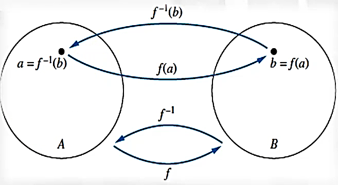

  <a className="button button--primary" href="/pdfs/toan-roi-rac/chapter2/bai11.pdf" download="bai11-toan-roi-rac.pdf" target="_blank" rel="noreferrer">
    Tải file PDF
  </a>

## 11.1. Ánh xạ hợp thành (tích của 2 ánh xạ)
- **Định nghĩa.** Cho $f: X \rightarrow Y$ và $g: Y \rightarrow Z$, lúc đó $\boldsymbol{g \circ f}: X \rightarrow Z$ là **ánh xạ hợp** của $g$ và $f$, được xác định bởi
$$\boldsymbol{g \circ f(x) = g(f(x))}.$$
  **Ví dụ.** Cho $f, g: \mathbb{R} \rightarrow \mathbb{R}$ xác định bởi $f(x) = x + 2$ và $g(x) = 3x - 1$.
  Xác định $g \circ f$ và $f \circ g$.

  **Giải.**

  i) Với mọi $x \in \mathbb{R}$ ta có
  $$g \circ f(x) = g(f(x)) = g(x + 2) = 3(x + 2) - 1 = 3x + 5.$$

  Vậy ánh xạ $g \circ f: \mathbb{R} \rightarrow \mathbb{R}$ được xác định bởi $g \circ f(x) = 3x + 5$.

  ii) Với mọi $x \in \mathbb{R}$ ta có
  $$f \circ g(x) = f(g(x)) = f(3x - 1) = (3x - 1) + 2 = 3x + 1.$$

  Vậy ánh xạ $f \circ g: \mathbb{R} \rightarrow \mathbb{R}$ được xác định bởi $f \circ g(x) = 3x + 1$.

> - **Nhận xét:** $f \circ g \neq g \circ f$

- **Tính chất.** Cho ánh xạ $f: X \rightarrow Y$ và $g: Y \rightarrow Z$. Khi đó
  - (i) $f, g$ đơn ánh $\Rightarrow g \circ f$ đơn ánh $\Rightarrow f$ đơn ánh;
  - (ii) $f, g$ toàn ánh $\Rightarrow g \circ f$ toàn ánh $\Rightarrow g$ toàn ánh;
  - (iii) $f, g$ song ánh $\Rightarrow g \circ f$ song ánh $\Rightarrow f$ đơn ánh, $g$ toàn ánh.

## 11.2. Ánh xạ ngược
### 11.2.1. Ánh xạ đồng nhất trên $X$
- Là ánh xạ **từ $X$ vào chính $X$** sao cho với mọi phần tử $x$ trong $X$, ta có $f$($x$) = $x$.
  $$
  \begin{array}{rccc}
  Id_X : & X & \longrightarrow & X \\
  & x & \longmapsto & x.
  \end{array}
  $$

### 11.2.2. Ánh xạ ngược
- Cho $f$: $X$ → $Y$ là một **song ánh.**

- Khi đó, với mọi $y \in Y$, tồn tại duy nhất một phần tử $x \in X$ thỏa $f$($x$) = $y$. Do đó tương ứng $y \longmapsto x$ là một ánh xạ từ $Y$ vào $X$. Ta gọi đây là ánh xạ ngược của $f$ và ký hiệu **$f$-1**. Như vậy:

  $$
  \begin{array}{rccc}
  f^{-1} : & Y & \longrightarrow & X \\
  & y & \longmapsto & x \text{ với } f(x) = y.
  \end{array}
  $$

 

  **Ví dụ.** Cho $f$ là ánh xạ từ $\mathbb{R}$ vào $\mathbb{R}$ xác định bởi $f(x) = x + 4$. Chứng tỏ $f$ song ánh và tìm $f^{-1}$?

  - **Chứng minh $f$($x$) = $x$ + 4 là đơn ánh:**

    - Giả sử $f(x_1) = f(x_2)$. Ta cần chứng minh rằng $x_1 = x_2$.
    $$f(x_1) = f(x_2) \Longrightarrow x_1 + 4 = x_2 + 4.$$

    - Loại bỏ $+4$ hai vế: $$x_1 = x_2.$$

    - Vì $x_1 = x_2$, nên $f(x)$ là **đơn ánh**.

  - **Chứng minh $f$($x$) = $x$ + 4 là toàn ánh:**

    - Ta cần chứng minh rằng với mọi $y \in \mathbb{R}$, tồn tại $x \in \mathbb{R}$ sao cho $f(x) = y$.
    $$f(x) = y \Longrightarrow x + 4 = y.$$

    - Giải phương trình trên cho $x$: $$x = y - 4.$$

    - Vì $x \in \mathbb{R}$, nên với mọi $y \in \mathbb{R}$, luôn tồn tại một $x \in \mathbb{R}$. Do đó, $f(x)$ là **toàn ánh**.

  - Vì $f$($x$) là vừa đơn ánh vừa toàn ánh, nên $f$($x$) là **song ánh** (đpcm).

  - Với $f(x) = x + 4$, ta có: $$y = x + 4 \Longrightarrow x = y - 4.$$

  - Do đó, ánh xạ ngược là: $$f^{-1}(y) = y - 4.$$

> **Định lý.** Cho ánh xạ $f: X \rightarrow Y$. Khi đó, nếu $\forall y \in Y$, phương trình $f(x) = y$ (theo ẩn $x$) có duy nhất một nghiệm thì $f$ là song ánh. Hơn nữa, nếu nghiệm đó là $x_0$ thì $f^{-1}(y) = x_0$.

  **Ví dụ.** Cho $f: \mathbb{R} \rightarrow \mathbb{R}$ xác định bởi $f(x) = 5x - 3$. Hỏi $f$ có song ánh không?

  **Giải.** Với mọi $y \in \mathbb{R}$, ta xét phương trình ẩn $x$ sau
  $$y = f(x) \Leftrightarrow y = 5x - 3 \Leftrightarrow x = \frac{y + 3}{5}.$$
  Như vậy, phương trình có nghiệm duy nhất, suy ra $f$ là song ánh.

  Hơn nữa
  $$f^{-1}(y) = \frac{y + 3}{5} \text{ hay } f^{-1}(x) = \frac{x + 3}{5}$$

> **Mệnh đề.** Cho $f: X \rightarrow Y$ và $g: Y \rightarrow Z$ là hai song ánh. Khi đó:
  - (i) $f^{-1}$ cũng là một song ánh và $(f^{-1})^{-1} = f$;
  - (ii) $(g \circ f)^{-1} = f^{-1} \circ g^{-1}$.

> **Mệnh đề.** Cho hai ánh xạ $f: X \rightarrow Y$ và $g: Y \rightarrow X$. Nếu $$g \circ f = Id_X, f \circ g = Id_Y$$ thì $f$ là song ánh và $g$ là ánh xạ ngược của $f$.

  **Ví dụ.** Cho $f: X = \mathbb{R} \setminus \{1\} \rightarrow Y = \mathbb{R} \setminus \{2\}$ và $g: Y \rightarrow X$ xác định bởi
  $$f(x) = \frac{2x + 1}{x - 1} \text{ và } g(x) = \frac{x + 1}{x - 2}.$$

  Ta dễ dàng kiểm tra $g \circ f(x) = x$ và $f \circ g(x) = x$. Do đó $f$ là song ánh và $g$ là ánh xạ ngược của $f$.
  
  - $(g \circ f)(x) = g(f(x))$:
  $$f(x) = \frac{2x + 1}{x - 1}.$$
  
    Thay $f(x)$ vào $g(x) = \frac{x + 1}{x - 2}$:
    $$g(f(x)) = g\left( \frac{2x + 1}{x - 1} \right) = \frac{\frac{2x + 1}{x - 1} + 1}{\frac{2x + 1}{x - 1} - 2}.$$

    Quy đồng và rút gọn:   $$g(f(x)) = x.$$
  
  - $(f \circ g)(y) = f(g(y))$:
    $$g(y) = \frac{y + 1}{y - 2}.$$
    
    Thay $g(y)$ vào $f(x) = \frac{2x + 1}{x - 1}$:
    $$f(g(y)) = f\left( \frac{y + 1}{y - 2} \right) = \frac{2\frac{y + 1}{y - 2} + 1}{\frac{y + 1}{y - 2} - 1}.$$
    
    Quy đồng và rút gọn:
    $$f(g(y)) = y.$$
