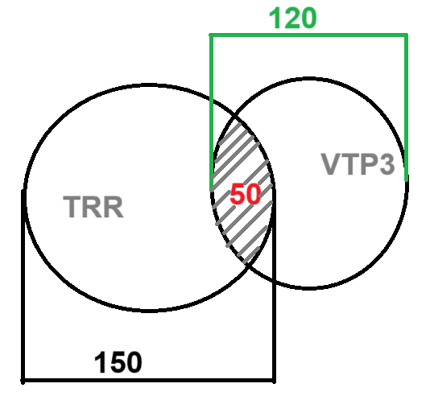
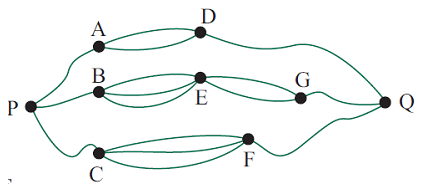

  <a className="button button--primary" href="/pdfs/toan-roi-rac/chapter2/bai12.pdf" download="bai12-toan-roi-rac.pdf" target="_blank" rel="noreferrer">
    Tải file PDF
  </a>

## 12.1. Nguyên lý cộng & nguyên lý bù trừ
### 12.1.1. **Nguyên lý cộng**
- Giả sử một công việc có thể được thực hiện theo một trong $k$ **<u>phương án</u>** $A$1, $A$2, …, $A$k. Trong đó có $n$1 **<u>cách</u>** thực hiện phương án $A$1, $n$2 cách thực hiện phương án $A$2, …, $n$k cách thực hiện phương án $A$k. Khi đó, công việc có thể thực hiện bởi:

$$
\boxed{n_1 + n_2 + \cdots + n_k = \sum_{i=1}^{k} n_i (cách)}
$$

### 12.1.2. **Nguyên lý cộng mở rộng – Nguyên lý bù trừ**
  - ***Ví dụ 1:*** Để chuẩn bị vào giai đoạn 2, một nhóm sinh viên gồm: 150 sinh viên chương trình 1 đã ghi tên hộc môn Toán rời rạc và 120 sinh viên ghi tên học Vi tích phân 3 ở học kỳ này. Hỏi có bao nhiêu sinh viên trong nhóm này. Biết rằng có 50 sinh viên ghi tên học cả hai môn.

  

    - Gọi $A$ là tập hợp các sinh viên ghi tên học môn Toán rời rạc và $B$ là tập hợp các sinh viên ghi tên học Vi tích phân 3.

    - Khi ấy tập hợp các sinh viên ghi tên học một trong hai môn là $A \cup B$.

    - Ta có: **\|$A \cup B$\| = \|$A$\| + \|$B$\|.**

    - Tuy nhiên như thế vẫn chưa đủ. Vì ***công thức trên chỉ dùng khi $A$, $B$ là 2 tập rời nhau.***

    - Tập hợp $A \cap B$ = ∅ và có 50 phần tử. Trong trường hợp này \|$A$\| + \|$B$\| không phải là số phần tử của \|$A \cup B$\| vì \[$A \cap B$\| được tính hai lần trong \|$A$\| và \|$B$\|.

    - Vì thế ta có: 
    
      $$
      \boxed{|A \cup B| = |A| + |B| - |A \cap B|}
      $$
      
      ***Đây chính là dạng mở rộng của nguyên lý cộng.***

    - Thay số, ta được: \|$A \cup B$\| = 150 + 120 – 50 = 220.

    - Vậy có 220 sinh viên trong nhóm.

  - ***Một ví dụ khác:*** Từ ví dụ trên. Hỏi có bao nhiêu sinh viên **ghi tên học một trong hai môn.** Biết rằng có 50 sinh viên ghi tên học cả hai môn.

    - **Số sinh viên chỉ học Toán rời rạc:** \|$A$∖$B$\| = \|$A$\| − \|$A \cap B$\| = 150 – 50 = 100

    - **Số sinh viên chỉ học Vi tích phân 3:** \|$B$∖$A$\| = \|$B$\| − \|$A \cap B$\| = 120 – 50 = 70

    - **Tổng số sinh viên chỉ học một môn:** \|$A$∖$B$\| + \|$B$∖$A$\| = 100 + 70 = 170.

  > **Về việc vì \[$A \cap B$\| được tính hai lần trong \|$A$\| và \|$B$\|:** Lấy ví dụ sau:
  >
  > Giả sử:
  > - Tập $A = \{1, 2, 3, 4\}$ (4 phần tử).
  > - Tập $B = \{3, 4, 5, 6, 7\}$ (5 phần tử).
  > - Giao $A \cap B = \{3, 4\}$ (2 phần tử).
  >
  > Cộng số phần tử của $A$ và $B$: $$|A| + |B| = 4 + 5 = 9$$
  >
  > Nhưng trong đó, $3, 4$ đã bị tính **hai lần**. Thực tế: $$|A \cup B| = 4 + 5 - 2 = 7$$

  - ***Ví dụ 2.*** cho $A$ = {0, 1, 2,3}, $B$ = {-2, -1, 0, 1, 2, 3}. Có bao nhiêu bộ ($x$, $y$) $\in A \times B$ sao cho $x$.$y$ = 0?
    - Để $x \cdot y = 0$, ít nhất một trong hai giá trị $x$ hoặc $y$ phải bằng 0. Ta sẽ phân tích các trường hợp sau:

    - **Trường hợp 1:** $x = 0$
      Khi $x = 0$, $y$ có thể là bất kỳ phần tử nào trong $B$, vì $0 \cdot y = 0$ với mọi giá trị của $y$. Số lượng cặp trong trường hợp này là $6$ (vì $y \in B$ có 6 phần tử).

    - **Trường hợp 2:** $y = 0$
      Khi $y = 0$, $x$ có thể là bất kỳ phần tử nào trong $A$, vì $x \cdot 0 = 0$ với mọi giá trị của $x$. Số lượng cặp trong trường hợp này là $4$ (vì $x \in A$ có 4 phần tử).

    > Lưu ý rằng khi $x = 0$ và $y = 0$, cặp $(0, 0)$ đã được tính hai lần, một lần trong trường hợp $x = 0$ và một lần trong trường hợp $y = 0$. Do đó, chúng ta cần **trừ** đi $1$ để loại bỏ sự trùng lặp.
    >
    > Tổng số cặp ($x$, $y$) sao cho $x$ ⋅ $y$ = 0 là: **6 + 4 - 1 = 9.**

  - ***Ví dụ 3:*** Giờ kiểm tra TRR có 3 bài. Biết rằng, **mỗi hs làm được ít nhất 1 bài.** Có:
    - 20 hs làm được bài 1. 14 hs làm được bài 2.
    - 10 hs làm được bài 3. 6 hs giải được bài 1 và 3.
    - 5 hs giải được bài 2 và bài 3. 2 hs giải được bài 1 và 2.
    - 1 hs giải được cả 3 bài.
    - Hỏi lớp có bao nhiêu học sinh.

    **<u>Giải:</u>** Gọi $A$ là số hs giải bài 1. $B$ là số hs giải bài 2. $C$ là số hs giải bài 3.
      - Tính số học sinh tức là tính $A \cup B \cup C$.
      - Ta có: \|$A \cup B \cup C$\| = \|$A$\| + \|$B$\| + \|$C$\| - \|$A \cap B$\| - \|$B \cap C$\| - \|$C \cap A$\| + \|$A \cap B \cap C$\|
      
      = 20 + 14 + 10 - 6 - 5 - 2 + 1 = 32

    > **Tại sao lại + \|$A \cap B \cap C$\| ?**
      > - Ban đầu, khi cộng \|$A$\| + \|$B$\| + \|$C$\|, các phần tử trong \|$A \cap B$\|, \|$B \cap C$\| và \|$C \cap A$\| đều bị tính nhiều lần.
      > - Khi trừ đi các giao \|$A \cap B$\|, \|$B \cap C$\| và \|$C \cap A$\|, ta loại bỏ phần tử chung **giữa hai tập**. Tuy nhiên, các phần tử thuộc cả **ba tập ($A \cap B \cap C$)** bị **trừ nhiều lần** (cụ thể là 3 lần, mỗi lần trong một giao).
      > - Ta cần **cộng lại \|$A \cap B \cap C$\|** một lần vì nó đã bị loại bỏ thừa trong bước trừ ở trên.
      > - ***Ví dụ minh họa:*** Giả sử: $A$ = {1, 2, 3}; $B$ = {3, 4, 5}; $C$ = {3, 6, 7}
      >
      >   - $A \cap B \cap C$ ={3}
      >
      >   - $\mid A \mid+\mid B \mid+$\mid $C$ \mid$ =3 + 3 + 3=$9
      >
      >   - **Trừ các giao đôi:**
      >     - $\mid A \cap B \mid$ ={3}⇒−1; $\mid B \cap C \mid$ ={3}⇒−1; $\mid C \cap A \mid$ ={3}⇒−1
      >
      >     - Tổng: 9−1−1−1=6.
      >
      >   - **Giao ba tập bị loại bỏ hoàn toàn:** Phần tử ‘3’ bị trừ đúng bằng số lần nó được cộng trước đó (+3 - 3 = 0).
      >
      >   - **Cộng lại giao ba tập:** Ta thêm lại phần tử 3 một lần để tính đúng: 6 + 1 = 7.
      >
      >   - **Kết quả:** Số phần tử trong $A \cup B \cup C$ = 7.

  - **Tổng quát cho $n$ tập hợp $(A_1, A_2, \ldots, A_n)$:**
  
   $$
  \boxed{
  \begin{aligned}
  |A_1 \cup A_2 \cup \cdots \cup A_n|
  ={}& \sum_{i=1}^{n} |A_i| \\
  &- \sum_{1 \le i < j \le n} |A_i \cap A_j| \\
  &+ \sum_{1 \le i < j < k \le n}
  |A_i \cap A_j \cap A_k| \\
  &- \cdots \\
  &+ (-1)^{n+1}
  |A_1 \cap A_2 \cap \cdots \cap A_n|
  \end{aligned}
  }
  $$
  
  > **Ý nghĩa của công thức:**
  > 1. **Cộng số phần tử của từng tập $(|A_i|)$:** Ban đầu, tất cả phần tử của $A_1, A_2, \ldots, A_n$ được tính.
  > 2. **Trừ số phần tử chung của từng cặp $(|A_i \cap A_j|)$:** Phần tử nằm ở cả $A_i$ và $A_j$ được tính hai lần, nên ta cần trừ đi.
  > 3. **Cộng lại số phần tử chung của ba tập $(|A_i \cap A_j \cap A_k|)$:** Khi trừ cặp đôi, phần tử chung của ba tập bị loại bỏ quá nhiều lần, nên cần cộng lại.
  > 4. **Tiếp tục cộng/trừ các giao của bốn tập, năm tập, ...:** Quá trình này tiếp tục xen kẽ cộng và trừ để loại bỏ hoặc bù lại các phần tử bị tính sai.
  > 5. **Dấu $(-1)^{n+1}$:** Xen kẽ cộng và trừ dựa trên số lượng tập trong giao. Ví dụ:
  >   - $+|A_i|$ cho tập đơn lẻ,
  >   - $-|A_i \cap A_j|$ cho giao hai tập,
  >   - $+|A_i \cap A_j \cap A_k|$ cho giao ba tập,
  >   - v.v.

## 12.2. Nguyên lý nhân
- Giả sử một công việc nào đó bao gồm $k$ giai đoạn $A$1, $A$2, …, $A$k trong đó có: $n$1 cách thực hiện thực hiện giai đoạn $A$1, $n$2 cách thực hiện giai đoạn $A$2, …, $n$k cách thực hiện giai đoạn $A$k. Khi đó công việc có thể được thực hiện bởi:

  $$
  \boxed{n_{1} \times n_{2} \times ... \times n_{k} = \prod_{i = 1}^{n}n_{i}  (cách)}
  $$

- **Ví dụ 1.** Hỏi có nhiêu cách đi từ $A$ đến $C$?

  **Đáp án.** $3 \times 2 = 6$ cách.

- **Ví dụ 2.** Có bao nhiêu chuỗi bit có độ dài 8?

  **Giải.** Mỗi bit có thể chọn 1 trong 2 cách: 0 hoặc 1. Theo nguyên lý nhân ta có số lượng chuỗi là $2^8 = 256$.

- **Ví dụ 3.** Cho tập $A$ gồm 6 phần tử và tập $B$ gồm 10 phần tử. Hỏi
  
  a) Có bao nhiêu ánh xạ từ $A$ vào $B$?
  
  b) Có bao nhiêu đơn ánh từ $A$ vào $B$?

  **Giải.** 
  
  a) Với mỗi phần tử $x$ của $A$ ta có 10 cách chọn ảnh của $x$ (vì $B$ có 10 phần tử). Theo nguyên lý nhân, ta có $10^6$ ánh xạ.
  
  b) Giả sử $A = \{x_1, x_2, \ldots, x_6\}$. Để xây dựng một đơn ánh ta cần thực hiện 6 bước:
  - Bước 1. Chọn ảnh của $x_1$ có 10 cách.
  - Bước 2. Chọn ảnh của $x_2$ có $10 - 1 = 9$ cách.
  - ...
  - Bước 6. Chọn ảnh của $x_6$ có $10 - 5 = 5$ cách.
  
  Vậy số đơn ánh là: $10 \times 9 \times 8 \times 7 \times 6 \times 5 = 151200$.

- **Ví dụ 4.** Từ các chữ số 0, 1, 2, 3, 4, 5 ta có thể lập được bao nhiêu số tự nhiên có ba chữ số khác nhau mà chia hết cho 2?

  **Giải.** Gọi số có ba chữ số là $\overline{abc}$.

  **Trường hợp 1.** $c = 0$. Khi đó
  - $c$ có 1 cách chọn
  - $a$ có 5 cách chọn ($a = X \setminus \{0\}$)
  - $b$ có 4 cách chọn ($b = X \setminus \{a, 0\}$)
  
  Trường hợp 1 có $1 \times 4 \times 5 = 20$ số.

  **Trường hợp 2.** $c \neq 0$. Khi đó
  - $c$ có 2 cách chọn
  - $a$ có 4 cách chọn ($a = X \setminus \{c, 0\}$)
  - $b$ có 4 cách chọn ($b = X \setminus \{a, c\}$)
  
  Trường hợp 2 có $2 \times 4 \times 4 = 32$ số.

  Như vậy có $20 + 32 = 52$ số.

- **Ví dụ 5:**
  
  - Để đi từ P đến Q, có 3 cách:
    - Hoặc đi qua A: 2 cách
    - Hoặc đi qua B: $3 \times 2 = 6$ cách
    - Hoặc đi qua C: 3 cách
  - Vậy tổng cộng có: $2 + 6 + 3 = 11$ cách đi từ P đến Q.

- **Ví dụ 6:** Một mẫu áo sơ mi đặc biệt có 12 màu, có 3 cỡ cho nam và 4 cỡ cho nữ. Hỏi có bao nhiêu loại khác nhau của mẫu áo này?
  
  Đáp số: $12 \times 3 + 12 \times 4 = 84$ mẫu áo.
