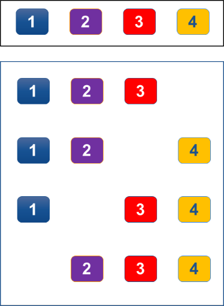

  <a className="button button--primary" href="/pdfs/toan-roi-rac/chapter2/bai13.pdf" download="bai13-toan-roi-rac.pdf" target="_blank" rel="noreferrer">
    Tải file PDF
  </a>

## 13.1. Chỉnh hợp
- ***Ví dụ mở đầu:*** Chọn 3 trong 5 sinh viên để thành lập ban cán sự lớp. Với quy tắc: Sinh viên thứ nhất làm lớp trưởng, Sinh viên thứ hai làm lớp phó, Sinh viên còn lại làm thủ quỹ. Hỏi có bao nhiêu cách chọn?

- Mỗi cách chọn ra 3 trong 5 sinh viên có kể thứ tự như trên gọi là một chỉnh hợp chập 3 của 5 phần tử.

- Tổng quát: Cho tập hợp $A$ gồm $n$ phần tử và **số nguyên** $k$ với 1 $\le k \le n$. Khi **lấy ra $k$ phần tử của $A$ và <u>sắp xếp chúng theo một thứ tự</u>**, ta được một chỉnh hợp chập $k$ của $n$ phần tử của $A$ (gọi tắt là một chỉnh hợp chập $k$ của $A$).

- Số lượng chỉnh hợp chập $k$ của một tập hợp có $n$ phần tử, 1 $\le k \le n$, được tính như sau:

  - Phần tử thứ 1 có $n$ cách chọn
  - Phần tử thứ 2 có $n$ - 1 cách chọn
  - Phần tử thứ 3 có $n$ - 2 cách chọn
  - ...
  - Phần tử thứ $k$ có $n$ – ($k$ – 1) = $n$ - $k$ + 1 cách chọn
  - Vậy theo quy tắc nhân ta có:

  $$
  \boxed{A_n^k = n(n - 1)(n - 2)\ldots(n - k + 1) = \frac{n!}{(n - k)!}}
  $$

  ***Chứng minh:***

$$
\frac{n!}{(n - k)!} = \frac{n.(n - 1)(n - 2)...(n - k + 1)\bcancel{(n - k)(n - k - 1)...1}}{\bcancel{(n - k)(n - k - 1)...1}} = n.(n - 1)(n - 2)...(n - k + 1)
$$

- **Ví dụ:** Từ 3 điểm $A$, $B$ và $C$ sẽ lập được bao nhiêu **vector?**

  **Giải:**

  - Số vector được tạo thành từ 3 điểm $A$,$B$,$C$ chính là số chỉnh hợp chập 2 của 3: $A_{3}^{2} = 6$

  - Vậy có 6 vector được tạo thành từ 3 điểm $A$, $B$, $C$.

## 13.2. Hoán vị
- **Mỗi chỉnh hợp chập $n$ của $n$ phần tử** được gọi là một hoán vị của các phần tử đó.

- Cho tập $A$ có $n$ ($n \ge$ 1) phần tử. Khi **<u>sắp xếp $n$ phần tử này theo một thứ tự</u>**, ta được một hoán vị các phần tử của tập $A$ (gọi tắt là một hoán vị của $A$).

- Số lượng hoán vị của tập có $n$ phần tử: 

  $$
  \boxed{P_n = A_n^n = n(n-1)(n-2)\cdots 1 = n!}
  $$

- Ta có: **0! = 1**

- **Ví dụ:** Một đoàn khách du lịch dự định đến tham quan 7 điểm $A$, $B$, $C$, $D$, $E$, $F$, $G$. Hỏi có bao nhiêu cách **<u>chọn thứ tự</u>** tham quan?

  **Giải:**

  - Mỗi cách họ chọn thứ tự tham quan là một hoán vị của tập $A$, $B$, $C$, $D$, $E$, $F$, $G$.

  - Do vậy đoàn khách có tất cả: $P$7 = 7! = 5040 cách chọn thứ tự tham quan.

> ***\* Lấy có thứ tự & không thứ tự?***
> - **Lấy có thứ tự** thường xuất hiện trong các bài toán cần quan tâm đến ***vai trò, vị trí, hay cách sắp xếp*** của các phần tử, ví dụ: xếp ghế, phân công nhiệm vụ, hoặc chạy đua.
> - Số cách **lấy có thứ tự** luôn **lớn hơn hoặc bằng** số cách **lấy không thứ tự**, vì mỗi nhóm phần tử trong trường hợp không thứ tự tương ứng với nhiều cách sắp xếp khác nhau trong trường hợp có thứ tự.
>   - Giả sử bạn có 3 phần tử {$A$, $B$, $C$} và muốn chọn 2 phần tử, nhưng thứ tự là quan trọng.
>   - Các tổ hợp **có thứ tự** sẽ bao gồm: {$A$, $B$}, {$A$, $C$}, {$B$, $A$}, {$B$, $C$}, {$C$, $A$}, {$C$, $B$}
>   - {$A$, $B$} và {$B$, $A$} được xem là **khác nhau** vì thứ tự khác nhau.
>   - Số lượng các cách chọn sẽ lớn hơn so với trường hợp **không thứ tự**.
> - **Lấy không thứ tự**
>   - Nếu thứ tự không quan trọng, bạn chỉ quan tâm đến nhóm các phần tử được chọn, bất kể chúng xuất hiện theo thứ tự nào.
>   - Các tổ hợp **không thứ tự** từ {$A$, $B$, $C$} khi chọn 2 phần tử sẽ là: {$A$,$B$},{$A$,$C$},{$B$,$C$}
>   - Ở đây, ($A$, $B$) và ($B$, $A$) được xem là **giống nhau**.

## 13.3. Tổ hợp
- Cho tập hợp $A$ gồm $n$ phần tử và **số nguyên** $k$ với 1 $\le k \le n$. Mỗi tập con của $A$ có $k$ phần tử **<u>không kể thứ tự</u>** được gọi là một tổ hợp chập $k$ của $n$ phần tử của $A$ (gọi tắt là một tổ hợp chập $k$ của $A$).

- Số lượng tổ hợp chập $k$ của một tập hợp có $n$ phần tử, 1 $\le k \le n$, được tính như sau:

- Giả sử số tổ hợp là $C_{n}^{k}$. Ta có $C_{n}^{k}$. $k$! = $A_{n}^{k}$ (Mỗi hoán vị của một tổ hợp chập $k$ cho trước tạo ra $k$! chỉnh hợp tương ứng – lấy ra $k$ phần tử, thực hiện hoán vị $k$ phần tử đó).

- Từ đó, ta có: 

  $$
  \boxed{C_{n}^{k} = \frac{A_{n}^{k}}{k!} = \frac{n!}{(n - k)!k!}}
  $$

- **Ký hiệu:** $C_{n}^{k}, nCk, \binom{n}{k}$.

- **Tính chất:** 
  - $C_{n}^{n - k} = C_{n}^{k},\quad 0 \leq k \leq n.$
  - $$ C_{n}^{k} + C_{n}^{k - 1} = C_{n + 1}^{k},\quad 1 \leq k \leq n.$$
  - $$C_{n}^{1} = C_{n}^{n - 1} = n.$$
  - $$C_{n}^{0} = C_{n}^{n} = 1$$

- **Ví dụ 1:** Cho tập $A$ gồm 4 số tự nhiên {1,2,3,4}. Tìm tất cả các tập con của $A$ sao cho các tập con chỉ có 3 phần tử.

  

  **Giải:** *Số tập con có thể tìm được là* $\text{C}_{\text{4}}^{\text{3}}$ *= 4*
  
- **Ví dụ 2:** Từ 3 điểm $A$, $B$ và $C$, bạn sẽ có bao nhiêu đoạn thẳng được tạo ra?
  
  **Giải:**
  - Số đoạn thẳng được tạo thành từ 3 điểm $A$, $B$, $C$ chính là **số tổ hợp chập 2 của 3:** $C_{3}^{2} = 3$

  - Vậy có 3 đoạn thẳng được tạo thành từ 3 điểm $A$, $B$, $C$.

## 13.4. Chỉnh hợp lặp
- Mỗi cách chọn ra $k$ phần tử **(có quan tâm thứ tự)** từ $n$ **loại** phần tử **(*trong đó mỗi loại phần tử có thể được chọn lại nhiều lần* –** *nghĩa là ta chọn xong rồi trả lại như ban đầu***)** được gọi là một ***<u>chỉnh hợp lặp chập $k$ của $n$</u>.***

- **Số các chỉnh hợp lặp chập $k$ của $n$ là:**

$$
\boxed{{\bar{A}}_{n}^{k} = V_{n}^{k} = \underbrace{n \times n \times n \times ... \times n}_{kson} = n^{k}}
$$

- **Ví dụ 1:** Có bao nhiêu cách lấy 2 phần tử (có thể lấy lặp lại) từ $M$ = {2, 3, 5}.

  Ta có các kết quả sau: {2, 2} {2, 3} {2, 5} {3, 2} {3, 3} {3, 5} {5, 2} {5, 3} {5, 5}

  **Giải:** Số cách lấy theo yêu cầu bài toán: ${\bar{A}}_{3}^{2} = 3^{2} = 9$.

- **Ví dụ 2:** Có bao nhiêu password gồm 6 chữ số được lập thành từ 10 chữ số 0,1,2, ..., 9?
  
  **Giải:** Số lượng mật khẩu gồm 6 chữ số theo yêu cầu đề: ${\bar{A}}_{10}^{6} = 10^{6} = 1000000$.

## 13.5. Hoán vị lặp
- Cho <u>$n$ đối tượng</u>, trong đó <u>có **$n$i đối tượng loại $i$** giống hệt nhau</u> ($i$ =$1,2,…,$k$) và **$n$1 + $n$2,…+ $n$k = $n$.**

- Nghĩa là:

  - *$n$1 đối tượng giống nhau thuộc loại 1,*

  - *$n$2 đối tượng giống nhau thuộc loại 2,*

  - *…,*

  - *$n$k đối tượng giống nhau thuộc loại $k$.*

- Mỗi cách sắp xếp có thứ tự $n$ đối tượng đã cho gọi là một hoán vị lặp của $n$.

- Số tất cả các hoán vị lặp của $n$ phần tử ở trên là:

$$
\boxed{P\left( n_{1},n_{2},...,n_{k} \right) = \frac{n!}{n_{1}!n_{2}!...n_{k}!}}
$$
  *Chứng minh:*

  - Để xác định số hoán vị trước tiên chúng ta nhận thấy có $C_{n}^{n_{1}}$ cách giữ chỗ cho $n$1 phần tử loại 1, còn lại $n$ – n1 chỗ trống.

  - Sau đó có $C_{n - n_{1}}^{n_{2}}$ cách đặt $n$2 phần tử loại 2 vào hoán vị, còn lại $n$ – $n$1 – $n$2 chỗ trống.

  - Tiếp tục đặt các phần tử loại 3 vào chỗ trống trong hoán vị. Theo quy tắc nhân tất cả các hoán vị có thể là:

  $$
  C_{n}^{n_{1}}.C_{n - n_{1}}^{n_{2}}.C_{n - n_{1} - n_{2}}^{n_{3}} = \frac{n!}{n_{1}!\left( n - n_{1} \right)!}.\frac{\left( n - n_{1} \right)!}{n_{2}!\left( n - n_{1} - n_{2} \right)!}.\frac{\left( n - n_{1} - n_{2} \right)!}{n_{3}!\left( n - n_{1} - n_{2} - n_{3} \right)!}
  $$
  - Tương tự với các phần tử loại 4 , … , loại $k$ – 1 đặt vào chỗ trống trong hoán vị. Cuối cùng có $C_{n - n_{1} - n_{2} - ... - n_{k - 1}}^{n_{k}}$cách đặt $n$k phần tử loại $k$ vào hoán vị. Theo quy tắc nhân:

  $$
  C_n^{n_1} \cdot C_{n - n_1}^{n_2} \ldots C_{n - n_1 - \ldots - n_{k - 1}}^{n_k} = \frac{n!}{n_1! n_2! \ldots n_k!}
  $$

**Ví dụ 1:** Từ tập $X$ = {1;2;3;4;5;6;7;8} lập được bao nhiêu số tự nhiên có 11 chữ số sao cho chữ số 1 có mặt 4 lần, các chữ số khác có mặt 1 lần?

- Mỗi cách lập số có 11 chữ số sao cho **chữ số 1 có mặt 4 lần**, **các chữ số khác có mặt 1 lần** là một hoán vị lặp của 11 phần tử. (số 1 xuất hiện 4 lần; các số khác 1 lần).

- Theo quy tắc hoán vị lặp có tất cả số các số thỏa mãn là:

$$
P(4, 1, 1, 1, 1, 1, 1, 1, 1) = \frac{11!}{4! 1! 1! 1! 1! 1! 1! 1! 1!} = \frac{11!}{4!}
$$

**Ví dụ 2:** Có bao nhiêu chuỗi ký tự khác nhau nhận được bằng cách sắp xếp lại các ký tự của chuỗi: “YAMAHAM”?

- Số ký tự có trong chuỗi là: $n$ = 7

- Có 3 ký tự ‘$A$’; Có 2 ký tự ‘$M$’; Có 1 ký tự ‘$Y$’; Có 1 ký tự ‘$H$’

- Do đó số chuỗi có được là: $P(3,2,1,1) = \frac{\text{7!}}{3\text{!2}\text{!1}\text{!1}!} = \text{420}$

**Ví dụ 3:** Với các chữ số **0; 1; 2; 3; 7; 9** có thể lập được bao nhiêu **số gồm 8 chữ số,** trong đó chữ số 1 có mặt 3 lần, mỗi chữ số khác có mặt đúng một lần?

- Gọi số có 8 chữ số là: $$\overline{a_1 a_2 \ldots a_8}.$$

- Mỗi cách lập số có 8 chữ số sao cho chữ số 1 xuất hiện 3 lần và các số khác có mặt xuất hiện 1 lần là một hoán vị lặp của 8 phần tử (số 1 xuất hiện 3 lần; các số khác xuất hiện 1 lần) **(tính cả trường hợp a1 = 0).**

  Theo quy tắc hoán vị lặp có tất cả: $$P(3, 1, 1, 1, 1, 1) = \frac{8!}{3! \cdot 1! \cdot 1! \cdot 1! \cdot 1! \cdot 1!} = 6720 \text{ số}$$

- Xét trường hợp $a$1 = 0.**

  - Ta tính số các số có 7 chữ số được lập từ các chữ số 1;2;3;7;9 trong đó chữ số 1 có mặt 3 lần; các chữ số khác có mặt đúng 1 lần.
  - Theo quy tắc hoán vị lặp có tất cả: $$P(3; 1; 1; 1; 1) = \frac{7!}{3! \cdot 1! \cdot 1! \cdot 1! \cdot 1!} = 840 \text{ số.}$$

- Suy ra số các số thỏa mãn đề bài là: **6720 – 840 = 5880 số.**

**Ví dụ 4:** Từ tập $X$ = {1; 2; 4; 6; 7; 9}. Từ tập $X$ ta lập được bao nhiêu **số có 8 chữ số** sao cho **chữ số 4 xuất hiện 2 lần**; **chữ số 2 xuất hiện 2 lần**; các **chữ số khác xuất hiện đúng 1 lần** và số đó không chia hết cho 2.

- Gọi số thỏa mãn bài toán là: $$\overline{a_1 a_2 \ldots a_8}.$$

- Vì số này không chia hết cho 2 nên $a_{8} ∈$ {1; 7; 9}.
- **Nếu $a$8 = 1.** Bài toán trở thành **<u>tính số các số có 7 chữ số</u>** sao cho chữ số 4 xuất hiện 2 lần; chữ số 2 xuất hiện 2 lần; **các số 6; 7; 9 xuất hiện 1 lần.**
  Theo quy tắc hoán vị lặp có: $$P(2; 2; 1; 1; 1) = \frac{7!}{2! \cdot 2! \cdot 1! \cdot 1! \cdot 1!} = 1260 \text{ số.}$$

- Tương tự; nếu **$a$8 = 7; 9** ta cũng có 1260 số thỏa mãn.

-Suy ra: số các số thỏa mãn đầu bài là: **1260 + 1260 + 1260 = 3780 số.**
