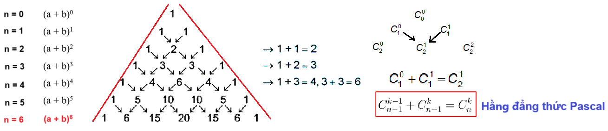
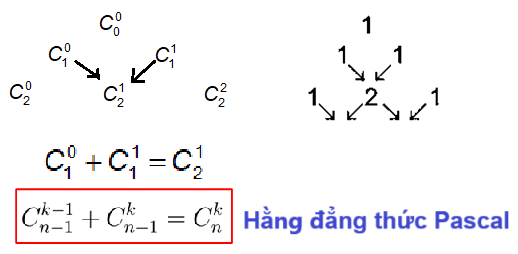

  <a className="button button--primary" href="/pdfs/toan-roi-rac/chapter2/bai15.pdf" download="bai15-toan-roi-rac.pdf" target="_blank" rel="noreferrer">
    Tải file PDF
  </a>

## 15.1. Vận dụng Nhị thức Newton
- **Định lý:** Với $a$, $b \in R$ và $n$ là số nguyên dương ta có:

  $\boxed{(a + b)^{n} = \sum_{k = 0}^{n}{C_{n}^{k}a^{n - k}b^{k}} = \sum_{k = 0}^{n}{C_{n}^{k}a^{k}b^{n - k}} = \underbrace{C_{n}^{0}a^{n}}_{so hangthunhat} + \underbrace{C_{n}^{1}a^{n - 1}b}_{thuhai} + ... + C_{n}^{k}a^{n - k}b^{k} + ... + \underbrace{C_{n}^{n - 1}a.b^{n - 1}}_{thun} + \underbrace{C_{n}^{n}b^{n}}_{thun + 1}}$ **(1)**

  ***Chứng minh***

  Ta chứng minh (1) bằng quy nạp theo $n$.
  - Khi $n = 1$, ta có
    $$(a+b)^1 = a + b = C_1^0 a + C_1^1 b.$$
  
  Vậy công thức (1) đúng khi $n = 1$.
  
  - Với giả thiết (1) là đúng với $n = m$, tức là ta có
    $$(a+b)^m = C_m^0 a^m + C_m^1 a^{m-1} b + \ldots + C_m^{m-1} a b^{m-1} + C_m^m b^m.$$
  
  Ta sẽ chứng minh rằng (1) cũng đúng khi $n = m + 1$, tức là
  $$(a+b)^{m+1} = C_{m+1}^0 a^{m+1} + C_{m+1}^1 a^m b + \ldots + C_{m+1}^m a b^m + C_{m+1}^{m+1} b^{m+1}. \quad (2)$$
  
  Thật vậy, ta có
  $$
  \begin{align*}
  (a+b)^{m+1} &= (a+b)^m (a+b) \\
  &= (C_m^0 a^m + C_m^1 a^{m-1} b + \ldots + C_m^{m-k} a^{m-k} b^k + \ldots + C_m^{m-1} a b^{m-1} + C_m^m b^m)(a+b) \\
  &= (C_m^0 a^m + C_m^1 a^{m-1} b + \ldots + C_m^{m-k} a^{m-k} b^k + \ldots + C_m^{m-1} a b^{m-1} + C_m^m b^m) a \\
  &\quad + (C_m^0 a^m + C_m^1 a^{m-1} b + \ldots + C_m^{m-k} a^{m-k} b^k + \ldots + C_m^{m-1} a b^{m-1} + C_m^m b^m) b \\
  &= C_m^0 a^{m+1} + (C_m^1 + C_m^0) a^m b + \ldots + (C_m^k + C_m^{k-1}) a^{m+1-k} b^k + \ldots + (C_m^m + C_m^{m-1}) a b^m + C_m^m b^{m+1}.
  \end{align*}
  $$
  
  Vì $C_m^0 = 1 = C_{m+1}^0, C_m^m = 1 = C_{m+1}^{m+1}, C_m^k + C_m^{k-1} = C_{m+1}^k$, nên ta có (2).
  
  Vậy công thức nhị thức Newton là đúng với mọi số nguyên dương $n$.

  **Chú ý.** Số hạng thứ $(k+1)$ trong khai triển của $(a+b)^n$ thành dạng (1) là $T_{k+1} = C_n^k a^{n-k} b^k$.

- **Tính chất:**

  - Số các số hạng của công thức là $n$ + 1.
  - Tổng các số mũ của $a$ và $b$ trong mỗi số hạng luôn luôn bằng số mũ của nhị thức: **$k$ + $n$ - $k$ = $n$.**
  - Số hạng tổng quát (thứ $k$ + 1) của nhị thức là: $T_{k + 1} = C_{n}^{k}a^{n - k}b^{k}$
  - Các hệ số nhị thức cách đều hai số hạn đầu và cuối thì bằng nhau.

**Ví dụ 1:**

  $$
  (x+y)^6 = x^6 + 6x^5y + 15x^4y^2 + 20x^3y^3 + 15x^2y^4 + 6xy^5 + y^6
  $$

  > Số hạng chứa $x^k$ trong khai triển của $(ax+b)^n$ là $C_n^{n-k} (ax)^k b^{n-k}$ hay $C_n^{n-k} a^k b^{n-k} x^k$.
Do đó, hệ số của $x^k$ trong khai triển của $(ax+b)^n$ là $C_n^{n-k} a^k b^{n-k}$.

**Ví dụ 2.** Tìm hệ số của $x^4$ trong khai triển của $(x+2)^{10}$.

**Giải.** 
- Số hạng chứa $x^k$ trong khai triển của $(x+2)^{10}$ là $C_{10}^{10-k} x^k 2^{10-k}$.
- Số hạng chứa $x^4$ ứng với $k=4$, tức là số hạng $C_{10}^6 x^4 2^6$ hay $13 \ 440 x^4$.
- Vậy hệ số của $x^4$ trong khai triển của $(x+2)^{10}$ là $13 \ 440$.

**Ví dụ 3:** Tìm hệ số của $x$4 trong khai triển ($x$2 - 2)5

- $(x^2 - 2)^5 = \sum_{k=0}^{5} C_5^k (x^2)^k (-2)^{5-k}$

- $(x^2)^k = x^4 \Rightarrow k = 2$

- Khi $k$ = 2 thì hệ số của $x$4: $C_{5}^{2}( - 2)^{5 - 2} = - 80$

**Ví dụ 4:** Tìm hệ số của số hạng trong khai triển (2x −3y)17

- Số hạng tổng quát:

$$C_{17}^k (2x)^{17-k} (-3y)^k = C_{17}^k 2^{17-k} (-3)^k x^{17-k} y^k$$

- Để có số hạng chứa $x^{8} y^{9}$ thì: $x^{17 - k}y^{k} = x^{8}y^{9}$ =\> $k$ = 9.

- Vậy hệ số của số hạng chứa $x^{8} y^{9}$ là: $$C_{17}^9 \cdot 2^8 \cdot (-3)^9 = -2^8 3^9 C_{17}^9$$

**Ví dụ 5:** Tìm hệ số của số hạng trong khai triển (3x – $x$2)12

- Số hạng tổng quát:
  $$
  \begin{aligned}
  C_{12}^{k}(3x)^{12-k}(-x^2)^k
  &= C_{12}^{k}3^{12-k}(-1)^k x^{12-k}(x^2)^k \\
  &= C_{12}^{k}3^{12-k}(-1)^k x^{12+k}
  \end{aligned}
  $$

- Để có số hạng chứa $x$15 thì: 12 + $k$ = 15 $\Leftrightarrow k$ = 3.

- Vậy hệ số của số hạng chứa $x$15 là $$-3^9 C_{12}^3$$

> **Khai triển mở rộng**
> $$
>(a_{1} + a_{2} + ... + a_{k})^{n} = \sum_{n_{1} + n_{2} + ... + n_{k} = n}^{}{\left( \begin{aligned}
> & n \\
> & n_{1},...,n_{k}
>\end{aligned} \right){a_{1}}^{n_{1}}{a_{2}}^{n_{2}}...{a_{k}}^{n_{k}}}
> $$
> **với các số nguyên không âm $n$1, $n$2, …, $n$k thoả $n$1 + $n$2 + … + $n$k = $n$, ký hiệu**
> $$
>\left( \begin{aligned}
> & n \\
> & n_{1},n_{2},...,n_{k}
>\end{aligned} \right) = \frac{n!}{n_{1}!n_{2}!...n_{k}!}
>$$
>$$
>\Rightarrow \boxed{(a_{1} + a_{2} + ... + a_{k})^{n} = \sum_{n_{1} + n_{2} + ... + n_{k} = n}^{}{\frac{n!}{n_{1}!n_{2}!...n_{k}!}{a_{1}}^{n_{1}}{a_{2}}^{n_{2}}...{a_{k}}^{n_{k}}}}
> $$

**Ví dụ.** Tìm hệ số của $x^3 y^5 z$ trong khai triển $(x + 2y - 3z + t)^9$

**Giải.** Áp dụng Định lý trên, ta có số hạng chứa $x^3 y^5 z$ là
$$\frac{9!}{3! \, 5! \, 1! \, 0!} x^3 (2y)^5 (-3z)^1 t^0 = -48384 x^3 y^5 z.$$

Vậy hệ số của $x^3 y^5 z$ là $-48384$.

- Các hệ số của khai triển ($a$ + $b$)n với một số giá trị đầu tiên của $n$, trong bảng tam giác sau đây, gọi là **tam giác Pascal**

  - **Công dụng:** Những người không biết về nhị thức Newton có thể tra cứu dựa trên tam giác này!

  

  - **Nhận xét:** Các hệ số tổ hợp đối xứng theo từng hàng.

  

## 15.2. Nguyên lý chuồng bồ câu (Dirichlet)
- Nếu nhốt $n$ \> $m$ con chim bồ câu vào $m$ chuồng thì tồn tại một chuồng nào đó chứa nhiều hơn 1 chim bồ câu.

- ***Nguyên lý cơ bản:*** Nếu ta đặt $n$ đối tượng nào đó vào $k$ hộp, và số hộp $k$ nhỏ hơn số đối tượng $n$, thì có ít nhất một hộp chứa từ 2 đối tượng trở lên.

- ***Nguyên lý mở rộng:*** Nếu ta đặt $n$ đối tượng vào $k$ hộp thì sẽ tồn tại một hộp chứa ít nhất là **\[$n$/$k$\]** đối tượng.

- **Chú ý:** Ký hiệu \[$a$\] được gọi là *Giá trị trần* của $a$, dùng để chỉ số nguyên nhỏ nhất lớn hơn hoặc bằng $a$.

  **Ví dụ: \[5\]=5, \[4/3\]=2, \[2.1\] = 3; \[1.9\] = 2; \[4\] = 4; \[−1.1\] = −1; \[−2.9\] = −2.**

<!-- -->

- ***Phát biểu tương tự:***
  - Nếu nhốt $n$ con thỏ vào $m \ge 2$ cái chuồng thì tồn tại một chuồng có ít nhất $\left[ \frac{n + m - 1}{m} \right]$ con thỏ, ở đây kí hiệu $[\alpha]$ để chỉ phần nguyên của số $\alpha$.
  - Ta chứng minh nguyên lí Dirichlet mở rộng như sau: Giả sử trái lại mọi chuồng thỏ không có đến $$\boxed{\left[ \frac{n + m - 1}{m} \right] = \left[ \frac{n - 1}{m} + 1 \right] = \left[ \frac{n - 1}{m} \right] + 1}$$ con, thì số thỏ trong mỗi chuồng đều nhỏ hơn hoặc bằng $\left[ \frac{n - 1}{m} \right]$ con. 
  - Từ đó suy ra tổng số con thỏ không vượt quá $n - 1$ con. Điều này vô lí vì có $n$ con thỏ.

**Ví dụ:**

1.  Có 20 chim bồ câu ở trong chuồng có 7 ô. Khi đó sẽ có ít nhất 1 ô chứa \[20 / 7\] = 3 con bồ câu trở lên.

2.  Có 100 người thì có ít nhất \[100 / 12\] = 9 người sinh cùng tháng.

3.  Số sinh viên của một lớp học ít nhất là bao nhiêu để có **ít nhất hai sinh viên đạt số điểm như nhau** trong kỳ thi môn CTRR, nếu **thang điểm là số nguyên từ 0→10**?

    - **$n$:** số sinh viên của lớp

    - **$k$:** số loại điểm nguyên từ 0→10 ⇒ **$$k$ =$11**

    - **Tìm $n$min =? biết \[$n$/$k$\] = \[$n$/11\] = 2**

    - Theo NL chuồng bồ câu: \[$n$/11\] = 2 ⇔ 1 \< n/11 ≤ 2 ⇔ 11\< n ≤ 22⇒ nmin = 12

4.  *Trong một phòng họp có $n$ người, bao giờ cũng tìm được 2 người có số người quen trong số những người dự họp là như nhau.*

    - Số người quen của mỗi người trong phòng họp nhận các giá trị từ 0 đến $n$ − 1. Rõ ràng trong phòng không thể đồng thời có người có số người quen là 0 (tức là không quen ai) và có người có số người quen là $n$ − 1 (tức là quen tất cả).

    - Vì vậy theo số lượng người quen, ta chỉ có thể **phân $n$ người ra thành $n$ − 1 nhóm.**

    - Vậy theo nguyên lý Dirichlet tồn tại một nhóm có ít nhất 2 người, tức là luôn tìm được ít nhất 2 người có số người quen là như nhau.

5.  *Trong một tháng gồm 30 ngày, **một đội bóng chuyền thi đấu mỗi ngày ít nhất 1 trận nhưng chơi không quá 45 trận.** Chứng minh rằng tìm được **một giai đoạn gồm một số ngày liên tục** nào đó trong tháng sao cho trong giai đoạn đó **đội chơi đúng 14 trận.***

    - Gọi **$a$j** là **số trận** mà đội đã chơi từ ngày đầu tháng **đến hết ngày $j$.**

    - Khi đó \(1 \leq a_1 < a_2 < \ldots < a_{30} \leq 45\)

      \(\Leftrightarrow 15 \leq a_1 + 14 < a_2 + 14 < \ldots < a_{30} + 14 \leq 59.\)

    - **Sáu mươi** số nguyên $a$1, $a$2, ..., $a$30, $a$1 + 14, $a$2 + 14, ..., $a$30 + 14 nằm giữa 1 và 59.

      Ở đây, ta có 60 số nguyên trong khoảng từ 1 đến 59, nhưng chỉ có 59 giá trị trong khoảng đó. Do đó, theo nguyên lý Dirichlet, ít nhất có hai số trong dãy $a_1, a_2, \ldots, a_{30}, a_1 + 14, a_2 + 14, \ldots, a_{30} + 14$ bằng nhau.

    - Vì vậy tồn tại $i$ và $j$ sao cho **$a$i = $a$j+ 14 ($j$ \< i) ⇔ a$i$ – $a$j = 14.** Điều này có nghĩa là từ ngày $j$ + 1 đến hết ngày $i$ đội đã chơi đúng 14 trận.

  > **Tại sao không phải là $a_i = a_j$?**
  >   - Nếu ta có $a_i = a_j$ (với $i \neq j$), điều này có nghĩa là đội bóng đã chơi một số lượng trận giống nhau vào hai thời điểm khác nhau (ngày $i$ và ngày $j$). 
  >   - Tuy nhiên, điều này sẽ mâu thuẫn với định nghĩa của dãy $a_j$, vì dãy này luôn tăng dần (với $a_1 < a_2 < \ldots < a_{30}$). 
  >   - Vì vậy, không thể có hai phần tử $a_i$ và $a_j$ bằng nhau trong dãy này.
  >
  > **Tại sao phải là $a_i = a_j + 14$?**
  >   - Việc cộng thêm 14 vào mỗi giá trị của dãy là để tạo ra sự khác biệt rõ ràng khi áp dụng nguyên lý Dirichlet. Nếu ta có $a_i = a_j + 14$, điều này có nghĩa là số trận đội bóng đã chơi trong khoảng thời gian từ ngày $j + 1$ đến ngày $i$ là 14 trận.
  >   - Khi ta tính toán sự chênh lệch giữa các giá trị này (tức là $a_i - a_j = 14$), ta thấy rằng số trận đội chơi trong giai đoạn từ ngày $j + 1$ đến ngày $i$ sẽ đúng bằng 14. Điều này chính là điều ta cần chứng minh trong bài toán.
