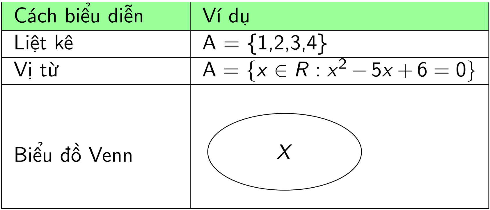
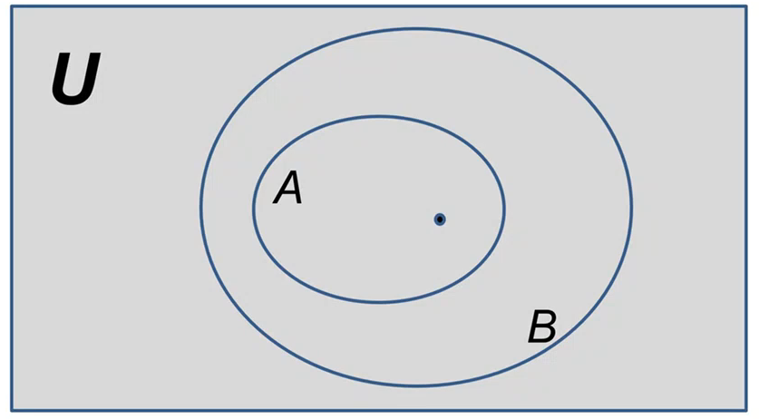

  <a className="button button--primary" href="/pdfs/toan-roi-rac/chapter2/bai7.pdf" download="bai7-toan-roi-rac.pdf" target="_blank" rel="noreferrer">
    Tải file PDF
  </a>

## 7.1. **Khái niệm**
  - Tập hợp là một khái niệm nguyên thủy, không có định nghĩa.

  - Tập hợp được coi là sự tụ tập của các phần tử, thường bao gồm (các) phần tử có **cùng tính chất** nào đó.

## 7.2. **Kí hiệu**
  - Tập hợp kí hiệu bằng chữ cái in hoa, ví dụ: $A$, $B$, $C$, $X$, $Y$, ...

  - Phần tử của tập hợp kí hiệu bằng chữ cái in thường, ví dụ: $a$, $b$, ...

- **Biểu diễn & ví dụ:**

## 7.3. **Phân loại**
  - Tập hợp rỗng: $∅$ Tập không chứa bất kỳ phần tử nào.

  - Tập hợp có hữu hạn các phần tử: $\|A\| = n, n ∈\mathbb{N}$.

  - Tập hợp có vô hạn các phần tử: $\|A\| = +∞.$

  - Tập vũ trụ: *$U$* Tập tất cả các phần tử ở ngữ cảnh đang xét.

    Các tập vũ trụ thường dùng: $\mathbb{R}, \mathbb{R}^{+}, \mathbb{N}, \mathbb{Z}, \mathbb{Q}, \mathbb{C}$.

    $\mathbb{C} = \{x + yi : x,y \in \mathbb{R}, i^2 = -1\}$.

  **Ví dụ**

  

  > - Tập vũ trụ $U$ được biểu diễn bởi hình chữ nhật.
  > - Mỗi tập con của $U$ được biểu diễn bởi phần trong của một vòng kín.

  - Nếu $A \subseteq B$: vùng biểu diễn $A$ hoàn toàn nằm trong vùng biểu diễn $B$ để đảm bảo rằng mọi phần tử thuộc vùng biểu diễn tập $A$ cũng nằm trong vùng biểu diễn tập $B$.

## 7.4. **Lực lượng của tập hợp (cadinality)**
  - Số phần tử của tập hợp $A$ được gọi là **lực lượng của tập hợp**, kí hiệu $|A|$. *(Đôi khi có ký hiệu là $#A, N(A)$).*

  - Nếu $A$ có hữu hạn phần tử, ta nói $A$ *hữu hạn*. Ngược lại, ta nói $A$ *vô hạn*.

  - ***Ví dụ.***

    · $|Ø| = 0$.

    · $\mathbb{N},\mathbb{Z},\mathbb{Q},\mathbb{R}$ là các tập vô hạn.

    · $X = \{1, 3, 4, 5\}$ là tập hữu hạn với $|X| = 4$.

    · $|\{n : n \text{ là số nguyên tố}\}| = \infty$.

## 7.5. Tính chất
- Cho $A$, $B$ là các tập hữu hạn. Khi đó:

  **1)** $|A ∪ B| = |A| + |B| - |A ∩ B|$

  **2)** $|A × B| = |A|. |B|$

  **3)** $|P(A)| = 2^{|A|}$

  > | Kí hiệu | Ý nghĩa |
  > | :---: | :--- |
  > | $x \in A$ | $x$ là phần tử của $A$ |
  > | $x \notin A$ | $x$ không là phần tử của $A$ |

## 7.6. **Quan hệ giữa các tập hợp**
  - ***Bao hàm / Con.*** Nếu *mọi phần tử của tập hợp $A$ đều là phần tử của tập hợp $B$* thì tập hợp $A$ được gọi là tập hợp con của tập hợp $B$, ký hiệu là $A ⊆ B$, nghĩa là **$A ⊆ B ⇔ ∀ x ∈ A → x ∈ B$.**

    - $A ⊆ A$: một tập luôn là tập con của chính nó.

    - **Để chứng minh $A$ là tập con của $B$,** ta cần chỉ ra với một phần tử $x$ bất kỳ, $x ∈ A$ thì $x$ cũng thuộc $B$.

  - ***Tập con thực sự.*** Nếu **$A ⊆ B$,** nhưng **$A ≠ B$,** khi đó ta nói **$A$ là tập con thực sự của $B$**. Ký hiệu: **$A ⊂ B$.**

    - ***Ví dụ:*** Giả sử $A = \{1,2,3\}$, $B = \{2,3,1\}$, $C = \{3\}$. Khi đó $A = B$, $C \subset A$, $C \subset B$.

    - Để chứng minh $A$ là tập con thực sự của $B$, ta cần chứng minh: *$A$ là tập con của $B$* **và** $∃x (x ∈ B) ∧ (x ∉ A)$.

    - **$∅$ là tập con của mọi tập.**

    **Ví dụ:**
    1. $A = \{1, 2, 3\}, B = \{1, 2, 3, 4, 5\}$:
      - $A \subseteq B$ vì mọi phần tử của $A$ (1, 2, 3) đều thuộc $B$.
      - $A \subset B$ vì $B$ có phần tử 4, 5 không thuộc $A$.

    2. $A = \{x \in \mathbb{N} \mid x \le 5\}, B = \mathbb{N}$ (tập số tự nhiên):
      - $A \subseteq B$ vì mọi số tự nhiên $x \le 5$ đều thuộc $\mathbb{N}$.
      - $A \subset B$ vì $\mathbb{N}$ còn chứa các số lớn hơn 5.

- ***Bằng nhau.*** Hai tập hợp $A$ và $B$ được gọi là bằng nhau nếu $A \subseteq B$ và $B \subseteq A$, *(mỗi phần tử của tập thứ nhất đều là phần tử của tập thứ hai và ngược lại)* ký hiệu **$A = B$**.

  ***Ví dụ:***

    - $\{2, 3, 5, 7\} = \{3, 2, 7, 5\}$, vì tập hợp là tập không có thứ tự

    - $\{2, 3, 5, 7\} = \{2, 2, 3, 5, 3, 7\}$ việc liệt kê lặp lại một phần tử không dẫn đến tập mới

    - $\{2, 3, 5, 7\} \neq \{2, 3\}$

- **Tập tất cả các tập con (tập lũy thừa / Power set) của tập $A$:** Ký hiệu: **$2^A$** (đôi khi dùng ký hiệu: **$P(A)$**).

  **Ví dụ:**

    - $A = \{\emptyset\} \rightarrow P(A) = \{\emptyset\}$

    - $A = \{a\} \rightarrow P(A) = \{\emptyset, \{a\}\}$

    - $A = \{a, b\} \rightarrow P(A) = \{\emptyset, \{a\}, \{b\}, \{a, b\}\}$

## 7.7. Định lý
> Cho $A$ là tập có lực lượng $|A| = n$, khi đó $|P(A)| = 2^n$.

  - ***Chứng minh:*** Giả sử $A$ là tập gồm $n$ phần tử $\{a_1, a_2, \ldots, a_n\}$.

  - Ta có thế xây dựng 1 tập con của $A$ bằng cách duyệt lần lượt từng phần tử $a$ có đưa vào dãy con hay không.

  - Với mỗi phần tử có 2 lựa chọn (cho vào tập con hoặc không cho vào tập con), và việc lựa chọn này là độc lập giữa các phần tử.

  - Theo quy tắc nhân: $\underbrace{2 \times 2 \times 2 \times ... \times 2}_{nso2} = 2^{n}$

  - Do đó tổng cộng có 2n lựa chọn. Mỗi lựa chọn trong số 2n lựa chọn này sẽ cho 1 tập con.

> Cho 2 tập $A$ và $B$:
  > - $A \subseteq B$ khi và chỉ khi $P(A) \subseteq P(B)$.
  > - $P(A) \cap P(B) = P(A \cap B)$.
  > - $P(A) \cup P(B) \subseteq P(A \cup B)$.
