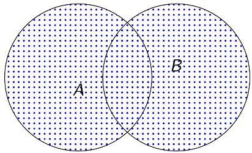
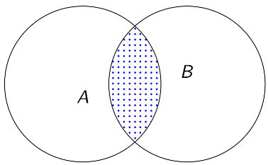
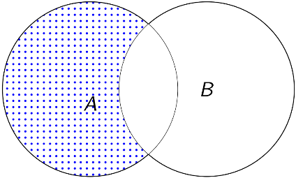
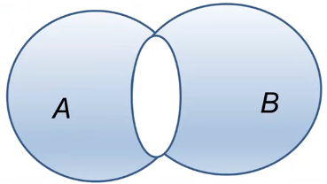
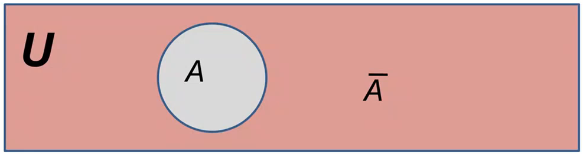
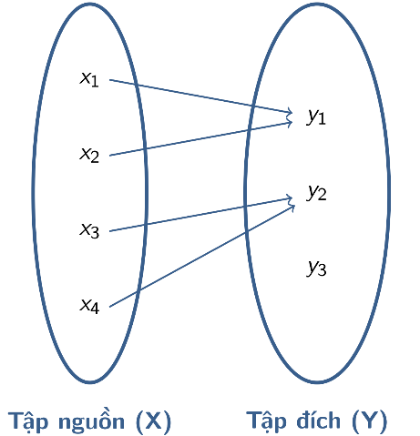

  <a className="button button--primary" href="/pdfs/toan-roi-rac/chapter2/bai8.pdf" download="bai8-toan-roi-rac.pdf" target="_blank" rel="noreferrer">
    Tải file PDF
  </a>

## 8.1. Phép toán trên tập hợp
- **Hợp (union)** của $A$ và $B$ là tập hợp gồm tất cả các phần tử thuộc ít nhất một trong hai tập hợp $A$ và $B$, ký hiệu **$A \cup B$**, nghĩa là

  **$A \cup B = \{x \mid x \in A \lor x \in B\}$ (lấy hết)**

  

  - **Nhận xét.** $x \in A \cup B \Leftrightarrow \left[ \begin{array}{l} x \in A \\ x \in B \end{array} \right. \quad x \notin A \cup B \Leftrightarrow \left\{ \begin{array}{l} x \notin A \\ x \notin B \end{array} \right.$

  - **Tính chất.**
    1. *Tính lũy đẳng* $A \cup A = A$
    2. *Tính giao hoán* $A \cup B = B \cup A$
    3. *Tính kết hợp* $(A \cup B) \cup C = A \cup (B \cup C)$
    4. *Hợp với tập rỗng* $A \cup \emptyset = A$

- **Giao (intersection)** của $A$ và $B$ là tập hợp gồm tất cả các phần tử vừa thuộc $A$ và thuộc $B$, ký hiệu **$A \cap B$**, nghĩa là

  **$A \cap B = \{x \mid x \in A \land x \in B\}$ (phần chung)**

  

  - **Nhận xét.** $x \in A \cap B \Leftrightarrow \left\{ \begin{array}{l} x \in A \\ x \in B \end{array} \right. \quad x \notin A \cap B \Leftrightarrow \left[ \begin{array}{l} x \notin A \\ x \notin B \end{array} \right.$

  - **Tính chất.**
    1. *Tính lũy đẳng* $A \cap A = A$
    2. *Tính giao hoán* $A \cap B = B \cap A$
    3. *Tính kết hợp* $(A \cap B) \cap C = A \cap (B \cap C)$
    4. *Giao với tập rỗng* $A \cap \emptyset = \emptyset$

  - **Tính chất.** *Tính phân phối của phép hợp và giao*
    1. $A \cup (B \cap C) = (A \cup B) \cap (A \cup C)$
    2. $A \cap (B \cup C) = (A \cap B) \cup (A \cap C)$

- **Hiệu (difference)** của hai tập hợp $A$ và $B$ là tập hợp tạo bởi tất cả các phần tử thuộc tập $A$ mà không thuộc tập $B$ ký hiệu **$A$ \\ $B$ (hoặc $A$ – $B$)**, nghĩa là

  **$A \setminus B = \{x \mid x \in A \land x \notin B\}$ (lấy $A$ bỏ $B$)**

  

  - **Nhận xét.** $x \in A \setminus B \Leftrightarrow \left\{ \begin{array}{l} x \in A \\ x \notin B \end{array} \right. \quad x \notin A \setminus B \Leftrightarrow \left[ \begin{array}{l} x \notin A \\ x \in B \end{array} \right.$

  - **Tính chất.** Cho $A, B, C$ là các tập hợp. Khi đó
    1. $A \setminus (B \cap C) = (A \setminus B) \cup (A \setminus C)$;
    2. $A \setminus (B \cup C) = (A \setminus B) \cap (A \setminus C)$.

  - **<u>Nhận xét:</u> $A \setminus B = B \setminus A$ khi và chỉ khi $A = B$. Khi đó $A \setminus B = B \setminus A = \emptyset$.**

  

- **Hiệu đối xứng (symmetric difference)** của $A$ và $B$ là tập $(A \setminus B) \cup (B \setminus A)$, ký hiệu **$A \oplus B$.**

- **Tập bù:** Khi $A \subset U$ thì $U$ \\ $A$ gọi là tập bù của $A$ trong $U$. Ký hiệu ***$C_{U} A$*** hay $C_{U}^{A}$ đơn giản là $\overline{A}$.

  

  **Ví dụ:** Cho $A$ = {$a$, $e$, $i$, $o$, $u$ } thì Ā = {$b$, $c$, $d$, $f$, $g$, $h$, $j$, $k$, $l$, $m$, $n$, $p$, $q$, $r$, $s$, $t$, $v$, $w$, $x$, $y$, $z$} (ở đây tập vũ trụ là tập các chữ cái tiếng Anh).

  - **Tính chất.** 
    - $A \setminus B = A \cap \overline{B}$ (triệt hiệu)
    - $\overline{\overline{A}} = A$
    - $A \cap \overline{A} = \emptyset$
    - $A \cup \overline{A} = U$

  - *Tính chất khác:*

    | Tính chất | Tên gọi |
    | :---: | :--- |
    | $A \cup \emptyset = A ; A \cap U = A$ | Phần tử trung hòa |
    | $A \cup U = U ; A \cap \emptyset = \emptyset$ | Tính thống trị |
    | $A \cup A = A ; A \cap A = A$ | Tính lũy đẳng |
    | $A \cup \overline{A} = U ; A \cap \overline{A} = \emptyset$ | Phần bù |
    | $A \cup B = B \cup A ; A \cap B = B \cap A$ | Tính giao hoán |
    | $A \cup (B \cup C) = (A \cup B) \cup C$ $A \cap (B \cap C) = (A \cap B) \cap C$ | Tính kết hợp |
    | $A \cup (B \cap C) = (A \cup B) \cap (A \cup C)$ $A \cap (B \cup C) = (A \cap B) \cup (A \cap C)$ | Tính phân phối |
    | $\overline{A \cup B} = \overline{A} \cap \overline{B} ; \overline{A \cap B} = \overline{A} \cup \overline{B}$ | Công thức De Morgan |

- **Tích Descartes (Đề - các):**

  - **Định nghĩa.** *Tích Descartes* của tập hợp $A$ với tập hợp $B$ là một tập hợp chứa tất cả các bộ có dạng $(x, y)$ với $x$ là một phần tử của $A$ và $y$ là một phần tử của $B$.
  
  - Ký hiệu $A \times B$, nghĩa là $$A \times B = \{(x, y) \mid x \in A \wedge y \in B\}$$

  - **Ví dụ.** 
  
    - Cho $A = \{1, 2, 3\}$ và $B = \{x, y\}$. Khi đó $$A \times B = \{(1, x), (1, y), (2, x), (2, y), (3, x), (3, y)\}$$

    - Cho $A = \{1, 2, 3\}$ và $B = \{3, 4\}$. Khi đó

      $$A \times B = \{(1, 3), (1, 4), (2, 3), (2, 4), (3, 3), (3, 4)\}$$

      $$B \times A = \{(3, 1), (3, 2), (3, 3), (4, 1), (4, 2), (4, 3)\}$$
  
    > Thông thường $A \times B \neq B \times A$
  
    > Nếu $|A| = n$ và $|B| = m$ thì $|A \times B| = n \times m$.

  - Khái niệm tích Descartes cũng được mở rộng cho hữu hạn tập hợp, nghĩa là $$A_1 \times A_2 \times \ldots \times A_k = \{(x_1, x_2, \ldots, x_k) \mid x_i \in A_i, \forall i = \overline{1, k}\}$$

## 8.2. Phân hoạch
- Giả sử $X_1, X_2, \ldots, X_m$ là các tập con của $X$. Ta nói $X_1, X_2, \ldots, X_m$ tạo thành một **phân hoạch** của $X$ (hoặc $X$ được phân hoạch thành các tập $X_1, X_2, \ldots, X_m$) nếu:
  - $X = X_1 \cup X_2 \cup \ldots \cup X_m$;
  - $X_i \cap X_j = \emptyset, i \neq j$.
  - $X_i \neq \emptyset, i = 1, \ldots, m$

  (Một phân hoạch của tập $X$ là một tập các tập con khác rỗng không giao nhau của $X$ và hợp của chúng là tập $X$)

- **Ví dụ:** $X = \{1, 2, 3, 4\}$

    $E = \{\{1, 2\}, \{3, 4\}\}$ là một phân hoạch của tập $X$

    $F = \{\{1, 2, 3\}, \{3, 4\}\}$ không là phân hoạch của tập $X$

  
