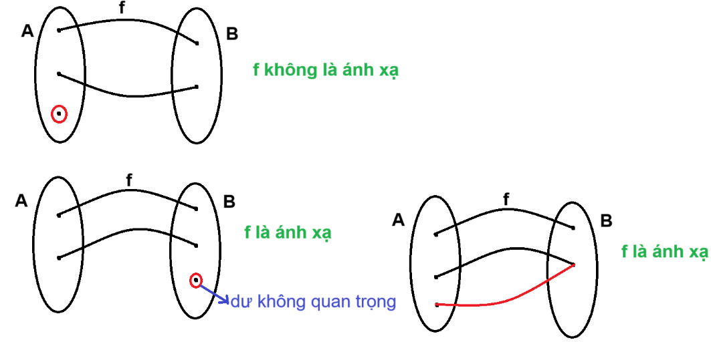
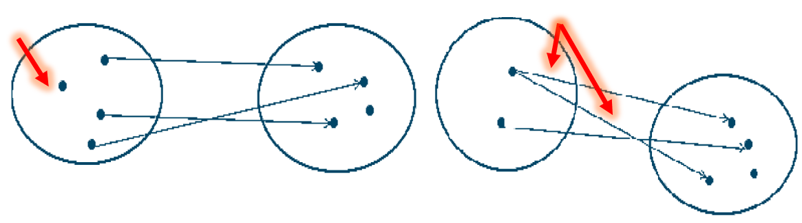
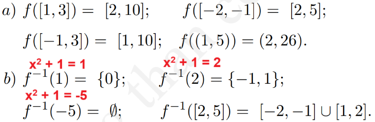
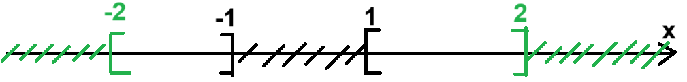
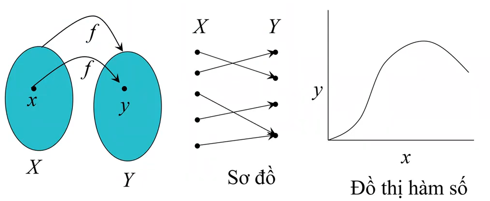
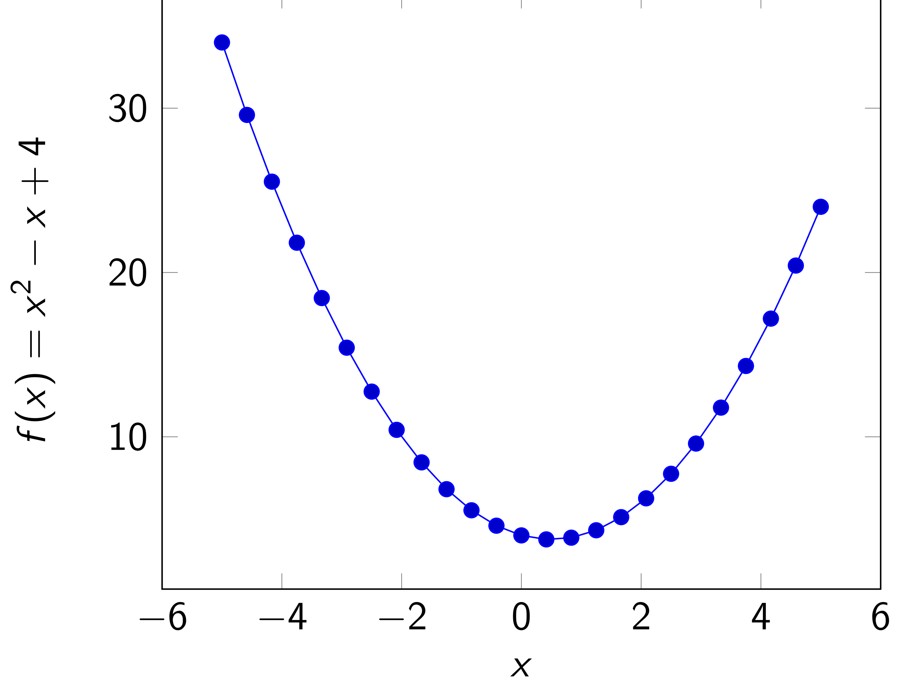
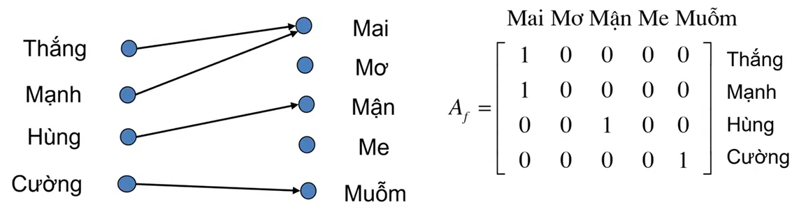

  <a className="button button--primary" href="/pdfs/toan-roi-rac/chapter2/bai9.pdf" download="bai9-toan-roi-rac.pdf" target="_blank" rel="noreferrer">
    Tải file PDF
  </a>

## 9.1. Định nghĩa
- Giả sử $X$, $Y$ là 2 tập khác rỗng.

- Khi đó, ánh xạ từ $X$ vào $Y$ là phép cho tương ứng **<u>mỗi</u>** phần tử thuộc $X$ **<u>duy nhất một</u>** phần tử thuộc $Y$, ký hiệu $y$ = $f$($x$).

  $$
  \begin{array}{rccc}
  f : & X & \longrightarrow & Y \\
  & x & \longmapsto & f(x)
  \end{array}
  $$

  Trong đó:

    - *$x$* gọi là gốc, *$y$ = $f$($x$)* gọi là ảnh của *$x$* bởi $f$.

    - $X$ là tập nguồn, $Y$ là tập đích.

    - Tập **$f(X) = \{y \in Y \mid \exists x \in X : y = f(x)\}$** được gọi là **miền giá trị của $f$.**

- **Nghịch ảnh (tạo ảnh, ảnh ngược)** của tập hợp $B$ là tập hợp

    $f^{-1}(B) = \{x ∈ X \mid f(x) ∈ B\}$ (không thể bằng $B$).

- Nghịch ảnh của phần tử $y ∈ Y$ được viết là $f^{-1}(y) = \{x ∈ X \mid f(x) = y\}$.

  ***Ví dụ 1:***

  

  - *Không là ánh xạ:*

  

***Ví dụ 2.*** Cho $f: \mathbb{R} \rightarrow \mathbb{R}$ được xác định $f(x) = x^2 + 1$. Hãy tìm
  a) $f([1, 3]); \ f([-2, -1]); \ f([-1, 3]); \ f((1, 5))$;
  b) $f^{-1}(1); \ f^{-1}(2); \ f^{-1}(-5); \ f^{-1}([2, 5])$?

  - **Giải.**

    

  - **Giải câu $b$, ý 4:** Tiến hành giải bài toán:

    $$
    1 \le x^2 \le 4
    \quad\Longleftrightarrow\quad
    \begin{cases}
    x^2 \ge 1,\\
    x^2 \le 4.
    \end{cases}
    $$

    Bảng xét dấu của hai biểu thức tương ứng:

    | $x$ | $-\infty$ | | $-1$ | | $1$ | | $+\infty$ |
    | :--- | :---: | :---: | :---: | :---: | :---: | :---: | :---: |
    | $x^2 = 1$ | | + | $0$ | $-$ | $0$ | + | |

     

    | $x$ | $-\infty$ | | $-2$ | | $2$ | | $+\infty$ |
    | :--- | :---: | :---: | :---: | :---: | :---: | :---: | :---: |
    | $x^2 = 4$ | | $+$ | $0$ | - | $0$ | $+$ | |

    
    
    Vậy nghiệm là $x\in[-2,-1]\cup[1,2]$. *Ta có đáp án như trên.*

## 9.2. **Biểu diễn**
- Cho hai tập hữu hạn $X$ và $Y$. Để xác định / biểu diễn một ánh xạ $f$ từ $X$ vào $Y$ ($f$: $X$→$Y$) ta có thể sử dụng một trong các cách sau:

  - ***Bảng giá trị đầy đủ:***

    - Giả sử $X = \{x_1, x_2, \ldots, x_m\}, Y = \{y_1, y_2, \ldots, y_n\}$,
    - Một ánh xạ $f$ từ $X$ vào $Y$ ($f: X \rightarrow Y$) có thể xác định bởi bảng giá trị đầy đủ sau đây

      | $x$ | $x_1$ | $x_2$ | $\ldots$ | $x_m$ |
      | :---: | :---: | :---: | :---: | :---: |
      | $y=f(x)$ | $f(x_1)$ | $f(x_2)$ | $\ldots$ | $f(x_m)$ |

    - Như vậy mỗi ánh xạ từ tập $m$ phần tử $X$ vào tập $n$ phần tử $Y$ hoàn toàn xác định bởi bộ ảnh 
    
      $$(f(x_1), f(x_2), \ldots, f(x_m))$$

  - ***Sơ đồ ánh xạ:***

    

    - Biểu diễn ánh xạ dưới dạng bảng:

      | $x$ | 1 | 2 | 3 | 4 | 5 |
      | :---: | :---: | :---: | :---: | :---: | :---: |
      | $y=f(x)$ | 2 | 4 | 6 | 8 | 10 |

    - Biểu diễn dưới dạng biểu thức đại số:

      $$f: \mathbb{R} \mapsto \mathbb{R}, f(x) = 2x^2 + 1$$

    - Biểu diễn dưới dạng đồ thị:
      
      

  - ***Ma trận ánh xạ:***

    - Giả sử
      - $X = \{x_1, x_2, \ldots, x_m\}$,
      - $Y = \{y_1, y_2, \ldots, y_n\}$,

    - Một ánh xạ $f$ từ $X$ vào $Y$ ($f: X \rightarrow Y$) có thể xác định bởi ma trận $A_f = \{a_{ij}\}$ kích thước $m \times n$ với các phần tử được xác định theo quy tắc sau đây:

      $$a_{ij} = \begin{cases} 1, & \text{nếu } y_j \text{ là phần tử tương ứng với } x_i \text{ qua ánh xạ } f \\ 0, & \text{nếu trái lại} \end{cases}$$

      (Với $m$, $n$ tương ứng là số lượng phần tử của tập $X$, $Y$.)

  - ***Biểu thức đại số:***

    - $f:\mathbb{R} \rightarrow \mathbb{R},f(x) = 2x^{2} + 1 f:\mathbb{Z} \rightarrow \mathbb{Z},f(x) = x + 1$
    - $f:\mathbb{N} \rightarrow \mathbb{R},f(x) = \sqrt{x}$
    - $f:\mathbb{R} \rightarrow \mathbb{R},f(x) = \frac{2}{3 - x}$: **không là ánh xạ,** do nếu $x$ = 3 $∈ \mathbb{R}$ thì $\cancel{\exists}$f(x) ∈$\mathbb{R}$.

  ***Ví dụ:***
  - $X = \{\text{Thắng}, \text{Mạnh}, \text{Hùng}, \text{Cường}\}$;
  - $Y = \{\text{Mai}, \text{Mơ}, \text{Mận}, \text{Me}, \text{Muỗm}\}$
  - Xét ánh xạ $f$ từ $X$ vào $Y$ xác định bởi bảng giá trị đầy đủ sau:

  | x | Thắng | Mạnh | Hùng | Cường |
  | :---: | :---: | :---: | :---: | :---: |
  | y=f(x) | Mai | Mai | Mận | Muỗm |

  - Ánh xạ nói trên có thể cho bởi sơ đồ và ma trận như sau:
  
  

> **Nhận xét.** Nếu $X, Y$ là tập hợp các số (chẳng hạn, $\emptyset \neq X, Y \subset \mathbb{R}$) thì $f: X \rightarrow Y$ còn được gọi là *hàm số*. Như vậy, hàm số chính là một trường hợp riêng của ánh xạ.

> **Định nghĩa.** Hai ánh xạ $f, g$ được gọi là *bằng nhau* khi và chỉ khi chúng có cùng tập nguồn, có cùng tập đích và
$$\forall x \in X, f(x) = g(x).$$

> **Nhận xét.** Vậy $f \neq g \Leftrightarrow \exists x \in X, f(x) \neq g(x)$.

**Ví dụ 1:**
Cho $A = \{1, 2, 3\}, B = \mathbb{R}$, và hai ánh xạ:
- $f: A \rightarrow B$ được định nghĩa bởi $f(x) = x + 1$,
- $g: A \rightarrow B$ được định nghĩa bởi $g(x) = x + 1$.

Ta thấy:
$$f(1) = g(1) = 2, \quad f(2) = g(2) = 3, \quad f(3) = g(3) = 4.$$
Do đó, $f(x) = g(x)$ với mọi $x \in A$, nên $f = g$.

**Ví dụ 2:**
Cho $A = \mathbb{R}, B = \mathbb{R}$, và hai ánh xạ:
- $f(x) = x^2 - 4x + 4$,
- $g(x) = (x - 2)^2$.

Với mọi $x \in A$, ta có:
$$f(x) = x^2 - 4x + 4 \quad \text{và} \quad g(x) = (x - 2)^2.$$
Dễ thấy $f(x) = g(x)$ với mọi $x \in A$, vì hai biểu thức này là đồng nhất. Do đó, $f = g$.

**Ví dụ 3:**
Giả sử $A = \{1, 2, 3, 4\}, B = \mathbb{Z}$, và:
- $f: A \rightarrow B$ được định nghĩa bởi $f(x) = x$,
- $g: A \rightarrow B$ được định nghĩa bởi $g(x) = x$.

Với mọi $x \in A$, ta có $f(x) = g(x)$. Vì vậy, $f$ và $g$ là hai ánh xạ bằng nhau.
