## 2.1. Tập hợp

### 2.1.1. Các khái niệm

- **Khái niệm:**

  - Tập hợp là một khái niệm nguyên thủy, không có định nghĩa.

  - Tập hợp được coi là sự tụ tập của các phần tử, thường bao gồm (các) phần tử có **cùng tính chất** nào đó.

- **Kí hiệu:**

  - Tập hợp kí hiệu bằng chữ cái in hoa, ví dụ: A, B, C, X, Y, ...

  - Phần tử của tập hợp kí hiệu bằng chữ cái in thường, ví dụ: a, b, ...

- **Biểu diễn & ví dụ:**

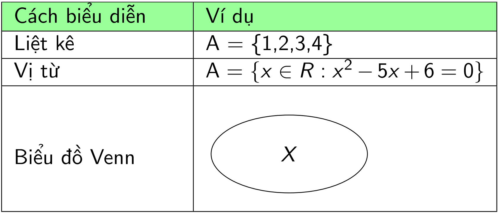

- **Phân loại:**

  - Tập hợp rỗng: ∅ Tập không chứa bất kỳ phần tử nào.

  - Tập hợp có hữu hạn các phần tử: \|A\| = n, n ∈$`\mathbb{N}`$.

  - Tập hợp có vô hạn các phần tử: \|A\| = +∞.

  - Tập vũ trụ: *U* Tập tất cả các phần tử ở ngữ cảnh đang xét.

    Các tập vũ trụ thường dùng: $`\mathbb{R},\mathbb{R}^{+},\mathbb{N},\mathbb{Z},\mathbb{Z}^{+}\mathbb{Q},\mathbb{C}`$.

    $`\mathbb{C} = \left\{ x + yi:x,y\mathbb{\in R};i^{2} = - 1 \right\}`$.

  ***Đối với sơ đồ Venn:***

  - Tập vũ trụ U được biểu diễn bởi hình chữ nhật.

  - Mỗi tập con của U được biểu diễn bởi phần trong của một vòng kín.

> 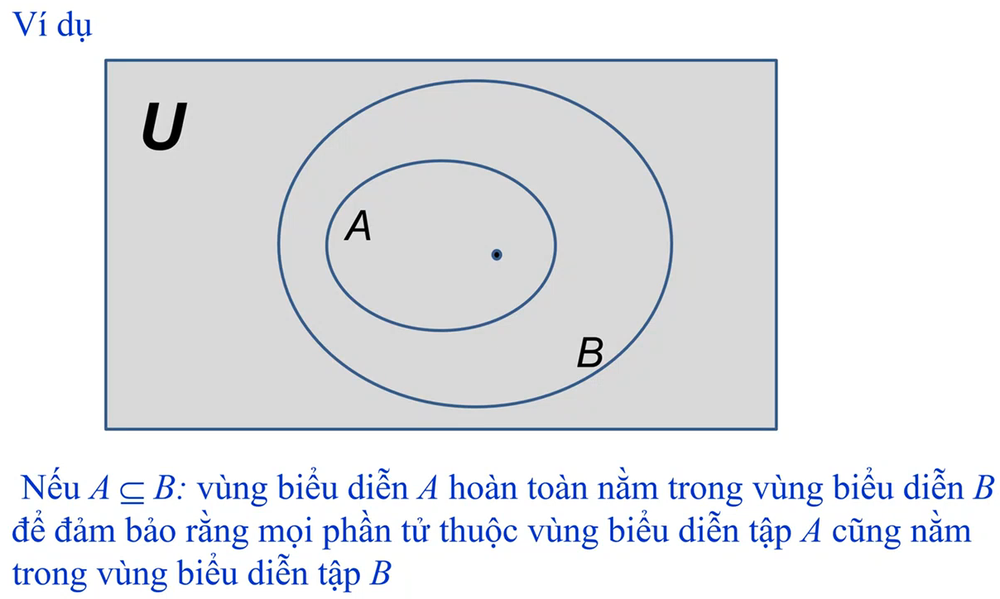

- **Lực lượng của tập hợp (cadinality):**

  - Số phần tử của tập hợp A được gọi là lực lượng của tập hợp, kí hiệu \|A\|. *(Đôi khi có ký hiệu là \#A, N(A)).*

  - Nếu A có hữu hạn phần tử, ta nói A *hữu hạn*. Ngược lại, ta nói A *vô hạn*.

  - ***Ví dụ.***

    · \|Ø\| = 0.

    · $`\mathbb{N},\mathbb{Z},\mathbb{Q},\mathbb{R}`$là các tập vô hạn.

    · X = {1, 3, 4, 5} là tập hữu hạn với \|X\| = 4.

    · \|{n: n là số nguyên tố}\| = ∞.

<!-- -->

- **Tính chất:** Cho A, B là các tập hữu hạn. Khi đó:

  **1)** \|A ∪ B\| = \|A\| + \|B\| - \|A ∩ B\| .

  **2)** \|A × B\| = \|A\|. \|B\|

  **3)** \|P(A)\| = 2<sup>\|A\|</sup>

> 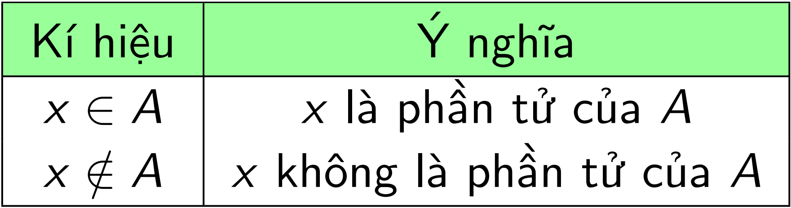

- **Quan hệ giữa các tập hợp**

  - ***Bao hàm/ Con.*** Nếu *mọi phần tử của tập hợp A đều là phần tử của tập hợp B* thì tập hợp A được gọi là tập hợp con của tập hợp B, ký hiệu là A ⊆ B, nghĩa là **A ⊆ B ⇔ ∀x∈A → x∈B.**

    - A ⊆ A: một tập luôn là tập con của chính nó.

    - **Để chứng minh A là tập con của B,** ta cần chỉ ra với một phần tử x bất kỳ, x ∈ A thì x cũng thuộc B.

  - ***Tập con thực sự.*** Nếu **A ⊆ B,** nhưng **A ≠ B,** khi đó ta nói **A là tập con thực sự của B**. Ký hiệu: **A ⊂ B.**

    - ***Ví dụ:*** Giả sử A = {1, 2, 3}, B = {2, 3, 1}, C = {3}. Khi đó: B = A, C ⊂ A, C ⊂ B.

    - Để chứng minh A là tập con thực sự của B, ta cần chứng minh: *A là tập con của B* **và** ∃x (x∈B) ∧ (x∉A).

    - **<span class="mark">∅ là tập con của mọi tập.</span>**

> **<span class="mark">Ví dụ:</span>**
>
> 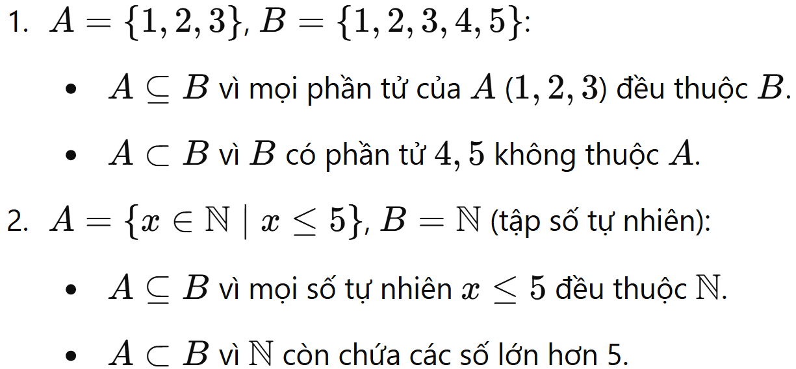

- ***Bằng nhau.*** Hai tập hợp A và B được gọi là bằng nhau nếu A ⊆ B và B ⊆ A, *(mỗi phần tử của tập thứ nhất đều là phần tử của tập thứ hai và ngược lại)* ký hiệu **A = B**.

  ***Ví dụ:***

  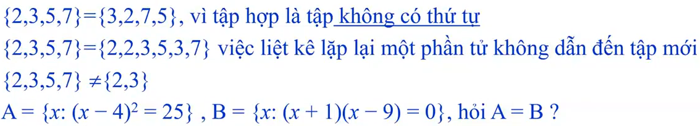

- **Tập tất cả các tập con (tập lũy thừa/ Power set) của tập A:** Ký hiệu: **2<sup>A</sup>** (đôi khi dùng ký hiệu: **P(A)**).

  **Ví dụ:**

  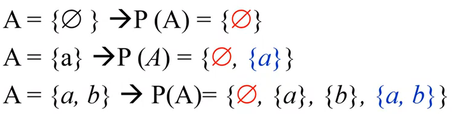

<!-- -->

- **<u>Định lý:</u>** <span class="mark">Cho A là tập có lực lượng \|A\| = n, khi đó \|P(A)\| = 2<sup>n</sup>.</span>

  - ***Chứng minh:*** Giả sử A là tập gồm n phần tử {a<sub>1</sub>, a<sub>2</sub>, ... , a<sub>n</sub>}.

  - Ta có thế xây dựng 1 tập con của A bằng cách duyệt lần lượt từng phần tử a có đưa vào dãy con hay không.

  - Với mỗi phần tử có 2 lựa chọn (cho vào tập con hoặc không cho vào tập con), và việc lựa chọn này là độc lập giữa các phần tử.

  - Theo quy tắc nhân: $`\underbrace{2 \times 2 \times 2 \times ... \times 2}_{nso2} = 2^{n}`$

  - Do đó tổng cộng có 2<sup>n</sup> lựa chọn. Mỗi lựa chọn trong số 2<sup>n</sup> lựa chọn này sẽ cho 1 tập con.

- **<u>Định lý.</u>** Cho 2 tập A và B:

  - A ⊆ B khi và chỉ khi P (A) ⊆ P (B).

  - P (A) ∩ P (B) = P(A ∩ B).

  - P (A) ∪ P (B) ⊆ P(A ∪ B).

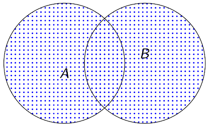

### 2.1.2. Phép toán trên tập hợp

- **Hợp (union)** của A và B là tập hợp gồm tất cả các phần tử thuộc ít nhất một trong hai tập hợp A và B, ký hiệu **A ∪ B**, nghĩa là

**A ∪ B = {x \| x ∈ A <span class="mark">∨</span> x ∈ B} (lấy hết)**

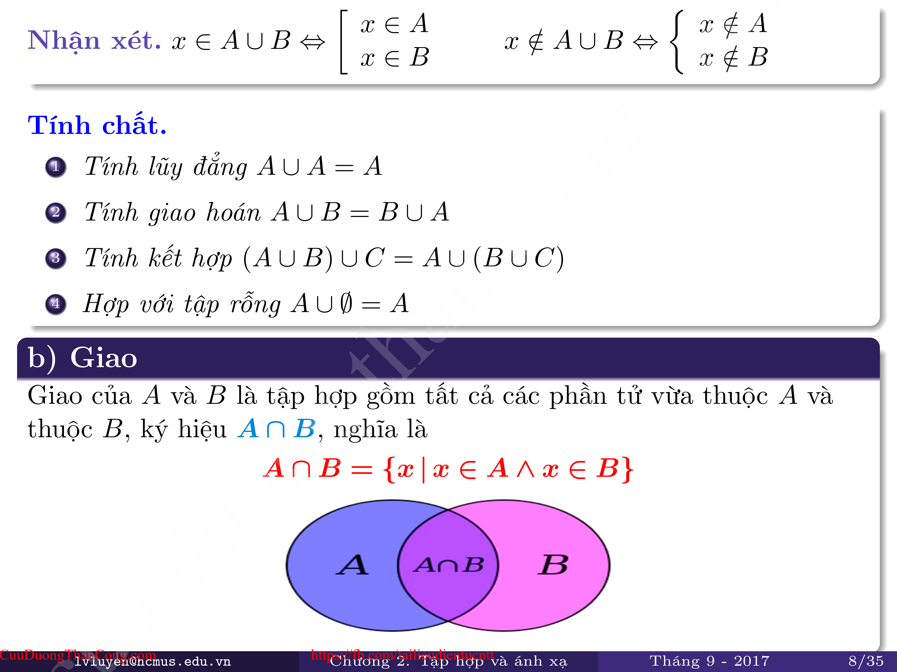

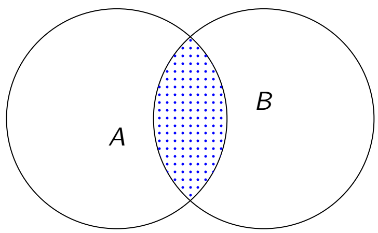

- **Giao (intersection)** của A và B là tập hợp gồm tất cả các phần tử vừa thuộc A và thuộc B, ký hiệu **A ∩ B**, nghĩa là

**A ∩ B = {x \| x ∈ A <span class="mark">∧</span> x ∈ B} (phần chung)**

> 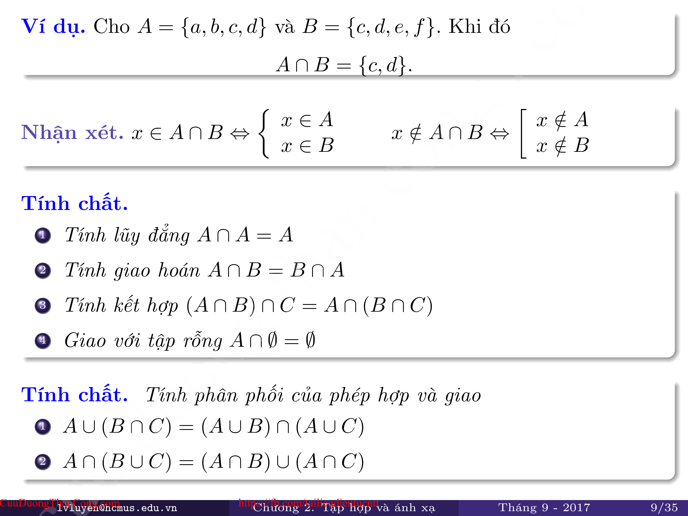

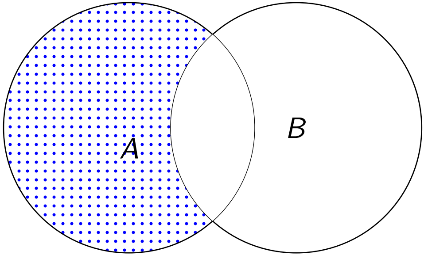

- **Hiệu (difference)** của hai tập hợp A và B là tập hợp tạo bởi tất cả các phần tử thuộc tập A mà không thuộc tập B ký hiệu **A \\ B (hoặc A – B)**, nghĩa là

**A \\ B = {x \| x ∈ A <span class="mark">∧</span> x <span class="mark">∉</span> B} (lấy A bỏ B)**

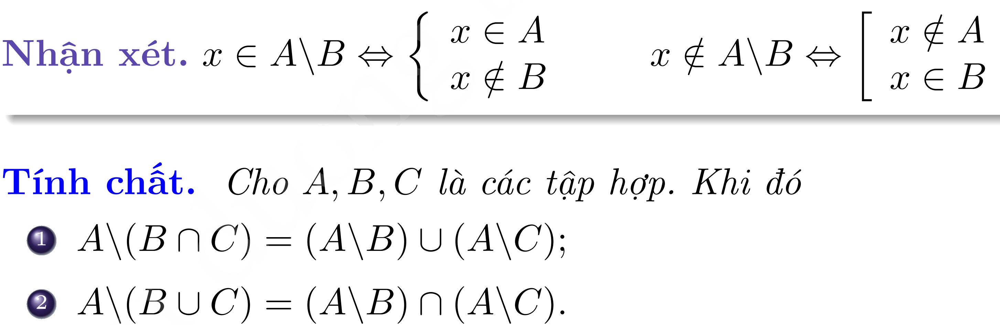

**<u>Nhận xét:</u> A\B = B\A khi và chỉ khi A = B. Khi đó A\B = B\A = ∅.**

- 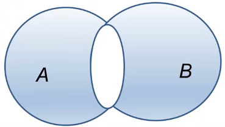**Hiệu đối xứng (symmetric difference)** của A và B là tập\
  (A \\ B) ∪ (B \\ A), ký hiệu **A ⊕ B.**

- **Tập bù:** Khi A ⊂ U thì U \\ A gọi là tập bù của A trong U. Ký hiệu ***C<sub>U</sub>A*** hay $`C_{U}^{A}`$ đơn giản là $`\overline{A}`$.

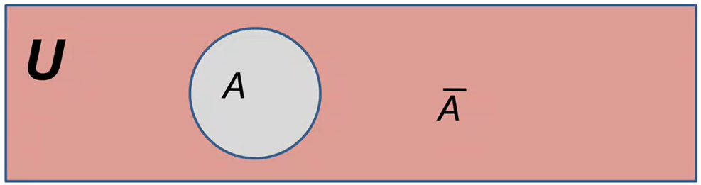

> **<u>Ví dụ:</u>** Cho A = {a, e, i, o, u } thì Ā = {b, c, d, f, g, h, j, k, l, m, n, p, q, r, s, t, v, w, x, y, z} (ở đây tập vũ trụ là tập các chữ cái tiếng Anh).

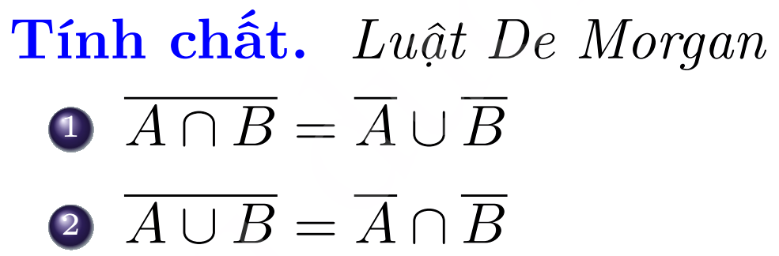

> 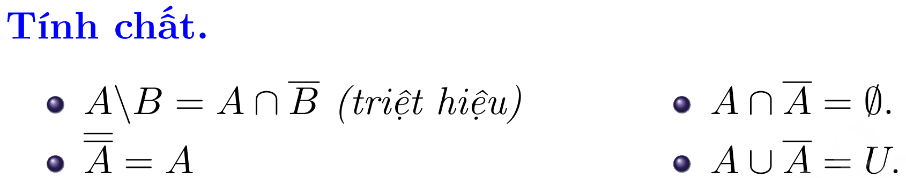

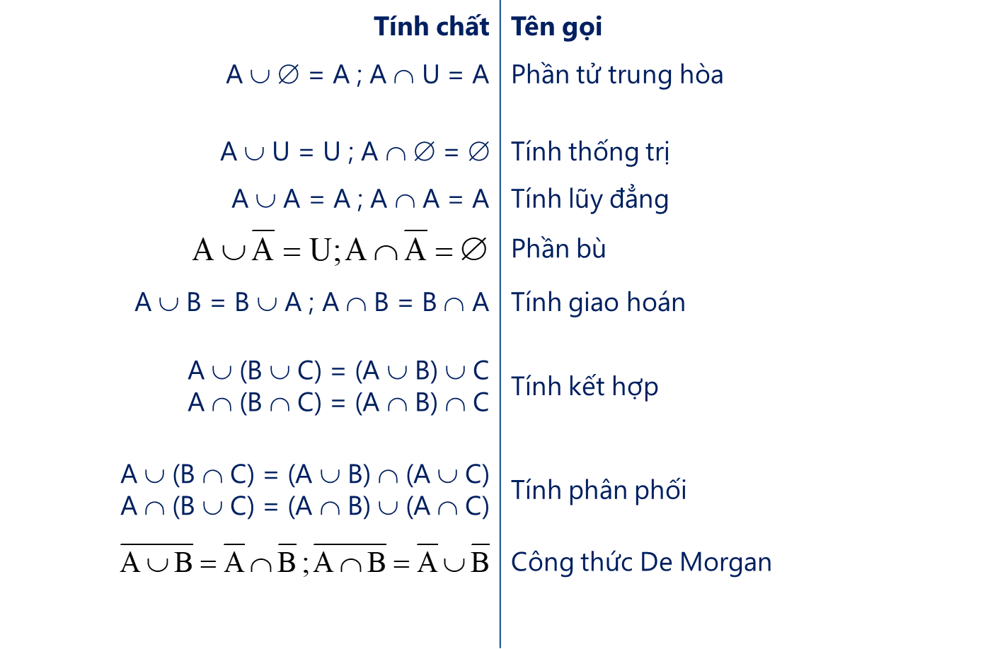

- **Tích Descartes (Đề - các):**

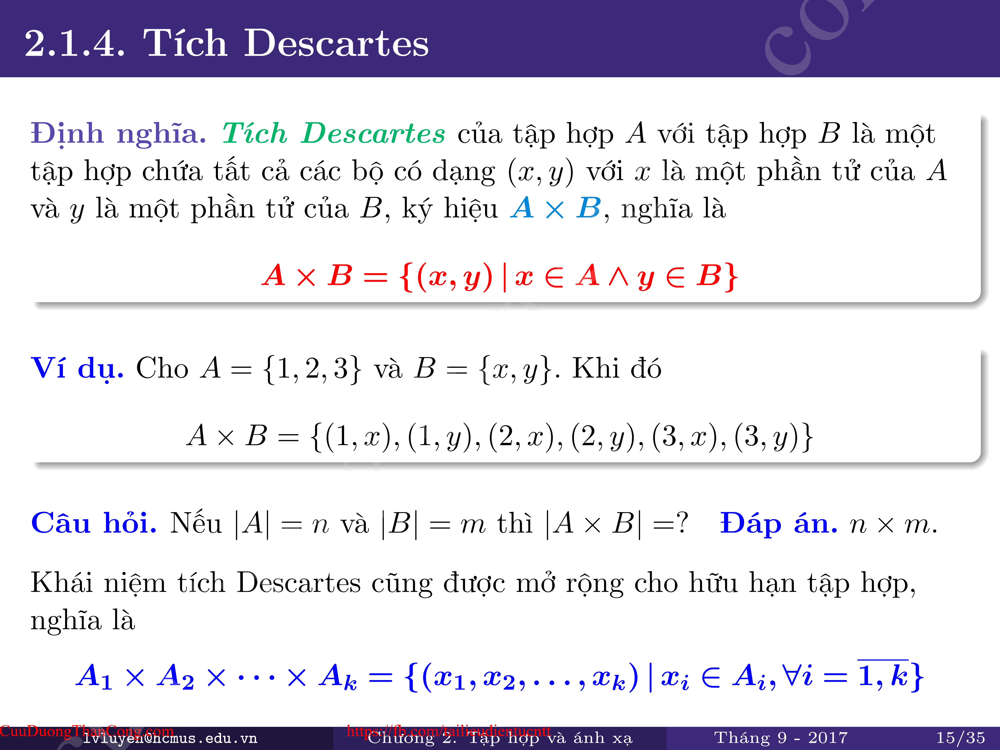

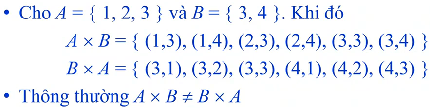


### 2.1.3. Phân hoạch

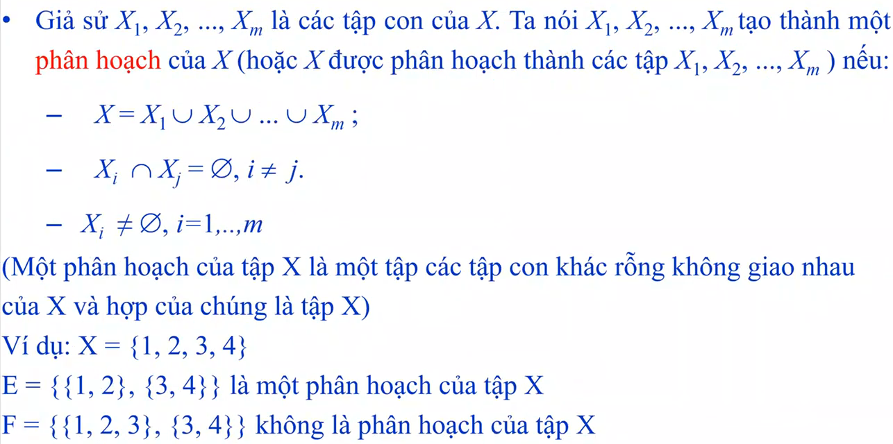

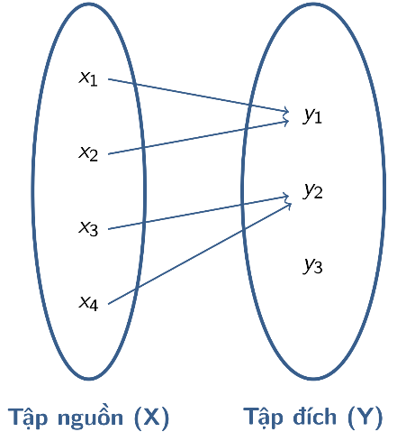

## 2.2. Ánh xạ

### 2.2.1. Định nghĩa

> \- Giả sử X, Y là 2 tập khác rỗng.
>
> \- Khi đó, ánh xạ từ X vào Y là phép cho tương ứng **<u>mỗi</u>** phần tử thuộc X **<u>duy nhất một</u>** phần tử thuộc Y, ký hiệu y = f(x).
>
> f: X → Y
>
> x 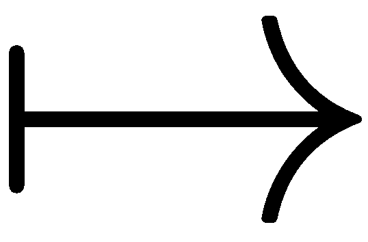 f(x)

- *x* gọi là gốc, *y = f(x)* gọi là ảnh của *x* bởi f.

- X là tập nguồn, Y là tập đích.

- Tập **f(X) = {y∈Y\| ∃x∈X: y = f(x)}** được gọi là **miền giá trị của f.**

- **Nghịch ảnh (tạo ảnh, ảnh ngược)** của <span class="mark">tập hợp</span> **<u>B</u>** là tập hợp

f<sup>-1</sup>(B) = {x ∈ X \| **f(x) <span class="mark">∈</span> B**} (không thể = B).

- Nghịch ảnh của <span class="mark">phần tử</span> **y ∈ Y** được viết là f<sup>-1</sup>(y) = {x ∈ X \| **f(x) = y**}.

***Ví dụ:***

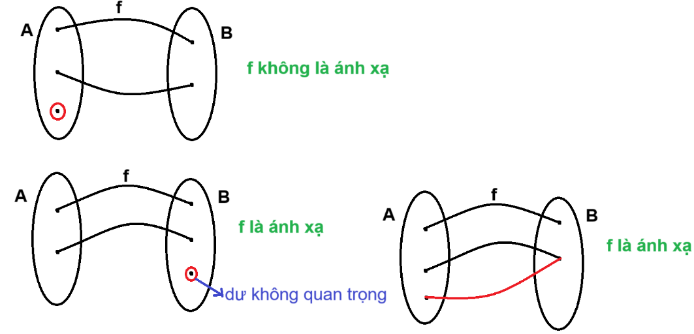

*Không là ánh xạ:*

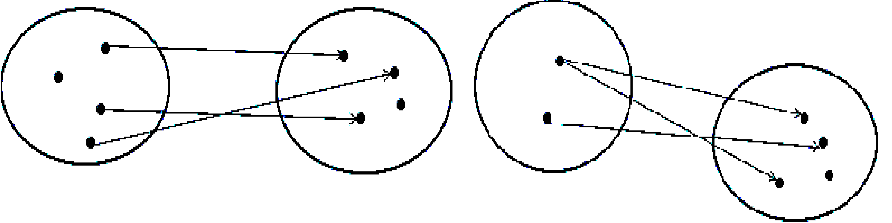

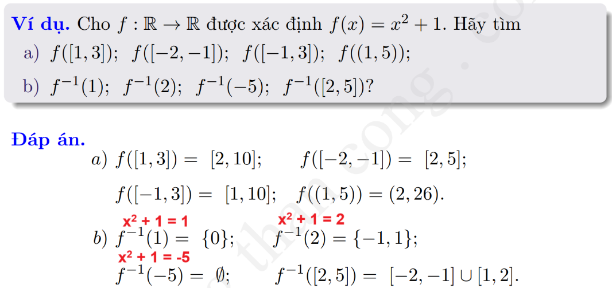

**Giải câu b), ý 4:** Ta có:

$$
1 \le x^2 \le 4
\quad\Longleftrightarrow\quad
\begin{cases}
x^2 \ge 1,\\
x^2 \le 4.
\end{cases}
$$

Bảng xét dấu của hai biểu thức tương ứng:

| $x$ | $(-\infty,-2)$ | $-2$ | $(-2,-1)$ | $-1$ | $(-1,1)$ | $1$ | $(1,2)$ | $2$ | $(2,+\infty)$ |
|:--:|:--:|:--:|:--:|:--:|:--:|:--:|:--:|:--:|:--:|
| $x^2-1$ | $+$ | $+$ | $+$ | $0$ | $-$ | $0$ | $+$ | $+$ | $+$ |
| $x^2-4$ | $+$ | $0$ | $-$ | $-$ | $-$ | $-$ | $-$ | $0$ | $+$ |

Vậy nghiệm là $x\in[-2,-1]\cup[1,2]$.

> 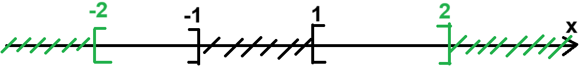
>
> *Vậy ta có đáp án như trên.*

\- **Biểu diễn:** Cho hai tập hữu hạn X và Y.

Để xác định/ biểu diễn một ánh xạ f từ X vào Y (f: X→Y) ta có thể sử dụng một trong các cách sau:

- ***Bảng giá trị đầy đủ:***

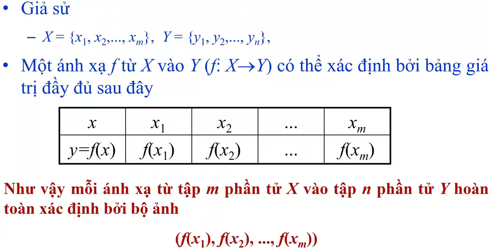

- ***Sơ đồ ánh xạ:***

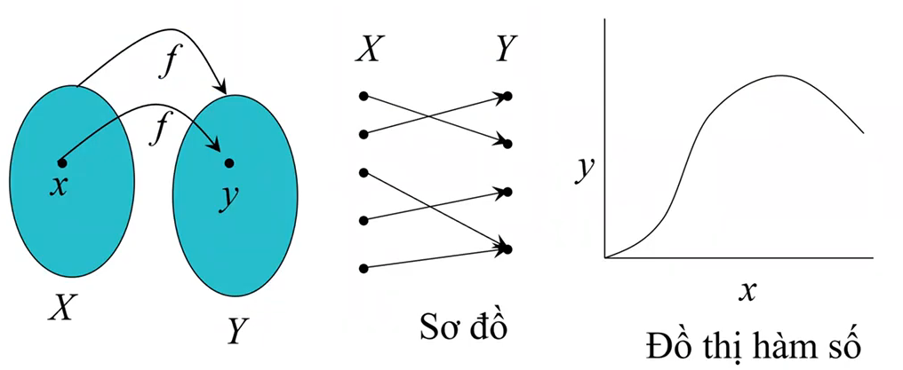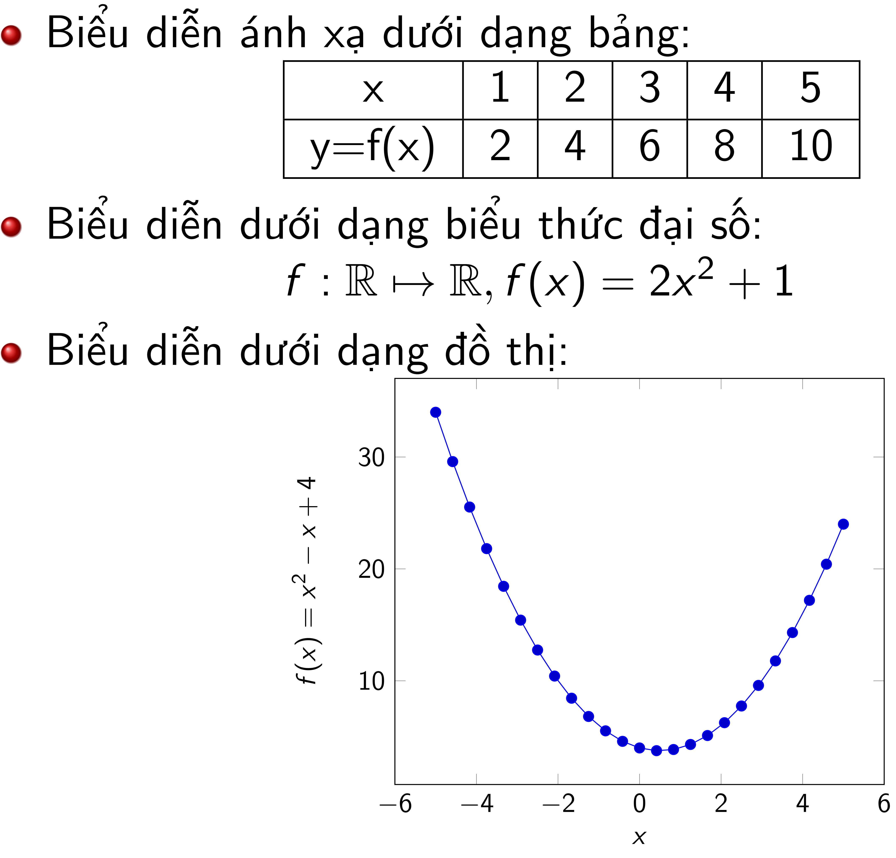

- ***Ma trận ánh xạ:***

> 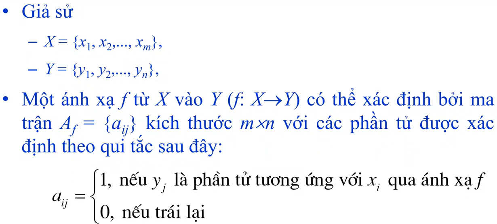
>
> Với m, n tương ứng là số lượng phần tử của tập X, Y.

- ***Biểu thức đại số:***

> $`f:\mathbb{R} \rightarrow \mathbb{R},f(x) = 2x^{2} + 1`$ $`f:\mathbb{Z} \rightarrow \mathbb{Z},f(x) = x + 1`$
>
> $`f:\mathbb{N} \rightarrow \mathbb{R},f(x) = \sqrt{x}`$
>
> $`f:\mathbb{R} \rightarrow \mathbb{R},f(x) = \frac{2}{3 - x}`$: **không là ánh xạ,** do nếu x = 3 ∈$`\mathbb{R}`$ thì $`\cancel{\exists}`$f(x) ∈$`\mathbb{R}`$.

***Ví dụ:***

> 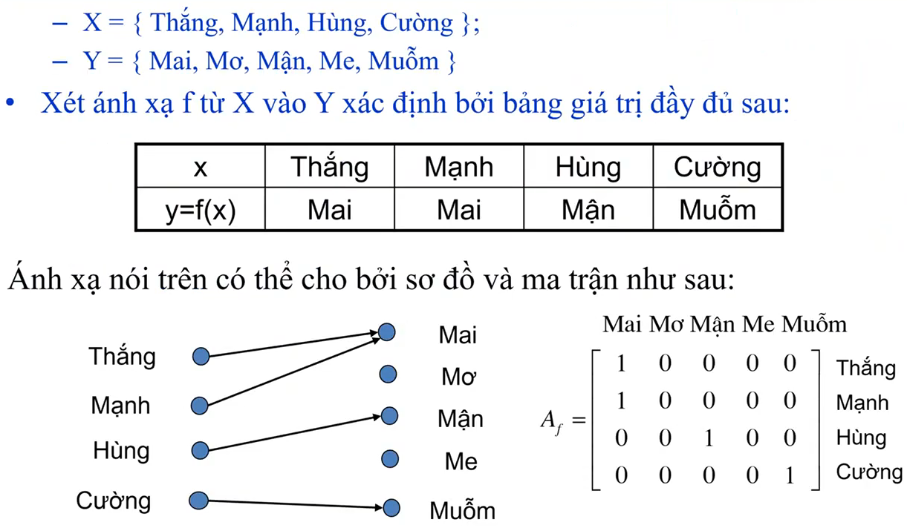

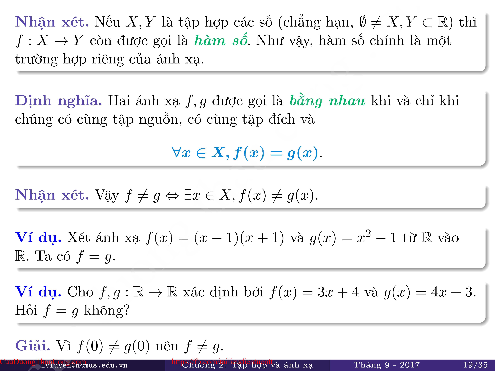

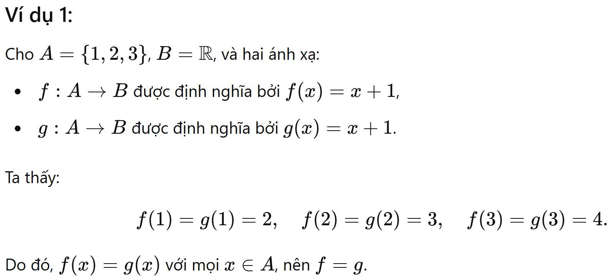

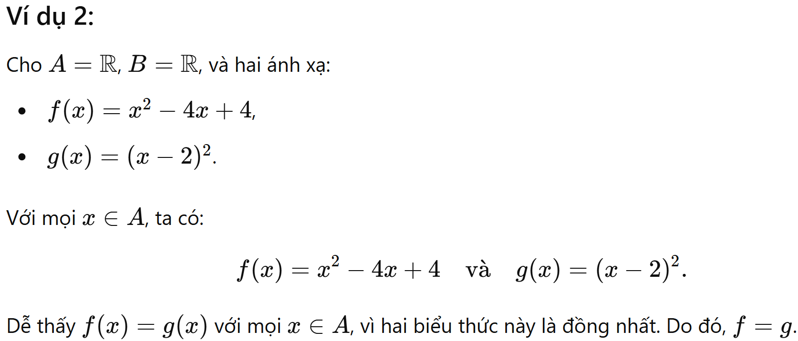

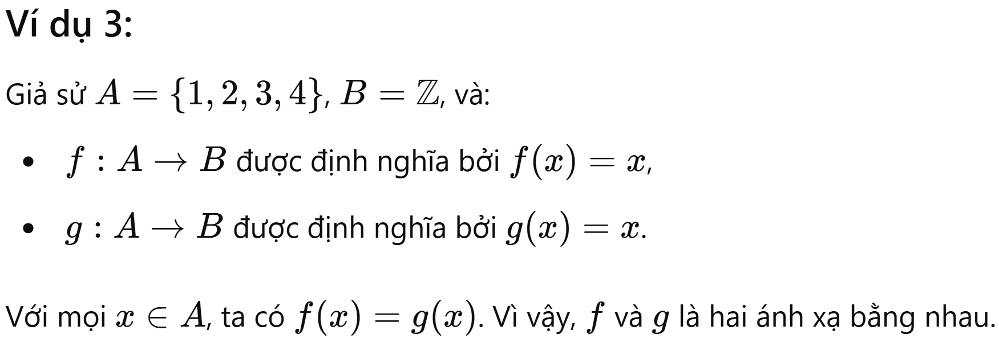

### 2.2.2. Các loại ánh xạ

Có 4 loại: **Đơn ánh, Toàn ánh, Song ánh, “còn lại”.**

Giả sử X, Y là các tập hợp.

- **Đơn ánh:** Ánh xạ f: X → Y được gọi là đơn ánh (injection hoặc one-to-one) nếu nó đặt tương ứng **hai phần tử khác nhau của X *với hai phần tử khác nhau*** của Y.

> 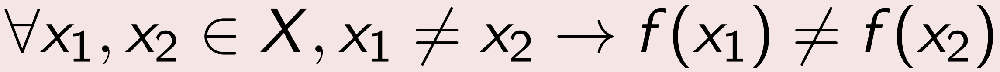
>
> Hoặc: 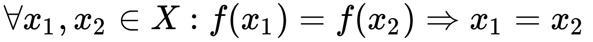

*(Mỗi sinh viên (Y) có không quá một viên phấn (X)).*

f: A → B g: A → B

> 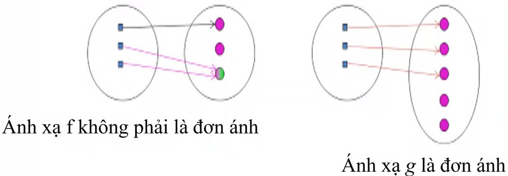

***Ví dụ:*** $`f:\mathbb{R} \rightarrow \mathbb{R},f(x) = e^{x}`$

Tính chất của hàm mũ e<sup>x</sup> cho thấy e<sup>x</sup> là **hàm đơn điệu tăng**, tức khi x<sub>1</sub> ≠ x<sub>2</sub>​, thì $`e^{x_{1}} \neq e^{x_{2}}`$.

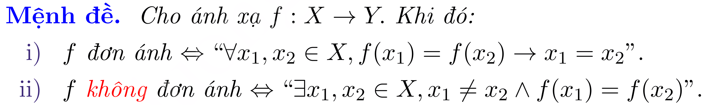

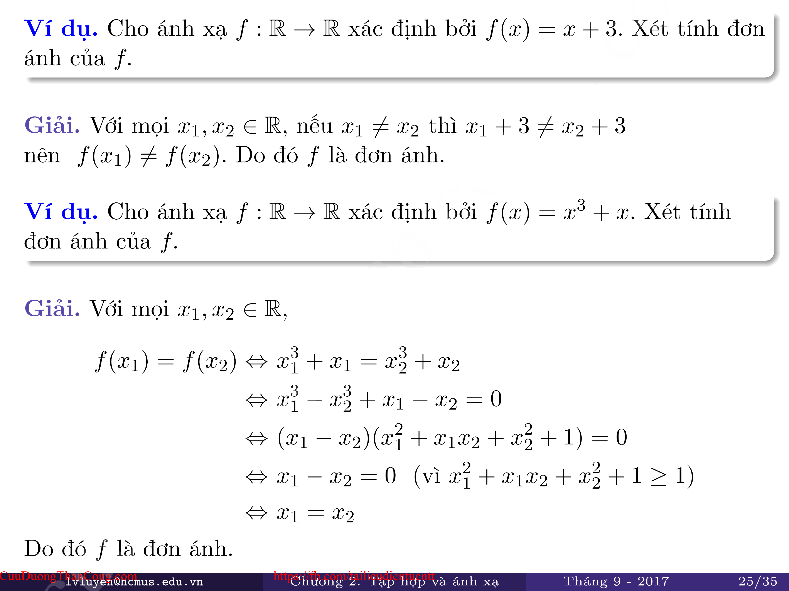


- **Toàn ánh:** Ánh xạ f từ X vào Y được gọi là toàn ánh (surjection hoặc onto) nếu ***mỗi** phần tử của Y* đều là **ảnh** của **<u>ít nhất một</u>** ***phần tử nào đó của X*** qua ánh xạ f (sao cho f(x) = y).

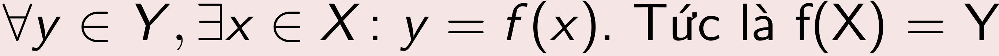

(Không có sinh viên nào không có phấn).

*(Mọi phần tử ảnh đều tìm được gốc của nó thông qua ánh xạ f).*

***Ví dụ:*** A = {1, 2, 3, 4} và B = {x, y, z}. Ánh xạ:

f<sub>1</sub> = {(1,z), (2,y), (3,x), (4,y)}; g = {(1, x), (2,x), (3,y), (4,y)}

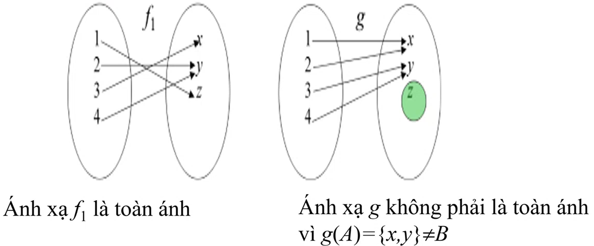

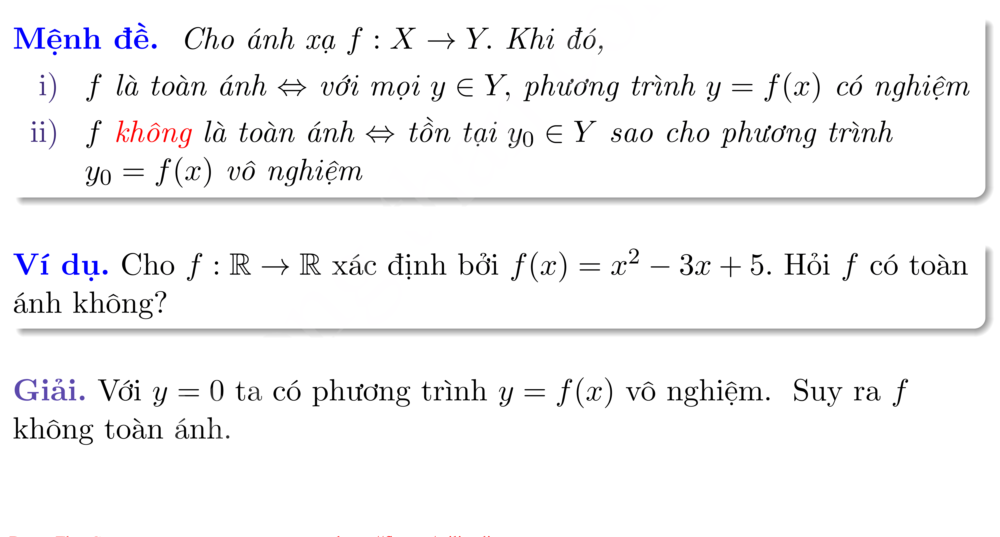

- ***Song ánh:*** Ánh xạ f từ X vào Y được gọi là song ánh (bijection), nếu nó vừa là đơn ánh vừa là toàn ánh.

  ***Ví dụ:*** $`f:\mathbb{R} \rightarrow \mathbb{R}^{+},f(x) = e^{x}`$

<!-- -->

- Ở đây, tập đích là R<sup>+</sup> = (0,∞) (các số thực dương).

- Với một y ∈ R<sup>+</sup>, ta cần tìm x ∈ R sao cho:

> f(x) = y ⟹ e<sup>x</sup> = y.

- Hàm mũ e<sup>x</sup> \> 0 với mọi x ∈ R, e<sup>x</sup> = y có nghiệm **duy nhất** là:

> x = ln(y).

- Do đó, với mỗi y ∈ R, ta luôn tìm được x = ln(y) ∈ R. Điều này chứng minh f(x) = e<sup>x</sup> là **toàn ánh** từ R vào R<sup>+</sup>.

- Do $`f:\mathbb{R} \rightarrow \mathbb{R},f(x) = e^{x}`$là đơn ánh, nên $`f:\mathbb{R} \rightarrow \mathbb{R}^{+},f(x) = e^{x}`$cũng **đơn ánh.**

- <span class="mark">Ta kết luận ánh xạ:</span> $`f:\mathbb{R} \rightarrow \mathbb{R}^{+},f(x) = e^{x}`$<span class="mark">là **song ánh.**</span>

Tuy nhiên $`f:\mathbb{R} \rightarrow \mathbb{R},f(x) = e^{x}`$không toàn ánh, vì ở tập ảnh, luôn luôn y \> 0 (như ảnh dưới), nên **y ≤ 0** ta không có bất kỳ x ∈ R nào thỏa mãn f(x) = y.

![Why do graphs of [math]e^{x}[/math] and [math](-e)^{x}[/math] look so different? - Quora](./img/image44.png) 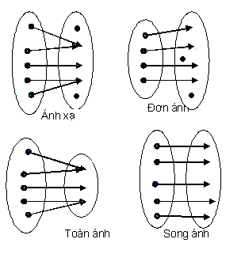

- **Xét bài toán:** Đếm số phần tử của tập X. Giả sử Y là tập mà số phần tử của nó là đã biết: **n<sub>y</sub> = \|Y\|.** Giả sử ta có thể xây dựng được ánh xạ f từ X vào Y. Khi đó

> *- Nếu f là đơn ánh, thì ta có \|X\|* ≤ *n<sub>y</sub>.*
>
> *- Nếu f là toàn ánh, thì ta có \|X\|* ≥ *n<sub>y</sub>.*
>
> *- Nếu f là song ánh, thì ta có \|X\| = n<sub>y</sub>.*

### 2.2.3. Ánh xạ hợp thành (tích của 2 ánh xạ)

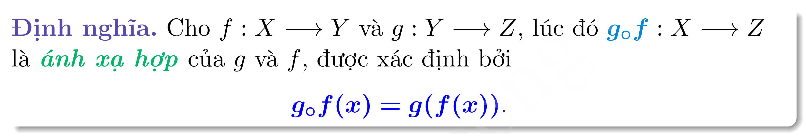

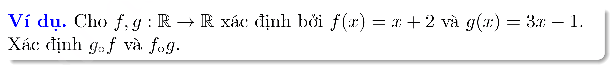

> 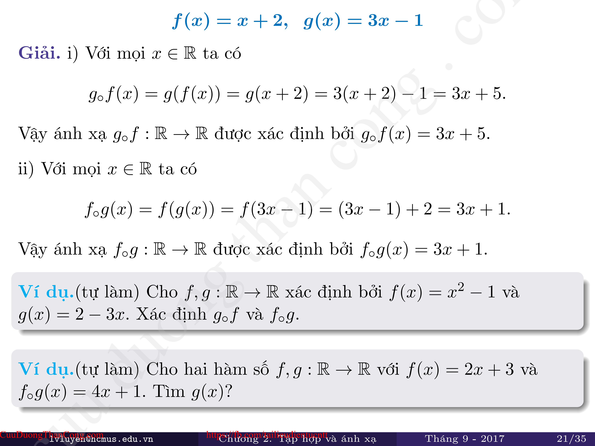

**<span class="mark">Nhận xét:</span>** $`f \circ g \neq g \circ f`$

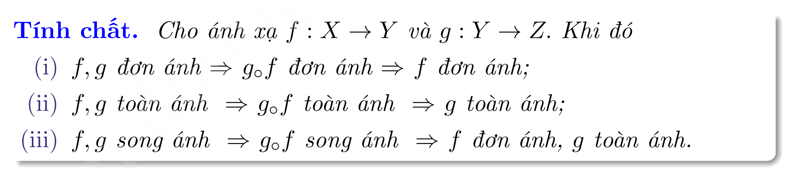

### 2.2.4. Ánh xạ ngược

#### 2.2.4.1. Ánh xạ đồng nhất trên X

Là ánh xạ **từ X vào chính X** sao cho với mọi phần tử x trong X, ta có f(x) = x.

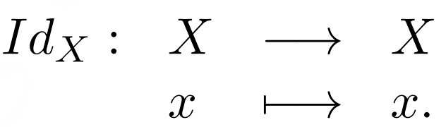

#### 2.2.4.2. Ánh xạ ngược

- Cho f: X → Y là một **song ánh.**

- Khi đó, với mọi y ∈ Y, tồn tại duy nhất một phần tử x ∈ X thỏa f(x) = y. Do đó tương ứng y  x là một ánh xạ từ Y vào X. Ta gọi đây là ánh xạ ngược của f và ký hiệu **f<sup>-1</sup>**. Như vậy:

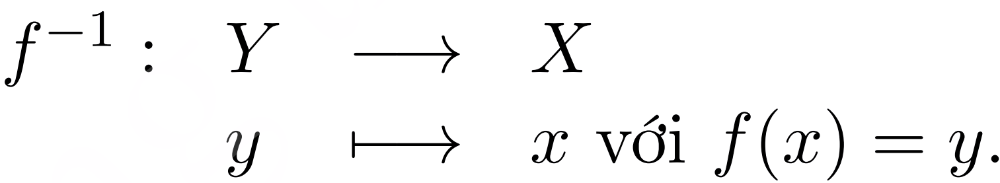 


**\* Chứng minh f(x) = x + 4 là đơn ánh:**

> 

**\* Chứng minh f(x) = x + 4 là toàn ánh:**

> 

Vì f(x) là vừa đơn ánh vừa toàn ánh, nên f(x) là **song ánh** (đpcm).


> 


> 
>
> 

## 2.3. Giải tích tổ hợp

### 2.3.1. Các nguyên lý đếm

#### 2.3.1.1. Nguyên lý cộng & nguyên lý bù trừ

**Nguyên lý cộng:**

Giả sử một công việc có thể được thực hiện theo một trong k **<u>phương án</u>** A<sub>1</sub>, A<sub>2</sub>, …, A<sub>k</sub>. Trong đó có n<sub>1</sub> **<u>cách</u>** thực hiện phương án A<sub>1</sub>, n<sub>2</sub> cách thực hiện phương án A<sub>2</sub>, …, n<sub>k</sub> cách thực hiện phương án A<sub>k</sub>. Khi đó, công việc có thể thực hiện bởi:

$`n_{1} + n_{2} + ... + n_{k} = \sum_{i = 1}^{k}n_{i}`$cách.

**Nguyên lý cộng mở rộng – Nguyên lý bù trừ:**

***Ví dụ 1:*** Để chuẩn bị vào giai đoạn 2, một nhóm sinh viên gồm: 150 sinh viên chương trình 1 đã ghi tên hộc môn Toán rời rạc và 120 sinh viên ghi tên học Vi tích phân 3 ở học kỳ này. Hỏi có bao nhiêu sinh viên trong nhóm này. Biết rằng có 50 sinh viên ghi tên học cả hai môn.

- Gọi A là tập hợp các sinh viên ghi tên học môn Toán rời rạc và B là tập hợp các sinh viên ghi tên học Vi tích phân 3.

- Khi ấy tập hợp các sinh viên ghi tên học một trong hai môn là A ∪ B.

- Ta có: **<span class="mark">\|A ∪ B\| = \|A\| + \|B\|.</span>**

- Tuy nhiên như thế vẫn chưa đủ. Vì ***công thức trên chỉ dùng khi A, B là 2 tập rời nhau.***

- Tập hợp A ∩ B = ∅ và có 50 phần tử. Trong trường hợp này \|A\| + \|B\| không phải là số phần tử của \|A ∪ B\| vì \[A ∩ B\| được tính hai lần trong \|A\| và \|B\|.

<!-- -->

- Vì thế ta có: **<span class="mark">\|A ∪ B\| = \|A\| + \|B\| - \[A ∩ B\|</span>**

  ***Đây chính là dạng mở rộng của nguyên lý cộng.***

- Thay số, ta được: \|A ∪ B\| = 150 + 120 – 50 = 220.

- Vậy có 220 sinh viên trong nhóm.

***Một ví dụ khác:*** Từ ví dụ trên. Hỏi có bao nhiêu sinh viên **ghi tên học một trong hai môn.** Biết rằng có 50 sinh viên ghi tên học cả hai môn.

- **Số sinh viên chỉ học Toán rời rạc:** \|A∖B\| = \|A\| − \|A∩B\| = 150 – 50 = 100

- **Số sinh viên chỉ học Vi tích phân 3:** \|B∖A\| = \|B\| − \|A∩B\| = 120 – 50 = 70

- **Tổng số sinh viên chỉ học một môn:** \|A∖B\| + \|B∖A\| = 100 + 70 = 170.

**Về việc vì \[A ∩ B\| được tính hai lần trong \|A\| và \|B\|:** Lấy ví dụ sau:

> 

Cộng số phần tử của A và B: \|A\| + \|B\| = 4 + 5 = 9

Nhưng trong đó 3, 4 đã bị tính **hai lần**. Thực tế: \|A ∪ B\| = 4 + 5 – 2 = 7.

***Ví dụ 2.*** cho A = {0, 1, 2,3}, B = {-2, -1, 0, 1, 2, 3}

Có bao nhiêu bộ (x, y) ∈ A × B sao cho x.y = 0?


> 
>
> Tổng số cặp (x, y) sao cho x ⋅ y = 0 là: **6 + 4 - 1 = 9.**

***Ví dụ 3:*** Giờ kiểm tra TRR có 3 bài. Biết rằng, **mỗi hs làm được ít nhất 1 bài.** Có:

> 20 hs làm được bài 1. 14 hs làm được bài 2.
>
> 10 hs làm được bài 3. 6 hs giải được bài 1 và 3.
>
> 5 hs giải được bài 2 và bài 3. 2 hs giải được bài 1 và 2.
>
> 1 hs giải được cả 3 bài.
>
> Hỏi lớp có bao nhiêu học sinh.

**<u>Giải:</u>** Gọi A là số hs giải bài 1. B là số hs giải bài 2. C là số hs giải bài 3.

> Tính số học sinh tức là tính A ∪ B ∪ C.
>
> Ta có: \|A ∪ B ∪ C\| = \|A\| + \|B\| + \|C\| - \|A ∩ B\| - \|B ∩ C\| - \|C ∩ A\| + \|A ∩ B ∩ C\|
>
> = 20 + 14 + 10 - 6 - 5 - 2 + 1 = 32

**Tại sao lại + \|A ∩ B ∩ C\| ?**

- Ban đầu, khi cộng \|A\| + \|B\| + \|C\|, các phần tử trong \|A∩B\|, \|B∩C\| và \|C∩A\| đều bị tính nhiều lần.

<!-- -->

- Khi trừ đi các giao \|A∩B\|, \|B∩C\| và \|C∩A\|, ta loại bỏ phần tử chung **giữa hai tập**. Tuy nhiên, các phần tử thuộc cả **ba tập (A∩B∩C)** bị **trừ nhiều lần** (cụ thể là 3 lần, mỗi lần trong một giao).

<!-- -->

- Ta cần **cộng lại \|A∩B∩C\|** một lần vì nó đã bị loại bỏ thừa trong bước trừ ở trên.

> ***Ví dụ minh họa***
>
> Giả sử: A = {1, 2, 3}; B = {3, 4, 5}; C = {3, 6, 7}

- A ∩ B ∩ C={3}

<!-- -->

- ∣A∣+∣B∣+∣C∣=3+3+3=9

- **Trừ các giao đôi:**

  - ∣A∩B∣={3}⇒−1; ∣B∩C∣={3}⇒−1; ∣C∩A∣={3}⇒−1

  - Tổng: 9−1−1−1=6.

- **Giao ba tập bị loại bỏ hoàn toàn:** Phần tử ‘3’ bị trừ đúng bằng số lần nó được cộng trước đó (+3 - 3 = 0).

- **Cộng lại giao ba tập:** Ta thêm lại phần tử 3 một lần để tính đúng: 6 + 1 = 7.

> **Kết quả:** Số phần tử trong A ∪ B ∪ C = 7.


#### 2.3.1.2. Nguyên lý nhân

Giả sử một công việc nào đó bao gồm k giai đoạn A<sub>1</sub>, A<sub>2</sub>, …, A<sub>k</sub> trong đó có: n<sub>1</sub> cách thực hiện thực hiện giai đoạn A<sub>1</sub>, n<sub>2</sub> cách thực hiện giai đoạn A<sub>2</sub>, …, n<sub>k</sub> cách thực hiện giai đoạn A<sub>k</sub>. Khi đó công việc có thể được thực hiện bởi:

$`n_{1} \times n_{2} \times ... \times n_{k} = \prod_{i = 1}^{n}n_{i}`$cách


**<span class="mark">\* Nguyên lý cộng, nguyên lý nhân</span>**


> Để đi từ P đến Q, có 3 cách:
>
> \- Hoặc đi qua A: 2 cách
>
> \- Hoặc đi qua B: 3 x 2 = 6 cách
>
> \- Hoặc đi qua C: 3 cách
>
> Vậy tổng cộng có: 2 + 6 + 3 = 11 cách đi từ P đến Q.


### 2.3.2. Chỉnh hợp

- ***Ví dụ mở đầu:*** Chọn 3 trong 5 sinh viên để thành lập ban cán sự lớp. Với quy tắc: Sinh viên thứ nhất làm lớp trưởng, Sinh viên thứ hai làm lớp phó, Sinh viên còn lại làm thủ quỹ. Hỏi có bao nhiêu cách chọn?

- Mỗi cách chọn ra 3 trong 5 sinh viên có kể thứ tự như trên gọi là một chỉnh hợp chập 3 của 5 phần tử.

- Tổng quát: Cho tập hợp A gồm n phần tử và **số nguyên** k với 1 ≤ k ≤ n. Khi **lấy ra k phần tử của A và <u>sắp xếp chúng theo một thứ tự</u>**, ta được một chỉnh hợp chập k của n phần tử của A (gọi tắt là một chỉnh hợp chập k của A).

- Số lượng chỉnh hợp chập k của một tập hợp có n phần tử, 1 ≤ k ≤ n, được tính như sau:

> \+ Phần tử thứ 1 có n cách chọn
>
> \+ Phần tử thứ 2 có n - 1 cách chọn
>
> \+ Phần tử thứ 3 có n - 2 cách chọn
>
> \+ ...
>
> \+ Phần tử thứ k có n – (k – 1) = n - k + 1 cách chọn

- Vậy theo quy tắc nhân ta có:


***Chứng minh:***

``` math
\frac{n!}{(n - k)!} = \frac{n.(n - 1)(n - 2)...(n - k + 1)\bcancel{(n - k)(n - k - 1)...1}}{\bcancel{(n - k)(n - k - 1)...1}} = n.(n - 1)(n - 2)...(n - k + 1)
```

**Ví dụ:** Từ 3 điểm A, B và C sẽ lập được bao nhiêu **vector?**

**Giải:**

- Số vector được tạo thành từ 3 điểm A,B,C chính là số chỉnh hợp chập 2 của 3: $`A_{3}^{2} = 6`$

- Vậy có 6 vector được tạo thành từ 3 điểm A, B, C.

### 2.3.3. Hoán vị

- **Mỗi chỉnh hợp chập n của n phần tử** được gọi là một hoán vị của các phần tử đó.

- Cho tập A có n (n ≥ 1) phần tử. Khi **<u>sắp xếp n phần tử này theo một thứ tự</u>**, ta được một hoán vị các phần tử của tập A (gọi tắt là một hoán vị của A).

- Số lượng hoán vị của tập có n phần tử: P<sub>n</sub> = $`A_{n}^{n} = n(n - 1)(n - 2)...1`$ = n!

- Ta có: **<span class="mark">0! = 1</span>**

**Ví dụ:** Một đoàn khách du lịch dự định đến tham quan 7 điểm A, B, C, D, E, F, G. Hỏi có bao nhiêu cách **<u>chọn thứ tự</u>** tham quan?

**Giải:**

- Mỗi cách họ chọn thứ tự tham quan là một hoán vị của tập A, B, C, D, E, F, G.

- Do vậy đoàn khách có tất cả: P<sub>7</sub> = 7! = 5040 cách chọn thứ tự tham quan.

***\* Lấy có thứ tự & không thứ tự?***

- **Lấy có thứ tự** thường xuất hiện trong các bài toán cần quan tâm đến ***vai trò, vị trí, hay cách sắp xếp*** của các phần tử, ví dụ: xếp ghế, phân công nhiệm vụ, hoặc chạy đua.

- Số cách **lấy có thứ tự** luôn **lớn hơn hoặc bằng** số cách **lấy không thứ tự**, vì mỗi nhóm phần tử trong trường hợp không thứ tự tương ứng với nhiều cách sắp xếp khác nhau trong trường hợp có thứ tự.

<!-- -->

- Giả sử bạn có 3 phần tử {A, B, C} và muốn chọn 2 phần tử, nhưng thứ tự là quan trọng.

- Các tổ hợp **có thứ tự** sẽ bao gồm: {A, B}, {A, C}, {B, A}, {B, C}, {C, A}, {C, B}

- {A, B} và {B, A} được xem là **khác nhau** vì thứ tự khác nhau.

- Số lượng các cách chọn sẽ lớn hơn so với trường hợp **không thứ tự**.

<!-- -->

- **Lấy không thứ tự**

<!-- -->

- Nếu thứ tự không quan trọng, bạn chỉ quan tâm đến nhóm các phần tử được chọn, bất kể chúng xuất hiện theo thứ tự nào.

- Các tổ hợp **không thứ tự** từ {A, B, C} khi chọn 2 phần tử sẽ là:

  {A,B},{A,C},{B,C}

- Ở đây, (A, B) và (B, A) được xem là **giống nhau**.

### 2.3.4. Tổ hợp

- Cho tập hợp A gồm n phần tử và **số nguyên** k với 1 ≤ k ≤ n. Mỗi tập con của A có k phần tử **<u>không kể thứ tự</u>** được gọi là một tổ hợp chập k của n phần tử của A (gọi tắt là một tổ hợp chập k của A).

- Số lượng tổ hợp chập k của một tập hợp có n phần tử, 1 ≤ k ≤ n, được tính như sau:

- Giả sử số tổ hợp là $`C_{n}^{k}`$. Ta có $`C_{n}^{k}`$. k! = $`A_{n}^{k}`$ (Mỗi hoán vị của một tổ hợp chập k cho trước tạo ra k! chỉnh hợp tương ứng – lấy ra k phần tử, thực hiện hoán vị k phần tử đó).

- Từ đó, ta có: $`C_{n}^{k} = \frac{A_{n}^{k}}{k!} = \frac{n!}{(n - k)!k!}`$

- **Ký hiệu:** $`C_{n}^{k},nCk,\left( \begin{aligned}
   & n \\
   & k
  \end{aligned} \right)`$.

- **Tính chất:** $`C_{n}^{n - k} = C_{n}^{k},\quad 0 \leq k \leq n.`$

> 
> ``` math
> C_{n}^{k} + C_{n}^{k - 1} = C_{n + 1}^{k},\quad 1 \leq k \leq n.
> ```
>
> ``` math
> C_{n}^{1} = C_{n}^{n - 1} = n
> ```
>
> ``` math
> C_{n}^{0} = C_{n}^{n} = 1
> ```
>
> **Ví dụ 1:** Cho tập A gồm 4 số tự nhiên {1,2,3,4}. Tìm tất cả các tập con của A sao cho các tập con chỉ có 3 phần tử.
>
> **Giải:** *Số tập con có thể tìm được là* $`\text{C}_{\text{4}}^{\text{3}}`$ *= 4*
>
> **Ví dụ 2:** Từ 3 điểm A, B và C, bạn sẽ có bao nhiêu đoạn thẳng được tạo ra?
>
> **Giải:**

- Số đoạn thẳng được tạo thành từ 3 điểm A, B, C chính là **số tổ hợp chập 2 của 3:** $`C_{3}^{2} = 3`$

- Vậy có 3 đoạn thẳng được tạo thành từ 3 điểm A, B, C.

### 2.3.5. Chỉnh hợp lặp

- Mỗi cách chọn ra k phần tử **(có quan tâm thứ tự)** từ n **loại** phần tử **(*trong đó mỗi loại phần tử có thể được chọn lại nhiều lần* –** *nghĩa là ta chọn xong rồi trả lại như ban đầu***)** được gọi là một ***<u>chỉnh hợp lặp chập k của n</u>.***

- **Số các chỉnh hợp lặp chập k của n là:**

``` math
\boxed{{\bar{A}}_{n}^{k} = V_{n}^{k} = \underbrace{n \times n \times n \times ... \times n}_{kson} = n^{k}}
```

> **Ví dụ 1:** Có bao nhiêu cách lấy 2 phần tử (có thể lấy lặp lại) từ M = {2, 3, 5}.
>
> Ta có các kết quả sau:
>
> {2, 2} {2, 3} {2, 5} {3, 2} {3, 3} {3, 5} {5, 2} {5, 3} {5, 5}
>
> **Giải:** Số cách lấy theo yêu cầu bài toán: $`{\bar{A}}_{3}^{2} = 3^{2} = 9`$.
>
> **Ví dụ 2:** Có bao nhiêu password gồm 6 chữ số được lập thành từ 10 chữ số 0,1,2, ..., 9?
>
> **Giải:** Số lượng mật khẩu gồm 6 chữ số theo yêu cầu đề:
>
> $`{\bar{A}}_{10}^{6} = 10^{6} = 1000000`$.

### 2.3.6. Hoán vị lặp

- Cho <u>n đối tượng</u>, trong đó <u>có **n<sub>i</sub> đối tượng loại i** giống hệt nhau</u> (i =1,2,…,k) và **n<sub>1</sub> + n<sub>2</sub>,…+ n<sub>k</sub> = n.**

- Nghĩa là:

  - *n<sub>1</sub> đối tượng giống nhau thuộc loại 1,*

  - *n<sub>2</sub> đối tượng giống nhau thuộc loại 2,*

  - *…,*

  - *n<sub>k</sub> đối tượng giống nhau thuộc loại k.*

- <u>Mỗi cách sắp xếp có thứ tự n đối tượng</u> đã cho gọi là <u>một hoán vị lặp</u> của n.

- Số tất cả các hoán vị lặp của n phần tử ở trên là:

``` math
\boxed{P\left( n_{1},n_{2},...,n_{k} \right) = \frac{n!}{n_{1}!n_{2}!...n_{k}!}}
```

- *Chứng minh:*

  - Để xác định số hoán vị trước tiên chúng ta nhận thấy có $`C_{n}^{n_{1}}`$ cách giữ chỗ cho n<sub>1</sub> phần tử loại 1, còn lại n – n1 chỗ trống.

  - Sau đó có $`C_{n - n_{1}}^{n_{2}}`$ cách đặt n<sub>2</sub> phần tử loại 2 vào hoán vị, còn lại n – n<sub>1</sub> – n<sub>2</sub> chỗ trống.

  - Tiếp tục đặt các phần tử loại 3 vào chỗ trống trong hoán vị. Theo quy tắc nhân tất cả các hoán vị có thể là:

``` math
C_{n}^{n_{1}}.C_{n - n_{1}}^{n_{2}}.C_{n - n_{1} - n_{2}}^{n_{3}} = \frac{n!}{n_{1}!\left( n - n_{1} \right)!}.\frac{\left( n - n_{1} \right)!}{n_{2}!\left( n - n_{1} - n_{2} \right)!}.\frac{\left( n - n_{1} - n_{2} \right)!}{n_{3}!\left( n - n_{1} - n_{2} - n_{3} \right)!}
```

- Tương tự với các phần tử loại 4 , … , loại k – 1 đặt vào chỗ trống trong hoán vị. Cuối cùng có $`C_{n - n_{1} - n_{2} - ... - n_{k - 1}}^{n_{k}}`$cách đặt n<sub>k</sub> phần tử loại k vào hoán vị. Theo quy tắc nhân:


**Ví dụ 1:** Từ tập X = {1;2;3;4;5;6;7;8} lập được bao nhiêu số tự nhiên có 11 chữ số sao cho chữ số 1 có mặt 4 lần, các chữ số khác có mặt 1 lần?

**Giải:**

- Mỗi cách lập số có 11 chữ số sao cho **chữ số 1 có mặt 4 lần**, **các chữ số khác có mặt 1 lần** là <span class="mark">một hoán vị lặp của 11 phần tử</span>. (số 1 xuất hiện 4 lần; các số khác 1 lần).

- Theo quy tắc hoán vị lặp có tất cả số các số thỏa mãn là:


**Ví dụ 2:** Có bao nhiêu chuỗi ký tự khác nhau nhận được bằng cách sắp xếp lại các ký tự của chuỗi: “YAMAHAM”?

- Số ký tự có trong chuỗi là: n = 7

- Có 3 ký tự ‘A’; Có 2 ký tự ‘M’; Có 1 ký tự ‘Y’; Có 1 ký tự ‘H’

- Do đó số chuỗi có được là: $`P(3,2,1,1) = \frac{\text{7!}}{3\text{!2}\text{!1}\text{!1}!} = \text{420}`$

**Ví dụ 3:** Với các chữ số **0; 1; 2; 3; 7; 9** có thể lập được bao nhiêu **số gồm 8 chữ số,** trong đó chữ số 1 có mặt 3 lần, mỗi chữ số khác có mặt đúng một lần?

**Giải:** Gọi số có 8 chữ số là: 

> \+ Mỗi cách lập số có 8 chữ số sao cho chữ số 1 xuất hiện 3 lần và các số khác có mặt xuất hiện 1 lần là một hoán vị lặp của 8 phần tử (số 1 xuất hiện 3 lần; các số khác xuất hiện 1 lần) **(tính cả trường hợp a1 = 0).**
>
> Theo quy tắc hoán vị lặp có tất cả:


**+ Xét trường hợp a<sub>1</sub> = 0.**

> Ta tính số các số có 7 chữ số được lập từ các chữ số 1;2;3;7;9 trong đó chữ số 1 có mặt 3 lần; các chữ số khác có mặt đúng 1 lần.
>
> Theo quy tắc hoán vị lặp có tất cả:


Suy ra số các số thỏa mãn đề bài là: **6720 – 840 = 5880 số.**

**Ví dụ 4:** Từ tập X= {1; 2; 4; 6; 7; 9}. Từ tập X ta lập được bao nhiêu **số có 8 chữ số** sao cho **chữ số 4 xuất hiện 2 lần**; **chữ số 2 xuất hiện 2 lần**; các **chữ số khác xuất hiện đúng 1 lần** và <span class="mark">số đó không chia hết cho 2.</span>

> **Giải:** Gọi số thỏa mãn bài toán là: 
>
> \+ Vì số này không chia hết cho 2 nên a<sub>8</sub> ∈ {1; 7; 9}.
>
> \+ **Nếu a<sub>8</sub> = 1.** Bài toán trở thành **<u>tính số các số có 7 chữ số</u>** sao cho chữ số 4 xuất hiện 2 lần; chữ số 2 xuất hiện 2 lần; **các số 6; 7; 9 xuất hiện 1 lần.**
>
> Theo quy tắc hoán vị lặp có:
>
> 
>
> \+ Tương tự; nếu **a<sub>8</sub> = 7; 9** ta cũng có 1260 số thỏa mãn.
>
> Suy ra: số các số thỏa mãn đầu bài là: **1260 + 1260 + 1260 = 3780 số.**

### 2.3.7. Tổ hợp lặp

Mở đầu: *"Có **k chiếc kẹo** giống nhau, cần chia chúng cho **n em bé**. Hỏi có bao nhiêu cách chia kẹo như vậy?".*

*Bài toán có thể được đưa về theo 2 hướng chính như sau:*

#### 2.3.7.1. Bài toán đếm số nghiệm nguyên không âm

Mỗi cách chọn ra **<u>k vật từ n loại vật</u>** khác nhau **(trong đó mỗi loại vật có thể được chọn lại nhiều lần)** được gọi là *<u>tổ hợp lặp chập k của n</u>.*

Số các tổ hợp lặp chập k của n là $`K_{n}^{k} = C_{n + k - 1}^{k} = C_{n + k - 1}^{n - 1}`$

(do ta có công thức: $`C_{n}^{n - k} = C_{n}^{k},\quad 0 \leq k \leq n`$)

**Chứng minh:**

- Sử dụng kĩ thuật song ánh, coi rằng giữa mỗi em bé có một **số 0 (ngăn cách)** và **số kẹo của em bé thứ *i*** nhận được sẽ biểu diễn bằng một dãy gồm ***x<sub>i</sub>*​ số 1,** thì bài toán trở thành đếm số cấu hình có dạng:


> *Với k số 1 và n−1 số 0 (đến cuối cùng số kẹo đã chia phải đúng bằng k, tức số kẹo ban đầu;\
> n-1 số 0 tượng trưng cho n-1 vách ngăn giữa các em).*

- Như vậy, thực tế ta đang **đếm số cách đặt n−1 số 0 vào một dãy gồm *k*+*n*−1 vị trí** *(bao gồm k vị trí cho số 1 và n – 1 vị trí cho số 0)*, còn lại sẽ là các số 1. Theo quy tắc tổ hợp không lặp, số nghiệm của bài toán sẽ là: $`C_{n + k - 1}^{n - 1} = C_{n + k - 1}^{k}`$.

- ***Lấy ví dụ:*** Có 5 chiếc kẹo chia cho 3 em. Có bao nhiêu cách chia như vậy?

  - Ta có: n = 3, k = 5. *<u>Vậy ta có n-1=2 vách ngăn tương ứng 2 chữ số 0 và 5 chữ số 1.</u>*

  - Giả sử 3 em đặt tên lần lượt là A, B, C

  - Ta có sơ đồ của một vài trường hợp như sau: (thay 1 = X, 0 = \|)

    - $`\underbrace{\phantom{X}}_{A}|\underbrace{\phantom{X}}_{B}|\underbrace{XXXXX}_{C}`$ (A, B không có kẹo, C có cả thảy 5)

> \(0011111\)

- $`\underbrace{XX}_{A}|\underbrace{X}_{B}|\underbrace{XX}_{C}`$ (A có 2, B có 1, C có 2).

- …

<!-- -->

- Vậy số cách chia thỏa ycbt: $`C_{n + k - 1}^{k} = C_{3 + 5 - 1}^{5} = 21.`$

**Ví dụ:** Có 3 loại nón A, B, C. An mua 2 cái nón. Hỏi An có bao nhiêu cách chọn?

**<u>Giải:</u>** Ta có mỗi cách chọn là mỗi tổ hợp lặp chập 2 của 3. Số cách chọn:

$`K_{3}^{2} = C_{3 + 2 - 1}^{2} = C_{4}^{2} = 6`$ **(Cụ thể AA, AB, AC, BB, BC, CC)**


> 
>
> 

**Ví dụ:** Tìm số nghiệm nguyên không âm của phương trình

x<sub>1</sub>+ x<sub>2</sub> + x<sub>3</sub> + x<sub>4</sub> = 20 **(1)**

> Thỏa điều kiện **x<sub>1</sub> ≤ 3; x<sub>2</sub> ≥ 2; x<sub>3</sub> \> 4** (∗).
>
> **<u>Giải:</u>**
>
> Ta viết điều kiện đã cho thành x<sub>1</sub> ≤ 3; x<sub>2</sub> ≥ 2; **x<sub>3</sub> ≥ 5**.
>
> Xét các điều kiện sau:
>
> x<sub>2</sub> ≥ 2; x<sub>3</sub> ≥ 5 (∗∗)
>
> x<sub>1</sub> ≥ 4; x<sub>2</sub> ≥ 2; x<sub>3</sub> ≥ 5 (∗∗∗)
>
> Gọi p, q, r lần lượt là các **số nghiệm** nguyên không âm của phương trình (1) thỏa các điều kiện (\*), (\*\*), (\*\*\*). Ta có:

**<span class="mark">p = q – r</span>**


*Trước hết ta tìm q.*

> Đặt: x<sub>1</sub>’ = x<sub>1</sub>; **x<sub>2</sub>’ = x<sub>2</sub> – 2; x<sub>3</sub>’ = x<sub>3</sub> - 5;** x<sub>4</sub>’ = x<sub>4</sub>
>
> Phương trình (1) trở thành: **<span class="mark">x<sub>1</sub>’+ x<sub>2</sub>’ + x<sub>3</sub>’ + x<sub>4</sub>’ = 13</span>** **(2)**
>
> Số nghiệm nguyên không âm của phương trình (1) thỏa điều kiện (\*\*) bằng số nghiệm nguyên không âm của phương trình (2)

``` math
\boxed{q = K_{4}^{13} = C_{4 + 13 - 1}^{13} = C_{16}^{13}}
```

Tương tự, ta có: $`\boxed{r = K_{4}^{9} = C_{4 + 9 - 1}^{9} = C_{12}^{9}}`$

``` math
\Rightarrow p = q - r = C_{16}^{13} - C_{12}^{9} = 560 - 220 = 340.
```

Vậy số nghiệm nguyên không âm của phương trình (1) thỏa điều kiện (\*) là 340.

#### 2.3.7.2. Bài toán đếm số nghiệm nguyên dương

Bài toán có thể lắt léo hơn một chút, nếu như đề bài yêu cầu rằng khi chia kẹo, **mỗi em bé đều phải được nhận ít nhất 1 chiếc kẹo.** Khi đó, bài toán sẽ trở thành: *Đếm số nghiệm **nguyên dương** của phương trình:*

**x<sub>1</sub>+ x<sub>2</sub> + … + x<sub>n</sub> = k**

Ta có:

- Xếp k cái kẹo thành hàng ngang, ta được (k – 1) khoảng trắng.

- Cần chia cho n em, thì cần (n – 1) ngăn cách.

🡪 Số cách chia tương ứng với **số cách chọn vị trí từ (k – 1) vị trí khoảng trắng cho\
(n – 1) ngăn cách.** Theo quy tắc tổ hợp không lặp, số nghiệm của bài toán sẽ là: $`C_{k - 1}^{n - 1}`$

**Các bài toán cũng tương đương:** Mua *k* món đồ cùng loại của *n* hãng sản xuất; Xếp *k* đồ vật vào *n* thùng chứa…

**CHÚ Ý: Trong một số tài liệu, định nghĩa Tổ hợp lặp, Chỉnh hợp lặp có thể được trình bày với n là số phần tử khác nhau (chứ không phải là số loại phần tử).**

- **Tổ hợp lặp** = 1 bộ **<u>không xét thứ tự</u>** gồm k phần tử được chọn từ n phần tử khác nhau (có thể chọn trùng lặp)

- **Chỉnh hợp lặp** = 1 bộ **<u>có thứ tự</u>** gồm k phần tử được chọn từ n phần tử khác nhau (có thể chọn trùng lặp)

### 2.3.8. Vận dụng Nhị thức Newton

- **Định lý:** Với a, b ∈ R và n là số nguyên dương ta có:

  $`(a + b)^{n} = \sum_{k = 0}^{n}{C_{n}^{k}a^{n - k}b^{k}} = \sum_{k = 0}^{n}{C_{n}^{k}a^{k}b^{n - k}}`$ $`= \underbrace{C_{n}^{0}a^{n}}_{so hangthunhat} + \underbrace{C_{n}^{1}a^{n - 1}b}_{thuhai} + ... + C_{n}^{k}a^{n - k}b^{k} + ... + \underbrace{C_{n}^{n - 1}a.b^{n - 1}}_{thun} + \underbrace{C_{n}^{n}b^{n}}_{thun + 1}`$ **(1)**


- **Tính chất:**

> **- Số các số hạng của công thức là n + 1.**
>
> \- Tổng các số mũ của a và b trong mỗi số hạng luôn luôn bằng số mũ của nhị thức:
>
> **k + n - k = n.**
>
> \- Số hạng tổng quát (thứ k + 1) của nhị thức là: $`T_{k + 1} = C_{n}^{k}a^{n - k}b^{k}`$
>
> \- Các hệ số nhị thức cách đều hai số hạn đầu và cuối thì bằng nhau.

**Ví dụ 1:**

> 
> ``` math
> {(x + y)^{6} = C_{6}^{0}x^{0}y^{6} + C_{6}^{1}x^{1}y^{5} + C_{6}^{2}x^{2}y^{4} + C_{6}^{3}x^{3}y^{3} + C_{6}^{4}x^{4}y^{2} + C_{6}^{5}x^{5}y^{1} + C_{6}^{6}x^{6}y^{0}
> }{= y^{6} + 6xy^{5} + 15x^{2}y^{4} + 20x^{3}y^{3} + 15x^{4}y^{2} + 6x^{5}y + x^{6}}
> ```


> **Ví dụ 3:** Tìm hệ số của x<sup>4</sup> trong khai triển (x<sup>2</sup> -2)<sup>5</sup>

- $`(x^{2} - 2)^{5} = \sum_{k = 0}^{5}{C_{5}^{k}(x^{2})^{k}( - 2)^{5 - k}}`$

- $`(x^{2})^{k} = x^{4} \Rightarrow k = 2`$

- Khi k = 2 thì hệ số của x<sup>4</sup>: $`C_{5}^{2}( - 2)^{5 - 2} = - 80`$

> **Ví dụ 4:** Tìm hệ số của số hạng trong khai triển (2x −3y)<sup>17</sup>

- Số hạng tổng quát:

  

- Để có số hạng chứa x<sup>8</sup>y<sup>9</sup> thì: $`x^{17 - k}y^{k} = x^{8}y^{9}`$=\> k = 9.

- Vậy hệ số của số hạng chứa x<sup>8</sup>y<sup>9</sup> là: 

> **Ví dụ 5:** Tìm hệ số của số hạng trong khai triển (3x – x<sup>2</sup>)<sup>12</sup>

- Số hạng tổng quát:

   

> 

- Để có số hạng chứa x<sup>15</sup> thì: 12 + k = 15 ⇔ k = 3.

- Vậy hệ số của số hạng chứa x<sup>15</sup> là .

<!-- -->

- **Khai triển mở rộng**

``` math
(a_{1} + a_{2} + ... + a_{k})^{n} = \sum_{n_{1} + n_{2} + ... + n_{k} = n}^{}{\left( \begin{aligned}
 & n \\
 & n_{1},...,n_{k}
\end{aligned} \right){a_{1}}^{n_{1}}{a_{2}}^{n_{2}}...{a_{k}}^{n_{k}}}
```

**với các số nguyên không âm n<sub>1</sub>, n<sub>2</sub>, …, n<sub>k</sub> thoả n<sub>1</sub> + n<sub>2</sub> + … + n<sub>k</sub> = n, ký hiệu**

``` math
\left( \begin{aligned}
 & n \\
 & n_{1},n_{2},...,n_{k}
\end{aligned} \right) = \frac{n!}{n_{1}!n_{2}!...n_{k}!}
```

``` math
\Rightarrow \boxed{(a_{1} + a_{2} + ... + a_{k})^{n} = \sum_{n_{1} + n_{2} + ... + n_{k} = n}^{}{\frac{n!}{n_{1}!n_{2}!...n_{k}!}{a_{1}}^{n_{1}}{a_{2}}^{n_{2}}...{a_{k}}^{n_{k}}}}
```


- Các hệ số của khai triển (a + b)<sup>n</sup> với một số giá trị đầu tiên của n, trong bảng tam giác sau đây, gọi là **<span class="mark">tam giác Pascal</span>**

- **Công dụng:** Những người không biết về nhị thức Newton có thể tra cứu dựa trên tam giác này!


**Nhận xét:** Các hệ số tổ hợp đối xứng theo từng hàng.


### 2.3.9. Nguyên lý chuồng bồ câu (Dirichlet)

- Nếu nhốt n \> m con chim bồ câu vào m chuồng thì tồn tại một chuồng nào đó chứa nhiều hơn 1 chim bồ câu.

- ***Nguyên lý cơ bản:*** Nếu ta đặt n đối tượng nào đó vào k hộp, và số hộp k nhỏ hơn số đối tượng n, thì có ít nhất một hộp chứa từ 2 đối tượng trở lên.

- ***Nguyên lý mở rộng:*** Nếu ta đặt n đối tượng vào k hộp thì sẽ tồn tại một hộp chứa ít nhất là **\[n/k\]** đối tượng.

- **Chú ý:** Ký hiệu \[a\] được gọi là *Giá trị trần* của a, dùng để chỉ số nguyên nhỏ nhất lớn hơn hoặc bằng a.

  **Ví dụ: \[5\]=5, \[4/3\]=2, \[2.1\] = 3; \[1.9\] = 2; \[4\] = 4; \[−1.1\] = −1; \[−2.9\] = −2.**

<!-- -->

- ***Phát biểu tương tự:***


**Ví dụ:**

1.  Có 20 chim bồ câu ở trong chuồng có 7 ô. Khi đó sẽ có ít nhất 1 ô chứa \[20/7\] = 3 con bồ câu trở lên.

2.  Có 100 người thì có ít nhất \[100/12\] = 9 người sinh cùng tháng.

3.  Số sinh viên của một lớp học ít nhất là bao nhiêu để có **ít nhất hai sinh viên đạt số điểm như nhau** trong kỳ thi môn CTRR, nếu **thang điểm là số nguyên từ 0→10**?

    - **n:** số sinh viên của lớp

    - **k:** số loại điểm nguyên từ 0→10 ⇒ **k=11**

    - **Tìm n<sub>min</sub> =? biết \[n/k\] = \[n/11\] = 2**

    - Theo NL chuồng bồ câu:

> <span class="mark">\[n/11\] = 2 ⇔ 1 \< n/11 ≤ 2</span> ⇔ 11\< n ≤ 22⇒ n<sub>min</sub> = 12

4.  *Trong một phòng họp có n người, bao giờ cũng tìm được 2 người có số người quen trong số những người dự họp là như nhau.*

- Số người quen của mỗi người trong phòng họp nhận các giá trị từ 0 đến n − 1. Rõ ràng trong phòng không thể đồng thời có người có số người quen là 0 (tức là không quen ai) và có người có số người quen là n − 1 (tức là quen tất cả).

- Vì vậy theo số lượng người quen, ta chỉ có thể **phân n người ra thành n − 1 nhóm.**

- Vậy theo nguyên lý Dirichlet tồn tại một nhóm có ít nhất 2 người, tức là luôn tìm được ít nhất 2 người có số người quen là như nhau.

5.  *Trong một tháng gồm 30 ngày, **một đội bóng chuyền thi đấu mỗi ngày ít nhất 1 trận nhưng chơi không quá 45 trận.** Chứng minh rằng tìm được **một giai đoạn gồm một số ngày liên tục** nào đó trong tháng sao cho trong giai đoạn đó **đội chơi đúng 14 trận.***

- Gọi **a<sub>j</sub>** là **số trận** mà đội đã chơi từ ngày đầu tháng **đến hết ngày j.**

- Khi đó 1 ≤ a<sub>1</sub> \< a<sub>2</sub>\< ... \< a<sub>30</sub> \< 45

  ⇔ 15 ≤ a<sub>1</sub> + 14\< a<sub>2</sub> + 14 \< ... \< a<sub>30</sub> + 14 \< 59.

- **Sáu mươi** số nguyên a<sub>1</sub>, a<sub>2</sub>, ..., a<sub>30</sub>, a<sub>1</sub> + 14, a<sub>2</sub> + 14, ..., a<sub>30</sub> + 14 nằm giữa 1 và 59.

  

- Vì vậy tồn tại i và j sao cho **a<sub>i</sub> = a<sub>j</sub>+ 14 (j \< i) ⇔ a<sub>i</sub> – a<sub>j</sub> = 14.** Điều này có nghĩa là từ ngày j + 1 đến hết ngày i đội đã chơi đúng 14 trận.

> 
>
> 
