Chương III.\
SỐ NGUYÊN
============

## 3.1. Phép chia

> 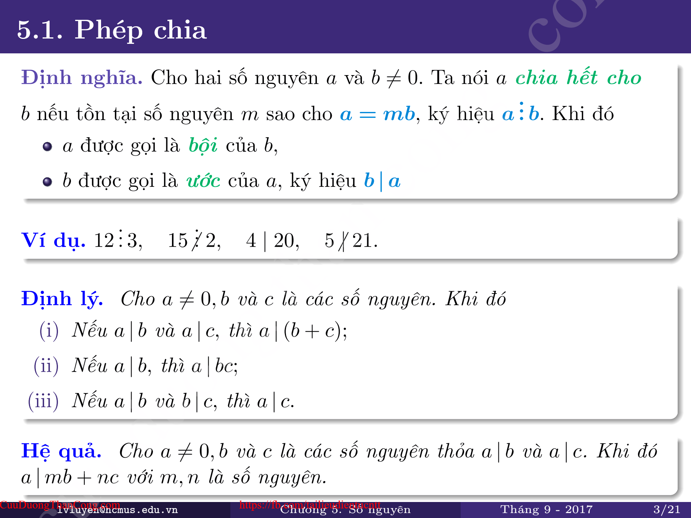
>
> 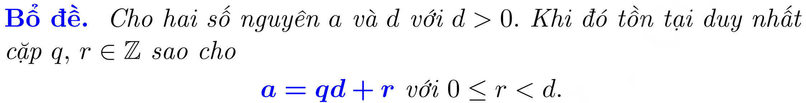
>
> 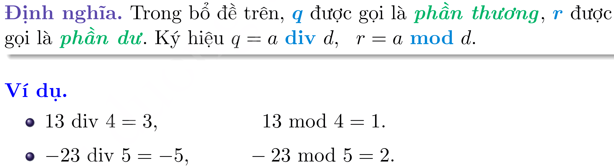

### 3.1.1. Đồng dư

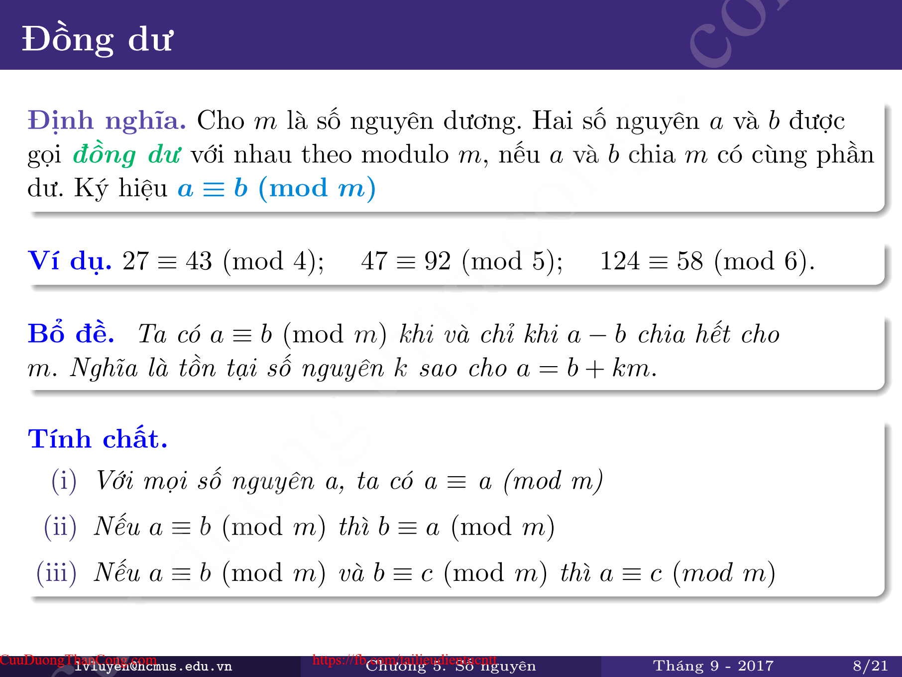

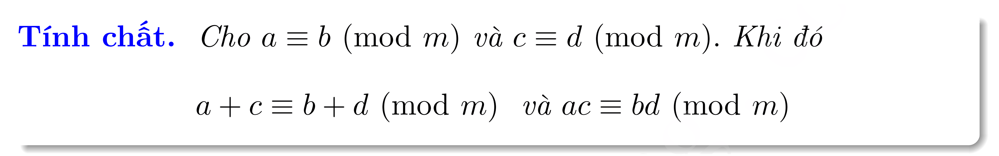

## 3.2. Ước chung lớn nhất & Bội chung nhỏ nhất

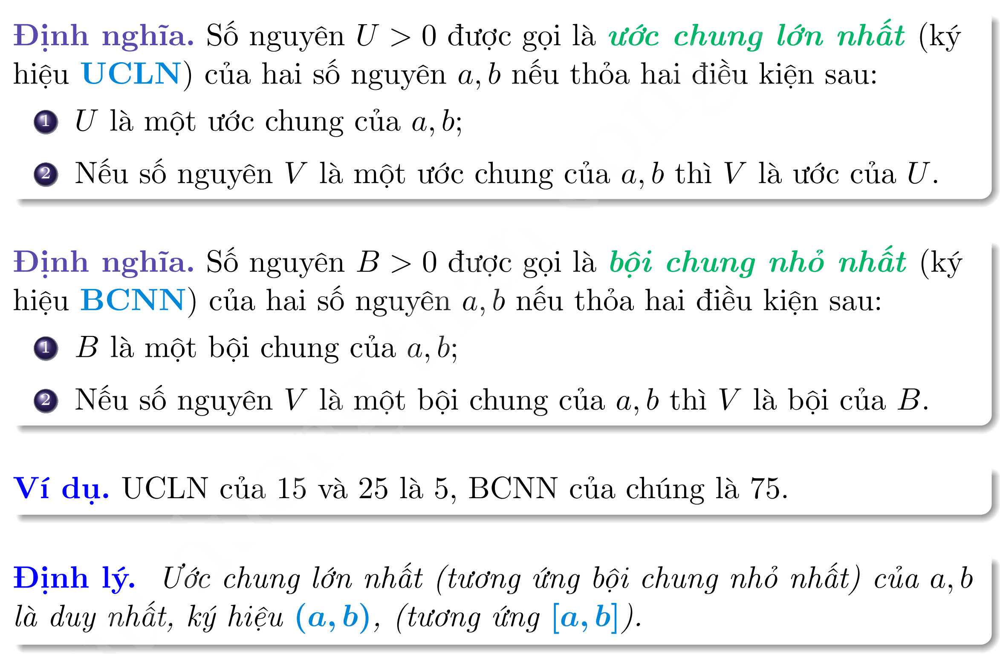

### 3.2.1. Các thuật toán tìm UCLN và BCNN

#### 3.2.1.1. Thuật toán ngây thơ

- **Ước Chung Lớn Nhất (UCLN)** của 2 số a, b là số lớn nhất mà 2 số a và b cùng chia hết

  - Thuật toán tự nhiên để tìm UCLN đó là duyệt từ số nhỏ hơn trong 2 số về tới 1, số nào mà **cả a và b chia hết <u>đầu tiên</u>** sẽ là UCLN

  - Chú ý rằng **UCLN(a, 0) = UCLN(0, a) = a**

- **Bội Chung Nhỏ Nhất (BCNN)** của 2 số a, b là số nhỏ nhất mà chia hết đồng thời cho cả a và b

  - Thuật toán tự nhiên để tìm BCNN đó là duyệt từ số lớn hơn trong 2 số và tăng dần cho tới khi **gặp số <u>đầu tiên</u> chia hết cho a và b**.

#### 3.2.1.2 Thuật toán Euclid

- Thuật toán Euclid phát biểu như sau: UCLN của hai số nguyên không thay đổi khi **thay số lớn hơn** bằng **hiệu của nó với số nhỏ hơn**

- Quá trình thay thế này được lặp đi lặp lại **cho tới khi 2 số bằng nhau**, khi đó UCLN chính là 1 trong 2 số.

- **Ví dụ:**

  - UCLN(20, 15) = UCLN (5, 15) = UCLN(10, 5) = UCLN(5, 5) =\> UCLN(20, 15) = 5

  - UCLN(16, 10) = UCLN(6, 10) = UCLN(6, 4) = UCLN(4, 2) = UCLN(2, 2) =\> UCLN(16, 10) = 2

- Để tìm BCNN: **BCNN(a, b) = a \* b / UCLN(a, b). **

***\* Cải tiến thuật toán Euclid***

- Trong mục 2 khi a và b cách xa nhau thì thuật toán Euclid hoạt động không hiệu quả, ví dụ, tìm ULCN(1000000000, 1) thì thuật toán cần lặp 999999999 lần. 

- Ta cải tiến thuật toán Euclid: UCLN của hai số nguyên không thay đổi khi **thay 1 trong 2 số thành <u>số dư của nó với số còn lại.</u>** Có nghĩa là *UCLN(a, b) = UCLN(b, a % b)*

- Quá trình thay thế này được lặp đi lặp lại cho tới khi 1 trong 2 số bằng 0, khi đó UCLN chính là số còn lại.

- **<u>Thuật toán Euclide tìm UCLN d của a, b:</u>**

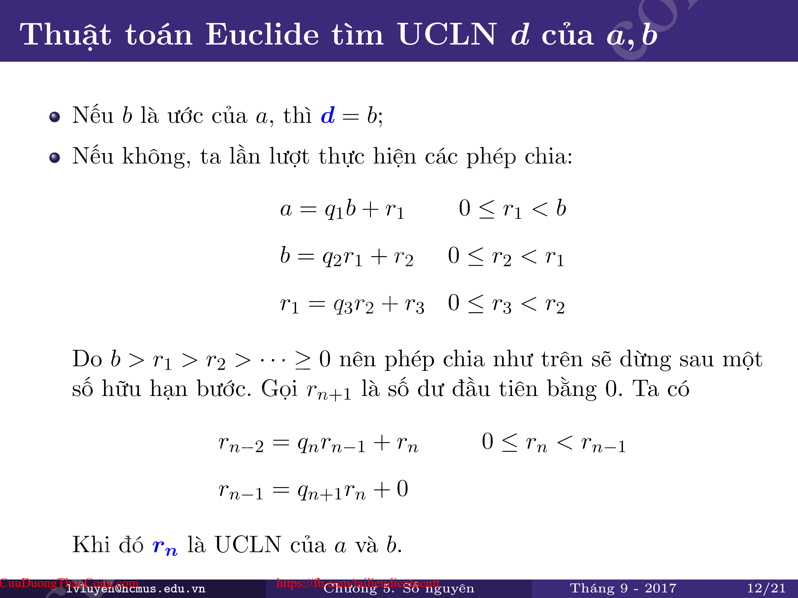

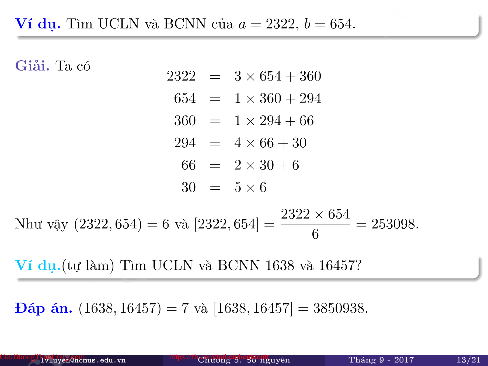

- **Cài đặt:**

  *int gcd(int a, int b)*

  *{*

  ***if (b == 0) return a;***

  ***return gcd(b, a % b);***

  *}*

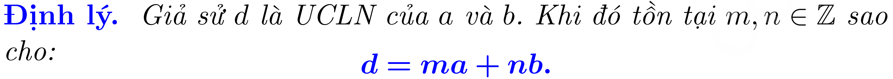

## 3.3. Số nguyên tố

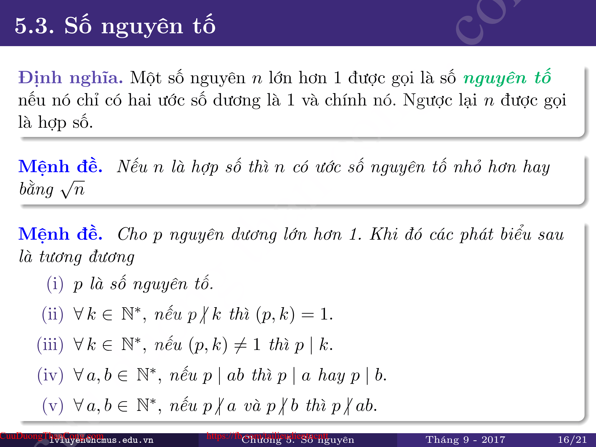

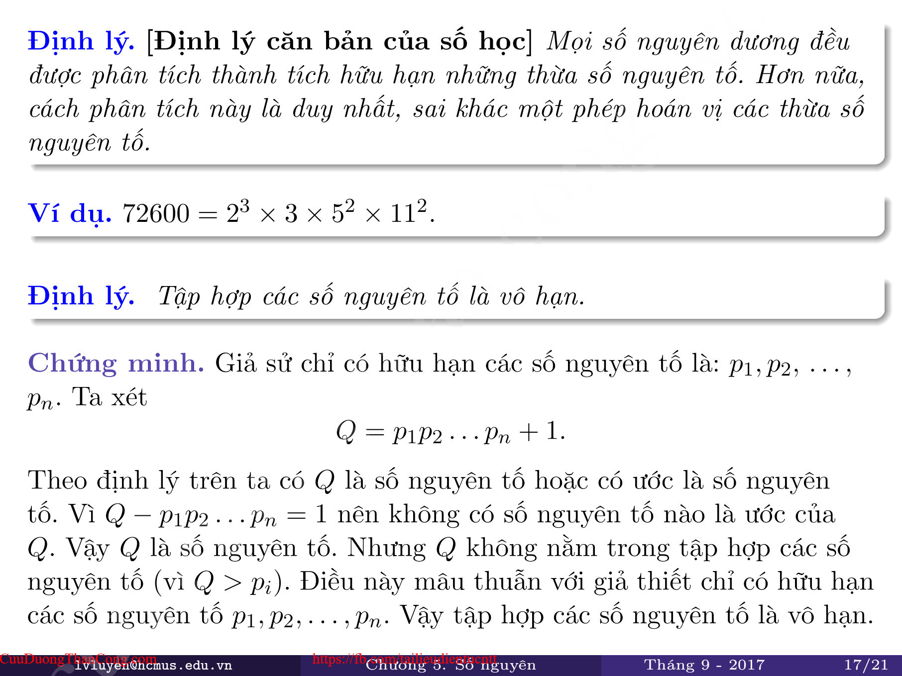

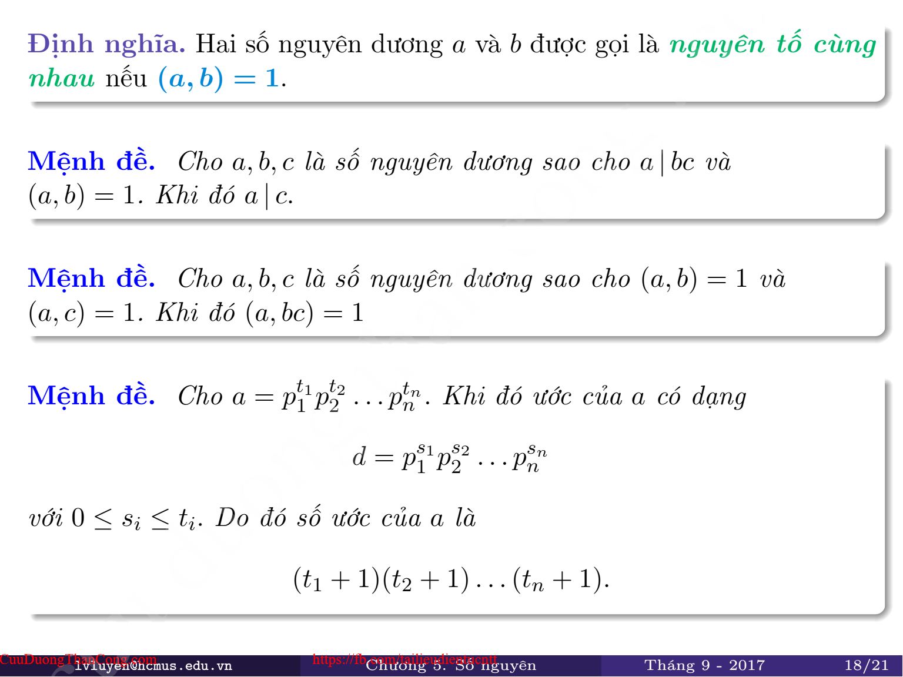

<figcaption>
<em>(Tích các thừa số nguyên tố)</em>
</figcaption>

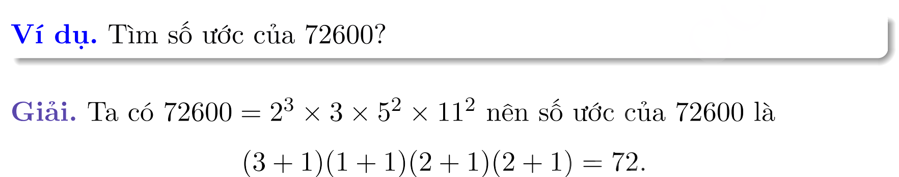

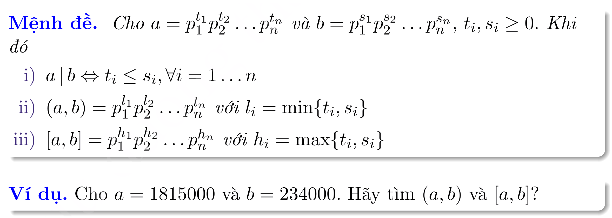

> 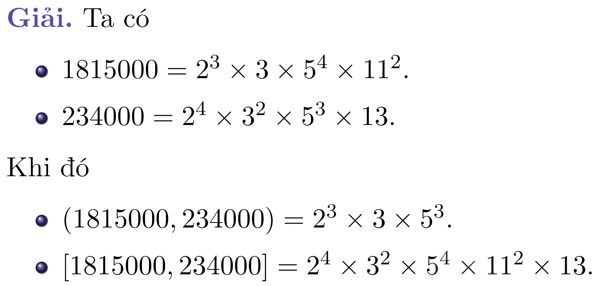
