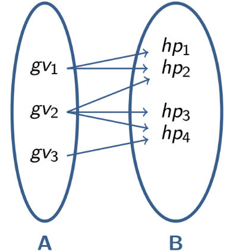
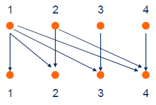

  <a className="button button--primary" href="/pdfs/toan-roi-rac/chapter2/bai7.pdf" download="bai7-toan-roi-rac.pdf" target="_blank" rel="noreferrer">
    Tải file PDF
  </a>

## 17.1. Khái niệm

- Giả sử 
  - $A$ là tập các giảng viên, $A$ = {gv1, gv2, gv3},
  - $B$ là tập các học phần, $B$ = {hp1, hp2, hp3, hp4}.

- Khi đó, mối quan hệ biểu diễn sự phân công giảng dạy có thể được mô tả như hình:

- Hoặc biểu diễn dưới dạng **tập hợp**:

  $$
  R = {(gv1, hp1), (gv1, hp2), (gv2, hp2), (gv2, hp3), (gv2, hp4), (gv3, hp4)}
  $$

- $R$ chính là tập con của tích Descartes của $A$ và $B$, tức: $R$ $⊆$ $A$ x $B$

- Tổng quát hóa ví dụ trên ta đi đến định nghĩa sau:

  - Giả sử $A$ và $B$ là 2 tập khác rỗng cho trước. 
  - Khi đó, **mối quan hệ giữa $A$ và $B$ là một tập $R$ $⊆$ $A$ x $B$**

  - Nếu 1 bộ **($a$, $b$) $∈$ $R$** ta nói $a$ có quan hệ $R$ với $b$, và viết **aRb**.

  - Ngược lại nếu ($a$, $b$) $∉$ $R$ thì ta kí hiệu$a\overline{R}b$hoặc $a\cancel{R}b$.

- Vì quan hệ $R$ là tập con của tích Descartes 2 tập hợp, nên nó được gọi là **quan hệ 2 ngôi.**

- $R \subseteq A \times A \Leftrightarrow R \subseteq A^{2}$ hoặc khi $A$ = $B$ thì được gọi là **quan hệ hai ngôi trên cùng một tập** (tập $A$). *Thực tế điều này được biểu hiện bởi mối quan hệ giữa: người với người, các số nguyên với nhau, đường thẳng trong không gian…*

- Nếu $R$ $⊆$ $A$1 x $A$2 x $A$3 ... x $A$$n$ thì $R$ được gọi là **quan hệ $n$ ngôi.**

**Ví dụ 1:** Cho *$A$* = {1, 2, 3, 4}, $R$ là một quan hệ (hai ngôi) trên $A$ và *$R$* = {(*$a$*, *$b$*) $∈$ $A$2 \| *$a$* là ước của *$b$*}. Khi đó *$R$* = {(1, 1), (1, 2), (1, 3), (1, 4), (2, 2), (2, 4), (3, 3), (4,4)}.

**Ví dụ 2.** Cho $A = \{1, 2, 3\}$ và $\mathcal{R} = \{(1, 1), (1, 2), (2, 3), (1, 3)\}$ là một quan hệ trên $A$. Khi đó

$$1\mathcal{R}1, \quad 1\mathcal{R}2, \quad 2\mathcal{R}3, \quad 1\mathcal{R}3, \quad 2\not\mathcal{R}1, \quad 2\not\mathcal{R}2, \dots$$

**Ví dụ 3.** Cho $A = \{1, 2, 3, 4, 5, 6, 7, 8\}$. Một quan hệ $\mathcal{R}$ trên $A$ được xác định như sau:

$$x\mathcal{R}y \Leftrightarrow x - y \text{ chia hết cho } 4.$$

Ta có:

$$1\mathcal{R}5, \quad 5\mathcal{R}1, \quad 7\mathcal{R}7, \quad 1\not\mathcal{R}2, \quad 3\not\mathcal{R}6, \dots$$

- **Lực lượng của tập các quan hệ:** Xét quan hệ 2 ngôi:
  - Giả sử \|$A$1\| = $n$, \|$A$2\| = $m$. 
  Ta có $R$ $⊆$ \|$A$1 x $A$2\| = $n$ x $m$ $⇒$ **\|$R$\| = 2$n$ x $m$**

## 17.2. Các tính chất của quan hệ

- **Định nghĩa:** Giả sử $R$ là một quan hệ hai ngôi trên tập $A$.

> \($a$\) Ta nói quan hệ *$R$* có ***tính** **phản xạ (reflexive)*** nếu và chỉ nếu **$∀$*$a$*$∈$*$A$, aRa.***
>
> Điều đó có nghĩa là, với ***bất kỳ phần tử nào trong tập $A$, cặp ($a$, $a$) phải nằm trong quan hệ $R$​.***

**Ví dụ:** Trên tập *$A$* = {1, 2, 3, 4}, quan hệ

- *$R$*1 *=* {(1,1), (1,2), (2,1), (2, 2), (3, 4), (4, 1), (4, 4)} không phản xạ vì (3, 3)$∉$*$R$*1

- *$R$*2 *=* {(1,1), (1,2), (1,4), (2, 2), (3, 3), (4, 1), (4, 4)} phản xạ vì (1,1), (2, 2), (3, 3), (4, 4)$∈$*$R$*2

> - Quan hệ $≤$ trên *$Z$* phản xạ vì *$a$* $≤$ *$a$,* $∀$*$a$* $∈$ *$Z$.*
>
> - Quan hệ \> trên *$Z$* không phản xạ vì 1 không lớn hơn 1.
>
> - Quan hệ “\|” (“ước số”) trên $Z$+ là phản xạ vì mọi số nguyên dương *$a$* là ước của chính nó.
>
> - Quan hệ vuông góc không phản xạ vì Mọi đường thẳng không bao giờ vuông góc với chính nó. Nhưng quan hệ song song là phản xạ.

> \($b$\) Ta nói quan hệ *$R$* có ***tính** **đối xứng (symmetric)*** nếu và chỉ nếu
> - Nếu $aRb$ thì $bRa$, $∀a, b ∈ A*
> - Nếu ($a$, $b$) đã thuộc $R$​, thì ($b$, $a$) cũng phải thuộc $R$.

**Ví dụ:** Xét $A$ = {1; 2; 3; 4}

  - Quan hệ $R$ = {(1; 2); (2; 1); (2; 3); (3; 2); (1; 1); (4; 4)} là đối xứng.

  - Quan hệ $R$1 = {(1,1), (1,2), (2,1)} là đối xứng.

> - Các quan hệ “=, $≡$, //, $⊥$” là những quan hệ đối xứng.
>
> - Quan hệ $≤$ trên $Z$, $R$, $Q$ không đối xứng.

> \($c$\) Ta nói quan hệ $R$ có ***tính bắc cầu (truyền) (transitive)*** nếu và chỉ nếu $∀a,b,c ∈ A$, $(aRb ∧ bRc) ⇒ aRc$

**Ví dụ:**
- Trên tập $A$ = {1, 2, 3, 4}:
  - Quan hệ $R$ = {(1,1), (1,2), (2,1), (2, 2), (1, 3), (2, 3)} có tính bắc cầu.
  - Quan hệ $R$1 = {(1; 2); (2; 4); (1; 4); (4; 4)} có tính bắc cầu.

> - Quan hệ $≤$ và “\|” trên $Z$ có tính bắc cầu vì
>   - ($a$ $≤$ $b$) $∧$ ($b$ $≤$ $c$) $⇒$ ($a$ $≤$ $c$)
>   - ($a$ \| $b$) $∧$ ($b$ \| $c$) $⇒$ ($a$ \| $c$)
>
> - Quan hệ “=, $≡$, //” có tính bắc cầu.
>
> - Quan hệ $⊥$” không có tính bắc cầu.

> \($d$\) Ta nói quan hệ $R$ có ***tính phản xứng (phản đối xứng) (antisymmetric)*** nếu và chỉ nếu

$∀$ $a$, $b$ $∈$ $A$, ($a$ $R$ $b$ $∧$ $b$ $R$ $a$) $⇒$ $a$ = $b$

**Ví dụ:** Xét $R$ là quan hệ **chia hết** trên tập số nguyên dương $\mathbb{Z}^+$.  
- Khi đó: $\forall x, y \in \mathbb{Z}^+, (x|y) \land (y|x) \to x = y \Leftrightarrow (xRy) \land (yRx) \to x = y$  
- Vậy $R$ có tính phản xứng.

> - Quan hệ $≤$ trên $Z$ không đối xứng, tuy nhiên nó phản xứng vì ($a$ $≤$ $b$) $∧$ ($b$ $≤$ $a$) $⇒$ ($a$ = $b$).
>
> - Quan hệ“ \| ” (“ước số”) trên $Z$+ không đối xứng, tuy nhiên nó có tính phản xứng vì ($a$ \| $b$) $∧$ ($b$ \| $a$) $⇒$ ($a$ = $b$).
>
> - Quan hệ $R = \left\{ (a,b):a > b \right\}$phản xứng, do $\underbrace{(a > b) \land (b > a)}_{0} \Rightarrow a = b$ là đúng *(Khi mệnh đề giả thiết sai, bất kể mệnh đề kết luận có chân trị như thế nào, phép kéo theo luôn cho ta chân trị là đúng).*

## 17.3. Biểu diễn quan hệ

- **Định nghĩa.** Cho *$R$* là quan hệ từ *$A$* = {1,2,3,4} đến $B$ = {$u$,$v$,$w$}, $R = {(1,u),(1,v),(2,w),(3,w),(4,u)}$.
- Khi đó *$R$* có thể biễu diễn như sau:

$$
\begin{array}{c}
  \\
  1 \\
  2 \\
  3 \\
  4
\end{array}
\begin{array}{c}
  \begin{array}{ccc} \text{u} & \text{v} & \text{w} \end{array} \\
  \begin{pmatrix}
    1 & 1 & 0 \\
    0 & 0 & 1 \\
    0 & 0 & 1 \\
    1 & 0 & 0
  \end{pmatrix}
\end{array}
$$

- Dòng và cột tiêu đề có thể bỏ qua nếu không gây hiểu nhầm. Khi đó ta có thể xem phần còn lại như là một ma trận nhị phân cấp 4 x 3.

- **Định nghĩa.** Cho *$R$* là quan hệ từ *$A$* = {*$a$1*, *$a$*2, …, *$a$$m$*} đến *$B$* = {*$b$*1, *$b$*2, …, *$b$$n$*}. Ma trận biểu diễn của *$R$* là ma trận $M$*$R$* = \[*$m$ij*\] *mxn* xác định bởi:

  $$
  m_{ij} = \begin{cases}
  0 & \text{nếu } (a_i, b_j) \notin R \\
  1 & \text{nếu } (a_i, b_j) \in R
  \end{cases}
  $$

**Ví dụ 1:** Cho *$R$* là quan hệ từ *$A$* = {1, 2, 3} đến *$B$* = {1, 2}: $aRb ⇔ a > b$. Khi đó ma trận biểu diễn của *$R$* là:

  $$
  \begin{array}{c}
    \\
    1 \\
    2 \\
    3
  \end{array}
  \begin{array}{c}
    \begin{array}{cc} 1 & 2 \end{array} \\
    \begin{pmatrix}
      0 & 0 \\
      1 & 0 \\
      1 & 1
    \end{pmatrix}
  \end{array}
  \begin{array}{c}
    \\
    = \mathrm{M}_R
  \end{array}
  $$

**Ví dụ 2:** Cho *$R$* là quan hệ từ *$A$* = {*$a$*1, *$a$*2, *$a$*3} đến *$B$* = {*$b$*1, *$b$*2, *$b$*3, *$b$*4, *$b$*5} được biễu diễn bởi ma trận

$$
\begin{array}{c}
  \\
  \mathbf{M}_R =
\end{array}
\begin{array}{c}
  \begin{array}{ccccc} b_1 & b_2 & b_3 & b_4 & b_5 \end{array} \\
  \begin{bmatrix}
    0 & 1 & 0 & 0 & 0 \\
    1 & 0 & 1 & 1 & 0 \\
    1 & 0 & 1 & 0 & 1
  \end{bmatrix}
\end{array}
\begin{array}{c}
  \\
  a_1 \\
  a_2 \\
  a_3
\end{array}
$$

  - Khi đó *$R$* ={(*$a$*1, *$b$*2), (*$a$*2, *$b$*1), (*$a$*2, *$b$*3), (*$a$*2, *$b$*4), (*$a$*3, *$b$*1), (*$a$*3,*$b$*3), (*$a$*3, *$b$*5)}.

- Cho *$R$* là quan hệ trên tập *$A$*, khi đó **$M$*$R$* là *ma trận vuông****.*

  - $R$ **là phản xạ** nếu tất cả các phần tử trên *đường chéo* của $M$*$R$* đều bằng 1: *$m$ii* = 1, $∀$*$i$.*

  $$
  \begin{array}{c}
    \\
    \text{u} \\
    \text{v} \\
    \text{w}
  \end{array}
  \begin{array}{c}
    \begin{array}{ccc} \text{u} & \text{v} & \text{w} \end{array} \\
    \begin{pmatrix}
      1 & 1 & 0 \\
      0 & 1 & 1 \\
      0 & 0 & 1
    \end{pmatrix}
  \end{array}
  $$

  - $R$ là **đối xứng** nếu $M$$R$ là đối xứng: $m$ij = $m$ji, $∀$ $i$, $j$.

  $$
  \begin{array}{c}
    \\
    \text{u} \\
    \text{v} \\
    \text{w}
  \end{array}
  \begin{array}{c}
    \begin{array}{ccc} \text{u} & \text{v} & \text{w} \end{array} \\
    \begin{pmatrix}
      1 & 0 & 1 \\
      0 & 0 & 1 \\
      1 & 1 & 0
    \end{pmatrix}
  \end{array}
  $$

  - $R$ là **phản xứng** nếu $M$$R$ thỏa: $m$ij = 0 hoặc $m$ji = 0 nếu $i$ $≠$ $j$

  $$
  \begin{array}{c}
    \\
    \text{u} \\
    \text{v} \\
    \text{w}
  \end{array}
  \begin{array}{c}
    \begin{array}{ccc} \text{u} & \text{v} & \text{w} \end{array} \\
    \begin{pmatrix}
      1 & 0 & 1 \\
      0 & 0 & 0 \\
      0 & 1 & 1
    \end{pmatrix}
  \end{array}
  $$
