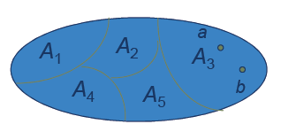

  <a className="button button--primary" href="/pdfs/toan-roi-rac/chapter2/bai7.pdf" download="bai7-toan-roi-rac.pdf" target="_blank" rel="noreferrer">
    Tải file PDF
  </a>

## 18.1. Định nghĩa

- Quan hệ 2 ngôi $R$ trên tập $A$ được gọi là ***tương đương*** nếu và chỉ nếu nó thỏa mãn các **tính chất** **phản xạ, đối xứng và bắc cầu.**

**Ví dụ 1:** Quan hệ *$R$* trên tập các chuỗi ký tự xác định bởi *aRb* nếu *$a$* và *$b$* có cùng độ dài. Khi đó *$R$* là quan hệ tương đương.

**Ví dụ 2:** Cho *$R$* là quan hệ trên tập **$R$** sao cho: $∀$ $a$,$b$ $∈$**$R$**, *aRb $⇔$ $a$* – *$b$*$∈$**$Z$**. CM: *$R$* là quan hệ tương đương trên **$R$**.
  - $\forall a \in \mathbb{R}$, ta có $a - a = 0 \in \mathbb{Z} \Rightarrow aRa \Rightarrow R$ có tính phản xạ (1)
  - $\forall a, b \in \mathbb{R} : aRb \Leftrightarrow a - b \in \mathbb{Z} \Rightarrow b - a \in \mathbb{Z} \Leftrightarrow bRa \Rightarrow R$ có tính đối xứng (2)
  - $\forall a, b, c \in \mathbb{R} : \begin{cases} aRb \\ bRc \end{cases} \Leftrightarrow \begin{cases} a - b \in \mathbb{Z} \\ b - c \in \mathbb{Z} \end{cases} \Rightarrow a - c \in \mathbb{Z} \Leftrightarrow aRc \Rightarrow R$ có tính bắc cầu (3)
  
  $\overset{(1),(2),(3)}{\Longrightarrow} R$ là quan hệ tương đương trên $\mathbb{R}$ (đpcm).

**Ví dụ 3:** Xét quan hệ $R$ = {(x, $y$) $∈$ $Z$ x $Z$ : $xRy$ $⇔$ x + $y$ chẵn}. Khi đó $R$ là quan hệ tương đương. Thật vậy:
  - $∀$ x $∈$ $Z$, $x + x$ là số chẵn, tức là $xRx$ (tính phản xạ).
  - $∀$ x, $y$ $∈$ $Z$ nếu $x + y$ chẵn thì $y + x$ chẵn, suy ra tính đối xứng.
  - $∀$ x, $y$, $z$ $∈$ $Z$ nếu $x + y$ chẵn và $y + z$ chẵn thì $x + z$ chẵn, suy ra tính bắc cầu.

**Ví dụ 4:** Cho $m$ là số nguyên dương và $R$ là quan hệ trên $Z: ∀ a,b ∈Z$, $aRb ⇔ (a – b)$ chia hết $m$

- Khi đó $R$ là quan hệ tương đương trên $Z$.
-   Rõ ràng quan hệ này có tính phản xạ và đối xứng.
-   Cho $a$, $b$, $c$ sao cho $a$ – $b$ và $b$ – $c$ chia hết cho $m$, khi đó $a$ – $c$ = $a$ – $b$ + $b$ – $c$ cũng chia hết cho $m$. Suy ra $R$ có tính chất bắc cầu.
-   Quan hệ này được gọi là quan hệ đồng dư modulo $m$, và chúng ta viết $a$ $≡$ $b$ (mod $m$) thay vì aRb.

## 18.2. Lớp tương đương (Equivalence Class)

- **Định nghĩa.** Cho $R$ là quan hệ tương đương trên $A$ và *$a$*$∈$*$A$*.

- ***Lớp tương đương chứa $a$*** theo quan hệ $R$ được ký hiệu bởi \[*$a$*\]*$R$* hoặc \[*$a$*\] hoặc $\overline{a}$, là **<u>tập hợp tất cả những phần tử có quan hệ $R$ với $a$</u>.**

  $$
  \boxed{
  [a] = \{b \in A \mid bRa\}
  }
  $$

- Mỗi phần tử x $∈$\[*$a$*\] được gọi là một phần tử đại diện của lớp tương đương \[*$a$*\].

**Ví dụ 1:** Quan hệ "cùng màu" trên tập hợp các đồ vật.
  - Giả sử có tập $A$ là các đồ vật:

  $$A = \{\text{"bút đỏ"}, \text{"vở đỏ"}, \text{"bút xanh"}, \text{"vở xanh"}\}.$$

  - Xét quan hệ $R$ trên tập $A$, định nghĩa như sau:

  $$(a, b) \in R \iff a \text{ và } b \text{ có cùng màu.}$$
  
  - Dựa trên định nghĩa "cùng màu", các cặp trong quan hệ *$R$* là:

  $$R = \{(\text{"bút đỏ"}, \text{"bút đỏ"}), (\text{"bút đỏ"}, \text{"vở đỏ"}), (\text{"vở đỏ"}, \text{"bút đỏ"}), (\text{"vở đỏ"}, \text{"vở đỏ"}), (\text{"bút xanh"}, \text{"bút xanh"}), (\text{"bút xanh"}, \text{"vở xanh"}), (\text{"vở xanh"}, \text{"bút xanh"}), (\text{"vở xanh"}, \text{"vở xanh"})\}.$$

  - Tập *$A$* được phân thành các lớp tương đương dựa trên quan hệ *$R$*:
    - Lớp tương đương của "bút đỏ" là:

      $$[\text{"bút đỏ"}] = \{\text{"bút đỏ"}, \text{"vở đỏ"}\}.$$

    - Lớp tương đương của "bút xanh" là:

      $$[\text{"bút xanh"}] = \{\text{"bút xanh"}, \text{"vở xanh"}\}.$$

  🡺 Mỗi lớp tương đương chứa các đồ vật **cùng màu**.

**Ví dụ 2:** Quan hệ chia hết trên $A$ = {1, 2, 3, 4, 5, 6}

* Quan hệ: $R$ là "chia hết cho 3", tức là $(a, b) \in R \iff a \bmod 3 = b \bmod 3$.
* Tập $A$ được phân thành các lớp tương đương:
  * $[1] = \{1, 4\}$ (vì $1 \bmod 3 = 4 \bmod 3$).
  * $[2] = \{2, 5\}$ (vì $2 \bmod 3 = 5 \bmod 3$).
  * $[3] = \{3, 6\}$ (vì $3 \bmod 3 = 6 \bmod 3 = 0$).
* Quan hệ $R$ trong ví dụ này gồm các cặp:

$$R = \{(1, 1), (1, 4), (4, 1), (4, 4), (2, 2), (2, 5), (5, 2), (5, 5), (3, 3), (3, 6), (6, 3), (6, 6)\}.$$

**Ví dụ 3:** Tìm các lớp tương đương theo quan hệ đồng dư modulo 8 chứa 0 và 1?

- \[0\]8 = {*$b$*$∈$**$Z$** *\| bR*0}= {*$b$*$∈$**$Z$** *\|* (*$b$-*0)=*$b$* chia hết cho 8} = { …, – 16, – 8, 0, 8, 16, … }

- Tương tự \[1\]8 = {*$b$*$∈$**$Z$** *\|* (*$b$-*1) chia hết cho 8} *=* { …, – 15, – 7, 1, 9, 17, …}

**Ví dụ 4:** Quan hệ "số có cùng bội chung nhỏ nhất" trên $A$

- Xét tập $A = \{2, 3, 4, 6, 8, 12\}$.
- Quan hệ $R$ được định nghĩa như sau:

$$(a, b) \in R \iff \text{BCNN}(a, b) = \text{BCNN}(b, a).$$
- Dựa trên định nghĩa, các phần tử trong *$A$* có thể nhóm lại theo BCNN:

  - Bội chung nhỏ nhất của 2, 4, 8 là 8. Các cặp thuộc *$R$* cho lớp tương đương này: $R$1 = {(2, 2), (2, 4), (2, 8), (4, 2), (4, 4), (4, 8), (8, 2), (8, 4), (8, 8)}

- Bội chung nhỏ nhất của 3, 6, 12 là 12. Các cặp thuộc *$R$* cho lớp tương đương này: $R$2 = {(3, 3), (3, 6), (3, 12), (6, 3), (6, 6), (6, 12), (12, 3), (12, 6), (12, 12)}

- Quan hệ *$R$* chia tập *$A$* thành các lớp tương đương:

  - **Lớp tương đương của 2**: \[2\] = {2, 4, 8}.

  - **Lớp tương đương của 3**: \[3\] = {3, 6, 12}.

- Ta có $R = R_{1} \cap R_{2}$.

**Ví dụ 5:** Khi xét mối quan hệ giữa tập các đường thẳng song song, lớp tương đương là tập các đường thẳng song song với nhau.

- **Tập thương** của $A$ theo quan hệ $R$, ký hiệu là $A$/$R$, được định nghĩa là **<u>tập tất cả các lớp tương đương</u>** của các phần tử thuộc $A$, nghĩa là

$$
  A/R = {[a] |∀a ∈ A}
$$

> Nếu quan hệ $R$ trên tập $A$ là **quan hệ tương đương**, thì:

> - Quan hệ này phân hoạch tập $A$ thành **các lớp tương đương không giao nhau**.

> - Mỗi lớp tương đương chứa các phần tử trong $A$ sao cho ***mọi phần tử trong cùng một lớp đều liên quan với nhau theo $R$.***

**Ví dụ 1: Quan hệ đồng dư modulo trên tập $A$:**

- Xét tập $A = \{0, 1, 2, 3, 4, 5, 6\}$, với quan hệ $R$: $$(a, b) \in R \iff a \equiv b \pmod 3.$$ 
- **Tìm các lớp tương đương:**
  - Lớp tương đương của 0:
    $$[0] = \{a \in A \mid a \equiv 0 \pmod 3\} = \{0, 3, 6\}.$$
  - Lớp tương đương của 1:
    $$[1] = \{a \in A \mid a \equiv 1 \pmod 3\} = \{1, 4\}.$$
  - Lớp tương đương của 2:
    $$[2] = \{a \in A \mid a \equiv 2 \pmod 3\} = \{2, 5\}.$$

- **Tập thương $A/R$:** $$A/R = \{[0], [1], [2]\},$$ với: $$[0] = \{0, 3, 6\}, \quad [1] = \{1, 4\}, \quad [2] = \{2, 5\}.$$

**Ví dụ 2: Quan hệ "cùng bội chung nhỏ nhất" trên tập ( $A = \{2, 3, 4, 6, 8, 12\}$:**
- Xét quan hệ $R$ trên $A$: $$(a, b) \in R \iff \text{BCNN}(a, b) = \text{BCNN}(b, a).$$
- **Tìm các lớp tương đương:**
  - Lớp tương đương của 2: $$[2] = \{2, 4, 8\},$$ vì các số này có BCNN giống nhau.
  - Lớp tương đương của 3: $$[3] = \{3, 6, 12\},$$ vì các số này có BCNN giống nhau.

- **Tập thương $A/R$:** $$A/R = \{[2], [3]\},$$

> **Mệnh đề.** *Cho $\mathcal{R}$ là quan hệ tương đương trên tập hợp $A$. Khi đó:*

> - i) $\forall x \in A, \, x \in \overline{x};$
> - ii) $\forall x, y \in A, \, x\mathcal{R}y \Leftrightarrow \overline{x} = \overline{y}.$
> - iii) $\forall x, y \in A$, *nếu* $\overline{x} \neq \overline{y}$ *thì* $\overline{x} \cap \overline{y} = \emptyset$. (hoặc nếu khi $x\cancel{R}y$)

> **Chú ý:** 
> - Từ mệnh đề trên ta thấy rằng các lớp tương đương của các phần tử của tập $A$ **hoặc trùng nhau, hoặc rời nhau.**
> -  Hơn nữa, **hợp của tất cả các lớp tương đương này trùng với $A$,** cho nên **tập $A$ là hợp rời rạc của các lớp tương đương.**
> - Ta cũng nói rằng **tập $A$ được phân hoạch thành các lớp tương đương theo quan hệ $R$.**

## 18.3. Sự phân hoạch thành các lớp tương đương

- **Chú ý:** Cho {*$A$*1, *$A$*2, … } là phân hoạch *$A$* thành các tập con không rỗng, rời nhau. Khi đó có duy nhất quan hệ tương đương trên *$A$* sao cho **mỗi *$A$$i$* là một lớp tương đương.**

- Định nghĩa một **quan hệ tương đương** $R$ trên $A$: aRb nếu và chỉ nếu $a$ và $b$ thuộc cùng một tập con $A$$i$​ trong phân hoạch $A$.

  - Nói cách khác, ta định nghĩa quan hệ $R$ bằng cách "liên kết" các phần tử trong cùng một tập con.

- Dễ dàng chứng minh rằng *$R$* là quan hệ tương đương trên *$A$* và \[*$a$*\]*$R$* = *$A$$i$* nếu *$a$*$∈$*$A$$i$ (nếu $a$ thuộc vào tập $A$$i$, thì mặc nhiên nó là phần tử đại diện của lớp tương đương \[$a$\])*.

**Ví dụ 1:** Giả sử $A = \{1, 2, 3, 4, 5\}$ và $A$ được phân hoạch thành các tập con sau:

  $$A_1 = \{1, 2\}, \quad A_2 = \{3, 4\}, \quad A_3 = \{5\}.$$

* Quan hệ $R$ được định nghĩa là: $a \, R \, b$ nếu và chỉ nếu $a$ và $b$ thuộc cùng một tập con $A_i$. Vậy, $R$ bao gồm các cặp sau:
  $$R = \{(1, 2), (2, 1), (3, 4), (4, 3), (5, 5)\}.$$
* **Lớp tương đương** của $1$ là $[1]_R = \{1, 2\}$, vì $1$ và $2$ cùng thuộc $A_1$.
* **Lớp tương đương** của $3$ là $[3]_R = \{3, 4\}$, vì $3$ và $4$ cùng thuộc $A_2$.
* **Lớp tương đương** của $5$ là $[5]_R = \{5\}$, vì $5$ chỉ có một mình trong $A_3$.

**Ví dụ 2:** Cho *$m$* là số nguyên dương, khi đó có *$m$* lớp tương đương theo quan hệ đồng dư modulo *$m$* là \[0\]*$m$* , \[1\]*$m$* , …, \[*$m$* – 1\]*$m$* .

- Chúng phân hoạch **$Z$** thành các tập con rời nhau.

- *Chú ý rằng*:
  - \[0\]*$m$* = \[*$m$*\]*$m$* = \[2*$m$*\]*$m$* = …
  - \[1\]*$m$* = \[*$m$* + 1\]*$m$* = \[2*$m$* +1\]*$m$* = …
  - ...
  - \[*$m$* – 1\]*$m$* = \[2*$m$* – 1\]*$m$* = \[3*$m$* – 1\]*$m$* = …

- **Mỗi lớp tương đương** này được gọi là ***số nguyên modulo $m$.***

- Tập hợp các số nguyên modulo *$m$* được ký hiệu bởi **$Z$***$m$* , đó chính là tập thương của **$Z$** theo quan hệ đồng dư modulo $m$.
  - **$Z$***$m$* = **$Z$**/$R$ = {\[0\]*$m$* , \[1\]*$m$* , …, \[*$m$* – 1\]*$m$* },

  - **$Z$** = \[0\]*$m$* $∪$ \[1\]*$m$* $∪$ … $∪$ \[*$m$* – 1\]*$m$* .
