

  <a className="button button--primary" href="/pdfs/toan-roi-rac/chapter4/bai20.pdf" download="bai20-toan-roi-rac.pdf" target="_blank" rel="noreferrer">
    Tải file PDF
  </a>

## 20.1. Một số khái niệm khác

### 20.1.1. Tập được sắp thứ tự tốt (well-ordered set)

- Quan hệ thứ tự tốt (hay được sắp tốt) trên một tập $S$ là **một quan hệ thứ tự toàn phần** trên $S$ với thuộc tính là **<u>mọi</u>** *tập con không rỗng của $S$* có ***một phần tử bé nhất ($a$ least element)*** trong quan hệ thứ tự này.

- Tập $S$ cùng với quan hệ thứ tự tốt được gọi là *tập được sắp thứ tự tốt.*

**Ví dụ:**
- Tập ℕ với quan hệ thứ tự **⪯** là tập được sắp thứ tự tốt. Bất kỳ tập con $A$ $⊆$ $\mathbb{N}$ đều có phần tử nhỏ nhất. Chẳng hạn:
  - Nếu $A$ = {3, 7, 10}, thì phần tử bé nhất là 3.

  - Nếu $A$ = {5, 2, 9, 1}, thì phần tử bé nhất là 1.

  - Nếu $A$ = ℕ, thì phần tử bé nhất là 0.

- Tập ℤ với quan hệ thứ tự **⪯** không phải là tập được sắp thứ tự tốt bởi vì nó không có phần tử bé nhất. Thật vậy:

  - Nếu $B$ = ℤ (toàn bộ tập số nguyên), thì không có số nào trong ℤ là nhỏ nhất, vì bất kỳ số nguyên nào cũng có một số nhỏ hơn (ví dụ: nếu chọn 0, thì −1 nhỏ hơn 0; nếu chọn −1, thì −2 nhỏ hơn −1, và cứ thế).

### 20.1.2. Quan hệ bán thứ tự (Preorder, quasiorder)

- Một quan hệ bán thứ tự là một quan hệ **hai ngôi** có **tính phản xạ và bắc cầu.**

- Nếu một quan hệ bán thứ tự thỏa phản đối xứng, nó là một quan hệ thứ tự một phần (bộ phận); nếu đối xứng, nó là một quan hệ tương đương.

- Nói cách khác, quan hệ bán thứ tự tổng quát hơn, cả hai quan hệ thứ tự bộ phận và quan hệ tương đương đều là những trường hợp đặc biệt của quan hệ bán thứ tự.

- Thuật ngữ *bán thứ tự* được hiểu là quan hệ đó gần như là quan hệ thứ tự bộ phận, nhưng không hoàn toàn, chỉ “một nửa”.

- *Định nghĩa.* Một quan hệ hai ngôi **⪯** trên một tập $P$ được gọi là một quan hệ bán thứ tự nếu **⪯** thỏa các điều kiện dưới đây với mọi $a$, $b$, $c$ trong $P$:

  - $a$ **⪯** $a$ **(phản xạ)**

  - nếu $a$ **⪯** $b$ và $b$ **⪯** $c$ thì $a$ **⪯** $c$ **(bắc cầu)**

- Một tập với một quan hệ bán thứ tự được gọi là *tập bán thứ tự* hay *tập được sắp bán thứ tự* (preordered set, proset).

### 20.1.3. Quan hệ thứ tự bộ phận ngặt (Strict partial order)

- Một quan hệ hai ngôi $\prec$ trên một tập $P$ được gọi là một quan hệ thứ tự bộ phận ngặt nếu thỏa các điều kiện dưới đây với mọi $a$, $b$, $c$ trong $P$:

  - **không** $a$ $\prec$ $a$ **(bất phản xạ)**

  - nếu $a$ $\prec$ $b$ thì **không** $b$ $\prec$ $a$  **(bất đối xứng)**

  - nếu $a$ $\prec$ $b$ và $b$ $\prec$ $c$ thì $a$ $\prec$ $c$ **(bắc cầu)**

- Quan hệ thứ tự bộ phận ngặt còn được gọi là quan hệ thứ tự bộ phận *bất phản xạ.*

## 20.2. Khái niệm trội & Biểu đồ Hasse

### 20.2.1. Trội & Trội trực tiếp

- Phần tử **$b$** trong **<u>poset</u>** ($S$, **⪯**) được gọi là phần tử **trội của** phần tử **$a$** trong $S$ **nếu $a$ ⪯ $b$**. Chúng ta cũng nói rằng **$a$ là được trội bởi $b$.**

- Phần tử **$b$ được gọi là trội <u>trực tiếp</u> của $a$** nếu $b$ là trội của $a$ và không tồn tại $c\in A$ sao cho $a\prec c\prec b$.

### 20.2.2. Biểu đồ Hasse

- Mỗi **poset** có thể biểu diễn bởi đồ thị đặc biệt ta gọi là biểu đồ Hasse

- Ta định nghĩa Biểu đồ Hasse của poset ($S$, $\prec$) là đồ thị:

  - Mỗi phần tử của $S$ được biểu diễn bởi một điểm trên mặt phắng.

  - Nếu **$b$ là trội trực tiếp của $a$** thì vẽ một **<u>cung</u>** (có hướng) **đi từ $a$ đến $b$.**

**Ví dụ 1:** Biểu đồ Hasse của quan hệ thứ tự ($P$($S$), $⊆$ ), $S$ = {$a$,$b$,$c$}.

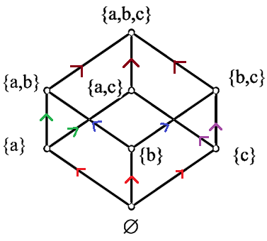 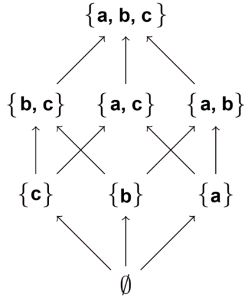

- Nếu giả sử tất cả các cạnh đều được hướng “lên trên”, chúng ta không cần phải thể hiện hướng của các cạnh.

- Và biểu đồ Hasse của các chuỗi bit độ dài 3.
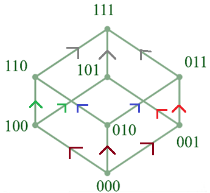

- Những cạnh trong đồ thị có hướng của một poset hữu hạn (finite poset) không cần phải được biểu diễn vì chúng bắt buộc phải tồn tại.

- Biểu đồ Hasse của một **thứ tự toàn phần** là một **dây chuyền.**

**Ví dụ 2:**  Xét đồ thị có hướng biểu diễn quan hệ thứ tự bộ phận ${(a,b) \mid a \leq b}$ trên tập ${1,2,3,4}$, được minh họa trong Hình (a).

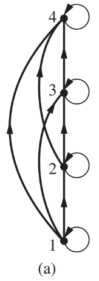

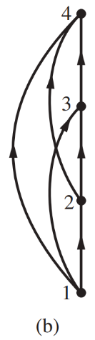

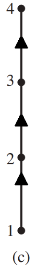

- Vì quan hệ này là một quan hệ thứ tự bộ phận (partial ordering) (đồng thời cũng là quan hệ thứ tự toàn phần (total ordering)), nên nó có tính chất phản xạ (reflexive). Do đó, đồ thị có hướng của nó có các vòng lặp (loops) tại tất cả các  đỉnh. Vì vậy, chúng ta không cần biểu diễn các vòng lặp này, bởi chúng bắt buộc phải tồn tại; trong Hình (b), các vòng lặp không được thể hiện.

- Vì quan hệ thứ tự bộ phận có tính chất bắc cầu, chúng ta không cần biểu diễn những cạnh bắt buộc phải tồn tại do tính chất bắc cầu.

- Ví dụ, trong Hình 2(c), các cạnh (1, 3), (1, 4) và (2, 4) không được thể hiện vì chúng bắt buộc phải tồn tại.

- Nếu chúng ta giả sử tất cả các cạnh đều hướng “lên trên” (như cách chúng được vẽ trong Hình 2(c)), thì không cần phải thể hiện hướng của các cạnh; Hình (d) không biểu diễn hướng của các cạnh.

→ Hình ($c$) và ($d$) được coi là một **dây chuyền.**

**Ví dụ 3:** Cho $A = {2, 3, 4, 7, 8, 12, 24, 35}$ và gọi $R$ là quan hệ chia hết (divides relation) trên $A$.

  - Khi đó: $R = {(x,y) \in A \times A : x \mid y}$.

  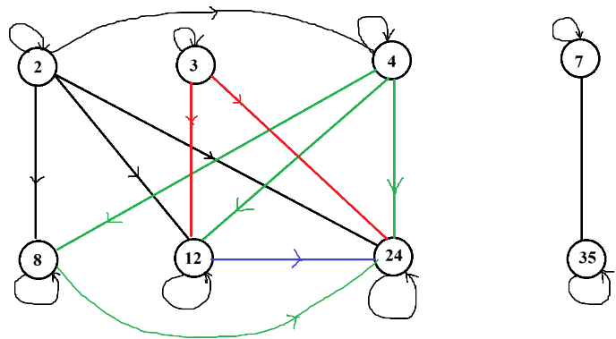

  - Lược bỏ các cạnh có thể suy ra từ tính chất bắc cầu & phản xạ, ta được:

  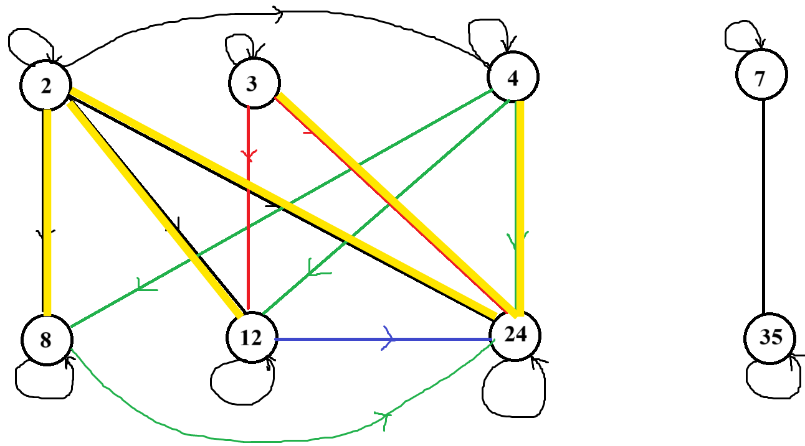 
  
  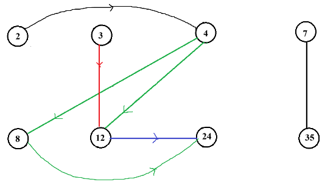

  - Ta có thể vẽ lại sơ đồ với các cung được quy ước chiều mũi tên hướng lên, lúc đó ta bỏ đi các mũi tên (như ví dụ trên), lúc này được sơ đồ Hasse như sau:

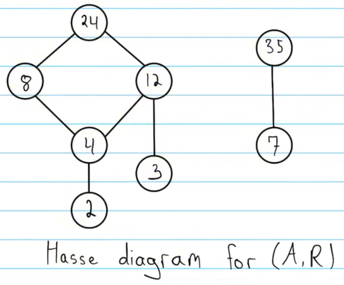

### 20.2.3. Phần tử nhỏ nhất và phần tử lớn nhất

- ***Định nghĩa*:** Giả sử ($S$, <u>≺</u>) là tập sắp thứ tự, khi đó:

  - *Phần tử nhỏ nhất* $Min(S) = m\boxed{\in S}$nếu $∀$ x $∈$ $S$ ta có **$m$ <u>≺</u> x.**

  - *Phần tử lớn nhất* $Max(S) = M\boxed{\in S}$nếu $∀$ x $∈$ $S$ ta có **x <u>≺</u> $M$.**

- ***Nhận xét*:** Phần tử nhỏ nhất (lớn nhất) của một tập hợp (nếu có) là duy nhất.

**Ví dụ:**

- Xét thứ tự ($P$($A$), $⊂$) với $A$ = {1, 2, 3} thì: **Max($A$) = $A$ và Min($A$) = $∅$.**

- Xét thứ tự ($A$1 = \[0,1\], $≤$) trên tập số thực. Ta có Max($A$) = 1, Min($A$) = 0.

- Xét $B=(\frac{1}{2},1]\subseteq A_1$ với thứ tự $\leq$. Ta có $\max(B)=1$, nhưng $B$ không có phần tử nhỏ nhất, nên $B$ không là thứ tự tốt.

- Trong tập có thứ tự ($S$, $≤$), $S$ = {$m$ $∈$**$Z$**\|$m$2 \<100} có min($S$) = -9, max($S$) = 9.

- Trong tập có thứ tự ($A$, $≤$), $A$ = {x $∈$**$R$**\|x2 \<100} không có phần tử nhỏ nhất và cũng không có phần tử lớn nhất.

- Xét thứ tự ($A$, $≤$), với $A = \left\{ x\mathbb{\in Z}:x^{2} < 100 \right\}$

  Ta có: $A = \left\{ - 9, - 8, - 7,...,7,8,9 \right\}$→ Min($A$) = - 9, Max($A$) = 9.

- Với thứ tự $\leq$ trên $\mathbb{R}$, không tồn tại phần tử nhỏ nhất hoặc lớn nhất; ta không viết chúng lần lượt là $-\infty$ và $+\infty$.

### 20.2.4. Phần tử tối tiểu và phần tử tối đại

- ***Định nghĩa*:** Xét tập sắp thứ tự ($S$, <u>≺</u>), khi đó:

  - $m$ được gọi là *Phần tử tối tiểu (minimal)* nếu **không tồn tại x $∈$ $S$** sao cho **x $≠$ $m$** và **x <u>≺</u> $m$** (nghĩa là $\forall x \in S,\left( x\underline{\prec}m \right) \Rightarrow x = m$), với $m$ $∈$ $S$.

    - Không tìm được x nào đứng trước/nhỏ hơn $m$.
    > **Phần tử tối tiểu (minimal element):** Là phần tử mà **không có phần tử nào khác có quan hệ với nó**, ngoại trừ chính nó. Tuy nhiên, nó vẫn có thể có quan hệ với các phần tử khác.

  - *$M$ được gọi là Phần tử tối đại (maximal)* nếu **không tồn tại x $∈$ $S$** sao cho **x $≠$ $a$** và **$a$ <u>≺</u> x** (nghĩa là $\forall x \in S,\left( M\underline{\prec}x \right) \Rightarrow x = M$), với $M$ $∈$ $S$.

    - Không tìm được x nào đứng sau/lớn hơn $M$)*
    > **Phần tử tối đại (maximal element):** Là phần tử mà **nó không có quan hệ với bất kỳ phần tử nào khác**, ngoại trừ chính nó. Tuy nhiên, các phần tử khác vẫn có thể có quan hệ với nó.

**Ví dụ 1.** Từ biểu đồ Hasse của tập thứ tự ({1, 2, 3, 4, 6}, \|). Ta có:

  - 4 và 6 là các phần tử tối đại.

  - 1 là phần tử tối tiểu và cũng là phần tử nhỏ nhất.

  - Không tồn tại phần tử lớn nhất.

  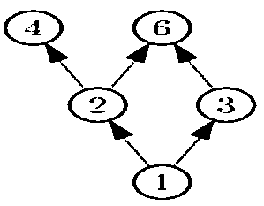

**Ví dụ 2:** Xét tập $S$ = {1, 2, 3} với quan hệ $R$ cho bởi $R$ = {(1,1), (2,2), (3,3), (1,2), (3,2)}.

  Dễ dàng kiểm chứng rằng ($S$,$R$) là tập có thứ tự. Với thứ tự $R$ này, $S$ có hai phần tử tối tiểu là 1 và 3; có một phần tử tối đại là 2.

  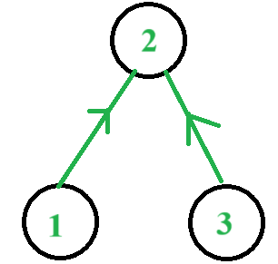

**Ví dụ 3:** Cho thứ tự có biểu đồ sau:

  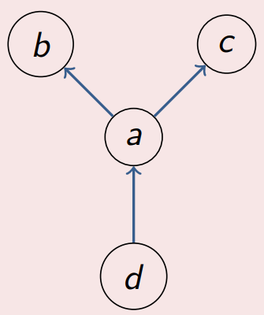

  thì tối thiểu là $d$ và các tối đại là $b$ và $c$.

**Ví dụ 4:** Xét lại ví dụ sau. 

  

  Ta có các tối tiểu và tối đại là:

  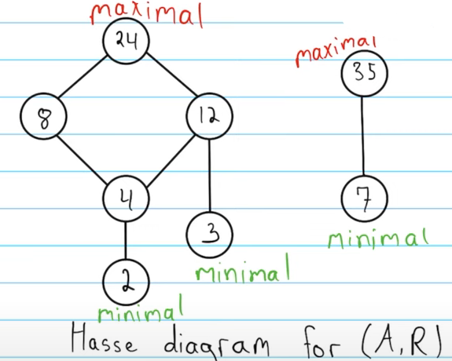

**Ví dụ 5:** Xét tập $A$ = {2, 4, 5, 6, 8, 12} với thứ tự ($A$, \|).

- Phần tử tối tiểu: 2, 5 (Trong tập $A$, ngoài phần tử 2 thì không còn số nào là ước của nó nữa, tương tự với phần tử 5).

- Phần tử tối đại: 5, 8, 12 (các phần tử này không là ước của những phần tử còn lại trong tập $A$).

***Nhận xét*:**

- Phần tử **tối tiểu (tối đại)** của một tập có thứ tự **không nhất thiết là duy nhất.**

- Phần tử **lớn nhất (nhỏ nhất)** của một tập có thứ tự, nếu có, là **phần tử tối đại (tối tiểu) duy nhất** của tập hợp đó; *chiều ngược lại chỉ đúng khi xét trong tập có thứ tự **<u>hữu hạn</u>**.*

  🡪 Nếu một tập hợp có nhiều phần tử tối đại hoặc tối tiểu, thì không tồn tại phần tử lớn nhất hoặc nhỏ nhất trong tập hợp đó.

- Mọi phần tử luôn **được trội** (tương ứng **bị trội**) bởi một phần tử **tối đại** (tương ứng **tối tiểu**)

- Không có cung nào xuất phát từ điểm tối đại.

- Không có cung nào kết thúc ở điểm tối tiểu.

**Chú ý:** Trong một poset $S$ <u>hữu hạn</u>, phần tử tối tiểu và phần tử tối đại luôn luôn tồn tại.

  - Thật vậy, chúng ta xuất phát từ điểm bất kỳ $a$0 $∈$ $S$. Nếu $a$0 không là phần tử tối tiểu thì $∃$ $a$1 $∈$ $S$: $a$1 ≺ $a$0. Tiếp tục như vậy cho đến khi tìm được phần tử tối tiểu.

  - Phần tử tối đại cũng tìm được bằng phương pháp tương tự.

**Ví dụ 6:** Gọi $U$$n$ là tập các ước của *số nguyên dương* $n$. Trên $U$$n$ ta xét thứ tự chia hết $a$ ≺ $b$ $⇔$ $a$\|$b$. Hãy tìm tối tiểu, tối đại, max và min của $U$6?

- 1 là tối tiểu vì 1 là ước của tất cả các phần tử trong $U$6​, và không có phần tử nào nhỏ hơn 1 🡪 vì 1 là tối tiểu duy nhất nên min($U$6) = 1.

- 6 là tối đại vì không có phần tử nào trong $U$6​ mà 6 là ước của nó (ngoài chính nó) 🡪 vì 1 là tối đại duy nhất nên max($U$6) = 6.

## 20.3. Thứ tự cảm sinh

- Giả sử **$B$ là <u>một tập hợp con</u> của tập hợp có thứ tự ($A$, ≺).** Khi ấy ≺ cảm sinh một thứ tự trên $B$ một cách tự nhiên: **với x, $y$ $∈$ $B$, ta nói x ≺ $y$ trong $B$ nếu x ≻ $y$ trong $A$.**

**Ví dụ:** (**$R$**, $≤$) là một tập hợp có thứ tự. Thứ tự cảm sinh các thứ tự tự nhiên trên **$Q$**, **$Z$**.

> Ta có tập thứ tự phép so sánh* $≤$ *trên tập $R$, nếu trích tập con từ tập $R$ (là $Q$, $Z$…) mà cũng thỏa phép so sánh* $≤$ *thì thứ tự này được gọi là thứ tự cảm sinh

## 20.4. Thứ tự từ điển

- Xét một tập hợp hữu hạn không rỗng **$A$** mà ta gọi là **bộ mẫu tự**.

- Giả sử trên $A$ có một thứ tự toàn phần <u>≺</u> (ví dụ như thứ tự thông thường nếu $A$ là bộ chữ cái: $a$ ≺ $b$ ≺ $c$ ≺ ⋯ ≺ $z$, hay thứ tự xác định bởi mã ASCII nếu $A$ là bộ chữ cái được mở rộng thêm các ký tự là các số từ 0 đến 9, các dấu +, - ,…)

- Gọi **$S$ là tập hợp các chuỗi ký tự** có dạng $s$ =$a_{1}a_{2}...a_{m}$ và $a_{1}a_{2}...a_{m}$**$∈$ $A$** với $m$ là số nguyên tự nhiên tùy ý.

- Với $m$ = 0, ta được chuỗi rỗng $∅$ không có ký tự nào cả (có thể ký hiệu λ).

- Giả sử <u>≺</u> là thứ tự toàn phần trên $A$, khi đó ta có thể định nghĩa thứ tự toàn phần <u>≺</u> trên $S$ như sau:

  - $\varnothing\underline{\prec}s,\forall s \in S$ (λ $∈$ $S$).

  - Nếu $s = a_{1}a_{2}...a_{m}$ và $t = b_{1}b_{2}...b_{n}$ là hai chuỗi khác $∅$ trên $S$, ta có: 
    
    Cho $\preccurlyeq$ là một **quan hệ thứ tự tốt (well-ordering)** trên $S$. Khi đó, **quan hệ thứ tự từ điển (lexicographic ordering)** $\preccurlyeq_L$ trên tập $S \times S$ được định nghĩa như sau:

    $$
    (a_1,b_1) \preccurlyeq_L (a_2,b_2) \equiv
    \begin{cases}
    \text{true}, & \text{if } a_1 \prec a_2,\\
    \text{true}, & \text{if } a_1=a_2 \text{ and } b_1\prec b_2,\\
    \text{false}, & \text{otherwise.}
    \end{cases}
    $$

- Ta chứng minh được rằng <u>≺</u> là một thứ tự trên $S$ gọi là thứ tự tự điển. Hơn nữa với thứ tự tự điển, $S$ là một tập sắp thứ tự toàn phần.

> **Lưu ý:**
> - Nếu $\preccurlyeq$ là một **quan hệ thứ tự toàn phần (total ordering)** thì quan hệ thứ tự từ điển mà nó xác định cũng là một quan hệ thứ tự toàn phần.
> - Tương tự, nếu $\preccurlyeq$ là một **quan hệ thứ tự tốt (well-ordering)** thì quan hệ thứ tự từ điển mà nó xác định cũng là một quan hệ thứ tự tốt.

**Ví dụ.** 
- Nếu $A$ là bảng chữ cái tiếng Anh với thứ tự: $a$ ≺ $b$ ≺ . . . ≺ $z$, thì thứ tự nói trên là thứ tự thông thường giữa các từ trong từ điển.

- love ≺ lovely; castle ≺ cat (so 2 ký tự đầu đều giống nhau, xét ký tự 3 ta có $s$ đứng trước $t$ trong bảng chữ cái tiếng Anh)

- Nếu $A$ = {0, 1} với 0 ≺ 1 thì thì <u>≺</u> là thứ tự toàn phần trên tập tất cả các chuỗi bit: 
10101 ≺ *10101*000; 10101 ≺ 11 (xét 2-bit đầu chuỗi bên trái, có 10 \< 11)
