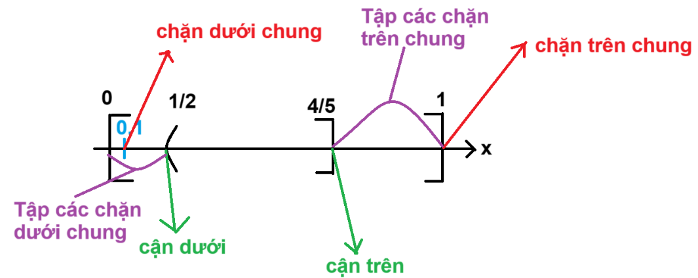
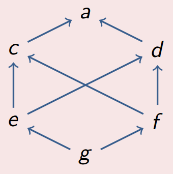
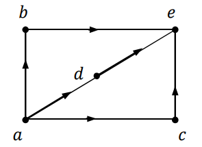

  <a className="button button--primary" href="/pdfs/toan-roi-rac/chapter2/bai7.pdf" download="bai7-toan-roi-rac.pdf" target="_blank" rel="noreferrer">
    Tải file PDF
  </a>

## 21.1. Chặn trên, chặn dưới

- Giả sử có thứ tự ($A$, ≺). Xét $B$ $⊂$ $A$. Khi đó:

  - Phần tử $s$ $∈$ $A$ gọi là **chặn trên (chung) (upper bound)** của $B$ nếu: **$∀$ x $∈$ $B$: x ≺ $s$**

  - Phần tử $i$ $∈$ $A$ gọi là **chặn dưới (chung) (lower bound)** của $B$ nếu: **$∀$ x $∈$ $B$: $i$ ≺ x**

- Gọi $S$ và $I$ tương ứng là tập các chặn trên và chặn dưới của $B$.

  - **Nếu Min($S$)** (least upper bound) tồn tại, được gọi là **chặn trên đúng/ cận trên (supremum)** của $B$, kí hiệu: **SupB** hoặc $∨$.

  - **Nếu** **Max($I$)** (greatest lower bound) tồn tại, được gọi là **chặn dưới đúng/ cận dưới (infimum)** của $B$, kí hiệu: **InfB** hoặc $∧$.

**Ví dụ 1:** Xét $B = \left. \ \frac{1}{2},\frac{4}{5} \right.\  \subset \left( A = \lbrack 0,1\rbrack, \leq \right)\mathbb{\in R}$.

- Giả sử lấy $i$ = 0,1 $∈$ $A$; $∀$**x $∈$ $B$:** $i$ $≤$ x → 0,1 là chặn dưới chung của $B$. Ngoài ra còn nhiều phần tử chặn dưới của $B$ (0,2, 0,3,...) và chúng thuộc tập các chặn dưới $I$.

- Dễ thấy, phần tử Max($I$) = ½ = InfB.

- Giả sử lấy $s$ = 1 $∈$ $A$, $∀$**x $∈$ $B$:** x $≤$ $s$ → 1 là chặn trên chung của $B$. Ngoài ra còn nhiều phần tử chặn trên của $B$ (0,85, 0,9,...) và chúng thuộc tập các chặn trên $S$.

- Dễ thấy, phần tử Min($S$) = 4/5 = SupB.

**Ví dụ 2:** Xét thứ tự$\left( \mathbb{Z}, \leq \right)$, và tập $A = \left\{ x\mathbb{\in Z}:x^{2} < 100 \right\}$. Dễ thấy $A$ $⊂$ $\left( \mathbb{Z}, \leq \right)$.

- Giả sử lấy $i$ = -15 $∈$ $\mathbb{Z}$; $∀$**x $∈$ $B$:** $i$ $≤$ x → -15 là chặn dưới chung của $A$. Ngoài ra còn nhiều phần tử chặn dưới của $A$ và chúng thuộc tập các chặn dưới $I$.

- Dễ thấy, phần tử Max($I$) = -10 = InfA.

- Giả sử lấy $s$ = 12 $∈$ $A$, $∀$**x $∈$ $B$:** x $≤$ $s$ → 12 là chặn trên chung của $A$. Ngoài ra còn nhiều phần tử chặn trên của $A$ và chúng thuộc tập các chặn trên $S$.

- Dễ thấy, phần tử Min($S$) = 10 = SupB.

**Ví dụ 3:** Xét thứ tự có biểu đồ sau:

Khi đó:

- $\cancel{\exists}$Sup {$e$, $f$}: ta có các trội chung (tập chặn trên chung) của {$e$, $f$} là {$c$, $d$, $a$}, và tập hợp này không có phần tử bé nhất, vì vậy dẫn đến kết quả trên.

- Sup {$c$, $f$} = $a$: ta có tập chặn trên chung của {$c$, $f$} là {$a$} *(chặn trên của $c$ là $a$, chặn trên của $f$ là $c$, $d$, $a$, nhưng ta chỉ lấy phần tử chặn trên chung là $a$)*, và vì tập hợp này chỉ có một phần tử duy nhất là $a$, dẫn đến kết quả trên.

- $\cancel{\exists}$Inf {$c$, $d$}: ta có tập chặn dưới chung của {$c$, $d$} là {$e$, $f$, $g$}, và tập hợp này không có phần tử lớn nhất, vì vậy dẫn đến kết quả trên.

- Inf {$e$, $f$} = $g$: ta có tập chặn dưới chung của {$e$, $f$} là {$g$}, và vì tập hợp này chỉ có một phần tử duy nhất là $g$, dẫn đến kết quả trên.

**Ví dụ 4:** Xét thứ tự ($P$($A$), $⊂$). Khi đó $∀$ $A$, $B$ $∈$ $P$($A$) ta có:

- **Sup{$A$, $B$} = $A$ $∪$ $B$**

  * Supremum (chặn trên nhỏ nhất) của $A, B \in P(A)$ là tập con nhỏ nhất trong $P(A)$ chứa cả $A$ và $B$.

  **Phân tích:**

  * Với $\{A, B\}$, hợp $A \cup B$ chứa mọi phần tử của cả $A$ và $B$, tức là:
    $$A \subseteq A \cup B \quad \text{và} \quad B \subseteq A \cup B.$$
  * $A \cup B$ là tập con nhỏ nhất thỏa mãn điều kiện trên. Vì nếu có tập $X$ nào khác thỏa mãn $A \subseteq X$ và $B \subseteq X$, thì $A \cup B \subseteq X$ (theo tính chất của hợp).
  * Do đó, $A \cup B$ là supremum của $A$ và $B$.

- **Inf {$A$, $B$} = $A$ $∩$ $B$**

  * Infimum (chặn dưới lớn nhất) của $A, B \in P(A)$ là tập con lớn nhất trong $P(A)$ chứa trong cả $A$ và $B$.

  **Phân tích:**

  * Với $\{A, B\}$, giao $A \cap B$ chứa mọi phần tử chung của $A$ và $B$, tức là:
    $$A \cap B \subseteq A \quad \text{và} \quad A \cap B \subseteq B.$$
  * $A \cap B$ là tập con lớn nhất thỏa mãn điều kiện trên. Vì nếu có tập $X$ nào khác thỏa mãn $X \subseteq A$ và $X \subseteq B$, thì $X \subseteq A \cap B$ (theo tính chất của giao).
  * Do đó, $A \cap B$ là infimum của $A$ và $B$.

**Ví dụ 5:** Xét thứ tự ($U$$n$, \|). Khi đó $∀$ $a$, $b$ $∈$ $U$$n$ ta có:

- **Sup{$a$, $b$} = BCNN($a$, $b$)**

  * Supremum (chặn trên nhỏ nhất) của $a, b \in \mathbb{U}_n$ là số nhỏ nhất trong $\mathbb{U}_n$ mà $a$ và $b$ đều chia hết.

  **Phân tích:**

  * $BCNN(a, b)$ (bội chung nhỏ nhất của $a$ và $b$) là số nguyên dương nhỏ nhất thỏa mãn:
    $$a|BCNN(a, b) \quad \text{và} \quad b|BCNN(a, b).$$
  * Với bất kỳ $x \in \mathbb{U}_n$ thỏa mãn $a|x$ và $b|x$, ta có:
    $$BCNN(a, b)|x.$$
  * Do đó, $BCNN(a, b)$ là chặn trên nhỏ nhất của $a, b$.

- **Inf {$a$, $b$} = UCLN($a$, $b$) (Ước chung lớn nhất)**

  * Infimum (chặn dưới lớn nhất) của $a, b \in \mathbb{U}_n$ là số lớn nhất trong $\mathbb{U}_n$ mà $a$ và $b$ đều chia hết.

  **Phân tích:**

  * $UCLN(a, b)$ (ước chung lớn nhất của $a$ và $b$) là số nguyên dương lớn nhất thỏa mãn:
    $$UCLN(a, b)|a \quad \text{và} \quad UCLN(a, b)|b.$$
  * Với bất kỳ $x \in \mathbb{U}_n$ thỏa mãn $x|a$ và $x|b$, ta có:
    $$x|UCLN(a, b).$$
  * Do đó, $UCLN(a, b)$ là chặn dưới lớn nhất của $a, b$.

## 21.2. Dàn (Lattice)

- Thứ tự ($A$, ≺) được gọi là một dàn nếu với **$∀$ x, $y$ $∈$ $A$ thì sup{x, $y$} và inf {x, $y$} đều tồn tại.**

  * ($P$($A$), $⊂$) và (Un, \|) trong các ví dụ trên chính là các dàn.

  * Một cách trực quan có thể thấy mối quan hệ "Thứ tự" - "Dàn" - "Thứ tự toàn phần" như sau:

    $$\boxed{\text{Thứ tự thông thường}} \longrightarrow \boxed{\text{Dàn}} \longrightarrow \boxed{\text{Thứ tự toàn phần}}$$

  - **Thứ tự thông thường → Dàn**: Một thứ tự thông thường có thể trở thành dàn nếu mọi cặp phần tử có supremum và infimum.

  - **Dàn → Thứ tự toàn phần**: Một dàn có thể được mở rộng thành thứ tự toàn phần nếu thêm điều kiện mọi phần tử đều có thể so sánh với nhau.

- Trong dàn hữu hạn $A = \left\{ a_{1},a_{2},...,a_{n} \right\}$thì$a_{1} \vee a_{2} \vee ... \vee a_{n}$ và $a_{1} \land a_{2} \land ... \land a_{n}$chính là phần tử lớn nhất và phần tử bé nhất của $A$.

- **Dàn phân phối/ phân bố:** một dàn $A$ được nói là phân bố (nếu với mọi x, $y$, $z$ trong $A$) khi và chỉ khi **các phép Sup (hay $∨$) và Inf ($∧$) (hay $∧$) của nó có tính phân phối.** Nghĩa là

$$
\begin{cases}
x \lor (y \land z) = (x \lor y) \land (x \lor z) \\
x \land (y \lor z) = (x \land y) \lor (x \land z)
\end{cases}
$$

**Ví dụ 1:** Các dàn ($P$($A$), $⊂$) và ($U$$n$, \|) đều là các dàn phân phối *(bởi tính phân phối của các phép toán: ($∪$, $∩$) và (BCNN, UCLN))*

**Ví dụ 2:** Xét tập hợp sắp thứ tự $A = \left\{ a,b,c,d,e \right\}$với biểu đồ Hasse như sau:

  

  Ta có thể kiểm tra dễ dàng $A$ là một dàn. Tuy nhiên $A$ không phân bố vì:

  $$
  \begin{aligned}
  d \land (b \lor c) &= d \land e = d \\
  \textit{trong khi} \quad (d \land b) \lor (d \land c) &= a \lor a = a \neq d
  \end{aligned}
  $$

> **Dàn bù:** Giả sử ($A$, ≺) là một dàn, lấy x $∈$ $A$. Khi đó nếu $∃$ $\overline{x}$ $∈$ $A$ sao cho:
>
>  $$
>  \sup\{x,\overline{x}\}=1,
>  \qquad
>  \inf\{x,\overline{x}\}=0.
>  $$
>  - Khi đó $\overline{x}$ được gọi là **<u>phần bù</u>** của x.
>  - Ta nói $A$ là một **<u>dàn bù</u>** nếu **mọi phần tử của $A$ đều có phần bù.**

- **Lưu ý:**

  - Không phải dàn nào cũng là dàn bù.

  - Trong một dàn bù, một phần tử có thể có nhiều hơn một phần bù (mặc dù điều này không phổ biến). Trong một *đại số Boolean*, mỗi phần tử có duy nhất một phần bù.

**Ví dụ 1:** Xét tập hợp các ước của 30: $U$30 = {1, 2, 3, 5, 6, 10, 15, 30}. Với **quan hệ chia hết**, tập hợp này là một dàn.

- Phần tử nhỏ nhất: 1

- Phần tử lớn nhất: 30

- Hãy tìm phần bù của 6:

  - Chúng ta cần tìm một số x sao cho ước chung lớn nhất (ƯCLN) của 6 và x là 1 (phần tử nhỏ nhất), và bội chung nhỏ nhất (BCNN) của 6 và x là 30 (phần tử lớn nhất).

  - Số đó là 5. Vì ƯCLN(6, 5) = 1 và BCNN(6, 5) = 30.

- Vậy, phần bù của 6 là 5 ($\overline{6} = 5$, $\overline{5} = 6$, $\overline{\overline{6}}$= 6).

- Để chứng minh $U$30 là một dàn bù, ta cần chứng minh *mọi* phần tử trong $U$30 đều có phần bù. Ta sẽ liệt kê phần bù của từng phần tử:

  - **1:** Phần bù của 1 là 30 (vì ƯCLN(1, 30) = 1 và BCNN(1, 30) = 30)

  - **2:** Phần bù của 2 là 15 (vì ƯCLN(2, 15) = 1 và BCNN(2, 15) = 30)

  - **3:** Phần bù của 3 là 10 (vì ƯCLN(3, 10) = 1 và BCNN(3, 10) = 30)

  - **5:** Phần bù của 5 là 6 (vì ƯCLN(5, 6) = 1 và BCNN(5, 6) = 30)

  - **6:** Phần bù của 6 là 5 (như đã nêu trên)

  - **10:** Phần bù của 10 là 3

  - **15:** Phần bù của 15 là 2

  - **30:** Phần bù của 30 là 1

- Như vậy, *mỗi* phần tử trong $U$30 đều có một phần bù duy nhất, vậy nó cũng là **dàn bù.**

**Ví dụ 2:** Xét tập $E$ = {1,2,3,4}, và $P$($E$) là một dàn.

- Xét $P$($E$), ta có: max($P$($E$)) = $E$, min($P$($E$)) = $∅$.

- Nếu $A$ = {1, 2} $⊂$ $E$ thì $\overline{A}$= {3, 4}

- Dễ thấy, đây là một dàn bù.

**Ví dụ 3:** Xét tập hợp các ước của 12: $U$30 = {1, 2, 3, 4, 6, 12}. Với **quan hệ chia hết**, tập hợp này là một dàn. Ta có max = 1, min = 12.

- Giả sử tìm phần bù của phần tử 2. Ta xét phần bù x = $\overline{2}$ sao cho:

$$
\left\{
\begin{aligned}
&\operatorname{BCNN}(x,2)=12\\
&\operatorname{UCLN}(x,2)=1
\end{aligned}
\right.
$$

- Tuy nhiên không tìm được x nào thỏa điều kiện. Vậy không tồn tại $\overline{2}$.

- Vậy đây không là dàn bù.

> ***Nhận xét:*** Nếu tìm được một phần tử trong dàn mà không tồn tại phần bù thì đó không là dàn bù.
