Chương IV.\
QUAN HỆ (RELATIONS)
===================

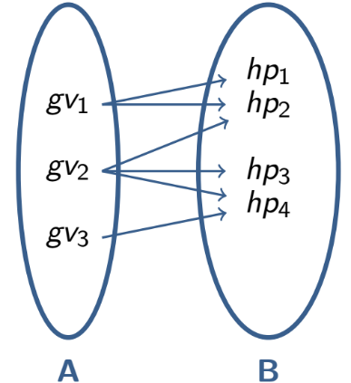

## 4.1. Khái niệm

- Giả sử A là tập các giảng viên, A = {gv1, gv2, gv3},

- B là tập các học phần, B = {hp1, hp2, hp3, hp4}.

- Khi đó, mối quan hệ biểu diễn sự phân công giảng dạy có thể được mô tả như hình bên:

- Hoặc biểu diễn dưới dạng **tập hợp**:

> R = {(gv1, hp1), (gv1, hp2), (gv2, hp2), (gv2, hp3), (gv2, hp4),\
> (gv3, hp4)}

- R chính là tập con của tích Descartes của A và B, tức: R ⊆ A x B

- Tổng quát hóa ví dụ trên ta đi đến định nghĩa sau:

  - Giả sử A và B là 2 tập khác rỗng cho trước. Khi đó, **mối quan hệ giữa A và B là một tập R ⊆ A x B**

  - Nếu 1 bộ **(a, b) ∈ R** ta nói a có quan hệ R với b, và viết **aRb**.

  - Ngược lại nếu (a, b) ∉ R thì ta kí hiệu$`a\overline{R}b`$hoặc $`a\cancel{R}b`$.

- Vì quan hệ R là tập con của tích Descartes 2 tập hợp, nên nó được gọi là **quan hệ 2 ngôi.**

- $`R \subseteq A \times A \Leftrightarrow R \subseteq A^{2}`$ hoặc khi A = B thì được gọi là **quan hệ hai ngôi trên cùng một tập** (tập A). *Thực tế điều này được biểu hiện bởi mối quan hệ giữa: người với người, các số nguyên với nhau, đường thẳng trong không gian…*

- Nếu R ⊆ A<sub>1</sub> x A<sub>2</sub> x A<sub>3</sub> ... X A<sub>n</sub> thì R được gọi là **quan hệ n ngôi.**

> 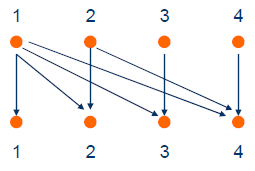
>
> **Ví dụ:** Cho *A* = {1, 2, 3, 4}, R là một quan hệ (hai ngôi) trên A và
>
> *R* = {(*a*, *b*) ∈ A<sup>2</sup> \| *a* là ước của *b*}.
>
> Khi đó *R* = {(1, 1), (1, 2), (1, 3), (1, 4), (2, 2), (2, 4), (3, 3), (4,4)}

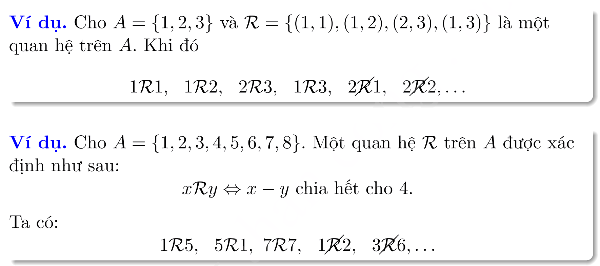

- **Lực lượng của tập các quan hệ:**

> Xét quan hệ 2 ngôi:
>
> Giả sử \|A<sub>1</sub>\| = n, \|A<sub>2</sub>\| = m. Ta có R ⊆ \|A<sub>1</sub> x A<sub>2</sub>\| = n x m ⇒ **<span class="mark">\|R\| = 2<sup>n x m</sup></span>**

## 4.2. Các tính chất của quan hệ

**Định nghĩa:** Giả sử R là một quan hệ hai ngôi trên tập A.

\(a\) Ta nói quan hệ *R* có ***tính** **phản xạ (reflexive)*** nếu và chỉ nếu **∀*a*∈*A, aRa.***

Điều đó có nghĩa là, với ***<span class="mark">bất kỳ phần tử nào trong tập A, cặp (a, a) phải nằm trong quan hệ R​.</span>***

> **Ví dụ:** Trên tập *A* = {1, 2, 3, 4}, quan hệ

- *R*<sub>1</sub> *=* {(1,1), (1,2), (2,1), (2, 2), (3, 4), (4, 1), (4, 4)} không phản xạ vì

  (3, 3)∉*R*<sub>1</sub>

- *R*<sub>2</sub> *=* {(1,1), (1,2), (1,4), (2, 2), (3, 3), (4, 1), (4, 4)} phản xạ vì

  (1,1), (2, 2), (3, 3), (4, 4)∈*R*<sub>2</sub>

> \- Quan hệ ≤ trên *Z* phản xạ vì *a* ≤ *a,* ∀*a* ∈ *Z.*
>
> \- Quan hệ \> trên *Z* không phản xạ vì 1 không lớn hơn 1.
>
> \- Quan hệ “\|” (“ước số”) trên Z<sup>+</sup> là phản xạ vì mọi số nguyên dương *a* là ước của chính nó.
>
> \- Quan hệ vuông góc không phản xạ vì Mọi đường thẳng không bao giờ vuông góc với chính nó. Nhưng quan hệ song song là phản xạ.

\(b\) Ta nói quan hệ *R* có ***tính** **đối xứng (symmetric)*** nếu và chỉ nếu

Nếu *aRb* thì *bRa,* ∀*a, b* ∈ *A*

**<span class="mark">Nếu (a, b) đã thuộc R​, thì (b, a) cũng phải thuộc R.</span>**

> **Ví dụ:**

- Xét *A* = {1*;* 2*;* 3*;* 4}

  \- *Q*uan hệ *R* = {(**1*;* 2**)*;* (**2*;* 1**)*;* (**2*;* 3**)*;* (**3*;* 2**)*;* (1*;* 1)*;* (4*;* 4)} là đối xứng.

  \- Quan hệ *R*<sub>1</sub> *=* {(**1,1**), (**1,2**), (2,1)} là đối xứng.

- Các quan hệ “=, ≡, //, ⊥” là những quan hệ đối xứng.

- Quan hệ ≤ trên *Z, R, Q* không đối xứng.

\(c\) Ta nói quan hệ *R* có ***tính** **bắc cầu (truyền) (transitive)*** nếu và chỉ nếu

<span class="mark">∀*a,b,c* ∈*A,* **(*a R b* ∧ *b R c*) ⇒ *a R c***</span>

> **Ví dụ:**
>
> \- Trên tập *A* = {1, 2, 3, 4}:
>
> \+ Quan hệ *R =* {(**1,1**), (**1,2**), (**2,1**), (2, 2), (1, 3), (2, 3)} có tính bắc cầu.
>
> \+ Quan hệ *R<sub>1</sub> =* {**(1*;* 2)*;* (2*;* 4)*;* (1*;* 4)*;*** (4*;* 4)} có tính bắc cầu.
>
> \- Quan hệ ≤ và “\|” trên *Z* có tính bắc cầu vì
>
> (*a* ≤ *b*) ∧ (*b* ≤ *c*) ⇒ (*a* ≤ *c*)
>
> (*a* \| *b*) ∧ (*b* \| *c*) ⇒ (*a* \| *c*)
>
> \- Quan hệ “=, ≡, //” có tính bắc cầu.
>
> \- Quan hệ ⊥” không có tính bắc cầu.

\(d\) Ta nói quan hệ *R* có ***tính*** ***phản xứng (phản đối xứng) (antisymmetric)*** nếu và chỉ nếu

<span class="mark">∀ *a, b* ∈ *A,* **(*a R b* ∧ *b R a)* ⇒ *a = b***</span>

> 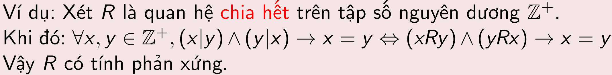
>
> \- Quan hệ ≤ trên **Z** không đối xứng, tuy nhiên nó phản xứng vì **(*a* ≤ *b*) ∧ (*b* ≤ *a*) ⇒ (*a = b*).**
>
> \- Quan hệ“ \| ” (“ước số”) trên Z<sup>+</sup> không đối xứng, tuy nhiên nó có tính phản xứng vì **(*a* \| *b*)** ∧ **(*b* \| *a*)** ⇒ **(*a = b*).**
>
> \- Quan hệ $`R = \left\{ (a,b):a > b \right\}`$phản xứng, do $`\underbrace{(a > b) \land (b > a)}_{0} \Rightarrow a = b`$ là đúng *(Khi mệnh đề giả thiết sai, bất kể mệnh đề kết luận có chân trị như thế nào, phép kéo theo luôn cho ta chân trị là đúng).*

## 4.3. Biểu diễn quan hệ

- 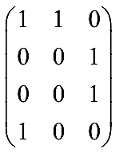**Định nghĩa.** *C*ho *R* là quan hệ từ *A* = {1,2,3,4} đến *B* = {u,v,w},

*R* = {(1,u),(1,v),(2,w),(3,w),(4,u)}.

> Khi đó *R* có thể biễu diễn như hình bên.
>
> Dòng và cột tiêu đề có thể bỏ qua nếu không gây hiểu nhầm. Khi đó ta có thể xem phần còn lại như là một ma trận nhị phân cấp 4 x 3.

- **Định nghĩa.** Cho *R* là quan hệ từ *A* = {*a<sub>1</sub>*, *a*<sub>2</sub>, …, *a<sub>m</sub>*} đến *B* = {*b*<sub>1</sub>, *b*<sub>2</sub>, …, *b<sub>n</sub>*}. Ma trận biểu diễn của *R* là ma trận M*<sub>R</sub>* = \[*m<sub>ij</sub>*\] *<sub>mxn</sub>* xác định bởi:

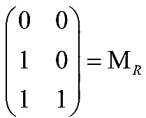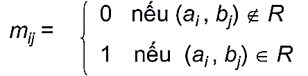

**Ví dụ 1:** Cho *R* là quan hệ từ *A* = {1, 2, 3} đến *B* = {1, 2}:

> *aRb* ⇔ *a* \> *b*. Khi đó ma trận biểu diễn của *R* là: 🡪

**Ví dụ 2:** Cho *R* là quan hệ từ *A* = {*a*<sub>1</sub>, *a*<sub>2</sub>, *a*<sub>3</sub>} đến *B* = {*b*<sub>1</sub>, *b*<sub>2</sub>, *b*<sub>3</sub>, *b*<sub>4</sub>, *b*<sub>5</sub>}

> được biễu diễn bởi ma trận

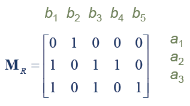

Khi đó *R* ={(*a*<sub>1</sub>, *b*<sub>2</sub>), (*a*<sub>2</sub>, *b*<sub>1</sub>), (*a*<sub>2</sub>, *b*<sub>3</sub>), (*a*<sub>2</sub>, *b*<sub>4</sub>), (*a*<sub>3</sub>, *b*<sub>1</sub>), (*a*<sub>3</sub>,*b*<sub>3</sub>), (*a*<sub>3</sub>, *b*<sub>5</sub>)}.


Cho *R* là quan hệ trên tập *A*, khi đó **M*<sub>R</sub>* là *ma trận vuông****.*

> *+) **R*** **là *phản xạ*** nếu tất cả các phần tử trên *đường chéo* của M*<sub>R</sub>* đều bằng1: *m<sub>ii</sub>* = 1, ∀*i.*


***+) R* là đối xứng** nếu **M*<sub>R</sub>* là *đối xứng:*** *m<sub>ij</sub>* = *m<sub>ji</sub>*, ∀ *i*, *j.*


*+) **R*** **là *phản xứng*** nếu M*<sub>R</sub>* thỏa:

*m<sub>ij</sub>* = 0 hoặc *m<sub>ji</sub>* = 0 nếu ***i* ≠ *j***

## 4.4. Quan hệ tương đương (Equivalence Relations)

### 4.4.1. Định nghĩa

- Quan hệ 2 ngôi *R* trên tập *A* được gọi là ***tương đương*** nếu và chỉ nếu nó thỏa mãn các **tính chất** **phản xạ, đối xứng và bắc cầu.**

> **Ví dụ 1:** Quan hệ *R* trên tập các chuỗi ký tự xác định bởi *aRb* nếu *a* và *b* có cùng độ dài. Khi đó *R* là quan hệ tương đương.
>
> **Ví dụ 2:** Cho *R* là quan hệ trên tập **R** sao cho: ∀a,b∈**R**, *aRb ⇔ a* – *b*∈**Z**
>
> CM: *R* là quan hệ tương đương trên **R**.
>
> 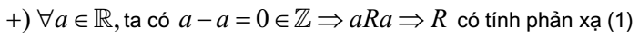
>
> 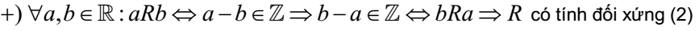
>
> 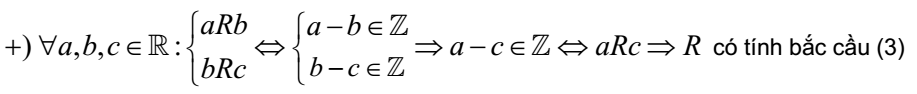
>
> 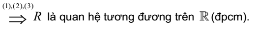
>
> **Ví dụ 3:** Xét quan hệ R = {(x, y) ∈ **Z** x **Z** : xRy ⇔ x + y chẵn}. Khi đó R là quan
>
> hệ tương đương. Thật vậy:
>
> · ∀x ∈ **Z**, x + x là số chẵn, tức là xRx (tính phản xạ).
>
> · ∀x, y ∈ **Z** nếu x + y chẵn thì y + x chẵn, suy ra tính đối xứng.
>
> · ∀x, y, z ∈ **Z** nếu x + y chẵn và y + z chẵn thì x + z chẵn, suy ra tính bắc cầu.

**Ví dụ 4:** Cho m là số nguyên dương và *R* là quan hệ trên **Z** :

∀a,b∈**Z**, *aRb ⇔ (a* – *b)* chia hết *m*

> Khi đó *R* là quan hệ tương đương trên **Z**.
>
> \- Rõ ràng quan hệ này có tính phản xạ và đối xứng.
>
> \- Cho *a*, *b*, *c* sao cho *a* – *b và b* – *c* chia hết cho *m*, khi đó
>
> *a* – *c = a* – *b + b* – *c* cũng chia hết cho *m*.
>
> Suy ra *R* có tính chất bắc cầu.
>
> \- Quan hệ này được gọi là ***quan hệ đồng dư modulo m,*** ***và chúng ta viết a ≡ b (mod m) thay vì aRb.** (khái niệm này đã được đề cập tại Chương III).*

### 4.4.2. Lớp tương đương (Equivalence Class)

- **Định nghĩa.** Cho *R* là quan hệ tương đương trên *A* và *a*∈*A*.

- ***Lớp tương đương chứa a*** theo quan hệ R được <span class="mark">ký hiệu bởi \[*a*\]*<sub>R</sub>* hoặc \[*a*\] hoặc</span> $`\overline{a}`$, là **<u>tập hợp tất cả những phần tử có quan hệ R với a</u>.**

\[*a*\] = {*b*∈*A\| bRa*}

Mỗi phần tử x∈\[*a*\] được gọi là một phần tử đại diện của lớp tương đương \[*a*\].

**Ví dụ 1:** Quan hệ "cùng màu" trên tập hợp các đồ vật.

> 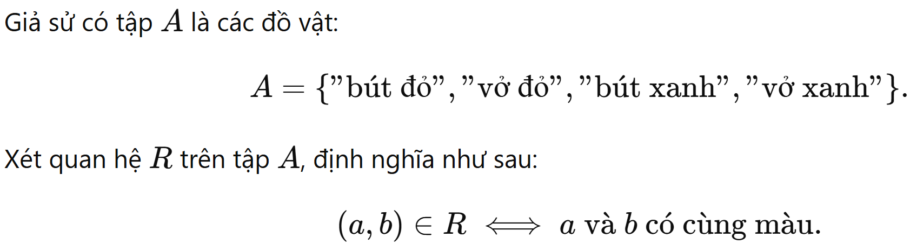
>
> Dựa trên định nghĩa "cùng màu", các cặp trong quan hệ *R* là:
>
> 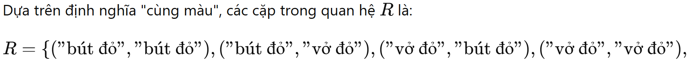
>
> 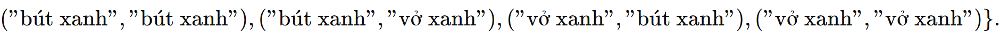
>
> Tập *A* được phân thành các lớp tương đương dựa trên quan hệ *R*:
>
> *Lớp tương đương của "bút đỏ" là:* 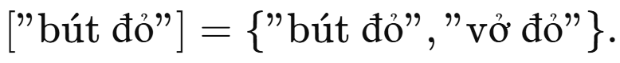
>
> *Lớp tương đương của "bút xanh" là:* 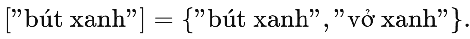
>
> 🡺 Mỗi lớp tương đương chứa các đồ vật **cùng màu**.

**Ví dụ 2:** Quan hệ chia hết trên A = {1, 2, 3, 4, 5, 6}

> 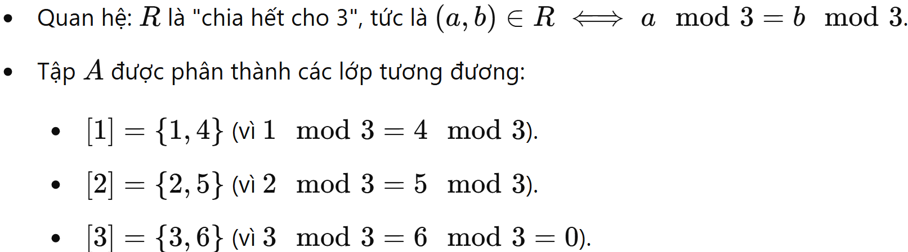
>
> 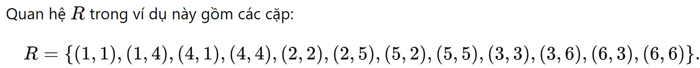
>
> **Ví dụ 3:** Tìm các lớp tương đương theo quan hệ đồng dư modulo 8 chứa 0 và 1?
>
> \[0\]<sub>8</sub> = {*b*∈**Z** *\| bR*0}= {*b*∈**Z** *\|* (*b-*0)=*b* chia hết cho 8} = { …, – 16, – 8, 0, 8, 16, … }
>
> Tương tự \[1\]<sub>8</sub> = {*b*∈**Z** *\|* (*b-*1) chia hết cho 8} *=* { …, – 15, – 7, 1, 9, 17, …}

**\**

**Ví dụ 4:** Quan hệ "số có cùng bội chung nhỏ nhất" trên A

> 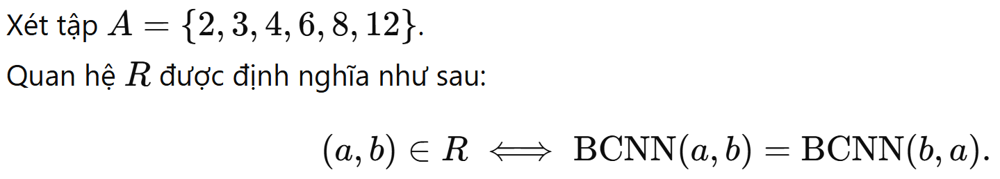
>
> Dựa trên định nghĩa, các phần tử trong *A* có thể nhóm lại theo BCNN:

- Bội chung nhỏ nhất của 2, 4, 8 là 8.

> Các cặp thuộc *R* cho lớp tương đương này:
>
> R<sub>1</sub> = {(2, 2), (2, 4), (2, 8), (4, 2), (4, 4), (4, 8), (8, 2), (8, 4), (8, 8)}

- Bội chung nhỏ nhất của 3, 6, 12 là 12.

> Các cặp thuộc *R* cho lớp tương đương này:
>
> R<sub>2</sub> = {(3, 3), (3, 6), (3, 12), (6, 3), (6, 6), (6, 12), (12, 3), (12, 6), (12, 12)}
>
> Quan hệ *R* chia tập *A* thành các lớp tương đương:

- **Lớp tương đương của 2**: \[2\] = {2, 4, 8}.

- **Lớp tương đương của 3**: \[3\] = {3, 6, 12}.

> Ta có $`R = R_{1} \cap R_{2}`$.
>
> **Ví dụ 5:** Khi xét mối quan hệ giữa tập các đường thẳng song song, lớp tương đương là tập các đường thẳng song song với nhau.

- **Tập thương** của A theo quan hệ R, ký hiệu là A/R, được định nghĩa là **<u>tập tất cả các lớp tương đương</u>** của các phần tử thuộc A, nghĩa là

**A/R = {\[*a*\] *\|*∀a∈A}**

Nếu quan hệ R trên tập A là **quan hệ tương đương**, thì:

- Quan hệ này phân hoạch tập A thành **các lớp tương đương không giao nhau**.

- Mỗi lớp tương đương chứa các phần tử trong A sao cho ***mọi phần tử trong cùng một lớp đều liên quan với nhau theo R.***

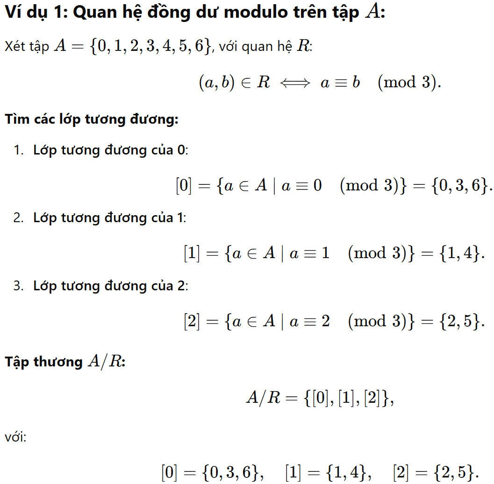

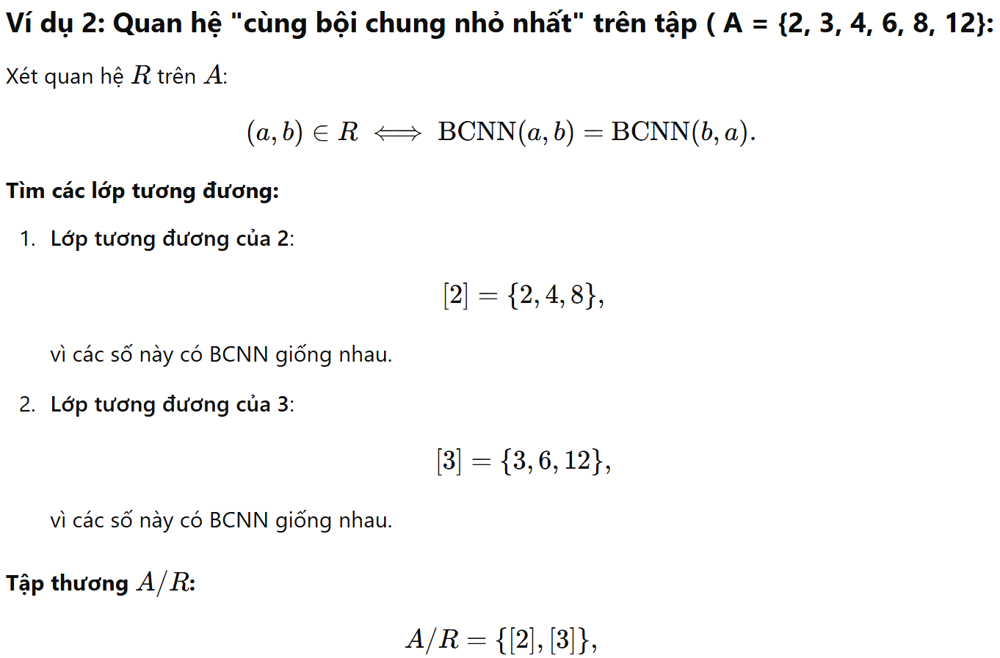

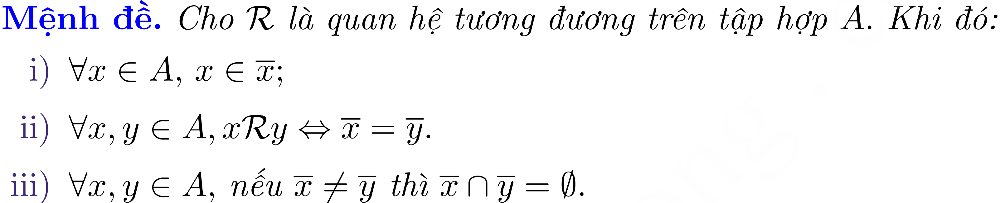
<figcaption><p><em>(hoặc nếu khi</em> <math display="inline" xmlns="http://www.w3.org/1998/Math/MathML"><semantics><mrow><mi>x</mi><menclose notation="updiagonalstrike"><mi>R</mi></menclose><mi>y</mi></mrow><annotation encoding="application/x-tex">x\cancel{R}y</annotation></semantics></math><em>)</em></p></figcaption>

**Chú ý:** Từ mệnh đề trên ta thấy rằng các lớp tương đương của các phần tử của tập A **hoặc trùng nhau, hoặc rời nhau.**

Hơn nữa, **hợp của tất cả các lớp tương đương này trùng với A,** cho nên **tập A là hợp rời rạc của các lớp tương đương.**

Ta cũng nói rằng **tập A được phân hoạch thành các lớp tương đương theo quan hệ R.**

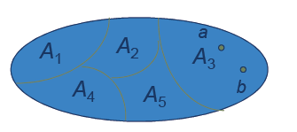

### 4.4.3. Sự phân hoạch thành các lớp tương đương

- **Chú ý:** Cho {*A*<sub>1</sub>, *A*<sub>2</sub>, … } là phân hoạch *A* thành các tập con không rỗng, rời nhau. Khi đó có duy nhất quan hệ tương đương trên *A* sao cho **mỗi *A<sub>i</sub>* là một lớp tương đương.**

- Định nghĩa một **quan hệ tương đương** R trên A: aRb nếu và chỉ nếu a và b thuộc cùng một tập con A<sub>i</sub>​ trong phân hoạch A.

  - Nói cách khác, ta định nghĩa quan hệ R bằng cách "liên kết" các phần tử trong cùng một tập con.

- Dễ dàng chứng minh rằng *R* là quan hệ tương đương trên *A* và \[*a*\]*<sub>R</sub>* = *A<sub>i</sub>* nếu *a*∈*A<sub>i</sub> (nếu a thuộc vào tập A<sub>i</sub>, thì mặc nhiên nó là phần tử đại diện của lớp tương đương \[a\])*.

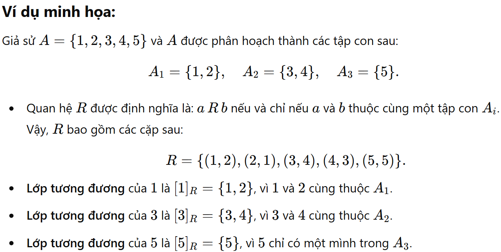

> **Ví dụ:** Cho *m* là số nguyên dương, khi đó có *m* lớp tương đương theo quan hệ đồng dư modulo *m* là \[0\]*<sub>m</sub>* , \[1\]*<sub>m</sub>* , …, \[*m* – 1\]*<sub>m</sub>* .

- Chúng phân hoạch **Z** thành các tập con rời nhau.

- *Chú ý rằng*:

> \[0\]*<sub>m</sub>* = \[*m*\]*<sub>m</sub>* = \[2*m*\]*<sub>m</sub>* = …
>
> \[1\]*<sub>m</sub>* = \[*m* + 1\]*<sub>m</sub>* = \[2*m* +1\]*<sub>m</sub>* = …
>
> …………………………………
>
> \[*m* – 1\]*<sub>m</sub>* = \[2*m* – 1\]*<sub>m</sub>* = \[3*m* – 1\]*<sub>m</sub>* = …

- **Mỗi lớp tương đương** này được gọi là ***số nguyên modulo m.***

- Tập hợp các số nguyên modulo *m* được ký hiệu bởi **Z***<sub>m</sub>* , đó chính là tập thương của **Z** theo quan hệ đồng dư modulo m.

**Z***<sub>m</sub>* = **Z**/R = {\[0\]*<sub>m</sub>* , \[1\]*<sub>m</sub>* , …, \[*m* – 1\]<sub>*m*</sub> },

**Z** = \[0\]*<sub>m</sub>* ∪ \[1\]*<sub>m</sub>* ∪ … ∪ \[*m* – 1\]<sub>*m*</sub> .

## 4.5. Quan hệ đối ngẫu

**Quan hệ đối ngẫu (hay nghịch đảo)** của một quan hệ **R** trên tập hợp A là một **quan hệ R\*** *cũng được định nghĩa trên tập A.* Cụ thể:

- *Quan hệ R:* Nếu xRy, điều đó có nghĩa là cặp (x, y) thuộc quan hệ R.

- *Quan hệ đối ngẫu R\*:* Nếu xR\*y, điều đó tương đương với yRx, tức là cặp (y, x) thuộc quan hệ R.

Nói cách khác, quan hệ R\* là **ngược lại** của R. Tất cả các cặp (x, y) trong R\* là những cặp (y, x) trong R.

``` math
xR*y \Leftrightarrow yRx
```

> **Ví dụ 1:** Giả sử tập hợp A = {1, 2, 3} và quan hệ R trên A được định nghĩa bởi:
>
> R = {(1, 2), (2, 3)}
>
> Quan hệ R\* (đối ngẫu của R) sẽ là: R\* = {(2, 1), (3, 2)}.
>
> **Ví dụ 2:** $`xRy	 \Leftrightarrow x \vdots y`$
>
> $`yR*y	 \Leftrightarrow`$y là ước của x.

**Một số ứng dụng:** Quan hệ đối ngẫu thường được sử dụng trong toán học và lý thuyết đồ thị, ví dụ như:

- Nếu R biểu diễn mũi tên trong đồ thị có hướng (từ x đến y), thì R\* biểu diễn mũi tên ngược lại (từ y đến x).

- Trong đại số quan hệ, quan hệ đối ngẫu có vai trò trong việc phân tích tính chất của các quan hệ như đối xứng, phản xạ, hoặc bắc cầu.

**Nhận xét:**

- *Quan hệ đối ngẫu của R\* sẽ là chính R.*

- Nếu R = R\*, thì với mọi x, y ∈ A, ta có: xRy ⟺ yRx. Điều này có nghĩa là R là một **quan hệ đối xứng**, bởi vì mỗi khi (x, y) ∈ R, thì (y, x) cũng thuộc R.

- *Nếu R bắc cầu, thì R\* cũng bắc cầu.*

  - Quan hệ R là bắc cầu nếu: xRy và yRz ⟹ xRz

  - Quan hệ đối ngẫu R\* cũng là bắc cầu vì:

    xR\*y ⟹ yRx, và yR\*z ⟹ zRy.

  - Khi đó, do R bắc cầu, zRx ⟹ xR\*z. Do đó, R\* cũng bắc cầu.

- *Nếu R đối xứng, thì R\* cũng đối xứng.*

  - Quan hệ R là đối xứng nếu: xRy  ⟹  yRx

  - Với R\*, ta có: xR\*y  ⟹  yRx  ⟹  xRy  ⟹  yR\*x.

  - Vậy, nếu R đối xứng, thì R\* cũng đối xứng.

- *Nếu R phản xứng, thì R\* cũng phản xứng.*

  - Quan hệ R là phản xứng nếu: xRy và yRx  ⟹  x = y

  - Đối với R\*, ta có:

    xR\*y và yR\*x ⟹  yRx và xRy  ⟹  x = y (do R phản xứng).

  - Do đó, nếu R phản xứng, thì R\* cũng phản xứng.

## 4.6. Quan hệ thứ tự

### 4.6.1. Định nghĩa

- Quan hệ 2 ngôi *R* trên tập *A* được gọi là ***quan hệ thứ tự (một phần/ bộ phận/ không ngặt)** (gọi tắt là thứ tự - tuy nhiên chưa đầy đủ, xem phân tích sau ví dụ) **(Partial Order)*** nếu và chỉ nếu nó có tính chất **<span class="mark">phản xạ, phản xứng và bắc cầu.</span>**

- *Khi đó (A, R) được gọi là một tập thứ tự (hay A là tập hợp được sắp).*

- Ta thường kí hiệu quan hệ thứ tự bởi **⪯ hoặc** $`\prec`$ **(cụ thể ở sau các ví dụ).**

- Cặp (A, **⪯**) được gọi là tập sắp thứ tự (tập được sắp) hay **poset *(Partially Ordered Set)***.

***Các ví dụ tiêu biểu:***

> **Ví dụ 1:** Quan hệ ($`\mathbb{Z}`$, ≤) là một tập hợp có thứ tự. Thật vậy

- $`\forall x\mathbb{\in Z},x \leq x \Rightarrow`$phản xạ.

- $`\forall x,y\mathbb{\in Z},(x \leq y) \land (y \leq x) \Rightarrow x = y \Rightarrow`$phản xứng.

- $`\forall x,y,z\mathbb{\in Z},(x \leq y) \land (y \leq z) \Rightarrow x \leq z \Rightarrow`$bắc cầu.

> **Ví dụ 2:** Quan hệ (M, ⇒) là một tập hợp có thứ tự. Thật vậy

- $`\forall p \in M,(p \Rightarrow p) \Rightarrow`$phản xạ.

- $`\forall p,q \in M,\left\lbrack (p \Rightarrow q) \land (q \Rightarrow p) \Rightarrow p \Leftrightarrow q \right\rbrack \Rightarrow`$phản xứng.

- $`\forall p,q,r \in M,\left\lbrack (p \Rightarrow q) \land (q \Rightarrow r) \Rightarrow (p \Rightarrow r) \right\rbrack \Rightarrow`$bắc cầu.

> **Ví dụ 3:** Quan hệ ước số “\|” trên tập số nguyên **dương** là quan hệ thứ tự, nghĩa là ($`\mathbb{Z}`$ **<sup>+</sup>**, \| ) là poset
>
> ``` math
> \forall x,y \in \mathbb{Z}^{+},x|y\left( \Leftrightarrow \exists k \in \mathbb{Z}^{+}:y = kx \right)
> ```
>
> *Thật vậy:*
>
> 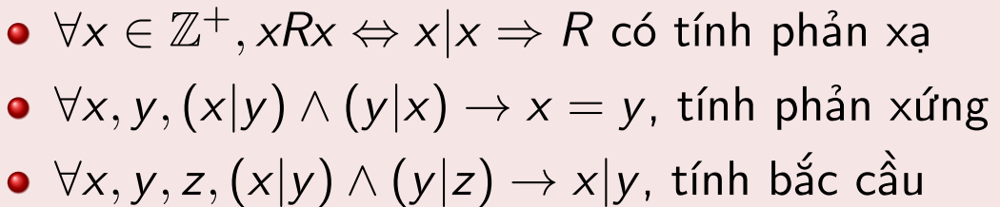
>
> **Ví dụ 4:** Xét tập A = {x, y} khi đó tập các tập con của A kí hiệu là P(A). Trên P(A) xét quan hệ bao hàm ⊆. Khi đó, (P(A), C) là một thứ tự. Thật vậy:

- $`\forall A \in P(A),A \subseteq A \Rightarrow`$phản xạ.

- $`\forall A,B \in P(A),(A \subseteq B) \land (B \subseteq A) \rightarrow A = B \Rightarrow`$phản xứng.

  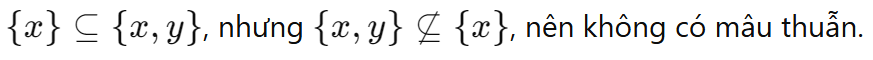

- $`\forall A,B,C \in P(A),(A \subseteq B) \land (B \subseteq C) \rightarrow A \subseteq C \Rightarrow`$bắc cầu.

  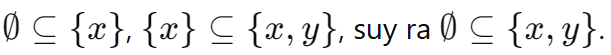

> **Ví dụ 5:** Quan hệ (L, ⊥) với L là tập các đường thẳng, không là thứ tự. Vì:

- Một đường thẳng không thể vuông góc với chính nó (theo định nghĩa hình học). Do đó, R **không phản xạ**.

- R không thỏa mãn d<sub>1</sub> ⊥ d<sub>2</sub> ∧ d<sub>2</sub> ⊥ d<sub>1</sub>  ⟹  d<sub>1</sub> = d<sub>2</sub>. Ví dụ, hai đường thẳng d<sub>1</sub> và d<sub>2</sub>​ khác nhau có thể vuông góc với nhau. Do đó, R **không phản xứng**.

- R không thỏa mãn d<sub>1</sub> ⊥ d<sub>2</sub> ∧ d<sub>2</sub> ⊥ d<sub>3</sub>  ⟹  d<sub>1</sub> ⊥ d<sub>3</sub>. Vì nếu d<sub>1</sub> vuông góc với d<sub>2</sub>​ và d<sub>2</sub> vuông góc với d<sub>3</sub>, thì d<sub>1</sub>​ không vuông góc với d<sub>3</sub>​ (thực tế, chúng sẽ song song). Do đó, R **không bắc cầu**.

- Tuy nhiên, Nếu d<sub>1</sub>​ vuông góc với d<sub>2</sub>​, thì d<sub>2</sub>​ cũng vuông góc với d<sub>1</sub>​ (tính chất đối xứng của góc vuông). Do đó, R **đối xứng**.

In different posets different symbols such as ≤, ⊆, and \|, *are used for a partial ordering.* However, we need a symbol that we can use when we discuss the ordering relation in an arbitrary *(tùy ý)* poset.

> **arbitrary** /ˈɑː.bɪ.trər.i/ (UK) ; /ˈɑːr.bə.trer.i/ (US)
>
> based on chance rather than being planned or based on reason

Customarily *(theo thông lệ)*, the notation <span class="mark">**a ⪯ b** is used to denote that (a, b) ∈ R in an arbitrary poset (S, R).</span>

This notation is used because **the <u>less than or equal to</u> relation on the set of real numbers is the most familiar example of a partial ordering and the symbol is similar to the** ≤ **symbol.** (Note that the symbol is used to denote the relation in **<u>any</u>** poset, not just the less than or equal to relation.)

*(Một số tài liệu có thể ký hiệu* ⪯ *thành* ≤*, tuy nhiên không nên vì nó dễ gây nhầm lẫn).*

The notation **<span class="mark">a ≺ b denotes that a ⪯ b, but a ≠ b.</span>** Also, we say *“a is less than b” or “b is greater than a” if a ≺ b.*

*When a and b are elements of the poset (S, **⪯**), it is not necessary that either a **⪯** b or b **⪯** a.* For instance, in (P(Z), ⊆), {1, 2} is not related to {1, 3}, and vice versa, because neither set is contained within the other. Similarly, in (Z+, ∣), 2 is not related to 3 and 3 is not related to 2, because 2 $`\cancel{|}`$ 3 and 3 $`\cancel{|}`$ 2.

This leads to below Definition.

### 4.6.2. So sánh được & thứ tự toàn phần

- Các phần tử a và b của poset (S, **⪯**) gọi là **so sánh được (comparable)** nếu a **⪯** b **<u>hoặc</u>** b **⪯** a.

- Trái lại thì ta nói a và b không so sánh được.

(When a and b are elements of S such that **neither** a **⪯** b **nor** b **⪯** a, a and b are called **incomparable**).

> **Ví dụ:** In the poset (Z+, ∣), are the integers 3 and 9 comparable? Are 5 and 7 comparable?
>
> ***Solution:*** The integers 3 and 9 are comparable, because 3 ∣ 9.
>
> The integers 5 and 7 are incomparable, because 5 $`\cancel{|}`$ 7 and 7 $`\cancel{|}`$ 5.

The adjective **“partial” is used to describe partial orderings because pairs of elements may be incomparable.** When every two elements in the set are comparable, the relation is called a ***total ordering.***

- If (S, **⪯**) is a poset and every two elements of S are comparable, S is called a **totally ordered** or **linearly ordered set** *(tập sắp thự tự toàn phần/tập sắp thứ tự tuyến tính)*, and **⪯** is called a **total order** or a **linear order** *(thứ tự toàn phần hay thứ tự tuyến tính)* on S. A totally ordered set is also called a **chain (xích)**.

- Trái lại thì ta nói **⪯** là thứ tự bán phần (tập thứ tự bộ phận).

- Một *tập con của một poset* mà *không có cặp hai phần tử khác nhau nào so sánh được*, được gọi là một *kháng xích* (antichain).

<!-- -->

- Như vậy, *quan hệ thứ tự toàn phần chỉ là một trường hợp đặc biệt của quan hệ thứ tự một phần.*

- <span class="mark">Một số tài liệu trong nước gọi *quan hệ thứ tự bộ phận* là *quan hệ thứ tự*, như vậy là không mô tả đầy đủ ý nghĩa của ngữ cảnh. Mặt khác, điều đó bó hẹp một quan hệ thứ tự nói chung vào ba điều kiện của quan hệ thứ tự bộ phận.</span>

  *(trích <https://phamtyn.wordpress.com/2016/06/29/quan-he-thu-tuorder-relation/>)*

> **Ví dụ:**
>
> \- Quan hệ “≤” trên tập số **Z<sup>+</sup>** là thứ tự toàn phần.
>
> \- Quan hệ ước số “ \| ”trên tập hợp số **Z<sup>+</sup>** là thứ tự bán phần, vì các số 5 và 7 là không so sánh được.
>
> \- Với tập A cho trước, tập P(A) tất cả các tập con của A với quan hệ ⊆ là một tập được sắp, nhưng không toàn phần khi *A có nhiều hơn một phần tử.*

### 4.6.3. Một số khái niệm khác

#### 4.6.3..1 Tập được sắp thứ tự tốt (well-ordered set)

Quan hệ thứ tự tốt (hay được sắp tốt) trên một tập S là **một quan hệ thứ tự toàn phần** trên S với thuộc tính là **<u>mọi</u>** *tập con không rỗng của S* có ***một phần tử bé nhất (a least element)*** trong quan hệ thứ tự này.

Tập S cùng với quan hệ thứ tự tốt được gọi là *tập được sắp thứ tự tốt.*

*Định nghĩa về phần tử nhỏ nhất được trình bày ở mục 4.6.4.3.*

**Ví dụ:**

- Tập ℕ với quan hệ thứ tự **⪯** là tập được sắp thứ tự tốt. Bất kỳ tập con A ⊆$`\mathbb{N}`$ đều có phần tử nhỏ nhất. Chẳng hạn:

  - Nếu A = {3, 7, 10}, thì phần tử bé nhất là 3.

  - Nếu A = {5, 2, 9, 1}, thì phần tử bé nhất là 1.

  - Nếu A = ℕ, thì phần tử bé nhất là 0.

- Tập ℤ với quan hệ thứ tự **⪯** không phải là tập được sắp thứ tự tốt bởi vì nó không có phần tử bé nhất. Thật vậy:

  - Nếu B = ℤ (toàn bộ tập số nguyên), thì không có số nào trong ℤ là nhỏ nhất, vì bất kỳ số nguyên nào cũng có một số nhỏ hơn (ví dụ: nếu chọn 0, thì −1 nhỏ hơn 0; nếu chọn −1, thì −2 nhỏ hơn −1, và cứ thế).

#### 4.6.3.2 Quan hệ bán thứ tự (Preorder, quasiorder)

Một quan hệ bán thứ tự là một quan hệ **hai ngôi** có **tính phản xạ và bắc cầu.**

Nếu một quan hệ bán thứ tự thỏa phản đối xứng, nó là một quan hệ thứ tự một phần (bộ phận); nếu đối xứng, nó là một quan hệ tương đương.

Nói cách khác, quan hệ bán thứ tự tổng quát hơn, cả hai quan hệ thứ tự bộ phận và quan hệ tương đương đều là những trường hợp đặc biệt của quan hệ bán thứ tự.

Thuật ngữ *bán thứ tự* được hiểu là quan hệ đó gần như là quan hệ thứ tự bộ phận, nhưng không hoàn toàn, chỉ “một nửa”.

*Định nghĩa.* Một quan hệ hai ngôi **⪯** trên một tập P được gọi là một quan hệ bán thứ tự nếu **⪯** thỏa các điều kiện dưới đây với mọi a, b, c trong P:

- a **⪯** a **(phản xạ)**

- nếu a **⪯** b và b **⪯** c thì a **⪯** c **(bắc cầu)**

Một tập với một quan hệ bán thứ tự được gọi là *tập bán thứ tự* hay *tập được sắp bán thứ tự* (preordered set, proset).

#### 4.6.3.3 Quan hệ thứ tự bộ phận ngặt (Strict partial order)

Một quan hệ hai ngôi $`\prec`$ trên một tập P được gọi là một quan hệ thứ tự bộ phận ngặt nếu thỏa các điều kiện dưới đây với mọi a, b, c trong P:

- **không** a $`\prec`$ a **(bất phản xạ)**

- nếu a $`\prec`$ b thì **không** b $`\prec`$ a  **(bất đối xứng)**

- nếu a $`\prec`$ b và b $`\prec`$ c thì a $`\prec`$ c **(bắc cầu)**

Quan hệ thứ tự bộ phận ngặt còn được gọi là quan hệ thứ tự bộ phận *bất phản xạ.*

### 4.6.4. Khái niệm trội & Biểu đồ Hasse

#### 4.6.4.1. Trội & Trội trực tiếp

- Phần tử **b** trong **<u>poset</u>** (S, **⪯**) được gọi là phần tử **trội của** phần tử **a** trong S **nếu a ⪯ b**. Chúng ta cũng nói rằng **a là được trội bởi b.**

- Phần tử **b được gọi là trội <u>trực tiếp</u> của a** nếu b là trội của a và không tồn tại $c\in A$ sao cho $a\prec c\prec b$.

#### 4.6.4.2. Biểu đồ Hasse

- Mỗi **poset** có thể biểu diễn bởi đồ thị đặc biệt ta gọi là biểu đồ Hasse

- Ta định nghĩa Biểu đồ Hasse của poset (S, $`\prec`$) là đồ thị:

  - Mỗi phần tử của S được biểu diễn bởi một điểm trên mặt phắng.

  - Nếu **b là trội trực tiếp của a** thì vẽ một **<u>cung</u>** (có hướng) **đi từ a đến b.**

**Ví dụ 1:** Biểu đồ Hasse của quan hệ thứ tự (P(S), ⊆ ), S = {a,b,c}.

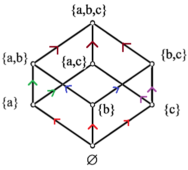 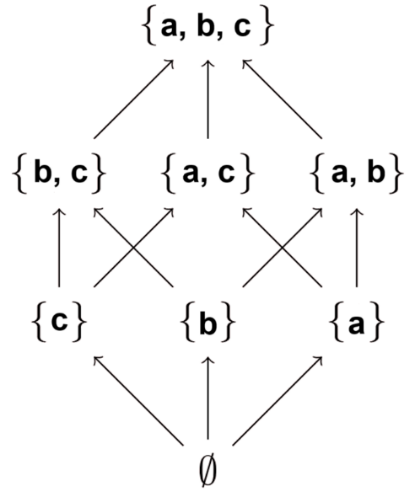

***Tại hình bên phải:*** If we assume that all edges are **pointed “upward”** (as they are drawn in the figure), we do not have to show the directions of the edges.

Và biểu đồ Hasse của các chuỗi bit độ dài 3.

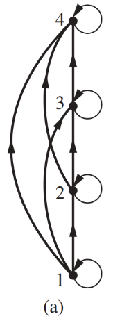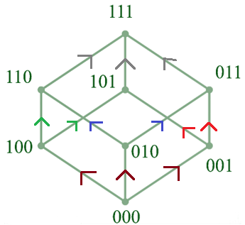

- **Many edges in the directed graph** for a **finite poset** do not have to be shown because they must be present.

- Biểu đồ Hasse của một **thứ tự toàn phần** là một **dây chuyền.**

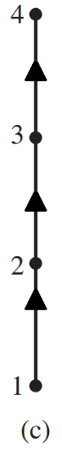**Ví dụ 2:** *(Mô tả bản chất)* Consider the directed graph for the partial ordering **{(a, b) ∣ a ≤ b}** on the set **{1, 2, 3, 4}**, shown in Figure (a).

Because this relation is **a partial ordering (and also total ordering)**, it is ***reflexive,*** and its directed graph has loops at all 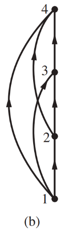vertices. Consequently, we **do not have to show these loops** because they must be present; in Figure (b) ***loops are not shown.***

Because a partial ordering is **transitive (bắc cầu),** we do not have to show those edges that must be present because of transitivity.

For example, in Figure 2(c) *the edges (1, 3), (1, 4), and (2, 4) are not shown because they must be present.*

If we ***assume that all edges are pointed “upward”*** (as they are drawn in the figure c), **we do not have to show the directions of the edges;** Figure (d) does not show directions.

→ Hình (c) và (d) được coi là một **dây chuyền.**

> **Ví dụ 3:** Let A = {2, 3, 4, 7, 8, 12, 24, 35} and let R be the devides relation on A.
>
> Thus **R = {(x, y} ∈ A × A: x \| y}.**

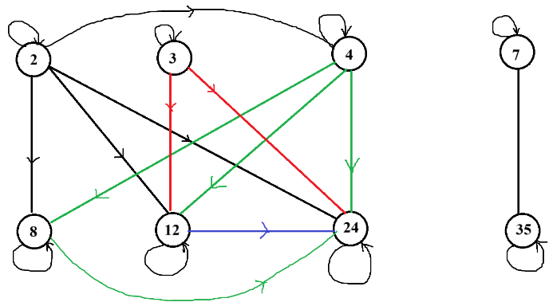

Lược bỏ các cạnh có thể suy ra từ tính chất bắc cầu & phản xạ, ta được:

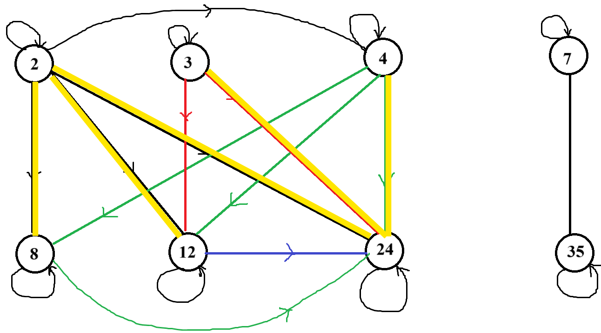 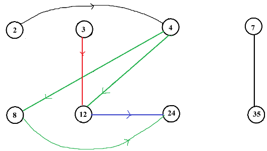

Ta có thể vẽ lại sơ đồ với các cung được quy ước chiều mũi tên hướng lên, lúc đó ta bỏ đi các mũi tên (như ví dụ trên), lúc này được sơ đồ Hasse như sau:

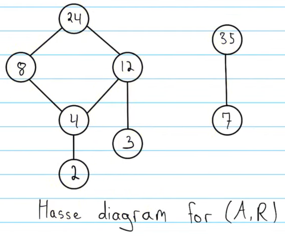

#### 4.6.4.3. Phần tử nhỏ nhất và phần tử lớn nhất

> ***Định nghĩa*:** Giả sử (S, <u>≺</u>) là tập sắp thứ tự, khi đó:

- *Phần tử nhỏ nhất* $`Min(S) = m\boxed{\in S}`$nếu ∀x ∈ S ta có **m <u>≺</u> x.**

- *Phần tử lớn nhất* $`Max(S) = M\boxed{\in S}`$nếu ∀x ∈ S ta có **x <u>≺</u> M.**

> ***Nhận xét*:** Phần tử nhỏ nhất (lớn nhất) của một tập hợp (nếu có) là duy nhất.

**Ví dụ:**

- Xét thứ tự (P(A), ⊂) với A = {1, 2, 3} thì: **Max(A) = A và Min(A) = ∅.**

- Xét thứ tự (A<sub>1</sub> = \[0,1\], ≤) trên tập số thực. Ta có Max(A) = 1, Min(A) = 0.

- Xét $B=(\frac{1}{2},1]\subseteq A_1$ với thứ tự $\leq$. Ta có $\max(B)=1$, nhưng B không có phần tử nhỏ nhất, nên B không là thứ tự tốt.

- Trong tập có thứ tự (S, ≤), S = {m∈**Z**\|m<sup>2</sup> \<100} có min(S) = -9, max(S) = 9.

- Trong tập có thứ tự (A, ≤), A = {x∈**R**\|x<sup>2</sup> \<100} không có phần tử nhỏ nhất và cũng không có phần tử lớn nhất.

- Xét thứ tự (A, ≤), với $`A = \left\{ x\mathbb{\in Z}:x^{2} < 100 \right\}`$

  Ta có: $`A = \left\{ - 9, - 8, - 7,...,7,8,9 \right\}`$→ Min(A) = - 9, Max(A) = 9.

- Với thứ tự $\leq$ trên $\mathbb{R}$, không tồn tại phần tử nhỏ nhất hoặc lớn nhất; ta không viết chúng lần lượt là $-\infty$ và $+\infty$.

#### 4.6.4.4. Phần tử tối tiểu và phần tử tối đại

> ***Định nghĩa*:** Xét tập sắp thứ tự (S, <u>≺</u>), khi đó:

- m được gọi là *Phần tử tối tiểu (minimal)* nếu **không tồn tại x ∈ S** sao cho **x ≠ m** và **x <u>≺</u> m** (nghĩa là $`\forall x \in S,\left( x\underline{\prec}m \right) \Rightarrow x = m`$), với m ∈ S.

> *(Không tìm được x nào đứng trước/nhỏ hơn m)*
>
> (An element is minimal if **<u>no element can relate to it</u>**, **except itself**, but it can relate to other elements)

- *M được gọi là Phần tử tối đại (maximal)* nếu **không tồn tại x ∈ S** sao cho **x ≠ a** và **a <u>≺</u> x** (nghĩa là $`\forall x \in S,\left( M\underline{\prec}x \right) \Rightarrow x = M`$), với M ∈ S.

> *(Không tìm được x nào đứng sau/lớn hơn M)*
>
> (An element is maximal if **<u>it relates to no element</u>**, **except itself**, but other elements might relate to it)

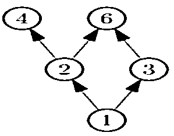

> **Ví dụ 1.** Từ biểu đồ Hasse của tập thứ tự ({1, 2, 3, 4, 6}, \|). Ta có:

- 4 và 6 là các phần tử tối đại.

<!-- -->

- 1 là phần tử tối tiểu và cũng là phần tử nhỏ nhất.

- Không tồn tại phần tử lớn nhất.

> 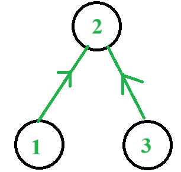**Ví dụ 2:** Xét tập S = {1, 2, 3} với quan hệ R cho bởi
>
> R = {(1,1), (2,2), (3,3), (1,2), (3,2)}.
>
> Dễ dàng kiểm chứng rằng (S,R) là tập có thứ tự. Với thứ tự R này, S có hai phần tử tối tiểu là 1 và 3; có một phần tử tối đại là 2.

**Ví dụ 3:** Cho thứ tự có biểu đồ sau:

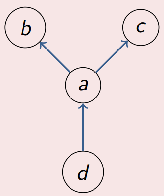

> thì tối thiểu là d và các tối đại là b và c.

**Ví dụ 4:** Xét lại ví dụ 3, mục 4.6.4.3. Ta có các tối tiểu và tối đại là:

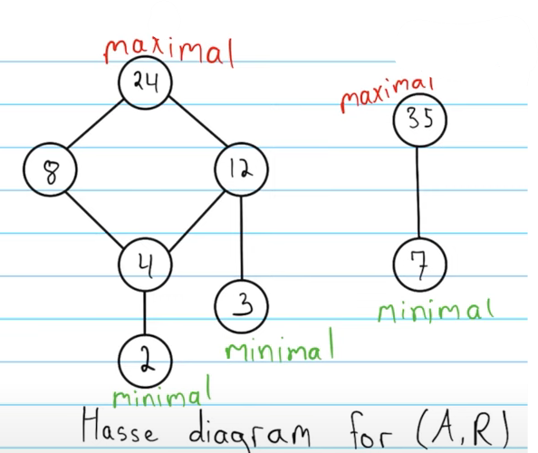

> **Ví dụ 5:** Xét tập A = {2, 4, 5, 6, 8, 12} với thứ tự (A, \|).

- Phần tử tối tiểu: 2, 5 (Trong tập A, ngoài phần tử 2 thì không còn số nào là ước của nó nữa, tương tự với phần tử 5).

- Phần tử tối đại: 5, 8, 12 (các phần tử này không là ước của những phần tử còn lại trong tập A).

***Nhận xét*:**

\- Phần tử **tối tiểu (tối đại)** của một tập có thứ tự **không nhất thiết là duy nhất.**

\- Phần tử **lớn nhất (nhỏ nhất)** của một tập có thứ tự, nếu có, là **phần tử tối đại (tối tiểu) duy nhất** của tập hợp đó; *chiều ngược lại chỉ đúng khi xét trong tập có thứ tự **<u>hữu hạn</u>**.*

🡪 Nếu một tập hợp có nhiều phần tử tối đại hoặc tối tiểu, thì không tồn tại phần tử lớn nhất hoặc nhỏ nhất trong tập hợp đó.

\- Mọi phần tử luôn **được trội** (tương ứng **bị trội**) bởi một phần tử **tối đại** (tương ứng **tối tiểu**)

\- Không có cung nào xuất phát từ điểm tối đại.

\- Không có cung nào kết thúc ở điểm tối tiểu.

**Chú ý:** Trong một poset S <u>hữu hạn</u>, phần tử tối tiểu và phần tử tối đại luôn luôn tồn tại.

Thật vậy, chúng ta xuất phát từ điểm bất kỳ a<sub>0</sub> ∈ S. Nếu a<sub>0</sub> không là phần tử tối tiểu thì ∃a<sub>1</sub> ∈ S: a<sub>1</sub> ≺ a<sub>0</sub>. Tiếp tục như vậy cho đến khi tìm được phần tử tối tiểu.

Phần tử tối đại cũng tìm được bằng phương pháp tương tự.

> **Ví dụ 6:** Gọi U<sub>n</sub> là tập các ước của *số nguyên dương* n. Trên U<sub>n</sub> ta xét thứ tự chia hết a ≺ b ⇔ a\|b. Hãy tìm tối tiểu, tối đại, max và min của U<sub>6</sub>?

- 1 là tối tiểu vì 1 là ước của tất cả các phần tử trong U<sub>6</sub>​, và không có phần tử nào nhỏ hơn 1 🡪 vì 1 là tối tiểu duy nhất nên min(U<sub>6</sub>) = 1.

- 6 là tối đại vì không có phần tử nào trong U<sub>6</sub>​ mà 6 là ước của nó (ngoài chính nó) 🡪 vì 1 là tối đại duy nhất nên max(U<sub>6</sub>) = 6.

### 4.6.5. Thứ tự cảm sinh

Giả sử **B là <u>một tập hợp con</u> của tập hợp có thứ tự (A, ≺).** Khi ấy ≺ cảm sinh một thứ tự trên B một cách tự nhiên: **với x, y ∈ B, ta nói x ≺ y trong B nếu x ≻ y trong A.**

**Ví dụ:** (**R**, ≤) là một tập hợp có thứ tự. Thứ tự cảm sinh các thứ tự tự nhiên trên **Q**, **Z**.

*(Ta có tập thứ tự phép so sánh* ≤ *trên tập R, nếu trích tập con từ tập R (là Q, Z…) mà cũng thỏa phép so sánh* ≤ *thì thứ tự này được gọi là thứ tự cảm sinh)*

### 4.6.6. Thứ tự từ điển

- Xét một tập hợp hữu hạn không rỗng **A** mà ta gọi là **bộ mẫu tự**.

- Giả sử trên A có một thứ tự toàn phần <u>≺</u> (ví dụ như thứ tự thông thường nếu A là bộ chữ cái: a ≺ b ≺ c ≺ ⋯ ≺ z, hay thứ tự xác định bởi mã ASCII nếu A là bộ chữ cái được mở rộng thêm các ký tự là các số từ 0 đến 9, các dấu +, - ,…)

- Gọi **S là tập hợp các chuỗi ký tự** có dạng s =$`a_{1}a_{2}...a_{m}`$ và $`a_{1}a_{2}...a_{m}`$**∈ A** với m là số nguyên tự nhiên tùy ý.

- Với m = 0, ta được chuỗi rỗng ∅ không có ký tự nào cả (có thể ký hiệu λ).

- Giả sử <u>≺</u> là thứ tự toàn phần trên A, khi đó ta có thể định nghĩa thứ tự toàn phần <u>≺</u> trên S như sau:

  - $`\varnothing\underline{\prec}s,\forall s \in S`$ (λ ∈ S).

  - Nếu $`s = a_{1}a_{2}...a_{m}`$ và $`t = b_{1}b_{2}...b_{n}`$ là hai chuỗi khác ∅ trên S, ta có:

> 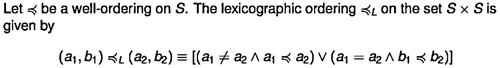
>
>  **=**
>
> $$
> \begin{cases}
> \text{true}, & \text{if } a_1 \prec a_2,\\
> \text{true}, & \text{if } a_1=a_2 \text{ and } b_1\prec b_2,\\
> \text{false}, & \text{otherwise.}
> \end{cases}
> $$

- Ta chứng minh được rằng <u>≺</u> là một thứ tự trên S gọi là thứ tự tự điển. Hơn nữa với thứ tự tự điển, S là một tập sắp thứ tự toàn phần.

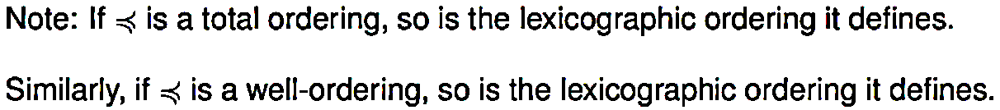

**Ví dụ.** Nếu A là bảng chữ cái tiếng Anh với thứ tự: a ≺ b ≺ . . . ≺ z, thì thứ tự nói trên là thứ tự thông thường giữa các từ trong từ điển.

love ≺ lovely; castle ≺ cat (so 2 ký tự đầu đều giống nhau, xét ký tự 3 ta có s đứng trước t trong bảng chữ cái tiếng Anh)

Nếu A = {0, 1} với 0 ≺ 1 thì thì <u>≺</u> là thứ tự toàn phần trên tập tất cả các chuỗi bit.

10101 ≺ *10101*000; 10101 ≺ 11

> (xét 2-bit đầu chuỗi bên trái, có 10 \< 11)

### 4.6.7. Dàn

#### 4.6.7.1. Chặn trên, chặn dưới

Giả sử có thứ tự (A, ≺). Xét B ⊂ A. Khi đó:

- Phần tử s ∈ A gọi là **chặn trên (chung) (upper bound)** của B nếu:

  **∀x ∈ B: x ≺ s**

- Phần tử i ∈ A gọi là **chặn dưới (chung) (lower bound)** của B nếu:

  **∀x ∈ B: i ≺ x**

Gọi S và I tương ứng là tập các chặn trên và chặn dưới của B.

- **Nếu Min(S)** (least upper bound) tồn tại, được gọi là **chặn trên đúng/ cận trên (supremum)** của B, kí hiệu: **SupB** hoặc <span class="mark">∨</span>.

- **Nếu** **Max(I)** (greatest lower bound) tồn tại, được gọi là **chặn dưới đúng/ cận dưới (infimum)** của B, kí hiệu: **InfB** hoặc <span class="mark">∧</span>.

**Ví dụ 1:** Xét $`B = \left. \ \frac{1}{2},\frac{4}{5} \right.\  \subset \left( A = \lbrack 0,1\rbrack, \leq \right)\mathbb{\in R}`$.

- Giả sử lấy i = 0,1 ∈ A; ∀**x ∈ B:** i <span class="mark">≤</span> x → 0,1 là chặn dưới chung của B. Ngoài ra còn nhiều phần tử chặn dưới của B (0,2, 0,3,...) và chúng thuộc tập các chặn dưới I.

- Dễ thấy, phần tử Max(I) = ½ = InfB.

- Giả sử lấy s = 1 ∈ A, ∀**x ∈ B:** x <span class="mark">≤</span> s → 1 là chặn trên chung của B. Ngoài ra còn nhiều phần tử chặn trên của B (0,85, 0,9,...) và chúng thuộc tập các chặn trên S.

- Dễ thấy, phần tử Min(S) = 4/5 = SupB.

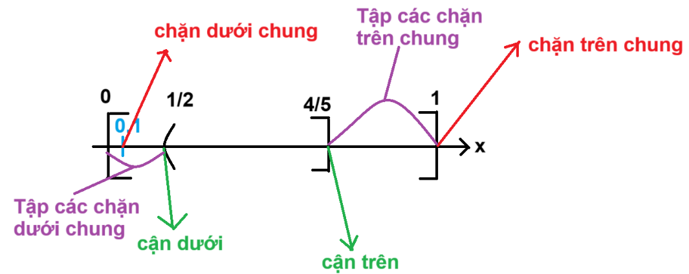

> **Ví dụ 2:** Xét thứ tự$`\left( \mathbb{Z}, \leq \right)`$, và tập $`A = \left\{ x\mathbb{\in Z}:x^{2} < 100 \right\}`$. Dễ thấy A ⊂ $`\left( \mathbb{Z}, \leq \right)`$.

- Giả sử lấy i = -15 ∈ $`\mathbb{Z}`$; ∀**x ∈ B:** i <span class="mark">≤</span> x → -15 là chặn dưới chung của A. Ngoài ra còn nhiều phần tử chặn dưới của A và chúng thuộc tập các chặn dưới I.

- Dễ thấy, phần tử Max(I) = -10 = InfA.

- Giả sử lấy s = 12 ∈ A, ∀**x ∈ B:** x <span class="mark">≤</span> s → 12 là chặn trên chung của A. Ngoài ra còn nhiều phần tử chặn trên của A và chúng thuộc tập các chặn trên S.

- Dễ thấy, phần tử Min(S) = 10 = SupB.

> 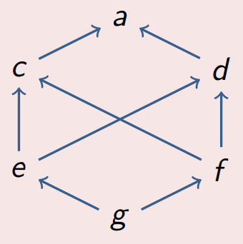**Ví dụ 3:** Xét thứ tự có biểu đồ sau:
>
> Khi đó:

- $`\cancel{\exists}`$Sup {e, f}: ta có các trội chung (tập chặn trên chung) của {e, f} là {c, d, a}, và tập hợp này không có phần tử bé nhất, vì vậy dẫn đến kết quả trên.

- Sup {c, f} = a: ta có tập chặn trên chung của {c, f} là {a} *(chặn trên của c là a, chặn trên của f là c, d, a, nhưng ta chỉ lấy phần tử chặn trên chung là a)*, và vì tập hợp này chỉ có một phần tử duy nhất là a, dẫn đến kết quả trên.

- $`\cancel{\exists}`$Inf {c, d}: ta có tập chặn dưới chung của {c, d} là {e, f, g}, và tập hợp này không có phần tử lớn nhất, vì vậy dẫn đến kết quả trên.

- Inf {e, f} = g: ta có tập chặn dưới chung của {e, f} là {g}, và vì tập hợp này chỉ có một phần tử duy nhất là g, dẫn đến kết quả trên.

**Ví dụ 4:** Xét thứ tự (P(A), ⊂). Khi đó ∀A, B ∈ P(A) ta có:

- **Sup{A, B} = A ∪ B**

> 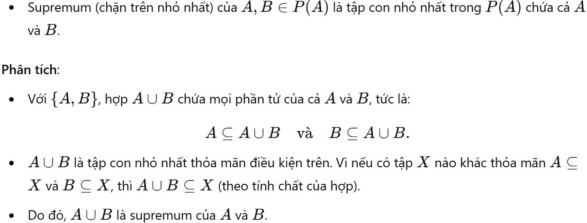

- **Inf {A, B} = A ∩ B**

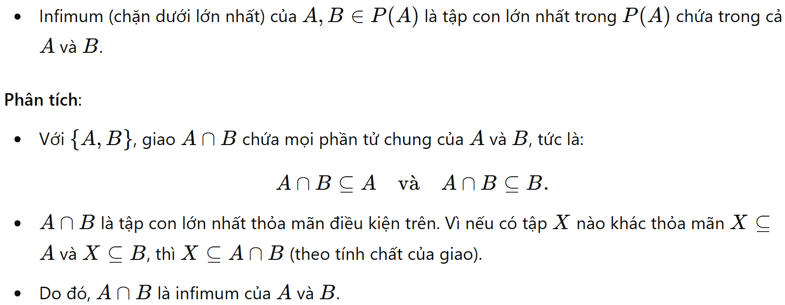

**Ví dụ 5:** Xét thứ tự (U<sub>n</sub>, \|). Khi đó ∀a, b ∈ U<sub>n</sub> ta có:

- **Sup{a, b} = BCNN(a, b) (Bội chung nhỏ nhất)**

> 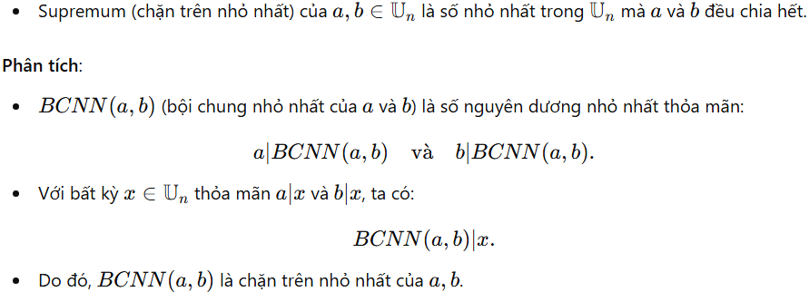

- **Inf {a, b} = UCLN(a, b) (Ước chung lớn nhất)**

> 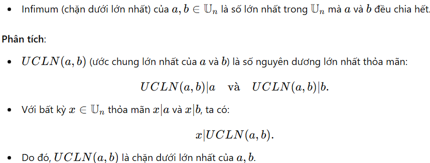

#### 4.6.7.2. Dàn (Lattice)

Thứ tự (A, ≺) được gọi là một dàn nếu với **∀x, y ∈ A thì sup{x, y} và inf {x, y} đều tồn tại.**

\* (P(A), ⊂) và (Un, \|) trong các ví dụ trên chính là các dàn.

\* Một cách trực quan có thể thấy mối quan hệ "Thứ tự" - "Dàn" - "Thứ tự toàn phần" như sau:


- **Thứ tự thông thường → Dàn**: Một thứ tự thông thường có thể trở thành dàn nếu mọi cặp phần tử có supremum và infimum.

- **Dàn → Thứ tự toàn phần**: Một dàn có thể được mở rộng thành thứ tự toàn phần nếu thêm điều kiện mọi phần tử đều có thể so sánh với nhau.

Trong dàn hữu hạn $`A = \left\{ a_{1},a_{2},...,a_{n} \right\}`$thì$`a_{1} \vee a_{2} \vee ... \vee a_{n}`$ và $`a_{1} \land a_{2} \land ... \land a_{n}`$chính là phần tử lớn nhất và phần tử bé nhất của A.

**Dàn phân phối/ phân bố:** một dàn A được nói là phân bố (nếu với mọi x, y, z trong A) khi và chỉ khi **các phép Sup (hay ∨) và Inf (∧) (hay ∧) của nó có tính phân phối.** Nghĩa là


> **Ví dụ 1:** Các dàn (P(A), ⊂) và (U<sub>n</sub>, \|) đều là các dàn phân phối *(bởi tính phân phối của các phép toán: (∪, ∩) và (BCNN, UCLN))*
>
> **Ví dụ 2:** Xét tập hợp sắp thứ tự $`A = \left\{ a,b,c,d,e \right\}`$với biểu đồ Hasse như sau:
>
> 

**Dàn bù:** Giả sử (A, ≺) là một dàn, lấy x ∈ A. Khi đó nếu ∃$`\overline{x}`$∈A sao cho:

$$
\sup\{x,\overline{x}\}=1,
\qquad
\inf\{x,\overline{x}\}=0.
$$

Khi đó $\overline{x}$ được gọi là **<u>phần bù</u>** của $x$.

Ta nói A là một **<u>dàn bù</u>** nếu **mọi phần tử của A đều có phần bù.**

> **Lưu ý:**

- Không phải dàn nào cũng là dàn bù.

- Trong một dàn bù, một phần tử có thể có nhiều hơn một phần bù (mặc dù điều này không phổ biến). Trong một *đại số Boolean*, mỗi phần tử có duy nhất một phần bù.

> **Ví dụ 1:** Xét tập hợp các ước của 30: U<sub>30</sub> = {1, 2, 3, 5, 6, 10, 15, 30}. Với **quan hệ chia hết**, tập hợp này là một dàn.

- Phần tử nhỏ nhất: 1

- Phần tử lớn nhất: 30

> Hãy tìm phần bù của 6:

- Chúng ta cần tìm một số x sao cho ước chung lớn nhất (ƯCLN) của 6 và x là 1 (phần tử nhỏ nhất), và bội chung nhỏ nhất (BCNN) của 6 và x là 30 (phần tử lớn nhất).

- Số đó là 5. Vì ƯCLN(6, 5) = 1 và BCNN(6, 5) = 30.

> Vậy, phần bù của 6 là 5 ($`\overline{6} = 5`$, $`\overline{5} = 6`$, $`\overline{\overline{6}}`$= 6).
>
> Để chứng minh U<sub>30</sub> là một dàn bù, ta cần chứng minh *mọi* phần tử trong U<sub>30</sub> đều có phần bù. Ta sẽ liệt kê phần bù của từng phần tử:

**\**

- **1:** Phần bù của 1 là 30 (vì ƯCLN(1, 30) = 1 và BCNN(1, 30) = 30)

- **2:** Phần bù của 2 là 15 (vì ƯCLN(2, 15) = 1 và BCNN(2, 15) = 30)

- **3:** Phần bù của 3 là 10 (vì ƯCLN(3, 10) = 1 và BCNN(3, 10) = 30)

- **5:** Phần bù của 5 là 6 (vì ƯCLN(5, 6) = 1 và BCNN(5, 6) = 30)

- **6:** Phần bù của 6 là 5 (như đã nêu trên)

- **10:** Phần bù của 10 là 3

- **15:** Phần bù của 15 là 2

- **30:** Phần bù của 30 là 1

> Như vậy, *mỗi* phần tử trong U<sub>30</sub> đều có một phần bù duy nhất, vậy nó cũng là **dàn bù.**
>
> **Ví dụ 2:** Xét tập E = {1,2,3,4}, và P(E) là một dàn.

- Xét P(E), ta có: max(P(E)) = E, min(P(E)) = ∅.

- Nếu A = {1, 2} ⊂ E thì $`\overline{A}`$= {3, 4}

- Dễ thấy, đây là một dàn bù.

> **Ví dụ 3:** Xét tập hợp các ước của 12: U<sub>30</sub> = {1, 2, 3, 4, 6, 12}. Với **quan hệ chia hết**, tập hợp này là một dàn. Ta có max = 1, min = 12.

- Giả sử tìm phần bù của phần tử 2. Ta xét phần bù x = $`\overline{2}`$sao cho:

  ``` math
  \left\{ \begin{aligned}
   & BCNN(x,2) = 12 \\
   & UCLN(x,2) = 1
  \end{aligned} \right.\ 
  ```

- Tuy nhiên không tìm được x nào thỏa điều kiện. Vậy không tồn tại $`\overline{2}`$.

- Vậy đây không là dàn bù.

***Nhận xét:*** Nếu tìm được một phần tử trong dàn mà không tồn tại phần bù thì đó không là dàn bù.
