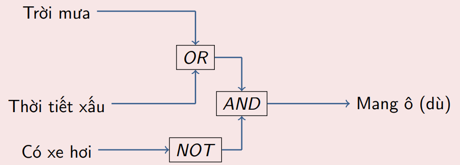

  <a className="button button--primary" href="/pdfs/toan-roi-rac/chapter5/bai22.pdf" download="bai22-toan-roi-rac.pdf" target="_blank" rel="noreferrer">
    Tải file PDF
  </a>

## 22.1. Đại số bool

### 22.1.1. Đại số bool

- **Ví dụ.** Xét tập hợp $\mathbb{B} = \{0; 1\}$. Với mọi $x, y \in \mathbb{B}$, ta định nghĩa:

  * $x \land y = xy$,
  * $x \lor y = x + y - xy$,
  * $\overline{x} = 1 - x$.

- Các phép toán vừa định nghĩa có bảng giá trị là:

| $x$ | $y$ | $x \land y$ | $x \lor y$ | $\overline{x}$ |
| :---: | :---: | :---: | :---: | :---: |
| 0 | 0 | 0 | 0 | 1 |
| 0 | 1 | 0 | 1 | 1 |
| 1 | 0 | 0 | 1 | 0 |
| 1 | 1 | 1 | 1 | 0 |

- Khi đó, tập hợp $\mathbb{B}$ với các phép toán trên là một ***đại số Boole***;

  1. $\land$ được gọi là ***tích Boole***;
  2. $\lor$ là ***tổng Boole***;
  3. $\overline{x}$ là ***phần bù*** của $x$.

- Một đại số Bool còn **thỏa mãn các tính chất: kết hợp, giao hoán, phân bố, phần tử trung hòa, phần tử bù** (Đã đề cập ở chương $I$).

**Ví dụ:**

**$a$/** Cho $U$ là tập bất kỳ, trên $A$ = $P$($U$) (tập các tập con của $U$)
- Xét phép  $∧$ là phép $∩$, phép $∨$ là phép $∪$, phép $\overline{\phantom{A}}$ là phép lấy phần bù, phần tử 0 là tập rỗng $Ø$, còn phần tử 1 là tập $U$.
- Khi đó ($P$($U$), $∩$, $∪$, $\overline{\phantom{A}}$ , $∅$, $U$) là một đại số Bool.

**$b$/** Xét $F$ là tập hợp tất cả các dạng mệnh đề theo $n$ biến $p$1, $p$2,…, $p$$n$ với phép toán hội $∧$, phép toán tuyển $∨$, phép $\overline{\phantom{A}}$ , phần tử 1 là hằng đúng 1, phần tử 0 là hằng sai 0, phần tử bù của dạng mệnh đề $E$ là dạng mệnh đề bù $\overline{E}$.
Khi đó $F$ là một đại số Bool.

### 22.1.2. Hàm bool

* Phát biểu: "Nếu trời đang mưa hoặc bản tin báo thời tiết xấu và không có xe hơi thì tôi sẽ mang ô (dù) khi đi ra ngoài."
* Mô tả logic:
  $(\text{Mang ô}) = (\textit{NOT } \text{Có xe hơi}) \text{ } \textit{AND} \text{ } ((\text{Trời mưa}) \text{ } \textit{OR} \text{ } (\text{Thời tiết xấu}))$
* Biểu đồ:

  

* Các mệnh đề **Trời mưa**, **Thời tiết xấu** và **Có xe hơi** có thể được đặc trưng bởi các biến $x, y$ và $z$ nhận giá trị trong tập $B = \{0, 1\}$
* Khi đó việc **Mang ô** hay không trở thành một hàm của $x, y$ và $z$. Kí hiệu là $f(x, y, z)$ và gọi là hàm boolean.
* Vậy định nghĩa hình thức của một hàm boolean $n$ biến như sau:

$$
\boxed{
\begin{aligned}
f : B^n &\mapsto B \\
(x_1, x_2, \dots, x_n) &\mapsto f(x_1, x_2, \dots, x_n)
\end{aligned}
}
$$

- Trong đó mỗi biến trong $x$1, $x$2, . . . , $x$$n$ **chỉ nhận hai giá trị 0, 1** và $f$ nhận giá trị trong **$B = {0, 1}$.

- Ký hiệu **$F$$n$** để chỉ **tập các hàm Boole** $n$ biến.

**Ví dụ:** (không viết tường minh phép toán hội $\land$)
  
  a. $f(x) = x$
  
  b. $f(x, y) = x \lor y$
  
  c. $f(x, y, z) = xy \lor \overline{y}$
  
  d. $f(x, y, z, t) = xyt \lor x\overline{y}z \lor \overline{x}y$
  e. $$f(x, y, z, t) = (\overline{x} \lor \overline{z})t \lor (\overline{x}y \lor \overline{y}t)z \lor (\overline{y}z \lor xy\overline{z})\overline{t}$$ là hàm Boole 4 biến.

- ***Các phép toán trên $F$$n$:***

  - **Phép cộng Bool $∨$:**

    - Với $f$, $g$ $∈$ $F$$n$ ta định nghĩa tổng Bool của $f$ và $g$: **$f$ $∨$ $g$ = $f$ + $g$ – fg**

    - $∀$ $x$ = ($x$1, $x$2,…, $x$$n$) $∈$ $B$$n$ , ($f$ $∨$ $g$)($x$) = $f$($x$) + $g$($x$) – $f$($x$)$g$($x$)

    - Dễ thấy $f$ $∨$ $g$ $∈$ $F$$n$ và **($f$** $∨$ **$g$)($x$) = max{$f$($x$), $g$($x$)}**

  - **Phép nhân Bool $∧$:**

    - Với $f$, $g$ $∈$ $F$$n$ ta định nghĩa tích Bool của $f$ và $g$: **$f$ $∧$ $g$ = fg**

    - $∀$ $x$ = ($x$1, $x$2,…,$x$$n$) $∈$ $B$$n$ , ($f$ $∧$ $g$)($x$) = $f$($x$)$g$($x$)

    - Dễ thấy: $f$ $∧$ $g$ $∈$ $F$$n$ và **($f$ $∧$ $g$)($x$) = min{$f$($x$), $g$($x$)}**

    - Ta thường viết **fg** thay cho **$f$ $∧$ $g$.**

  - **Phép lấy hàm bù:** Với $f$ $∈$ $F$$n$ ta định nghĩa hàm bù của $f$ như sau: $\boxed{\overline{f} = 1 - f}$

