

  <a className="button button--primary" href="/pdfs/toan-roi-rac/chapter2/bai7.pdf" download="bai7-toan-roi-rac.pdf" target="_blank" rel="noreferrer">
    Tải file PDF
  </a>

## 24.1. Khái niệm
* Biểu đồ $K$ là một hình chữ nhật, gồm tập hợp các ô, **mỗi ô biểu diễn một hội sơ cấp** của **<u>tất cả</u> các biến**.

* Nếu hàm boolean có **$n$ biến** thì biểu đồ $K$ có **2$n$ ô.**

* Khi **một ô nằm trong dãy được đánh dấu bởi $x$ thì tại đó $x$ = 1**, bởi $\overline{x}$ thì tại đó $x$ = 0, tương tự cho $y$, $z$, $t$…

  **Ví dụ:**

  - ***Biểu đồ $K$ trường hợp 3 biến.***
  
  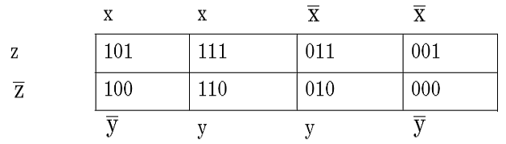

  - ***Biểu đồ $K$ trường hợp 4 biến.***

  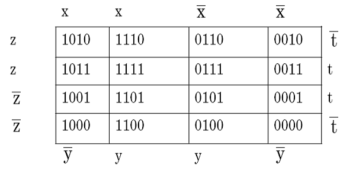

> **Gạch chéo (hoặc tô đen)** những ô mà **$f$ nhận giá trị 1.** Khi đó ta được một biểu đồ, gọi là biểu đồ Karnaugh của $f$, ký hiệu bởi **kar($f$)**, hoặc đơn giản ký hiệu là **$K$**.

- Hai ô được gọi là **kề nhau** (theo nghĩa rộng), nếu chúng là **hai ô liền nhau** hoặc **chúng là ô đầu, ô cuối** của ***cùng một hàng (cột)*** nào đó. Nhận xét rằng, do cách đánh dấu như trên, **hai ô kề nhau chỉ lệch nhau ở một <u>bit</u> duy nhất.**

- Các biến bool $x$, $y$, ($z$, $t$…) được sắp xếp tại các cạnh theo thứ tự *Trên, Dưới, Trái, Phải và đặt xen kẽ biến và bù của biến như các hình ví dụ.*

* Thứ tự đọc của một hội sơ cấp thuộc một ô cũng theo thứ tự Trên, Dưới, Trái, Phải.

  **Ví dụ:**

  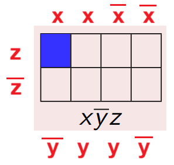 
  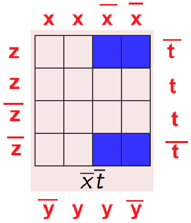

  $$
  \underbrace{\overline{x} \land \overline{x}}_{\overline{x}} \land \underbrace{y \land \overline{y}}_{1} \land \underbrace{z \land \overline{z}}_{1} \land \underbrace{\overline{t} \land \overline{t}}_{\overline{t}} = \overline{x} \land \overline{t} = \overline{x}\overline{t}
  $$

- Trong đại số Boolean, nếu **một biến được nhân (hội) với chính nó** (bao gồm cả bù của nó), kết quả sẽ luôn **<u>bằng chính biến đó:</u> *$x$ ⋅ $x$ = $x$;*** $\overline{x} \cdot \overline{x} = \overline{x}$

  | $x\overline{y}z\overline{t}$ | $\overline{y}z\overline{t}$ |
  |:--:|:--:|
  | 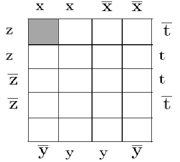 | 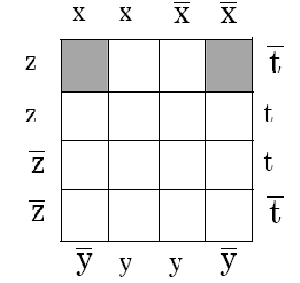 |

  | $\overline{y}\overline{t}$ | $\overline{t}$ |
  |:--:|:--:|
  | 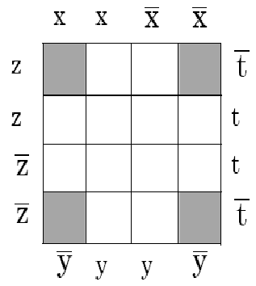 | 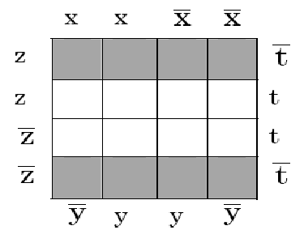 |

  **Ví dụ.** Cho hàm boole theo 4 biến $x, y, z, t$ với $$f^{-1}(0) = \{1110, 0110, 1111, 1101, 0101, 1000, 0100\}.$$ Tìm biểu đồ Karnaugh của $f$?
  
  **Giải.**

  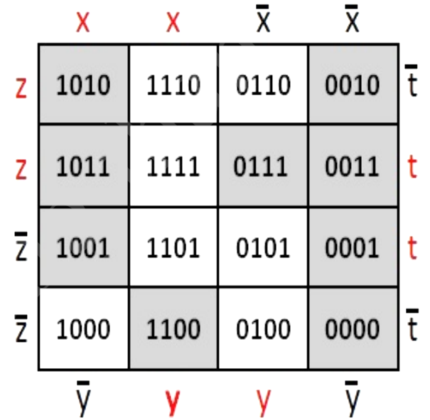

- **Mệnh đề.** *Cho $f$ và $g$ là các hàm boole theo 4 biến $x, y, z, t$. Khi đó*

  1. $f = g \Leftrightarrow kar(f) = kar(g);$
  2. $kar(fg) = kar(f) \cap kar(g);$
  3. $kar(f \lor g) = kar(f) \cup kar(g);$

**Ví dụ.** Cho hàm boole theo 4 biến $x, y, z, t$ với $$f = x z \lor y\overline{z} t \lor \overline{y}\overline{t}.$$ Tìm biểu đồ Karnaugh của $f$.

  **Đáp án.**
  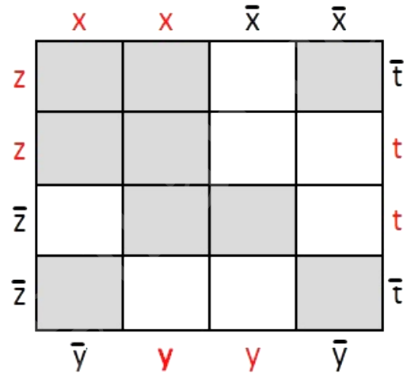

## 24.2. Tế bào
- là *các ô của biểu đồ Karnaugh phủ (vừa đúng) 1 hội sơ cấp.*
- Giả sử hàm f có biểu đồ tương ứng là K. 
    - **Tế bào tối đại** là ***tế bào lớn nhất** chỉ **phủ các ô thuộc K**.*
    - *Thoả hai tính chất sau:*
        a. T là một tế bào và T ⊆ kar(f).
        b. Không tồn tại tế bào T’ nào thỏa T’ ≠ **T** và **T ⊆ T’ ⊆ kar(f).**

- Tế bào càng lớn ⇒ Số biến càng ít ⇒ Mạch càng ít phức tạp.

## 24.3. Các bước xác định công thức tối tiểu của hàm Bool $f$

>  - **Bước 1.** Biểu diễn f bằng sơ đồ Karnaugh.
>  - **Bước 2.** Xác định tất cả các **Cell lớn (tế bào tối đại)** theo thứ tự **số ô trong hình chữ nhật giảm dần** (từ 2n, ***giảm dần n** (…23, 22, 21, 20)**,*** đến 1 ô), sao cho ***Cell (tế bào) vừa xác định*** *<u>không bị chứa trong bất kỳ Cell nào được xác định trước đó.</u>*
>  - **Bước 3.** Trong sơ đồ Karnaugh, nếu tồn tại **<u>ô chỉ nằm trong duy nhất một Cell lớn</u>** thì **tô Cell lớn này vào sơ đồ phụ *(gọi là tế bào bắt buộc)*.** Lặp lại bước 3 cho đến khi không còn Cell lớn nào có tính chất trên.
>  - **Bước 4.** Nếu **sơ đồ phụ** giống với sơ đồ Karnaugh thì sang **Bước 5.** Nếu không, trong số các Cell lớn còn lại, **chọn ra Cell lớn chứa nhiều ô chưa được tô đen nhất.** Tiếp tục chọn cho đến khi sơ đồ phụ giống sơ đồ Karnaugh.
>  - **Bước 5.** Vì Bước 4 có thể có nhiều sự lựa chọn để tô các Cell lớn vào sơ đồ phụ nên f thường có nhiều hơn một công thức. **Loại trừ các công thức không tối tiểu của f, ta nhận được công thức tối tiểu của f.**

  **Ví dụ 1:** Biểu diễn sơ đồ Karnaugh của hàm Bool 4 biến sau đây:

  $$
  f = \overline{a}\overline{b}c\overline{d} \lor \overline{a}\overline{b}cd \lor \overline{a}bc\overline{d} \lor \overline{a}bcd \lor a\overline{b}\overline{c}\overline{d} \lor a\overline{b}\overline{c}d \lor ab\overline{c}d \lor abcd
  $$
  
  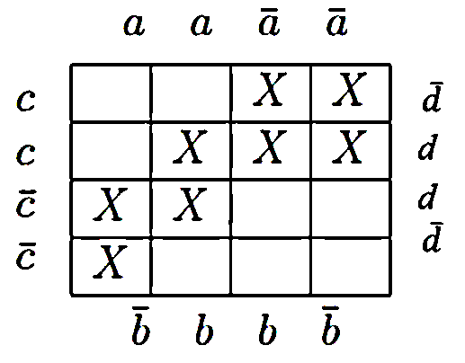

  - **Bước 1 & 2:**

  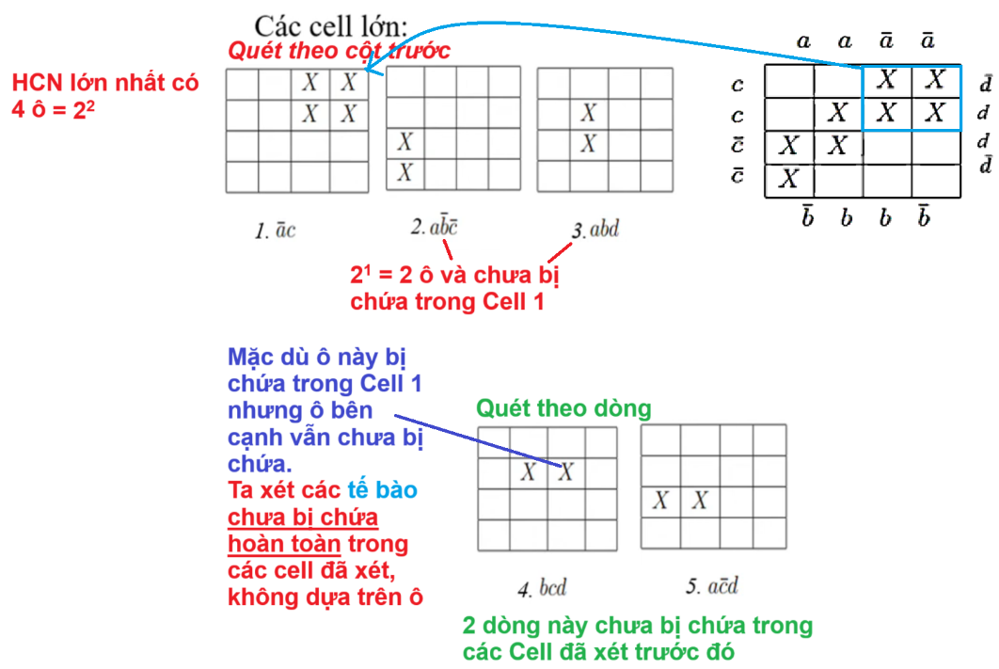

  - **Bước 3:**

  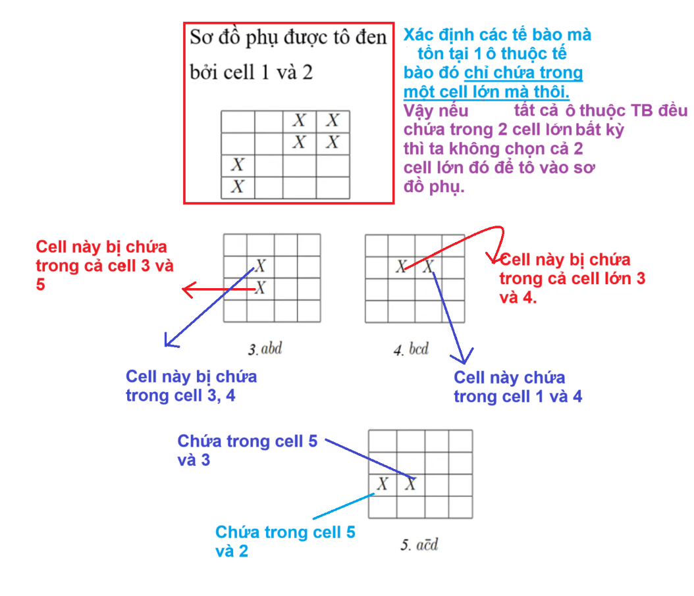

  - **Bước 4:** Do sơ đồ phụ chưa giống với biểu đồ Karnaugh ban đầu, ta ưu tiên chọn một tế bào tối đại bị loại trong bước 3 mà phủ lớn nhất để tô vào sơ đồ phụ. Tuy nhiên, nếu các tế bào còn lại cũng phủ được thì ta vẫn chọn, từ đó ta có nhiều dạng tuyển chuẩn tắc của f.
    - Sơ đồ phụ được tô đen bởi cell lớn 1 và 2.
    - Vì sơ đồ phụ chưa giống sơ đồ Karnaugh nên chọn thêm cell lớn 3 hoặc cell lớn 4 và 5.
    
    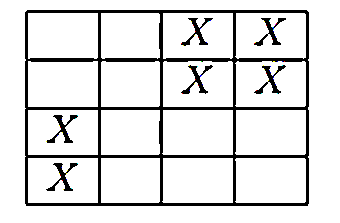

  - **Bước 5:** Các dạng tuyển chuẩn tắc là:

  $$
  \begin{aligned}
  f &= \overline{a}c \lor a\overline{b}\overline{c} \lor abd \\
  f &= \overline{a}c \lor a\overline{b}\overline{c} \lor bcd \lor a\overline{c}d
  \end{aligned}
  $$

  - Suy ra dạng TCTTT là:
  
  $$
  f = \overline{a}c \lor a\overline{b}\overline{c} \lor abd
  $$

  **Ví dụ 2:** Phương pháp Karnaugh với 3 biến. Tìm dạng TCTTT của hàm $f$ có biểu đồ Karnaugh sau:
  
  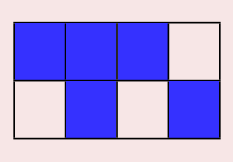

  - Danh sách các tế bào tối đại:

  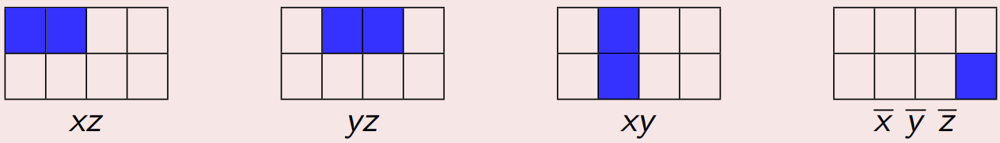

  - Cả 4 tế bào trên đều thuộc nhóm **bắt buộc chọn**  
  - Vậy dạng TCTTT là: $f(x, y, z) = xz \lor yz \lor xy \lor \overline{x}\,\overline{y}\,\overline{z}$
  
  **Ví dụ 3**: Tìm các công thức đa thức tối tiểu của hàm $f$:

  $$
  f(x,y,z,t)=xyzt\lor x\overline{y}\lor x\overline{z}\lor yz\lor xy\overline{z}\lor xy\overline{t}
  $$

  - **Bước 1:** Bảng Kar($f$)
  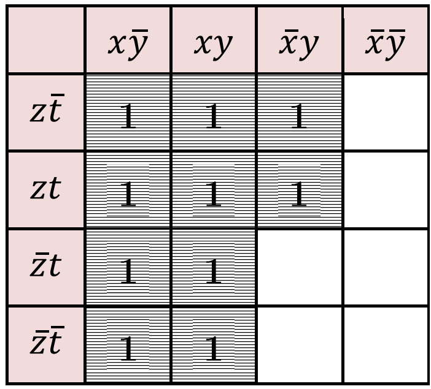

  - **Bước 2:** Xác định tất cả các tế bào lớn của $f$.
  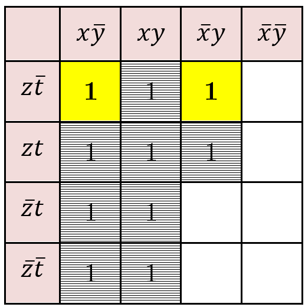

  - **Bước 3:** Chọn tế bào lớn nhất thiết phải chọn: (Vì chúng chứa các các ô không nằm trong tế bào nào khác)

    - Chọn tế bào lớn thứ 1: $\mathbf{x}$
    - Chọn tế bào lớn thứ 2: $\mathbf{yz}$
  - **Bước 4:** Xác định họ phủ của các tế bào lớn: Ta thấy các tế bào chọn ở bước 3 đã phủ hết bảng. **Đây là phủ tối thiểu duy nhất của $\mathbf{Kar(}\boldsymbol{f}\mathbf{)}$: $\mathbf{x \lor yz}$**

  - **Bước 5:** Ứng với phủ tối thiểu duy nhất ở bước 4 ta được duy nhất 1 công thức đa thức tối tiểu của $f$: $\boldsymbol{f}\mathbf{(x, y, z) = x \lor yz}.$

  **Ví dụ 4:** Tìm các công thức đa thức tối thiểu của

  $$
  f(x, y, z, t) = \overline{y}zt \lor \overline{y}\overline{z}\overline{t} \lor y\overline{z}\overline{t} \lor xyzt \lor \overline{x}z\overline{t}
  $$

  - **Bước 1:** Bảng $\text{Kar}(f)$

  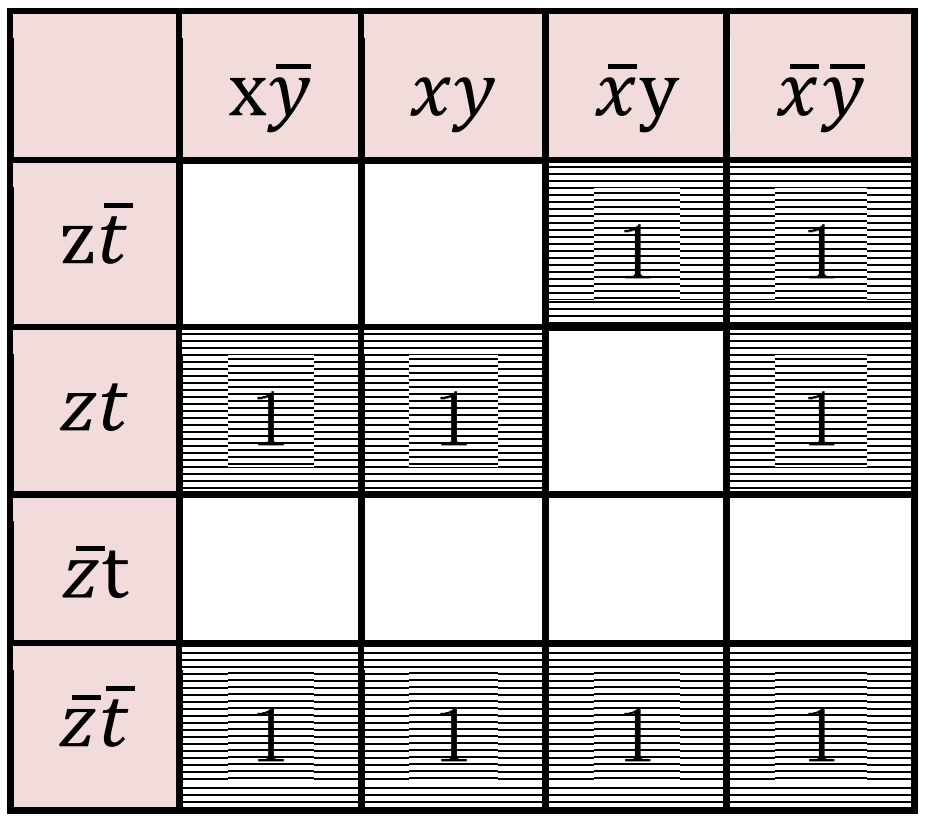

  - **Bước 2:** Xác định các tế bào lớn

  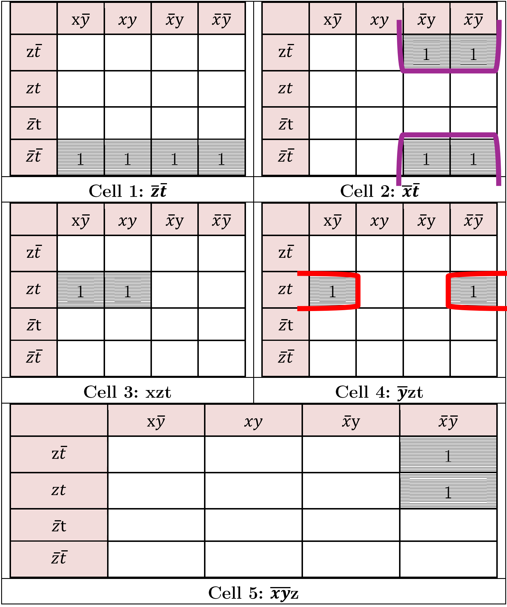
  
  - **Bước 3:** Xác định các tế bào lớn nhất thiết phải chọn:

    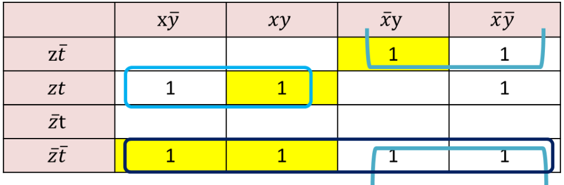

    - Từ các ô chỉ nằm trong 1 tế bào lớn *(minh họa các ô màu vàng)*, ta có các tế bào lớn nhất thiết phải chọn là **cell 1, 2, 3.**

    $$
    \overline{x}\overline{t} \lor xzt \lor \overline{z}\overline{t}
    $$

    - *Sơ đồ phụ:* 

    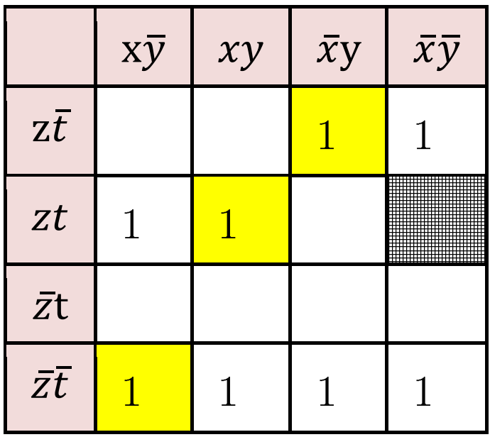

  - **Bước 4:** Xác định họ phủ tối thiểu của các tế bào lớn:

    - Các tế bào lớn: $\overline{zt} \vee$ $\overline{x}\overline{t} \vee$ xzt chưa phủ hết Kar(f).

    - Ta thấy còn **một ô** chưa được phủ và ô đó nằm ở 1 trong 2 tế bào lớn: **cell 4, cell 5.**

    - Ta có 2 cách chọn:

      - Cách chọn thứ 1: $\overline{zt} \vee$ $\overline{x}\overline{t} \vee$ xzt$\  \vee$ $\overline{y}$zt **(cell 4)**

      - Cách chọn thứ 2: $\overline{zt} \vee$ $\overline{x}\overline{t} \vee$ xzt$\  \vee$ $\overline{x}\overline{y}$z **(cell 5)**

  - **Bước 5:** Xác định các công thức đa thức cực tiểu:

  - Ta thấy 2 công thức *đơn giản như nhau* cho nên các công thức đa thức tối thiểu của hàm $f$ là:
    - $f=\overline{zt}\lor\overline{x}\overline{t}\lor xzt\lor\overline{x}\overline{y}z$
    - $f=\overline{zt}\lor\overline{x}\overline{t}\lor xzt\lor\overline{y}zt$.
