Chương V.\
ĐẠI SỐ BOOL VÀ HÀM BOOL
=======================

## 5.1. Đại số bool

### 5.1.1 Đại số bool

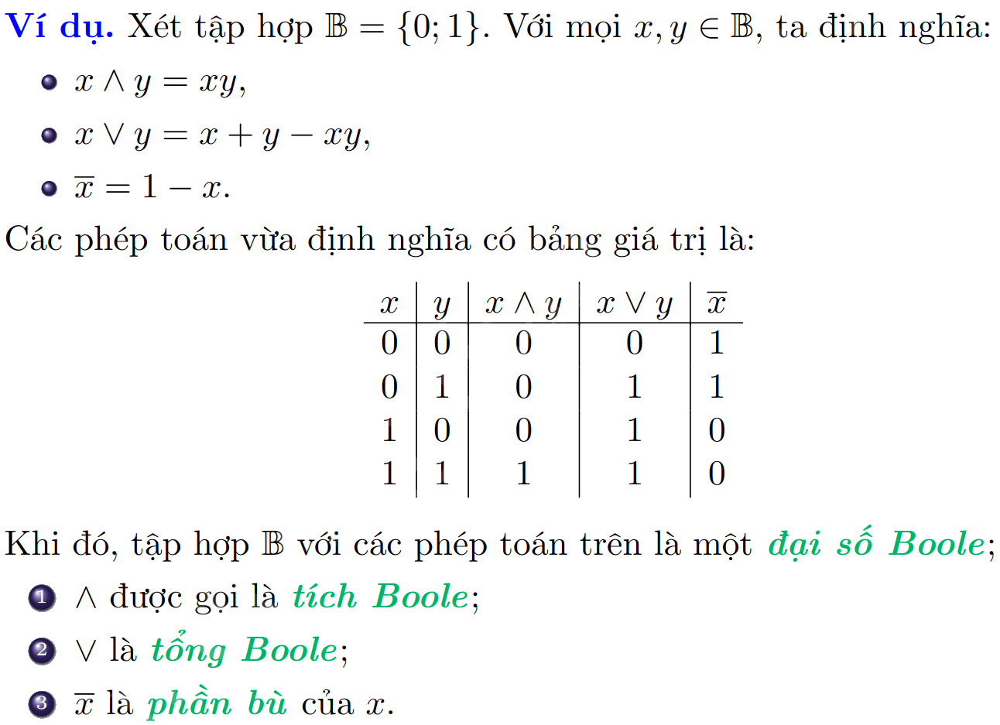

Một đại số Bool còn **thỏa mãn các tính chất: kết hợp, giao hoán, phân bố, phần tử trung hòa, phần tử bù** (Đã đề cập ở chương I).

> **Ví dụ:**
>
> **a/** Cho U là tập bất kỳ, trên A = P(U) (tập các tập con của U)
>
> Xét phép  ∧ là phép ∩, phép ∨ là phép ∪, phép là phép lấy phần bù, phần tử 0 là tập rỗng Ø, còn phần tử 1 là tập U.
>
> Khi đó (P(U), ∩, ∪, , ∅, U) là một đại số Bool.
>
> **b/** Xét F là tập hợp tất cả các dạng mệnh đề theo n biến p<sub>1</sub>, p<sub>2</sub>,…, p<sub>n</sub> với phép toán hội ∧, phép toán tuyển ∨, phép , phần tử 1 là hằng đúng 1, phần tử 0 là hằng sai 0, phần tử bù của dạng mệnh đề E là dạng mệnh đề bù $`\overline{E}`$.
>
> Khi đó F là một đại số Bool.

### 5.1.2. Hàm bool

> 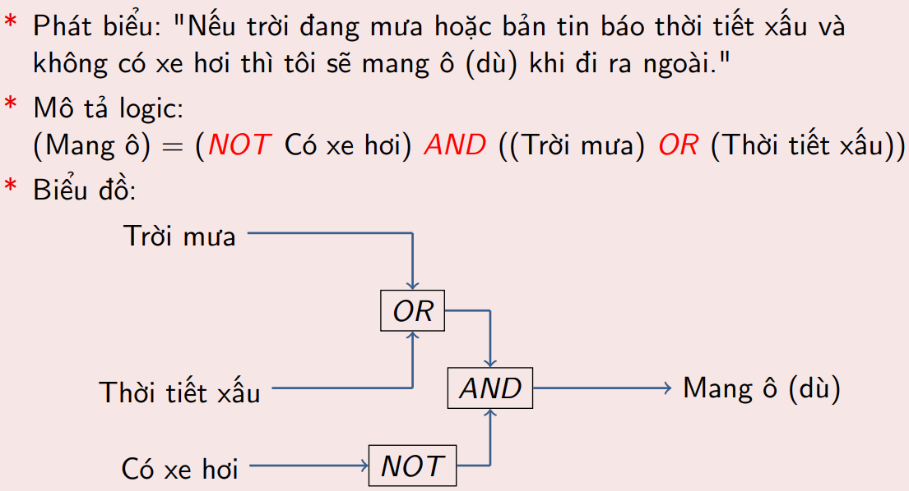
>
> 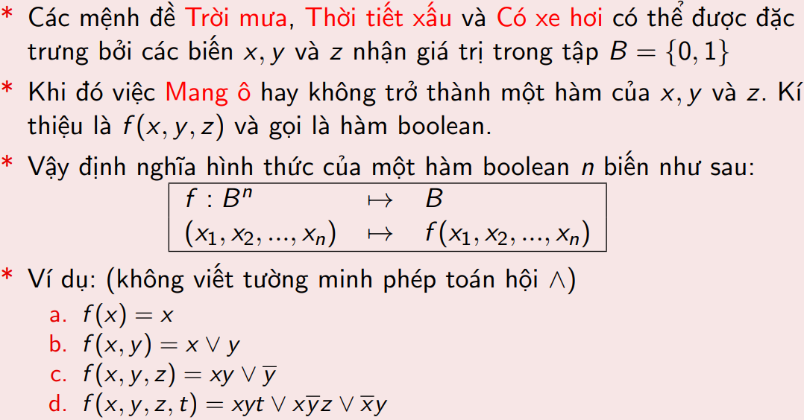
>
> Trong đó mỗi biến trong x<sub>1</sub>, x<sub>2</sub>, . . . , x<sub>n</sub> **chỉ nhận hai giá trị 0, 1** và f nhận giá trị trong\
> **B = {0, 1}.**

Ký hiệu **F<sub>n</sub>** để chỉ **tập các hàm Boole** n biến.

> **Vi dụ:**
>
> 
>
> **e.** 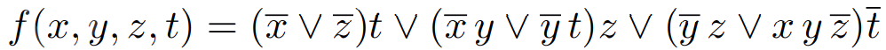là hàm Boole 4 biến.
>
> ***\* Các phép toán trên F<sub>n</sub>:***
>
> **- Phép cộng Bool ∨:**

- Với f, g ∈ F<sub>n</sub> ta định nghĩa tổng Bool của f và g: **f ∨ g = f + g – fg**

- ∀x = (x<sub>1</sub>, x<sub>2</sub>,…, x<sub>n</sub>) ∈ B<sub>n</sub> , (f ∨ g)(x) = f(x) + g(x) – f(x)g(x)

- Dễ thấy f ∨ g ∈ F<sub>n</sub> và **(f** ∨ **g)(x) = max{f(x), g(x)}**

> **- Phép nhân Bool ∧:**

- Với f, g ∈ F<sub>n</sub> ta định nghĩa tích Bool của f và g: **f ∧ g = fg**

- ∀x = (x<sub>1</sub>, x<sub>2</sub>,…,x<sub>n</sub>) ∈ B<sub>n</sub> , (f ∧ g)(x) = f(x)g(x)

- Dễ thấy: f ∧ g ∈ F<sub>n</sub> và **(f ∧ g)(x) = min{f(x), g(x)}**

- Ta thường viết **fg** thay cho **f ∧ g.**

> **- Phép lấy hàm bù:** Với f ∈ F<sub>n</sub> ta định nghĩa hàm bù của f như sau: $`\boxed{\overline{f} = 1 - f}`$

## 5.2. Dạng tuyển chuẩn tắc

<span class="mark">Một số tài liệu khác gọi là **Dạng nối rời chính tắc.**</span>

### 5.2.1. Từ đơn, từ tối tiểu

Xét tập hợp các hàm Boole F<sub>n</sub> theo **n biến** boolean x<sub>1</sub>, x<sub>2</sub>,..., x<sub>n</sub>. Khi đó:

> i\) Mỗi biến Boole x<sub>i</sub> hay $`{\overline{x}}_{i}`$ được gọi là **<u>từ đơn.</u>**
>
> ii\) **<u>Từ tối tiểu</u>** *(Hội sơ cấp/ Đơn thức tối tiểu)* là **tích** **khác 0** của <span class="mark">đúng **n từ đơn.**</span>

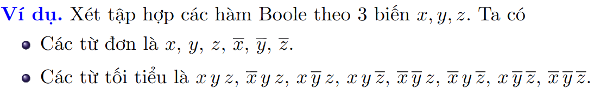

**Nhận xét.** Tập hợp các hàm Boole **n biến** chứa đúng **2n từ đơn và 2<sup>n</sup> từ tối tiểu.**

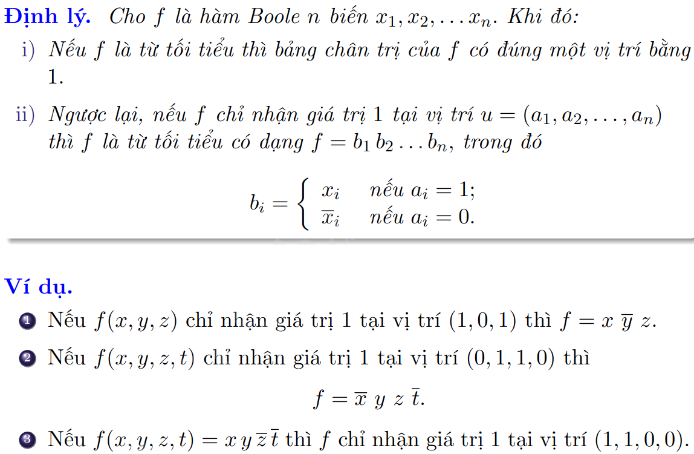

### 5.2.2. Dạng tuyển chuẩn tắc

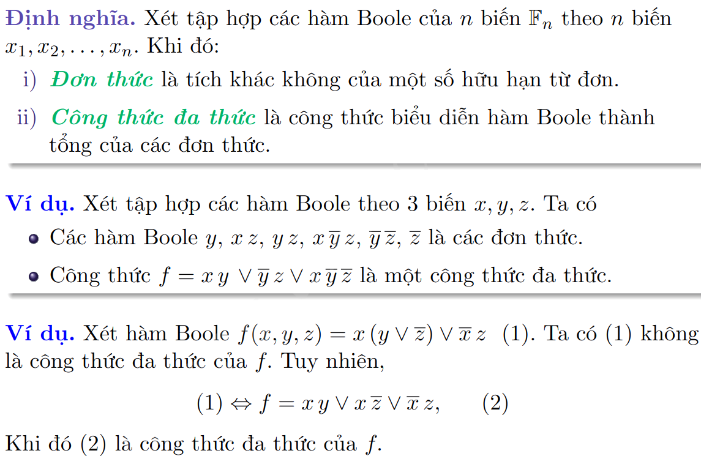

***Nhận xét.*** Mọi hàm Boole đều có thể biểu diễn dưới dạng đa thức.

- Dạng nối rời chính tắc là công thức biểu diễn **hàm Boole** thành **<u>tổng (hội) của các từ tối tiểu.</u>**

  Hay nói cách khác:

> 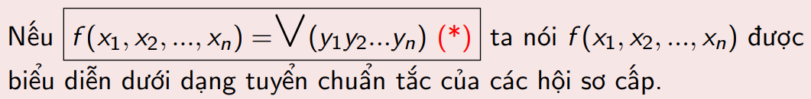
>
> *Trong đó:*
>
> 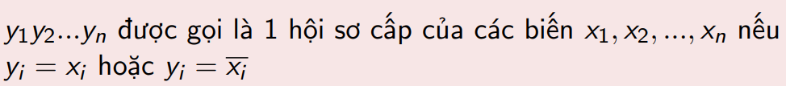
>
> Và hàm bool **chỉ nhận** các từ tối tiểu (**các dòng**) có giá trị **f** **bằng 1** trong bảng chân trị.


**Ví dụ 1: *Dùng bảng chân trị***

> 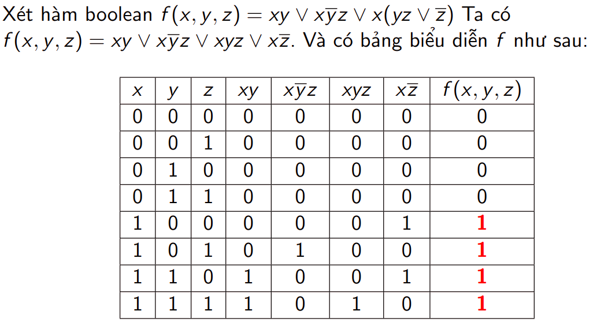
>
> 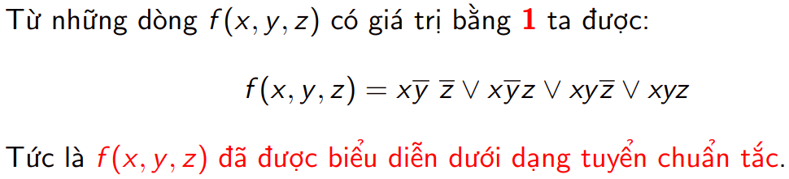

*Hoặc ta có thể dùng cách **bổ sung** các từ đơn còn thiếu vào hàm bool như sau:*

> 
>
> 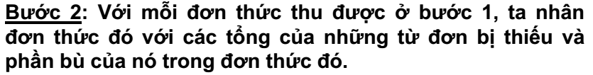
>
> 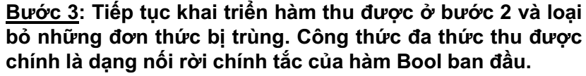

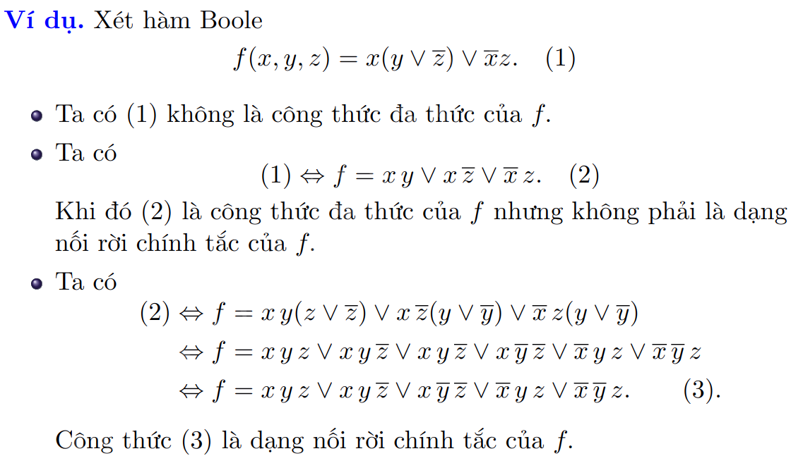

***So sánh với Bảng chân trị của hàm (2):***

| **x** | **y** | **z** | **xy** | $x\overline{z}$ | $\overline{x}z$ | **f(x, y, z)** |
|:-----:|:-----:|:-----:|:------:|:-------------:|:-------------:|:--------------:|
|   0   |   0   |   0   |   0    |       0       |       0       |       0        |
|   0   |   0   |   1   |   0    |       0       |       1       |     **1**      |
|   0   |   1   |   0   |   0    |       0       |       0       |       0        |
|   0   |   1   |   1   |   0    |       0       |       1       |     **1**      |
|   1   |   0   |   0   |   0    |       1       |       0       |     **1**      |
|   1   |   0   |   1   |   0    |       0       |       0       |       0        |
|   1   |   1   |   0   |   1    |       1       |       0       |     **1**      |
|   1   |   1   |   1   |   1    |       0       |       0       |     **1**      |

**Ví dụ 3:**

> 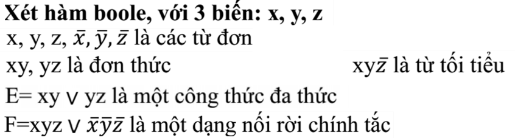

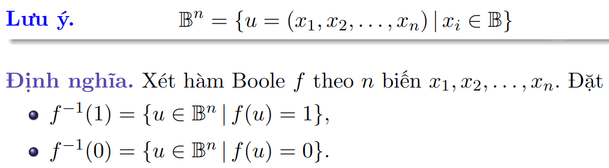

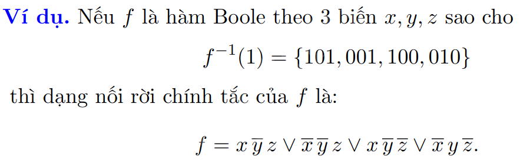

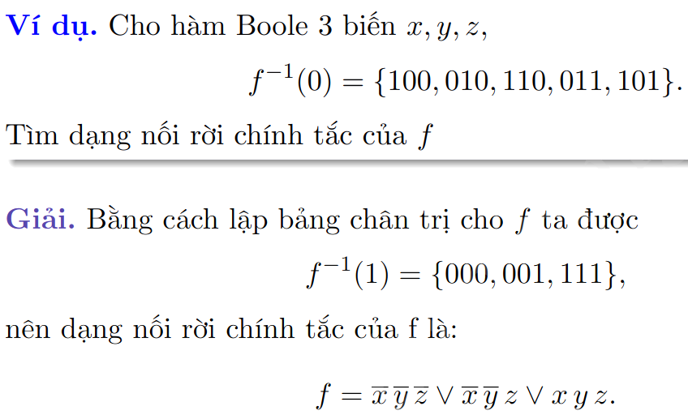

> ***Bài toán:***
>
> \- Cho hàm boolean f bất kỳ, yêu cầu tìm dạng **tuyển chuẩn tắc tối thiểu** *(công thức đa thức tối tiểu)* của nó.
>
> \- Ý nghĩa của bài toán: **f tối thiểu ⇒ <u>Mạch logic tối thiểu</u>**
>
> 🡪 Để tìm, ta sử dụng ***phương pháp Karnaugh*** sau đây.

## 5.3. Phương pháp Karnaugh

> \* Biểu đồ K là một hình chữ nhật, gồm tập hợp các ô, **mỗi ô biểu diễn một hội sơ cấp** của **<u>tất cả</u> các biến**.
>
> \* Nếu hàm boolean có **n biến** thì biểu đồ K có **2<sup>n</sup> ô.**
>
> \* Khi **một ô nằm trong dãy được đánh dấu bởi x thì tại đó x = 1**, bởi $`\overline{x}`$ thì tại đó x = 0, tương tự cho y, z, t…
>
> **Ví dụ:**
>
> ***Biểu đồ K trường hợp 3 biến.***

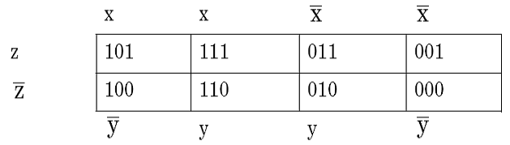

***Biểu đồ K trường hợp 4 biến.***

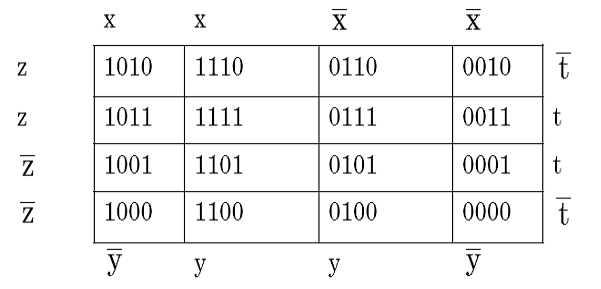

> **\* Gạch chéo (hoặc tô đen)** những ô mà **f nhận giá trị 1.** Khi đó ta được một biểu đồ, gọi là biểu đồ Karnaugh của f, ký hiệu bởi **kar(f)**, hoặc đơn giản ký hiệu là **K**.

Hai ô được gọi là **kề nhau** (theo nghĩa rộng), nếu chúng là **hai ô liền nhau** <span class="mark">hoặc **chúng là ô đầu, ô cuối** của ***cùng một hàng (cột)***</span> nào đó. Nhận xét rằng, do cách đánh dấu như trên, **hai ô kề nhau chỉ lệch nhau ở một <u>bit</u> duy nhất.**

<span class="mark">Các biến bool x, y, (z, t…) được sắp xếp tại các cạnh theo thứ tự *Trên, Dưới, Trái, Phải và đặt xen kẽ biến và bù của biến như các hình ví dụ.*</span>

*<span class="mark">Thứ tự đọc của một hội sơ cấp thuộc một ô cũng theo thứ tự Trên, Dưới, Trái, Phải.</span>*

**Ví dụ:**

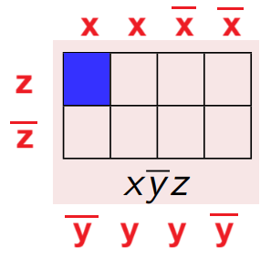 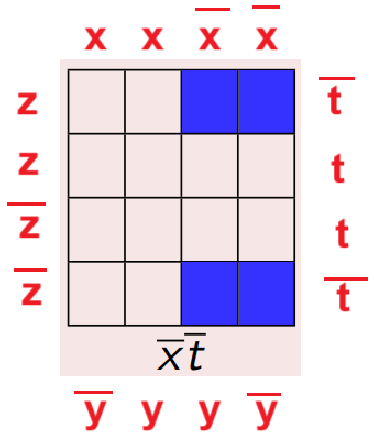

$`\underbrace{\overline{x} \land \overline{x}}_{\overline{x}} \land \underbrace{y \land \overline{y}}_{1} \land \underbrace{z \land \overline{z}}_{1} \land \underbrace{\overline{t} \land \overline{t}}_{\overline{t}}`$
``` math
= \overline{x} \land \overline{t} = \overline{x}\overline{t}
```

Trong đại số Boolean, nếu **một biến được nhân (hội) với chính nó** (bao gồm cả bù của nó), kết quả sẽ luôn **<u>bằng chính biến đó:</u> *x ⋅ x = x;*** $`\overline{x} \cdot \overline{x} = \overline{x}`$

| 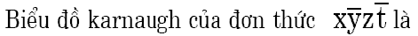 | 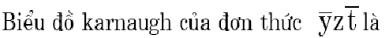 |
|:--:|:--:|
| 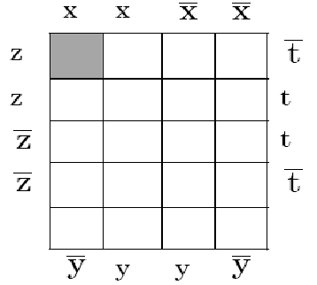 | 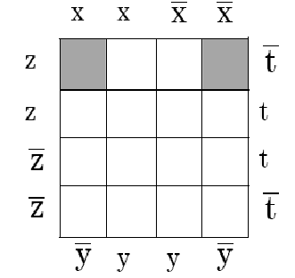 |

| 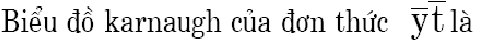 | 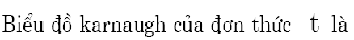 |
|:--:|:--:|
| 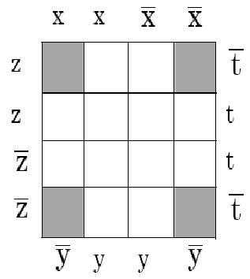 | 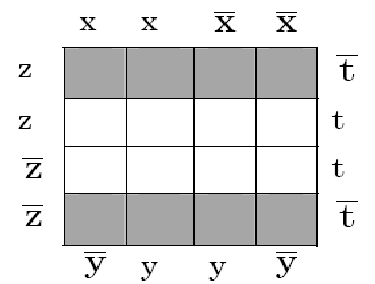 |

> 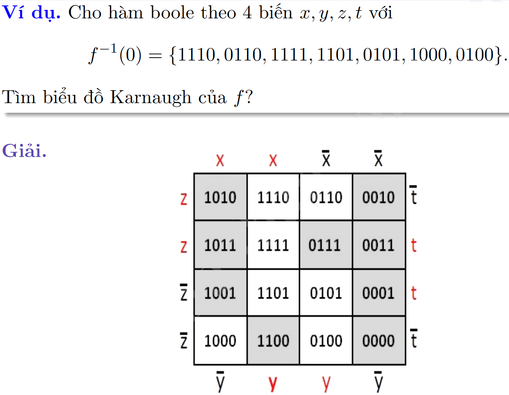

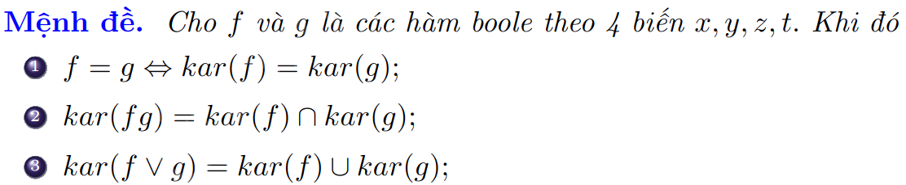

> 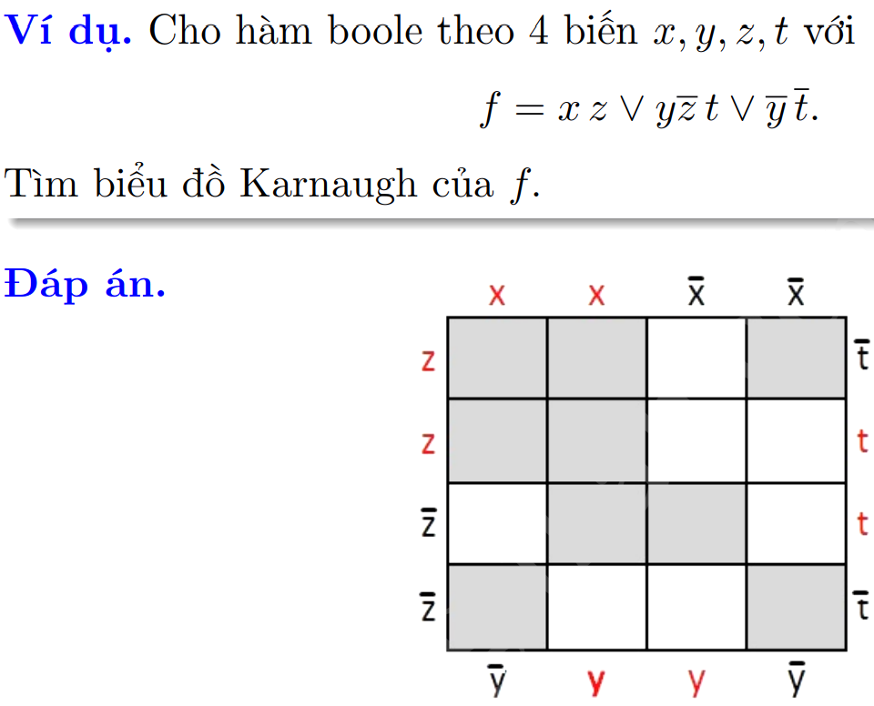
>
> \+ **Tế bào** là *các ô của biểu đồ Karnaugh phủ (vừa đúng) 1 hội sơ cấp.*
>
> \+ Giả sử hàm f có biểu đồ tương ứng là K.

- **Tế bào tối đại** là ***tế bào lớn nhất** chỉ **phủ các ô thuộc K**.*

  *Thoả hai tính chất sau:*

> a\) T là một tế bào và T ⊆ kar(f).
>
> b\) Không tồn tại tế bào T’ nào thỏa T’ ≠ **T** và **T ⊆ T’ ⊆ kar(f).**

- **<span class="mark">Tế bào càng lớn ⇒ Số biến càng ít ⇒ Mạch càng ít phức tạp.</span>**

> **<u>Các bước xác định công thức tối tiểu của hàm Bool f:</u>**
>
> **- Bước 1.** Biểu diễn f bằng sơ đồ Karnaugh.
>
> **- Bước 2.** Xác định tất cả các **Cell lớn (tế bào tối đại)** theo thứ tự **số ô trong hình chữ nhật giảm dần** (từ 2<sup>n</sup>, ***giảm dần n** (…2<sup>3</sup>, 2<sup>2</sup>, 2<sup>1</sup>, 2<sup>0</sup>)**,*** đến 1 ô), sao cho ***Cell (tế bào) vừa xác định*** *<u>không bị chứa trong bất kỳ Cell nào được xác định trước đó.</u>*
>
> **- Bước 3.** Trong sơ đồ Karnaugh, nếu <span class="mark">tồn tại</span> **<u>ô chỉ nằm trong duy nhất một Cell lớn</u>** thì **tô Cell lớn này vào sơ đồ phụ *(gọi là tế bào bắt buộc)*.** Lặp lại bước 3 cho đến khi không còn Cell lớn nào có tính chất trên.
>
> **- Bước 4.** Nếu **sơ đồ phụ** giống với sơ đồ Karnaugh thì sang **Bước 5.** Nếu không, trong số các Cell lớn còn lại, **chọn ra Cell lớn chứa nhiều ô chưa được tô đen nhất.** Tiếp tục chọn cho đến khi sơ đồ phụ giống sơ đồ Karnaugh.
>
> **- Bước 5.** Vì Bước 4 có thể có nhiều sự lựa chọn để tô các Cell lớn vào sơ đồ phụ nên f thường có nhiều hơn một công thức. **Loại trừ các công thức không tối tiểu của f, ta nhận được công thức tối tiểu của f.**

**<u>Ví dụ 1:</u>**

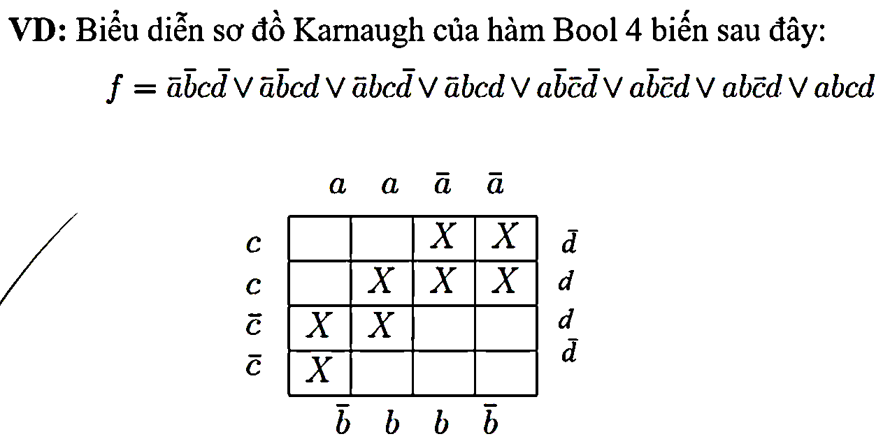

**\**

**Bước 1 & 2:**

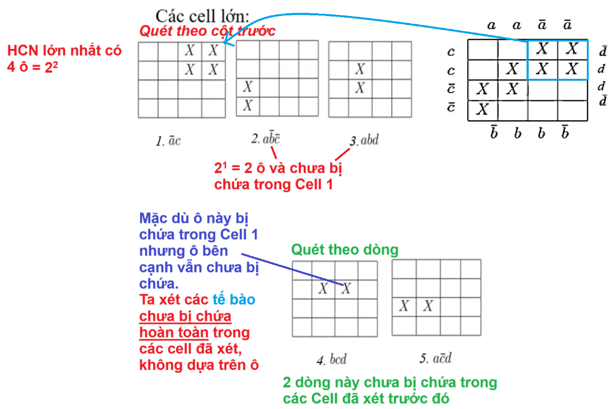

**Bước 3:**

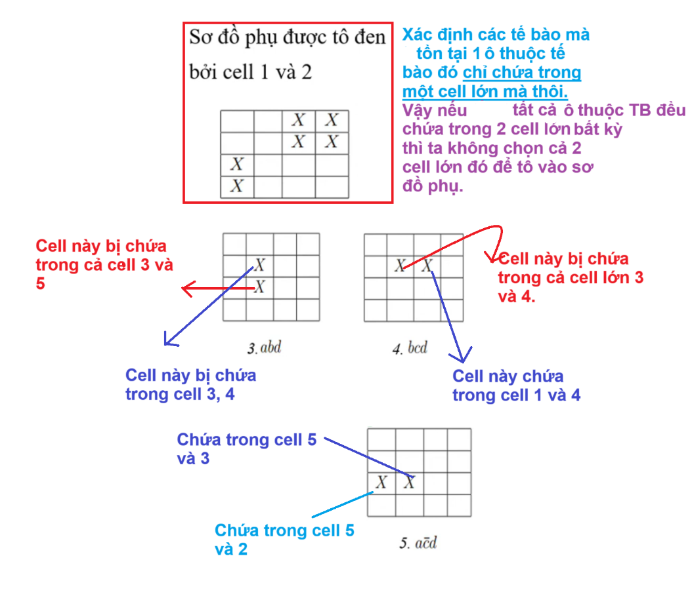

> **Bước 4:** Do sơ đồ phụ chưa giống với biểu đồ Karnaugh ban đầu, ta ưu tiên chọn một tế bào tối đại bị loại trong bước 3 mà phủ lớn nhất để tô vào sơ đồ phụ. Tuy nhiên, nếu các tế bào còn lại cũng phủ được thì ta vẫn chọn, từ đó ta có nhiều dạng tuyển chuẩn tắc của f.
>
> 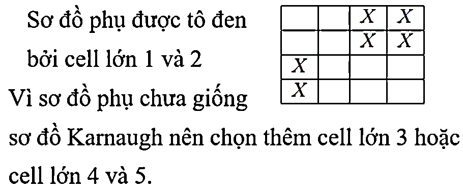

**Bước 5:** Các dạng tuyển chuẩn tắc là:

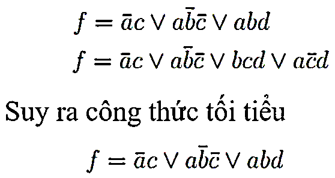

Suy ra dạng TCTTT là: 

**<u>Ví dụ 2:</u>** phương pháp Karnaugh với 3 biến:

> 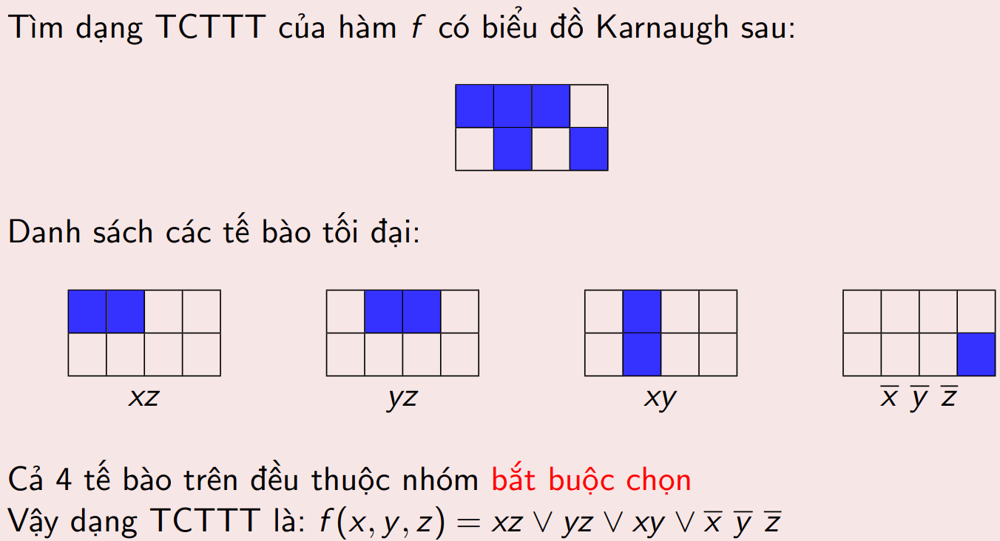

**<u>Ví dụ 3</u>**: Tìm các công thức đa thức tối tiểu của hàm $`f`$:

$f(x,y,z,t)=xyzt\lor x\overline{y}\lor x\overline{z}\lor yz\lor xy\overline{z}\lor xy\overline{t}$

> **Bước 1:** Bảng Kar($`f`$)

|  | $x\overline{y}$ | $xy$ | $\overline{x}y$ | $\overline{x}\overline{y}$ |
|:--:|:--:|:--:|:--:|:--:|
| $z\overline{t}$ |  |  | 1 | 1 |
| $zt$ | 1 | 1 |  | 1 |
| $\overline{z}t$ |  |  |  |  |
| $\overline{z}\overline{t}$ | 1 | 1 | 1 | 1 |

**Bước 2:** Xác định các tế bào lớn

<table style="width:66%;">
<colgroup>
<col style="width: 33%" />
<col style="width: 33%" />
</colgroup>
<thead>
<tr>
<th style="text-align: center;"><table style="width:31%;">
<colgroup>
<col style="width: 6%" />
<col style="width: 6%" />
<col style="width: 6%" />
<col style="width: 6%" />
<col style="width: 6%" />
</colgroup>
<thead>
<tr>
<th></th>
<th style="text-align: center;"><math display="block" xmlns="http://www.w3.org/1998/Math/MathML"><semantics><mrow><mi>x</mi><mover><mi>y</mi><mo accent="true">¯</mo></mover></mrow><annotation encoding="application/x-tex">x\overline{y}</annotation></semantics></math></th>
<th style="text-align: center;"><math display="block" xmlns="http://www.w3.org/1998/Math/MathML"><semantics><mrow><mi>x</mi><mi>y</mi></mrow><annotation encoding="application/x-tex">xy</annotation></semantics></math></th>
<th style="text-align: center;"><math display="block" xmlns="http://www.w3.org/1998/Math/MathML"><semantics><mrow><mover><mi>x</mi><mo accent="true">¯</mo></mover><mi>y</mi></mrow><annotation encoding="application/x-tex">\overline{x}y</annotation></semantics></math></th>
<th style="text-align: center;"><math display="block" xmlns="http://www.w3.org/1998/Math/MathML"><semantics><mrow><mover><mi>x</mi><mo accent="true">¯</mo></mover><mover><mi>y</mi><mo accent="true">¯</mo></mover></mrow><annotation encoding="application/x-tex">\overline{x}\overline{y}</annotation></semantics></math></th>
</tr>
</thead>
<tbody>
<tr>
<td><math display="block" xmlns="http://www.w3.org/1998/Math/MathML"><semantics><mrow><mi>z</mi><mover><mi>t</mi><mo accent="true">¯</mo></mover></mrow><annotation encoding="application/x-tex">z\overline{t}</annotation></semantics></math></td>
<td style="text-align: center;"></td>
<td style="text-align: center;"></td>
<td style="text-align: center;"></td>
<td style="text-align: center;"></td>
</tr>
<tr>
<td><math display="block" xmlns="http://www.w3.org/1998/Math/MathML"><semantics><mrow><mi>z</mi><mi>t</mi></mrow><annotation encoding="application/x-tex">zt</annotation></semantics></math></td>
<td style="text-align: center;"></td>
<td style="text-align: center;"></td>
<td style="text-align: center;"></td>
<td style="text-align: center;"></td>
</tr>
<tr>
<td><math display="block" xmlns="http://www.w3.org/1998/Math/MathML"><semantics><mrow><mover><mi>z</mi><mo accent="true">¯</mo></mover><mi>t</mi></mrow><annotation encoding="application/x-tex">\overline{z}t</annotation></semantics></math></td>
<td style="text-align: center;"></td>
<td style="text-align: center;"></td>
<td style="text-align: center;"></td>
<td style="text-align: center;"></td>
</tr>
<tr>
<td><math display="block" xmlns="http://www.w3.org/1998/Math/MathML"><semantics><mrow><mover><mi>z</mi><mo accent="true">¯</mo></mover><mover><mi>t</mi><mo accent="true">¯</mo></mover></mrow><annotation encoding="application/x-tex">\overline{z}\overline{t}</annotation></semantics></math></td>
<td style="text-align: center;">1</td>
<td style="text-align: center;">1</td>
<td style="text-align: center;">1</td>
<td style="text-align: center;">1</td>
</tr>
</tbody>
</table></th>
<th style="text-align: center;"><table style="width:31%;">
<colgroup>
<col style="width: 6%" />
<col style="width: 6%" />
<col style="width: 6%" />
<col style="width: 6%" />
<col style="width: 6%" />
</colgroup>
<thead>
<tr>
<th></th>
<th style="text-align: center;"><math display="block" xmlns="http://www.w3.org/1998/Math/MathML"><semantics><mrow><mi>x</mi><mover><mi>y</mi><mo accent="true">¯</mo></mover></mrow><annotation encoding="application/x-tex">x\overline{y}</annotation></semantics></math></th>
<th style="text-align: center;"><math display="block" xmlns="http://www.w3.org/1998/Math/MathML"><semantics><mrow><mi>x</mi><mi>y</mi></mrow><annotation encoding="application/x-tex">xy</annotation></semantics></math></th>
<th style="text-align: center;"><math display="block" xmlns="http://www.w3.org/1998/Math/MathML"><semantics><mrow><mover><mi>x</mi><mo accent="true">¯</mo></mover><mi>y</mi></mrow><annotation encoding="application/x-tex">\overline{x}y</annotation></semantics></math></th>
<th style="text-align: center;"><math display="block" xmlns="http://www.w3.org/1998/Math/MathML"><semantics><mrow><mover><mi>x</mi><mo accent="true">¯</mo></mover><mover><mi>y</mi><mo accent="true">¯</mo></mover></mrow><annotation encoding="application/x-tex">\overline{x}\overline{y}</annotation></semantics></math></th>
</tr>
</thead>
<tbody>
<tr>
<td><math display="block" xmlns="http://www.w3.org/1998/Math/MathML"><semantics><mrow><mi>z</mi><mover><mi>t</mi><mo accent="true">¯</mo></mover></mrow><annotation encoding="application/x-tex">z\overline{t}</annotation></semantics></math></td>
<td style="text-align: center;"></td>
<td style="text-align: center;"></td>
<td style="text-align: center;">1</td>
<td style="text-align: center;">1</td>
</tr>
<tr>
<td><math display="block" xmlns="http://www.w3.org/1998/Math/MathML"><semantics><mrow><mi>z</mi><mi>t</mi></mrow><annotation encoding="application/x-tex">zt</annotation></semantics></math></td>
<td style="text-align: center;"></td>
<td style="text-align: center;"></td>
<td style="text-align: center;"></td>
<td style="text-align: center;"></td>
</tr>
<tr>
<td><math display="block" xmlns="http://www.w3.org/1998/Math/MathML"><semantics><mrow><mover><mi>z</mi><mo accent="true">¯</mo></mover><mi>t</mi></mrow><annotation encoding="application/x-tex">\overline{z}t</annotation></semantics></math></td>
<td style="text-align: center;"></td>
<td style="text-align: center;"></td>
<td style="text-align: center;"></td>
<td style="text-align: center;"></td>
</tr>
<tr>
<td><math display="block" xmlns="http://www.w3.org/1998/Math/MathML"><semantics><mrow><mover><mi>z</mi><mo accent="true">¯</mo></mover><mover><mi>t</mi><mo accent="true">¯</mo></mover></mrow><annotation encoding="application/x-tex">\overline{z}\overline{t}</annotation></semantics></math></td>
<td style="text-align: center;"></td>
<td style="text-align: center;"></td>
<td style="text-align: center;">1</td>
<td style="text-align: center;">1</td>
</tr>
</tbody>
</table></th>
</tr>
</thead>
<tbody>
<tr>
<td style="text-align: center;"><p><strong>Cell 1:</strong> <math display="inline" xmlns="http://www.w3.org/1998/Math/MathML"><semantics><mrow><mover><mi mathvariant="bold-italic">𝒛</mi><mo accent="true">¯</mo></mover><mover><mi mathvariant="bold-italic">𝒕</mi><mo accent="true">¯</mo></mover></mrow><annotation encoding="application/x-tex">\overline{\mathbf{z}}\overline{\mathbf{t}}</annotation></semantics></math></p></td>
<td style="text-align: center;"><p><strong>Cell 2:</strong> <math display="inline" xmlns="http://www.w3.org/1998/Math/MathML"><semantics><mrow><mover><mi mathvariant="bold-italic">𝒙</mi><mo accent="true">¯</mo></mover><mover><mi mathvariant="bold-italic">𝒕</mi><mo accent="true">¯</mo></mover></mrow><annotation encoding="application/x-tex">\overline{\mathbf{x}}\overline{\mathbf{t}}</annotation></semantics></math></p></td>
</tr>
<tr>
<td style="text-align: center;"><table style="width:31%;">
<colgroup>
<col style="width: 6%" />
<col style="width: 6%" />
<col style="width: 6%" />
<col style="width: 6%" />
<col style="width: 6%" />
</colgroup>
<thead>
<tr>
<th></th>
<th style="text-align: center;"><math display="block" xmlns="http://www.w3.org/1998/Math/MathML"><semantics><mrow><mi>x</mi><mover><mi>y</mi><mo accent="true">¯</mo></mover></mrow><annotation encoding="application/x-tex">x\overline{y}</annotation></semantics></math></th>
<th style="text-align: center;"><math display="block" xmlns="http://www.w3.org/1998/Math/MathML"><semantics><mrow><mi>x</mi><mi>y</mi></mrow><annotation encoding="application/x-tex">xy</annotation></semantics></math></th>
<th style="text-align: center;"><math display="block" xmlns="http://www.w3.org/1998/Math/MathML"><semantics><mrow><mover><mi>x</mi><mo accent="true">¯</mo></mover><mi>y</mi></mrow><annotation encoding="application/x-tex">\overline{x}y</annotation></semantics></math></th>
<th style="text-align: center;"><math display="block" xmlns="http://www.w3.org/1998/Math/MathML"><semantics><mrow><mover><mi>x</mi><mo accent="true">¯</mo></mover><mover><mi>y</mi><mo accent="true">¯</mo></mover></mrow><annotation encoding="application/x-tex">\overline{x}\overline{y}</annotation></semantics></math></th>
</tr>
</thead>
<tbody>
<tr>
<td><math display="block" xmlns="http://www.w3.org/1998/Math/MathML"><semantics><mrow><mi>z</mi><mover><mi>t</mi><mo accent="true">¯</mo></mover></mrow><annotation encoding="application/x-tex">z\overline{t}</annotation></semantics></math></td>
<td style="text-align: center;"></td>
<td style="text-align: center;"></td>
<td style="text-align: center;"></td>
<td style="text-align: center;"></td>
</tr>
<tr>
<td><math display="block" xmlns="http://www.w3.org/1998/Math/MathML"><semantics><mrow><mi>z</mi><mi>t</mi></mrow><annotation encoding="application/x-tex">zt</annotation></semantics></math></td>
<td style="text-align: center;">1</td>
<td style="text-align: center;">1</td>
<td style="text-align: center;"></td>
<td style="text-align: center;"></td>
</tr>
<tr>
<td><math display="block" xmlns="http://www.w3.org/1998/Math/MathML"><semantics><mrow><mover><mi>z</mi><mo accent="true">¯</mo></mover><mi>t</mi></mrow><annotation encoding="application/x-tex">\overline{z}t</annotation></semantics></math></td>
<td style="text-align: center;"></td>
<td style="text-align: center;"></td>
<td style="text-align: center;"></td>
<td style="text-align: center;"></td>
</tr>
<tr>
<td><math display="block" xmlns="http://www.w3.org/1998/Math/MathML"><semantics><mrow><mover><mi>z</mi><mo accent="true">¯</mo></mover><mover><mi>t</mi><mo accent="true">¯</mo></mover></mrow><annotation encoding="application/x-tex">\overline{z}\overline{t}</annotation></semantics></math></td>
<td style="text-align: center;"></td>
<td style="text-align: center;"></td>
<td style="text-align: center;"></td>
<td style="text-align: center;"></td>
</tr>
</tbody>
</table></td>
<td style="text-align: center;"><table style="width:31%;">
<colgroup>
<col style="width: 6%" />
<col style="width: 6%" />
<col style="width: 6%" />
<col style="width: 6%" />
<col style="width: 6%" />
</colgroup>
<thead>
<tr>
<th></th>
<th style="text-align: center;"><math display="block" xmlns="http://www.w3.org/1998/Math/MathML"><semantics><mrow><mi>x</mi><mover><mi>y</mi><mo accent="true">¯</mo></mover></mrow><annotation encoding="application/x-tex">x\overline{y}</annotation></semantics></math></th>
<th style="text-align: center;"><math display="block" xmlns="http://www.w3.org/1998/Math/MathML"><semantics><mrow><mi>x</mi><mi>y</mi></mrow><annotation encoding="application/x-tex">xy</annotation></semantics></math></th>
<th style="text-align: center;"><math display="block" xmlns="http://www.w3.org/1998/Math/MathML"><semantics><mrow><mover><mi>x</mi><mo accent="true">¯</mo></mover><mi>y</mi></mrow><annotation encoding="application/x-tex">\overline{x}y</annotation></semantics></math></th>
<th style="text-align: center;"><math display="block" xmlns="http://www.w3.org/1998/Math/MathML"><semantics><mrow><mover><mi>x</mi><mo accent="true">¯</mo></mover><mover><mi>y</mi><mo accent="true">¯</mo></mover></mrow><annotation encoding="application/x-tex">\overline{x}\overline{y}</annotation></semantics></math></th>
</tr>
</thead>
<tbody>
<tr>
<td><math display="block" xmlns="http://www.w3.org/1998/Math/MathML"><semantics><mrow><mi>z</mi><mover><mi>t</mi><mo accent="true">¯</mo></mover></mrow><annotation encoding="application/x-tex">z\overline{t}</annotation></semantics></math></td>
<td style="text-align: center;"></td>
<td style="text-align: center;"></td>
<td style="text-align: center;"></td>
<td style="text-align: center;"></td>
</tr>
<tr>
<td><math display="block" xmlns="http://www.w3.org/1998/Math/MathML"><semantics><mrow><mi>z</mi><mi>t</mi></mrow><annotation encoding="application/x-tex">zt</annotation></semantics></math></td>
<td style="text-align: center;"></td>
<td style="text-align: center;"></td>
<td style="text-align: center;"></td>
<td style="text-align: center;">1</td>
</tr>
<tr>
<td><math display="block" xmlns="http://www.w3.org/1998/Math/MathML"><semantics><mrow><mover><mi>z</mi><mo accent="true">¯</mo></mover><mi>t</mi></mrow><annotation encoding="application/x-tex">\overline{z}t</annotation></semantics></math></td>
<td style="text-align: center;"></td>
<td style="text-align: center;"></td>
<td style="text-align: center;"></td>
<td style="text-align: center;"></td>
</tr>
<tr>
<td><math display="block" xmlns="http://www.w3.org/1998/Math/MathML"><semantics><mrow><mover><mi>z</mi><mo accent="true">¯</mo></mover><mover><mi>t</mi><mo accent="true">¯</mo></mover></mrow><annotation encoding="application/x-tex">\overline{z}\overline{t}</annotation></semantics></math></td>
<td style="text-align: center;"></td>
<td style="text-align: center;"></td>
<td style="text-align: center;"></td>
<td style="text-align: center;"></td>
</tr>
</tbody>
</table></td>
</tr>
<tr>
<td style="text-align: center;"><p><strong>Cell 3: xzt</strong></p></td>
<td style="text-align: center;"><p><strong>Cell 4:</strong> <math display="inline" xmlns="http://www.w3.org/1998/Math/MathML"><semantics><mover><mi mathvariant="bold-italic">𝒚</mi><mo accent="true">¯</mo></mover><annotation encoding="application/x-tex">\overline{\mathbf{y}}</annotation></semantics></math><strong>zt</strong></p></td>
</tr>
<tr>
<td colspan="2" style="text-align: center;"><table style="width:64%;">
<colgroup>
<col style="width: 12%" />
<col style="width: 12%" />
<col style="width: 12%" />
<col style="width: 12%" />
<col style="width: 12%" />
</colgroup>
<thead>
<tr>
<th></th>
<th style="text-align: center;"><math display="block" xmlns="http://www.w3.org/1998/Math/MathML"><semantics><mrow><mi>x</mi><mover><mi>y</mi><mo accent="true">¯</mo></mover></mrow><annotation encoding="application/x-tex">x\overline{y}</annotation></semantics></math></th>
<th style="text-align: center;"><math display="block" xmlns="http://www.w3.org/1998/Math/MathML"><semantics><mrow><mi>x</mi><mi>y</mi></mrow><annotation encoding="application/x-tex">xy</annotation></semantics></math></th>
<th style="text-align: center;"><math display="block" xmlns="http://www.w3.org/1998/Math/MathML"><semantics><mrow><mover><mi>x</mi><mo accent="true">¯</mo></mover><mi>y</mi></mrow><annotation encoding="application/x-tex">\overline{x}y</annotation></semantics></math></th>
<th style="text-align: center;"><math display="block" xmlns="http://www.w3.org/1998/Math/MathML"><semantics><mrow><mover><mi>x</mi><mo accent="true">¯</mo></mover><mover><mi>y</mi><mo accent="true">¯</mo></mover></mrow><annotation encoding="application/x-tex">\overline{x}\overline{y}</annotation></semantics></math></th>
</tr>
</thead>
<tbody>
<tr>
<td><math display="block" xmlns="http://www.w3.org/1998/Math/MathML"><semantics><mrow><mi>z</mi><mover><mi>t</mi><mo accent="true">¯</mo></mover></mrow><annotation encoding="application/x-tex">z\overline{t}</annotation></semantics></math></td>
<td style="text-align: center;"></td>
<td style="text-align: center;"></td>
<td style="text-align: center;"></td>
<td style="text-align: center;">1</td>
</tr>
<tr>
<td><math display="block" xmlns="http://www.w3.org/1998/Math/MathML"><semantics><mrow><mi>z</mi><mi>t</mi></mrow><annotation encoding="application/x-tex">zt</annotation></semantics></math></td>
<td style="text-align: center;"></td>
<td style="text-align: center;"></td>
<td style="text-align: center;"></td>
<td style="text-align: center;">1</td>
</tr>
<tr>
<td><math display="block" xmlns="http://www.w3.org/1998/Math/MathML"><semantics><mrow><mover><mi>z</mi><mo accent="true">¯</mo></mover><mi>t</mi></mrow><annotation encoding="application/x-tex">\overline{z}t</annotation></semantics></math></td>
<td style="text-align: center;"></td>
<td style="text-align: center;"></td>
<td style="text-align: center;"></td>
<td style="text-align: center;"></td>
</tr>
<tr>
<td><math display="block" xmlns="http://www.w3.org/1998/Math/MathML"><semantics><mrow><mover><mi>z</mi><mo accent="true">¯</mo></mover><mover><mi>t</mi><mo accent="true">¯</mo></mover></mrow><annotation encoding="application/x-tex">\overline{z}\overline{t}</annotation></semantics></math></td>
<td style="text-align: center;"></td>
<td style="text-align: center;"></td>
<td style="text-align: center;"></td>
<td style="text-align: center;"></td>
</tr>
</tbody>
</table></td>
</tr>
<tr>
<td colspan="2" style="text-align: center;"><p><strong>Cell 5:</strong> <math display="inline" xmlns="http://www.w3.org/1998/Math/MathML"><semantics><mrow><mover><mi mathvariant="bold-italic">𝒙</mi><mo accent="true">¯</mo></mover><mover><mi mathvariant="bold-italic">𝒚</mi><mo accent="true">¯</mo></mover></mrow><annotation encoding="application/x-tex">\overline{\mathbf{x}}\overline{\mathbf{y}}</annotation></semantics></math><strong>z</strong></p></td>
</tr>
</tbody>
</table>

**Bước 3:** Xác định các tế bào lớn nhất thiết phải chọn:

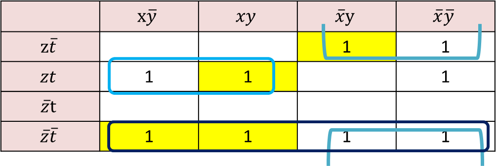

Từ các ô chỉ nằm trong 1 tế bào lớn *(minh họa các ô màu vàng)*, ta có các tế bào lớn nhất thiết phải chọn là **cell 1, 2, 3.**

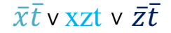

*Sơ đồ phụ:*

|  | $x\overline{y}$ | $xy$ | $\overline{x}y$ | $\overline{x}\overline{y}$ |
|:--:|:--:|:--:|:--:|:--:|
| $z\overline{t}$ |  |  | 1 | 1 |
| $zt$ | 1 | 1 |  |  |
| $\overline{z}t$ |  |  |  |  |
| $\overline{z}\overline{t}$ | 1 | 1 | 1 | 1 |

> **Bước 4:** Xác định họ phủ tối thiểu của các tế bào lớn:

- Các tế bào lớn: $`\overline{zt} \vee`$ $`\overline{x}\overline{t} \vee`$ xzt chưa phủ hết Kar(f).

- Ta thấy còn **một ô** chưa được phủ và ô đó nằm ở 1 trong 2 tế bào lớn: **cell 4, cell 5.**

- Ta có 2 cách chọn:

  - Cách chọn thứ 1: $`\overline{zt} \vee`$ $`\overline{x}\overline{t} \vee`$ xzt$`\  \vee`$ $`\overline{y}`$zt **(cell 4)**

  - Cách chọn thứ 2: $`\overline{zt} \vee`$ $`\overline{x}\overline{t} \vee`$ xzt$`\  \vee`$ $`\overline{x}\overline{y}`$z **(cell 5)**

> **Bước 5:** Xác định các công thức đa thức cực tiểu:
>
> Ta thấy 2 công thức *đơn giản như nhau* cho nên các công thức đa thức tối thiểu của hàm $`f`$ là:
>
> $f=\overline{zt}\lor\overline{x}\overline{t}\lor xzt\lor\overline{x}\overline{y}z$
>
> và
>
> $f=\overline{zt}\lor\overline{x}\overline{t}\lor xzt\lor\overline{y}zt$.

## 5.4. Mạch logic (Mạng logic)

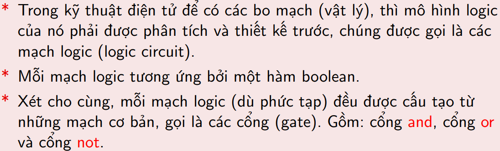

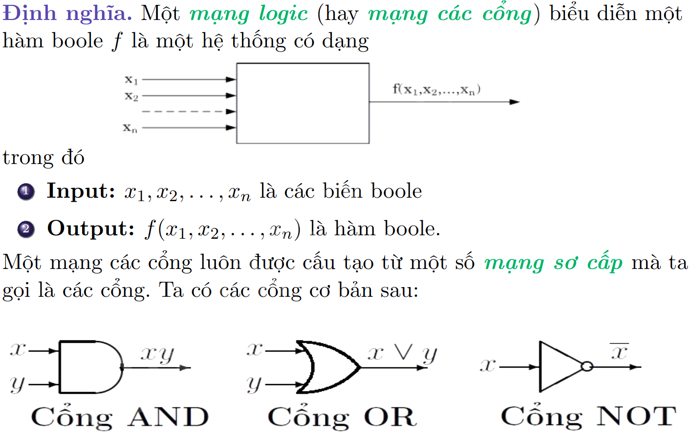


<figcaption><p><em>(Đảo điện)</em></p></figcaption>

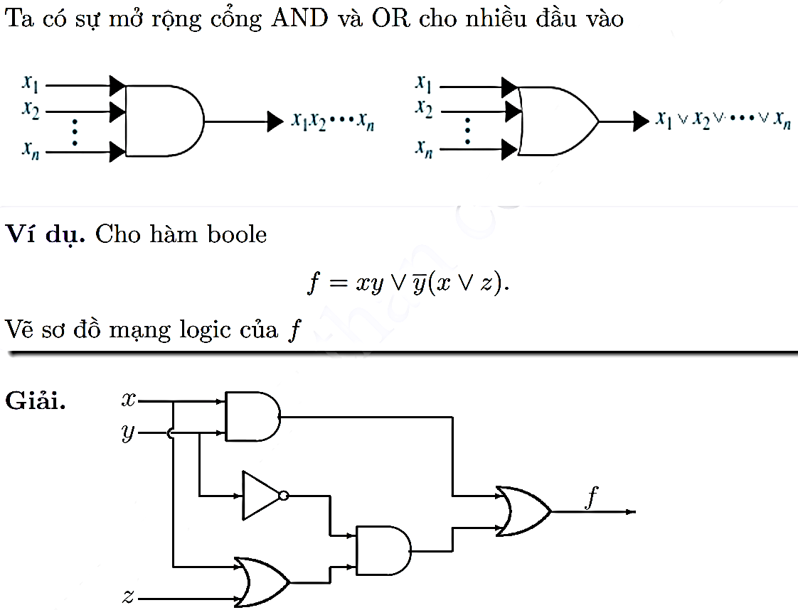

*Phép AND, OR, NOT có bảng chân trị y hệt bảng chân trị với các phép mệnh đề hội, tuyển và phủ định (Chương 1).*

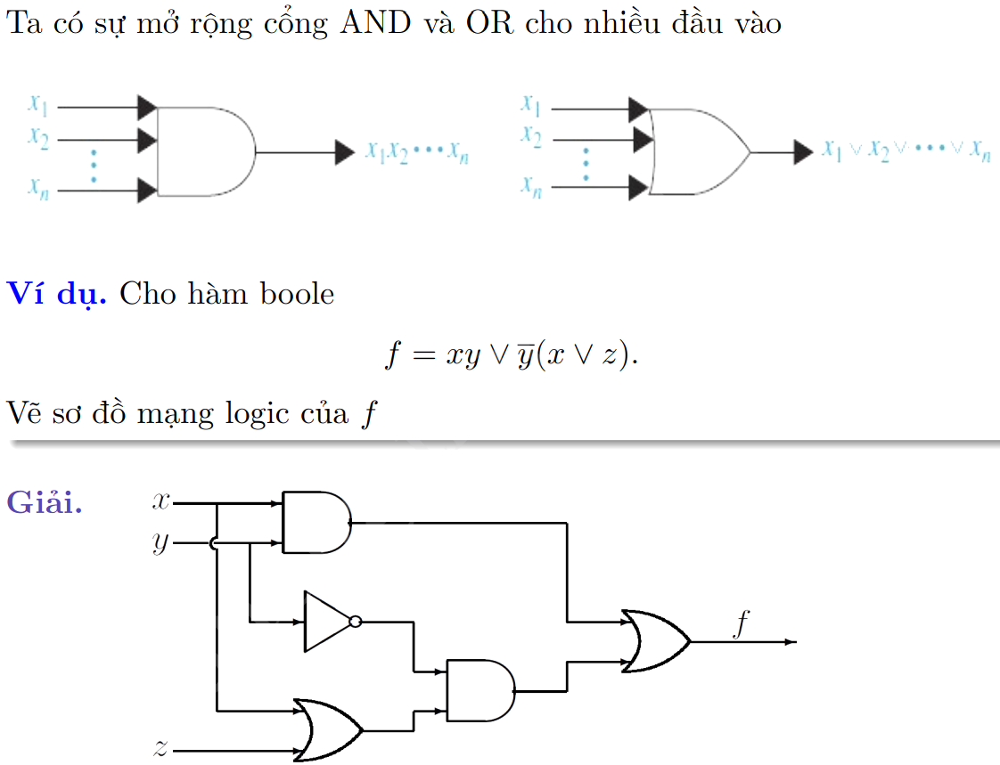

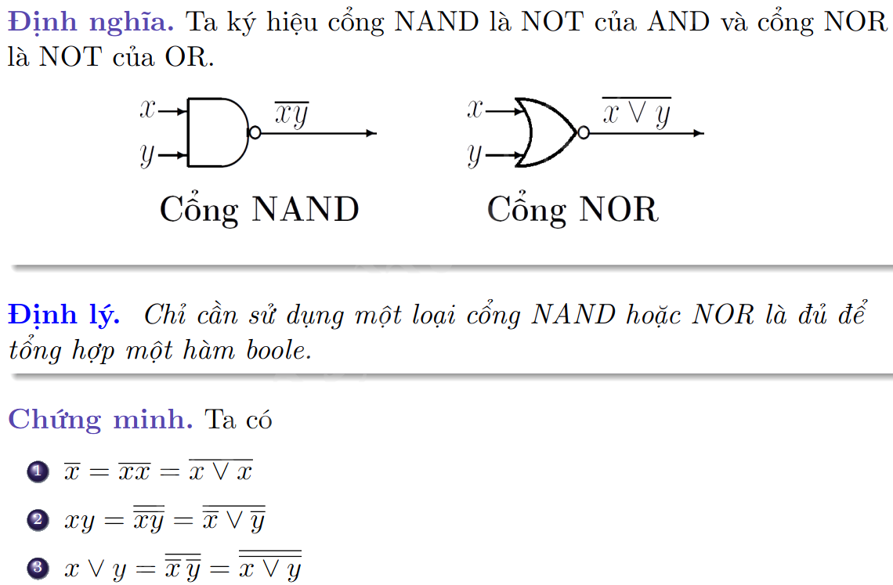

**\* NAND:** Là cổng bù của AND; Có đầu ra là ngược lại với cổng AND.

<table style="width:75%;">
<colgroup>
<col style="width: 33%" />
<col style="width: 41%" />
</colgroup>
<thead>
<tr>
<th><table style="width:26%;">
<colgroup>
<col style="width: 7%" />
<col style="width: 6%" />
<col style="width: 12%" />
</colgroup>
<thead>
<tr>
<th style="text-align: center;"><strong>x</strong></th>
<th style="text-align: center;"><strong>y</strong></th>
<th style="text-align: center;"><strong>x nand y</strong></th>
</tr>
</thead>
<tbody>
<tr>
<td style="text-align: center;">0</td>
<td style="text-align: center;">0</td>
<td style="text-align: center;">1</td>
</tr>
<tr>
<td style="text-align: center;">0</td>
<td style="text-align: center;">1</td>
<td style="text-align: center;">1</td>
</tr>
<tr>
<td style="text-align: center;">1</td>
<td style="text-align: center;">0</td>
<td style="text-align: center;">1</td>
</tr>
<tr>
<td style="text-align: center;">1</td>
<td style="text-align: center;">1</td>
<td style="text-align: center;">0</td>
</tr>
</tbody>
</table></th>
<th></th>
</tr>
</thead>
<tbody>
</tbody>
</table>

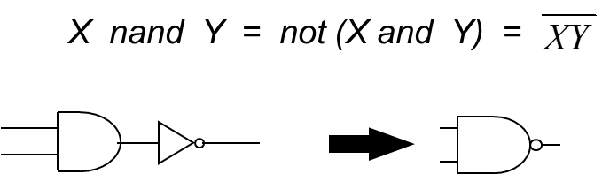

**\* NOR:** Là cổng bù của OR; Có đầu ra ngược với cổng OR.

<table style="width:79%;">
<colgroup>
<col style="width: 33%" />
<col style="width: 46%" />
</colgroup>
<thead>
<tr>
<th><table style="width:26%;">
<colgroup>
<col style="width: 7%" />
<col style="width: 6%" />
<col style="width: 12%" />
</colgroup>
<thead>
<tr>
<th style="text-align: center;"><strong>x</strong></th>
<th style="text-align: center;"><strong>y</strong></th>
<th style="text-align: center;"><strong>x nor y</strong></th>
</tr>
</thead>
<tbody>
<tr>
<td style="text-align: center;">0</td>
<td style="text-align: center;">0</td>
<td style="text-align: center;">1</td>
</tr>
<tr>
<td style="text-align: center;">0</td>
<td style="text-align: center;">1</td>
<td style="text-align: center;">0</td>
</tr>
<tr>
<td style="text-align: center;">1</td>
<td style="text-align: center;">0</td>
<td style="text-align: center;">0</td>
</tr>
<tr>
<td style="text-align: center;">1</td>
<td style="text-align: center;">1</td>
<td style="text-align: center;">0</td>
</tr>
</tbody>
</table></th>
<th></th>
</tr>
</thead>
<tbody>
</tbody>
</table>


- **Sự chuyển đổi giữa các cổng cơ bản sang cổng NAND**

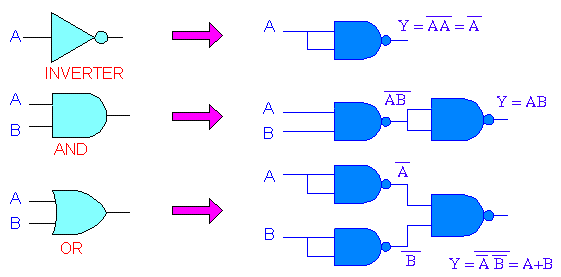

- **Sự chuyển đổi giữa các cổng cơ bản sang cổng NOR**

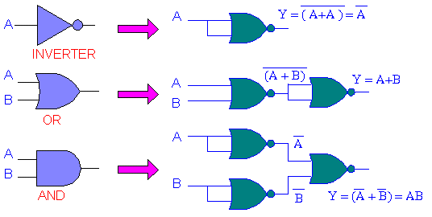

**Ví dụ:** Viết lại biểu thức logic sau từ mạch logic:

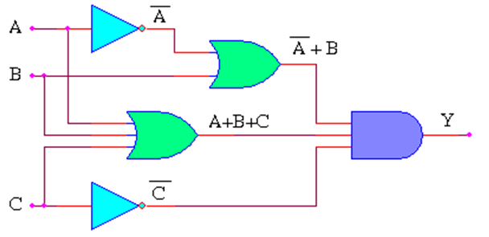 $`\mathbf{Y}\mathbf{= (}\overline{\mathbf{A}}\mathbf{+ B)(A + B + C)}\overline{\mathbf{C}}`$

> $`F = \overline{\overline{xy} + \overline{zt}}`$
>
> 
>
> 
>
> ***<u>Thiết kế mạch logic tổng hợp:</u>***

- **Bước 1:** *Đặt các biến cho đầu vào và các hàm của đầu ra* tương ứng.

- **Bước 2:** Thiết lập *bảng chân trị* cho đầu ra và đầu vào.

- **Bước 3:** Viết *biểu thức logic* liên hệ giữa đầu ra và các đầu vào.

- **Bước 4:** Tìm *công thức đa thức tối tiểu* của biểu thức logic vừa tìm được.

- **Bước 5:** Từ biểu thức logic tối tiểu *thiết kế mạch logic* tương ứng.

> **Ví dụ:** Một ngôi nhà có 3 công tắc, người chủ nhà muốn bóng đèn sáng khi cả 3 công tắc đều hở, hoặc khi công tắc 1 và 2 đóng còn công tắc thứ 3 hở. Hãy thiết kế mạch logic thực hiện sao cho **số cổng cơ bản sử dụng là ít nhất.**

- **Bước 1:**

<!-- -->

- Gọi 3 công tắc lần lượt là A, B, C.

- Bóng đèn là Y.

- Trạng thái công tắc đóng là (logic) 1, hở là 0.

- Trạng thái đèn sáng là logic 1 và tắt là 0.

<!-- -->

- **Bước 2:** Từ yêu cầu bài toán ta có bảng chân trị:

<table style="width:89%;">
<colgroup>
<col style="width: 15%" />
<col style="width: 15%" />
<col style="width: 16%" />
<col style="width: 20%" />
<col style="width: 22%" />
</colgroup>
<thead>
<tr>
<th colspan="3" style="text-align: center;"><p><strong>Ngõ vào</strong></p></th>
<th style="text-align: center;"><p><strong>Ngõ ra</strong></p></th>
<th rowspan="3"><p><strong>(Sáng) 🡪</strong> <math display="inline" xmlns="http://www.w3.org/1998/Math/MathML"><semantics><mrow><mover><mi mathvariant="bold-italic">𝑨</mi><mo accent="true">¯</mo></mover><mover><mi mathvariant="bold-italic">𝑩</mi><mo accent="true">¯</mo></mover><mover><mi mathvariant="bold-italic">𝑪</mi><mo accent="true">¯</mo></mover></mrow><annotation encoding="application/x-tex">\overline{\mathbf{A}}\overline{\mathbf{B}}\overline{\mathbf{C}}</annotation></semantics></math></p>
<p><strong>(Sáng) 🡪 AB</strong><math display="inline" xmlns="http://www.w3.org/1998/Math/MathML"><semantics><mover><mtext mathvariant="normal">C</mtext><mo accent="true">¯</mo></mover><annotation encoding="application/x-tex">\overline{\text{C}}</annotation></semantics></math></p></th>
</tr>
<tr>
<th style="text-align: center;"><p>A</p></th>
<th style="text-align: center;"><p>B</p></th>
<th style="text-align: center;"><p>C</p></th>
<th style="text-align: center;"><p>Y</p></th>
</tr>
<tr>
<th style="text-align: center;"><p>0</p>
<p>0</p>
<p>0</p>
<p>0</p>
<p>1</p>
<p>1</p>
<p>1</p>
<p>1</p></th>
<th style="text-align: center;"><p>0</p>
<p>0</p>
<p>1</p>
<p>1</p>
<p>0</p>
<p>0</p>
<p>1</p>
<p>1</p></th>
<th style="text-align: center;"><p>0</p>
<p>1</p>
<p>0</p>
<p>1</p>
<p>0</p>
<p>1</p>
<p>0</p>
<p>1</p></th>
<th style="text-align: center;"><p><strong>1</strong></p>
<p>0</p>
<p>0</p>
<p>0</p>
<p>0</p>
<p>0</p>
<p><strong>1</strong></p>
<p>0</p></th>
</tr>
</thead>
<tbody>
</tbody>
</table>

- **Bước 3:** Từ bảng chân trị ta có biểu thức ngõ ra: $`\mathbf{Y =}\overline{\mathbf{A}}\overline{\mathbf{B}}\overline{\mathbf{C}}\mathbf{+ AB}\overline{\mathbf{C}}`$

<!-- -->

- **Bước 4:** CTĐTTT của biểu thức logic: $`\mathbf{Y =}\overline{\mathbf{A}}\overline{\mathbf{B}}\overline{\mathbf{C}}\mathbf{+ AB}\overline{\mathbf{C}}`$

<!-- -->

- **Bước 5:** Mạch logic tương ứng của CTĐTTT:


#
